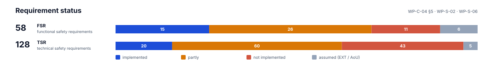
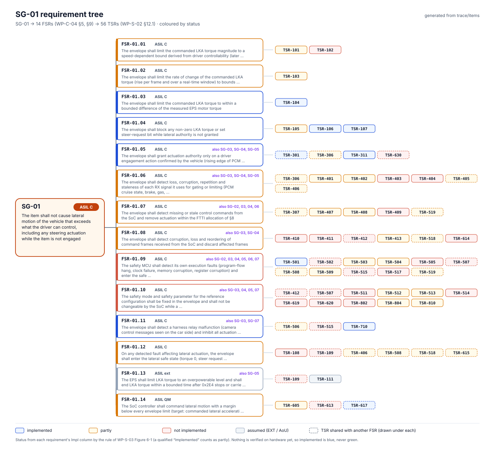
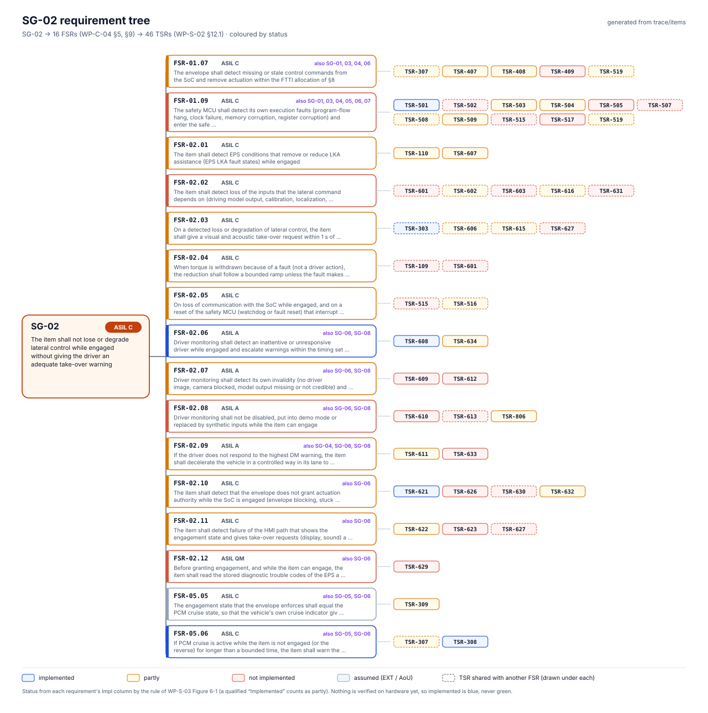
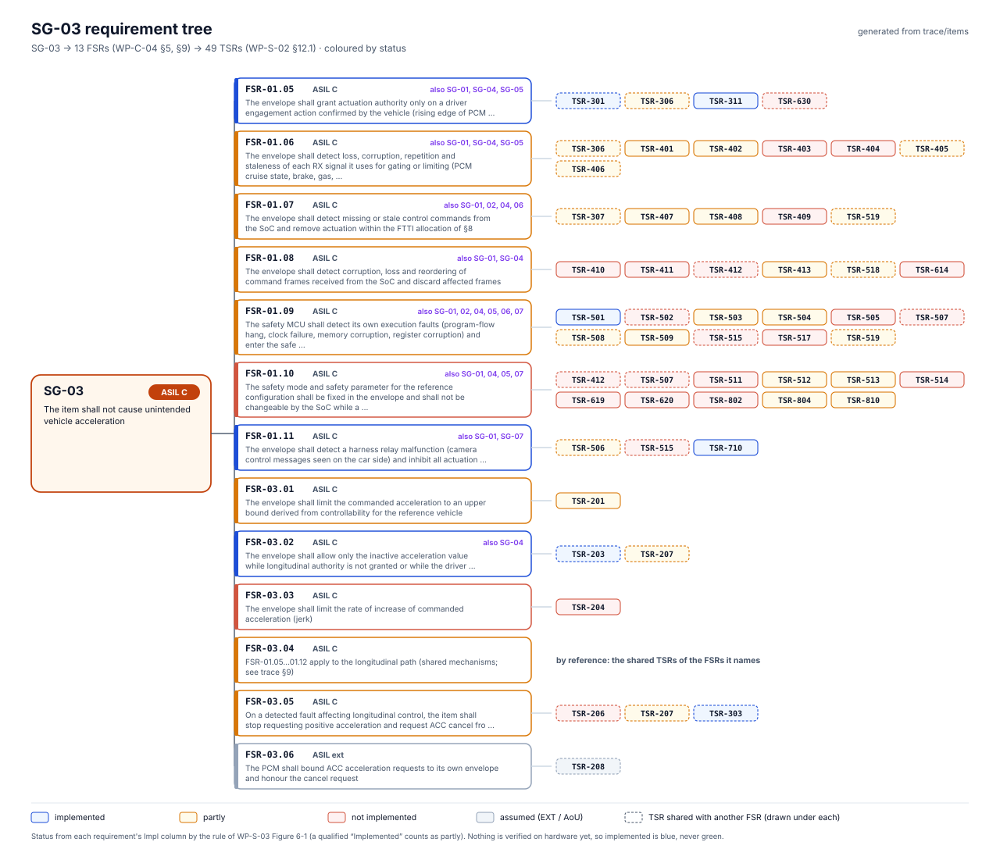
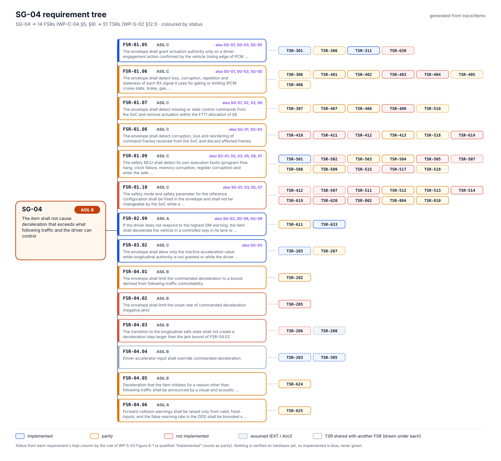
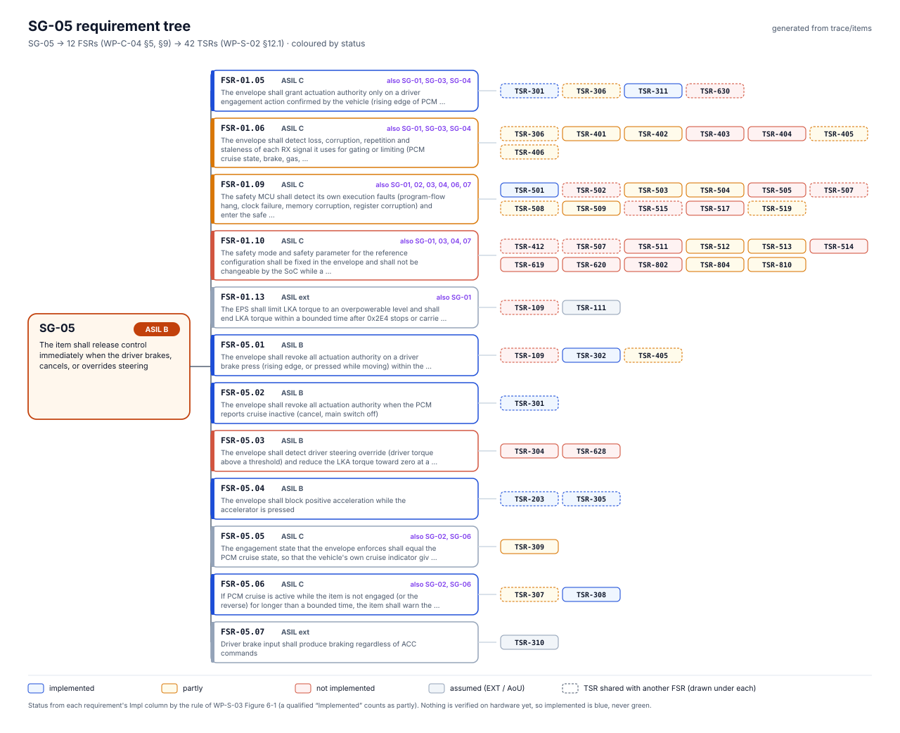
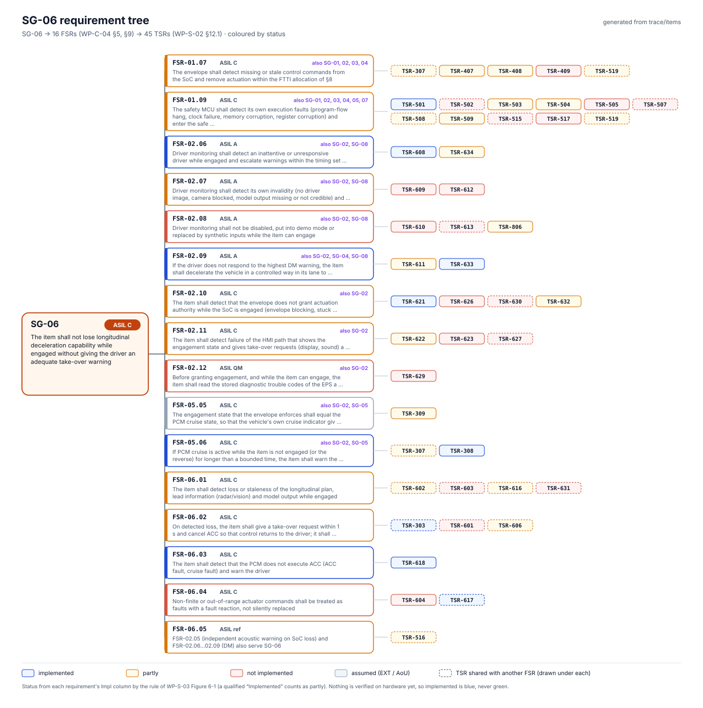
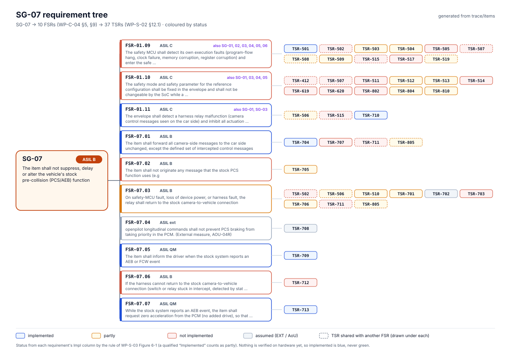
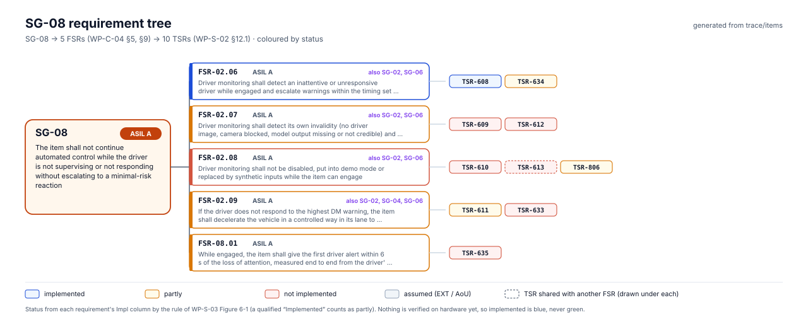

<!-- Generated by assurance/03-system/requirements/requirements_view.py; do not edit by hand. -->

# Requirements at a glance

The 58 functional safety requirements of [WP-C-04](../../02-concept/WP-C-04-functional-safety-concept.md) and the 128 technical safety requirements of [WP-S-02](../WP-S-02-technical-safety-requirements.md) and [WP-S-06](../WP-S-06-requirements-production-operation.md), drawn from their copies in [`trace/items`](../../trace/items/). The documents stay the source of truth.



## Coverage

- FSRs without a TSR: none.
- FSRs covered by reference to other FSRs' TSRs: FSR-03.04.
- TSRs without an FSR parent: 13 (TSR-801, TSR-803, TSR-807, TSR-808, TSR-809, TSR-811, TSR-812, TSR-813, TSR-814, TSR-815, TSR-816, TSR-817, TSR-818); they trace to a safety goal or to another requirement (WP-S-02 §10, WP-S-06).

## Requirement tree per safety goal

Each goal with the FSRs that serve it and the TSRs that refine them. An FSR that serves several goals is drawn in each of their trees; a TSR with several parent FSRs is drawn under each, dashed.

### SG-01 · ASIL C



### SG-02 · ASIL C



### SG-03 · ASIL C



### SG-04 · ASIL B



### SG-05 · ASIL B



### SG-06 · ASIL C



### SG-07 · ASIL B



### SG-08 · ASIL A



## FSR × TSR matrix

Every parent link of WP-S-02 §12.1 as a cell: rows are FSRs by safety goal, columns are TSRs by WP-S-02 block.


## Lists

- [FSR list](fsr-list.md): all 58 FSRs, one line each.
- [TSR list](tsr-list.md): all 128 TSRs, one line each.

## Regenerating

```bash
python3 assurance/03-system/requirements/requirements_view.py
```

CI runs it with `--check` after `sync_requirements.py`, so the view follows every change to WP-C-04 §5, §9 and WP-S-02 §3–§12. The status rule and colours are those of WP-S-03 Figure 6-1.
