# System requirements

The system requirements, [WP-S-01](../WP-S-01-system-requirements.md), say what LD-SDA should do well: how closely it
keeps the lane, how it follows and stops behind a lead, when it engages, how it watches the driver and how it warns.
They are the functional and performance requirements, not the safety ones. What the item must never do is in the
technical safety requirements of [WP-S-02](../WP-S-02-technical-safety-requirements.md), and where the two touch the
same quantity the safety requirement wins.

<!-- terms:start (generated by assurance/trace/tools/terms.py; do not edit by hand) -->

Terms on this page (20)

| Term | Meaning |
|---|---|
| AI | artificial intelligence |
| CSR-nn | cybersecurity requirement: CSR-C-nn at concept level (WP-C-10 §7), CSR-nnn refined (WP-S-07) |
| DQ-nn | decision of the project lead (decision register) |
| F-nn | function of the item (WP-C-01 §2.1), F-01…F-09 |
| FCW | forward collision warning |
| I0–I3 | independence level of a review, I0 (none, e.g. the author or an AI) to I3 (independent organisation) |
| LD-SDA | LionDriver Supervised Driving Assistance, the item |
| LDW | lane departure warning |
| ODD | operational design domain: where the system is meant to work |
| OI-nn | open item of the document it appears in |
| SN-nn | stakeholder need (WP-S-01 §1.3), SN-01…SN-12 |
| SOTIF | safety of the intended functionality (ISO 21448): hazards with nothing failing |
| SYS | system requirement SYS-nnn of WP-S-01 |
| SysML | Systems Modeling Language: the system model in models/sysml |
| TBD | to be determined: a value not yet set |
| TSR-nn | technical safety requirement (WP-S-02) |
| UC-nn | use case (WP-S-01 §1.4), UC-01…UC-11 |
| V-nn | view of the SysML model (V-01…V-25) |
| VS-nn | verification case: VS-SI system integration, VS-HW hardware, VS-SWQ software, VS-FI fault injection, VS-SQ system qualification |
| WP-nn | work product, e.g. WP-C-04; the letter is its area (M management, C concept, S system, H hardware, W software, V validation, P processes, A analyses, O operation, K safety case) |

All terms: [abbreviations and record codes](../../terms.md).

<!-- terms:end -->

This page is drawn from the SysML system model. WP-S-01 is the document of record; its stakeholders, needs, use
cases and requirements are generated into the model (`LionDriverNeeds`, `LionDriverRequirements`), related there to
the functions, the architecture and the test cases, and checked on every pull request. Every diagram below is a SysML
view of that model, in SysML notation: use case (`uc`) and requirement (`req`) diagrams with their frames, and the
model's relationships (`«deriveReqt»`, `«satisfy»`, `«verify»`, `«perform»`) drawn as they are held.

**The system requirements in five lines.**

1. **39 requirements across the nine functions.** Lateral and longitudinal control, engagement, driver monitoring,
   warnings, the envelope's functional side, and logging and updates.
2. **12 targets are still TBD.** How close to the lane centre, how steady the speed, how quickly it resumes: these
   need LionDriver's own drive logs and vehicle tests (OI-1).
3. **14 have no test case.** Among them are the lane-change rules, FCW and LDW, and the logging rules (WP-S-09
   OI-6).
4. **Every requirement traces up and down.** Each one refines a stakeholder need (§1.3) and is placed on the
   architecture (§10.1). The SysML model checks both (N2, R2) and draws one need end to end (V-15).
5. **Two recent decisions shaped them.** No engagement outside the assured settings (DQ-221 A, SYS-040, partly in the
   code), and no engagement below a highway speed floor (DQ-280 A, SYS-041, not yet built; the floor is TBD, 60 km/h
   proposed).

| Where it comes from | The requirements | Where it goes |
|---|---|---|
| Stakeholders, needs and use cases (§1.2–§1.4) · [Item definition (WP-C-01)](../../02-concept/item/README.md): functions F-01…F-09 · [ODD (WP-C-02)](../../02-concept/odd/README.md): where they apply · [AI requirements (WP-C-11)](../../02-concept/ai/README.md): model performance | SYS-001…SYS-145 with type, target, verification method and allocation | [SysML model](../../models/sysml/README.md): satisfy and verify relationships · [System verification (WP-S-09)](../verification/README.md) · [SOTIF validation (WP-V-02)](../../06-validation/WP-V-02-sotif-vv-strategy.md) for the TBD targets |
| [TSRs (WP-S-02)](../WP-S-02-technical-safety-requirements.md): the bounds a SYS value must stay inside, with margin (TSR-605) | | |

## 1. Who uses LD-SDA

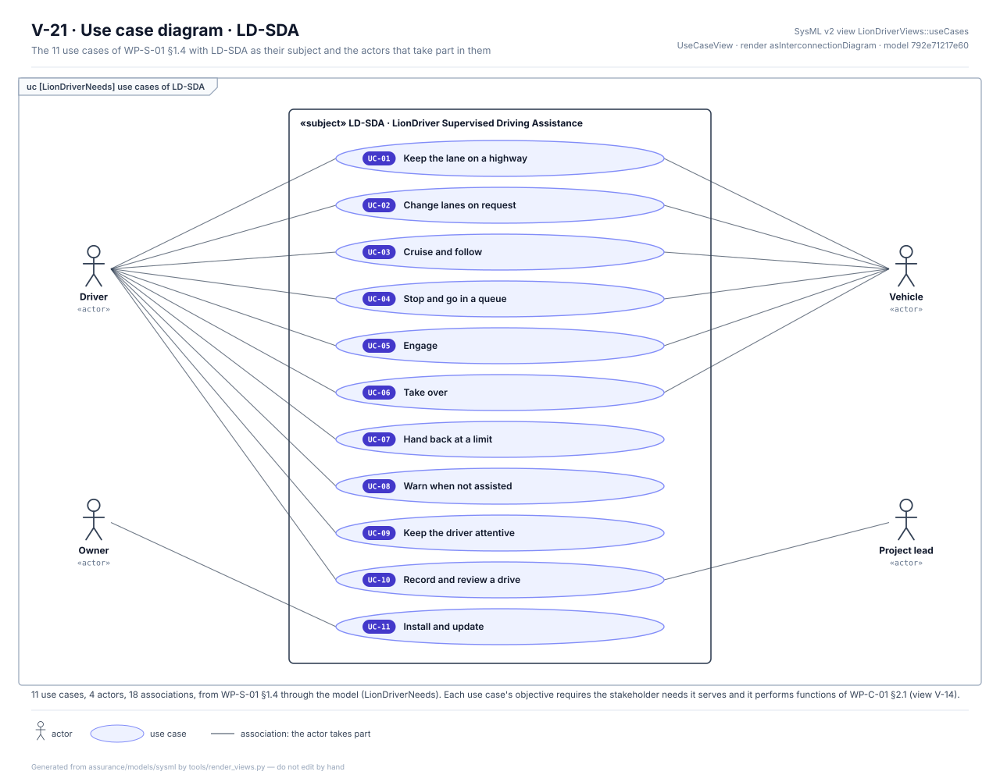

*Use cases (§1.4, SysML view V-21, `uc` diagram).* LD-SDA is the subject of eleven use cases. The driver takes part in
ten of them; the car's own systems (the vehicle) in the six that drive the car; the owner installs and updates; the
project lead reviews the drives.

## 2. What each stakeholder needs

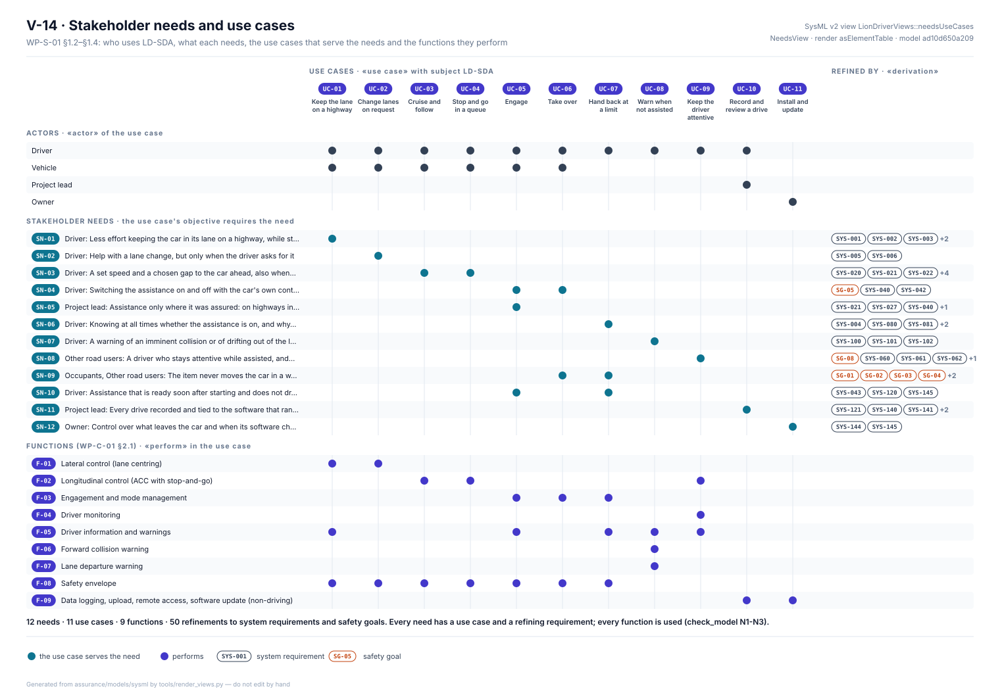

*Stakeholder needs (§1.2, §1.3, SysML view V-14).* Five stakeholders have needs: the driver, the occupants, other road
users, the owner and the project lead. Each need is served by a use case and refined by system requirements or safety
goals; each use case performs functions of the item.

- **Every system requirement refines a need,** and so does every safety goal. The safety goals sit under two needs:
  the car never moves in a way the driver cannot control (SN-09), and the driver stays attentive (SN-08).
- **Every function is used,** and the safety envelope (F-08) takes part in seven of the eleven use cases.
- **The needs and use cases are AI-drafted** from the item definition and the ODD, and not reviewed yet (I0).

## 3. One need end to end

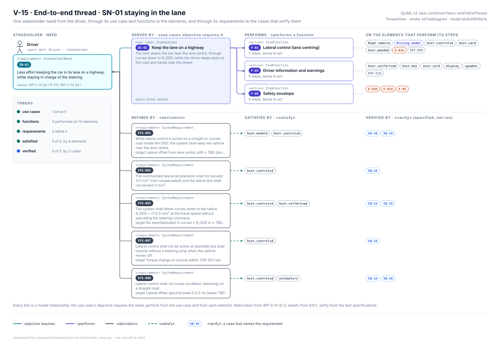

*The end-to-end thread (SysML view V-15).* The driver's need for less effort keeping the lane (SN-01) is served by
one use case, which performs lateral control, driver information and the safety envelope on 14 elements. Five system
requirements refine it. All five are satisfied by elements of the architecture and named by a vehicle test case. No
case has been run.

## 4. The requirements, function by function

One SysML requirement diagram per function (view V-06). Each requirement shows its text, type, verification method
and target, the stakeholder need it is derived from (`«deriveReqt»`), the elements that satisfy it (`«satisfy»`, from
§10.1) and the cases that verify it (`«verify»`, from WP-S-08 and WP-S-09). A red outline marks a requirement no case
verifies.

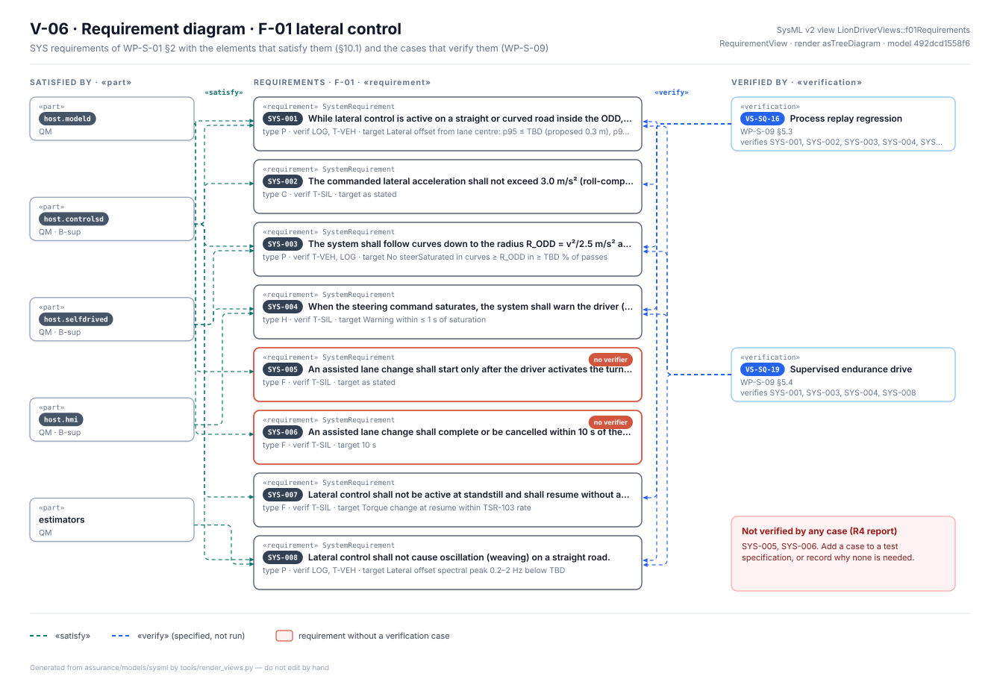

*F-01 lateral control (§2).* Eight requirements from three needs (keeping the lane, lane changes, knowing why it hands
back). The two lane-change rules (SYS-005, SYS-006) have no case.

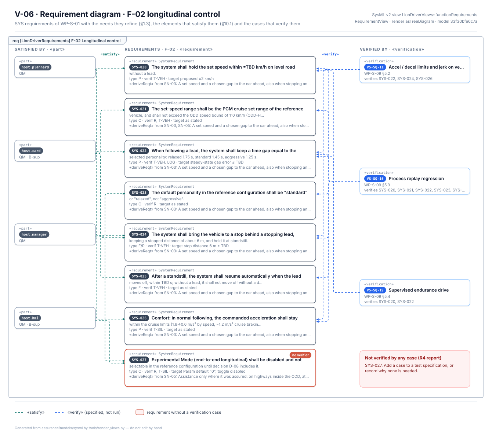

*F-02 longitudinal control (§3).* Eight requirements from the needs for a set speed and gap and for assistance only
where it was assured. Experimental Mode not being selectable (SYS-027) has no case.

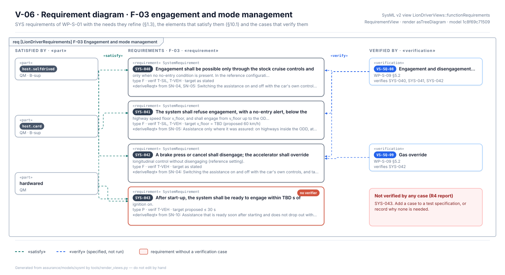

*F-03 engagement and mode management (§4).* Engagement only through the car's cruise controls, the highway speed
floor, brake and cancel, and start-up time. The start-up time (SYS-043) has no case.

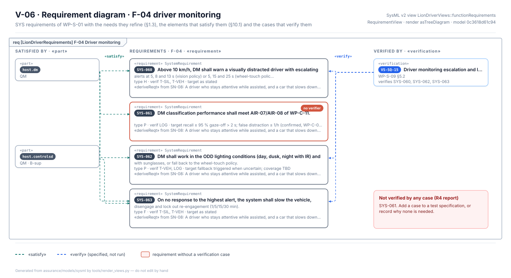

*F-04 driver monitoring (§5).* All four come from the other road users' need for an attentive driver. The
classification performance (SYS-061) has no case.

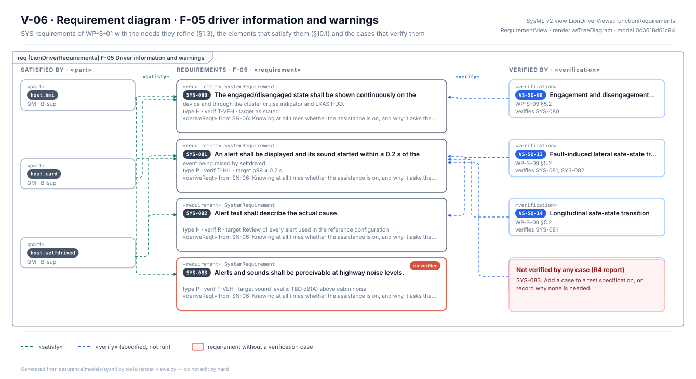

*F-05 driver information and warnings (§6).* The driver's need to know what the assistance is doing. Alert loudness
(SYS-083) has no case.

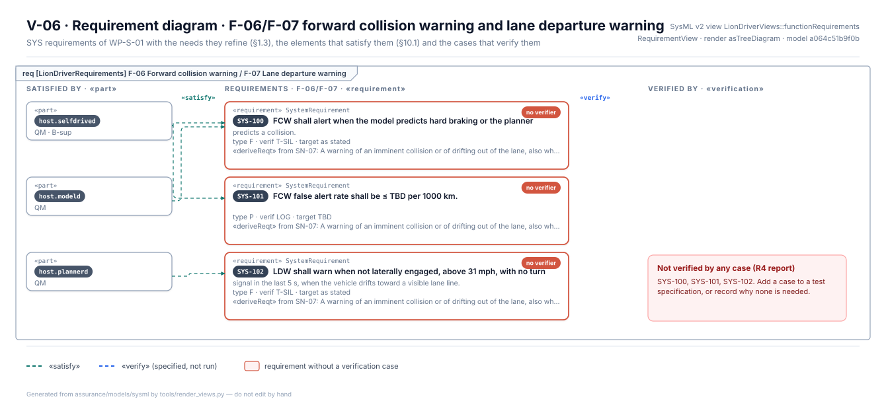

*F-06 forward collision warning and F-07 lane departure warning (§7).* The two warnings share their three
requirements, and none of them has a case yet.

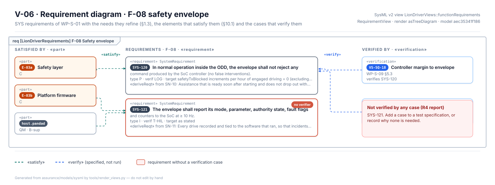

*F-08 safety envelope, functional side (§8).* No false interventions, and a status report to the host. The status
report (SYS-121) has no case. The envelope's safety requirements are the TSRs of
[WP-S-02](../technical-safety-requirements/README.md).

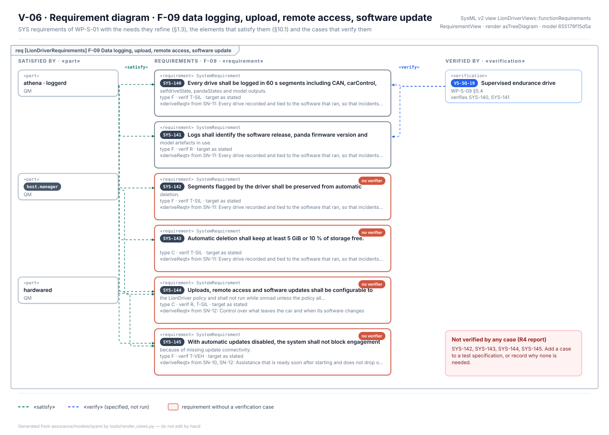

*F-09 logging, upload, remote access and update (§9).* Six requirements from three needs; four have no case.

## 5. All requirements against the architecture and the tests

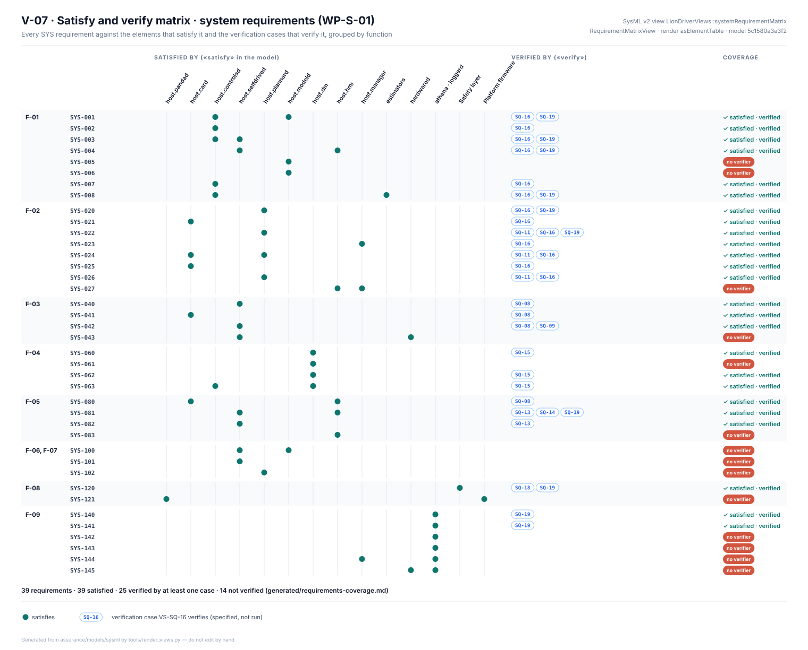

*Satisfy and verify (SysML view V-07).* All 39 requirements in one matrix: a dot where an element satisfies a
requirement, and the cases that verify it. "Verified" means a case is specified, not that it has passed.

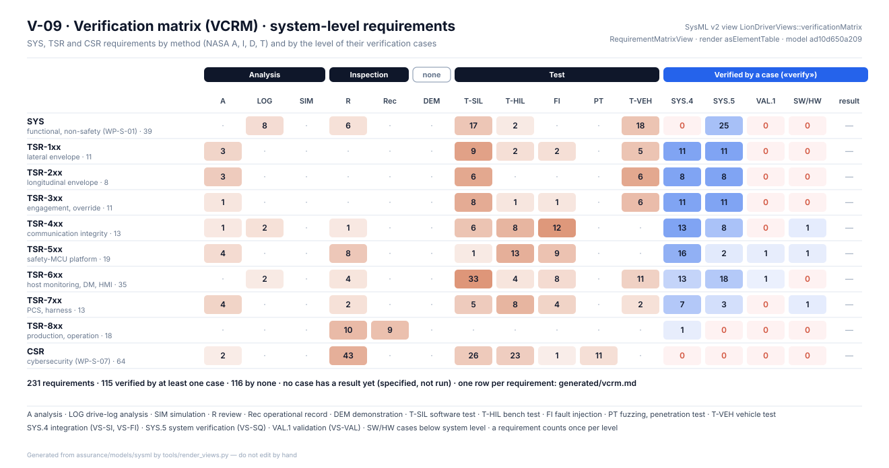

*Verification cross-reference matrix (SysML view V-09).* The system requirements next to the safety and security
requirements, by verification method (analysis, inspection, demonstration, test) and by the level of their cases.

## 6. The requirements as the document lists them

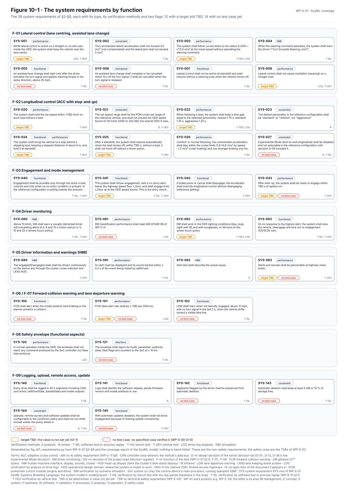

*The requirements (§2–§9, Figure 10-1).* The document's own overview, with two flags:

- **Target TBD (12).** Most are performance targets that need data: lane-centre offset, curve following, weaving,
  set-speed accuracy, following gap, stop distance, resume time, start-up time, driver-monitoring coverage, alert
  loudness and the FCW false-alert rate, plus the highway speed floor.
- **No test case (14).** The same fourteen the requirement diagrams outline in red; the list comes from the model's
  coverage report.

## 7. How they relate to the safety requirements

The system requirements describe good behaviour inside the limits the safety requirements set. Two rules follow:

- **The safety requirement wins.** Where both name the same quantity, the system value must sit inside the TSR with
  margin (TSR-605). For example, the controller's 3.0 m/s² lateral limit (SYS-002) sits inside the envelope's limits
  of TSR-1xx.
- **A shared limit is a finding.** Today the controller and the envelope use the same limits, so the margin is zero;
  WP-S-09 expects its margin case (VS-SQ-18) to fail.

## 8. Open items

The full list is in WP-S-01 §11.

- **OI-1:** set the TBD targets from LionDriver's own logs and vehicle tests.
- **OI-2:** confirm the reference car's set-speed range and stop-and-go behaviour.
- **OI-3:** decide the default following personality and whether the accelerator disengages (WP-C-08).
- **OI-4:** re-check curve following (SYS-003) once the reduced torque bound is known.
- **Review the needs and use cases** of §1.2–§1.4 (AI-drafted, I0) with the item definition (SysML README OI-10).

## Where the figures come from

This folder has no files of its own besides this page.

| Figure | Generator |
|---|---|
| SysML views V-06 (one per function), V-07, V-14, V-15 and V-21 | [`render_requirements.py`](../../models/sysml/tools/render_requirements.py), from the SysML model; WP-S-01 §1.2–§1.4, §2–§9 and §10.1 are generated into it by [`gen_requirements.py`](../../models/sysml/tools/gen_requirements.py) |
| SysML view V-09, the verification matrix | [`render_se.py`](../../models/sysml/tools/render_se.py), from the SysML model |
| WP-S-01 Figure 10-1, the requirements by function | [`fig_s01_requirements.py`](../figures/fig_s01_requirements.py), from §2–§9 and the coverage report of the SysML model; nothing is hand-listed |
