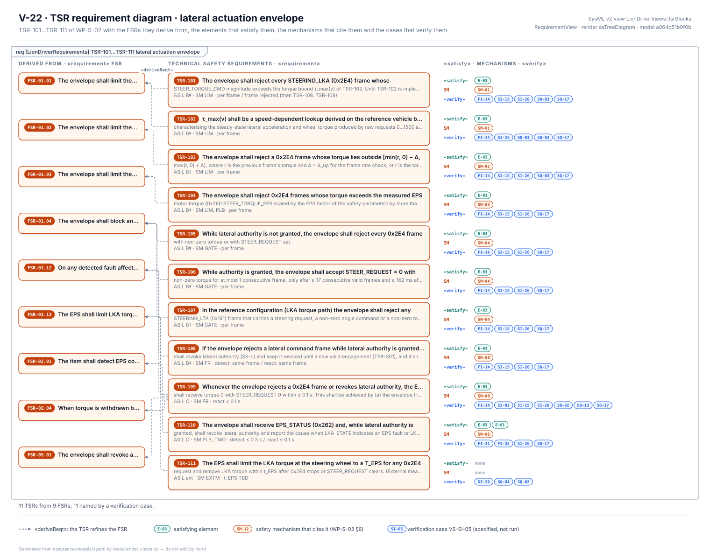
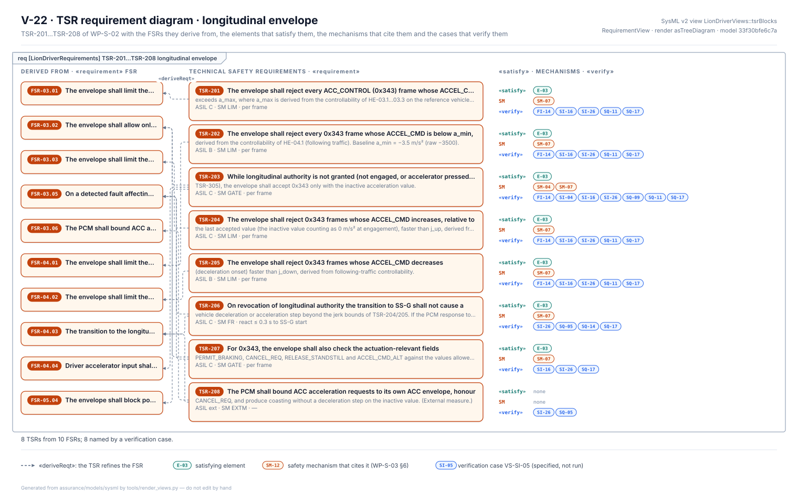
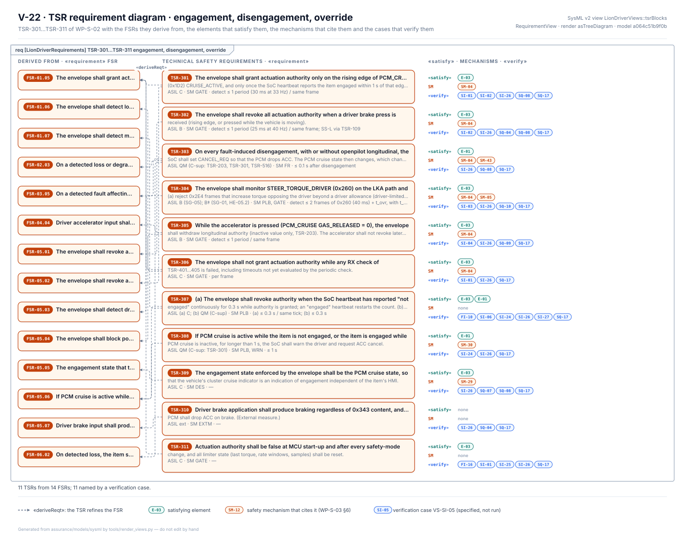
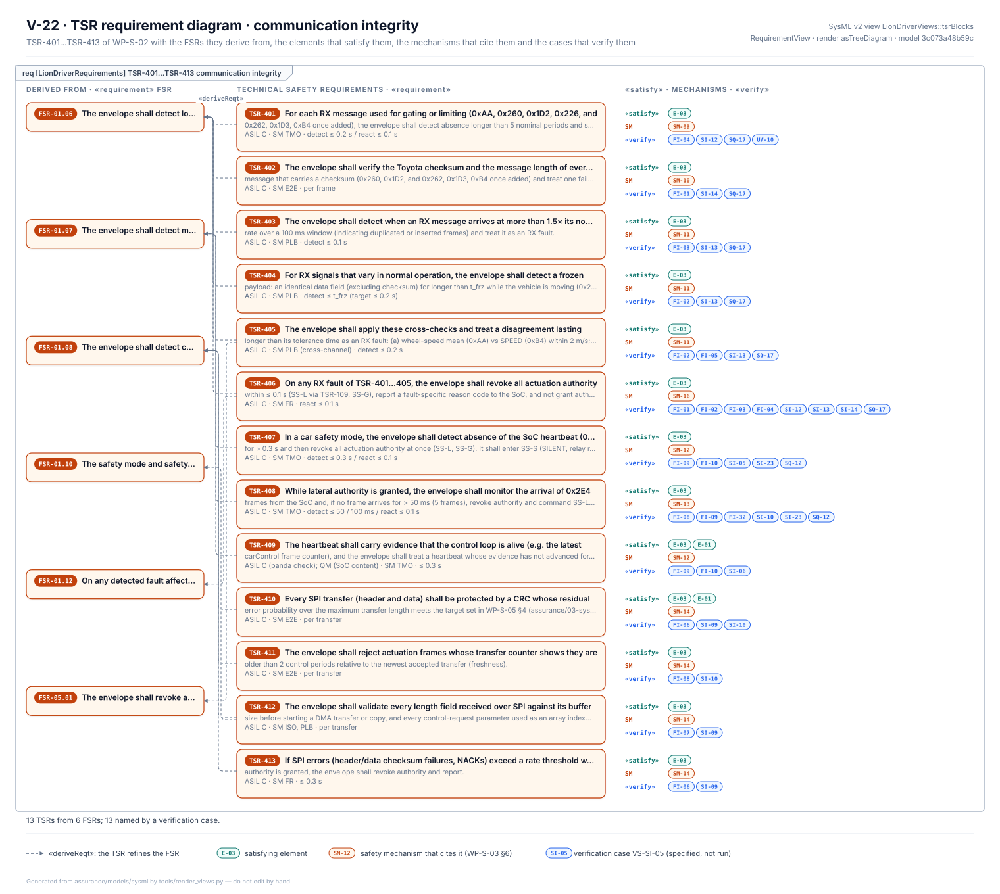
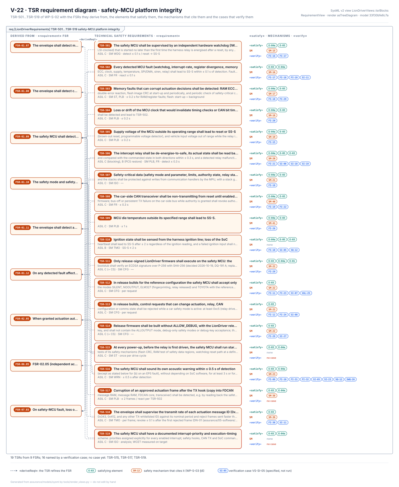
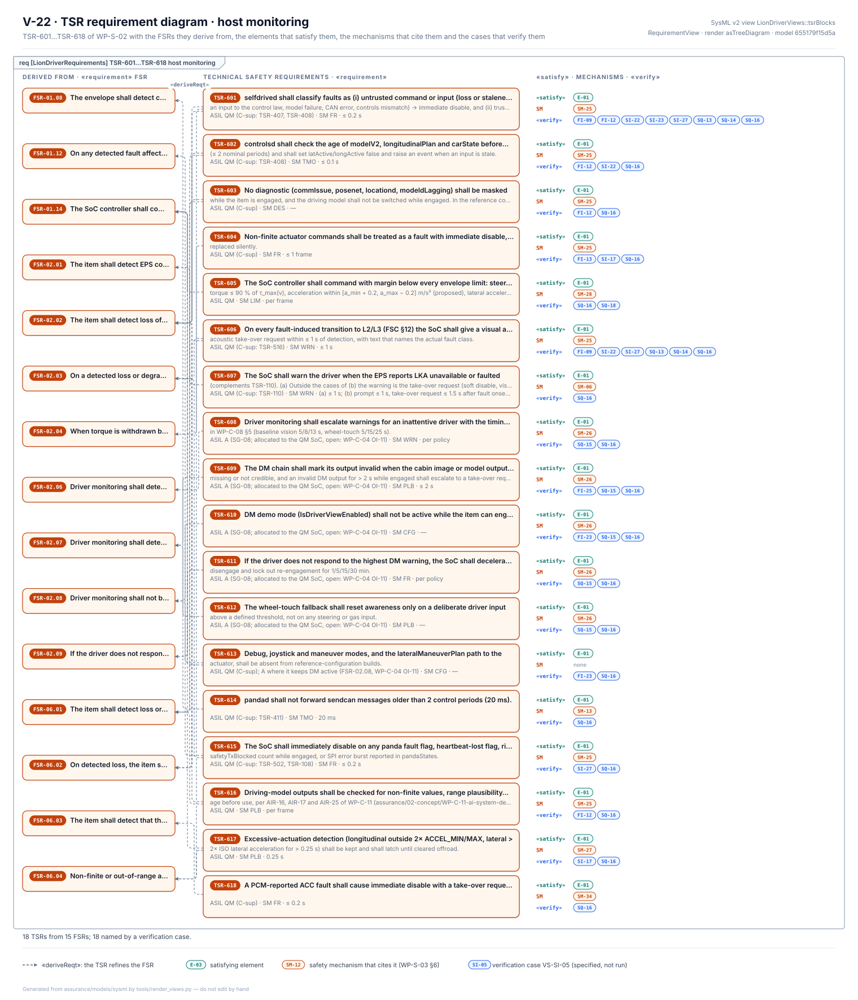
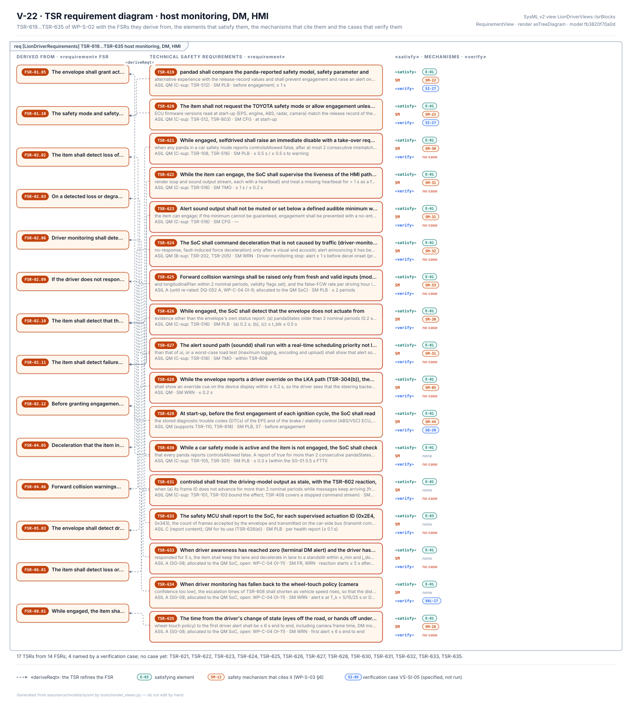
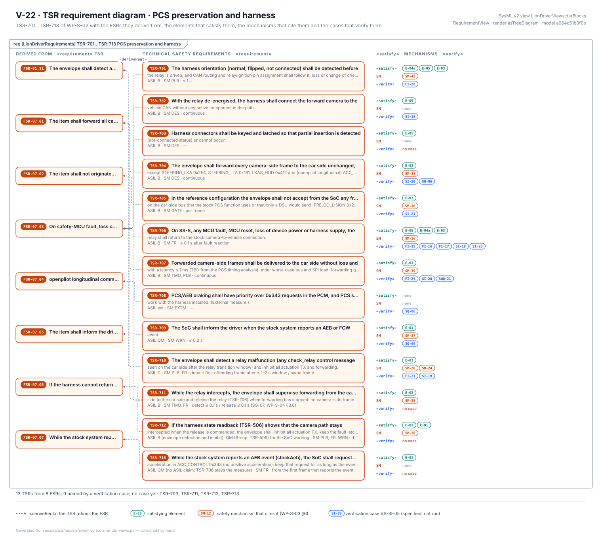
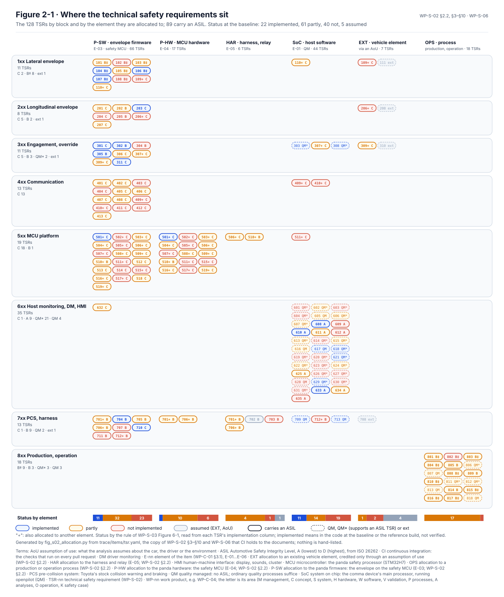

# Technical safety requirements

The technical safety requirements, [WP-S-02](../WP-S-02-technical-safety-requirements.md), turn the functional safety
concept into requirements on the elements of LD-SDA: what the envelope in the safety MCU must reject, how fast it must
notice a fault, what the host software must watch, what the harness must do when the MCU stops. Each of the 128
requirements, TSR-101…TSR-818, states one checkable property with its ASIL, its parent FSR, the element it is allocated
to, the kind of safety mechanism, its timing and how it is verified, and says what the code does today.

<!-- terms:start (generated by assurance/trace/tools/terms.py; do not edit by hand) -->

Terms on this page (41)

| Term | Meaning |
|---|---|
| AEB | automatic emergency braking |
| ASIL | Automotive Safety Integrity Level, A (lowest) to D (highest), from ISO 26262 |
| CAN | controller area network: the vehicle's data bus |
| CRC | cyclic redundancy check |
| CSR-nn | cybersecurity requirement: CSR-C-nn at concept level (WP-C-10 §7), CSR-nnn refined (WP-S-07) |
| DM | driver monitoring |
| DQ-nn | decision of the project lead (decision register) |
| E-nn | element of the item (WP-C-01 §3.1), E-01…E-06 |
| EPS | electric power steering |
| FSC | functional safety concept |
| FSR-nn | functional safety requirement (FSC) |
| FTTI | fault-tolerant time interval: fault to hazard, the time a safety mechanism has |
| GAP-nn | gap found by the gap assessment |
| HARA | hazard analysis and risk assessment (ISO 26262-3) |
| HMI | human-machine interface: display, sounds, cluster |
| HSI | hardware-software interface |
| HWSR-nn | hardware safety requirement (WP-H-01) |
| IF-nn | interface of the item (WP-C-01 §3.4) |
| LD-SDA | LionDriver Supervised Driving Assistance, the item |
| MCU | microcontroller: the panda safety processor (STM32H7) |
| ML | machine learning |
| NF-nn | finding of the onboard code review |
| OI-nn | open item of the document it appears in |
| PCM | powertrain control module (engine and drive) |
| PCS | pre-collision system: Toyota's stock collision warning and braking |
| QM | quality managed: no ASIL; ordinary quality processes suffice |
| RX | receive |
| SG-nn | safety goal (HARA §6) |
| SM-nn | safety mechanism (TSC §6) |
| SN-nn | stakeholder need (WP-S-01 §1.3), SN-01…SN-12 |
| SoC | system on chip: the comma device's main processor, running openpilot (QM) |
| SPI | serial peripheral interface (the link between SoC and MCU) |
| SS-nn | safe state (FSC §6): SS-L lateral, SS-G longitudinal, SS-S envelope silent |
| SWSR-nn | software safety requirement (WP-W-02) |
| SYS | system requirement SYS-nnn of WP-S-01 |
| SysML | Systems Modeling Language: the system model in models/sysml |
| TSC | technical safety concept |
| TSR-nn | technical safety requirement (WP-S-02) |
| TX | transmit |
| V-nn | view of the SysML model (V-01…V-25) |
| WP-nn | work product, e.g. WP-C-04; the letter is its area (M management, C concept, S system, H hardware, W software, V validation, P processes, A analyses, O operation, K safety case) |

All terms: [abbreviations and record codes](../../terms.md).

<!-- terms:end -->

This page walks through them with SysML views of the [system model](../../models/sysml/README.md). The document is the
source of record; its requirements, their derivation from the FSRs, the elements that satisfy them, the mechanisms that
cite them and the cases that verify them are all in the model, and every figure below is generated from it.

**The technical safety requirements in five lines.**

1. **The envelope carries the argument.** 66 of the 128 requirements are allocated to the envelope firmware on the
   safety MCU, all of them with an ASIL (45 C, 13 B, 8 B‡). The host software carries 44, mostly as QM supporting an
   envelope requirement (QM (C-sup)), and the driver-monitoring ones at ASIL A.
2. **Twenty-one are in the code, none verified.** 61 are partly in place and 41 not; 5 are assumptions about the car.
   "In the code" includes the reference build; nothing has been verified on hardware.
3. **B‡ is a target, not a rating.** It marks a requirement whose ASIL C comes from SG-01 alone and could drop to B
   after controllability tests. The envelope is built to ASIL C either way (DQ-341 A).
4. **The open work is concentrated.** Among the envelope requirements not yet in the code: the speed-dependent torque
   limit (TSR-102), an active zero-torque safe state (TSR-109), driver-torque override (TSR-304), plausibility checks
   for the car's counter-less messages (TSR-403, 404) and a protected SoC link (TSR-410…412).
5. **Every requirement traces both ways.** Each TSR names its parent FSR (or goal); each SWSR and HWSR names its TSR.
   The trees and the FSR × TSR matrix are on the [requirements at a glance](../requirements/README.md) page.

| Where it comes from | The requirements | Where it goes |
|---|---|---|
| [FSC (WP-C-04)](../../02-concept/fsc/README.md): FSR-01.01…07.05 and the safe states · [HARA (WP-C-03)](../../02-concept/hara/README.md): the safety goals and their ASILs · [gap assessment](../../00-assessment/gap-assessment.md): what the code lacks | TSR-1xx…7xx by mechanism, TSR-8xx in [WP-S-06](../production/README.md); ASIL, allocation, mechanism type, timing, verification, baseline status; new findings NF-01…07 | [TSC (WP-S-03)](../tsc/README.md): the mechanisms that implement them · [Timing (WP-S-04)](../timing/README.md) · [HSI (WP-S-05)](../hsi/README.md) · [SWSRs (WP-W-02)](../../05-software/WP-W-02-software-safety-requirements.md) and [HWSRs (WP-H-01)](../../04-hardware/WP-H-01-hardware-safety-requirements.md) · [integration](../integration/README.md) and [verification](../verification/README.md) cases |

## 1. The technical safety architecture

*The elements the requirements are allocated to (V-03).* The QM partition on the left (host software E-01, ML models
E-02), the ASIL C safety envelope on the right (firmware E-03a and E-03b on the STM32H7 safety MCU E-04a) and the
harness E-05 below, with the interfaces IF-01…IF-10 and the mechanisms each element performs. The envelope sits
between the host and the car's CAN, so every actuation frame passes through it; that position is why it carries most
of the ASIL requirements.

## 2. The mechanisms that implement them

*Safety mechanisms by element (V-04).* A TSR states the property; a mechanism of WP-S-03 §6 is what delivers it. Each
mechanism cites the TSRs it meets, and those citations are the «SM» rows of the requirement diagrams below.

## 3. The requirements, block by block

One SysML requirement diagram per block (V-22). Each TSR is a «requirement» with its ASIL, mechanism kind and timing.
On the left are the FSRs it refines («deriveReqt»); on the right, the elements that satisfy it, the mechanisms that
cite it and the cases that verify it. A TSR with a red outline has no verification case yet: 20 of the 110 in
1xx…7xx. The 8xx block is drawn on the [production and operation](../production/README.md) page.

*1xx lateral envelope.* Every one has a case. TSR-111, the EPS's own torque limit, has no satisfying element and no
mechanism: it is an external measure of the car, credited through an assumption of use.

*2xx longitudinal envelope.* More FSRs than TSRs: several of the acceleration, jerk and field checks answer more than
one FSR. Every one has a case.

*3xx engagement, override.* The widest fan-in of any block: 14 FSRs from six of the eight FSR groups (FSR-01…06), since
every function has to engage and give way to the driver. TSR-304, driver-torque override, is one of the envelope gaps in
the code.

*4xx communication.* Six FSRs, thirteen TSRs: each RX fault kind and each property of the SoC link gets its own check.
TSR-406 is the common reaction and is verified by eight cases, the most in the block.

*5xx MCU platform.* TSR-515 (relay start-up test), TSR-517 (corruption after the TX hook) and TSR-519 (interrupt
priority and timing scheme) are drawn with a red outline: no verification case names them yet.

*6xx-a host monitoring (TSR-601…618).* Mostly QM supporting an envelope requirement (C-sup); the five driver-monitoring
requirements TSR-608…612 carry ASIL A of their own. Every one has a case.

*6xx-b host monitoring, DM, HMI (TSR-619…635).* The thinnest coverage in the model: only TSR-619, 620, 629 and 634 have
a case, and seven (TSR-629…635) have no mechanism citing them yet. The ones that matter most are TSR-632, an ASIL C
report from the safety MCU, and the ASIL A driver-monitoring reactions TSR-633 and 635.

*7xx PCS, harness.* No case yet for the connector keying (TSR-703), the camera-forwarding supervision (TSR-711), the
stuck-intercept reaction (TSR-712) or the stock AEB hand-over (TSR-713).

## 4. One requirement end to end

*TSR-407 followed through the model (V-05).* Left: FSR-01.07, the five safety goals it serves and the stakeholder
need SN-09 behind them. Right: the safety MCU firmware that satisfies it, SM-12 that implements it and the five cases
that verify it. Every TSR has the same
thread in the model; the [explorer](../../models/sysml/generated/explorer.html) shows it for any element.

## 5. How they will be verified

*The verification matrix (V-09).* Every TSR by verification method and by the level of the cases that name it. The
cases are specified, not run: nothing has been verified on hardware.

## 6. Where the requirements sit, by element

*Where the TSRs sit (§2.2, Figure 2-1).* One pill per requirement in each element it is allocated to, with its ASIL
and its status. Some things stand out:

- **The envelope column is long and mostly not finished.** Of its 66 requirements, 11 are in the code, 32 partly and
  23 not. Most of the gaps are in the lateral limits, the RX plausibility checks and the SoC link.
- **The MCU platform block (5xx) lives in two places.** Its requirements sit on both the firmware and the MCU hardware:
  watchdog, memory protection, clock and supply monitors, start-up tests.
- **The host column carries little ASIL.** Its requirements support an envelope requirement that bounds the effect
  of a host error (QM (C-sup)). Only the nine driver-monitoring requirements carry ASIL A of their own, and how a QM
  processor can carry them is still open (WP-C-04 OI-11).
- **The car's own behaviour is assumed.** Four requirements are external measures credited through assumptions of
  use, and three envelope requirements also depend on the car: how the EPS takes a zero-torque command (TSR-109), how
  the car responds to the inactive acceleration (TSR-206), and whether the cluster shows the PCM's cruise state
  (TSR-309).

## 7. How a requirement is written

Every row has the same columns (§2.2). **Alloc** says which element must meet it. **SM** says what kind of mechanism it
is: limiter, gating, plausibility, timeout, integrity code, watchdog, fault reaction, self-test, configuration lock,
isolation, warning, design constraint or external measure. **Timing** gives the worst-case detection and reaction
time, inside the FTTI of [WP-S-04](../timing/README.md). **Impl** says what the baseline code does, with the gap it
leaves.

A requirement that detects a fault leads to one of three safe states (§2.3): no steering torque (SS-L), the inactive
acceleration with a cancel request (SS-G), or the envelope silent with the relay released so the car's own camera path
is back (SS-S).

| Block | What it covers | TSRs |
|---|---|---|
| 1xx | lateral actuation envelope: torque bound, rate, tracking, safe state | 11 |
| 2xx | longitudinal envelope: acceleration and jerk bounds, field checks | 8 |
| 3xx | engagement, disengagement and driver override | 11 |
| 4xx | communication: vehicle CAN RX checks and the SoC link | 13 |
| 5xx | safety MCU platform: watchdog, memory, supply, boot and mode lock | 19 |
| 6xx | host monitoring, driver monitoring and the HMI | 35 |
| 7xx | the car's own collision braking (PCS) and the harness | 13 |
| 8xx | production, operation, service and decommissioning ([WP-S-06](../production/README.md)) | 18 |

## 8. What the code has to change

§12.3 orders the changes the code needs by priority. The first five:

1. **Watchdog and fault reaction** (TSR-501, 502): an independent watchdog, and every detected fault leading to a
   latched safe state. The watchdog is in (panda `3859fa8`); the fault reaction is not.
2. **Lock the configuration** (TSR-511…513, 619): only the reference safety mode and parameter, no debug or
   configuration requests while driving, boot integrity. The mode lock is in the reference build and the request
   gating partly; boot integrity and the host's cross-check of the panda configuration (TSR-619) are not.
3. **Timeouts that fit the FTTI** (TSR-401, 407, 408, 307): RX, heartbeat and command timeouts within the budgets.
   Mostly in the reference build, partly for the heartbeat; none measured on hardware.
4. **An active safe state** (TSR-108, 109): commanding zero torque instead of dropping frames, and latching on a
   violation.
5. **Driver torque and EPS status in the envelope** (TSR-304, 110).

Writing the requirements also found seven code facts the gap assessment had missed (§11, NF-01…07), now GAP-46…GAP-49:
among them, that a rejected steering frame does not command zero torque, and that many configuration requests were
accepted while driving.

## 9. Open items

The ones that can change requirements are below; the full list is in WP-S-02 §13.

- **OI-2:** replace B‡ with the final ASIL once SG-01 is re-rated on controllability evidence, together with the
  SWSRs and HWSRs that still read B‡.
- **OI-3:** derive the torque table τ_max(v), the rate and jerk limits and the override threshold from vehicle
  characterisation; provisional values are set (DQ-081 A).
- **OI-5:** confirm the timing of `0x262`, `0x1D3` and `0xB4` on the reference car and set the cross-check tolerances
  from logs.
- **OI-7:** specify the SPI CRC. The method is decided (DQ-143 A): set a residual-error target from the ASIL C
  budget, then choose the shortest CRC that meets it, with the sequence counter of TSR-411. The analysis and the
  panda and host change are left.
- **OI-8:** confirm whether the reference device is the "tres" or the "cuatro" board; the siren path differs.

## Where the figures come from

This folder has no files of its own besides this page.

| Figure | Generator |
|---|---|
| SysML views V-03 and V-04 | [`render_views.py`](../../models/sysml/tools/render_views.py), from the SysML model and the view layout |
| SysML views V-05 and V-22 (one per block) | [`render_requirements.py`](../../models/sysml/tools/render_requirements.py), from the SysML model; the TSRs are generated into it from WP-S-02 by [`gen_requirements.py`](../../models/sysml/tools/gen_requirements.py) |
| SysML view V-09, the verification matrix | [`render_se.py`](../../models/sysml/tools/render_se.py), from the SysML model |
| WP-S-02 Figure 2-1, where the requirements sit | [`fig_s02_allocation.py`](../figures/fig_s02_allocation.py), from the trace copy of §3–§10 and WP-S-06; the status rule is that of WP-S-03 Figure 6-1, so nothing is hand-listed |
| The requirement trees and the FSR × TSR matrix | [`requirements_view.py`](../requirements/requirements_view.py), on the [requirements at a glance](../requirements/README.md) page |
