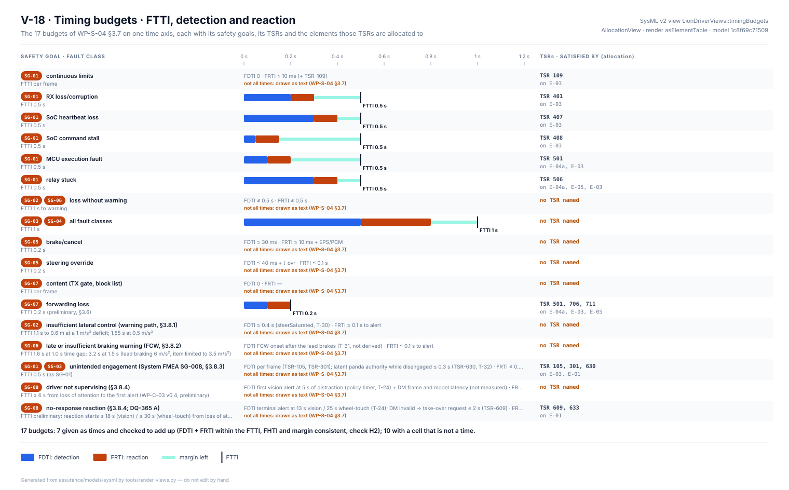
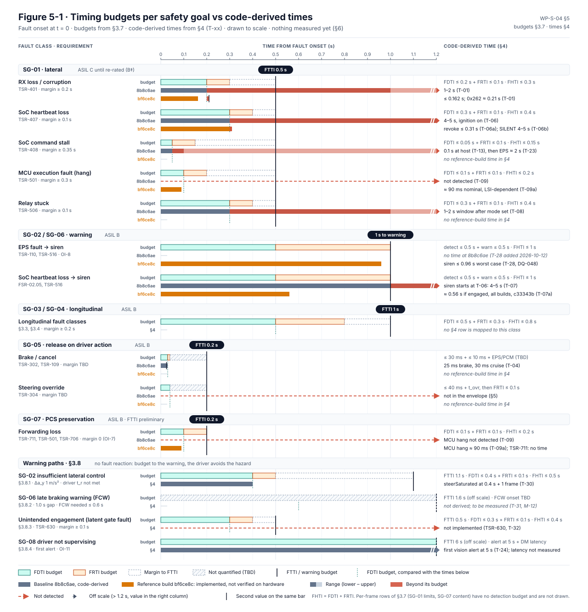
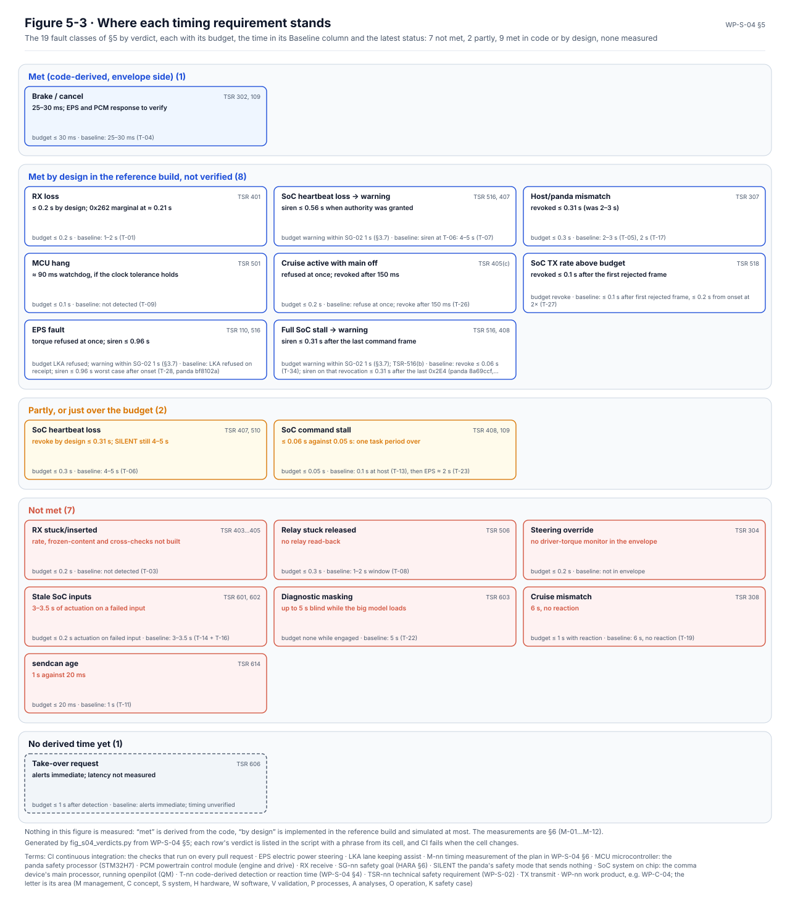
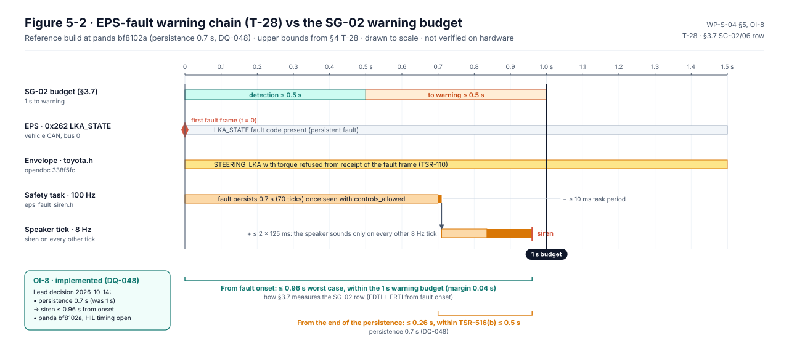

# Timing: FTTI, fault detection and reaction budget

The timing analysis, [WP-S-04](../WP-S-04-timing-ftti-budget.md), asks how fast each safety mechanism has to act. For
every safety goal it derives, from vehicle dynamics, how long a fault can go unhandled before it becomes dangerous:
the fault-tolerant time interval (FTTI). It splits that time into a detection and a reaction budget, derives from the
code how long each mechanism actually takes, and compares the two. Nothing in it is measured yet; the times are
derived from the code and cross-checked in simulation, and the measurement plan says how they will be measured.

<!-- terms:start (generated by assurance/trace/tools/terms.py; do not edit by hand) -->

Terms on this page (23)

| Term | Meaning |
|---|---|
| CAN | controller area network: the vehicle's data bus |
| CI | continuous integration: the checks that run on every pull request |
| DQ-nn | decision of the project lead (decision register) |
| EPS | electric power steering |
| FHTI | fault handling time interval: FDTI + FRTI |
| FMEA | failure mode and effects analysis |
| FSC | functional safety concept |
| FTTI | fault-tolerant time interval: fault to hazard, the time a safety mechanism has |
| HARA | hazard analysis and risk assessment (ISO 26262-3) |
| HIL | hardware in the loop: the bench with the real panda and simulated car buses |
| M-nn | timing measurement of the plan in WP-S-04 §6 |
| MCU | microcontroller: the panda safety processor (STM32H7) |
| ODD | operational design domain: where the system is meant to work |
| OI-nn | open item of the document it appears in |
| SG-nn | safety goal (HARA §6) |
| SoC | system on chip: the comma device's main processor, running openpilot (QM) |
| SysML | Systems Modeling Language: the system model in models/sysml |
| T-nn | code-derived detection or reaction time (WP-S-04 §4); in WP-M-01 and WP-S-06, a tailoring decision T-01…T-08 (WP-M-01 §5) |
| TSC | technical safety concept |
| TSR-nn | technical safety requirement (WP-S-02) |
| TX | transmit |
| V-nn | view of the SysML model (V-01…V-23) |
| WP-nn | work product, e.g. WP-C-04; the letter is its area (M management, C concept, S system, H hardware, W software, V validation, P processes, A analyses, O operation, K safety case) |

All terms: [abbreviations and record codes](../../terms.md).

<!-- terms:end -->

This page walks through it with its figures. The document is the source of record, and the figures are generated from
its tables or from models of the code.

**The timing in five lines.**

1. **Half a second for steering faults.** A fault that defeats the envelope can push the car 0.6 m out of its lane in
   0.5–0.6 s, so the SG-01 FTTI is 0.5 s: detect within 0.3 s, react within 0.1 s, keep 0.1 s spare.
2. **Losing the steering in a curve is faster than the driver.** At the ODD curve bound the car reaches the lane line
   in about 0.7 s, quicker than a driver reacts to a warning (0.75–1.5 s). A faster warning alone does not fix that;
   it is an ODD and controllability question for the HARA (OI-2).
3. **The original code was seconds too slow.** Message loss took 1–2 s to detect, heartbeat loss 4–5 s, and an engaged
   mismatch 2–3 s, against budgets of 0.2–0.3 s.
4. **The reference build closes most of the gap by design.** A 100 Hz safety task, a 90 ms watchdog and fast revocation
   bring nine of the nineteen fault classes within budget, and two more close to it. Seven are still not met.
5. **Nothing is measured.** Each time is derived from the code and at most simulated. A mechanism counts in the FMEA
   only once its timing has been measured on the bench or the car (DQ-206 A).

| Where it comes from | The analysis | Where it goes |
|---|---|---|
| [HARA (WP-C-03)](../../02-concept/hara/README.md): preliminary FTTIs per goal · [FSC (WP-C-04)](../../02-concept/fsc/README.md) §8: first budgets | FTTI per goal from vehicle dynamics; detection and reaction budgets; code-derived times T-01…T-34; verdicts; measurement plan | [TSRs (WP-S-02)](../WP-S-02-technical-safety-requirements.md): the time each one sets · [TSC (WP-S-03)](../tsc/README.md) §4 · [System FMEA](../../08-analyses/fmea/msr-plan.md): the monitoring ratings |
| [ODD (WP-C-02)](../../02-concept/odd/README.md): lane widths and the curve bound | | [Validation (WP-V-01)](../../06-validation/WP-V-01-safety-validation.md) and the HIL bench: measurements M-01…M-14 |

## 1. How the budgets are set

The budget rule is simple: detection plus reaction must fit inside the FTTI, with at least a fifth of the FTTI to
spare for scheduling jitter, CAN latency and the steering's or engine's own response. The driver's reaction time is
not part of the FTTI; it is used for controllability and for the warning budgets.

| Safety goal | FTTI | Why that number |
|---|---|---|
| SG-01 steering | 0.5 s | 0.6 m to the next lane at the EPS's own authority (§3.1) |
| SG-02 / SG-06 loss without warning | 1 s to the warning | the driver must be told before the car drifts or fails to brake (§3.2) |
| SG-03 / SG-04 acceleration and braking | 1 s | gap loss of about 1 m at the envelope's limits (§3.3, §3.4) |
| SG-05 release on driver action | 0.2 s | the driver expects release within their own action (§3.5) |
| SG-07 keep Toyota's own collision braking | 0.2 s, preliminary | each 0.2 s of delay costs about 4 km/h of the braking's speed reduction (§3.6, DQ-062) |
| SG-08 driver not supervising | ≤ 6 s to the first alert | preliminary, from the HARA (§3.8.4) |

The full table, with detection and reaction budgets per fault class, is §3.7.

*The budgets in the system model (SysML view V-18).* Each row of §3.7 is a timing budget in the SysML model, tied to
its safety goals and to the TSRs it names, so the figure can show which elements must keep it. The model also does the
arithmetic: wherever the cells are times, detection plus reaction must fit inside the FTTI and the stated FHTI and
margin must agree, or CI fails (check H2). Seven rows are given as plain times and add up. The other ten have a cell
that is not a single time ("per frame", "≤ 40 ms + t_ovr", a driver reaction).

## 2. The loops, fault by fault

*The timing loops (§3.10, Figure 3-1).* An Octave model of the code runs each fault from onset to the safe state. In
the reference build, losing a message is detected within 162 ms and handled within the 500 ms FTTI; in the original
code the same fault took up to 2 s. A stalled command stream is caught within 60 ms, 10 ms over its own budget but
well inside the FTTI. The model is of the code, not of the hardware, so it is not evidence.

## 3. Budgets against the code

*Budgets and times on one axis (§5, Figure 5-1).* For each goal, the detection and reaction budgets and the times
derived from the code: grey for the original baseline, amber for the reference build. Red marks the part of a time
beyond its budget.

*Where each requirement stands (§5, Figure 5-3).* The nineteen rows of the comparison, sorted by verdict:

- **Met by design in the reference build (8):** message loss, the heartbeat-loss warning, the engaged mismatch, the
  watchdog, cruise with main off, the TX-rate limit, the EPS-fault warning and the full-stall warning.
- **Met in code (1):** brake and cancel, on the envelope side; the steering's and engine's response still has to be
  verified.
- **Partly (2):** heartbeat loss revokes authority in time but reaches the silent mode only after 4–5 s, and a
  stalled command stream is caught one 10 ms task period late.
- **Not met (7):** stuck or inserted messages, a stuck relay, the driver steering against the item, stale inputs on
  the SoC, the big model's 5 s blind spot, the cruise mismatch, and the age of the command messages.
- **No derived time (1):** the take-over request, to be measured.

*One chain to scale (§5, Figure 5-2).* The EPS-fault warning: torque is refused on the first fault frame, the fault
must persist 0.7 s (DQ-048), then the next task period and the next speaker tick. The siren sounds at up to 0.96 s,
inside the 1 s budget with 0.04 s to spare.

## 4. Warnings that the driver must act on

§3.8 gives a budget to four warnings the System FMEA credits, where the driver avoids the hazard after the warning:

- **Insufficient steering in a curve (SG-02).** The saturation warning comes after 0.4 s. That is in time only for a
  torque deficit of about 0.5 m/s² and a fast driver; at the ODD curve bound the deficit can be 0.5–1.0 m/s². Same
  question as OI-2.
- **A lead braking harder than the item can (SG-06).** The item brakes at most 3.5 m/s², so the forward collision
  warning has to come within about 0.6 s of a lead's hard braking at a 1 s gap. Its onset is not derived yet (M-12).
- **Unintended engagement (SG-01, SG-03).** Per frame by the envelope; a latent authority while disengaged is not yet
  detected by the host (TSR-630).
- **The driver not supervising (SG-08).** First alert at 5 s of distraction plus the camera and model latency, which
  is not measured (OI-11).

## 5. How it will be measured

No measurement has been made. Twelve are planned (§6), among them:

- **M-02, first:** what the EPS does when the steering command stops. It decides most of the simulated outcomes:
  releasing gives about 1.3–1.5 s to the lane line, holding about 3.1–3.5 s (OI-10).
- **M-04 to M-06, on the HIL bench:** message loss, heartbeat loss and command stall, and an MCU hang.
- **M-01, M-07, M-08, on the closed course:** EPS authority, brake to zero torque, and driver override.

## 6. Open items

The ones that can change a budget are below; the full list is in WP-S-04 §7.

- **OI-2:** SG-02 at the ODD curve bound: the car is faster than the driver; the HARA owner reviews the rating or the
  curve bound.
- **OI-4, OI-7:** measure Toyota's collision-braking timing and confirm the 0.2 s SG-07 budget, which today has no
  margin.
- **OI-10:** make the EPS drop-out measurement (M-02) the first on the car.
- **OI-11:** measure the driver-monitoring alert time against the SG-08 FTTI.

## Where the figures come from

This folder has no files of its own besides this page. The figures live next to their documents:

| Figure | Generator |
|---|---|
| WP-S-04 Figure 5-3, where each requirement stands | [`fig_s04_verdicts.py`](../figures/fig_s04_verdicts.py), from §5; each verdict is listed with a phrase from its cell, and CI fails when the cell changes |
| WP-S-04 Figures 5-1 and 5-2 | [`fig_s04_timing.py`](../figures/fig_s04_timing.py), from §3.7, §4 and §5 |
| SysML view V-18, the budgets in the model | [`render_arch.py`](../../models/sysml/tools/render_arch.py), from the model, which [`gen_timing_hsi.py`](../../models/sysml/tools/gen_timing_hsi.py) generates from §3.7 |
| WP-S-04 Figure 3-1, the timing loops | [`models/figures/fig_timing_anim.py`](../../models/figures/fig_timing_anim.py), from the Octave timing-loop model (§3.10) |
