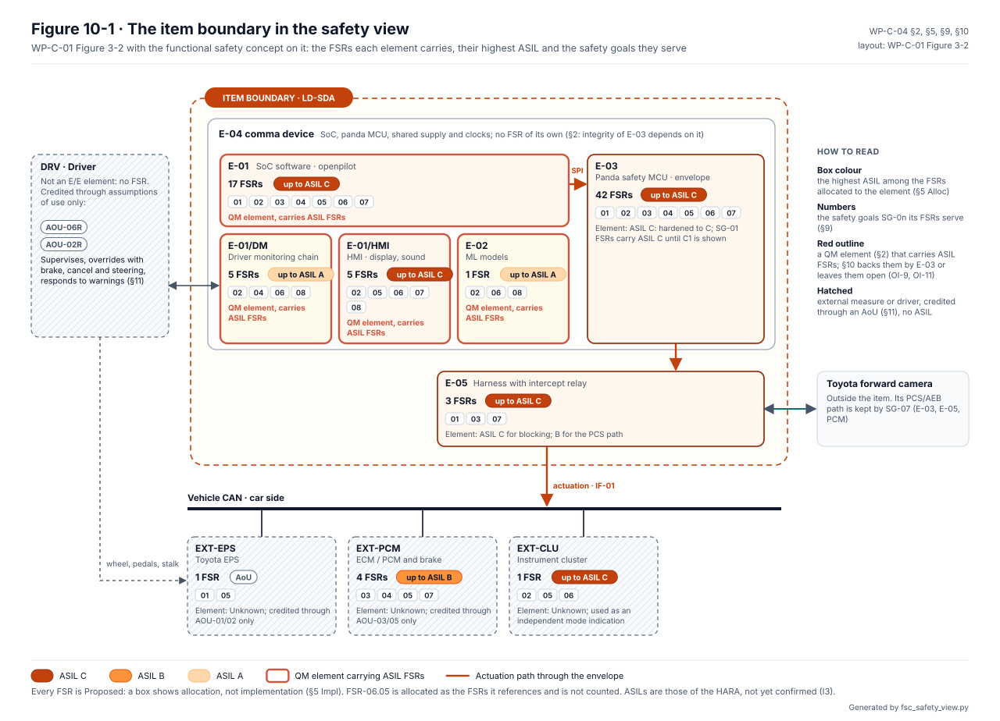
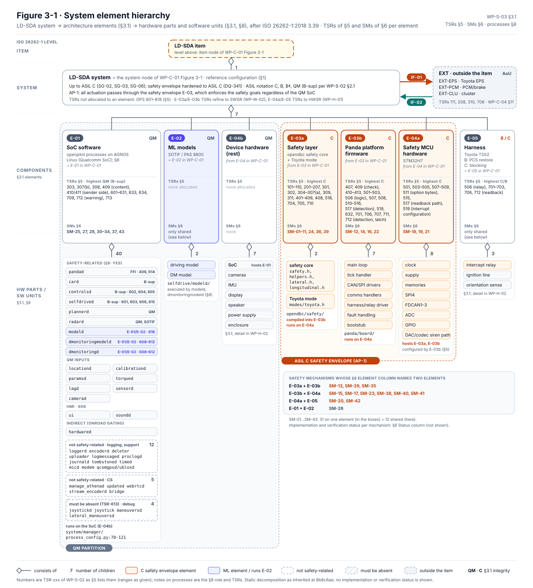
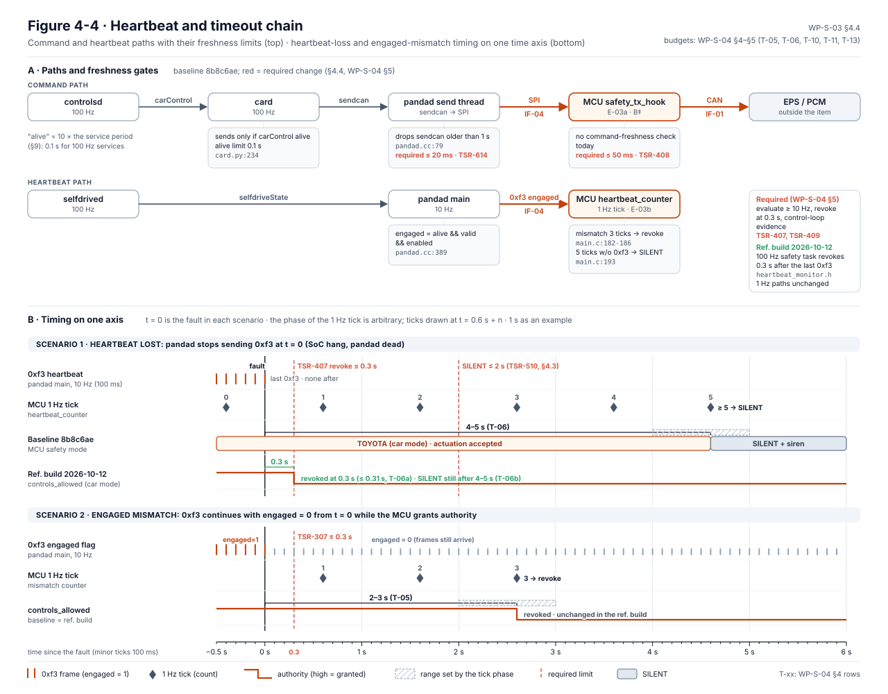
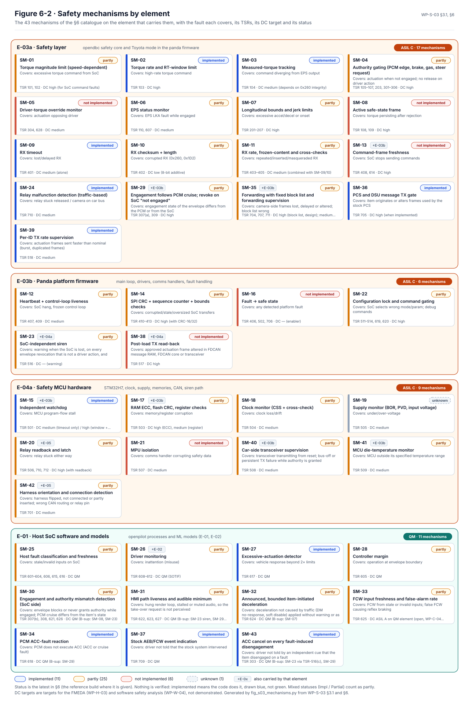
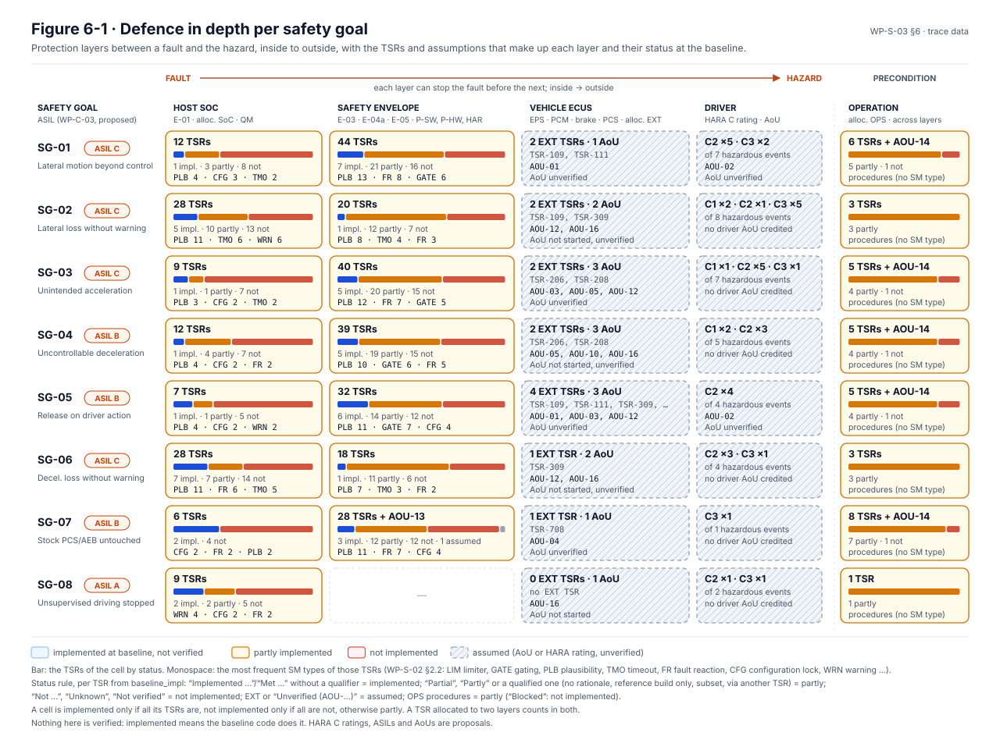
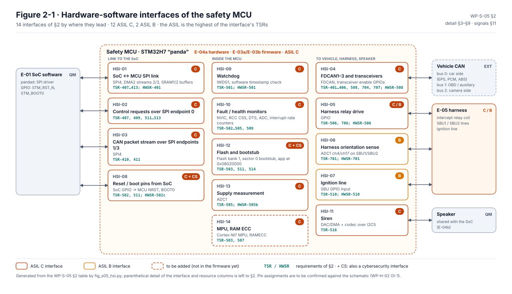

# Technical safety concept

The technical safety concept, [WP-S-03](../WP-S-03-technical-safety-concept-architecture.md), takes the functional
safety concept down one level. Each functional safety requirement (FSR) becomes technical safety requirements (TSRs,
[WP-S-02](../WP-S-02-technical-safety-requirements.md)) on a concrete architecture: which chip, which firmware, which
message, which timeout. Each TSR is carried by a catalogued safety mechanism. This page walks through it with the
figures. The documents are the source of record, and the figures are drawn from them.

<!-- terms:start (generated by assurance/trace/tools/terms.py; do not edit by hand) -->

Terms on this page (46)

| Term | Meaning |
|---|---|
| AI | artificial intelligence |
| ALLOWED | the envelope's authority state with controls_allowed = 1 (NOT_ALLOWED: 0), WP-W-05 §5.2 |
| AoU | assumption of use: what the analysis assumes about the car, the driver or the environment |
| AP-nn | attack path (TARA §5); in WP-S-03 and on the TSC page, an architectural principle (WP-S-03 §2) |
| ASIL | Automotive Safety Integrity Level, A (lowest) to D (highest), from ISO 26262 |
| CAN | controller area network: the vehicle's data bus |
| CI | continuous integration: the checks that run on every pull request |
| DC | diagnostic coverage: the share of faults a safety mechanism detects |
| DQ-nn | decision of the project lead (decision register) |
| E-nn | element of the item (WP-C-01 §3.1), E-01…E-06 |
| ECU | electronic control unit |
| EPS | electric power steering |
| EXT | allocation to an existing vehicle element, credited only through an assumption of use (WP-S-02 §2.2) |
| EXT-nn | external element credited only through an assumption of use (EXT-EPS, EXT-PCM, EXT-CLU) |
| FDTI | fault detection time interval |
| FFI | freedom from interference |
| FMEDA | failure modes, effects and diagnostic analysis (hardware metrics) |
| FRTI | fault reaction time interval |
| FSC | functional safety concept |
| FSR-nn | functional safety requirement (FSC) |
| FTTI | fault-tolerant time interval: fault to hazard, the time a safety mechanism has |
| GAP-nn | gap found by the gap assessment |
| HMI | human-machine interface: display, sounds, cluster |
| HSI | hardware-software interface |
| IF-nn | interface of the item (WP-C-01 §3.4) |
| IND-nn | independence claim (WP-S-03 §7) |
| ISO | International Organization for Standardization |
| MCU | microcontroller: the panda safety processor (STM32H7) |
| MPU | memory protection unit |
| NF-nn | finding of the onboard code review |
| OI-nn | open item of the document it appears in |
| PCM | powertrain control module (engine and drive) |
| PCS | pre-collision system: Toyota's stock collision warning and braking |
| QM | quality managed: no ASIL; ordinary quality processes suffice |
| RX | receive |
| SG-nn | safety goal (HARA §6) |
| SM-nn | safety mechanism (TSC §6) |
| SoC | system on chip: the comma device's main processor, running openpilot (QM) |
| SPI | serial peripheral interface (the link between SoC and MCU) |
| SVG | scalable vector graphics (the figure format) |
| SysML | Systems Modeling Language: the system model in models/sysml |
| TSC | technical safety concept |
| TSR-nn | technical safety requirement (WP-S-02) |
| TX | transmit |
| V-nn | view of the SysML model (V-01…V-27) |
| WP-nn | work product, e.g. WP-C-04; the letter is its area (M management, C concept, S system, H hardware, W software, V validation, P processes, A analyses, O operation, K safety case) |

All terms: [abbreviations and record codes](../../terms.md).

<!-- terms:end -->

**The concept in five lines.**

1. **One safety element.** All actuation passes through the panda safety MCU, which enforces the safety goals whatever
   the QM SoC commands (AP-1). Its safety layer, platform firmware and hardware (E-03a, E-03b, E-04a) are ASIL C.
2. **Fail-silent, de-energise to safe.** On a fault the item stops actuating. Loss of power releases the harness relay
   and restores the stock camera path (AP-2, AP-4).
3. **The SoC cannot configure the safety element.** Mode, parameters and limits are fixed in the envelope, and the SoC
   can only ask it to step down (AP-5). This is partly true in the reference build; the boot-control path is still open
   (GAP-38).
4. **The driver is an independent channel.** Brake, cancel and steering act on vehicle elements outside the item, and
   the envelope follows the PCM cruise state (AP-6).
5. **43 safety mechanisms.** None of them is verified. "Implemented" means the code does it.

| Where it comes from | The concept | Where it goes |
|---|---|---|
| [FSC (WP-C-04)](../../02-concept/fsc/README.md): FSRs and their allocation | Architecture, TSR allocation, safety mechanisms, FFI | [Software safety requirements (WP-W-02)](../../05-software/WP-W-02-software-safety-requirements.md), [hardware safety requirements (WP-H-01)](../../04-hardware/WP-H-01-hardware-safety-requirements.md) |
| [Item definition (WP-C-01)](../../02-concept/WP-C-01-item-definition.md): elements and interfaces | | [Requirement trees](../requirements/README.md), [timing (WP-S-04)](../WP-S-04-timing-ftti-budget.md), [HSI (WP-S-05)](../WP-S-05-hsi-specification.md) |

## 1. From the functional view to the technical one

The FSC puts its requirements on the elements of the item boundary. The TSC opens those boxes. The envelope E-03
becomes the safety layer, the platform firmware and the MCU hardware. The SoC becomes its openpilot processes. Every
block carries its mechanisms and TSRs.

*The FSC's view: what each element must do ([WP-C-04](../../02-concept/WP-C-04-functional-safety-concept.md) §10,
Figure 10-1).*

*The TSC's view: how it does it (§3.2, Figure 3-2).* The device splits into a QM partition and the ASIL C envelope.
Inside the MCU, the shaded blocks are the safety layer (E-03a), the outlined ones the platform firmware (E-03b), and
the strip below is the hardware (E-04a).

*What flows between them (§3.4, Figure 3-3).* The same item as functions in the order they act. Every kind of AI error
enters in the QM partition. The envelope then bounds only the size of a command, not its direction, so a wrong
curvature inside the limits reaches the steering.

## 2. The elements

*Figure 3-1 (§3.1, §5, §6).* The same elements on the ISO 26262 hierarchy, below the system node of the item
definition. The TSR and mechanism lists are generated from §5 and §6, and CI fails when a TSR is not allocated.

| Element | Integrity | TSRs it carries (§5) |
|---|---|---|
| E-03a safety layer (opendbc safety, Toyota mode) | ASIL C | Actuation limits, gating, RX checks, forwarding: 101–110, 201–207, 301–311, 401–408, 704, 705, 710 … |
| E-03b panda platform firmware | ASIL C | Heartbeat, SPI integrity, fault → safe state, configuration lock, siren, relay logic: 407, 409–413, 501–519, 701, 706–712 … |
| E-04a safety MCU hardware | ASIL C | Watchdog, memories, clock, supply, MPU, transceivers: 501–509, 511, 515, 517, 519 |
| E-05 harness | ASIL C blocking / B PCS path | Relay and its readback: 506, 701–703, 706, 712 |
| E-01 SoC software (QM) | QM, backed by the envelope | Host fault handling, driver monitoring, HMI, warnings: 303, 307(b), 308, 601–635, 709, 713 |
| EXT (Toyota EPS, PCM, brake) | AoU only | 111, 208, 310, 708 |

## 3. How it behaves over time

*Start-up and engagement (§4.1, Table 4-1, Figure 4-1).* The MCU starts silent and is locked into the Toyota mode. It
grants authority only on the rising edge of the PCM's cruise-active signal. The 21 steps are a table in §4.1; the
figure is drawn from the SysML model, which holds every lifeline to an element and every step to the state-machine
records. Two steps are still required: the start-up tests (TSR-515, not implemented) and the mode lock (TSR-512, in
the reference build).

*The envelope's states (§4.5, Figure 4-5).* In the reference build the cruise edge only opens a 1 s window; authority
comes when the host's engaged heartbeat arrives inside it. So a host that will not engage, as in the driver lockout,
never gets authority on the car. Eleven ways of taking authority away are in the code and seven are not yet, among
them the driver steering against the item. The right-hand panel shows where the host and the envelope disagree:
during a steering override, during the 3 s soft disable (GAP-16), and for up to 0.3 s after an immediate disable.

*Heartbeat and timeouts (§4.4, Figure 4-4).* If the SoC stops talking, the envelope revokes authority after 0.3 s and,
if it was engaged, sounds its own siren about 0.56 s after the last heartbeat. If the command frames stop arriving, it revokes after 50 ms. Both are in the reference build
and not yet verified on hardware.

*The time budgets per goal ([WP-S-04](../WP-S-04-timing-ftti-budget.md) §5, Figure 5-1):* fault detection plus
reaction against each goal's FTTI, today and in the reference build.

## 4. The safety mechanisms

*Figure 6-2 (§6).* One tile per mechanism, on the element that carries it, coloured by status. Most of the envelope's
mechanisms are partly there. The ones not started are the driver-torque override monitor (SM-05), the active
zero-torque frame after a rejection (SM-08), fault → safe state (SM-16), MPU isolation (SM-21) and the post-load TX read-back (SM-38). The diagnostic-coverage targets are
targets for the FMEDA, not results.

## 5. Defence in depth

*Figure 6-1 (§6).* For each goal, the layers that stand between a fault and the hazard, from the inside out. The
envelope column is where the item's own integrity lives. The vehicle and driver columns are assumptions, hatched
because none is verified.

## 6. Freedom from interference

*Figure 7-1 (§7).* The QM SoC and the ASIL C MCU share a board, a supply and a speaker. The figure lists what the SoC
could do to the MCU, what the two share, and what is required to stop each. Two interference paths are open: the SoC
can still replace the MCU firmware through its boot and reset lines (FFI-3, GAP-24, GAP-38). A malformed SPI
transfer can still corrupt MCU memory (FFI-4, NF-04). The other four are partly covered. Two of the shared causes, the
power supply and the speaker, have not been analysed yet. The second, independent limiter (IND-1) does not exist. It
waits on the decision after the SG-01 controllability tests (OI-3, DQ-050). The analyses themselves are
[WP-A-02](../../08-analyses/WP-A-02-coexistence-freedom-from-interference.md) and
[WP-A-03](../../08-analyses/WP-A-03-dependent-failure-analysis.md).

## 7. The hardware-software interface

*The MCU's interfaces ([WP-S-05](../WP-S-05-hsi-specification.md) §2, Figure 2-1).*

## 8. Open items

The full list is in WP-S-03 §10.

- **OI-1:** confirm the DC targets in the FMEDA and the software safety analysis.
- **OI-2:** write the freedom-from-interference and dependent-failure analyses (WP-A-02, WP-A-03).
- **OI-3:** decide on a second, independent limiter after the SG-01 controllability tests (DQ-050).

## Where the figures come from

This folder has no files of its own besides this page. The figures live next to their documents:

| Figure | Generator |
|---|---|
| WP-S-03 Figures 3-1, 6-1, 6-2 | [`../figures/fig_s03_hierarchy.py`](../figures/fig_s03_hierarchy.py), [`fig_s03_defence_in_depth.py`](../figures/fig_s03_defence_in_depth.py), [`fig_s03_mechanisms.py`](../figures/fig_s03_mechanisms.py); CI fails if stale |
| WP-S-03 Figure 3-3, the functional flow | [`fig_s03_functional_flow.py`](../figures/fig_s03_functional_flow.py), checked against WP-S-03 §8–§9, WP-C-01 §2.1 and WP-C-11 §5 |
| WP-S-03 Figure 7-1, freedom from interference | [`fig_s03_ffi.py`](../figures/fig_s03_ffi.py), from §7; it fails if a status cannot be classified |
| WP-S-03 Figure 4-5, the envelope's states | [`fig_s03_envelope_states.py`](../figures/fig_s03_envelope_states.py), from the state-machine records of WP-W-05 §5 |
| WP-S-03 Figure 4-1, the start-up sequence | SysML view V-17, drawn by [`render_arch.py`](../../models/sysml/tools/render_arch.py) from the model, which [`gen_behaviour.py`](../../models/sysml/tools/gen_behaviour.py) generates from Table 4-1 |
| WP-S-03 Figures 3-2, 4-4 | Hand-drawn SVGs in [`../figures/`](../figures/); change them together with the sections named in their captions |
| WP-S-04 Figure 5-1, WP-S-05 Figure 2-1 | [`fig_s04_timing.py`](../figures/fig_s04_timing.py), [`fig_s05_hsi.py`](../figures/fig_s05_hsi.py) |
| WP-C-04 Figure 10-1 | [`02-concept/fsc/fsc_safety_view.py`](../../02-concept/fsc/fsc_safety_view.py) |
