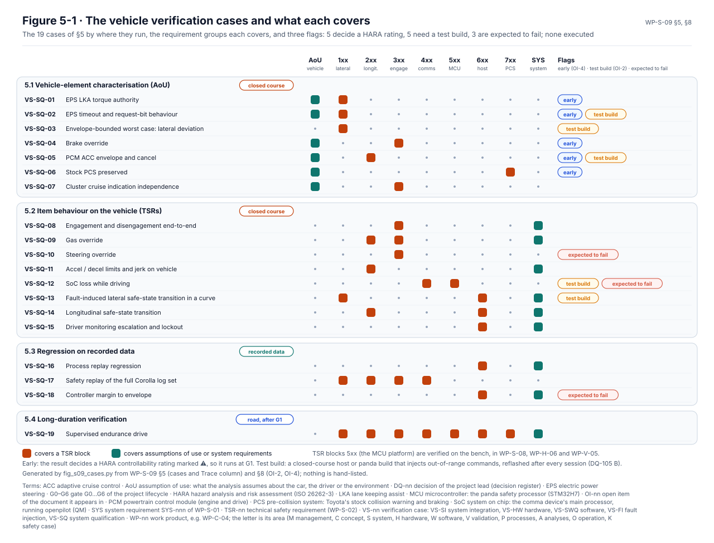

# System verification

The system verification specification, [WP-S-09](../WP-S-09-system-verification.md), says how the integrated item is
verified in the reference car: against the technical safety requirements, the system requirements, and the
assumptions it makes about the car's own steering, engine, cluster and collision braking. It also sets the regression
checks each release runs on recorded drives. Nineteen cases are specified. None has been run.

<!-- terms:start (generated by assurance/trace/tools/terms.py; do not edit by hand) -->

Terms on this page (18)

| Term | Meaning |
|---|---|
| CAN | controller area network: the vehicle's data bus |
| DQ-nn | decision of the project lead (decision register) |
| EPS | electric power steering |
| FSC | functional safety concept |
| G0–G6 | gate G0…G6 of the project lifecycle |
| GAP-nn | gap found by the gap assessment |
| GC-nn | global pass criterion of every integration test (WP-S-08 §5) |
| GNSS | global navigation satellite system (GPS) |
| HARA | hazard analysis and risk assessment (ISO 26262-3) |
| I-nn | integration step I-1…I-4 (WP-S-08 §3.1) |
| IMU | inertial measurement unit: accelerometers and gyroscopes |
| MCU | microcontroller: the panda safety processor (STM32H7) |
| OI-nn | open item of the document it appears in |
| PC | personal computer |
| SoC | system on chip: the comma device's main processor, running openpilot (QM) |
| TSR-nn | technical safety requirement (WP-S-02) |
| VS-nn | verification case: VS-SI system integration, VS-HW hardware, VS-SWQ software, VS-FI fault injection, VS-SQ system qualification |
| WP-nn | work product, e.g. WP-C-04; the letter is its area (M management, C concept, S system, H hardware, W software, V validation, P processes, A analyses, O operation, K safety case) |

All terms: [abbreviations and record codes](../../terms.md).

<!-- terms:end -->

This page walks through it with its figure. The document is the source of record, and the figure is generated from
it.

**Verification in five lines.**

1. **Nineteen cases in four groups.** Measuring the car's own behaviour on a closed course (7), testing the item's
   behaviour on the car on the same course (8), regression on recorded drives (3), and a supervised endurance drive on
   public roads after gate G1 (1).
2. **Five cases come first.** The steering's torque authority and timeout, brake override, the engine's acceleration
   bounds and Toyota's collision braking decide controllability ratings the HARA has marked ⚠. They run at G1
   (OI-4).
3. **Five cases need a test build.** A closed-course host or panda build injects out-of-range commands. Whether it
   ever reaches a public road rests on procedure: the release build is reflashed after every session and logged
   (DQ-105 B).
4. **Three are expected to fail today.** The driver steering against the item (GAP-02), losing the SoC while
   driving (GAP-06), and the controller's margin to the envelope, which is zero because the two use the same
   limits.
5. **Verification is not validation.** This checks that the item meets its requirements and that the assumptions
   about the car hold. Whether the safety goals are achieved for real drivers is validated in WP-V-01.

| Where it comes from | The specification | Where it goes |
|---|---|---|
| [Integration (WP-S-08)](../integration/README.md): steps I-1…I-4 passed (precondition PC-01) · [TSRs (WP-S-02)](../WP-S-02-technical-safety-requirements.md) · [System requirements (WP-S-01)](../WP-S-01-system-requirements.md) · the assumptions of use in the [item definition](../../02-concept/item/README.md) | Preconditions, methods, closed-course environment, cases VS-SQ-01…19, report template | [HARA (WP-C-03)](../../02-concept/hara/README.md): the ⚠ ratings the measurements confirm or revise · [Safety validation (WP-V-01)](../../06-validation/WP-V-01-safety-validation.md) · [Release record (WP-K-06)](../../10-safety-case/WP-K-06-release-record.md) |
| [Vehicle test operations (WP-V-07)](../../06-validation/WP-V-07-vehicle-test-operations.md): the safety driver and the course | | |

## 1. The cases and what each covers

*The cases (§5, Figure 5-1).* One row per case, a square for each requirement group it covers, read from its Trace
column, and three flags read from the document. Some things stand out:

- **The car's assumptions are measured first (§5.1).** How much torque the EPS really delivers, how it fades when
  commands stop, whether the brake always wins, what the engine clamps, whether Toyota's collision braking still works
  with the harness in, and whether the cluster's cruise indicator follows only the engine.
- **The MCU platform block (5xx) is barely here.** Watchdog, memory and supply checks are verified on the bench
  ([WP-S-08](../integration/README.md), WP-H-06, WP-V-05). Only the SoC-loss case and the endurance drive touch it on
  the car.
- **The endurance drive observes everything and proves little on its own.** It counts and classifies every
  disengagement and alert over a mileage set by the validation targets (WP-V-02).

## 2. How a case passes

- **Two rules in every case.** No actuation frame outside the envelope's limits on the car's bus (GC-1), and Toyota's
  collision-braking frames forwarded unchanged whenever the item is not meant to intercept them (GC-2).
- **A measurement is a result, not a failure.** The three characterisation cases pass when the value is measured with
  its uncertainty. If the value breaks an assumption, the HARA rating it supports is revisited.
- **Timing** uses the FSC budget until the [timing analysis](../timing/README.md) is approved.

## 3. Methods and the course

The course needs a straight of at least 1 km, constant-radius curves (for example 250 m and 500 m), dry asphalt and
optionally a wet section. The car carries a steering torque and angle sensor or robot, an IMU with GNSS for lateral
position, pedal force sensors, CAN loggers on both buses with hardware timestamps, video of the cluster and device,
and audio. A soft target stands in for a car in the collision-braking test.

## 4. Open items

The ones that decide when and how testing can start are below; the full list is in WP-S-09 §8.

- **OI-2:** define the closed-course test builds as configuration items; keeping them off public roads rests on the
  reflash and logbook procedure (DQ-105 B).
- **OI-3:** set the course geometry and speeds per case from the timing analysis.
- **OI-4:** run VS-SQ-01, -02, -04, -05 and -06 early, at G1: they decide the HARA ⚠ ratings and the envelope strategy.
- **OI-5:** fix the controller's margin target to the envelope (VS-SQ-18) together with the derived limits.
- **OI-6:** add cases for the system requirements not yet covered, or move them to WP-S-08 or WP-V-03.

## Where the figures come from

This folder has no files of its own besides this page.

| Figure | Generator |
|---|---|
| WP-S-09 Figure 5-1, the cases | [`fig_s09_cases.py`](../figures/fig_s09_cases.py), from §5 and §8; the coverage comes from each case's Trace column and the flags from OI-2, OI-4 and the pass criteria, so nothing is hand-listed |
