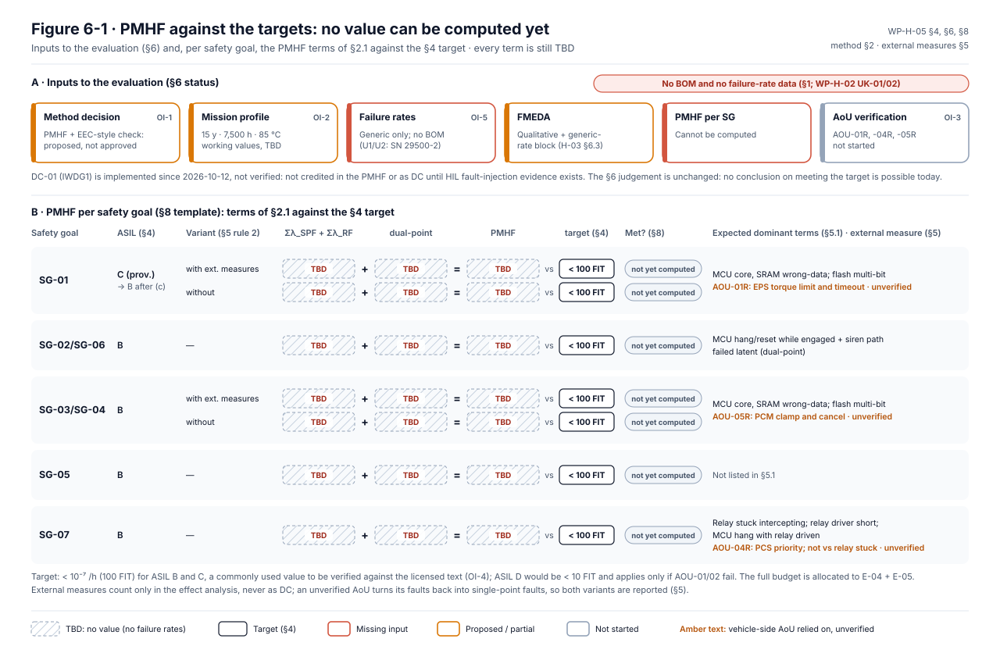

# WP-H-05 Evaluation of safety goal violations due to random hardware failures (PMHF)

| Field | Value |
|---|---|
| Work product | WP-H-05 Evaluation of safety goal violations due to random HW failures (PMHF) |
| Standard reference | ISO 26262-5:2018 §9 (evaluation of safety goal violations due to random hardware failures: probabilistic metric and evaluation of each cause), Annex C; ISO 26262-10:2018 (PMHF explanations, informative); ISO 26262-11:2018 (informative) |
| Version | 0.4 (§3 working mission-profile values shown as used by the generic FMEDA; §6 status and λSPF + λRF note from FMEDA rev 0.4; plan step 2 per DQ-065; 2026-10-16). 0.3 (§6 status and §8 template drawn as Figure 6-1; no value changed; 2026-10-13). 0.2 (status note 2026-10-12 in §6: DC-01 implemented, not verified, not credited). 0.1: initial draft |
| Status | Draft (method and plan; no value computed) |
| ASIL / scope | ASIL C (provisional, SG-01) / ASIL B (SG-02…SG-07) |
| Author | Assurance team (initial draft) |
| Reviewer(s) | TBD (I1 minimum, external reviewer, T-09) |
| Approver | TBD (per [WP-M-02](../01-management/WP-M-02-safety-plan.md)) |
| Baseline | `bf6ce8c` (status update 2026-10-12) |

## 1. Purpose

States how LionDriver will show that the residual risk of each safety goal being violated by a
random hardware failure is sufficiently low, which method and target apply, the current status and
the plan. It addresses the PMHF part of **GAP-15**.

**No value has been computed. None can be computed today: there is no BOM and no failure-rate
data** ([WP-H-02](WP-H-02-hardware-design.md) UK-01/02).

## 2. Method choice

ISO 26262-5 §9 offers two alternatives: a probabilistic metric for the whole hardware of a safety
goal (PMHF, "method 1"), or an evaluation of each cause of safety goal violation against
per-fault targets (EEC, "method 2"). Comparison for LionDriver:

| Criterion | PMHF (method 1) | EEC (method 2) |
|---|---|---|
| Inputs | Failure rates of all safety-related parts, fault classes, DC, exposure times | Same rates, plus the failure-rate class of each part and the DC of the mechanism for each fault |
| Fit with COTS + estimated rates | One number that is sensitive to every rate estimate; uncertainty can be shown by sensitivity | Per-part evaluation; a single bad part (e.g. the relay) is visible directly |
| Comparability | Directly comparable with a target and with other systems | Harder to communicate as one figure |
| Effort | Lower once the FMEDA exists | Higher (per fault) |

**Decision proposed: PMHF (method 1) as the primary evaluation, complemented by an
EEC-style per-cause check of the dominant single-point and residual contributors** (MCU core,
SRAM, relay stuck intercepting) so that a low overall figure cannot hide one uncovered part.
To be confirmed by the safety manager (OI-1).

### 2.1 Calculation basis (our words; verify against licensed text and ISO 26262-10)

```
PMHF ≈ Σ λ_SPF + Σ λ_RF + Σ (dual-point contributions)
dual-point contribution of a pair (fault A, then fault B)
     ≈ λ_A,MPF × λ_B × T_exposure(A)
T_exposure = vehicle lifetime T_life for latent faults (not detected),
           = multiple-point fault detection interval for faults that are detected/perceived
```

The PMHF is expressed as an average probability per hour over the vehicle lifetime. Only
dual-point faults are normally evaluated; higher-order combinations are argued negligible.

## 3. Mission profile (to be fixed)

| Parameter | Proposed value / source | Status |
|---|---|---|
| Vehicle service life T_life | 15 years (common automotive assumption) | Proposal |
| Operating hours | To be derived from user data and the ODD ([WP-C-02](../02-concept/WP-C-02-odd-and-intended-functionality.md)); LD-SDA is energised only with ignition on. Working value used by the generic FMEDA: about 500 h/year, so 7,500 h over 15 years | TBD (working value in use) |
| Item fitted life | An aftermarket item may be fitted for less than the vehicle life; LionDriver will still use the vehicle life (conservative) unless an end-of-life rule is defined in [WP-O-02](../09-production-operation/WP-O-02-operation-service-decommissioning.md) | Proposal |
| Temperature profile | Windscreen-mounted device in the cabin, sun load: define a profile (e.g. distribution of junction temperatures) for SN 29500 stress factors. Working value used by the generic FMEDA: ambient up to +85 °C in the sun-loaded enclosure, Tj up to about +105 °C. The harness box sits behind the camera in the same windscreen zone and takes the same profile. No stress conversion has been applied to any rate yet | TBD (working value in use) |
| On/off cycles | One per drive cycle; intercept switch changeovers per drive (mode changes). The harness box switch is an analog IC, so changeovers cause no wear ([RR-2026-010](reviews/RR-2026-010.md) F-04) | TBD |
| Multiple-point fault detection interval | One drive cycle, if start-up tests are implemented ([WP-H-04](WP-H-04-hardware-metrics.md) OI-4) | Proposal |

## 4. Targets

| SG | ASIL | PMHF target | Note |
|---|---|---|---|
| SG-01 | C (provisional; B expected after FSC option (c)) | < 10⁻⁷ /h (100 FIT) | Commonly used value for ASIL B and C — **verify against licensed text** |
| SG-02…SG-06 | B | < 10⁻⁷ /h (100 FIT) | as above |
| SG-07 | B | < 10⁻⁷ /h (100 FIT) | as above |
| (reference) | D | < 10⁻⁸ /h (10 FIT) | not applicable unless AOU-01/02 fail (HARA) |

The targets in the standard are reference values. They may be replaced by targets derived from
field data of similar, trusted designs; LionDriver has no such data (T-06: proven in use not
claimed), so the reference values apply.

The target is a budget for the whole item's hardware contribution to the SG. LionDriver allocates
**the full budget to E-04 + E-05**, because no other hardware element of the item exists (vehicle
ECUs are outside the item, T-02).

## 5. Argument structure and the vehicle-side external measures

A hardware fault in LD-SDA only violates a safety goal if its effect at vehicle level is not
prevented elsewhere. Three vehicle-side measures matter (all outside the item, all unverified):

| External measure | AoU (WP-C-04 §11) | Effect on the evaluation |
|---|---|---|
| EPS limits LKA torque to an overpowerable level and removes it within t_EPS after `0x2E4` stops or the request bit clears | AOU-01R (FSR-01.13) | (a) MCU faults that **stop** transmission (hang, reset, power loss) do not violate SG-01: they become safe faults for SG-01 (they remain relevant for SG-02/SG-07). (b) Faults that **corrupt** the torque command are bounded by the EPS limit; under FSC option (c) that bound is also the C1 controllability basis |
| PCM clamps ACC requests and honours cancel | AOU-05R (FSR-03.06) | Same pattern for SG-03/SG-04 |
| PCS braking has priority over `0x343` | AOU-04R (FSR-07.04) | Bounds the SG-07 effect of a corrupted ACC command; does not help when PCS messages are blocked by the relay |

Rules for using them:

1. External measures are used **only in the effect analysis** (deciding whether a fault leads to an
   SG violation). They are not counted as diagnostic coverage in SPFM/LFM ([WP-H-04](WP-H-04-hardware-metrics.md) §3.3).
2. Every fault classified "safe because of an external measure" carries the AoU ID in the FMEDA.
   If the AoU is not verified by vehicle characterization (FSC OI-2; GAP-05), those faults revert
   to single-point faults and the PMHF is recomputed. **Both variants will be reported.**
3. The external measures do not protect SG-07 against a relay stuck intercepting
   ([WP-H-03](WP-H-03-hardware-safety-analysis-fmeda.md) FM-REL-02/04). That contributor is
   evaluated on its own (EEC-style, §2).

### 5.1 Expected dominant contributors (qualitative)

| SG | Expected dominant terms | Mechanism that would reduce them |
|---|---|---|
| SG-01, SG-03/04 | MCU core and SRAM wrong-data faults (λ_SPF today, λ_RF after STL/ECC handling); flash multi-bit | DC-01, DC-05, DC-06, software self-test (WP-H-02 §6) |
| SG-02, SG-06 | MCU hang/reset while engaged with siren path failed latent (dual-point) | Siren self-test; FSR-02.05 timing |
| SG-07 | Relay stuck intercepting; relay driver short; MCU hang with relay driven | DC-03 readback; DC-01 IWDG; harness relay design evidence |

## 6. Current status

| Item | Status |
|---|---|
| Method decision | Proposed (§2), not approved |
| Mission profile | Proposed in part (§3) |
| Failure rates | **No part-level rates (no BOM).** Generic block rates in the FMEDA; the harness box switches U1/U2 at the SN 29500-2 reference value from a secondary source ([WP-H-03](WP-H-03-hardware-safety-analysis-fmeda.md) §6.3) |
| FMEDA | Qualitative block level, plus a generic-rate block FMEDA ([WP-H-03](WP-H-03-hardware-safety-analysis-fmeda.md) §6.3) |
| PMHF per SG | **Cannot be computed** |
| AoU verification (external measures) | Not started (AOU-01R, -04R, -05R unverified) |

Provisional qualitative judgement: with the baseline firmware the MCU die is largely uncovered,
so its failure rate enters PMHF almost entirely as λ_SPF. Whether that alone exceeds 100 FIT
depends on the die rate, which is unknown. The SG-07 figure is dominated by the relay data,
also unknown. No conclusion on meeting the target is possible today; the evaluation must not be
reported as "met" or "not met" until computed.

*Status note 2026-10-12:* since 2026-10-12 DC-01 (IWDG1, window mode, fed from the 100 Hz safety task; panda `9f60e17`) is implemented, **not verified**. It is not credited in the PMHF or as DC until HIL fault-injection evidence exists and the LSI tolerance is confirmed ([watchdog impact record](../07-supporting/impact/change-2026-10-12-panda-hw-watchdog.md) OI-3 and OI-2). The judgement above is unchanged.

*Status note 2026-10-16:* the generic-rate FMEDA (rev 0.4) gives the single-point and residual term λSPF + λRF as 8.1 FIT for SG-01 and 62.9 FIT for SG-07. The dual-point term is not computed. These are not PMHF values and must not be read as "met". They show only that at these rates SG-07's single-point term is already about two thirds of the 100 FIT target, driven by the harness box switches (35 FIT). That term would fall to 15.6 FIT with switch readback and a stock-path continuity check (WP-H-03 §6.3).



*Figure 6-1.* Top: the inputs of the evaluation with their status from the table above. Bottom: each row of the §8 results template, with the terms of §2.1 (single-point plus residual, dual-point, PMHF) all TBD against the §4 target, the variants with and without external measures where §8 has them, and the expected dominant terms of §5.1 and the external measures of §5. Drawn from §4, §5, §5.1, §6 and §8. Source: [`figures/fig-h05-6-1-pmhf-status.svg`](figures/fig-h05-6-1-pmhf-status.svg); change it together with §4, §6 and §8.

## 7. Plan

| # | Activity | Depends on | Gate |
|---|---|---|---|
| 1 | Approve method (§2) and mission profile (§3) | Safety manager | G2 |
| 2 | Obtain BOM, schematic, harness relay data (WP-H-02 OI-1) and ST failure-rate data (WP-H-07 QE-02) | Supplier (ask and wait, no teardown, DQ-065) | G2 |
| 3 | Fill FMEDA (WP-H-03 §6) and classify faults, marking those that rely on external measures | 2 | G3 |
| 4 | Compute PMHF per SG in two variants: with external measures (AoUs verified) and without | 3 | G3 |
| 5 | EEC-style check of the dominant contributors (MCU core, SRAM, relay) | 3 | G3 |
| 6 | Sensitivity analysis on die rate, relay rate and DC | 4 | G3 |
| 7 | If above target: decide DC-02/DC-03 or other measures and recompute | 6 | G3 |
| 8 | Vehicle characterization of AOU-01R/04R/05R (WP-C-04) — prerequisite for the "with external measures" variant | Vehicle tests | G2–G4 |
| 9 | Independent review | 4–7 | G3 |

## 8. Results (template)

| SG | ASIL | Variant | Σλ_SPF + Σλ_RF (FIT) | Dual-point contribution (FIT) | PMHF (FIT) | Target (FIT) | Met? | Dominant contributors |
|---|---|---|---|---|---|---|---|---|
| SG-01 | | With external measures | TBD — requires BOM | TBD | TBD | | Not yet computed | |
| SG-01 | | Without external measures | TBD | TBD | TBD | | Not yet computed | |
| SG-02/SG-06 | B | — | TBD | TBD | TBD | 100 | Not yet computed | |
| SG-03/SG-04 | B | With / without | TBD | TBD | TBD | 100 | Not yet computed | |
| SG-05 | B | — | TBD | TBD | TBD | 100 | Not yet computed | |
| SG-07 | B | — | TBD | TBD | TBD | 100 | Not yet computed | |

## 9. Open items

| ID | Item | Needed by |
|---|---|---|
| OI-1 | Safety manager to approve the method choice (§2) | G2 |
| OI-2 | Fix the mission profile values marked TBD (§3) | G2 |
| OI-3 | Confirm with the external assessor the use of vehicle external measures in the effect analysis (§5) | G2 |
| OI-4 | Verify target values and PMHF approximations against licensed ISO 26262-5 and -10 | G2 |
| OI-5 | Obtain data (plan steps 2 and 8) | G2/G3 |
