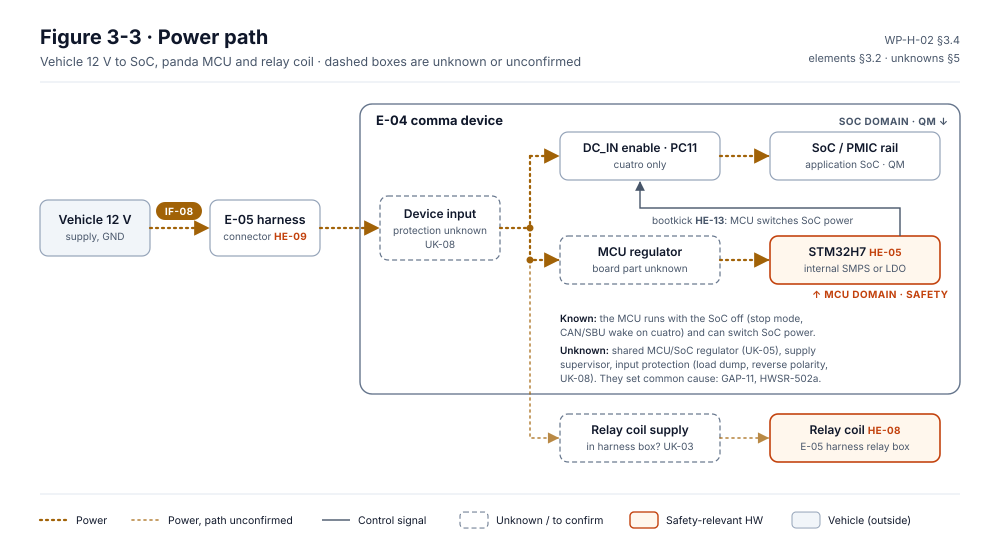
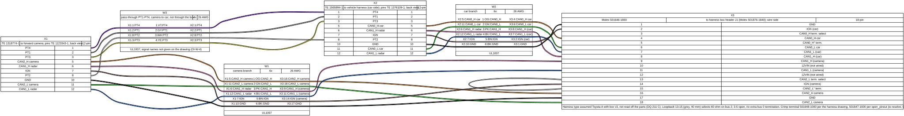
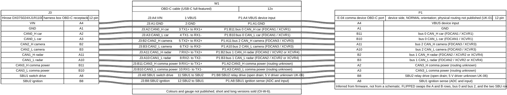

# Hardware design

The hardware design, [WP-H-02](../WP-H-02-hardware-design.md), records what LD-SDA runs on: the comma device with its
Snapdragon SoC and the panda safety MCU (an STM32H725), and the E-05 harness with comma's harness box, whose intercept
switch cuts the forward camera off the car while LionDriver steers. LionDriver does not design this hardware. It is
bought, so the document is a **recovered architecture**: what the firmware and the published drawings show, the
safety-related elements, what is still unknown, and the changes the safety concept needs.

<!-- terms:start (generated by assurance/trace/tools/terms.py; do not edit by hand) -->

Terms on this page (51)

| Term | Meaning |
|---|---|
| ADC | analogue-to-digital converter (in the safety MCU: orientation, supply and health readings) |
| BOM | bill of materials |
| BOR | brown-out reset (MCU supply monitor) |
| CAN | controller area network: the vehicle's data bus |
| COM | common terminal of a changeover switch |
| CSS | clock security system (MCU clock monitor) |
| DC | diagnostic coverage: the share of faults a safety mechanism detects |
| DFM-nn | DFMEA row: failure mode DFM-nnn, cause .Cn (08-analyses/fmea) |
| DQ-nn | decision of the project lead (decision register) |
| E-nn | element of the item (WP-C-01 §3.1), E-01…E-06 |
| ECC | error-correcting code (memory) |
| F-nn | function of the item (WP-C-01 §2.1), F-01…F-09 |
| FDCAN | CAN with flexible data rate (the MCU's CAN controller) |
| FMEDA | failure modes, effects and diagnostic analysis (hardware metrics) |
| GND | ground |
| HE-nn | hazardous event (HARA) |
| HSE | high-speed external oscillator: the crystal that clocks the panda MCU |
| HSI | hardware-software interface |
| HWSR-nn | hardware safety requirement (WP-H-01) |
| ID | identifier |
| IGN | ignition line |
| ISO | International Organization for Standardization |
| LD-SDA | LionDriver Supervised Driving Assistance, the item |
| LDO | low-dropout linear regulator |
| MCU | microcontroller: the panda safety processor (STM32H7) |
| MPU | memory protection unit |
| NC | normally closed terminal of a changeover switch (connected to COM when not driven) |
| NMI | non-maskable interrupt |
| NO | normally open terminal of a changeover switch (connected to COM when driven) |
| OBD | on-board diagnostics port |
| OI-nn | open item of the document it appears in |
| PMHF | probabilistic metric for random hardware failures (ISO 26262-5) |
| PMIC | power-management IC of the SoC |
| PVD | programmable voltage detector (MCU supply monitor) |
| QM | quality managed: no ASIL; ordinary quality processes suffice |
| RAM | random-access memory |
| RDP | read-out protection of the MCU's flash (option bytes) |
| ROM | read-only memory |
| RR-nn | review record |
| SBU | sideband-use pins of a USB-C connector (in the harness, the intercept drive, orientation and ignition lines) |
| SMPS | switched-mode power supply (the STM32H7's internal step-down regulator) |
| SoC | system on chip: the comma device's main processor, running openpilot (QM) |
| SPI | serial peripheral interface (the link between SoC and MCU) |
| SRAM | static RAM: the MCU's working memory |
| TSC | technical safety concept |
| UK-nn | unknown that WP-H-02 must obtain (UK-01…UK-09, WP-H-02 §5) |
| USB-C | USB Type-C connector |
| VIN | vehicle identification number; in the harness box and its simulations, the box supply voltage |
| VS-nn | verification case: VS-SI system integration, VS-HW hardware, VS-SWQ software, VS-FI fault injection, VS-SQ system qualification |
| WP-nn | work product, e.g. WP-C-04; the letter is its area (M management, C concept, S system, H hardware, W software, V validation, P processes, A analyses, O operation, K safety case) |
| WRP | write protection of the MCU's flash (option bytes) |

All terms: [abbreviations and record codes](../../terms.md).

<!-- terms:end -->

This page walks through it with its figures: block diagrams, the harness wiring, and two circuits animated from their
ngspice simulations. The document is the source of record. The simulations are design aids with synthetic data and
no evidence credit (DQ-413).

**The hardware in five lines.**

1. **Seventeen safety-related elements, HE-01…HE-17.** They are the MCU's own resources (core, flash, RAM, clock,
   supply, watchdog), the board circuits around it (CAN transceivers, sensing, fan, siren), the links to the SoC, and
   in the harness the intercept switch, the SBU lines and the ignition sense.
2. **The intercept switch is the hardware's safety path.** It is two DG419LE analogue switches in the harness box,
   held in the stock path by a 240 Ω pull-down and moved to intercept when the device drives SBU1 high.
3. **The circuit behind most pins is unknown.** comma has not published the device schematic or BOM (UK-01, UK-02), so
   part-level FMEDA, metrics and PMHF are blocked until it replies (OI-1, DQ-065). Only the harness box has a published
   drawing.
4. **Much of the silicon's safety is there but not switched on.** BOR, PVD, RAM ECC monitors and the MPU exist on the
   STM32H7 and are not configured; the watchdog is, since 2026-10-12. The design changes DC-01…DC-10 fix this in
   firmware.
5. **The simulations sharpen the bench tests.** The harness box pilot shows the bench drive of VS-HW-23 cannot switch a
   good box, and the supply study shows a level II cranking dip resets the device's generic power path.

| Where it comes from | The design | Where it goes |
|---|---|---|
| [Hardware safety requirements (WP-H-01)](../WP-H-01-hardware-safety-requirements.md) · [TSC (WP-S-03)](../../03-system/tsc/README.md) and [HSI (WP-S-05)](../../03-system/hsi/README.md) · the panda firmware and comma's published harness box v3 drawing ([RR-2026-010](../reviews/RR-2026-010.md)) | Variants, block diagram, elements HE-01…HE-17, power path, reset behaviour, harness wiring, safety mechanisms in silicon, unknowns UK-01…UK-09, design changes DC-01…DC-10 | [FMEDA (WP-H-03)](../WP-H-03-hardware-safety-analysis-fmeda.md), [metrics (WP-H-04)](../WP-H-04-hardware-metrics.md) and [PMHF (WP-H-05)](../WP-H-05-random-hardware-failures-pmhf.md) · [hardware verification (WP-H-06)](../WP-H-06-hardware-integration-verification.md) and the [bench checklist](../bench/VS-HW-22-24-checklist.md) · [component qualification (WP-H-07)](../WP-H-07-hardware-component-qualification.md) |

## 1. The hardware at a glance

*The block diagram (§3.1, Figure 3-1).* Orange is safety-relevant, white is QM. Three CAN buses leave the safety MCU:
bus 0 to the car, bus 2 to the camera, bus 1 for diagnostics. The camera bus reaches the car only through the intercept
switch. The SoC can reset the MCU and start its ROM bootloader (HE-12), which the safety argument has to cover as a
dependent failure.

*The elements (§3.2, Figure 3-2).* Each element with the safety goals it serves, the HWSRs that apply to it and the
unknowns that block its analysis.

## 2. The intercept switch

![WP-H-02 Figure 3-7, animated: the harness box intercept switch in four ngspice frames. Left, the device's 5 V drive through 20 Ω into SBU1 with the 240 Ω pull-down R2/R3 and the DG419LE input threshold; right, U1 on CAN_H and U2 on CAN_L with their COM, NC and NO nets, the terminations R6, R7 and R8 and the device taps on bus 2 and bus 0. Frame 1: SBU1 undriven at 0 V, stock path. Frame 2: SBU1 driven to 4.62 V above the 4.20 V threshold, intercept. Frame 3, DFM-010.C3: pull-down open, SBU1 leaks up to 13.86 V, the box stays in intercept with the device off. Frame 4, DFM-011.C2: VIN 16 V, threshold 8.00 V, weak drive 3.35 V, the box stays in the stock path](../figures/fig-h02-3-7-box-switch-anim.svg)

*The switch, animated (§3.6, Figure 3-7).* Four frames of the ngspice harness-box study loop every 16 seconds; the
table under the circuit lists all four for reading on a phone. Some things stand out:

- **In the stock path the device only listens.** U1 and U2 rest on NC, so the camera's CAN reaches the car directly
  and the device sees both buses.
- **In intercept the camera talks only to the device.** The camera bus is terminated in the box, and the device's bus
  0 drives the car. Nothing reaches the car from the camera that the envelope has not passed.
- **Two box faults leave it in the wrong state.** With the pull-down open, IN floats up on its leakage and the box
  stays in intercept with the device off, so the stock camera stays cut off (DFM-010.C3). At high VIN with a high
  threshold and a weak drive, the device asks for intercept and does not get it (DFM-011.C2).

The same circuit runs in a phone browser: the Falstad link on the [harness box results
page](../../sim/results/harness-box.md) lets you flip each fault and read the voltages.

*The box as wired (§3.6, Figure 3-5).* The same nets as comma's v3 drawing, drawn undriven. Every wire end has an ID in
[`wiring/wire-ends.tsv`](../wiring/wire-ends.tsv) that an FMEDA row can cite.

The [ngspice pilot](../spice/README.md) adds the cases the bench needs. A 0–5 V bench source through 1 kΩ reaches only
0.97 V at IN against the 240 Ω pull-down, so VS-HW-23 step 1 would see no intercept on a good box. A clamp diode
shorted to GND on the camera's CAN_H kills dominant bits on the joined stock bus, not only in intercept.

## 3. Power and the cranking dip

*The power path (§3.4, Figure 3-3).* The SoC and the MCU both run from the device input; whether they share a
regulator, and what protects the input, is unknown (UK-05, UK-08). The intercept switch has no coil: it runs from the
box supply, which also feeds the device, so losing that supply removes both (RR-2026-010 F-02).

![WP-H-02 Figure 3-8, animated: the cranking dip through a generic power path, ngspice, ISO 16750-2 level II, nominal circuit. The car's supply falls from 14 V to 4.5 V at 20 ms; the device input to 4.30 V; the 5 V buck drops out to 0.17 V and the MCU rail to 0 V, through BOR3 2.61 V, the rated minimum 1.71 V and the power-down reset at 1.62 V, so the MCU resets and restarts as the supply recovers to 6.5 V. Below, all 21 runs: 7 reset the device, all of level II but the 3.5 V lockout and level IV with a 6 V lockout](../figures/fig-h02-3-8-crank-anim.svg)

*The dip, animated (§3.4, Figure 3-8).* A cursor sweeps the first 120 ms of the 12 V supply study while each node of
the power path shows its voltage and the MCU its state. The device's power path is not published, so the circuit is
generic, with a band on each part. Some things stand out:

- **Level II resets the generic device.** The input falls to 4.3 V, under the buck's nominal lockout, so the 5 V rail
  and the MCU rail collapse for about 20 ms; the MCU restarts once the supply recovers.
- **The hold-up capacitance hardly helps.** At about 8 W even 470 µF lasts a few milliseconds, not the 15 ms of the
  dip. A lower lockout (3.5 V) rides through level II.
- **Nothing in the MCU notices the way down.** BOR and PVD are not configured (HWSR-505, HWSR-505a), so between the
  rated minimum and BOR3 the MCU runs out of specification; DC-07 sets them.

## 4. The harness wiring

*The Toyota A harness (§3.6, Figure 3-4).* The harness sits in line between the car and the forward camera; both
connectors use the same pins, with the camera bus where the car side has CAN0.

*The link to the device (§3.6, Figure 3-6).* The device side is inferred from the firmware. A plug read the wrong way
round would swap the car and camera buses, which HWSR-701 and VS-HW-13 guard against.

## 5. Safety mechanisms in the silicon

What the STM32H7 offers, and what the firmware does with it (§4):

| Mechanism | Configured | Change |
|---|---|---|
| Independent watchdog IWDG1 | yes, since 2026-10-12; not verified on hardware | DC-01 |
| Clock security system | yes: HSE failure → NMI → reset | — |
| Brown-out reset, voltage detector | no | DC-07 |
| SRAM ECC monitors, flash ECC | no | DC-05 |
| Memory protection unit | no | DC-06 |
| Relay readback | needs an extra circuit; not pursued (DQ-209 A) | DC-03 |
| Die temperature, input voltage | read and reported only | DC-10 |

A hang inside `Default_Handler` or `assert_fatal` leaves the switch where it was, possibly driven, so the stock path
stays cut off until a power cycle (§3.5). That is why the watchdog (DC-01) and a safe-state routine (DC-08) come
first.

## 6. Open items

The ones that hold up the hardware analysis; the full list is in WP-H-02 §8.

- **OI-1:** the device schematic, BOM and harness data from comma (UK-01…UK-03). The lead's route is to ask and
  wait, no teardown (DQ-065 B); part-level FMEDA, metrics and PMHF stay blocked until then.
- **OI-2:** read the option bytes of a reference device (RDP, WRP, BOR level), read-only.
- **OI-3:** fix the reference device (tres or cuatro board); both stay in scope until then (DQ-011).
- **OI-5:** confirm the STM32H7 safety features marked *(verify)* against the reference manual.

## Where the figures come from

| Figure | Generator |
|---|---|
| WP-H-02 Figure 3-7, the intercept switch, animated | [`fig_h02_box_anim.py`](../figures/fig_h02_box_anim.py), from the ngspice netlist [`spice/box-v3-nominal.cir`](../spice/box-v3-nominal.cir) and the ngspice results [`sim/results/harness-box.json`](../../sim/results/harness-box.json); CSS animation, the intercept frame stays under reduced motion |
| WP-H-02 Figure 3-8, the cranking dip, animated | [`fig_h02_crank_anim.py`](../figures/fig_h02_crank_anim.py), from [`sim/results/crank-dip.json`](../../sim/results/crank-dip.json) and its table [`crank-dip.md`](../../sim/results/crank-dip.md) |
| WP-H-02 Figures 3-1 to 3-3 | the figures of WP-H-02, in [`../figures/`](../figures/) |
| WP-H-02 Figures 3-4 to 3-6, the wiring | [`wiring/make_wiring.py`](../wiring/make_wiring.py), from the YAML drawings in [`wiring/`](../wiring/README.md) |
