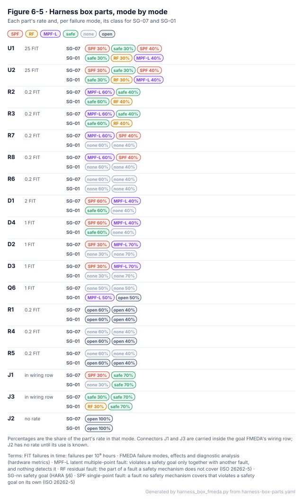

<!-- GENERATED by harness_box_fmeda.py from harness-box-parts.yaml and fmeda-flow.yaml; do not edit -->

# Harness box component FMEDA

The detailed component FMEDA of the harness box v3 (E-05), one row per part, as [WP-H-03](../WP-H-03-hardware-safety-analysis-fmeda.md) §6.5 describes. It is the part-level layer under the two goal FMEDAs ([`fmeda-sg009.yaml`](../../08-analyses/fmea/analyses/fmeda-sg009.yaml), [`fmeda-sg001.yaml`](../../08-analyses/fmea/analyses/fmeda-sg001.yaml)): the check below proves that the parts add up to their box rows. The rates are still generic estimates (no SN 29500 held), so these numbers show where the box falls short; they are not evidence of compliance. Draft, AI-assisted (I0), not reviewed.

**The box in five lines.**

1. **18 parts, 37 failure modes**, every designator of the v3 drawing and the BOM; 15 carry their own rate, the connectors sit inside the wiring row.
2. **For stock braking (SG-07) the box puts 37.56 FIT on single points** out of 57.6 FIT, almost all of it the two DG419LE switches.
3. **For steering (SG-01) the box has no single point:** 15.16 FIT is covered by a mechanism, 20.5 FIT is latent and 17.04 FIT is safe.
4. **The part-level view found what the block view hid:** the goal FMEDAs split the same switch two ways, and R6, Q6, R1, R4, R5 are in no goal FMEDA. Applied, SG-01's SPFM goes from 96.84 % to 96.95 % and its LFM from 88.94 % to 88.60 %.
5. **No periodic test of the box exists**, so every latent fault stays latent for the box's life; 8 modes still need their effect analysed.

## The FMEDA flow

*Figure 6-0. The inputs a detailed component FMEDA needs and the outputs it gives, with the records that hold each here and how far each has got ([`fmeda-flow.yaml`](fmeda-flow.yaml)).*

## Output 1: failure rate per mode and category

*Figure 6-5. Every part, its rate and the class of each failure mode for both goals.*

| Category | SG-07 stock braking (FIT) | SG-01 steering (FIT) |
|---|---|---|
| Single-point | 37.56 | 0 |
| Covered by a mechanism (before DC) | 0 | 15.16 |
| Latent multiple-point | 3.08 | 20.5 |
| Safe | 15.16 | 17.04 |
| No effect on this goal | 1.6 | 3.8 |
| Effect not yet analysed | 0.2 | 1.1 |

| Part | λ (FIT) | Failure mode | Share | SG-07 | SG-01 | Goal FMEDA row |
|---|---|---|---|---|---|---|
| U1 | 25 | Stuck in intercept, or IN input damaged high | 30% | SPF | safe | sg009 FMD-019, sg001 FMD-021 |
| U1 | 25 | Stuck in pass-through | 30% | safe | RF | sg009 FMD-021, sg001 FMD-020 |
| U1 | 25 | Channel open, increased on-resistance, leakage or latch-up | 40% | SPF | MPF-L | sg009 FMD-022, sg001 FMD-022 |
| U2 | 25 | Stuck in intercept, or IN input damaged high | 30% | SPF | safe | sg009 FMD-019, sg001 FMD-021 |
| U2 | 25 | Stuck in pass-through | 30% | safe | RF | sg009 FMD-021, sg001 FMD-020 |
| U2 | 25 | Channel open, increased on-resistance, leakage or latch-up | 40% | SPF | MPF-L | sg009 FMD-022, sg001 FMD-022 |
| R2 | 0.2 | Open (IN floats when SBU1 is undriven) | 60% | MPF-L | safe | sg009 FMD-028, sg001 FMD-024 |
| R2 | 0.2 | Short (SBU1 held low) | 40% | safe | RF | sg009 FMD-029, sg001 FMD-023 |
| R3 | 0.2 | Open (IN floats when SBU1 is undriven) | 60% | MPF-L | safe | sg009 FMD-028, sg001 FMD-024 |
| R3 | 0.2 | Short (SBU1 held low) | 40% | safe | RF | sg009 FMD-029, sg001 FMD-023 |
| R7 | 0.2 | Open (camera side left with one 120 Ω in intercept) | 60% | MPF-L | none | sg009 FMD-035 |
| R7 | 0.2 | Short (camera CAN2_H to CAN2_L in intercept) | 40% | SPF | none | sg009 FMD-036 |
| R8 | 0.2 | Open (camera side left with one 120 Ω in intercept) | 60% | MPF-L | none | sg009 FMD-035 |
| R8 | 0.2 | Short (camera CAN2_H to CAN2_L in intercept) | 40% | SPF | none | sg009 FMD-036 |
| R6 | 0.2 | Open | 60% | none | none | none |
| R6 | 0.2 | Short | 40% | none | none | none |
| D1 | 2 | Open (box unpowered without comma power) | 60% | SPF | safe | sg009 FMD-030 |
| D1 | 2 | Short (reverse protection lost) | 40% | MPF-L | none | sg009 FMD-032 |
| D4 | 1 | Short (box VIN to ground) | 60% | SPF | safe | sg009 FMD-031 |
| D4 | 1 | Open (transient protection lost) | 40% | MPF-L | none | sg009 FMD-032 |
| D2 | 1 | Short or leakage on a CAN line | 30% | SPF | none | sg009 FMD-033 |
| D2 | 1 | Open (clamp lost) | 70% | MPF-L | none | sg009 FMD-034 |
| D3 | 1 | Short or leakage on a CAN line | 30% | SPF | none | sg009 FMD-033 |
| D3 | 1 | Open (clamp lost) | 70% | MPF-L | none | sg009 FMD-034 |
| Q6 | 1 | Drain-source short (SBU2 held low) | 50% | none | MPF-L | none |
| Q6 | 1 | Open (SBU2 never pulled low) | 50% | none | open | none |
| R1 | 0.2 | Open | 60% | open | open | none |
| R1 | 0.2 | Short | 40% | open | open | none |
| R4 | 0.2 | Open | 60% | none | open | none |
| R4 | 0.2 | Short | 40% | none | open | none |
| R5 | 0.2 | Open | 60% | none | open | none |
| R5 | 0.2 | Short | 40% | none | open | none |
| J1 | in the wiring row | Contact open in the stock path | 30% | SPF | none | sg009 FMD-023 |
| J1 | in the wiring row | Plug loose (whole box off the harness) | 70% | safe | safe | sg009 FMD-024 |
| J3 | in the wiring row | SBU1 contact open | 30% | safe | RF | none |
| J3 | in the wiring row | Cable loose (device off the box) | 70% | safe | safe | sg009 FMD-024 |
| J2 | no rate | Contact open or short | 100% | open | open | none |

## Output 2: useful life

Mission: 15 years, about 7,500 operating hours, one power cycle per drive (DQ-067). The rates assume a constant failure rate, which holds only while no part reaches wear-out.

| Parts | Wear-out | Limit |
|---|---|---|
| U1, U2, Q6, D1, D2, D3, D4 | None expected (semiconductors; no electromigration or oxide limit is given in the transcribed data) | Not limiting |
| R1, R2, R3, R4, R5, R6, R7, R8 | None expected (thick-film resistors at low power) | Not limiting |
| J1, J2, J3 | Contact wear by mating cycles and fretting under vibration | To confirm against the connector datasheets; the box is mated once at installation and again only at service or decommissioning (WP-O-02) |

No electrolytic capacitor, relay, battery or fan is on the v3 box, the usual wear-out parts.

## Output 3: diagnostic coverage per failure mode

| Part | Failure mode | Goal | Mechanism | DC |
|---|---|---|---|---|
| U1 | Stuck in pass-through | SG-01 | FMD-SM-006 | 90% |
| U1 | Channel open, increased on-resistance, leakage or latch-up | SG-01 | FMD-SM-008 | 90% |
| U2 | Stuck in pass-through | SG-01 | FMD-SM-006 | 90% |
| U2 | Channel open, increased on-resistance, leakage or latch-up | SG-01 | FMD-SM-008 | 90% |
| R2 | Short (SBU1 held low) | SG-01 | FMD-SM-006 | 90% |
| R3 | Short (SBU1 held low) | SG-01 | FMD-SM-006 | 90% |

Every other mode of the box has no mechanism: DC 0 %.

## Output 4: coverage of each periodic test

In ISO 26262 terms the slide's proof test is the test that finds latent faults.

| Test | When | Finds | Coverage in service | Note |
|---|---|---|---|---|
| Installation check of the stock path (DFM-ACT-008) | Once, at installation (WP-O-01) | U1 channel open, U2 channel open, J1 contact open | 0% | Runs once, so it is not a periodic test for the latent faults of the 15-year life |
| Harness box bench tests VS-HW-22…24 | On a sample box, at verification (WP-H-06) | R2/R3 open, R7/R8 open, clamp short split, box VIN lost | 0% | Type tests on a sample; they find design errors, not latent faults in a fielded box |

## Findings

**Disagreements with the goal FMEDAs** (the check reports them; the list only shrinks):

- fmeda-sg001 FMD-C-007: FMD-020 parts 15.00 FIT, row 17.50 FIT; FMD-021 parts 15.00 FIT, row 17.50 FIT; FMD-022 parts 20.00 FIT, row 15.00 FIT. The SG-001 file splits the DG419LE as 0.35 stuck in pass-through, 0.35 stuck in intercept and 0.30 channel open; the SG-009 file, and this part list, as 0.30, 0.30 and 0.40. One part can have only one failure-mode distribution: the two goal FMEDAs should be aligned (WP-H-03 OI-11).

**Parts in no goal FMEDA:** R6, Q6, R1, R4, R5. Their modes are classified above; the Q6 drain-source short is latent for SG-01 (DFM-014.C2).

**What the goal metrics would be with these applied** (computed in memory with fmea_lint; the FMEDA files are not changed here):

| Case | SPFM | LFM | λ total (FIT) |
|---|---|---|---|
| SG-01 today (fmeda-sg001) | 96.84 % | 88.94 % | 255.4 |
| with the DG419LE split aligned | 96.94 % | 88.75 % | 255.4 |
| and Q6 short carried as a latent row | 96.95 % | 88.60 % | 256.4 |

**Modes whose effect is not yet analysed:**

- Q6: Open (SBU2 never pulled low)
- R1: Open
- R1: Short
- R4: Open
- R4: Short
- R5: Open
- R5: Short
- J2: Contact open or short

## Where this comes from

| File | What it is |
|---|---|
| [`harness-box-parts.yaml`](harness-box-parts.yaml) | The parts, rates, modes, classes, useful life and periodic tests |
| [`fmeda-flow.yaml`](fmeda-flow.yaml) | The inputs and outputs of Figure 6-0 with their records and state |
| [`harness_box_fmeda.py`](harness_box_fmeda.py) | Checks the part list against RR-2026-010 and the BOM, rolls the parts up into the goal FMEDAs, computes the outputs and draws the figures; `--check` in CI |
