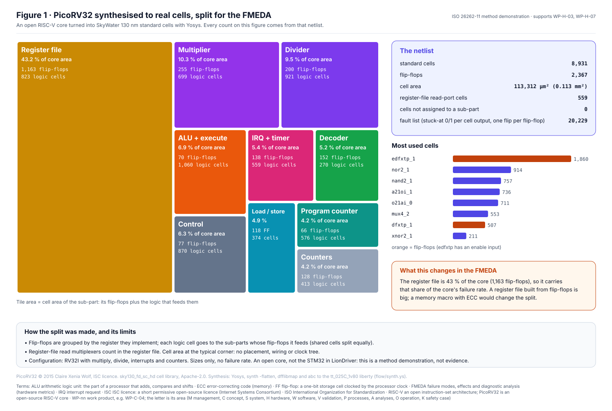
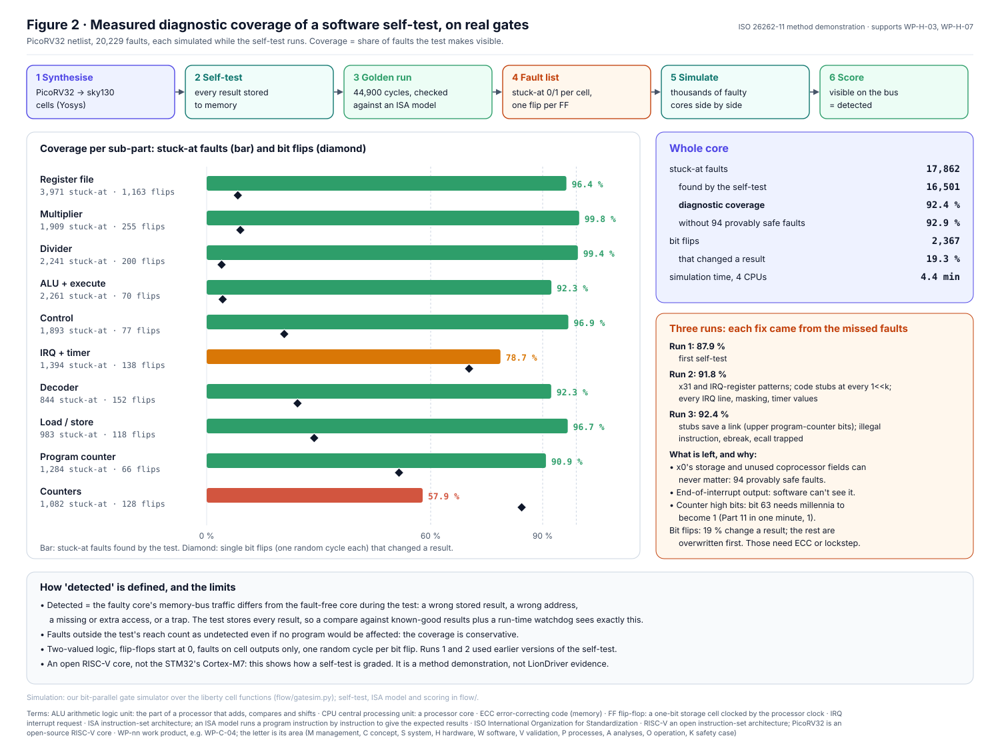

# Part 11 method demonstration (open RISC-V core)

The ISO 26262-11 method, run end to end on a real gate netlist: an open-source RISC-V core (PicoRV32) synthesised to
the open SkyWater 130 nm cell library, split into sub-parts for the FMEDA, then graded by fault injection. It shows how
LionDriver would measure diagnostic coverage instead of assuming it from a table, and what ECC and lockstep buy.

> [!IMPORTANT]
> **A method demonstration, not LionDriver evidence.** The core is not the STM32H725 in the item: ST's netlist is not
> public, and a self-test written for a RISC-V core does not run on a Cortex-M7. Nothing here earns FMEDA credit for
> [WP-H-03](../../WP-H-03-hardware-safety-analysis-fmeda.md). It supports the method of WP-H-03 §6.2 and
> [WP-H-07](../../WP-H-07-hardware-component-qualification.md) §7.

| Field | Value |
|---|---|
| Record | Supporting record of WP-H-03 and WP-H-07 |
| Version | 0.1 (2026-11-19): synthesis, sub-part split, self-test campaign in three runs, ECC and lockstep campaigns, eight figures |
| Status | Draft, not reviewed |
| Author | Claude (AI-assisted, I0 under WP-M-02 §3.3) |
| Tools | Yosys (YoWASP build 0.71) for synthesis; our own gate simulator ([`flow/gatesim.py`](flow/gatesim.py)), not qualified (WP-P-07): results are demonstration only |

## 1. Results

| Question | Measured | From |
|---|---|---|
| How big is the core, and where is its area? | 8,931 cells and 2,367 flip-flops, 113,312 µm²; the register file is 43.2 % of the area | [`results/subparts.json`](results/subparts.json) |
| How much does a software self-test catch? | 92.4 % of 17,862 stuck-at faults (92.9 % without the 94 provably safe faults), up from 87.9 % in the first run | [`results/coverage.json`](results/coverage.json), [`coverage-history.json`](results/coverage-history.json) |
| How many single bit flips change a result? | 457 of 2,367 (19.3 %); the rest are overwritten before use | `coverage.json` |
| What does ECC on the register file buy? | single flips causing a wrong result: 88 of 1,120 without ECC, 0 of 1,365 with SECDED; 455 of 600 double flips flagged; area +14.3 % | [`results/ecc_summary.json`](results/ecc_summary.json) |
| What does lockstep buy? | all 6,537 faults that sent a wrong command were caught first, a median 105 cycles before the write; area ×2.04. Same glitch in both cores: plain lockstep caught none of 289 wrong commands, delayed lockstep (2 cycles) caught 80 of the 289 | [`results/lockstep_summary.json`](results/lockstep_summary.json) |

The faults the self-test still misses all have a named cause: x0's storage and the unused register fields of the
coprocessor interface can never matter (94 faults, by rule in [`flow/analyze.py`](flow/analyze.py)); the
end-of-interrupt output is invisible to software; and the high bits of the 64-bit counters cannot become 1 in any test
(bit 63 needs millennia at 50 MHz).



*Figure 1.* The core as the FMEDA sees it: ten sub-parts sized by real cell area. Drawn from `results/subparts.json` by
[`figures/fig_md_core.py`](figures/fig_md_core.py); CI fails if it is stale.



*Figure 2.* Coverage per sub-part for stuck-at faults (bars) and bit flips (diamonds), and how each test change raised
it. Drawn from `results/coverage.json` and `coverage-history.json` by [`figures/fig_md_core.py`](figures/fig_md_core.py).

## 2. Part 11 in one minute

Six phone-format explainers drawn from the same results by [`figures/fig_md_explainers.py`](figures/fig_md_explainers.py).

| | Question | Figure |
|---|---|---|
| 1 | How long before the top bit of a counter is ever tested? | [`fig-md-e1-counter-bits.svg`](figures/fig-md-e1-counter-bits.svg) |
| 2 | Where does a CPU's failure rate go? | [`fig-md-e2-where-lambda-goes.svg`](figures/fig-md-e2-where-lambda-goes.svg) |
| 3 | How do you check that a CPU self-test really works? | [`fig-md-e3-grading-a-selftest.svg`](figures/fig-md-e3-grading-a-selftest.svg) |
| 4 | Why doesn't one flipped bit crash the CPU? | [`fig-md-e4-bit-flips.svg`](figures/fig-md-e4-bit-flips.svg) |
| 5 | What does ECC on the register file buy you? | [`fig-md-e5-what-ecc-buys.svg`](figures/fig-md-e5-what-ecc-buys.svg) |
| 6 | Why run two CPUs to do the work of one? | [`fig-md-e6-why-lockstep.svg`](figures/fig-md-e6-why-lockstep.svg) |

## 3. How it works

1. **Fetch** ([`flow/fetch.sh`](flow/fetch.sh)) PicoRV32, the sky130 typical-corner liberty and one cell layout at pinned
   commits, each checked by SHA-256. No third-party file is committed.
2. **Synthesise** with Yosys ([`flow/synth.ys`](flow/synth.ys)) to sky130 cells. The ECC core uses PicoRV32's
   register-file hook with our generated SECDED register file ([`flow/gen_regs_ecc.py`](flow/gen_regs_ecc.py),
   [`flow/patch_picorv32_ecc.py`](flow/patch_picorv32_ecc.py)); the lockstep top is two cores and a comparator
   ([`flow/lockstep_top.v`](flow/lockstep_top.v)).
3. **Split** ([`flow/subparts.py`](flow/subparts.py)): flip-flops by the register they implement, logic cells by the
   flip-flops they feed, register-file read multiplexers to the register file.
4. **Self-test** ([`flow/selftest.py`](flow/selftest.py)): 5,268 instructions covering the register file, ALU, multiply
   and divide, branches, jumps, every load and store width, counters, every interrupt line, masking, the timer and traps.
   Every result is stored. The fault-free gate-level run is checked against an instruction-set model of the same program.
5. **Fault campaign** ([`flow/campaign.py`](flow/campaign.py), [`flow/gatesim.py`](flow/gatesim.py)): stuck-at 0 and 1 on
   every cell output and one bit flip per flip-flop at a random cycle, thousands of faulty cores simulated side by side
   in one pass, on 4 CPUs. Detected = the core's memory-bus traffic differs from the fault-free core.
6. **ECC and lockstep** ([`flow/ecc_campaign.py`](flow/ecc_campaign.py), [`flow/lockstep.py`](flow/lockstep.py),
   [`flow/lockstep_cc.py`](flow/lockstep_cc.py)): the same flips in both register files; all faults in one core of a
   lockstep pair running a small torque limiter whose commands are checked against a Python model.
7. **Score** ([`flow/analyze.py`](flow/analyze.py), [`flow/ecc_score.py`](flow/ecc_score.py),
   [`flow/lockstep_score.py`](flow/lockstep_score.py)) into `results/`, from which the figures are drawn.

To reproduce (about 20 minutes on 4 CPUs; needs `pip install yowasp-yosys gdstk`):

```bash
bash assurance/04-hardware/semiconductors/method-demo/flow/run_all.sh
```

**Limits.** Two-valued logic; flip-flops start at 0; faults on cell outputs only; one random cycle per bit flip; no
placement, wiring or clock tree; a typical-corner library, not a foundry sign-off library. Runs 1 and 2 of the
self-test used earlier versions of `selftest.py` and are kept only as recorded results; run 3 is what the committed flow
reproduces. Coverage is conservative: a fault the test cannot reach counts as undetected.

**Licences.** PicoRV32 © 2015 Claire Xenia Wolf, ISC licence. The SkyWater sky130_fd_sc_hd library and the cell geometry
in [`results/sky130_dfxtp_1.json`](results/sky130_dfxtp_1.json) are Apache-2.0 (google/skywater-pdk-libs-sky130_fd_sc_hd).
