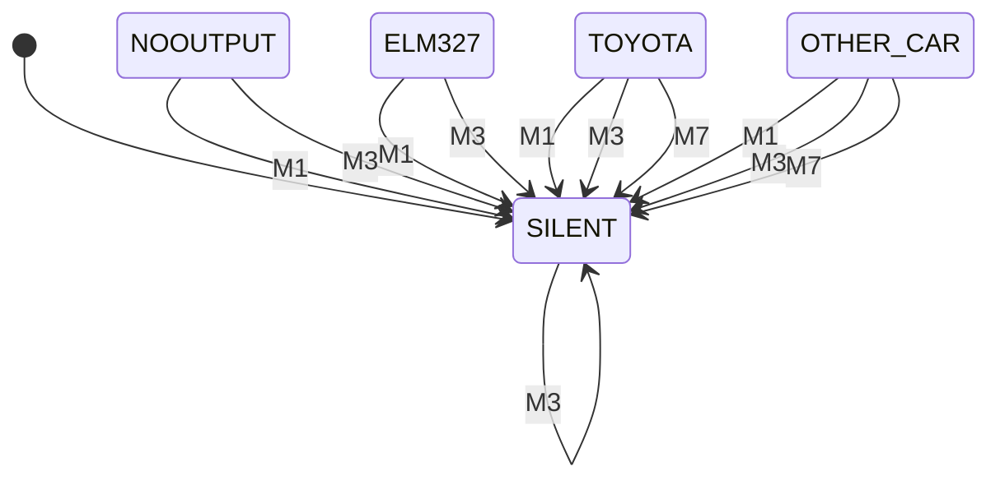
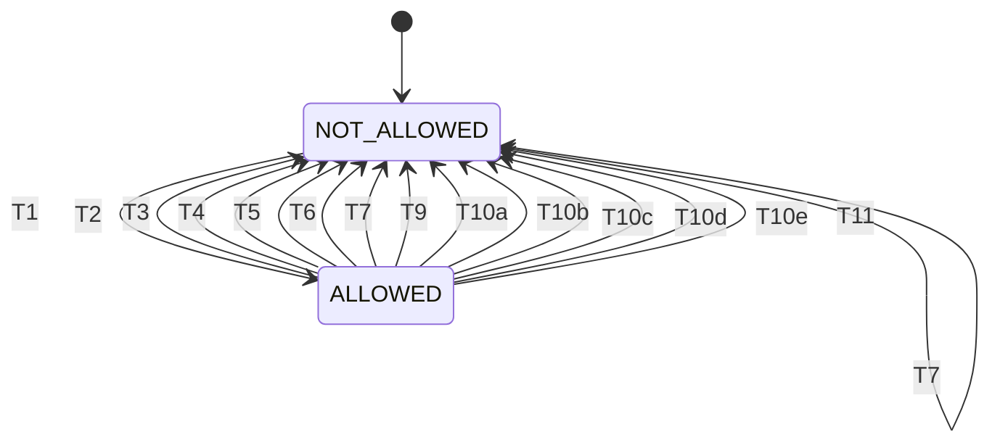

# WP-W-05 Software Unit Design and Implementation

| Field | Value |
|---|---|
| Work product | WP-W-05 Software unit design and implementation |
| Standard reference | ISO 26262-6:2018 §8 (software unit design and implementation: notation, design principles for unit design and implementation); ISO/SAE 21434:2021 §10 (by reference to WP-W-11); ASPICE 4.0 SWE.3 |
| Version | 0.3 (RR-2026-008 F-16: unit inventory, §3, §4, §6–§8 rewritten for the current pins, new units UN-36…UN-44, allocation lines for SWSRs without a unit, ENV-R-07 sizes marked as line spans; F-29: Origin column; F-28: Author, baseline; 2026-10-12). 0.2 (UN-03: TX rate supervision design proposal DN-01; 2026-10-12). 0.1 |
| Status | Draft |
| ASIL / scope | Envelope units (E-03a/E-03b): B‡ (ASIL C until SG-01 re-rating) |
| Author | Assurance team (AI-assisted draft, Claude) |
| Reviewer(s) | TBD (I1) |
| Approver | Project maintainer (acting safety manager) |
| Baseline | `682f184` (opendbc `7993399`, panda `8aa8671`) |

## 1. Purpose and scope

This document describes the software units of the safety envelope as implemented at the baseline `682f184` (opendbc `7993399`, panda `8aa8671`): purpose, inputs, outputs, state, algorithm, limits and error handling. It records compliance with the unit design principles of [WP-W-01 §6](WP-W-01-software-development-environment-guidelines.md) (ENV-R-01…15) and lists the changes each SWSR of [WP-W-02](WP-W-02-software-safety-requirements.md) requires. Units belong to the components of [WP-W-03 §3.1](WP-W-03-software-architecture.md); unit verification is in [WP-W-06](WP-W-06-software-unit-verification.md).

All sections describe the current pins. §5 (normative state tables) is generated from the state-machine data files in [`state-machines/`](state-machines/) by `assurance/trace/tools/check_state_machines.py` and is not edited by hand; §3 and §4 refer to its transition IDs.

The design is back-filled from code (T-03). The code is the implementation; this document is the design description against which it is reviewed. Nothing in this document is verified on hardware or reviewed; "implemented" means the code exists at the pin and, where named, host tests exist.

**Unit granularity.** A unit is one C function (or a small group of static helpers used by one public function). Module-level groupings (U-SAF-CORE etc.) are the components used by WP-W-06.

**Notation.** Function tables, state-transition tables (normative), pseudo-code only where the code is not self-explanatory (WP-W-01 §14). Paths as in WP-W-02 §2.2.

## 2. Unit inventory

**Pins and paths.** Repo "opendbc" means opendbc `7993399`, paths relative to `opendbc_repo/opendbc/safety/`; repo "panda" means panda `8aa8671`, paths relative to `panda/board/`. Every file:line in §2–§4 and §6–§8 is at these pins unless another pin is named. Line numbers are file positions of the first and last line of the function or block.

**Build variants.** Code under `#ifdef LIONDRIVER_REFERENCE` is compiled only in the reference build (`LIONDRIVER_REFERENCE=1`, panda `SConscript:24-26`); code under `LIONDRIVER_FAULT_INJECTION` only in debug builds made with `FAULT_INJECTION=1` (panda `SConscript:29-31`). Units or parts marked "(ref. build)" do not exist in other builds.

**Origin** (RR-2026-008 F-29) is decided from the fork histories: every non-merge commit in opendbc `229dc70..7993399` (10 commits) and panda `92eb565..8aa8671` (17 commits) is a LionDriver commit (author "Claude", merged through pull requests on the `jherrodthomas` forks); `229dc70` (commaai/opendbc #3846) and `92eb565` (commaai/panda #2455) are the upstream bases. Method: `git log --no-merges` and `git diff --stat` over those ranges on a full clone of the fork remotes (the submodule checkouts in the working tree are shallow). A unit is

- *Inherited* — no line of it changed in those ranges (inherited from opendbc or panda upstream);
- *Inherited, modified by LionDriver* — upstream function with LionDriver lines added or changed;
- *LionDriver-authored* — function or file added in those ranges.

| Unit | Function(s) | Repo | File:lines | Component | Context | Origin | SWSRs |
|---|---|---|---|---|---|---|---|
| UN-01 | `safety_rx_hook` | opendbc | `safety.h:201-230` | U-SAF-CORE | FDCAN RX ISR | Inherited | 301, 302, 402, 406, 710 |
| UN-02 | `rx_msg_safety_check`, `get_addr_check_index`, `update_addr_timestamp`, `update_counter`, `is_msg_valid` | opendbc | `safety.h:114-199` | U-SAF-CORE | RX ISR, safety task | Inherited | 110, 401, 402, 406 |
| UN-03 | `safety_tx_hook`, `tx_msg_safety_check` | opendbc | `safety.h:232-241, 283-302` | U-SAF-CORE | SPI/USB ISR (TX path) | Inherited, modified by LionDriver (rate check call, ref. build) | 101–107, 201–207, 518, 705, 710 |
| UN-04 | `safety_fwd_hook`, `get_fwd_bus` | opendbc | `safety.h:304-337` | U-SAF-CORE | RX ISR | Inherited | 704, 710 |
| UN-05 | `safety_tick` | opendbc | `safety.h:403-420` | U-SAF-CORE | safety task ISR (TIM4, 100 Hz) | Inherited, modified by LionDriver (uses UN-37) | 401, 406 |
| UN-06 | `generic_rx_checks`, `stock_ecu_check`, `relay_malfunction_set/reset` | opendbc | `safety.h:422-460` | U-SAF-CORE | RX ISR | Inherited | 302, 710 |
| UN-07 | `set_safety_hooks`, `reset_sample` | opendbc | `safety.h:462-565` | U-SAF-CORE | SPI ISR, tick ISR, thread (via UN-18) | Inherited, modified by LionDriver (new flags and TX rate state reset) | 311, 506a, 512 |
| UN-08 | `pcm_cruise_check` | opendbc | `safety.h:601-610` | U-SAF-CORE | RX ISR | Inherited, modified by LionDriver (engagement gated by UN-37) | 301, 306, 309 |
| UN-09 | `to_signed`, `update_sample`, `ROUND`, `GET_BYTES_LE`, `GET_BYTES_64_LE`, `speed_mismatch_check` | opendbc | `safety.h:35-52, 567-599, 612-620` | U-SAF-CORE / HELP | all | Inherited | 101a, 104 |
| UN-10 | `steer_torque_cmd_checks` | opendbc | `lateral.h:60-151` | U-SAF-LAT | TX path | Inherited | 101–106, 108 |
| UN-11 | `dist_to_meas_check`, `driver_limit_check`, `rt_torque_rate_limit_check` | opendbc | `lateral.h:10-57` | U-SAF-LAT | TX path | Inherited | 103, 103a, 104, 304 |
| UN-12 | `get_longitudinal_allowed`, `longitudinal_accel_checks` | opendbc | `longitudinal.h:3-12` | U-SAF-LONG | TX path | Inherited | 201–203, 305 |
| UN-13 | `SAFETY_MIN/MAX/CLAMP/ABS`, `crc8_update`, `msg_matches_*`, `safety_get_ts_elapsed`, `safety_max_limit_check`, `safety_interpolate` | opendbc | `helpers.h:7-104` | U-SAF-HELP | all | Inherited | all |
| UN-14 | `toyota_rx_hook` | opendbc | `modes/toyota.h:179-266` | U-SAF-TOY | RX ISR | Inherited, modified by LionDriver (`0x262`, `0x1D3` decoding, ref. build) | 104, 110, 301, 302, 305, 405 |
| UN-15 | `toyota_tx_hook` | opendbc | `modes/toyota.h:268-457` | U-SAF-TOY | TX path | Inherited, modified by LionDriver (EPS-fault gate, ref. build) | 101, 101a, 103–107, 110, 201, 201a, 202–207, 705 |
| UN-16 | `toyota_init`, TX/RX tables | opendbc | `modes/toyota.h:5-83, 459-563` | U-SAF-TOY | SPI ISR (via UN-07) | Inherited, modified by LionDriver (whitelist, RX set, timeout periods, TX rate rows) | 104a, 401, 512, 518, 705 |
| UN-17 | `toyota_compute_checksum`, `toyota_get_checksum`, `toyota_get_quality_flag_valid` | opendbc | `modes/toyota.h:147-177` | U-SAF-TOY | RX ISR | Inherited | 402 |
| UN-18 | `set_safety_mode`, `is_car_safety_mode` | panda | `main.c:37-100` | U-PND-MAIN | SPI ISR, tick ISR, thread | Inherited, modified by LionDriver (critical section) | 311, 512, 706 |
| UN-19 | `tick_handler` | panda | `main.c:146-290` | U-PND-MAIN | tick ISR (8 Hz, 1 Hz decimation) | Inherited, modified by LionDriver (`safety_tick` moved to UN-N1) | 307, 510, 516, 701 |
| UN-20 | `main` | panda | `main.c:292-423` | U-PND-MAIN | thread | Inherited, modified by LionDriver (priorities, safety task, reset cause, main-loop progress) | 501, 502c, 515, 519 |
| UN-21 | `comms_control_handler`, `get_health_pkt` | panda | `main_comms.h:8-61, 69-343` | U-PND-COMMS | SPI/USB ISR | Inherited, modified by LionDriver (reference lock call, health fields, heartbeat monitor reset) | 108a, 409, 412a, 511a, 512, 513, 514 |
| UN-22 | `comms_can_write`, `comms_can_read`, `comms_can_reset`, `refresh_can_tx_slots_available` | panda | `can_comms.h:47-146` | U-PND-COMMS | SPI/USB ISR | Inherited | 410a, 411, 412b |
| UN-23 | `spi_rx_done`, `spi_tx_done`, `validate_checksum`, `spi_version_packet` | panda | `drivers/spi.h:44-243` | U-PND-SPI | DMA/SPI ISR | Inherited | 410, 412, 413 |
| UN-24 | `llspi_mosi_dma`, `llspi_miso_dma`, DMA/SPI IRQ handlers, `llspi_init` | panda | `stm32h7/llspi.h:5-110` | U-PND-SPI | ISR | Inherited | 410b, 412 |
| UN-25 | `can_rx` | panda | `drivers/fdcan.h:154-243` | U-PND-FDCAN | FDCAN IT0 | Inherited | 704, 707, 711 |
| UN-26 | `process_can`, `update_can_health_pkt`, `can_clear_send`, `can_init` | panda | `drivers/fdcan.h:7-150, 254-272` | U-PND-FDCAN | FDCAN IT1, any | Inherited | 508, 707 |
| UN-27 | `can_send`, `can_push`, `can_pop`, `can_slots_empty`, `can_clear`, `can_set_checksum`, `can_check_checksum`, `can_init_all`, `can_set_orientation` | panda | `drivers/can_common.h:42-177` | U-PND-FDCAN | any | Inherited | 109, 707, 711 |
| UN-28 | `set_intercept_relay`, `harness_check_ignition`, `harness_detect_orientation`, `harness_tick`, `harness_init` | panda | `drivers/harness.h:9-112` | U-PND-HARN | tick, SPI ISR, thread | Inherited, modified by LionDriver (starts the IWDG) | 501b, 506, 701, 706 |
| UN-29 | `fault_occurred`, `fault_recovered` | panda | `sys/faults.h:10-33` | U-PND-FLT | any | Inherited, modified by LionDriver (critical section) | 502 |
| UN-30 | `simple_watchdog_kick/init` | panda | `drivers/simple_watchdog.h:7-23` | U-PND-FLT | tick | Inherited | 502 (report only; SWSR-501 now met by UN-41) |
| UN-31 | `handle_interrupt`, `interrupt_timer_handler`, `init_interrupts`, `unused_interrupt_handler` | panda | `drivers/interrupts.h:5-83` | U-PND-FLT | all ISRs | Inherited | 502a, 502b |
| UN-32 | `register_set*`, `check_registers` | panda | `drivers/registers.h:24-77` | U-PND-FLT | any, tick | Inherited | 503a |
| UN-33 | `set_power_save_state`, `enable_can_transceivers`, `enter_stop_mode` | panda | `sys/power_saving.h:15-55, 57-…` | U-PND-PWR | SPI ISR, tick, thread | Inherited, modified by LionDriver (`enter_stop_mode` resets if the IWDG runs) | 508a, 513 |
| UN-34 | `NMI_Handler`, `HardFault_Handler`, early init | panda | `early_init.h:30-81` | U-PND-PLAT | exception | Inherited | 502a, 504 |
| UN-35 | bootstub `main` | panda | `bootstub.c:33-82` | U-PND-BOOT | thread | Inherited | 511 |
| UN-36 | `tx_rate_check` (ref. build) | opendbc | `safety.h:243-281`; types `declarations.h:218-245` | U-SAF-CORE | TX path | LionDriver-authored | 518 |
| UN-37 | `rx_check_frequency`, `rx_check_lagging`, `rx_checks_allow_engagement` | opendbc | `safety.h:369-401` | U-SAF-CORE | safety task ISR, RX ISR | LionDriver-authored (`rx_check_lagging` factors out upstream code of `safety_tick`) | 306, 401 |
| UN-38 | `toyota_lka_state_is_fault`, `safety_eps_fault` (ref. build) | opendbc | `modes/toyota.h:91-116`; flag `safety.h:74` | U-SAF-TOY | RX ISR | LionDriver-authored | 110, 108a |
| UN-39 | `toyota_cruise_main_check` (ref. build) | opendbc | `modes/toyota.h:118-144` | U-SAF-TOY | RX ISR | LionDriver-authored | 405 |
| UN-40 | `reference_request_allowed` (ref. build) | panda | `reference_lock.h:13-63` | U-PND-COMMS | SPI/USB ISR | LionDriver-authored | 104a, 511a, 512, 512a, 513 |
| UN-41 | `hw_watchdog_start`, `hw_watchdog_main_loop_alive`, `hw_watchdog_tick`, `main_loop_progress` | panda | `drivers/hw_watchdog.h:1-76`; `main.c:119-126` | U-PND-FLT | any (start), thread (alive), safety task ISR (feed) | LionDriver-authored | 501, 501b |
| UN-42 | `heartbeat_monitor_reset`, `heartbeat_monitor_tick` | panda | `drivers/heartbeat_monitor.h:1-30` | U-PND-MAIN | SPI/USB ISR (reset), safety task ISR (tick) | LionDriver-authored | 407 |
| UN-43 | `interrupt_priorities_init` | panda | `drivers/irq_priorities.h:1-46` | U-PND-PLAT | thread, before interrupts are enabled | LionDriver-authored | 519 |
| UN-44 | fault-injection hooks (`fault_injection_*`), request `0xa9` (debug builds with `FAULT_INJECTION=1` only) | panda | `drivers/fault_injection.h:1-55`; `main_comms.h:91-96` | U-PND-FLT (test support) | thread, tick, safety task, SPI/USB ISR | LionDriver-authored | none (HIL test support for 501) |
| UN-N1 | `safety_task_handler`, `safety_task_timer_init` (periodic safety task, formerly "(new)") | panda | `main.c:128-144`; `drivers/timers.h:30-38`; `stm32h7/stm32h7_config.h:38-41` | U-PND-MAIN | TIM4 ISR, 100 Hz | LionDriver-authored | 401a, 407, 501 (run in it); 408, 413, 506, 711a (not yet) |
| UN-N2 | (new) fault reaction `enter_safe_state(reason)` — not implemented | — | — | U-PND-FLT | any | — | 502, 108a, 503b, 504, 505, 509 |
| UN-N3 | (new) zero-torque frame generator — not implemented | — | — | U-SAF-TOY | TX path, safety task | — | 109, 109a |
| UN-N4 | (new) RX plausibility: rate and frozen-value checks, cross-checks (a), (b), (d) — not implemented; cross-check (c) is UN-39 | — | — | U-SAF-CORE/TOY | RX ISR, safety task | — | 403–405 |
| UN-N5 | (new) start-up tests — not implemented | — | — | U-PND-PLAT | thread before IRQs | — | 515 |
| UN-N6 | (new) SPI CRC and sequence check — not implemented | — | — | U-PND-SPI/COMMS | ISR | — | 410, 410a, 411 |

### 2.1 SWSRs allocated without a unit entry above

These SWSRs are allocated in [`swsr.yaml`](../trace/items/swsr.yaml) (field `allocated_to`) but had no unit entry at version 0.2. Status per the WP-W-02 Baseline column; code statements at the pins of §2.

| SWSR | Allocated to (`allocated_to`) | Unit in this document | Implementation at `682f184` |
|---|---|---|---|
| 201a | U-SAF-TOY | UN-15: `0x343` ACCEL_CMD decoded as `to_signed((data[0] << 8) \| data[1], 16)` (opendbc `modes/toyota.h:313-315`) | Implemented (upstream code); not verified on hardware |
| 503b | U-PND-FLT | UN-N2 (planned); no RAM/flash ECC handler exists in panda `8aa8671` | Not implemented |
| 504 | U-PND-FLT | UN-N2 (planned); existing: `NMI_Handler` resets the MCU (UN-34, `early_init.h:73-76`). Whether the clock security system is enabled so that it raises the NMI: not confirmed here | Not implemented |
| 505 | U-PND-FLT | UN-N2 (planned); supply voltage is only reported in health (`main_comms.h:13`) | Not implemented |
| 509 | U-PND-FLT | UN-N2 (planned); die temperature is only reported in health (`main_comms.h:57-58`) | Partial (report only) |
| 514 | build, U-PND-COMMS | UN-21 request `0xd6` returns `gitversion` (`main_comms.h:229-233`), built as `<builder>-<git>-<RELEASE\|DEBUG>` (panda `SConscript:36-41, 155-159`), so the build type is readable. The default build is DEBUG with `ALLOW_DEBUG` (`SConscript:12-20`); `LIONDRIVER_REFERENCE` is not part of the version string | Not met by default (build type reported; release not the default) |
| 516b | U-SAF-CORE | None. Candidate units: UN-08 (cruise state) and UN-N1 (periodic evaluation) | Not implemented |
| 711 | U-PND-FDCAN, U-PND-MAIN | UN-25, UN-27 (inputs: frames received, queue push) and UN-N1 (periodic check); today a full TX/forward queue is only counted (`drivers/can_common.h:165`) | Not implemented |
| 711a | U-PND-MAIN | UN-N1: the 100 Hz task that SWSR-711a requires exists since panda `9f60e17`; no `t_fwd` constant or forwarding check runs in it | Not implemented |

## 3. Unit design descriptions (safety layer)

All file:lines in this section are opendbc `7993399` unless marked.

### UN-01 `safety_rx_hook`

| Item | Description |
|---|---|
| Purpose | Validate one received frame and update envelope state |
| Inputs | `CANPacket_t` (addr, bus, DLC, data); `current_safety_config`, `current_hooks` |
| Outputs | Return: frame valid; side effects on `controls_allowed`, brand state, `relay_malfunction`, `heartbeat_engaged_mismatches` |
| State | via UN-02, UN-06, brand hook |
| Algorithm | (1) `rx_msg_safety_check` (`safety.h:204`); (2) brand RX hook only if valid **and** in the RX check list (`:205-208`); (3) `generic_rx_checks` (brake/regen/steering edges) always (`:211`); (4) for each TX message with `check_relay`, `stock_ecu_check(addr/bus match)` (`:216-222`); (5) reset mismatch counter on authority rising edge (`:225-227`) |
| Limits | none directly |
| Error handling | invalid checksum/quality/counter → `controls_allowed = false` in `is_msg_valid` (`safety.h:114-123`) |
| Remarks | Step (3) runs for every frame, so a brake edge from a frame that fails validation is still processed through the previous `brake_pressed` value only (brand hook not run). Correct direction (revocation not lost) to be confirmed by test (OI-1) |

### UN-02 RX checks

| Item | Description |
|---|---|
| Purpose | Match a frame to an RX check entry; verify checksum, counter, quality; time-stamp |
| Inputs | frame, `RxCheck[]` table of the mode (Toyota: UN-16, below) |
| Outputs | index; `status.valid_checksum`, `wrong_counters`, `valid_quality_flag`, `last_timestamp` |
| Algorithm | Linear search with first-match latch of the alternative address (`msg_seen`, `safety.h:125-148`); checksum via brand callbacks unless `ignore_checksum` (`:175-181`); counter compares expected `(last+1) mod (max+1)` and keeps a clamped 0…5 score (`:157-164, 184-189`); quality flag via callback (`:192-196`) |
| Limits | `MAX_WRONG_COUNTERS = 5` (`safety.h:54`); `MAX_ADDR_CHECK_MSGS = 3` |
| Error handling | invalid → authority cleared (`safety.h:117-119`) |

Toyota RX check table for the reference car (non-SecOC, LKA, BRAKE_MODULE `0x226`; parameter 73), `modes/toyota.h:46-69`, selected in `toyota_init` (`:527-539`):

| ID | Signal use | Nominal rate | Checksum | Counter | Quality | Build |
|---|---|---|---|---|---|---|
| `0xAA` | wheel speeds | 83 Hz | ignored | ignored | wheel-speed fault bits (`:166-175`) | all |
| `0x260` | EPS motor/driver torque, angle | 50 Hz | checked | ignored | ignored in LKA (`ignore_quality_flag = !lta`) | all |
| `0x262` | EPS_STATUS (LKA_STATE) | 25 Hz | checked | ignored | ignored | ref. build (`:56-60`) |
| `0x1D3` | PCM_CRUISE_2 (MAIN_ON) | 33 Hz | checked | ignored | ignored | ref. build (`:56-60`) |
| `0x1D2` | PCM_CRUISE (CRUISE_ACTIVE, GAS_RELEASED) | 33 Hz | checked | ignored | ignored | all |
| `0x226` | BRAKE_MODULE (BRAKE_PRESSED) | 40 Hz | ignored | ignored | ignored | all |

`0xB4` (SPEED) is not in the set: no nominal rate is known (`modes/toyota.h:54-55`). The 25 Hz and 33 Hz rates of `0x262` and `0x1D3` are to be confirmed against measured rates (WP-S-05 OI-7, `modes/toyota.h:53-54`). Other Toyota sets (alt-brake `:71-74`, SecOC `:76-80`) are unchanged from upstream apart from the timeout periods.

### UN-03 `safety_tx_hook`

| Item | Description |
|---|---|
| Purpose | Decide whether a SoC frame may be transmitted |
| Inputs | frame; TX whitelist; `relay_malfunction`; current mode; TX rate rows (ref. build) |
| Outputs | true = transmit |
| Algorithm | whitelist by (addr, bus, length) (`safety.h:232-241, 284`) → ALLOUTPUT and ELM327 bypass the whitelist (`:285-287`) → reference build: per-ID rate check UN-36 **before** the brand TX hook, so a frame over budget does not update the brand's limit state (`:290-294`); other builds: brand TX hook (`:296-298`) → AND with `!relay_malfunction` (`:301`) |
| Error handling | caller (`can_send`, panda `drivers/can_common.h:161-176`) counts rejection and echoes frame with `rejected=1` |
| Change | On rejection of a lateral frame while engaged: revoke and request substitute frame (SWSR-108, 109): not implemented. Design of the rate check: [DN-01](design-notes/DN-01-tx-rate-supervision.md) |

### UN-04 `safety_fwd_hook`

Purpose: return the destination bus (0↔2) or −1 (`safety.h:304-337`). Blocked when `relay_malfunction` or `disable_forwarding`, or when the address is a `check_relay` TX message destined for that bus and not `disable_static_blocking` (static block for the reference configuration: `0x191`, `0x412`, `0x2E4`, `0x343` towards bus 0, `modes/toyota.h:6-39`). Runs before `safety_rx_hook` for the same frame (panda `drivers/fdcan.h:199, 221`), deliberately independent of RX validation (GAP-11).

### UN-05 `safety_tick`

| Item | Description |
|---|---|
| Purpose | Detect lagging or invalid RX messages |
| Algorithm | For each RX entry (`safety.h:404-420`): `lagging = rx_check_lagging(i, ts)` (UN-37), stored in `status.lagging`; invalid if lagging, nominal frequency < 10 Hz, or `is_msg_valid` false → `controls_allowed = false`; `safety_rx_checks_invalid` = any invalid |
| Threshold | Modes with `rx_timeout_periods > 0`: that many nominal periods, no floor. Toyota sets 5 in every build (`modes/toyota.h:82-83, 543`): `0xAA` 60 ms, `0x260` 100 ms, `0x262` 200 ms, `0x1D3` and `0x1D2` ≈ 151 ms, `0x226` 125 ms (5 × 10^6 / f µs, truncated). Other modes: `max(10 periods, 1 s)` as upstream (`safety.h:380-381`) |
| Timing | Called from the 100 Hz safety task UN-N1 (panda `main.c:133`), so detection is the threshold plus at most one task period (10 ms) by design; period and jitter not measured (SWSR-401a). At `8b8c6ae`: 1 Hz from the tick, detection 1–2 s |

### UN-07 `set_safety_hooks`

Purpose: select brand hooks, reset all state (`safety.h:467-565`). Algorithm: reset every state variable (`:501-538`), including `controls_allowed = false`, `relay_malfunction = false`, and the LionDriver flags `safety_eps_fault` and `safety_tx_rate_exceeded` (`:537-538`); zero `current_safety_config` (`:540`); linear search of the registry (debug-only modes under `ALLOW_DEBUG`, `:489-498`); call brand `init(param)`; zero all RX status (`:555-557`) and, in the reference build, all TX rate status (`:558-562`). Returns −1 for an unknown mode, after the state reset, with `current_hooks` unchanged and the configuration zeroed; the caller then sets SILENT (panda `main.c:46-54`). The caller runs it inside a critical section (UN-18). Open changes: do not clear the relay latch (SWSR-506a, not met); accept only the locked configuration (SWSR-512: done one level up, in UN-40, reference build only).

### UN-08 `pcm_cruise_check` and engagement

`pcm_cruise_check` (`safety.h:601-610`): cruise not engaged → `controls_allowed = false`; rising edge of cruise → `controls_allowed = rx_checks_allow_engagement()` (UN-37), so for modes with `rx_timeout_periods` (Toyota) authority is granted only if every RX check is seen, valid and not lagging at that moment (SWSR-306, Partial). Other modes: the upstream unconditional grant (`rx_checks_allow_engagement` returns true). In the Toyota reference build UN-39 runs after it on the same `0x1D2` frame and may clear the grant again. §5.2 transitions T1, T8, T10c.

### UN-10 `steer_torque_cmd_checks`

| Item | Description |
|---|---|
| Purpose | Check one lateral torque command |
| Inputs | `desired_torque` (raw), `steer_req`, `TorqueSteeringLimits` (Toyota: `modes/toyota.h:269-283`); state `desired_torque_last`, `rt_torque_last`, `ts_torque_check_last`, `valid/invalid_steer_req_count`, `ts_steer_req_mismatch_last`; `torque_meas`; `controls_allowed`; µs timer |
| Outputs | violation flag; updated state |
| Algorithm | If engaged: (1) max-torque (optionally speed-dependent); (2) motor-limited check `dist_to_meas_check` (rate up/down relative to last, and ≤ meas ± 350); (3) store last; (4) RT window ±450 vs `rt_torque_last`, window restarted after 250 ms. Always: (5) torque ≠ 0 while not engaged → violation; (6) steer-request tolerance (17 valid frames, 1 invalid, 162 ms); (7) on violation or not engaged: reset all state (`lateral.h:140-148`) |
| Limits | 1500, 15, 25, 350, 450 / 250 ms, 17, 1, 162 ms (raw) |
| Error handling | returns violation; caller drops frame |
| Remarks | Unchanged from upstream. Rate state is updated before the RT check so a rejected frame still sets `desired_torque_last`; step (7) resets it to 0 on violation. Rate limit relative to `max(last, 0)` makes the allowed range asymmetric around 0 by design. In the reference build the EPS-fault gate of UN-15 runs before this unit, so a frame refused for an EPS fault does not reach it |
| Changes | SWSR-105 (reject `steer_req` without authority, Partial), SWSR-108 (revoke, not impl), SWSR-102 (table, not impl), SWSR-304 (driver check in addition to motor check, not impl) |

### UN-11 limit helpers

`dist_to_meas_check` (`lateral.h:10-23`): allowed band = intersection of rate band `[min(last,0) − up, max(last,0) + up]` and a measured band that allows moving towards zero at `down`. `driver_limit_check` (`lateral.h:26-46`): same structure with driver-torque-based band; unused by Toyota. `rt_torque_rate_limit_check` (`lateral.h:49-57`): ±450 band around `rt_torque_last`. Unchanged from upstream.

### UN-12 longitudinal

`get_longitudinal_allowed = controls_allowed && !gas_pressed_prev` (`longitudinal.h:3-5`). `longitudinal_accel_checks` returns violation unless (allowed and within [min, max]) or equal to `inactive_accel` (0 for Toyota, implicit) (`longitudinal.h:8-12`). Unchanged from upstream. Open changes: jerk limits (SWSR-204/205), wind-down (206), explicit inactive constant (203).

### UN-13 helpers

Statement-expression macros (GNU extension, WP-W-01 DEV records); `safety_interpolate` holds end values and protects `dx` from zero (`helpers.h:80-104`), 3-point tables; `safety_get_ts_elapsed` relies on unsigned wrap-around (`helpers.h:71-73`; correct for a 32-bit µs counter, wrap ≈ 71.6 min). `msg_matches(msg, addr, bus[, len])` selects the address/bus or address/bus/length comparison by argument count (`helpers.h:53-67`). Unchanged from upstream.

### UN-14 `toyota_rx_hook`

| Signal | Frame / bits | Use | Lines |
|---|---|---|---|
| EPS motor torque | `0x260` bytes 5–6, signed, × factor/100, then min−1 / max+1 | `torque_meas` (UN-10) | `modes/toyota.h:181-193` |
| Driver torque | `0x260` bytes 1–2 | `torque_driver` (LTA only) | `:196-198` |
| Steering angle | `0x260` bytes 3–4 when bit 3 (initializing) is 0 | `angle_meas` (LTA only) | `:202-207` |
| CRUISE_ACTIVE | `0x1D2` bit 5 | `pcm_cruise_check` (UN-08) | `:225-227` |
| GAS_RELEASED | `0x1D2` bit 4 (inverted) | `gas_pressed` | `:228` |
| BRAKE_PRESSED | `0x226` bit 37 (`0x224` bit 5 with ALT_BRAKE) | `brake_pressed` | `:230-235` |
| LKA_STATE (ref. build) | `0x262` byte 3 bits 1–7, length 8 | `safety_eps_fault = toyota_lka_state_is_fault(…)` (UN-38) | `:237-240` |
| MAIN_ON (ref. build, not ALT_BRAKE) | `0x1D3` bit 15, length 8 | `toyota_main_on`, then `toyota_cruise_main_check(false)` (UN-39) | `:241-245` |
| CRUISE_ACTIVE again (ref. build, not ALT_BRAKE) | `0x1D2` | `toyota_cruise_main_check(true)` after `pcm_cruise_check` (UN-39) | `:246-248` |
| Wheel speeds | `0xAA` 4 × 15 bit, offset 6767 | `vehicle_moving`, `vehicle_speed` | `:254-265` |

Runs only for valid, whitelisted frames (UN-01). Open changes: driver override (SWSR-304a), cross-checks (a), (b), (d) of SWSR-405 (UN-N4).

### UN-15 `toyota_tx_hook`

Whitelist of the reference configuration (non-SecOC, openpilot longitudinal: `TOYOTA_LONG_TX_MSGS`, `modes/toyota.h:6-39, 468-470, 506-511`): `0x191`, `0x412`, `0x1D2` (8 bytes), `0x2E4` (5 bytes), `0x343` (listed twice, `check_relay` false and true), `0x283` (7 bytes), `0x750`, all bus 0. Since opendbc `aff4033` PRE_COLLISION_2 `0x344`, the DSU bus-0 set (`0x2E6`, `0x2E7`, `0x33E`, `0x365`, `0x366`, `0x4CB`) and the DSU bus-1 set are not in any Toyota whitelist (`:28-39`). PCS_HUD `0x411` is whitelisted only outside the reference build (`:19-26`, decision D-1, opendbc `5b5a4ba`); confirmed: in the reference build `TOYOTA_PCS_HUD_TX_MSG` is empty.

Per-address checks (`:268-457`): `0x343` ACCEL_CMD decoded as signed 16-bit from bytes 0–1 (SWSR-201a, `:313-315`), bounds/inactive via UN-12 (+ stock-long cancel-only branch, `:325-333`); `0x183` (SecOC, unused); `0x283` zero payload in bytes 0–5 (`:348-354`); `0x191` no actuation in LKA configuration (`:357-370`); `0x131` (SecOC); `0x2E4` → reference build: **EPS-fault gate** first — while `safety_eps_fault`, any non-zero torque or `STEER_REQUEST = 1` is refused without calling UN-10, so a refused frame does not change the limit state; zero frames pass (`:425-434`, SWSR-110) — then UN-10; other builds: UN-10 directly (`:436-438`); `0x750` tester present only (`:448-454`). Frames on the whitelist without a specific check pass (in the reference build `0x412` and `0x1D2`). Before the hook, the reference build applies UN-36. Open changes: SWSR-207 (other `0x343` fields), SWSR-109 (substitute frame).

### UN-16 `toyota_init`

Decodes `param` (`modes/toyota.h:476-492`): low byte = EPS factor, bit 8 ALT_BRAKE, bit 9 STOCK_LONGITUDINAL, bit 10 LTA, bit 11 SECOC (debug only); selects TX list (`:500-512`) and RX check table (`:514-540`); sets `rx_timeout_periods = 5` for every Toyota configuration and build (`:542-543`); in the reference build resets the cruise-main state (`:493-497`) and, for non-SecOC configurations, installs the TX rate rows of UN-36 (`:545-560`). No range check on the EPS factor (GAP-44): the reference build relies on UN-40, which accepts TOYOTA only with parameter 73 (SWSR-104a met there through the lock; other builds still accept 0–255).

TX rate rows (reference build, `:549-557`); the per-window budget is computed by UN-36 as `ceil(0.3 × f) + 1 + burst` (`safety.h:262-263`):

| ID | f (Hz) | burst | Budget per 250 ms window |
|---|---|---|---|
| `0x2E4` | 100 | 5 | 36 |
| `0x191` | 50 | 3 | 19 |
| `0x343` | 33 | 3 | 14 |
| `0x412` | 5 | 4 | 7 |
| `0x1D2` | 1 | 2 | 4 |
| `0x283` | 1 | 2 | 4 |
| `0x750` | 5 | 2 | 5 |

The nominal rates come from `opendbc/car/toyota/carcontroller.py` (comment `:546-547`); budgets not yet confirmed on reference logs (TX-rate change record).

### UN-17 checksum and quality

`toyota_compute_checksum` (`modes/toyota.h:147-154`): 8-bit sum of address bytes, length and data bytes except the last; `toyota_get_checksum` (`:156-159`): last data byte; `toyota_get_quality_flag_valid` (`:161-177`): `0x260` bit 3 clear, `0xAA` all four wheel fault bits clear. Unchanged from upstream.

### UN-36 `tx_rate_check` (reference build)

| Item | Description |
|---|---|
| Purpose | Reject SoC frames that exceed the TX rate budget of their ID and revoke authority on persistent excess (SWSR-518) |
| Inputs | frame; `current_safety_config.tx_rate_checks` (UN-16); µs timer; `controls_allowed` |
| Outputs | true = within budget; side effects `controls_allowed = false`, `safety_tx_rate_exceeded = true` |
| State | per row `TxRateStatus`: `msgs`, `msgs_prev`, `rejected`, `ts_last` (`declarations.h:221-226`), zeroed by UN-07 |
| Algorithm | (`safety.h:248-280`) First row matching (addr, bus). When ≥ 125 ms have passed since `ts_last`, start a new half-window: `msgs_prev = msgs` (or 0 after ≥ 250 ms), `msgs = rejected = 0`. If `msgs + msgs_prev ≥ budget` → reject, `rejected` +1 (saturating); if `controls_allowed` and `rejected ≥ 3` → revoke and set the flag. Else count the frame. IDs without a row are not rate-checked |
| Limits | window 250 ms (`TX_RATE_WINDOW_US`), revocation after 3 rejections in a half-window (`TX_RATE_REVOKE_REJECTED`), `safety.h:246-247` |
| Error handling | rejected frame is handled by the caller as any TX rejection (UN-03) |
| Remarks | Reference build only (DN-01 D-5). Runs before the brand hook (UN-03). Host tests `test_tx_rate_*` (`tests/test_toyota.py:128-260`); HIL test `tests/hitl/test_14_tx_rate.py` not run |

### UN-37 RX lag and engagement helpers

`rx_check_frequency(i)` (`safety.h:369-371`): nominal frequency of the RX entry's selected message. `rx_check_lagging(i, ts)` (`:373-386`): `elapsed > threshold`, threshold = `max(10 × period, 1 s)`, or `rx_timeout_periods × period` when the mode sets it (Toyota: 5). Shared by UN-05 and `rx_checks_allow_engagement` (`:390-401`), which, only for modes with `rx_timeout_periods`, returns false if any RX entry is lagging or invalid at the moment of the call (and `is_msg_valid` clears `controls_allowed` for an invalid one). Called from UN-08 on the PCM rising edge (SWSR-306, 401). Host tests `test_rx_timeout_5_periods`, `test_rx_timeout_5_periods_each_msg`, `test_no_engagement_with_invalid_rx_checks` (`tests/test_toyota.py:369-430`).

### UN-38 EPS fault state (reference build)

`toyota_lka_state_is_fault(lka_state)` (`modes/toyota.h:99-116`) returns true for LKA_STATE ∈ {0, 3, 9, 11, 17, 21, 25}, the set openpilot's host treats as temporary or permanent steering faults (`:92-97`; reverse-engineered, to be confirmed for the reference EPS firmware). UN-14 stores the result for every valid `0x262` frame in `safety_eps_fault` (`safety.h:74`); UN-15 uses it to refuse lateral actuation; `controls_allowed` is not cleared, so longitudinal control continues. The flag is reset on every mode change (UN-07) and reported in health bit 10 (UN-21). Authority cannot be granted before a valid `0x262` has been received (UN-37). Host test `test_eps_fault_blocks_lka` (`tests/test_toyota.py:309`); HIL test `tests/hitl/test_13_eps_fault.py` not run.

### UN-39 `toyota_cruise_main_check` (reference build)

| Item | Description |
|---|---|
| Purpose | Treat PCM_CRUISE.CRUISE_ACTIVE = 1 with PCM_CRUISE_2.MAIN_ON = 0 as invalid (SWSR-405(c)) |
| Inputs | `cruise_engaged_prev` (set by UN-08 from `0x1D2`), `toyota_main_on` (from `0x1D3`), `from_pcm_cruise` (call site), µs timer |
| State | `toyota_main_on`, `toyota_cruise_main_mismatch`, `toyota_cruise_main_mismatch_start` (`modes/toyota.h:123-125`), reset in UN-16 |
| Algorithm | (`:127-144`) mismatch = cruise active and main off. No mismatch → clear the latch. New mismatch → latch with time stamp; if detected on a `0x1D2` frame (cruise just became or is active while main is off) clear `controls_allowed` at once. Continuing mismatch → clear `controls_allowed` once it has lasted > 150 ms |
| Limits | `TOYOTA_CRUISE_MAIN_TOLERANCE_US = 150000` (`:122`) |
| Remarks | Not used with ALT_BRAKE (no `0x1D3` in that RX set, `:241`). Host test `test_cruise_active_with_main_off` (`tests/test_toyota.py:263`) |

## 4. Unit design descriptions (panda platform)

All file:lines in this section are panda `8aa8671` unless marked.

### UN-18 `set_safety_mode`

Calls UN-07 inside `ENTER_CRITICAL()`/`EXIT_CRITICAL()` (`main.c:43-45`; WP-W-03 §5.4.3 R-1); on failure falls back to SILENT, again in a critical section, and `assert_fatal`s if SILENT fails (`:46-54`); clears `safety_tx_blocked` and `safety_rx_invalid` (`:55-56`); sets relay and CAN mode per mode (`:58-91`): SILENT and NOOUTPUT release the relay, ELM327 releases it and selects OBD CAN for parameter 0, every other mode drives the relay (which starts the IWDG, UN-41) and clears the heartbeat counters; re-initialises all CAN cores (`:92`). Not gated by the reference lock: internal callers (tick, heartbeat loss) reach it directly; host requests pass UN-40 first. `is_car_safety_mode` (`:95-100`): any mode except SILENT, NOOUTPUT, ALLOUTPUT, ELM327. Open change: replace the `assert_fatal` hang by reset (SWSR-502a).

### UN-19 `tick_handler`

8 Hz tick ISR (`main.c:146-290`), with a 1 Hz part when `loop_counter == 0` (`:187-284`). 8 Hz: siren output (`:155`), `harness_tick`, `simple_watchdog_kick` (UN-30), relay-malfunction fault bit (`:166-173`), on harness status change re-initialise CAN and call `set_safety_mode(current_safety_mode, current_safety_param)` (`:176-184`). 1 Hz: `heartbeat_counter` +1 (`:204-206`; cleared by `0xf3`); authority cleared after 3 ticks of `controls_allowed && !heartbeat_engaged` (`:226-233`); counter ≥ 5 (ignition) / 2 → `heartbeat_lost` (car mode), siren 3 s if authority was recent, SILENT, power save (`:235-270`); `check_registers` (`:273`); `safety_mode_cnt` +1 (`:282`). Since panda `9f60e17` `safety_tick` no longer runs here (UN-N1), and the 0.3 s heartbeat revocation runs in UN-N1/UN-42; the 3-tick mismatch (SWSR-307, not met) and the 5 s SILENT path (SWSR-510, not met) are unchanged.

### UN-N1 periodic safety task

| Item | Description |
|---|---|
| Purpose | Run the periodic safety checks at a fixed rate independent of the 8 Hz tick (SWSR-401a) |
| Timer | TIM4, 1 MHz count, ARR = 10^6 / `SAFETY_TASK_FREQ` − 1 (`drivers/timers.h:30-38`), `SAFETY_TASK_FREQ = 100` (`stm32h7/stm32h7_config.h:38-41`); registered with an interrupt-rate limit of 110 Hz sharing `FAULT_INTERRUPT_RATE_TICK` (`main.c:351-353`) |
| Algorithm | (`main.c:130-144`) when the update flag is set: (1) `safety_tick()` (UN-05); (2) `heartbeat_monitor_tick()` (UN-42) and, in a car mode, `controls_allowed = false` while it reports a timeout; (3) `hw_watchdog_tick()` (UN-41); (4) fault-injection hook (UN-44, debug builds with `FAULT_INJECTION` only); then clear the flag |
| Priority | NVIC level 8, same as all other interrupts (UN-43), so it does not preempt and is not preempted |
| Not yet in it | SWSR-307, 403, 404, 405 (beyond UN-39, which runs per frame), 408, 413, 506, 109a, 711/711a |
| Timing | Period, jitter and execution time not measured (SWSR-401a, SWSR-519) |

### UN-20 `main`

Order (`main.c:292-423`): `init_interrupts` → `disable_interrupts` → `interrupt_priorities_init` (UN-43, `:299-300`) → clock, peripherals, board, `harness_init` (relay released, UN-28) → µs timer → `set_safety_mode(SILENT)` (`:339`) → CAN transceivers on (`:342`) → software watchdog init, 375 ms (`:345`) → 8 Hz tick (`:348-349`) → 100 Hz safety task (`:351-353`) → USB, SPI → reset-cause flags: NMI/HardFault cookies and, since panda `3859fa8`, `HEALTH_FLAG_WATCHDOG_RESET` from `RCC_RSR_IWDG1RSTF`, then the reset flags are cleared (`:367-380`) → interrupts on (`:383`) → idle loop calling `main_loop_progress()` (UN-41) on every iteration and every LED fade step (`:386-409`), in power save: stop mode on CUATRO without SOM GPIO, asserting SILENT first, else `__WFI` (`:410-419`). Open: start-up tests (SWSR-515, UN-N5), MPU (SWSR-507).

### UN-21 `comms_control_handler`

One switch over the request byte (`main_comms.h:69-343`). In the reference build the request first passes UN-40; a refused request is mapped to `0x00`, which has no case and no effect (`:73-79`). Safety-relevant cases:

| Request | Effect | Gating, reference build | Gating, other builds | Required |
|---|---|---|---|---|
| `0xdc` | set mode/param (`:243-245`) | UN-40: only SILENT, NOOUTPUT, ELM327, TOYOTA with parameter 73; in TOYOTA only NOOUTPUT or SILENT | none | SWSR-512 (met, ref. build) |
| `0xf3` | heartbeat: clears `heartbeat_counter`, resets UN-42, sets `heartbeat_engaged` (`:298-306`) | none | none | + loop counter (SWSR-409) |
| `0xc5` | drive relay (`:165-167`; starts the IWDG, UN-41) | refused in a car mode | none | SWSR-513 (met, ref. build) |
| `0xd1` | bootloader (param 0, `ALLOW_DEBUG` only) / softloader (param 1) (`:185-205`) | param 1 refused in a car mode | param 0 debug only | SWSR-511a (Partial) |
| `0xd8` | MCU reset (`:235-237`) | refused in a car mode | none | SWSR-513 |
| `0xdb`, `0xde`, `0xe5`, `0xe6`, `0xe7`, `0xe8`, `0xf1`, `0xf9`, `0xfc` | CAN/clock/power config | refused in a car mode; `0xe8` index `bus_config[param1]` still unbounded outside a car mode (`:282-284`) | none (`0xe8` no bound) | SWSR-513, 412a |
| `0xdf` | alternative experience (`:262-267`) | refused in every mode | refused in car modes only | SWSR-512a, 513 |
| `0xf8` | disable heartbeat (`:312-316`) | refused in car modes | refused in car modes | keep |
| `0xa9` | fault injection (`:91-96`) | exists only in debug builds with `FAULT_INJECTION` | same | not in a release image (UN-44) |
| `0xd2` | health (`:207-209`) | — | — | general reason code (SWSR-108a) |

`0xb0` (IR power), `0xb1` (fan), `0xc0` (comms reset) and `0xf6` (siren) are not gated in any build and are not in the SWSR-513 list (OI-6).

**Health reporting** (`get_health_pkt`, `main_comms.h:8-61`; layout `health.h:3-41`). In addition to the upstream fields (`controls_allowed`, `heartbeat_lost`, `safety_rx_checks_invalid`, `safety_tx_blocked`, `safety_rx_invalid`, faults, `spi_error_count`, voltage, temperature), LionDriver added: flag bit 9 `HEALTH_FLAG_WATCHDOG_RESET` (last reset by the IWDG, set in UN-20), bit 10 `HEALTH_FLAG_EPS_FAULT` (`safety_eps_fault`, UN-38), bit 11 `HEALTH_FLAG_TX_RATE_EXCEEDED` (`safety_tx_rate_exceeded`, UN-36), and `requests_rejected_pkt` (UN-40 counter in the reference build, 0 otherwise; `main_comms.h:25-31`, `health.h:12-17, 40`). There is still no general revocation reason code (SWSR-108a, Partial).

### UN-22 CAN stream packing

`comms_can_write` reassembles packets that span transfers using a 72-byte buffer and `dlc_to_len[data[pos] >> 4]` (max 70 bytes); complete packets go to `can_send(…, false)` (`can_comms.h:83-129`). `comms_can_read` drains `can_rx_q` into the MISO buffer (`:47-78`). No sequence counter. Unchanged from upstream. Open changes: SWSR-410a, 411, 412b.

### UN-23 SPI protocol state machine

| State | Event | Guard | Action | Next |
|---|---|---|---|---|
| HEADER | 7 bytes received | "VERSION" | version response | HEADER_NACK |
| HEADER | 7 bytes | sync 0x5A and XOR ok | send HACK | HEADER_ACK |
| HEADER | 7 bytes | else | send NACK | HEADER_NACK |
| HEADER_ACK | ACK sent | — | DMA `len_mosi + 1` bytes | DATA_RX |
| DATA_RX | data received | XOR ok and endpoint handler ACKs | DACK + response + XOR | DATA_TX |
| DATA_RX | data received | else | NACK | HEADER_NACK |
| DATA_TX / HEADER_NACK | TX complete | — | DMA 7 bytes | HEADER |

`spi_rx_done` (`drivers/spi.h:106-222`) increments `spi_error_count` when the checksum is invalid (`:219-221`). Unchanged from upstream. Open changes: length guard in HEADER (SWSR-412), CRC (410), DMA error flags (410b).

### UN-25 `can_rx`

Per frame in FIFO 0 (`drivers/fdcan.h:154-243`): build `CANPacket_t`, forward (UN-04, `can_send` with `skip_tx_hook = true`), `safety_rx_hook`, `ignition_can_hook`, push to `rx_q`, enable CAN-FD/BRS if seen. Errors → `update_can_health_pkt`, bus-off → core reset. Unchanged from upstream.

### UN-27 `can_send`

If TX hook passes (or skipped): push to the bus queue (overflow counted in `tx_buffer_overflow`) and call `process_can`; else count `safety_tx_blocked`, mark `rejected`, echo to `rx_q` (`drivers/can_common.h:161-177`). Unchanged from upstream. Open change: on rejected lateral frame, push the substitute zero-torque frame (SWSR-109).

### UN-28 harness

Relay outputs open-drain, active low; `set_intercept_relay` (`drivers/harness.h:9-37`) busy-waits on `sbu_adc_lock` (`:24`). Since panda `5bdb5de` (commits `6c7bf48`, `361c7a2`) it calls `hw_watchdog_start()` whenever it drives the relay or the ignition relay (`:16-21`), on every path including `0xc5` (SWSR-501b). `harness_init` (`:100-112`) sets both relay outputs to the released level before detecting orientation. Orientation via SBU ADC compared with AVDD/2 only while the relay is not driven. Open changes: readback (SWSR-506), orientation-loss reaction (SWSR-701).

### UN-29…32 fault units

`fault_occurred` sets a bit and status, `fault_recovered` clears it, both inside a critical section since panda `52cad44` (`sys/faults.h:8-33`; WP-W-03 §5.4.3 R-8); `PERMANENT_FAULTS = 0` (`sys/sys.h:50`) so no fault is permanent; nothing reacts. Software watchdog (UN-30) compares tick intervals inside the tick ISR (threshold 375 ms, `main.c:345`) and only reports; the hang reaction is now UN-41. Interrupt-rate fault raised when a handler is called more often than its limit in a second (UN-31; the safety task shares `FAULT_INTERRUPT_RATE_TICK`). Register check compares masked register values at 1 Hz (UN-32). Open change: UN-N2 `enter_safe_state(reason)` called by all of them (SWSR-502).

### UN-33 power saving

`enable_can_transceivers` (`sys/power_saving.h:15-21`), `set_power_save_state` (`:23-55`). `enter_stop_mode` (`:57-…`) resets the MCU first if the IWDG runs (`:61-63`), because the IWDG keeps counting in stop mode; the next stop entry after the reset sleeps because the IWDG starts only when the relay is driven.

### UN-35 bootstub

Soft flasher if the softloader magic is set; else length check, SHA-1 over the image, version tag, RSA-1024 against the release key (debug key only under `ALLOW_DEBUG`), jump or `fail()` (`bootstub.c:33-82`). Unchanged from upstream. Open changes: SWSR-511; start of the IWDG in the bootstub remains a target (SWSR-501b, OI-10 of WP-W-02).

### UN-40 `reference_request_allowed` (reference build)

| Item | Description |
|---|---|
| Purpose | Lock the safety configuration and refuse configuration requests in a car mode (SWSR-512, 512a, 513, 511a; SWSR-104a through the parameter) |
| Inputs | `ControlPacket_t` (request, param1, param2); `current_safety_mode` |
| Outputs | true = request may run; side effects: `reference_requests_rejected` +1 (saturating at 0xFFFF), debug print |
| Algorithm | (`reference_lock.h:18-62`) `0xdc`: in TOYOTA only NOOUTPUT or SILENT; otherwise SILENT, NOOUTPUT, ELM327, or TOYOTA with param2 = 73 (`LIONDRIVER_REFERENCE_TOYOTA_PARAM`, `:14`). `0xdf`: always refused. `0xd1`: param 1 refused in a car mode. `0xc5`, `0xd8`, `0xdb`, `0xde`, `0xe5`, `0xe6`, `0xe7`, `0xe8`, `0xf1`, `0xf9`, `0xfc`: refused in a car mode. Others: allowed |
| Error handling | caller maps a refused request to `0x00` (UN-21) |
| Remarks | Internal mode changes (tick, heartbeat loss) are not affected. Host tests `tests/reference_lock/test_reference_lock.py`; HIL test `tests/hitl/test_11_reference_lock.py` not run |

### UN-41 hardware watchdog

| Item | Description |
|---|---|
| Purpose | End a main-loop hang, a safety-task hang or a hang with interrupts disabled in a reset (relay released, restart in SILENT) (SWSR-501, 501b) |
| Configuration | IWDG1 from LSI, prescaler /4 (PR = 0), reload 719 → 90 ms nominal at 32 kHz; window 679 → a feed is accepted only ≈ 5 ms or more after the previous one (`drivers/hw_watchdog.h:20-39`); LSI tolerance to be confirmed from the datasheet (`:22-23`) |
| Algorithm | `hw_watchdog_start` (`:45-58`): once, write start/unlock keys, PR, RLR, wait for the update flags with a bounded loop (200000 iterations), write WINR, skip the next tick. `hw_watchdog_main_loop_alive` (`:61-63`): set a flag, called from `main_loop_progress` (`main.c:121-126`). `hw_watchdog_tick` (`:66-76`, from UN-N1): skip the first tick after the start; else feed only if the main loop ran since the previous feed, and clear the flag |
| Start | by UN-28 the first time a relay is driven; never stopped by software; UN-33 resets before stop mode if it runs |
| Reporting | reset cause → health bit 9 (UN-20) |
| Remarks | Deviations D-1/D-2 of the watchdog change record accepted as interim. Host tests `tests/hw_watchdog/`; HIL test `tests/hitl/test_10_hw_watchdog.py` not run as recorded evidence. Timeout and window values are design values, not measured on the device |

### UN-42 heartbeat monitor

`heartbeat_monitor_reset` (`drivers/heartbeat_monitor.h:20-22`) clears `heartbeat_age_ticks` on every `0xf3` (UN-21). `heartbeat_monitor_tick` (`:25-30`), from UN-N1, increments it up to 30 and returns true while it is ≥ 30 (0.3 s at 100 Hz, `HEARTBEAT_AUTHORITY_TIMEOUT_TICKS`, `:15`). UN-N1 clears `controls_allowed` on every tick while true and the mode is a car mode, until the next heartbeat; re-engagement needs a new PCM rising edge (SWSR-407, implemented). Detection is ≤ 0.3 s plus one task period by design; not measured. Host tests `tests/heartbeat_monitor/`.

### UN-43 `interrupt_priorities_init`

Sets an explicit NVIC priority for the interrupts the firmware enables (20 `NVIC_SetPriority` calls; the change record says 21, OI-7) (`drivers/irq_priorities.h:21-46`), grouped in five classes (safety task, CAN, host, housekeeping, peripheral, `:15-19`), all at level 8, so the equal-priority, no-preemption behaviour of WP-W-03 §6.3 is unchanged. Called from UN-20 before any interrupt is enabled. The distinct levels proposed in WP-W-03 §5.4.2 are not set; latency not measured (SWSR-519, Partial). Host test `tests/irq_priorities/`.

### UN-44 fault-injection hooks (debug builds only)

`fault_injection.h` (`drivers/fault_injection.h:1-55`) refuses to compile without `ALLOW_DEBUG` (`:10-12`) and is included only with `LIONDRIVER_FAULT_INJECTION` (`main.c:11-13`), which the build allows only for DEBUG (`SConscript:29-31`). Request `0xa9` selects a hang of the main loop, the tick, the safety task, a hang with interrupts disabled, or an early watchdog feed, for the HIL watchdog tests. Not part of a release image; listed so that the inventory covers all LionDriver-authored firmware code.

## 5. Normative state tables

### 5.1 Safety-mode transitions (UN-18/UN-07)

<!-- BEGIN GENERATED: sm-safety-mode (assurance/trace/tools/check_state_machines.py) -->
Generated from [`state-machines/sm-safety-mode.yaml`](state-machines/sm-safety-mode.yaml) by `assurance/trace/tools/check_state_machines.py --write`; do not edit by hand. Status is taken from the WP-W-02 Baseline column of the cited SWSRs ("Implemented" = code changed and host tests pass, not verified on hardware). Build: all, reference (`LIONDRIVER_REFERENCE=1` only) or upstream (without it).

| # | Current | Event | Guard | Action | Next | Build | SWSR | Status | Code |
|---|---|---|---|---|---|---|---|---|---|
| M1 | any | reset | — | set_safety_mode(SILENT) | SILENT | all | 311, 502c | Partial | panda main.c:339 |
| M2 | any | 0xdc (m, p) | m in the registry | reset state; relay per m; CAN re-init | m | upstream | 311 | Implemented | panda main_comms.h:243-245; main.c:38-90 |
| M3 | any | 0xdc (m, p) | m unknown (set_safety_hooks fails); in the reference build an unknown m is refused by M6 first | fall back | SILENT | upstream | 311 | Implemented | panda main.c:46-53 |
| M4 | SILENT, NOOUTPUT, ELM327 | 0xdc (m, p) | m ∈ {SILENT, NOOUTPUT, ELM327}, or m = TOYOTA with p = 73 | reset state; relay per m | m | reference | 512, 104a | Implemented | panda board/reference_lock.h:25-27; main_comms.h:74-78 |
| M5 | TOYOTA | 0xdc (m, p) | m ∈ {NOOUTPUT, SILENT} | reset state; relay released | m | reference | 512 | Implemented | panda board/reference_lock.h:22-24; main_comms.h:74-78 |
| M6 | any | 0xdc (m, p) | any other (m, p) | request refused, counted in requests_rejected_pkt | same | reference | 512, 513 | Implemented | panda board/reference_lock.h:53-58; main_comms.h:74-78 (request mapped to 0x00) |
| M7 | TOYOTA, OTHER_CAR | 1 Hz tick | heartbeat counter ≥ 5 (ignition on) / 2 (off) | siren if recently engaged; heartbeat_lost | SILENT | all | 510, 516 | Partial | panda main.c:237-257 |
| M8 | any | harness status change | — | set_safety_mode(current) (state reset) | same | all | 311 | Implemented | panda main.c:176-183 |

<!-- END GENERATED: sm-safety-mode -->

### 5.2 Authority (`controls_allowed`) for the Toyota mode

<!-- BEGIN GENERATED: sm-toy-auth (assurance/trace/tools/check_state_machines.py) -->
Generated from [`state-machines/sm-toy-auth.yaml`](state-machines/sm-toy-auth.yaml) by `assurance/trace/tools/check_state_machines.py --write`; do not edit by hand. Status is taken from the WP-W-02 Baseline column of the cited SWSRs ("Implemented" = code changed and host tests pass, not verified on hardware). Build: all, reference (`LIONDRIVER_REFERENCE=1` only) or upstream (without it).

| # | Current | Event | Guard | Action | Next | Build | SWSR | Status | Code |
|---|---|---|---|---|---|---|---|---|---|
| T1 | NOT_ALLOWED | 0x1D2 valid | CRUISE_ACTIVE 0→1 and rx_checks_allow_engagement() | set | ALLOWED | all | 301, 306 | Partial | opendbc safety.h:606-608 (pcm_cruise_check) |
| T8 | NOT_ALLOWED | 0x1D2 valid | CRUISE_ACTIVE held 1, or 0→1 with an RX check failing | none | NOT_ALLOWED | all | 301, 306 | Partial | opendbc safety.h:606-608 |
| T2 | ALLOWED | 0x1D2 valid | CRUISE_ACTIVE = 0 | clear | NOT_ALLOWED | all | 301 | Implemented | opendbc safety.h:603-605 |
| T3 | ALLOWED | any RX | brake rising, or pressed while moving | clear | NOT_ALLOWED | all | 302 | Implemented | opendbc safety.h:430-432 (generic_rx_checks) |
| T4 | ALLOWED | RX of checked message | checksum, quality flag or counter invalid | clear | NOT_ALLOWED | all | 402, 406 | Partial | opendbc safety.h:117-120 (is_msg_valid) |
| T5 | ALLOWED | safety_tick (100 Hz safety task) | any RX check lagging (5 periods), below 10 Hz, or invalid | clear | NOT_ALLOWED | all | 401, 401a, 406 | Partial | opendbc safety.h:413-416; panda main.c:133 (safety_task_handler) |
| T6 | ALLOWED | 1 Hz tick | heartbeat engaged=0 for 3 consecutive ticks | clear | NOT_ALLOWED | all | 307 | Not implemented | panda main.c:225-229 |
| T7 | any | safety mode set (0xdc, heartbeat loss, harness change) | — | clear | NOT_ALLOWED | all | 311 | Implemented | opendbc safety.h:534 (set_safety_hooks) |
| T9 | ALLOWED | TX frame rejected by a content check | — | clear, reason | NOT_ALLOWED | all | 108 | Not implemented | not implemented: the frame is dropped, authority kept (opendbc safety.h safety_tx_hook) |
| T10a | ALLOWED | safety task: heartbeat check | no SoC heartbeat for > 0.3 s in a car mode | clear | NOT_ALLOWED | all | 407 | Implemented | panda main.c:135-137 (heartbeat_monitor_tick) |
| T10b | ALLOWED | safety task: command freshness check | no accepted 0x2E4/0x343 for 50/100 ms | clear, reason | NOT_ALLOWED | all | 408 | Not implemented | not implemented |
| T10c | ALLOWED | 0x1D2 / 0x1D3 | CRUISE_ACTIVE while MAIN_ON is off for > 150 ms | clear | NOT_ALLOWED | reference | 405 | Partial | opendbc modes/toyota.h:126-143 (toyota_cruise_main_check) |
| T10d | ALLOWED | platform fault | — | clear, SS-S | NOT_ALLOWED | all | 502 | Not implemented | not implemented: faults are reported only |
| T10e | ALLOWED | driver steering override | — | clear, reason | NOT_ALLOWED | all | 304 | Not implemented | not implemented for Toyota LKA |
| T11 | ALLOWED | TX frame over the per-ID rate budget | 3 rejected frames in one 125 ms half-window | clear, report txRateExceeded | NOT_ALLOWED | reference | 518 | Implemented | opendbc safety.h:264-272 (tx_rate_check) |

Reactions that do **not** change the state:

| Event | Reaction | Build | SWSR | Code |
|---|---|---|---|---|
| EPS reports a fault (LKA_STATE in the fault set) | lateral frames with torque or steer request refused; authority kept | reference | 110 | opendbc modes/toyota.h:425-432 |
| gas pressed | longitudinal actuation blocked; authority kept | all | 305 | opendbc longitudinal.h (UN-12) |

<!-- END GENERATED: sm-toy-auth -->

Gas pressed does not change the state; it gates longitudinal only (UN-12). This table is the reference for WP-W-06 VS-UV-06.

## 6. Error handling and fault classification (target design)

### 6.1 Fault table for SWSR-502

The "Class" and "Reaction" columns are the target design. The last column states what exists at `682f184` (panda `8aa8671`).

| Fault | Source unit | Class (proposed) | Reaction | At `682f184` |
|---|---|---|---|---|
| Relay malfunction | UN-06, SWSR-506 | latched until power cycle | TX + forwarding blocked; relay released if readback shows stuck | TX + forwarding blocked (UN-03, UN-04); latch cleared by every mode change (SWSR-506a, not met); no readback |
| Watchdog / hang | IWDG (UN-41) | reset | SS-S after reset | Implemented, not verified on hardware: IWDG reset, restart releases the relay (`drivers/harness.h:100-112`) and sets SILENT (`main.c:339`); cause reported in health bit 9 |
| Interrupt rate (CAN, SPI, tick, safety task) | UN-31 | latched for drive cycle | SS-S | Report only; the safety task shares `FAULT_INTERRUPT_RATE_TICK` (`main.c:352`) |
| Register divergence | UN-32 | latched | SS-S | Report only, 1 Hz |
| RAM/flash ECC double error, image CRC | new (UN-N2, SWSR-503b) | latched | SS-S | Not implemented |
| Clock drift, supply (PVD), temperature | new (UN-N2, SWSR-504, 505, 509) | recoverable with hysteresis | SS-S while active | Not implemented; voltage and temperature reported only |
| SPI error burst | UN-23 | recoverable | revoke (SWSR-413) | Counted only |
| Siren malfunction | U-PND-HK | report | warning only | Not assessed here |
| Unused interrupt | UN-31 | latched | SS-S | Report only |

## 7. Compliance with unit design principles (WP-W-01 §6)

| Rule | U-SAF-* units | U-PND-* units | Finding |
|---|---|---|---|
| ENV-R-01 no dynamic memory | Yes | Yes (`-nostdlib`) | — |
| ENV-R-02 no recursion | Yes | Yes | — |
| ENV-R-03 bounded loops | Yes (UN-36 loop bounded by `tx_rate_checks_len`) | Not all: `while (harness.sbu_adc_lock) {}` (`drivers/harness.h:24`), SPI drain loop (`stm32h7/llspi.h:12-15`), main idle loop. The IWDG update waits are bounded (`drivers/hw_watchdog.h:51, 54`, 200000 iterations) | Bounded waits or argued (WP-W-04 SDF-03); the IWDG now resets on an unbounded hang (UN-41) |
| ENV-R-04 single exit | Mostly | Mostly (switch with `break`) | Review (WP-W-01 OI-4) |
| ENV-R-05 no implicit conversion / unions | `to_signed` explicit; float in `ROUND`, `safety_interpolate`, `1e6 / f` in `rx_check_lagging` (`safety.h:380-381`) | `(uint16_t)req->param2` explicit | DEV-04 review |
| ENV-R-06 no hidden control flow | Hook table via pointer | `interrupts[].handler` pointer table | Tables constant after init; protect by MPU (SWSR-507) |
| ENV-R-07 complexity | Line spans (from file positions, first to last line including comments, blank lines and inactive preprocessor branches; **not measured logical lines**): `toyota_tx_hook` 190 (`modes/toyota.h:268-457`); `toyota_init` 105 (`:459-563`); `set_safety_hooks` 99 (`safety.h:467-565`); `steer_torque_cmd_checks` 92 (`lateral.h:60-151`); `toyota_rx_hook` 88 (`modes/toyota.h:179-266`) | Line spans, same method: `comms_control_handler` 275 (`main_comms.h:69-343`); `tick_handler` 144 (`main.c:147-290`); `main` 132 (`main.c:292-423`); `spi_rx_done` 117 (`drivers/spi.h:106-222`) | Exceed the 60-line rule by line span; split or justify (OI-2). Logical-line (NLOC) and cyclomatic figures need a qualified tool run (not measured) |
| ENV-R-08 range checks | EPS factor not checked in `toyota_init` (`modes/toyota.h:492`); fixed to 73 in the reference build by UN-40 | SPI lengths not checked; `0xe8` index not checked (`main_comms.h:282-284`), refused in a car mode in the reference build | SWSR-104a, 412, 412a |
| ENV-R-09 plausibility | No counters (vehicle limitation); cross-check (c) in the reference build (UN-39) | XOR only | SWSR-403…405, 410 |
| ENV-R-10 fail-silent default | Yes | Unknown mode → SILENT | — |
| ENV-R-11 faults drive reaction | Partly | Partly: hang → IWDG reset (UN-41); other faults report only | SWSR-502 |
| ENV-R-12 shared data documented | — | — | Done in WP-W-03 §6.3; mode switch and fault words now in critical sections (UN-18, UN-29) |
| ENV-R-13 no decision before validation | — | forwarding before RX validation | Accepted by design (UN-04) |
| ENV-R-14 stack bounded | Not measured | Not measured | VS-UV-21 |
| ENV-R-15 separation | — | No MPU | SWSR-507 |

## 8. Required changes per SWSR (implementation backlog)

The status column is copied from the WP-W-02 Baseline column at `682f184` (opendbc `7993399`, panda `8aa8671`). "Implemented" or "Met" means the code was changed and host tests exist; nothing here is verified on hardware or reviewed. The "Change" column is the original backlog text at `8b8c6ae` (rows added in version 0.3 are marked "(0.3)"); the "Unit(s)" column names the units of §2 at the current pins.

| SWSR | Unit(s) | Change | Status at `682f184` (WP-W-02 Baseline column) |
|---|---|---|---|
| 102, 102a | UN-10, UN-16, build | Speed table for Toyota; build-time check; extend `lookup_t` if needed | 102: Not impl; 102a: Not impl |
| 104a, 512 | UN-40, UN-16, UN-21, UN-18 | Compiled reference configuration; reject other `0xdc` | 104a: Met (ref. build, through UN-40); 512: Met (ref. build) |
| 105 | UN-10 | Reject `steer_req` without authority | 105: Partial |
| 108, 108a | UN-10/UN-03, UN-N2, UN-21 (health) | Revoke on TX violation; reason codes in health | 108: Not impl; 108a: Partial (health flags, no general reason code) |
| 109, 109a | UN-N3, UN-27, UN-N1 | Substitute and autonomous zero-torque frames | 109: Not impl; 109a: Not impl |
| 110, 405 | UN-02, UN-14, UN-15, UN-38, UN-39, UN-N4 | Add `0x262`, `0x1D3`, `0xB4`; cross-checks | 110: Partial (ref. build); 405: Partial (ref. build) |
| 201a | UN-15 | (0.3) none: decoding exists | 201a: Impl |
| 204–207 | UN-12, UN-15 | Jerk, wind-down, field checks | 204: Not impl; 205: Not impl; 206: Not impl; 207: Partial |
| 304, 304a | UN-10, UN-14 | Driver-torque checks | 304: Not impl; 304a: Not impl |
| 306, 401, 401a, 403, 404, 407, 408, 413 | UN-N1, UN-05, UN-37, UN-42, UN-N4 | Periodic safety task ≥ 50 Hz | 306: Partial; 401: Met; 401a: Partial; 403: Not impl; 404: Not impl; 407: Implemented; 408: Not impl; 413: Partial |
| 409, 410, 410a, 411 | UN-21, UN-22, UN-N6 | Loop counter, CRC, sequence | 409: Not impl; 410: Not met; 410a: Not impl; 411: Not impl |
| 412, 412a, 412b | UN-23, UN-21, UN-22 | Bounds checks | 412: Not met; 412a: Not met; 412b: Partial |
| 501, 501b | UN-41, UN-N1, UN-28, UN-35 | IWDG | 501: Implemented; 501b: Implemented (start at first relay drive; start in the bootstub remains a target) |
| 502, 502a, 502b, 503a | UN-29…34, UN-N2 | Fault reaction | 502: Not impl; 502a: Partial; 502b: Partial; 503a: Partial |
| 503, 515 | UN-N5 | Start-up tests, image CRC | 503: Not impl; 515: Not impl |
| 503b, 504, 505, 509 | UN-N2 (§2.1) | (0.3) ECC, clock, supply and temperature faults handled under SWSR-502 | 503b: Not impl; 504: Not impl; 505: Not impl; 509: Partial |
| 506, 506a | UN-28, UN-07 | Readback; latch not cleared by mode change | 506: Not impl; 506a: Not met |
| 507 | UN-20 | MPU configuration | 507: Not impl |
| 514 | UN-21, build (§2.1) | (0.3) Release build without `ALLOW_DEBUG` by default; build type in `0xd6` | 514: Not met |
| 516b | none; candidates UN-08, UN-N1 (§2.1) | (0.3) Failed-cancel flag 0.5 s after "not engaged" | 516b: Not impl |
| 517 | UN-26, UN-N2 | TX read-back comparison | 517: Not impl |
| 518 | UN-36, UN-03, UN-16, UN-21 (health) | Per-ID TX rate supervision | 518: Implemented (ref. build) |
| 519 | UN-43, UN-20, all ISRs | Explicit NVIC priorities; WCET measurement | 519: Partial |
| 511a, 513 | UN-40, UN-21 | Gating in car modes | 511a: Partial; 513: Met (ref. build) |
| 705 | UN-16, UN-15 | Reduced whitelist | 705: Met (ref. build) |
| 711, 711a | UN-N1, UN-25, UN-27 (§2.1) | (0.3) Forwarding-stopped detection at ≥ 50 Hz, relay release | 711: Not impl; 711a: Not impl |

## 9. Open items

| ID | Item | Owner | Needed by |
|---|---|---|---|
| OI-1 | Confirm by test the behaviour noted in UN-01 (brake edge when the brake frame fails validation) | Maintainer | G3 |
| OI-2 | Decide function size limits for the large switch/ISR functions (ENV-R-07); measure logical lines and complexity with a qualified tool instead of line spans | SW lead | G3 |
| OI-3 | Complete unit descriptions for the remaining new units UN-N2…N6 when designed (UN-N1 is implemented and described in §4) | SW lead | G3 |
| OI-4 | Review this document against the code at the next baseline (line numbers drift; current numbers at opendbc `7993399`, panda `8aa8671`) | Reviewer | G3 |
| OI-5 | Keep §3/§4 and the generated §5 tables consistent when either changes (§5 is generated from `state-machines/*.yaml`) | SW lead | G3 |
| OI-6 | Decide whether `0xb0`, `0xb1`, `0xc0` and `0xf6` need gating in a car mode (not in the SWSR-513 list; UN-21) | Safety engineer | G3 |
| OI-7 | The IRQ-priority change record states 21 interrupts; `interrupt_priorities_init` has 20 `NVIC_SetPriority` calls (UN-43). Reconcile the count | SW lead | G3 |
| OI-8 | Independent review of the Origin column of §2 against the fork histories (F-29) | Reviewer | G3 |
