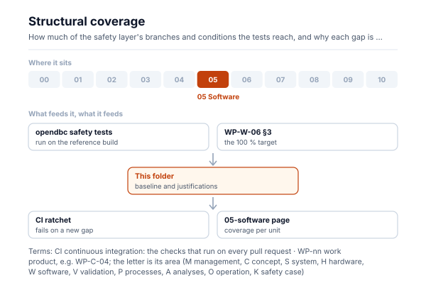
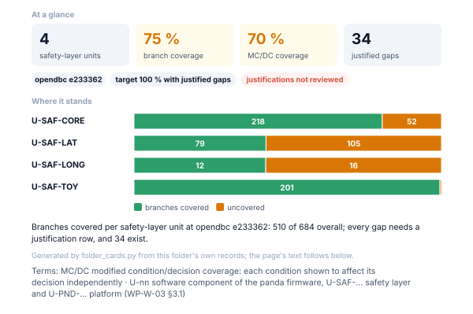

# Structural coverage

<!-- folder-card:start (generated by assurance/01-management/figures/folder_cards.py; do not edit by hand) -->

<!-- folder-card:end -->

Branch and MC/DC coverage of the safety layer's units (U-SAF-CORE, U-SAF-LAT, U-SAF-LONG, U-SAF-TOY), measured on the
reference build with the opendbc safety tests ([WP-W-06 §4.2.1](../WP-W-06-software-unit-verification.md)).

| File | What it holds |
|---|---|
| [`structural-baseline.json`](structural-baseline.json) | The uncovered branches and MC/DC conditions per unit at the opendbc pin. It is a ratchet, not a pass criterion: `tools/ci/coverage/structural_coverage.py report --check` fails when a unit's gaps grow or the pin changes without the baseline being re-recorded |
| [`justifications.md`](justifications.md) | Every measured gap with its justification (not called in the reference configuration, fixed by constant data, or infeasible). The same check fails when a gap has no row, or a row no longer matches a gap |

The target is 100 % with justified exclusions (WP-W-06 §3). The coverage per unit is drawn on the
[folder page](../README.md), under "Where the software stands".
