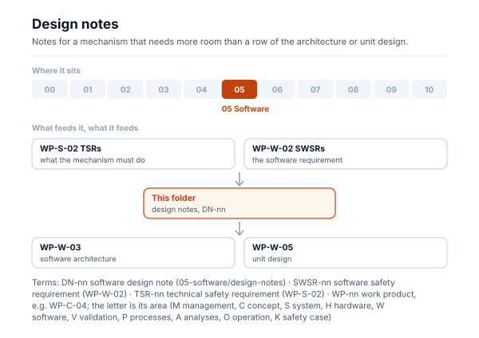
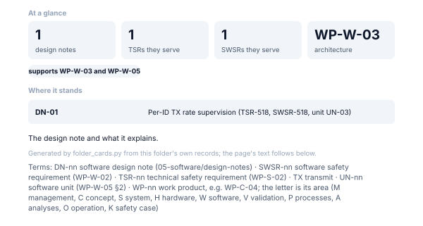

# Design notes

<!-- folder-card:start (generated by assurance/01-management/figures/folder_cards.py; do not edit by hand) -->

<!-- folder-card:end -->

Short design notes that support the architecture ([WP-W-03](../WP-W-03-software-architecture.md)) and the unit design
([WP-W-05](../WP-W-05-software-unit-design.md)) where one mechanism needs more room than a table row.

| Note | Subject |
|---|---|
| [DN-01](DN-01-tx-rate-supervision.md) | Per-ID TX rate supervision (TSR-518, SWSR-518, unit UN-03) |
