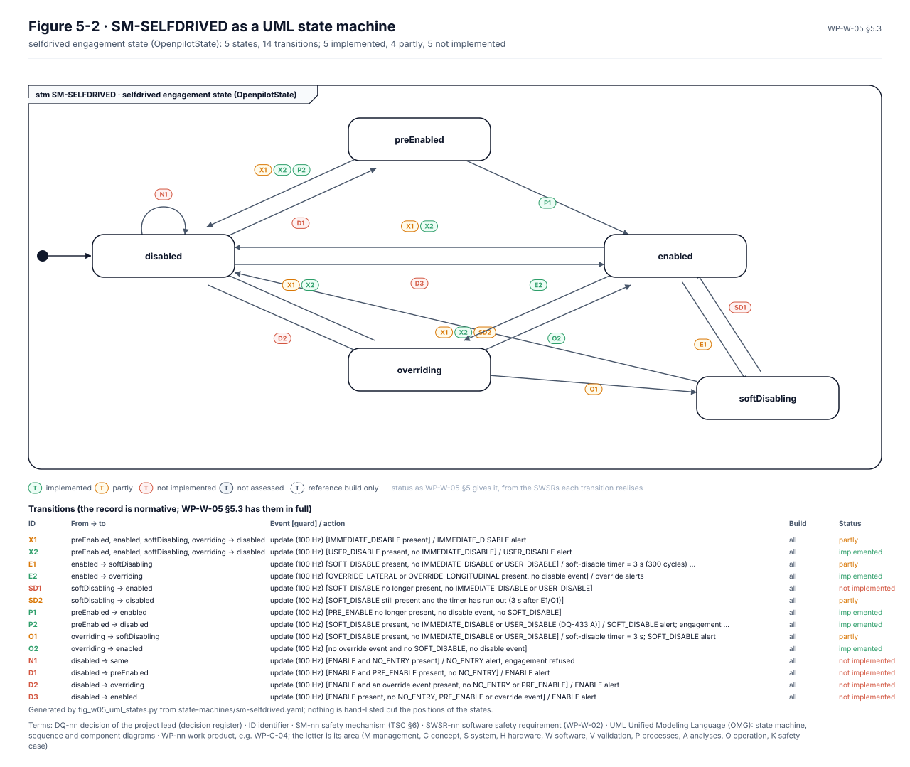

# Software design

The software design is in three work products. The architecture, [WP-W-03](../WP-W-03-software-architecture.md), says
which software components make up LD-SDA and how they talk. The unit design, [WP-W-05](../WP-W-05-software-unit-design.md),
describes each unit and the state machines it runs. The software safety requirements,
[WP-W-02](../WP-W-02-software-safety-requirements.md), say what each component must do. Two software components carry
the safety argument: E-03, the panda firmware on the safety MCU (ASIL C), and E-01, the openpilot host stack on the SoC
(QM), whose failures the envelope must contain.

<!-- terms:start (generated by assurance/trace/tools/terms.py; do not edit by hand) -->

Terms on this page (33)

| Term | Meaning |
|---|---|
| ALLOWED | the envelope's authority state with controls_allowed = 1 (NOT_ALLOWED: 0), WP-W-05 §5.2 |
| ASIL | Automotive Safety Integrity Level, A (lowest) to D (highest), from ISO 26262 |
| CAN | controller area network: the vehicle's data bus |
| DMA | direct memory access: hardware that copies data without the processor |
| E-nn | element of the item (WP-C-01 §3.1), E-01…E-06 |
| HSI | hardware-software interface |
| ID | identifier |
| LD-SDA | LionDriver Supervised Driving Assistance, the item |
| M01–M14, M1–M8 | guide word M01…M14 of the HARA (no function, unrequested, excessive, …); M1…M8 (one digit) a safety-mode transition (WP-W-05 §5.1) |
| MCU | microcontroller: the panda safety processor (STM32H7) |
| NOOUTPUT | the panda's safety mode that receives but sends nothing |
| OI-nn | open item of the document it appears in |
| QM | quality managed: no ASIL; ordinary quality processes suffice |
| RX | receive |
| SI-nn | software interface between components (WP-W-03 §3.3) |
| SILENT | the panda's safety mode that sends nothing |
| SM-SAFETY | SM-SAFETY-MODE, the state machine of the panda's safety mode (WP-W-05 §5.1) |
| SM-SELFDRIVED | the state machine of the host's engagement state in selfdrived (WP-W-05 §5.3) |
| SM-TOY | SM-TOY-AUTH, the state machine of the Toyota authority controls_allowed (WP-W-05 §5.2) |
| SoC | system on chip: the comma device's main processor, running openpilot (QM) |
| SPI | serial peripheral interface (the link between SoC and MCU) |
| ST-nn | step of the start-up and engagement sequence (WP-S-03 Table 4-1), ST-01…ST-21 |
| SWSR-nn | software safety requirement (WP-W-02) |
| SysML | Systems Modeling Language: the system model in models/sysml |
| TOYOTA | the panda's Toyota car mode (parameter 73 in the reference build) |
| TSC | technical safety concept |
| TSR-nn | technical safety requirement (WP-S-02) |
| TX | transmit |
| U-nn | software component of the panda firmware, U-SAF-… safety layer and U-PND-… platform (WP-W-03 §3.1) |
| UML | Unified Modeling Language (OMG): state machine, sequence and component diagrams |
| UN-nn | software unit (WP-W-05 §2) |
| V-nn | view of the SysML model (V-01…V-28) |
| WP-nn | work product, e.g. WP-C-04; the letter is its area (M management, C concept, S system, H hardware, W software, V validation, P processes, A analyses, O operation, K safety case) |

All terms: [abbreviations and record codes](../../terms.md).

<!-- terms:end -->

This page walks through them with their diagrams: UML state machines generated from the state-machine records, one
engagement animated, the component and block diagrams, and the start-up sequence from the SysML model. The documents and
the records stay the source of record; every figure here is generated from them.

**The software in five lines.**

1. **The envelope is interrupt-driven firmware.** All of E-03's safety processing runs in interrupt context: CAN
   receive, the SPI link, a 100 Hz safety task and an 8 Hz tick. The main loop only proves to the watchdog that it is
   alive.
2. **One flag carries the authority.** `controls_allowed` is set by the Toyota authority machine (SM-TOY-AUTH) and
   cleared by 18 of its 23 transitions; every actuation frame is checked against it.
3. **Five of those revocations are not implemented.** A TX frame rejected for its content, a platform fault, a driver
   steering override, the driver-torque check and forwarding supervision exist only as requirements (T9, T10d, T10e,
   T12, T15); SPI errors and CAN bus-off (T13, T14) are only counted. The reference build cannot revoke authority on
   any of them.
4. **The host's way in is not yet what the requirements ask.** Five of SM-SELFDRIVED's 13 transitions realise SWSRs
   that are not in place, among them the refusal and the three ways in from disabled (N1, D1–D3).
5. **Of the 147 software safety requirements, 56 are in the code and 54 are not;** 31 are partly in place. Nothing is
   verified on hardware yet.

| Where it comes from | The design | Where it goes |
|---|---|---|
| [TSC (WP-S-03)](../../03-system/tsc/README.md) and [HSI (WP-S-05)](../../03-system/hsi/README.md) · [TSRs (WP-S-02)](../../03-system/technical-safety-requirements/README.md) · the panda, opendbc and openpilot code at the pinned commits | Components and units (WP-W-03 §3–§4, WP-W-05 §2), interfaces SI-01…SI-10, execution model and schedule, the state-machine records SM-SAFETY-MODE, SM-TOY-AUTH, SM-SELFDRIVED, partitioning and freedom from interference | [Software safety analysis (WP-W-04)](../WP-W-04-software-safety-analysis.md) · [unit](../WP-W-06-software-unit-verification.md), [integration](../WP-W-07-software-integration-verification.md) and [embedded](../WP-W-08-embedded-software-testing.md) verification · the [reference models](../reference-models/README.md) that replay the charts against the C |

## 1. The software at a glance

*The element hierarchy (WP-W-03 §3.1, Figure 3-1).* E-03 is the opendbc safety layer (U-SAF, E-03a) on top of the
panda platform firmware (U-PND, E-03b). Units marked "ref" exist only in the reference build, and dashed red ones are
planned and not implemented.

*The component diagram (WP-W-03 §3.2, Figure 3-2).* Orange is the command and actuation path from the host through the
envelope to the car, teal is CAN reception and forwarding, grey is control requests and internal calls. Every line is an
interface SI-nn of WP-W-03 §3.3.

## 2. Inside the firmware

*The firmware by execution context (WP-W-03 §3.2).* Dashed frames are interrupt contexts and dashed blocks exist only
in the reference build. The thin dashed lines are the reads and writes of `controls_allowed`. Because every context runs
at the same interrupt priority today, the order of those accesses is the subject of the priority scheme proposed in
WP-W-03 §5.4 (SWSR-519).

*The envelope's signal flow (WP-W-05 §5.2).* What drives the authority chart below: the RX checks, the cruise edge and
the brake on the receive side, the timeouts and heartbeat checks of the safety task, the TX-rate budget. Each line
carries the ID of the transition it drives.

## 3. The state machines in UML

*The authority machine (WP-W-05 §5.2, Figure 5-1).* Each ID on an arrow is a transition of the record, coloured by its
status and dashed when only the reference build has it. Some things stand out:

- **Seventeen ways out, two ways in.** Authority is granted only on a cruise edge from the car, at once (T1) or after the
  1 s engagement window of the reference build (T1a, T1b). Everything else revokes it.
- **The red chips are the open safety work.** T9, T10d, T10e, T12 and T15 are revocations the requirements ask for and
  the code does not have: a TX frame rejected for its content, a platform fault, a driver steering override, the
  driver-torque check and forwarding supervision.
- **T7 leaves the frame.** A transition from "any state" is drawn from the machine's border, as UML allows: setting the
  safety mode clears authority whatever the state.

*The host's engagement machine (WP-W-05 §5.3, Figure 5-2).* `selfdrived` decides from the events of the cycle whether
openpilot is engaged. The ways in from disabled (D1, D2, D3) and the refusal (N1) are red: the SWSRs they realise are
not in place at the baseline. X1 and X2 are drawn from each of the four engaged states, as the record lists them.

*The safety-mode machine (WP-W-05 §5.1).* Kept as its Stateflow-style chart: most of its transitions go from any state
to the requested mode, which a chart per build shows more clearly than one UML diagram. In the reference build the mode
lock makes OTHER_CAR unreachable (M4).

## 4. One engagement, animated

*Engage, then lose the heartbeat (Figure 5-3).* The active state and the transition that fired are lit, and the caption
gives that transition's event, guard and action from the record. The walk is the reference build's engagement and its
most important revocation: if the host stops sending its heartbeat, the envelope takes authority away within 0.3 s and
sounds its own siren.

*The same engagement as a sequence (SysML view V-17).* From ignition on to the first actuated frame, step by step across
the host processes, the panda and the car. Each step names the record transitions it stands for, so the sequence and the
state machines above cannot drift apart (check B2 of the [SysML model](../../models/sysml/README.md)).

## 5. The host stack

*The host's data flow (WP-W-03 §4).* The QM side: `card` reads the car, `selfdrived` decides engagement, `controlsd`
computes the commands, and `pandad` carries them to the panda over SPI. The envelope does not trust any of it.

## 6. Open items

The ones that change the design; the full lists are in WP-W-03 §9 and WP-W-05 §9.

- **WP-W-03 OI-4:** the interrupt priority scheme for the safety task (SWSR-519), proposed in §5.4 and partly in the
  code; the race analysis under it is still to be confirmed on the bench.
- **WP-W-03 OI-8:** whether a TX-rate revocation (SWSR-518) must block re-engagement until the next mode change.
- **WP-W-05 OI-3:** unit descriptions for the planned units UN-N2…N6 once they are designed.
- **WP-W-05 OI-6:** whether the control requests `0xb0`, `0xb1`, `0xc0` and `0xf6` need gating in a car mode.

## Where the figures come from

| Figure | Generator |
|---|---|
| WP-W-05 Figures 5-1 to 5-3, the UML state machines and the animated walk | [`fig_w05_uml_states.py`](../figures/fig_w05_uml_states.py), from [`state-machines/*.yaml`](../state-machines/README.md), with each transition's status from the WP-W-02 Baseline column through `check_state_machines.py`; only the state positions and the walk are chosen there |
| WP-W-03 Figures 3-1 and 3-2 | the figures of WP-W-03, in [`../figures/`](../figures/) |
| The Simulink- and Stateflow-style diagrams | [`diagrams/make_diagrams.py`](../diagrams/make_diagrams.py), from the same records and WP-W-03 |
| SysML view V-17, the start-up sequence | [`render_arch.py`](../../models/sysml/tools/render_arch.py), from the SysML model, which [`gen_behaviour.py`](../../models/sysml/tools/gen_behaviour.py) generates from WP-S-03 §4.1 |
