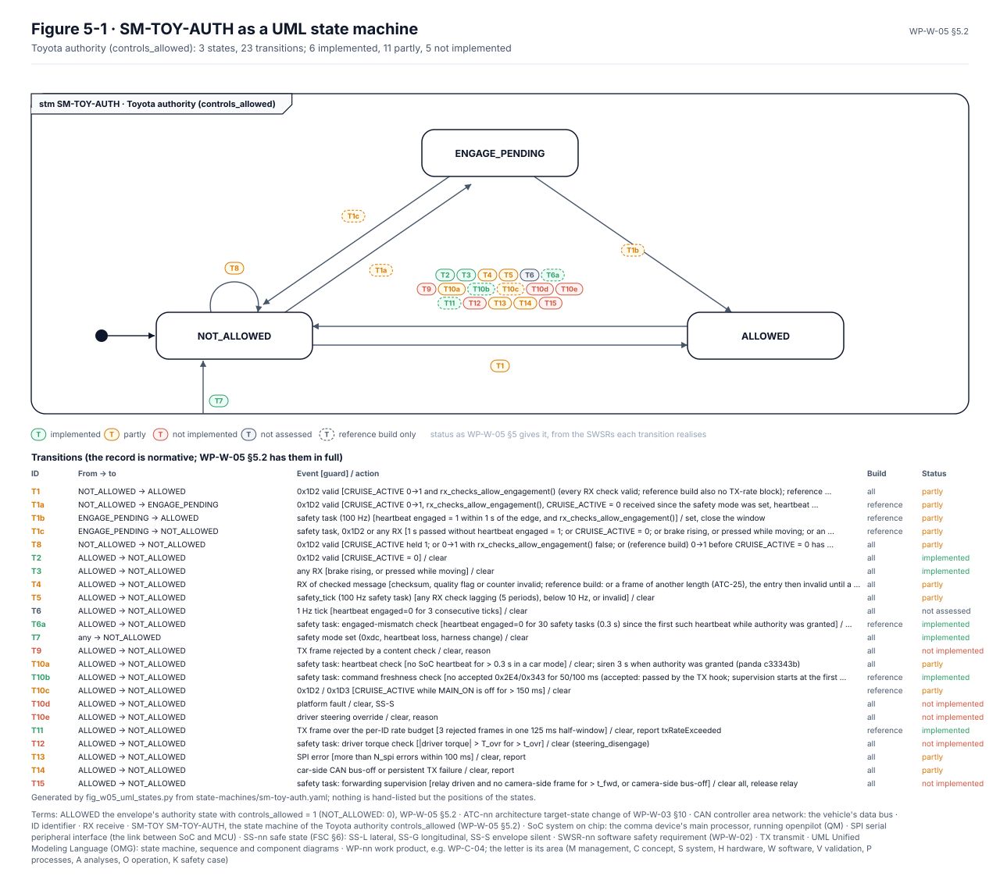
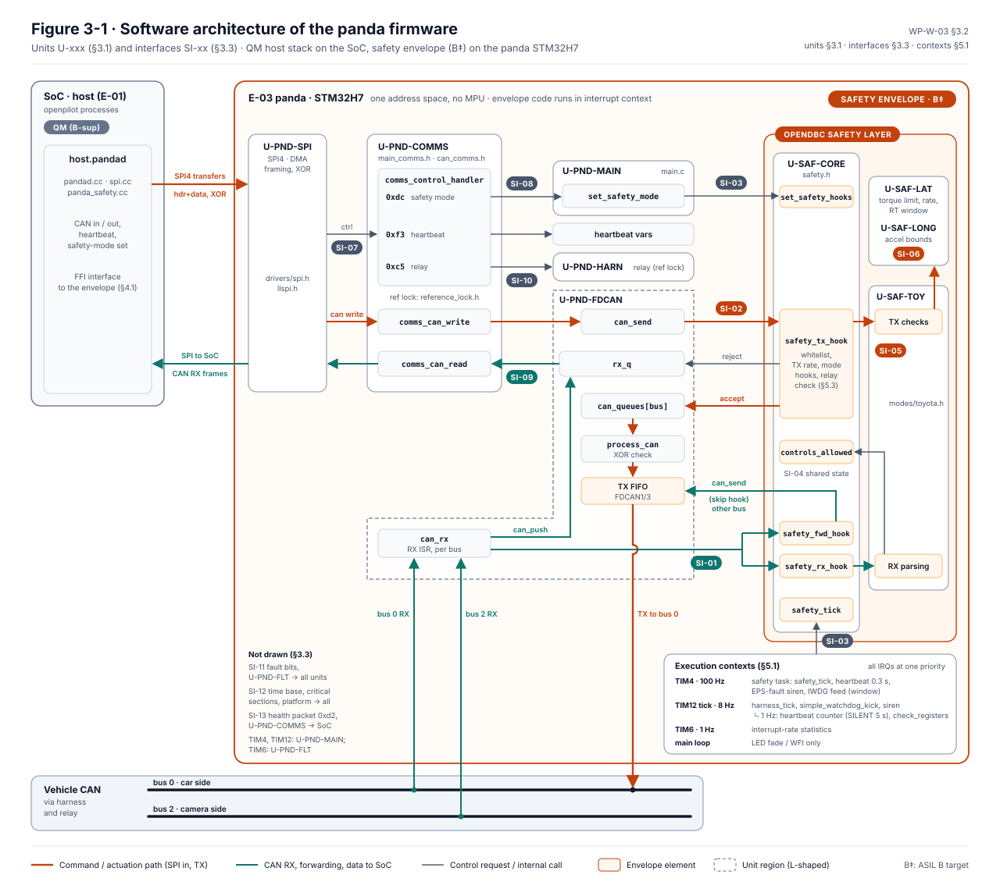
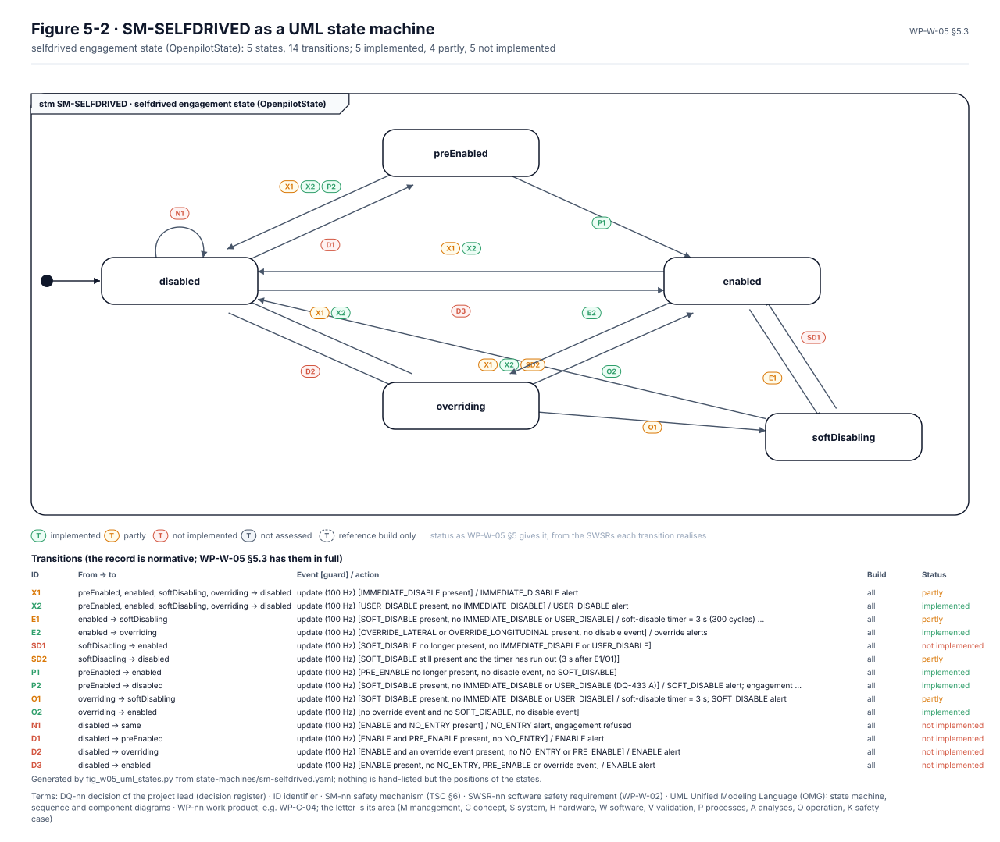
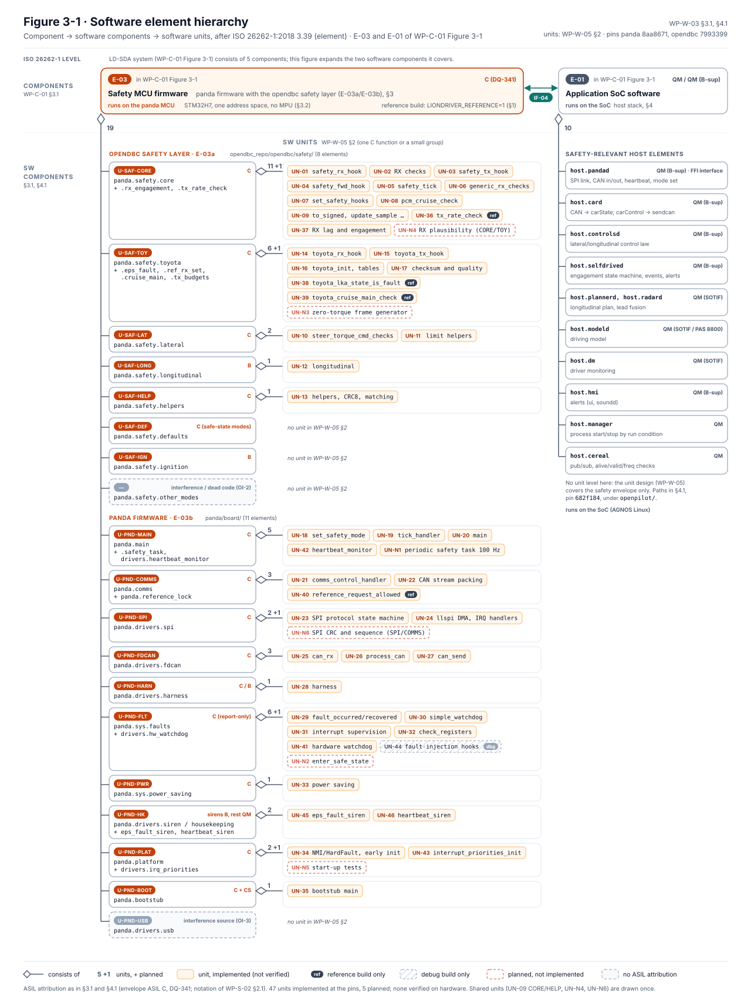
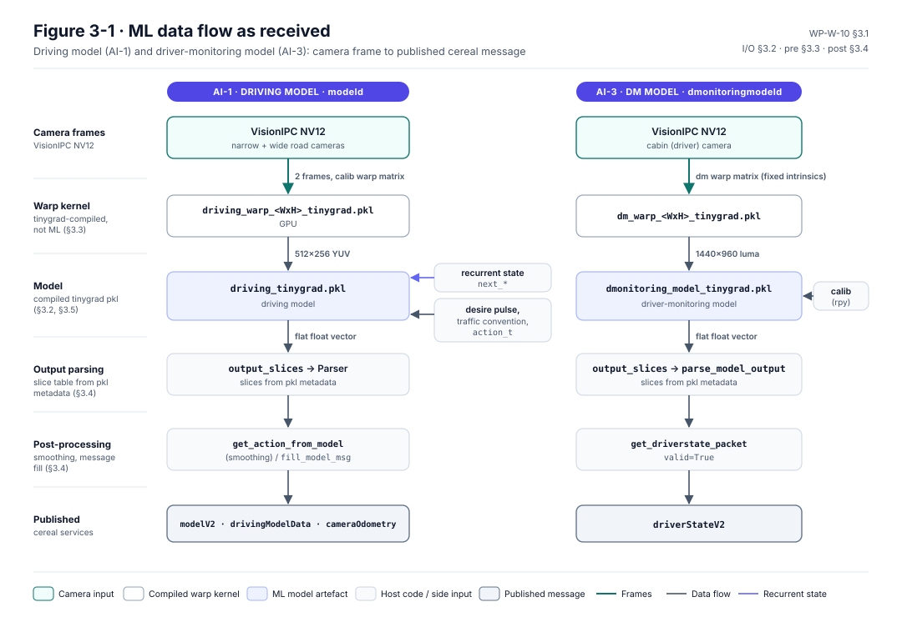
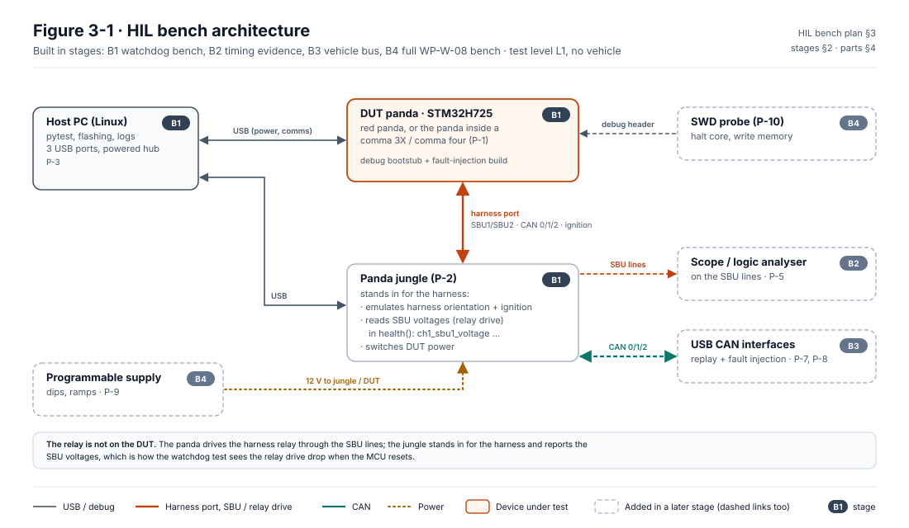

## The software at a glance

*Figure W-0-1. One box per work product: down the left the design, up the right the verification of each level, the code at the bottom. Counts are the IDs in each document's defining table, status is the WP-M-00 §3 register. Generated by [`fig_w00_overview.py`](fig_w00_overview.py).*

Each box, and where it is:

- Software safety requirements: 147 SWSRs, [WP-W-02](../WP-W-02-software-safety-requirements.md)
- Architectural design: 18 panda components (U-…), [WP-W-03](../WP-W-03-software-architecture.md)
- Unit design: 52 units (incl. planned), [WP-W-05](../WP-W-05-software-unit-design.md)
- Code and coding guidelines: 20 MISRA deviations, [WP-W-01](../WP-W-01-software-development-environment-guidelines.md)
- Unit verification: 23 test cases, [WP-W-06](../WP-W-06-software-unit-verification.md)
- Integration verification: 19 test cases, [WP-W-07](../WP-W-07-software-integration-verification.md)
- Embedded software testing (HIL): 26 test cases, [WP-W-08](../WP-W-08-embedded-software-testing.md)
- Software safety analysis: 52 SW FMEA rows, [WP-W-04](../WP-W-04-software-safety-analysis.md)
- Configuration and calibration data: 23 data items, [WP-W-09](../WP-W-09-configuration-calibration-data.md)
- ML engineering: 15 ML requirements, [WP-W-10](../WP-W-10-ml-engineering.md)
- Cybersecurity implementation: 64 CSRs to verify, [WP-W-11](../WP-W-11-cybersecurity-implementation-verification.md)

The design walkthrough, with the UML state machines and the animated engagement, is [`design/`](../design/README.md).

## Where the software stands

*Figure W-0-2. Requirements from the WP-W-02 Baseline column, coverage from [`coverage/structural-baseline.json`](../coverage/structural-baseline.json) (gaps justified in [`coverage/justifications.md`](../coverage/justifications.md)), transitions from [`state-machines/`](../state-machines/README.md). Generated by [`fig_w00_overview.py`](fig_w00_overview.py); CI fails if it is stale.*

## Diagrams in this folder

| | |
|---|---|
|  Toyota authority as a UML state machine |  One engagement, animated |
|  Panda firmware component diagram |  The firmware by execution context |
|  Host engagement as a UML state machine |  The safety envelope's signal flow |
|  Software element hierarchy |  ML data flow |
|  HIL bench architecture |  Host data flow |

Each picture links to the page that explains it.
