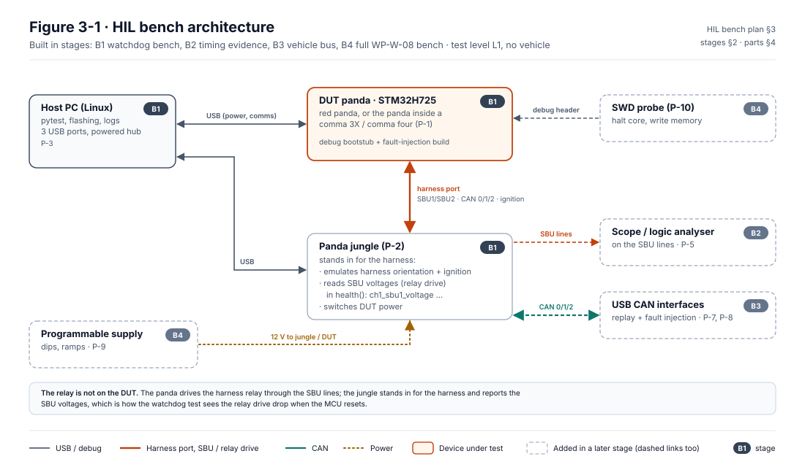

# HIL bench plan

| Field | Value |
|---|---|
| Work product | Hardware-in-the-loop bench plan (decision D-04 of [WP-M-01](../../01-management/WP-M-01-assurance-strategy.md); test environment of [WP-W-08](../WP-W-08-embedded-software-testing.md) §3) |
| Standard reference | ISO 26262-6:2018 §11.4.2 (test environments); ISO 26262-8:2018 §9.4.3 (verification environment); ASPICE 4.0 SWE.6 |
| Version | 0.8 (A-1 and Status: the bench is deferred by the lead, D-04, DQ-049 B; 2026-10-23). 0.7 (`test_16` in the pin since `3a8b7c2` (#405); AI-drafted; 2026-10-21). 0.6 (`test_16_engaged_mismatch_siren.py`, panda PR #22, mapped to VS-FI-10 (b); AI-drafted; 2026-10-21). 0.5 (merge of PR #47 software alignment with the base; §7 mapping rows of `test_12`…`test_14` merged into the base's rows; 2026-10-13). It carries PR #47's draft, numbered 0.2 there: alignment pass: baseline and pins consistent; mapping for `test_12`…`test_14`. History on the base: 0.4 (heartbeat-loss siren, panda `c33343b`; EPS-siren worst case 1.26 s; 2026-10-13). 0.3 (§3 diagram redrawn as Figure 3-1; text version kept; 2026-10-13). 0.2 (verification status for the integrated envelope changes: pins `b790fca`/`7993399`, reference-build campaign for `test_11…14`; 2026-10-12). 0.1 |
| Status | Draft: plan only. No bench exists, no part has been bought, no test has been run on hardware. The bench is deferred by the lead (D-04, decision register DQ-049, B, 2026-10-14) |
| Author | Assurance team (AI-assisted draft) |
| Reviewer(s) | TBD |
| Approver | Project maintainer (acting safety manager) |
| Baseline | Written at LionDriver `4aca58b` (panda `3859fa8`, opendbc `5b5a4ba`); aligned at `682f184` (panda `8aa8671`, opendbc `7993399`) and on the base at `bf6ce8c` (panda `b790fca`, opendbc `7993399`). Current pins: panda `c33343b`, opendbc `273f44e`. Use the current pins; §5 commands name `3859fa8` only as the commit that added the watchdog tests |

## 1. Purpose

LionDriver has no HIL bench (GAP-30), so no firmware test in [WP-W-08](../WP-W-08-embedded-software-testing.md) or hardware fault-injection case in [WP-V-05](../../06-validation/WP-V-05-fault-injection.md) can run. The hardware watchdog, the 100 Hz safety task and the 5-period RX timeout were integrated on 2026-10-12 (panda `9f60e17`, opendbc `aff4033`) **without hardware verification** ([watchdog change record](../../07-supporting/impact/change-2026-10-12-panda-hw-watchdog.md) OI-3). The later envelope changes up to the current pins (panda `c33343b`, opendbc `273f44e`: reference-build lock, EPS fault, TX rate supervision, TX arrival supervision, heartbeat-loss siren, HIL tests `test_11…15`) are equally without hardware verification. The bench now produces the missing evidence for code that is already pinned; until it runs, these pins have no hardware evidence (WP-W-08 §4).

This plan builds the bench in stages, so the watchdog evidence comes from the smallest useful setup and the rest of WP-W-08 follows on the same hardware. The bench is test level L1 of [WP-V-07](../../06-validation/WP-V-07-vehicle-test-operations.md): no vehicle, no road.

It is the one bench that [WP-H-06](../../04-hardware/WP-H-06-hardware-integration-verification.md) §2 defines for hardware, software and system integration. All stages are due by G3, because [WP-M-03](../../01-management/WP-M-03-project-plan.md) phase P4 depends on "G3; HIL bench ready".

> [!NOTE]
> Part availability and prices are **unconfirmed**. Check each part at the vendor before buying. A part not marked "confirmed" below has not been checked.

## 2. Stages

| Stage | Goal | Adds | Unblocks |
|---|---|---|---|
| **B1: watchdog bench** | Run the existing HIL tests and the watchdog fault-injection test on a real STM32H7 panda | DUT panda, panda jungle, host PC | Hardware evidence for the integrated watchdog and safety task (VS-FI-17, VS-SWQ-14 in its debug-build form); VS-SWQ-08/13/17/25, VS-FI-04/11 via `test_11…14` (jungle plays the car on bus 0; §5.5); OI-3 of WP-W-08 for the jungle-based upstream tests |
| **B2: timing evidence** | Measure relay release independently of USB polling, ≥ 100 repetitions (WP-W-08 §4) | Oscilloscope or logic analyser on the SBU lines | Timing results usable as evidence for TSR-501 and D-1 |
| **B3: vehicle bus** | Replay Corolla CAN traffic and inject bus faults. A candump capture of bus 0 also feeds the inter-frame gap scan ([`tools/can_gaps/`](../../../tools/can_gaps/README.md)) | 2–3 USB CAN interfaces, harness-equivalent wiring, 120 Ω terminations | VS-SWQ-01… (limits, timeouts), VS-FI-01…04, VS-FI-22 |
| **B4: full WP-W-08 bench** | Supply, debug and SoC-side faults | Programmable supply, SWD probe, reference comma device, audio capture | VS-FI-06…08, -10, -11, -15, -16, -18; release-image repeats |

Build B1 first. B2 is cheap and turns B1 results into evidence. B3 and B4 follow; the 100 Hz safety task and the RX timeout are already integrated (§1), so they are waiting only on hardware.

## 3. Architecture



*Figure 3-1.* The bench by build stage: B1 elements are solid, elements added in B2–B4 and their links are dashed; part numbers refer to §4. Source: [`figures/fig-hil-3-1-bench-architecture.svg`](figures/fig-hil-3-1-bench-architecture.svg); change it together with §2 and §4.

<details><summary>Text version of Figure 3-1</summary>

```
                 USB                    USB
  host PC  ─────────────── DUT panda ◄──────── (power, comms)
  (Linux)  ───────┐           │ harness port (SBU1/SBU2, CAN 0/1/2, ignition)
                  │ USB       │
                  └────── panda jungle ─── emulates harness orientation + ignition,
                              │             reads SBU voltages (relay drive),
                              │             switches DUT power
                              ├── scope / logic analyser on SBU lines   (B2)
                              └── CAN 0/1/2 ─ USB CAN interfaces        (B3)
                                                replay + fault injection
  programmable supply ─► jungle / DUT 12 V                              (B4)
  SWD probe ─► DUT (debug header)                                       (B4)
```

</details>

The relay itself is not on the DUT: the panda drives the harness relay through the SBU lines. The jungle stands in for the harness. It reports the SBU voltages in `health()` (`ch1_sbu1_voltage`…), which is how the watchdog test sees the relay drive drop when the MCU resets.

## 4. Parts

| # | Part | Stage | Purpose | Options | Availability |
|---|---|---|---|---|---|
| P-1 | DUT panda, STM32H725 | B1 | Device under test | (a) red panda (USB, runs the same `panda_h7` image as the reference device); (b) the panda inside a comma 3X / comma four, tested in place (needs SSH to the device and its own USB path) | Red panda listed at comma.ai/shop/panda; stock and price not confirmed |
| P-2 | Panda jungle | B1 | Harness emulation, ignition, DUT power switching, SBU readback | comma panda jungle v2 | **Not confirmed**: check comma.ai/shop. Without a jungle, the watchdog test cannot see the relay drive (see §8 R-1) |
| P-3 | Host PC | B1 | Runs pytest, flashes, logs | Any Linux x86-64 or ARM machine with 3 free USB ports; powered USB hub recommended | Owned or any |
| P-4 | USB cables, USB-C harness cable | B1 | DUT ↔ jungle (harness port), DUT and jungle ↔ host | As supplied with the jungle | — |
| P-5 | Oscilloscope or logic analyser, ≥ 2 channels, ≥ 1 MS/s, with trigger | B2 | Time from fault injection to relay drive release, independent of USB | USB logic analyser (Saleae-class or an inexpensive fx2-based clone with sigrok); any bench scope | Not checked |
| P-6 | Fault-injection marker line | B2 | Gives the scope a start edge | Spare GPIO toggled by the fault-injection hook (firmware change, see §8 R-3), or the USB control request seen by a USB analyser | Firmware change needed |
| P-7 | USB CAN interfaces, classic CAN 500 kbit/s, ×2–3 | B3 | Replay Corolla traffic on bus 0 and 2, inject errors | CANable 2.0 (slcan/candlelight, SocketCAN); PEAK PCAN-USB; Kvaser Leaf. Error-frame injection and dominant hold need an interface that supports them (PCAN-USB FD or a microcontroller-based injector) | Not checked |
| P-8 | Harness-equivalent wiring, 120 Ω terminations | B3 | Split the jungle CAN lines to the interfaces | Breakout board or DB-15/OBD breakout; jungle CAN pins | Build |
| P-9 | Programmable DC supply, 0–20 V, ≥ 5 A, list mode | B4 | Dips, ramps, brown-out (VS-FI-15) | Any programmable bench supply with list/sequence mode | Not checked |
| P-10 | SWD probe | B4 | Halt cores, write memory, read cycle counter (VS-FI-18, release-image fault injection) | ST-LINK V3 or J-Link with a Tag-Connect or pogo adapter for the panda debug pads | Pad access on the red panda to confirm |
| P-11 | Reference comma device | B4 | Full SoC + panda path (SPI, pandad) | comma 3X or comma four, as in WP-C-01 | Owned? (to confirm) |
| P-12 | Microphone / audio interface | B4 | Siren timing (TSR-516) | Any USB audio interface | Not checked |

## 5. B1 setup and the watchdog test

### 5.1 Wiring

1. DUT harness port to a jungle harness port with the USB-C harness cable.
2. DUT USB and jungle USB to the host (through a powered hub if needed).
3. Jungle 12 V supply connected (the jungle powers the DUT through the harness port).

### 5.2 Software

From a LionDriver checkout, with the panda submodule at its pin:

```bash
cd panda
git checkout c33343b   # the LionDriver pin, with the fault injection and the HIL tests test_10…15
pip install -e .[dev]                                               # panda python lib, pytest, libusb1, pycapnp
export PYTHONPATH=$PWD/../opendbc_repo:$PWD/..
```

Use the `opendbc_repo` that matches the LionDriver baseline. Record the exact panda and opendbc commits in the test log.

### 5.3 Flash a fault-injection build

A fault-injection image is a **debug** build: it needs `ALLOW_DEBUG` and is signed with the debug key, so the DUT needs a debug bootstub.

```bash
./board/recover.py                         # one-off: DUT in DFU, writes the debug bootstub
FAULT_INJECTION=1 ./board/flash.py         # builds with -DLIONDRIVER_FAULT_INJECTION and flashes
```

`SConscript` refuses `FAULT_INJECTION=1` in a release build, and `board/drivers/fault_injection.h` has an `#error` without `ALLOW_DEBUG`, so the hooks cannot reach a release image.

After the campaign, flash the normal image again (`./board/flash.py` without `FAULT_INJECTION`) and record that the DUT left the bench without the hooks.

### 5.4 Run

```bash
HITL=1 FAULT_INJECTION=1 python -m pytest -v tests/hitl/test_10_hw_watchdog.py
```

| Test | Injection (control request `0xa9`) | Checks |
|---|---|---|
| `test_main_loop_hang` | 1: main loop spins forever | Relay drive released within `WATCHDOG_RESET_BUDGET_S` (default 0.12 s at the pin; 0.25 s on panda#1 alone); DUT restarts in SILENT with uptime < 5 s |
| `test_tick_hang` | 2: tick interrupt spins forever | As above, plus one 125 ms tick period for the hang to start |
| `test_hang_with_interrupts_disabled` | 3: interrupts off, then spin | As above |
| `test_safety_task_hang` | 4: the 100 Hz safety task spins forever | As above, plus one 10 ms task period |
| `test_early_feed_window_violation` | 5: two feeds back to back, the second inside the closed window (HWSR-501b) | As above, plus one 10 ms task period |
| `test_no_reset_without_fault` | none, relay driven for several seconds | No reset (uptime keeps rising), relay stays driven: the watchdog does not fire in normal running |

Then run the upstream HIL tests on the same bench to show the change breaks nothing else:

```bash
HITL=1 python -m pytest -v tests/hitl/
```

Upstream tests that need comma's multi-panda jig or SPI-only hardware will fail or skip; record which ones and why rather than treating every failure as a defect.

### 5.5 Reference build campaign

`test_11_reference_lock.py`, `test_13_eps_fault.py`, `test_14_tx_rate.py`, `test_15_heartbeat_siren.py` and `test_16_engaged_mismatch_siren.py` skip unless `REFERENCE_BUILD=1` (`test_15` needs it for the car simulation only: the heartbeat-loss siren is in every build); `test_12_rx_timeout.py` runs on any build and adds the reference build's RX messages (`EPS_STATUS`, `PCM_CRUISE_2`) with `REFERENCE_BUILD=1`. All six need the jungle, which plays the car on bus 0. `test_15` times the revocation after the last heartbeat; the host cannot read the speaker, so the tester confirms by ear (or a microphone) that the siren sounds at the revocation (≤ 0.56 s after the last heartbeat, WP-S-04 T-07a) and records it in the bench log. `test_16` prints when the siren must start (0.5 s after the first "not engaged" heartbeat, cruise still active) and when it must stay silent (cruise dropped).

```bash
LIONDRIVER_REFERENCE=1 ./board/flash.py    # builds with -DLIONDRIVER_REFERENCE (debug build unless RELEASE=1) and flashes
HITL=1 REFERENCE_BUILD=1 python -m pytest -v tests/hitl/test_11_reference_lock.py tests/hitl/test_12_rx_timeout.py tests/hitl/test_13_eps_fault.py tests/hitl/test_14_tx_rate.py tests/hitl/test_15_heartbeat_siren.py tests/hitl/test_16_engaged_mismatch_siren.py
```

Record each skipped test as **Not run**, never as Pass. Record the build type (debug or release) of the reference image in the test log; a debug reference build is not the release image (WP-W-08 §4). Flash the normal image again afterwards (§5.3).

### 5.6 What B1 does and does not show

| Shows | Does not show |
|---|---|
| The IWDG resets the MCU on all three hang types, on real silicon | The timing to evidence quality: the B1 time comes from USB polling of the jungle and includes host latency (a few ms of error each way) |
| The relay drive drops after the reset and the DUT restarts in SILENT | The real harness relay's drop-out time (the jungle reads the drive lines, not contacts) |
| No spurious reset in normal running (short run) | No spurious reset over a long drive: that needs field logging (change record §3) |
| | Anything about the release image: the hooks exist only in the debug build (WP-W-08 §4; OI-2 there) |

## 6. B2 timing measurement

WP-W-08 §4 asks for the worst value over ≥ 100 repetitions with random phase against the tick.

1. Scope channel 1 on SBU1, channel 2 on SBU2 (or on the jungle's sense points), trigger on the start marker (P-6).
2. Loop the injection 100 times per mode with a random delay of 0–125 ms (one tick period) before each request:
   `for i in $(seq 100); do HITL=1 FAULT_INJECTION=1 python -m pytest -q tests/hitl/test_10_hw_watchdog.py -k <mode>; done`
   (or a wrapper script; add one to the panda branch if this is used repeatedly).
3. Record for each mode: n, minimum, median, maximum, and the LSI frequency measured on the DUT (MCO output or IWDG count over a known time), which answers change-record OI-2.
4. Pass: maximum ≤ 0.2 s (SG-01 bound, TSR-501 v0.4 with D-1 accepted). Record the result against 0.1 s as well, so the D-1 shortfall is measured rather than estimated.

## 7. Test mapping

| Bench test | WP-W-08 / WP-V-05 case | Requirement | Stage | State |
|---|---|---|---|---|
| `tests/hitl/test_10_hw_watchdog.py` modes 1–3 (tick hang budget includes one tick period) | VS-SWQ-14 (hang part), VS-FI-17 (main-loop and tick hang; interrupts disabled) | TSR-501, HWSR-501, HWSR-501c | B1 | Implemented, in pin `b790fca`, not run |
| `test_no_reset_without_fault` | VS-SWQ-14 (no false trip) | TSR-501 | B1 | Implemented, not run |
| Timing campaign (§6) | VS-SWQ-14 timing, VS-FI-17 pass criterion | TSR-501, SG-01 budget | B2 | Planned |
| Safety-task hang | VS-FI-17 | TSR-501 | B1 | `test_safety_task_hang` (mode 4, panda#3; in the pin), implemented, not run |
| SPI interrupt hang | VS-FI-17 (SPI ISR) | TSR-501, TSR-502 | B4 (reference device: SPI) | Planned: needs another injection mode and the SPI path |
| Window violation (early feed) | VS-SWQ-14 / HWSR-501b | HWSR-501b | B1 | `test_early_feed_window_violation` (mode 5, panda#3; in the pin), implemented, not run |
| `tests/hitl/test_11_reference_lock.py` | VS-SWQ-17, VS-FI-11 | TSR-512, TSR-513 | B1 | Implemented, not run; needs `REFERENCE_BUILD=1` (§5.5) |
| `tests/hitl/test_12_rx_timeout.py` | VS-SWQ-08, VS-FI-04 | TSR-401, TSR-306 | B1 | Implemented, not run; needs `REFERENCE_BUILD=1` for the reference RX set (§5.5) ([RX timeout](../../07-supporting/impact/change-2026-10-12-opendbc-toyota-rx-timeout.md), [EPS fault](../../07-supporting/impact/change-2026-10-12-opendbc-toyota-eps-fault.md) change records) |
| `tests/hitl/test_13_eps_fault.py` | VS-SWQ-13 | TSR-110 | B1 | Implemented, not run; needs `REFERENCE_BUILD=1` (§5.5) ([EPS fault change record](../../07-supporting/impact/change-2026-10-12-opendbc-toyota-eps-fault.md)) |
| `tests/hitl/test_14_tx_rate.py` | VS-SWQ-25 (TSR-518 part) | TSR-518 | B1 | Implemented, not run; needs `REFERENCE_BUILD=1` (§5.5) ([TX rate change record](../../07-supporting/impact/change-2026-10-12-tx-rate-supervision.md)) |
| `tests/hitl/test_15_heartbeat_siren.py` (added 2026-10-13, panda `c33343b`) | VS-SWQ-10 (revocation timing and siren on heartbeat loss), VS-FI-10 (a) | TSR-407, TSR-516 | B1 | Implemented, not run; needs `REFERENCE_BUILD=1` for the car simulation (§5.5); siren confirmed by ear |
| `tests/hitl/test_16_engaged_mismatch_siren.py` (added 2026-10-21, panda PR #22, in the pin since `3a8b7c2` (#405)) | VS-FI-10 (b) (heartbeat "not engaged" while authority is granted: revoke ≤ 0.3 s; siren at 0.5 s only while PCM cruise stays active) | TSR-307 (a), TSR-516 (c) | B1 | Implemented, not run on hardware; needs `REFERENCE_BUILD=1` (`engaged_mismatch.h` is reference-only); siren confirmed by ear |
| Upstream `tests/hitl/test_1…9` | Regression | — | B1 | Existing, not run on LionDriver hardware |
| Corolla log replay, limit and timeout cases | VS-SWQ-01…, VS-FI-01…04 | TSR-1xx, TSR-401…406 | B3 | Planned |
| Power dips, resets, SWD memory faults, heartbeat and SPI faults | VS-FI-06…08, -10, -11, -15, -16, -18 | TSR-407…413, TSR-505, TSR-503, TSR-706 | B4 | Planned |

### 7.1 With panda#3

[jherrodthomas/panda#3](https://github.com/jherrodthomas/panda/pull/3) (100 Hz safety task, window mode, 90 ms nominal) is stacked on panda#1 and contains its fault injection and HIL test (merge `b9596ed`); both are in the pin `9f60e17`. On panda#3 the same test file adds:

| Test | Injection | Checks |
|---|---|---|
| `test_safety_task_hang` | 4: the 100 Hz safety task spins forever | Release within the budget plus one task period (10 ms) |
| `test_early_feed_window_violation` | 5: two feeds back to back, the second inside the closed window | Release within the budget plus one task period (HWSR-501b) |

The default budget on panda#3 is 0.12 s (TSR-501's 0.1 s plus 20 ms for relay release and USB polling) instead of 0.25 s. The tick-hang case adds one 8 Hz tick period on both branches, because the hang only starts at the next tick.

## 8. Risks and open questions

| ID | Item | Effect | Handling |
|---|---|---|---|
| R-1 | No panda jungle available | The watchdog test cannot see the relay drive; `NO_JUNGLE=1` runs only the DUT side | Fallback: probe the DUT SBU pins directly with the scope (B2 parts) and check the reset through uptime and SILENT after reconnect. Weaker: no harness emulation, so confirm the relay is driven at all without a harness detected |
| R-2 | Red panda board differs from the reference device panda | Relay drive circuit and harness detection may differ | Repeat the watchdog cases on the reference device (B4) before release; B1 evidence covers the integrated pin only if the reviewer accepts the red panda as representative |
| R-3 | No hardware start marker for timing | B2 timing is from the USB request, which adds host latency | Add a GPIO toggle to the fault-injection hook (debug build only) |
| R-4 | Debug bootstub on the DUT | A DUT with the debug bootstub must not go into a car | Label the bench DUT; never use it in the vehicle |
| R-5 | Fault injection only in a debug build | Evidence is for a different image than the release one (WP-W-08 §4) | Repeat with SWD halt on the release image when P-10 exists (WP-W-08 OI-2) |

## 9. Recording results

Each campaign produces:

- a test log: date, operator, DUT serial and board type, panda and opendbc commits, image hash, bench configuration (stage, parts), raw pytest output and scope captures;
- the summary filled into the WP-W-08 §7 report template;
- an evidence entry in the living safety case (`assurance/case-records/`), linked to the claim it supports, with the result stated as measured, including failures.

Results go in the record as observed. A failed or skipped case is recorded as such with a problem report (WP-W-08 §4), never re-labelled as passed.

## 10. Next actions

| ID | Action | Owner | Needed by |
|---|---|---|---|
| A-1 | Confirm which of P-1, P-2, P-11 are owned or can be bought. Deferred: the lead decided on 2026-10-14 not to build the bench for now (D-04, decision register DQ-049, B), so no part is bought. Until the bench is built, no envelope change gets on-device test credit and G4 cannot pass | Maintainer | B1 |
| A-2 | Build B1 and run §5.4 on the pinned panda; attach the output to the change record | Maintainer | Before any release image for a car |
| A-3 | Add the GPIO start marker (R-3) and run the §6 campaign | Maintainer (firmware: assistant draft) | Release |
| A-4 | Injection mode for an SPI interrupt hang, on the reference device | Assistant draft, maintainer review | Release |
