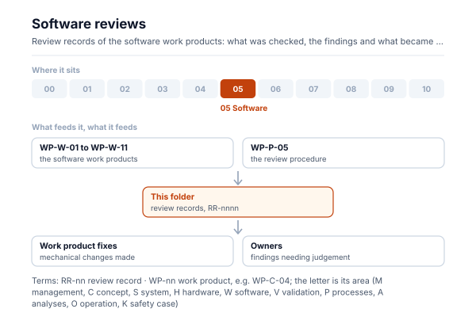
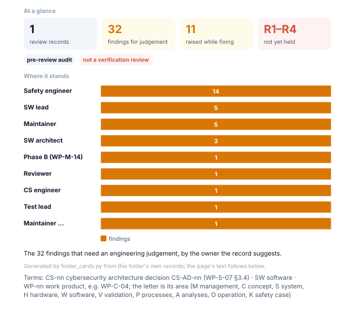

# Software reviews

<!-- folder-card:start (generated by assurance/01-management/figures/folder_cards.py; do not edit by hand) -->

<!-- folder-card:end -->

Review records of the software work products. A record lists what was reviewed, against which checklist, the findings
and their disposition ([WP-P-05](../../07-supporting/WP-P-05-verification-review-procedure.md)).

| Record | What was reviewed |
|---|---|
| [RR-2026-009](RR-2026-009.md) | WP-W-01…WP-W-11, DN-01 and the HIL bench plan against WP-M-14 and the integrated firmware changes (pre-review audit, not an R1–R4 verification review) |
