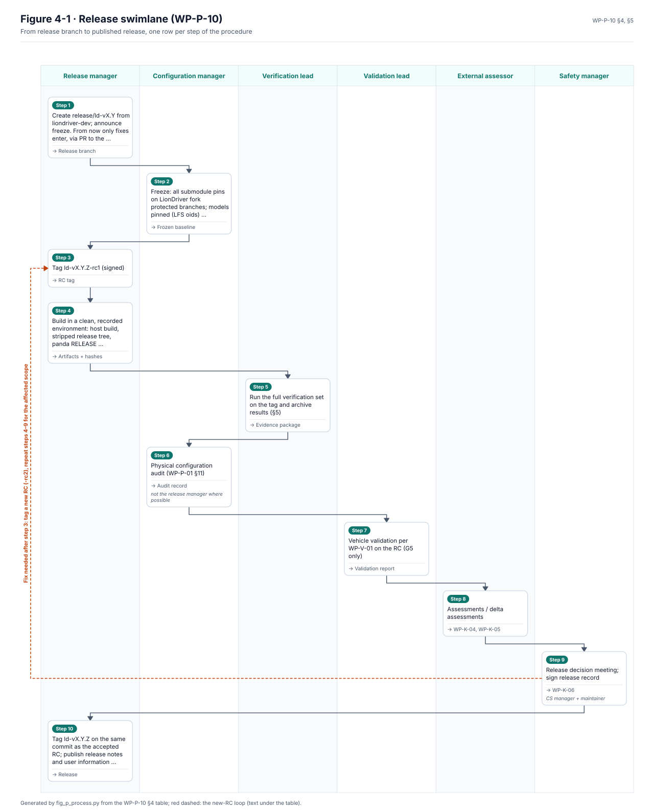

# WP-P-10 Release Management and Baseline Procedure

| Field | Value |
|---|---|
| Work product | WP-P-10 Release management and baseline procedure |
| Standard reference | ISO 26262-2:2018 §6 (release for production); ISO 26262-8:2018 §7; ISO 21448:2022 §12; ISO/SAE 21434:2021 §6 (release for post-development); ASPICE 4.0 SUP.8 |
| Version | 0.6 (§3 vehicle-test baseline criteria decided, DQ-047 A, OI-5 closed; OI-4 notes the signed-release decision, DQ-075 A; 2026-10-23). 0.5 (OI-2 decided: release evidence kept as signed GitHub release assets plus an offline copy, DQ-093 B, 2026-10-19). 0.4 (release key custody decided, DQ-086: hardware token with escrowed backup; §6 key row and OI-3; 2026-10-17). 0.3 (§4 Figure 4-1, release swimlane generated from the §4 table; 2026-10-14). 0.2 (status update for the integrated envelope changes: panda release build is the reference build, `LIONDRIVER_REFERENCE=1`; 2026-10-12). 0.1 |
| Status | Draft |
| ASIL / scope | All |
| Author | Assurance team (initial draft) |
| Reviewer(s) | TBD (I1) |
| Approver | Project maintainer (acting safety manager) |
| Baseline | `bf6ce8c` (status update 2026-10-12) |

## 1. Purpose and scope

Defines how a LionDriver baseline becomes a release candidate and a release, what evidence must exist, how the panda firmware is built and signed, how the release is recorded ([WP-K-06](../10-safety-case/WP-K-06-release-record.md)) and how it is rolled back or withdrawn. Applies to gate baselines (G0–G4) and to releases (G5). Versioning and tags are defined in [WP-P-01 §7](WP-P-01-configuration-management-plan.md#7-version-scheme-closes-gap-35-when-implemented).

No LionDriver release exists. Until G5, the only "releases" are vehicle-test baselines used under [WP-V-07](../06-validation/WP-V-07-vehicle-test-operations.md); they follow this procedure with the reduced criteria in §3.

## 2. Inherited release process (not used)

Upstream uses `tools/release/README.md` (manual checklist), `tools/release/build_release.sh` and `build_stripped.sh`, Jenkins device stages and the `release.yaml` workflow (gated to `commaai/openpilot`). These depend on comma infrastructure:

| Upstream element | Why LionDriver cannot use it as is |
|---|---|
| `build_release.sh` | Builds panda with `CERT=/data/pandaextra/certs/release` (comma's key on comma's build devices); commits as `Vehicle Researcher <user@comma.ai>` (`identity.sh`); force-pushes release branches |
| Jenkins `build release-*`, `nightly*` stages | comma device pools and credentials (GAP-30) |
| Release checklist | Contains no safety evidence, impact analysis or approval step |
| `test_onroad.py` on device after build | Useful; LionDriver keeps it as an on-device check once a device bench exists |

LionDriver keeps the useful mechanics (stripped release tree, no submodules in the release tree, `check_file_sizes.sh`) and replaces the rest.

## 3. Release candidate criteria per gate

| Baseline type | Gate | Minimum criteria |
|---|---|---|
| Gate baseline | G0 | Plans (WP-M-*, WP-P-01..06) Approved; CM, change control and CODEOWNERS in force |
| Vehicle-test baseline | G1 onward | All SR-A CI green (safety tests, coverage gate, MISRA, mutation); panda RELEASE build with LionDriver key (§6); [WP-V-07](../06-validation/WP-V-07-vehicle-test-operations.md) approved; closed-course checkout of the build passed before it goes on a public road; safety-relevant changes since the last test baseline reviewed by a reviewer other than the author; open S-1 problems: none; impact analysis since last test baseline reviewed. This subset was decided by the lead on 2026-10-14 (decision register DQ-047, A) |
| Gate baseline | G2 | As G1 + TSC/architecture/analyses Approved; trace checks K1–K6 pass ([WP-P-06 §7](WP-P-06-requirements-management-traceability.md#7-consistency-checks-to-automate)) |
| Gate baseline | G3 | All HW/SW safety WPs Approved; tool qualification reports for TCL2/3 tools ([WP-P-07](WP-P-07-tool-classification-qualification.md)); trace check K8, K10 errors resolved |
| Gate baseline | G4 | Integration, HIL and fault injection reports complete; functional configuration audit passed |
| Release candidate `ld-vX.Y.Z-rcN` | G5 | As G4 + safety validation, SOTIF residual risk acceptance ([WP-K-02](../10-safety-case/WP-K-02-sotif-release-argument.md)), CS validation, safety and CS cases, FSA ([WP-K-04](../10-safety-case/WP-K-04-functional-safety-assessment.md)) and CS assessment ([WP-K-05](../10-safety-case/WP-K-05-cybersecurity-assessment.md)) with no open major finding; no open S-1/S-2 problems unless residual risk accepted in writing |
| Patch release | G5 (delta) | Impact analysis shows no change to safety requirements; regression evidence complete; FSA delta statement |

## 4. Procedure

| Step | Activity | Output | Responsible |
|---|---|---|---|
| 1 | Create `release/ld-vX.Y` from `liondriver-dev`; announce freeze. From now only fixes enter, via PR to the release branch with CCB approval ([WP-P-02 §7.3](WP-P-02-change-management.md#73-change-control-board-ccb)) | Release branch | Release manager |
| 2 | Freeze: all submodule pins on LionDriver fork protected branches; models pinned (LFS oids); lockfiles unchanged since freeze unless CCB-approved | Frozen baseline | Configuration manager |
| 3 | Tag `ld-vX.Y.Z-rc1` (signed) | RC tag | Release manager |
| 4 | Build in a clean, recorded environment: host build, stripped release tree, panda RELEASE firmware (§6) | Artifacts + hashes | Release manager |
| 5 | Run the full verification set on the tag and archive results (§5) | Evidence package | Verification lead |
| 6 | Physical configuration audit ([WP-P-01 §11](WP-P-01-configuration-management-plan.md#11-configuration-audits)) | Audit record | Configuration manager (not the release manager where possible) |
| 7 | Vehicle validation per [WP-V-01](../06-validation/WP-V-01-safety-validation.md) on the RC (G5 only) | Validation report | Validation lead |
| 8 | Assessments / delta assessments | WP-K-04, WP-K-05 | External assessor |
| 9 | Release decision meeting; sign release record | [WP-K-06](../10-safety-case/WP-K-06-release-record.md) | Safety manager + CS manager + maintainer |
| 10 | Tag `ld-vX.Y.Z` on the same commit as the accepted RC; publish release notes and user information ([WP-O-03](../09-production-operation/WP-O-03-user-information-safety-warnings.md)); update distribution channel ([WP-O-01](../09-production-operation/WP-O-01-installation-and-provisioning-control.md)) | Release | Release manager |

If any fix is needed after step 3, a new RC (`-rc2`) is tagged and steps 4–9 are repeated for the affected scope, based on an impact analysis.

*Figure 4-1.* The procedure table as a swimlane: each step in the lane of the first role in its Responsible cell (the rest in italics); the red dashed loop is the new-RC rule in the sentence above. Generated by [`figures/fig_p_process.py`](figures/fig_p_process.py); CI fails if it is stale. Change it together with the table.

**Two-person rule.** The person who signs the release record as safety manager must not be the only person who reviewed the SR-A changes in the release. With a single maintainer this requires the external reviewer/assessor ([WP-M-01 T-09](../01-management/WP-M-01-assurance-strategy.md#5-tailoring)).

## 5. Evidence package

Closes the retention part of the verification evidence problem: today CI results live only as GitHub Actions logs and artifacts, which expire, and HIL/replay evidence exists only on comma's infrastructure (GAP-30). Retention period per [WP-P-04 §10](WP-P-04-documentation-management.md#10-retention).

| Content | Source |
|---|---|
| Baseline manifest | [WP-P-01 §8](WP-P-01-configuration-management-plan.md#8-baselines) |
| Source archive | `git archive` of the tag, plus each submodule at its pin |
| Built artifacts and SHA-256 | Release tree, panda firmware binary(ies), model files |
| SBOM | [WP-P-08 §6](WP-P-08-software-component-qualification.md#6-sbom) |
| CI results | Logs and JUnit-style results of all required jobs at the tag, with tool versions |
| Safety unit verification | `test.sh` output incl. coverage report (gcovr HTML/JSON), MISRA reports (opendbc and panda) incl. `checkers.txt`, mutation report incl. survivors list |
| Integration / HIL / fault injection | Reports from [WP-W-07](../05-software/WP-W-07-software-integration-verification.md), [WP-W-08](../05-software/WP-W-08-embedded-software-testing.md), [WP-V-05](../06-validation/WP-V-05-fault-injection.md) |
| Process replay | Diff report against fork-owned references, with the reference commit |
| Trace report | Generated matrix and check results ([WP-P-06](WP-P-06-requirements-management-traceability.md)) |
| Review, change and problem records | GitHub exports ([WP-P-04 §8](WP-P-04-documentation-management.md#8-storage-backup-and-export), [WP-P-03 §9](WP-P-03-problem-resolution.md#9-records)) |
| Work products | PDF/Markdown export of `assurance/` at the tag |
| Assessment reports and release record | WP-K-04, WP-K-05, WP-K-06 |

Layout: `evidence/ld-vX.Y.Z/{manifest,artifacts,ci,unit,integration,validation,trace,records,wp}/` plus `SHA256SUMS`, signed with the release key. Stored outside GitHub Actions (LionDriver-controlled storage, plus offline copy). Location: OI-2.

## 6. panda firmware release build (GAP-25, GAP-24)

| Rule | Detail |
|---|---|
| Build type | `RELEASE=1` with `CERT=<LionDriver release key>`. The reference lock and the other envelope changes of the LionDriver change records ([`impact/`](impact/README.md)) are compiled only with `LIONDRIVER_REFERENCE=1` ([WP-M-12](../01-management/WP-M-12-impact-analysis.md) M-11). The top-level `SConstruct` sets it by default; a release build must not override it, and a non-reference build is never released for the reference configuration. `panda/SConscript` otherwise defaults to `DEBUG` with `-DALLOW_DEBUG` and the committed debug key (`panda/board/crypto/certs/debug`). A DEBUG build is never released or used for vehicle testing beyond the bench |
| Key | LionDriver release key pair generated offline; private key never in Git or CI logs. Custody decided by the lead ([DQ-086](../01-management/decisions/register.yaml), option A, 2026-10-14): the private key is kept on a hardware token the lead holds, with an escrowed backup, so it is generated off-token on an offline machine, imported into the token, and the backup goes to escrow before the offline copy is destroyed. `panda/board/crypto/sign.py` reads a key file today, so release signing goes through the token instead (OI-1); public key committed in the panda fork replacing `release.pub`. Algorithm upgrade (from RSA-1024/SHA-1 in `panda/board/crypto/rsa.h`, `sha.h`) is a bootstub change tracked under [WP-S-07](../03-system/WP-S-07-cybersecurity-requirements-architecture.md); until then the existing scheme is used with a LionDriver key and the weakness stays a recorded CS risk |
| Builder identity | `BUILDER` changed from `DEV` to `LD` so the version string reads `LD-<git8>-RELEASE` ([WP-P-01 §7](WP-P-01-configuration-management-plan.md#7-version-scheme-closes-gap-35-when-implemented)) |
| Verification | Release check: version string contains `RELEASE`; binary hash recorded; rebuild from tag reproduces the hash (or differences explained); `ALLOW_DEBUG` symbol absent; `opendbc/safety/tests/test_release_build.py` passes; reference-build flag present (`LIONDRIVER_REFERENCE=1` recorded for the build); safety suite evidence taken from the reference variant (`.github/workflows/safety.yaml`) |
| Device check | Bench flash: bootstub accepts the LionDriver-signed image and rejects a debug-signed and a tampered image |
| Bootstub | Bootstub changes require a separate CCB decision because a bad bootstub cannot be recovered over the normal update path |

## 7. Release record ([WP-K-06](../10-safety-case/WP-K-06-release-record.md))

Minimum content: release ID and tag commit; reference configuration (vehicle, device revision, AGNOS version, panda firmware version and hash); evidence package location and checksum; list of open problems and accepted residual risks; assessment references; known limitations and user information version; sign-offs (safety manager, CS manager, maintainer) with dates.

## 8. Rollback and withdrawal

| Situation | Action |
|---|---|
| Defect found before tag | New RC |
| S-1 or S-2 problem after release ([WP-P-03](WP-P-03-problem-resolution.md)) | Safety manager decides within 1 working day: (a) advise users to stop using the function, (b) roll back to the previous release, or (c) patch release. Recorded on the problem issue and as an addendum to the release record |
| Rollback | Previous release is re-published as current. Because the panda firmware and models may differ, rollback is only to a release whose evidence package is still valid for the installed device; a rollback that changes panda firmware is tested on the bench first. Rollback procedure for the device side is defined in [WP-O-02](../09-production-operation/WP-O-02-operation-service-decommissioning.md) |
| Withdrawal | Release marked withdrawn (GitHub release note, release record addendum); tag kept (never deleted); users notified per [WP-O-04](../09-production-operation/WP-O-04-field-monitoring.md) |
| CS incident | Per [WP-O-05](../09-production-operation/WP-O-05-cybersecurity-incident-response-updates.md); key compromise triggers re-keying and re-signing |

Note: upstream updates are git fetches from a configurable branch with no signature check beyond TLS (GAP-26). A controlled rollback/withdrawal therefore depends on LionDriver controlling the update branch and, later, on signed updates ([WP-S-07](../03-system/WP-S-07-cybersecurity-requirements-architecture.md)).

## 9. Open items

| ID | Item |
|---|---|
| OI-1 | Write a LionDriver release script replacing `build_release.sh` (key path, identity, no force-push of shared branches, evidence capture) |
| OI-2 | Choose evidence storage outside GitHub Actions and its backup. Decided by the lead on 2026-10-19 (decision register DQ-093, B): release evidence is kept as signed GitHub release assets, with an offline copy held by the maintainer. No new service; the archive depends on GitHub staying available and on its file-size limits. Open: write the offline-copy step into the release checklist |
| OI-3 | Generate the LionDriver panda release key and put it on the token. Custody is decided (DQ-086: hardware token held by the lead, escrowed backup); still to do: choose a token that supports the bootstub's signature scheme, name the escrow holder, generate and import the key |
| OI-4 | Define the update channel for the reference device (which branch `updated` follows). The lead decided on 2026-10-14 (decision register DQ-075, A) that updates come as releases signed with an offline LionDriver key and checked by the device, replacing the git-branch updater (GAP-26); until then updates are off and installs are manual. Open: the channel and the signing pipeline, before G3 |
| OI-5 | Closed 2026-10-23: the reduced criteria for vehicle-test baselines are the §3 row: CI green, safety tests, a closed-course checkout and reviewed safety changes (decision register DQ-047, A, the lead 2026-10-14). The review item needs the reviewer of [WP-M-02](../01-management/WP-M-02-safety-plan.md) OI-1 |
| OI-6 | Device-side rollback procedure in WP-O-02 |
