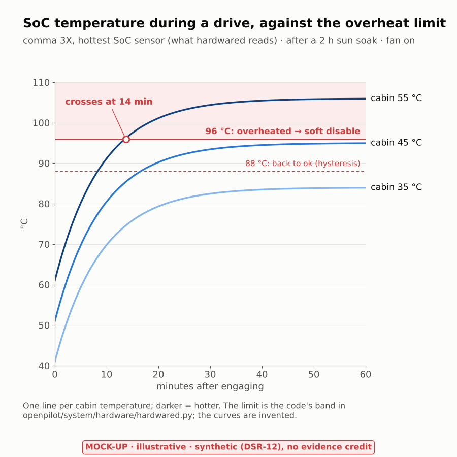
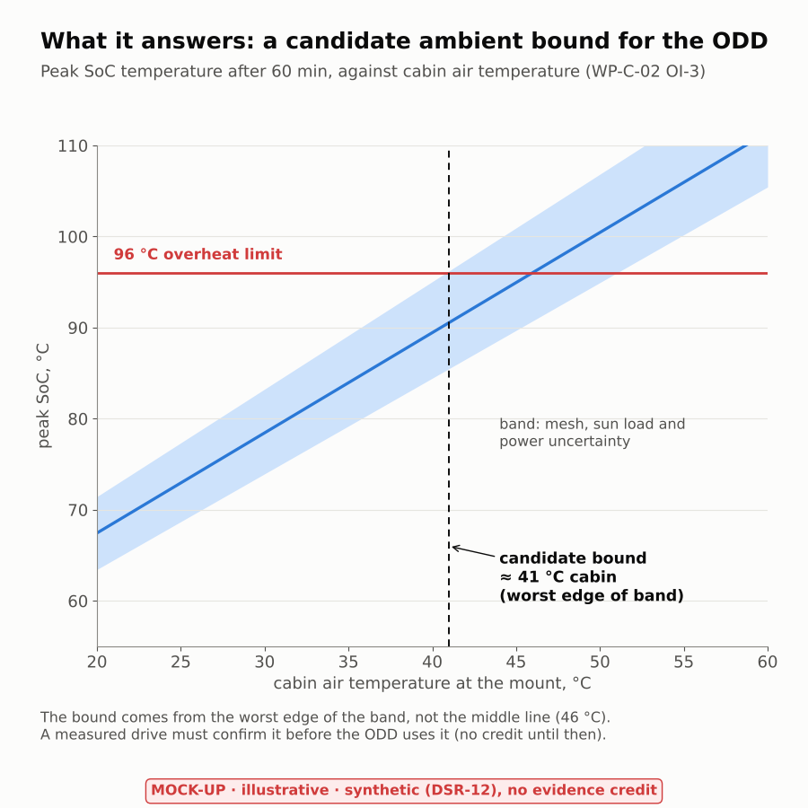
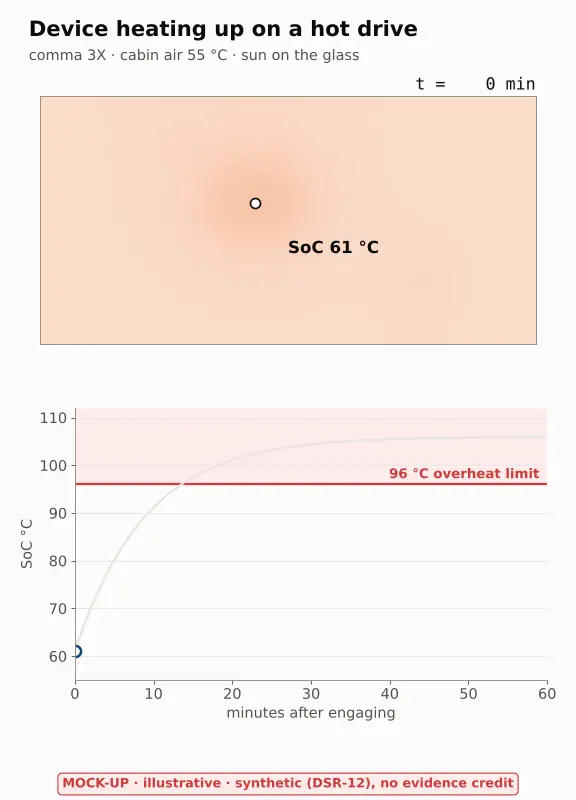

# TE-04 Tool evaluation (scoping) — a physics field model with rendered results: FEniCSx, FiPy and others

| Field | Value |
|---|---|
| Purpose | Decide whether LionDriver needs a physics field model (heat, stress or diffusion over a geometry, shown as a 2D or 3D picture), which problem it should answer first, and which open-source solver it should use |
| Status | Draft. The lead's go on 2026-10-21: the device heat model F1 (DQ-409 A), a cabin-air logger of about US$100 for validation (DQ-411 A), and a design aid with no credit sought, credit revisited at G2 (DQ-412 A). Solver per DQ-410 (Claude's choice, open to objection until 2026-10-28). Pilot started 2026-10-21: T2 and T3 done on estimated inputs ([`assurance/sim/thermal/`](../../sim/thermal/README.md), tool TL-53); T1, T4 and T5 open. AI-drafted (Claude, AI assistant; I0 under WP-M-02 §3.3); not reviewed |
| Standard reference | ISO 26262-8:2018 §11 (confidence in the use of software tools), applied as in [WP-P-07](../WP-P-07-tool-classification-qualification.md) §2; ISO 21448 for the ODD use |
| Date | 2026-10-21 |
| Baseline | `liondriver-dev` at `561f5c1` |
| Related | [WP-C-02](../../02-concept/WP-C-02-odd-and-intended-functionality.md) OI-3, [WP-C-06](../../02-concept/WP-C-06-sotif-insufficiencies-triggering-conditions.md) TC-21, [WP-A-03](../../08-analyses/WP-A-03-dependent-failure-analysis.md) DFI-04, [WP-S-02](../../03-system/WP-S-02-technical-safety-requirements.md) TSR-509, [WP-H-01](../../04-hardware/WP-H-01-hardware-safety-requirements.md) HWSR-509/509a, [sim README](../../sim/README.md), [WP-V-02](../../06-validation/WP-V-02-sotif-vv-strategy.md) §5.3 |

## 1. Why a field model, and why not for the vehicle

FEniCSx and FiPy solve partial differential equations: a quantity that varies over a shape (temperature, stress,
concentration). The vehicle, EPS and PCM dynamics in [`assurance/sim/`](../../sim/README.md) are lumped: a handful of
states per component, solved as ordinary differential equations. Moving those to a field solver adds mesh and cost and
answers nothing new. A field model earns its place only where **where on the part** it gets hot or strained decides a
safety question. §2 lists the candidates against the work products.

## 2. Candidate field problems

| # | Problem | Safety question it answers | Where it is open in the work products | What it needs | Verdict |
|---|---|---|---|---|---|
| F1 | **comma device thermal** in the windshield mount: SoC, panda MCU and camera heat, sun through the glass, cabin air, fan | At what cabin temperature does the SoC reach the `overheated` band (96 °C on the comma 3X, 100 °C on the comma four, `hardwared.py:93-103`) during a drive, and how hot is the panda MCU then? | ODD ambient bound **TBD** (WP-C-02 §3.1, OI-3, G1); triggering condition TC-21 (WP-C-06); common-cause DFI-04, SoC heat raising the MCU temperature, rated **P** (WP-A-03); TSR-509 / HWSR-509 MCU die temperature, reported only; HWSR-509a fan stall | External dimensions of the device and mount (measured with calipers, no teardown); board power from the device's own logs; sun load and glass data from literature; a cabin-air logger for validation | **Recommended first.** Directly feeds an open G1 item, the geometry is small, and the device already logs its own temperatures, so a check against reality is cheap |
| F2 | **EPS motor and column thermal derating** | Does the Toyota EPS reduce assist when hot, which would move the torque authority AOU-01 rests on? | AOU-01 and VS-VAL-01 (WP-V-01) measure the authority cold; no work product names derating | The EPS motor, winding and controller design, which Toyota does not publish; any model would be invented parameters | **Not a field-model job.** The question is real but the answer is a vehicle measurement: add a heat-soaked repeat of VS-VAL-01 (repeated torque steps until the assist stops changing). Raised as a task for the WP-V-01 owner, not as a decision |
| F3 | **Tyre contact patch or rack compliance** | Lateral force build-up and steering-rack flex under LKA torque | Covered at the level needed by the L1 tyre model and the Chrono pilot ([TL-52](../WP-P-07-tool-classification-qualification.md)) | Tyre carcass and tread material data, contact mechanics, a nonlinear 3D solve per time step | **Too heavy.** Contact FEA takes hours per case and needs tyre data we cannot get; the lumped and multibody models already answer the controllability questions at the precision the assumptions allow |
| F4 | Harness connector heating, camera lens fogging | Contact resistance heating at the TSS2 harness; condensation on the windshield in front of the camera | Not raised in any work product | — | Not now. Noted so it is not rediscovered |

## 3. Tools for F1

| | **FEniCSx** (DOLFINx) | **FiPy** (NIST) | **Elmer FEM** (CSC) | **NASA NASTRAN-95** | Lumped RC network (numpy, in-house) |
|---|---|---|---|---|---|
| Method | Finite elements, any order, unstructured 2D/3D meshes from Gmsh | Finite volumes on structured grids or Gmsh meshes | Finite elements, multiphysics; built-in heat transfer with radiation view factors | Finite elements, structural and heat transfer | 5–10 thermal nodes and resistances |
| Licence | LGPL-3.0 or later; used as a tool, not shipped | NIST public-domain notice (conda-forge lists NIST-PD) | GPL-2.0+ for the programs, LGPL-2.1 for the ElmerSolver library | NOSA 1.3 | Ours |
| Maintenance | Active; 0.10 early 2026, 0.11 series packaged mid-2026 | Active; 4.0.3, docs updated September 2026 | Active; 26.2.1 (April 2026) | Archived Fortran 77 release, no active development | — |
| Headless CI, pinning | conda-forge `fenics-dolfinx`, pinned with every dependency by URL and md5 in an explicit lock (the TL-44 pattern); or the `dolfinx/dolfinx` image by digest | `pip` with pinned versions in a `requirements.txt` (TL-45 pattern); pure Python with a sparse solver | conda-forge or source build; text case files (`.sif`) | Source build with a legacy Fortran toolchain | Already in the TL-45 stack |
| Render path | `dolfinx.plot` → **PyVista** off-screen PNG; XDMF/VTX files for ParaView | Built-in **matplotlib** viewers for 2D; VTK output for ParaView/PyVista | VTU output → ParaView/PyVista | Legacy output; would need converters | matplotlib time series only |
| Fit for F1 | Good: 3D conduction with convection and a sun-flux boundary; a linearised radiation term is easy to write | Good on a 2D cross-section, weak on the full 3D shell | Very good physically (radiation between surfaces built in), but a second language and file format in the repo | Poor: no maintenance and no modern build | Good for the time series, cannot show *where* it is hot |
| Evidence view (ISO 26262-8 §11) | Weak-form code is short and reviewable; verification by manufactured solutions and the analytic slab case | Independent method and code base from FEniCSx, which makes it a useful cross-check | Mature code, but its input files are less readable to a reviewer | A NASA pedigree does not help an unmaintained build | Hand-checkable; the natural sanity check |

**Recommendation (decider: Claude, reversible; recorded with DQ-410):** FEniCSx for the 3D model, rendered with
PyVista, with two independent checks: FiPy on a 2D cross-section of the same device, and a lumped RC network in numpy.
If the three agree within a stated tolerance, a solver or mesh error is unlikely to pass unnoticed (tool error
detection TD2 without measurement, TD1 once logged drives back it, §5). In the pilot the lumped network became two
exact checks instead, which test the same things more sharply: a well-mixed box against the exact exponential, and
the energy balance of the device model (§5). Elmer is the fallback if surface-to-surface
radiation inside the mount turns out to matter more than a linearised term can capture.

No NASA tool fits this problem. NASA's current heat-transfer codes (for example UNIC at Marshall) are US-release
only, and NASTRAN-95, the open one, is unmaintained. The NASA tools that do fit LionDriver sit elsewhere: Trick for
the future HIL bench, IKOS for static analysis of the panda C code, and FRET → Ogma → Copilot for runtime monitors
([TE-03](TE-03-fret-requirements.md)).

## 4. What it would show (mock-ups)

All five figures are **mock-ups: illustrative, synthetic (DSR-12), no evidence credit**. Geometry, power and sun load
are invented; only the 96 °C and 88 °C band edges are the code's (comma 3X, `hardwared.py:99-103`).

*Figure 4-1. The rendered field: where on the device it is hot, at 45 °C cabin air after a 60 min drive.*

*Figure 4-2. The time series at the critical point against the limit the code applies.*

*Figure 4-3. The answer it is for: a candidate ambient bound for WP-C-02 OI-3, taken from the worst edge of the band.*

*Figure 4-4. How the result would sit on a README page.*

*Figure 4-5. The same result animated (looping WebP; GIF is not used because the repository sends `*.gif` to the read-only LFS store). A real run would write one such loop per cabin temperature, next to the still figures.*

## 5. Pilot plan and progress

| Step | Work | Done when | Status |
|---|---|---|---|
| T1 Inputs | Measure the device and mount; pull SoC, PMIC and fan logs from a few drives already on the car (local logs only, no uploads, DQ-084) for board power | A parameter file with a source for every number | Open. [`params.yaml`](../../sim/thermal/params.yaml) holds estimates, each with its source; the device logs `powerDrawW`, `somPowerDrawW`, `intakeTempC` and `exhaustTempC`, so most inputs can come from local logs |
| T2 Model | FEniCSx 3D conduction with convection and sun-flux boundaries on a hexahedral box mesh (no Gmsh needed for a box); PyVista off-screen render | A CI job builds the figures of §4 from the model, stamped synthetic | **Done** 2026-10-21 on estimated inputs: [`thermal-pilot.md`](../../sim/results/thermal-pilot.md); CI job 'simulation device heat model' |
| T3 Verify | Analytic slab; lumped transient; energy balance; mesh convergence; FiPy 2D section agrees within the stated tolerance | The checks fail the job on disagreement | **Done** 2026-10-21: checks V1–V6 ([sim/thermal README §3](../../sim/thermal/README.md#3-checks)) |
| T4 Validate | Cabin-air logger at the mount on hot drives (DQ-411); compare predicted with logged SoC temperature | A comparison table; the uncertainty band of Figure 4-3 is set from it | Open: waits on the logger (DQ-411) and T1 |
| T5 Hand over | The candidate bound and its band go to the WP-C-02 owner for OI-3 and to WP-A-03 for DFI-04 | The owners have it, labelled synthetic | Open: after T1 and T4 |

Classification: FEniCSx, FiPy and PyVista are TL-53 in WP-P-07, **TI1 / TCL1** while the bound is only a candidate
that a measurement must confirm; **TI2 / TCL2** with a qualification plan if the ODD bound ever rests on the model
alone (DQ-412, revisit at G2).

**First result on estimated inputs** (not a device result): the hottest SoC point reaches the comma 3X's 96 °C at
about 50 °C cabin air on the nominal line, and at about 43 °C on the worst edge of the band. The conductivity of the
spreader and the SoC power move it most. T1 replaces the estimates; T4 sets the band from measured drives.

## 6. What this is not

- **Not evidence.** Nothing here earns credit until a fidelity case is approved (WP-V-02 §5.3, DQ-139).
- **Not the ODD bound.** The model proposes a number with its uncertainty; the bound is set in WP-C-02 by the lead.
- **Not a device qualification.** Thermal qualification of the device is a supplier and WP-H-07 matter; the model
  shows where the margin is thin.

## 7. Open items

| ID | Item |
|---|---|
| OI-1 | ~~The lead's go or no-go~~ **Closed** 2026-10-21: go on F1 (DQ-409 A), logger approved, not yet bought (DQ-411 A), design aid, TCL1 (DQ-412 A); the tool choice is Claude's, open to objection until 2026-10-28 (DQ-410) |
| OI-2 | ~~Confirm that PyVista renders off-screen~~ **Closed** 2026-10-21: VTK 9.7 renders through Mesa's software EGL (surfaceless), no screen or GPU; conda-forge Mesa 26 no longer ships OSMesa |
| OI-3 | Task for the WP-V-01 owner: a heat-soaked repeat of VS-VAL-01 to see whether the EPS derates (F2) |
| OI-4 | Licence: conda-forge's PETSc build links ParMETIS, whose licence allows non-commercial use only without permission. The serial runs here use PETSc's own LU, not ParMETIS. Before LionDriver is used commercially, settle it: a PETSc build without ParMETIS, or the authors' permission (coordinator) |
