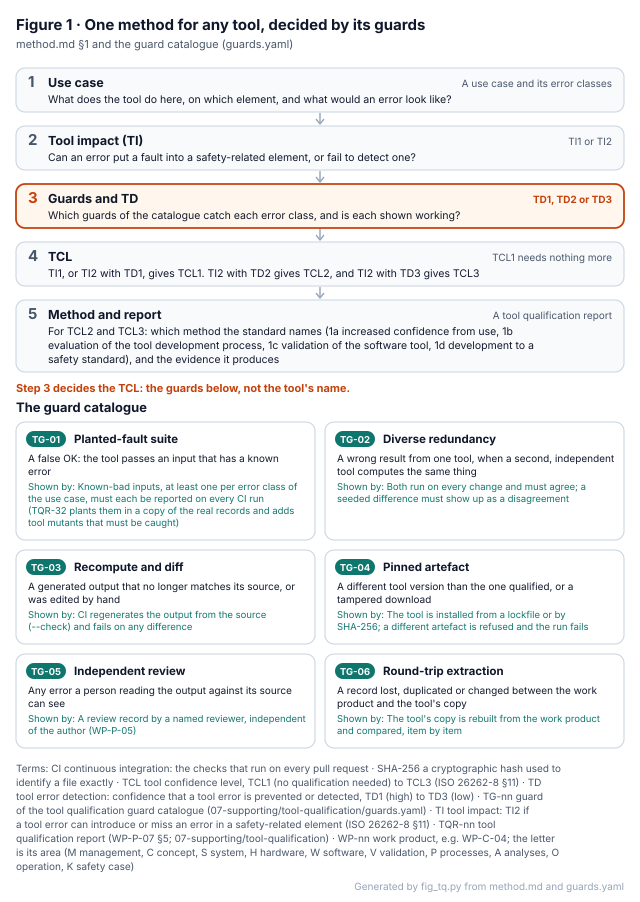
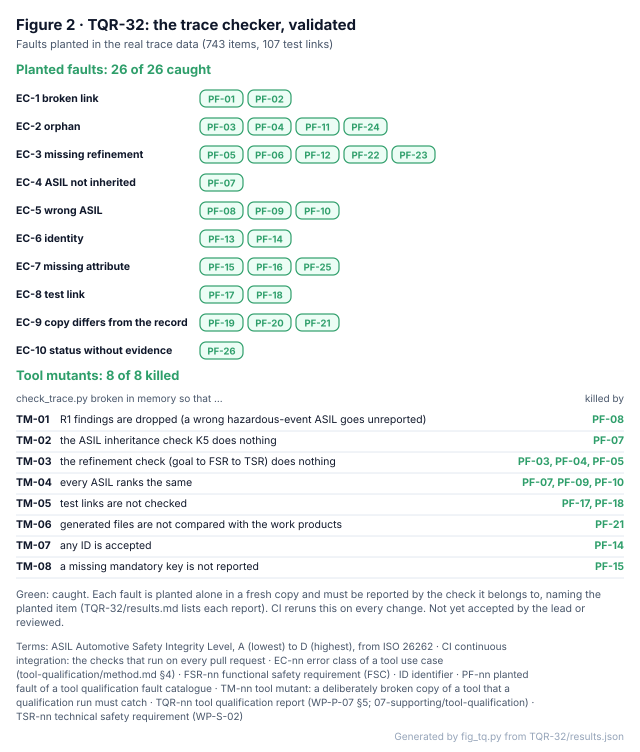

# Tool qualification: any tool, the right guards

ISO 26262-8 §11 qualifies a tool **for a use**, not a brand. This folder holds one method that works for any tool:
DOORS, Jama or Polarion, a compiler, or a script written for this project. It starts from what the tool is used for,
finds the guards that would catch its errors, and derives the tool confidence level (TCL) from those guards. For a
tool that needs qualifying, it ends in a report whose evidence CI runs again on every change.

<!-- terms:start (generated by assurance/trace/tools/terms.py; do not edit by hand) -->

Terms on this page (13)

| Term | Meaning |
|---|---|
| ASIL | Automotive Safety Integrity Level, A (lowest) to D (highest), from ISO 26262 |
| CI | continuous integration: the checks that run on every pull request |
| CR-nn | confirmation review of the confirmation measures plan (WP-M-06) |
| DOORS | IBM Engineering Requirements Management DOORS: a commercial requirements management tool |
| ISO | International Organization for Standardization |
| MISRA | MISRA C, the coding guideline for the C of the envelope (WP-W-01 §5) |
| TCL | tool confidence level, TCL1 (no qualification needed) to TCL3 (ISO 26262-8 §11) |
| TD | tool error detection: confidence that a tool error is prevented or detected, TD1 (high) to TD3 (low) |
| TG-nn | guard of the tool qualification guard catalogue (07-supporting/tool-qualification/guards.yaml) |
| TI | tool impact: TI2 if a tool error can introduce or miss an error in a safety-related element (ISO 26262-8 §11) |
| TL-nn | tool entry in the tool register (WP-P-07) |
| TQR-nn | tool qualification report (WP-P-07 §5; 07-supporting/tool-qualification) |
| WP-nn | work product, e.g. WP-C-04; the letter is its area (M management, C concept, S system, H hardware, W software, V validation, P processes, A analyses, O operation, K safety case) |

All terms: [abbreviations and record codes](../../terms.md).

<!-- terms:end -->

**The approach in five lines.**

1. **64 tools are classified** in [WP-P-07](../WP-P-07-tool-classification-qualification.md). 31 of them are TCL2 or TCL3
   and need qualifying for use in the ASIL path.
2. **The TCL follows the guards, not the brand.** Swap a tool and keep its guards, and its TCL holds. A commercial
   requirements tool is TCL1 only because review or a check catches its errors, the same rule this project applies
   to its own tools ([method](method.md) §2).
3. **A guard counts only once it is shown working.** A planted-fault suite runs in CI; a review counts once a
   reviewer is named ([guard catalogue](guards.yaml)).
4. **First report: [TQR-32](TQR-32-check-trace.md)**, the trace checker, which does what DOORS or Jama would do here.
   26 faults are planted in the real trace data and all are caught. 8 deliberately broken versions of the checker
   are run, and the planted faults catch all 8.
5. **People still decide.** The lead accepts each report, an independent reviewer reviews each in-house tool, and the
   assessor samples the reports.

| Where it comes from | This folder | Where it goes |
|---|---|---|
| [WP-P-07](../WP-P-07-tool-classification-qualification.md) §3: every tool, its use case, TI, TD and TCL · ISO 26262-8 §11 | The method, the guard catalogue, one report per qualified tool with its validation in CI | WP-P-07 §5 (qualification status) · the [decision register](../../01-management/decisions/register.yaml) (acceptance) · the confirmation review CR-09 |

## 1. One method for any tool

*Figure 1. The method ([method.md](method.md) §1) and the [guard catalogue](guards.yaml).* Step 3 decides the
outcome: which guards catch each error class of the tool's use, and whether each is shown working. The same steps
give a DOORS installation, a compiler and an in-house checker their TCL.

## 2. The first report: the trace checker

*Figure 2. [TQR-32](TQR-32-check-trace.md), generated from its last run.* Each fault is a real error of
requirements management planted in a copy of the committed trace data: a broken link, an orphan, a missing
refinement, a wrong ASIL, a hand-edited copy. The checker must report each one with the check it belongs to. Then
eight broken versions of the checker run against the same faults, and every one is caught. The trace checker stays
TCL2: the validation qualifies it (method 1c), and TCL1 would need a named reviewer as the guard in use.

## Reports

| Report | Tool | TCL | Method | State |
|---|---|---|---|---|
| [TQR-32](TQR-32-check-trace.md) | `check_trace.py` (TL-32), trace consistency | TCL2 | 1c validation: planted faults and tool mutants on the real data | Validation passes in CI; acceptance by the lead queued |

The other TCL2 and TCL3 tools have plans in WP-P-07 §5. MISRA (TL-04), coverage (TL-42/TL-43) and mutation testing
(TL-06) come next, with a comparison of this approach and the commercial requirements tools against the same error
classes.

## Where the files come from

| File | What it is |
|---|---|
| [`method.md`](method.md) | The method, the TD rule, the error classes of requirements management, the report contents, re-qualification |
| [`guards.yaml`](guards.yaml) | The guard catalogue TG-01…TG-06 |
| [`TQR-32/faults.yaml`](TQR-32/faults.yaml) | The planted faults of TQR-32 |
| [`tools/qualify.py`](tools/qualify.py) | Plants each fault, runs the checker and the mutants, writes [`TQR-32/results.md`](TQR-32/results.md); `--check` in CI |
| [`figures/fig_tq.py`](figures/fig_tq.py) | Figures 1 and 2, from method.md, guards.yaml and the results; `--check` in CI |
