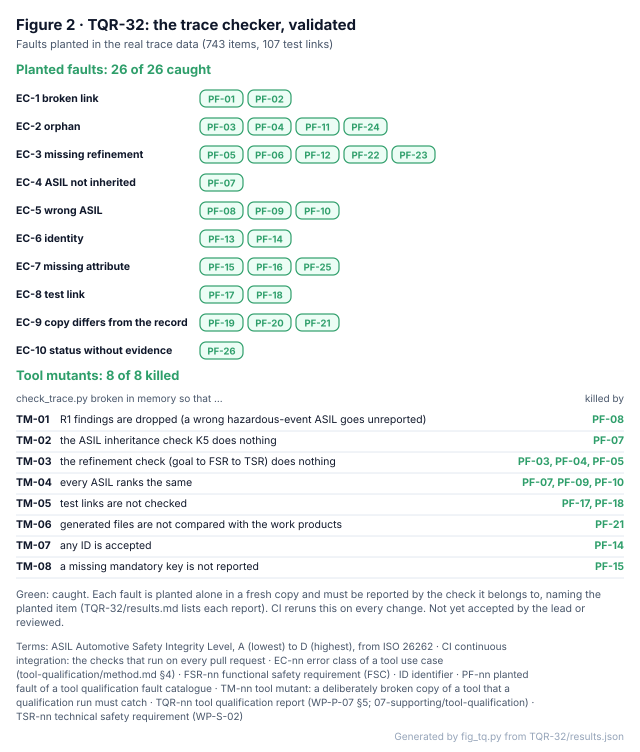

# TQR-32 Tool qualification report: the trace checker `check_trace.py`

| Field | Value |
|---|---|
| Tool | [`assurance/trace/tools/check_trace.py`](../../trace/tools/check_trace.py) (WP-P-07 TL-32), in-house, LionDriver-owned |
| Version | The file at the commit under review: CI runs this report's validation on every change, so a result always belongs to the code beside it. Python 3.12 of the CI image `ubuntu-24.04`; PyYAML 6.0.3 pinned in [`assurance/trace/requirements.txt`](../../trace/requirements.txt) (TL-55) |
| Use case | Check the trace data of all safety goals: links, ASIL inheritance and risk-graph ASILs, refinement coverage, test links, and agreement with the work products (checks K1–K6, K12, R1–R4, S1, A1, C1, Q1, I1, X1–X3) |
| Classification | TI2, TD2, **TCL2** (WP-P-07 §3) |
| Method | 1c, validation of the software tool, by the [method](method.md) of this folder |
| Version of this report | 0.1 (first issue; I0, Claude; 2026-11-12) |
| Status | Draft. Validation passes in CI. **Not accepted:** acceptance by the lead, independent review and assessor sampling are open (§7) |

<!-- terms:start (generated by assurance/trace/tools/terms.py; do not edit by hand) -->

Terms on this page (23)

| Term | Meaning |
|---|---|
| AI | artificial intelligence |
| ASIL | Automotive Safety Integrity Level, A (lowest) to D (highest), from ISO 26262 |
| C0–C3 | controllability class C0 (controllable in general) to C3 (difficult or uncontrollable) |
| CI | continuous integration: the checks that run on every pull request |
| CR-nn | confirmation review of the confirmation measures plan (WP-M-06) |
| DOORS | IBM Engineering Requirements Management DOORS: a commercial requirements management tool |
| EC-nn | error class of a tool use case (tool-qualification/method.md §4) |
| FSR-nn | functional safety requirement (FSC) |
| HARA | hazard analysis and risk assessment (ISO 26262-3) |
| HWSR-nn | hardware safety requirement (WP-H-01) |
| I0–I3 | independence level of a review, I0 (none, e.g. the author or an AI) to I3 (independent organisation) |
| ID | identifier |
| OI-nn | open item of the document it appears in |
| PF-nn | planted fault of a tool qualification fault catalogue |
| S0–S3 | severity class S0 (no injuries) to S3 (life-threatening) |
| SOTIF | safety of the intended functionality (ISO 21448): hazards with nothing failing |
| SWSR-nn | software safety requirement (WP-W-02) |
| TD | tool error detection: confidence that a tool error is prevented or detected, TD1 (high) to TD3 (low) |
| TG-nn | guard of the tool qualification guard catalogue (07-supporting/tool-qualification/guards.yaml) |
| TL-nn | tool entry in the tool register (WP-P-07) |
| TQR-nn | tool qualification report (WP-P-07 §5; 07-supporting/tool-qualification) |
| TSR-nn | technical safety requirement (WP-S-02) |
| WP-nn | work product, e.g. WP-C-04; the letter is its area (M management, C concept, S system, H hardware, W software, V validation, P processes, A analyses, O operation, K safety case) |

All terms: [abbreviations and record codes](../../terms.md).

<!-- terms:end -->

## 1. Use case and the error that matters

`check_trace.py` reads the trace items (hazards, hazardous events, safety goals, FSRs, TSRs, SWSRs, HWSRs, the SOTIF,
AI, cybersecurity, system and interface items) and the test links. It reports what is broken. It changes nothing.

The error that matters is a **false OK**: the tool passes trace data that has a broken link, an orphan, a missing
refinement or a wrong ASIL. A wrong ASIL or a missing requirement would then reach the safety goals, the design and
the tests with nothing to stop it. A false alarm only costs time, because a person reads every error.

This is the use case DOORS, Jama or Polarion would cover in a commercial toolchain. The error classes are the same
(method §4), so this report is also the template for qualifying such a tool here.

## 2. Classification

- **TI2:** a false OK can fail to detect an error in the trace of every safety goal.
- **TD2:** a second, independent check exists for some error classes in use, but not all (§4). For the rest the
  detection is a review of the trace and the work products, which counts fully only once a reviewer is named
  ([WP-M-02](../../01-management/WP-M-02-safety-plan.md) OI-1).
- **TCL2.** Qualification is required for use in the ASIL path. This report qualifies the tool by validation (1c).

Reaching TD1, and so TCL1, would need an independent guard in use for every error class, in practice the named
reviewer (TG-05). The validation below does not raise TD on its own (method §3).

## 3. Validation (method 1c)

The validation runs [`tools/qualify.py`](tools/qualify.py) against the **committed trace data**, not a toy set:

1. The unchanged data must pass with no error.
2. **Planted faults.** Each fault of [`TQR-32/faults.yaml`](TQR-32/faults.yaml) is planted alone in a fresh copy of
   the data, and `check_trace.py` must report it with the check it belongs to and a message that names the planted
   item. There is at least one fault for every check the tool runs; a new check without a fault fails the test of
   this report.
3. **Tool mutants.** A validation is only worth something if it notices a broken tool. Each mutant switches off or
   weakens one part of `check_trace.py` in memory (the file is never touched): for example, drop every R1 finding, make
   every ASIL rank the same, or accept any ID. A mutant is killed when the unchanged data no longer passes or a
   planted fault goes unreported. Every mutant must be killed.

*Figure 2. The validation, generated from the last run ([`TQR-32/results.md`](TQR-32/results.md) has every fault,
the error it was reported as, and every mutant).* CI runs it on every change and fails when a fault is missed, a
mutant survives or the result is stale.

## 4. Guards per error class

| Error class (method §4) | Validation: planted faults | Guards in use, independent of the tool |
|---|---|---|
| EC-1 Broken link | PF-01, PF-02 | Review (TG-05, reviewer not yet named) |
| EC-2 Orphan | PF-03, PF-04, PF-11, PF-24 | Review |
| EC-3 Missing refinement | PF-05, PF-06, PF-12, PF-22, PF-23 | Review |
| EC-4 ASIL not inherited | PF-07 | Review; recorded findings in `links/k5-known.yaml` only shrink (K5) |
| EC-5 Wrong ASIL | PF-08, PF-09, PF-10 | For hazardous events, diverse redundancy (TG-02): the HARA generator `hara_model.py` (TL-36) computes every hazardous-event ASIL with its own code, and its tests compare it with the risk graph exhaustively. Goal ASILs (R2, R3): review |
| EC-6 Identity | PF-13, PF-14 | Schema check (TG-02): `check_schema.py` (TL-55) validates every ID against the item schema |
| EC-7 Missing attribute | PF-15, PF-16, PF-25 | Schema check (TG-02): required fields and status values in `item.schema.json` |
| EC-8 Test link | PF-17, PF-18 | Recompute and diff (TG-03): `verification_links.py --check` regenerates the links from WP-W-06 |
| EC-9 Copy differs from the record | PF-19, PF-20, PF-21 | Round trip (TG-06): `sync_requirements.py --check` (TL-33) rebuilds the generated items from the work products |
| EC-10 Status without evidence | PF-26 | Review |

Every class has a guard. Five of the ten rest on the review alone in use, and a sixth (goal ASILs) in part, which is
why TD stays at TD2.

## 5. Use constraints and known limitations

- Run it on the whole trace data, as CI does: the cross-checks (K4, R4, S1, C1, X1–X3) need every file.
- A planted fault shows the tool catches that pattern. A fault on another pattern of the same class may still pass;
  the catalogue grows when a review finds one, and the test of this report keeps one fault per check.
- The mutants are a sample of eight ways the tool could break, not all of them.
- K6 checks the links file; the `@req` tags in test code that README §6 also names are not checked.
- X1 and X2 compare the fields the parser reads from WP-C-03 and WP-C-01, not every column of those tables.
- Without PyYAML the tool parses a restricted YAML subset; its equivalence with PyYAML on the committed items is
  tested in `test_check_trace.py`. CI always uses the pinned PyYAML.

## 6. Re-qualification

The validation reruns in CI on every change to the tool, its catalogue, the trace data, the work products it reads
or this folder (method §6). A new check in the tool fails the test of this report until the catalogue has a fault
for it. A change to the use case, or credit beyond this use case, means classifying again in WP-P-07.

## 7. Acceptance

| Step | Who | State |
|---|---|---|
| Validation passes in CI | Tooling | Done, on every change |
| Accept this report as the qualification of TL-32 for use in the ASIL path | The lead, through the decision register | Queued as a question for the next batch |
| Review `check_trace.py`, `qualify.py` and the catalogue as test software | An independent reviewer (WP-P-05) | Open (WP-P-07 OI-13) |
| Sample the report in the confirmation review of WP-P-07 | The assessor (CR-09) | Open |
