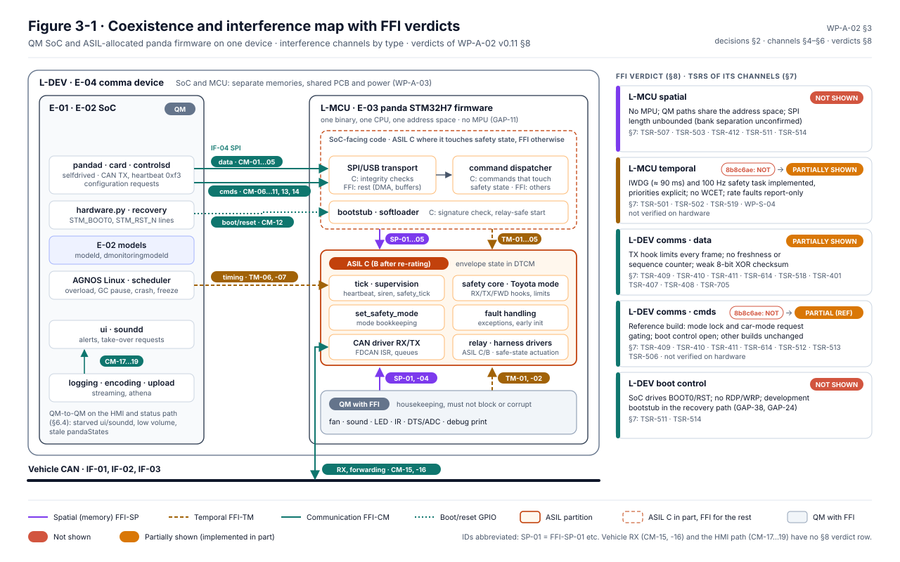

# WP-A-02 Coexistence of Elements and Freedom from Interference

| Field | Value |
|---|---|
| Work product | WP-A-02 Coexistence of elements and freedom from interference |
| Standard reference | ISO 26262-9:2018 §6 (criteria for coexistence of elements); ISO 26262-6:2018 §7 and Annex D (freedom from interference between software elements: timing and execution, memory, exchange of information); ISO 26262-5:2018 Annex D (communication bus diagnostic measures, informative); ASPICE 4.0 SYS.3, SWE.2 |
| Version | 0.14 (RX timeout bound ≤ 0.162 s, was ≤ 0.16 s, as WP-S-04 v0.21 T-01 (161.5 ms: 5 periods of 30.3 ms plus one 10 ms task period); no requirement, budget or verdict changed; 2026-10-27). 0.13 (OI-9: the reference build drops USB and other brands' modes and measures handler times first, DQ-153/155/156 A; 2026-10-26). 0.12 (§2: the housekeeping code (fan, sound, LED, IR, DTS/ADC, debug print) is developed and verified to ASIL C instead of QM with FFI, lead decision in the decision register (DQ-126, option B, 2026-10-23); OI-2 closed; the §7 measures stay required for the SoC-facing paths and random hardware faults; no verdict changed; I0, Claude; 2026-10-25). 0.11 (Figure 3-1 generated by `figures/fig_a02_interference_map.py` and checked in CI; the cards now list the TSRs §7 gives for each verdict's channels and show the dated change of verdict; no analysis content changed; 2026-10-19). 0.10 (FFI-CM-06: panda `0a7da85` pinned, a relay malfunction blocks TOYOTA until ignition off; no verdict changed; 2026-10-17). 0.9 (FFI-CM-06: opendbc `515b9a2` pinned, a mode cycle no longer re-grants authority without a new engagement or clears the TX-rate block; relay-malfunction re-detection still lags 1–2 s; no verdict changed; 2026-10-17). 0.8 (FFI-CM-06: a TOYOTA → NOOUTPUT → TOYOTA cycle clears the envelope's latched fault reactions; no verdict changed; 2026-10-16). 0.7 (the harness "relay" is two solid-state switches in comma's harness box, [RR-2026-010](../04-hardware/reviews/RR-2026-010.md); its supply and release default are common causes in WP-A-03 DFI-27, DFI-28; no interference rating changed; 2026-10-16). 0.6 (heartbeat-loss siren, panda `c33343b`; EPS-siren worst case 1.26 s; 2026-10-13). 0.5 (§3 Figure 3-1 interference map with the §8 verdicts added; no change to the analysis; 2026-10-13). 0.4 (status update 2026-10-12: dated status notes for the reference build at `bf6ce8c` in §4–§6, §8 verdicts, OI-5 partly closed; nothing verified on hardware or reviewed independently). History: 0.3 (TSR-626, TSR-627 for FFI-CM-17/19; 2026-10-12) |
| Status | Draft |
| ASIL / scope | ASIL C (SG-01, until re-rated) / ASIL B (SG-02…SG-07) elements coexisting with QM elements, on the panda MCU and on the comma device |
| Author | Assurance team (initial draft) |
| Reviewer(s) | TBD (I1); input to G2 confirmation review |
| Approver | Safety manager |
| Baseline | `bf6ce8c` (status update 2026-10-12; opendbc `7993399`, panda `b790fca`). Analysis originally at `8b8c6ae` (opendbc `229dc70`, panda `92eb565`); the "Existing measures" cells describe that baseline unless a dated status note says otherwise |

## 1. Purpose and scope

The LionDriver safety argument ([WP-M-01 §4](../01-management/WP-M-01-assurance-strategy.md#4-safety-architecture-argument-the-central-strategy)) treats everything on the application SoC as QM and puts all ASIL requirements on the safety envelope (E-03). That argument holds only if no fault in a QM element can cause the envelope to violate a safety requirement. This document analyses that condition, as ISO 26262-9 §6 requires when elements of different ASIL (or QM) coexist inside one element or interact with it.

Two coexistence levels are analysed:

| Level | Container | ASIL-allocated part | QM (or lower-ASIL) parts |
|---|---|---|---|
| L-MCU | Panda STM32H7 firmware image (one binary, one CPU, one address space) | opendbc safety hooks (Toyota mode), safety tick, heartbeat supervision, relay drive, CAN TX/RX path, fault handling; since v0.12 also fan, sound, LEDs, IR, ADC housekeeping and debug UART (§2) | Host command dispatcher (USB/SPI), CAN forwarding plumbing, power save, bootstub/softloader paths |
| L-DEV | comma device (SoC + MCU + shared PCB, power, enclosure) and harness | E-03 envelope, E-05 harness relay (*2026-10-16:* two DG419LE analog switches in the harness box, released to the stock path by a pull-down while the box is powered, [RR-2026-010](../04-hardware/reviews/RR-2026-010.md); "relay" below means these switches) | E-01 SoC software (pandad, card, controlsd, selfdrived, ...), E-02 ML models, AGNOS Linux, network services |

Dependent failures that do not originate in a QM element (shared power, clock, thermal, toolchain, identical constants) are analysed in [WP-A-03](WP-A-03-dependent-failure-analysis.md). This document cross-references them where interference and dependent failure overlap.

TSR references are to [WP-S-02](../03-system/WP-S-02-technical-safety-requirements.md) (Draft v0.1). New findings use the NF-nn IDs of WP-S-02 §11 where WP-S-02 already raised them.

## 2. Coexistence decision for the panda firmware (L-MCU)

ISO 26262-9 §6 gives two options for a QM or lower-ASIL sub-element that coexists with a higher-ASIL sub-element: develop it to the higher ASIL, or show freedom from interference. The table records the decision per sub-element.

| Sub-element (panda firmware) | Source | Safety role | Decision | Rationale |
|---|---|---|---|---|
| opendbc safety core and Toyota mode (`safety_rx_hook`, `safety_tx_hook`, `safety_fwd_hook`, `safety_tick`, limit checks) | `opendbc_repo/opendbc/safety/safety.h`, `lateral.h`, `longitudinal.h`, `modes/toyota.h` | Implements FSR-01.xx…07.xx | **ASIL C (B after re-rating)** | Core envelope |
| Tick handler: heartbeat timeout, controls-allowed mismatch, siren, `safety_tick` call | `panda/board/main.c:106-249` | FSR-01.07, FSR-02.05 | **ASIL C** | Safety supervision |
| CAN driver RX/TX path (FDCAN ISR, `can_send`, queues) | `panda/board/drivers/fdcan.h`, `drivers/can_common.h:161-176` | Carries every actuation frame; invokes TX/RX hooks | **ASIL C** | Safety-related data path; a fault here bypasses the hooks |
| Relay and harness drivers | `panda/board/drivers/harness.h` | FSR-01.11, FSR-07.03 | **ASIL C/B** | Actuation of the safe state |
| `set_safety_mode` and mode bookkeeping | `panda/board/main.c:31-80` | Configures envelope | **ASIL C** | Configuration of the safety element |
| Fault handling, exception handlers, early init | `panda/board/sys/faults.h`, `early_init.h:66-80` | FSR-01.09 | **ASIL C** | |
| Host command dispatcher (`comms_control_handler`) | `panda/board/main_comms.h` | Receives commands from the QM SoC; some commands change safety-relevant state | **ASIL C for the commands that touch safety state; others shown non-interfering** | It is the interface through which QM interference arrives (§5) |
| SPI/USB transport (`spi_rx_done`, DMA, USB ISR) | `panda/board/drivers/spi.h`, `stm32h7/llspi.h`, `stm32h7/llusb.h` | Moves host frames into `comms_can_write` | **ASIL C (integrity checks) / FFI for the rest** | Corruption here reaches `can_send` |
| Fan, sound, LED, IR, DTS/ADC housekeeping, debug print | `drivers/fan.h`, `stm32h7/sound.h`, `drivers/led.h`, `stm32h7/lldts.h` | None | **ASIL C** | Developed and verified to the envelope's ASIL, so no freedom from interference is claimed for it: reviewed, tested and covered to ASIL C, and so is every upstream change to it. Lead decision, decision register DQ-126 option B (2026-10-23), instead of the recommended QM with MPU isolation |
| Bootstub / softloader | `panda/board/bootstub.c`, `flasher.h` | Boot integrity (TSR-511) | **ASIL C for signature check and relay-safe start; cybersecurity scope** | GAP-24, GAP-38 |

**Consequence:** the panda firmware is one image without MPU partitioning (GAP-11). For the housekeeping code the coexistence question is settled by developing it to ASIL C (v0.12), so its interference channels (FFI-SP-01, FFI-SP-04, FFI-TM-01, FFI-TM-02) are addressed for systematic faults by its development, not by an FFI argument. What this costs: the units of U-PND-HK ([WP-W-03](../05-software/WP-W-03-software-architecture.md) §3.1) get ASIL C software requirements, reviews, unit tests and structural coverage (WP-W-05, WP-W-06), the MISRA and coding rules of WP-W-01 apply to them in full, and every upstream change to them is assessed at ASIL C under [WP-M-11](../01-management/WP-M-11-upstream-and-supplier-management.md). The decision does not remove a measure: the MPU, stack guard, watchdog and fault reactions of §7 stay required, because they also protect the envelope against the SoC-facing paths (host command dispatcher, SPI/USB transport) and against random hardware faults. The two rows still marked "FFI for the rest" or "shown non-interfering" depend on those measures (OI-9).

## 3. Interference model

| Type | ISO 26262-6 Annex D fault classes considered | Applies to |
|---|---|---|
| Spatial (memory) | Corruption of content, read/write access to memory allocated to another element, stack overflow, DMA writes to wrong location | L-MCU |
| Temporal (timing and execution) | Blocking of execution, deadlock, livelock, wrong allocation of execution time, incorrect synchronisation, interrupt overload | L-MCU, L-DEV |
| Communication (exchange of information) | Repetition, loss, delay, insertion, masquerade/incorrect addressing, incorrect sequence, corruption, asymmetric information, information to only a subset, blocking of a communication channel; plus unintended **commands** that change the receiver's configuration | L-MCU ↔ SoC (IF-04), vehicle CAN (IF-01/02/03), boot/reset lines |

*Figure 3-1.* The coexistence decisions of §2 drawn as partitions of the one firmware image, the interference channels of §4–§6 by type (spatial, temporal, communication), and the verdicts of §8 with the key measures of §7. Amber means implemented in part and not verified; no verdict is "shown". Drawn from §2, §4–§8. Generated by [`figures/fig_a02_interference_map.py`](figures/fig_a02_interference_map.py) from §2, §4–§8 and checked in CI: the channel tags, the verdict chips and the TSRs on each card (those §7 gives for the card's channels) are read from this document. The two lines of reason on each card are condensed from §8; a change to a §8 row or a §2 decision fails the build until the figure is reviewed and regenerated.

## 4. Spatial interference (L-MCU)

| ID | Interference | Path | Effect on safety | Existing measures (code) | Gap | Required measure |
|---|---|---|---|---|---|---|
| FFI-SP-01 | QM code (comms handler, housekeeping) overwrites envelope state (`controls_allowed`, `current_safety_mode`, limits, `relay_malfunction`, heartbeat variables) through a pointer or index error | Single address space; `.data/.bss/stack` all in DTCM (`panda/board/stm32h7/stm32h7x5_flash.ld:160-188`) | SG-01/03/04/05: authority granted or limits altered | MISRA C:2012 checking of `board/main.c` (`panda/tests/misra/test_misra.sh`); `-Werror`; bounds-checked index for CAN bus number (`can_common.h:163`) | **No MPU configuration** (`mpu_armv7.h` vendored, unused); no RAM ECC handling (GAP-08, GAP-11) | MPU regions: envelope data read-only to non-safety code paths, stack guard, code non-writable, MemManage → safe state (TSR-507); RAM ECC enabled with double-error → safe state (TSR-503) |
| FFI-SP-02 | **SPI DMA writes beyond `spi_buf_rx`.** The data length is taken from the 16-bit header field `spi_data_len_mosi` (`drivers/spi.h:115`) and used directly as DMA length (`drivers/spi.h:233`, `stm32h7/llspi.h:22`). No check against `SPI_BUF_SIZE` (4096, `drivers/drivers.h:216`) was found. The header is protected only by an 8-bit XOR (`spi.h:97-104, 122`) Note: the linker map suggests the overrun is confined to the SRAM1/2 region holding only the SPI buffers, with envelope state in DTCM (not DMA-reachable); confirm per WP-W-04 OI-1 before crediting or discounting this path. | SoC (QM) → SPI4 → DMA2 Stream2 | Overrun of the SPI buffers. By linker layout the buffers are in SRAM1/2 (`.sram12`, `stm32h7x5_flash.ld:72, 202-206`) and the envelope state is in DTCM, which the general-purpose DMA cannot reach on the STM32H7 bus matrix (to be confirmed against RM0468). The expected effect is therefore corruption of `spi_buf_tx` and unused SRAM1/2, not of envelope state | Buffers placed in a separate SRAM bank from `.data/.bss`; header XOR | Missing length bound: **NF-04 of WP-S-02** (no GAP ID yet; OI-3); reliance on bus-matrix property not documented | Reject any header with `spi_data_len_mosi > SPI_BUF_SIZE − SPI_HEADER_SIZE − 1` or `spi_data_len_miso > SPI_BUF_SIZE − 4` (TSR-412); document DTCM-not-DMA-reachable as a safety-relevant HW property in [WP-S-05 HSI](../03-system/WP-S-05-hsi-specification.md); fault-injection test VS-FI-07 ([WP-V-05](../06-validation/WP-V-05-fault-injection.md)) |
| FFI-SP-03 | Reassembly buffer overflow in `comms_can_write`: `can_write_buffer.data[72]`, packet length from `dlc_to_len[data[pos] >> 4]` (`can_comms.h:113-124`) | SoC → SPI → `comms_can_write` | Corrupted CAN packet passed to `can_send` (then subject to `safety_tx_hook`) | Max packet length bounded by DLC table (≤ 64 + header ≤ 72); `safety_tx_hook` checks every frame (`can_common.h:162`) | Bound argument not documented | Unit test and review of the bound; SWSR under TSR-412 |
| FFI-SP-04 | Stack overflow from nested ISRs | All IRQs on one stack (`_Min_Stack_Size = 0x400` in linker check only) | Corruption of DTCM data | All interrupts appear to run at the same (default) NVIC priority, since no `NVIC_SetPriority` call was found in `panda/board`, so ISR nesting is limited. *Status 2026-10-12 (`bf6ce8c`):* explicit priority table `board/drivers/irq_priorities.h` (panda `65b75d3`, pin `52cad44`): every enabled interrupt set before enabling, all classes at level 8, so no ISR preempts another | No stack usage analysis; no guard | Static stack analysis (WCET/stack in [WP-W-03](../05-software/WP-W-03-software-architecture.md)); MPU stack guard (TSR-507) |
| FFI-SP-05 | Flash write by QM path (softloader / flasher) while a car mode is active | `0xd1` param 1 enters softloader in release (`main_comms.h:165-186`); then flasher erases/programs application sectors | Envelope code replaced | Sector 0 (bootstub) protected from flasher erase (`stm32h7/llflash.h:12-14`); bootstub signature check at boot (`bootstub.c:47-72`) | Softloader entry allowed at any time, also in a car mode (GAP-24); RSA-1024/SHA-1 | Refuse `0xd1` while a car safety mode is active or controls are allowed (TSR-513, to be extended: `0xd1` param 1 is not in its list, OI-7); release-only firmware signature with modern algorithm (TSR-511) |

### 4.1 Spatial interference on the device (L-DEV)

The SoC and MCU have physically separate memories. There is no shared RAM. Spatial interference between them is therefore only possible through communication (§6) or by **replacing the MCU memory content** through flashing (FFI-SP-05, FFI-CM-12). Spatial interference inside the SoC (between QM processes, e.g. UI corrupting controlsd) is QM-to-QM and does not need an FFI argument under ISO 26262. It is a SOTIF and cybersecurity concern (GAP-20, GAP-23) and is covered there.

## 5. Temporal interference

### 5.1 On the panda MCU (L-MCU)

| ID | Interference | Effect on safety | Existing measures (code) | Gap | Required measure |
|---|---|---|---|---|---|
| FFI-TM-01 | **Interrupt load.** CAN RX ISR (runs `safety_fwd_hook` and `safety_rx_hook`, `drivers/fdcan.h:199-221`), SPI/DMA ISRs (run the whole command dispatcher and `comms_can_write` → `can_send` → `safety_tx_hook` in interrupt context, `drivers/spi.h:108-221`), USB ISR, sound DMA, fan tach and the 8 Hz tick all share one core. A babbling SoC or bus can starve the tick | Tick delayed → heartbeat timeout and `safety_tick` RX-timeout detection late (FSR-01.06/01.07) | Per-IRQ call-rate limits with faults (`drivers/interrupts.h:33-35`; e.g. SPI `llspi.h:86-88`, CAN `fdcan.h:257-262`, USB 1.5 M/s `llusb.h:14`); interrupt load measured (`interrupts.h:60-62`) | Rate faults are **report-only** (`PERMANENT_FAULTS = 0U`, `sys/sys.h:50`) (GAP-08); no priority scheme; no WCET. *Status 2026-10-12 (`bf6ce8c`):* priorities explicit and equal (`irq_priorities.h`, panda `52cad44`); the safety task runs on TIM4 at 100 Hz with an interrupt-rate limit of 110 Hz (`FAULT_INTERRUPT_RATE_TICK`, report-only); the distinct levels of WP-W-03 §5.4.2 are not adopted (critical-section and handler lengths not measured, §5.4.5); rate faults still report-only; no WCET | Interrupt-rate and load faults → safe state (TSR-502); NVIC priority scheme with tick/safety above comms; WCET of ISRs ([WP-S-04](../03-system/WP-S-04-timing-ftti-budget.md)) |
| FFI-TM-02 | **Hang in any ISR or the main loop** (e.g. busy-wait) | All supervision stops; relay stays in its last (intercepting) state; behaviour of frames already queued in the FDCAN TX FIFO to be analysed | Software watchdog `simple_watchdog_kick` (`main.c:119`) checked in the **same** tick ISR (`main.c:301`, `drivers/simple_watchdog.h:7-17`) | **IWDG never initialised** (`stm32h7/stm32h7_config.h:43`) (GAP-07). *Status 2026-10-12 (`bf6ce8c`):* IWDG1 implemented (`drivers/hw_watchdog.h`): window mode (≈ 5 ms minimum feed interval), ≈ 90 ms nominal, fed from the 100 Hz safety task only after main-loop progress, started at the first relay drive; a watchdog reset is reported as `pandaState.watchdogReset`. Remaining: hangs before the first relay drive not covered by design (relay released then), LSI tolerance (watchdog impact record OI-2), HIL evidence | Hardware independent watchdog serviced only on completion of safety processing, window mode (TSR-501) |
| FFI-TM-03 | Busy-waits in code reachable from QM-triggered paths: `while (harness.sbu_adc_lock) {}` in `set_intercept_relay` (`drivers/harness.h:20`), reachable via `0xc5`/`0xdc` in SPI ISR context; `while ((SPI4->SR & SPI_SR_RXP) != 0U)` drain (`llspi.h:12-15`) | Potential blocking; with equal ISR priorities, a wait for a flag that only another ISR clears would deadlock | — | Not analysed | Analyse every busy-wait for termination; bound by timeout; covered by IWDG (TSR-501) |
| FFI-TM-04 | Host command that reinitialises CAN (`0xdc` → `can_init_all()`, `main.c:78`; `0xde` bitrate, `0xe5` loopback → `can_init_all()`) | CAN TX/RX interrupted during re-init; RX timeouts | Re-init resets safety state to not-allowed (`safety.h:458`) | No restriction while in a car mode | Reject these commands while a car safety mode is active (§6, FFI-CM-06…09) |
| FFI-TM-05 | Power-save/stop mode entered while the envelope must run | Envelope stops | Stop mode only from SILENT, asserted (`main.c:353-356`); comment cites STM UM2331 conditions of use (`sys/power_saving.h:5-8`) | `0xe7` power save is accepted in car modes (see FFI-CM-08) | As FFI-CM-08 |

### 5.2 On the device (L-DEV): SoC timing vs envelope

| ID | Interference | Effect | Existing measures | Gap | Required measure |
|---|---|---|---|---|---|
| FFI-TM-06 | SoC overload, scheduling delay, GC pause or crash of pandad/card/controlsd | Commands late, frozen or missing; envelope keeps passing the last in-limit frames that arrive | Host: SCHED_FIFO and core affinity, GC disabled (`openpilot/common/realtime.py:41-46`), `Ratekeeper.lagging` average-based (`realtime.py:72-74`); pandad drops `sendcan` older than 1 s (`openpilot/selfdrive/pandad/pandad.cc:79`). MCU: heartbeat loss → SILENT after 5 s with ignition (`main.c:101-103, 193-213`) | No WCET (GAP-23); detection 3–5 s vs SG-01 FTTI ≤ 0.5 s (GAP-06); heartbeat shows pandad liveness, not control-loop liveness (GAP-10). *Status 2026-10-12 (`bf6ce8c`):* authority revoked 0.3 s after the last heartbeat in a car mode (TSR-407, panda `c2e5d93`); SILENT still after 5 s; command-frame freshness (TSR-408) and control-loop evidence (TSR-409) missing | Envelope command-freshness supervision within ≤ 0.3 s (FSR-01.07; TSR-407, TSR-408); heartbeat carries control-loop evidence (TSR-409); pandad age filter 20 ms (TSR-614, QM); host-side freshness check in controlsd (TSR-602, QM) |
| FFI-TM-07 | SoC stops sending but does not reset (frozen kernel) | As FFI-TM-06 | As FFI-TM-06; panda siren 3 s on heartbeat loss (`main.c:198-201`) | Timing (GAP-06). *Status 2026-10-12 (`bf6ce8c`):* authority revoked after 0.3 s (TSR-407); SILENT and siren still after 5 s (TSR-510, TSR-516(a) open). *2026-10-13:* siren at the revocation when authority was granted, ≈ 0.56 s after the last heartbeat, in all builds (TSR-516(a)/(b), panda `c33343b`; WP-S-04 T-07a); not verified on hardware. SILENT still after 5 s (TSR-510) | As FFI-TM-06; FSR-02.05 timing (TSR-516) |

## 6. Communication interference

### 6.1 SoC → panda data channel (IF-04)

| ID | Fault | Effect | Existing measures (code) | Gap | Required measure |
|---|---|---|---|---|---|
| FFI-CM-01 | Corruption of CAN TX frames on SPI | Corrupted actuation frame | SPI header + payload 8-bit XOR, NACK on mismatch (`drivers/spi.h:97-104, 122-138`); per-packet XOR checked at FDCAN TX (`can_comms.h`, `fdcan.h:100-101`); every frame passes `safety_tx_hook` limits (`can_common.h:162`) | 8-bit XOR has weak residual-error rate; no Hamming-distance argument (GAP-10) | CRC-16 or stronger over header and payload (TSR-410, HWSR-401); residual-error analysis per ISO 26262-5 Annex D |
| FFI-CM-02 | Repetition / stale frames (SoC replays an old buffer) | Last command held; stale steering bias (HE-02.3) | `safety_tx_hook` rate and RT limits bound the change but accept a repeated in-limit value; pandad 1 s age filter is host-side (QM) | **No sequence counter or freshness** (`can_comms.h:27`) (GAP-10) | Sequence counter + freshness window on the SoC→panda command stream, checked by the envelope (TSR-410, TSR-411); stale → SS-L/SS-G |
| FFI-CM-03 | Loss / delay | Actuation stops or is late | Heartbeat (5 s). *Status 2026-10-12 (`bf6ce8c`):* authority revoked 0.3 s after the last heartbeat (TSR-407) | GAP-06. *Status 2026-10-12 (`bf6ce8c`):* TSR-408 (command-frame gap) and TSR-409 missing | As FFI-TM-06 (TSR-407, TSR-408) |
| FFI-CM-04 | Insertion / babbling (SoC floods CAN TX) | Bus load, TX of in-limit but unintended frames | TX whitelist and limits per frame (`safety.h:230-253`); `test_spam_can_buses` (`opendbc_repo/opendbc/safety/tests/common.py:937`); TX queue overflow counted (`can_common.h:165`); SPI CAN NACK when not ready (`spi.h:159-167`) | No TX rate limit per message ID in the envelope; overflow report-only. *Status 2026-10-12 (`bf6ce8c`):* reference build: per-ID sliding 250 ms window, frames beyond the budget rejected, 3 rejections while authority is granted revoke it, reported as `pandaState.txRateExceeded` (TSR-518, opendbc `951b459`); budgets to be confirmed on logs; the shared forwarding/TX queue remains (SDF-05) | TX rate supervision per actuation message ID (TSR-518, added in WP-S-02 after OI-7); verification WP-S-08 VS-SI-11 |
| FFI-CM-05 | Masquerade (SoC sends `0x344` PRE_COLLISION / `0x411` PCS_HUD on bus 0) | Alters stock PCS (SG-07) | `0x283` content-checked (`modes/toyota.h:251-257`) | `0x344`/`0x411` allowed with no content check (**GAP-42**; WP-S-02 NF-07 adds DSU-only IDs). *Status 2026-10-12 (`bf6ce8c`):* `0x344` and the DSU IDs removed from the whitelist (opendbc `e089e85`); `0x411` removed in the reference build only (decision D-1, opendbc `bf24453`); other builds keep `0x411` (TSR-705) | Remove from the reference-configuration whitelist or content-check (TSR-705) |

### 6.2 SoC → panda commands that change configuration or mode

These are the main FFI concern: a QM element can change the configuration and state of the safety element. All are unauthenticated and accepted in any mode unless stated.

| ID | Command | Effect if sent by a faulty or compromised SoC while a car mode is active | Existing restriction | Gap | Required measure |
|---|---|---|---|---|---|
| FFI-CM-06 | `0xdc` set safety mode / param (`main_comms.h:223-225`) | Any mode or param (e.g. different EPS scale, different brand, `ALLOUTPUT` in debug builds) | Mode change resets `controls_allowed` (`safety.h:458`); `ALLOUTPUT` only with `ALLOW_DEBUG` (`safety.h:413-422`); host reads mode from unauthenticated CarParams (`openpilot/selfdrive/pandad/panda_safety.cc:56-70`); host cross-check after 10 s (onboard review, `selfdrived.py:351-366`, QM) | **GAP-09.** No lock; no cross-check in the envelope. *Status 2026-10-12 (`bf6ce8c`):* reference build (`board/reference_lock.h`): only SILENT, NOOUTPUT, ELM327 and TOYOTA/73 accepted; in TOYOTA only NOOUTPUT or SILENT; refusals counted as `pandaState.requestsRejected`, no driver alert (TSR-512). *2026-10-16 (opendbc `9a13f60`, panda `a55bdfc`):* from NOOUTPUT the lock accepts TOYOTA/73 again at any time (`reference_lock.h:56-62`), and the mode set clears the cruise edge state and the latched TX-rate, EPS-fault, RX-check and relay-malfunction flags (`safety.h:578-620`), so the QM SoC can reset the envelope's fault reactions (WP-A-03 DFI-13; fix in jherrodthomas/opendbc#15, not pinned). *2026-10-17 (opendbc `515b9a2`):* fix pinned: after the mode set, authority needs cruise seen off and then on again (SWSR-311, ATC-26), the TX-rate block holds for one window after the last rejected frame (SWSR-518, ATC-20), and the RX checks must be valid again. The relay-malfunction latch is still cleared and re-detected only after 1–2 s (`dfa.yaml` DFI-07 rev 0.12). *2026-10-17 (panda `0a7da85`):* the reference lock now remembers a relay malfunction for the ignition cycle and refuses TOYOTA until ignition off; not verified on the board (`dfa.yaml` DFI-07 rev 0.13) | Lock mode and param for the reference configuration in firmware; accept only Toyota/param 73 or SILENT/NO_OUTPUT (TSR-512, FSR-01.10); a mode change keeps the fault reactions and requires cruise off and on (SWSR-311, SWSR-518) |
| FFI-CM-07 | `0xc5` DEBUG drive relay (`main_comms.h:144-147`) | Relay released while the envelope believes it intercepts (camera LKA/ACC reach car → relay-malfunction latch), or relay driven in SILENT (PCS path cut, SG-07) | None. *Status 2026-10-12 (`bf6ce8c`):* refused in a car mode in the reference build (TSR-513, `reference_lock.h`), counted as `requestsRejected`; still accepted outside car modes | **GAP-09** (not gated by `ALLOW_DEBUG`) | Remove from release builds (TSR-513, TSR-506 / HWSR-506c) |
| FFI-CM-08 | `0xe7` set power save (`main_comms.h:258-260` → `sys/power_saving.h:21-50`) | In normal harness orientation, disables CAN interrupts and transceivers for the non-main buses, including the camera-side bus, while the relay stays energised. **By code reading, this stops forwarding of camera messages (including PCS) to the car side** → SG-07 violation; also loss of camera-side RX | Power save is entered automatically only on heartbeat loss together with SILENT (relay released) (`main.c:193-216`) | No restriction in car modes: covered by **NF-05 of WP-S-02** (no GAP ID yet). The SG-07 effect (forwarding stops with relay energised) is not stated in NF-05 (OI-4). *Status 2026-10-12 (`bf6ce8c`):* `0xe7` refused in a car mode in the reference build (TSR-513), counted as `requestsRejected` | Reject `0xe7` (enable) while a car safety mode is active (TSR-513); HIL test [WP-S-08](../03-system/WP-S-08-system-integration-test.md) VS-SI-08 to confirm the effect |
| FFI-CM-09 | `0xe5` CAN loopback (`main_comms.h:249-252`), `0xde`/`0xf9` bitrate (`:234-240, 297+`), `0xdb` OBD CAN mux (`:219-221`), `0xe8` CAN-FD auto (`:262-264`), `0xf1` clear TX queue (`:266-276`) | Actuation frames stop reaching the vehicle, or bus mis-configured. Mostly fail-silent (EPS timeout), but without envelope-side warning: unannounced loss (SG-02/SG-06) | None in car modes. *Status 2026-10-12 (`bf6ce8c`):* `0xe5`, `0xde`, `0xf9`, `0xdb`, `0xe8`, `0xf1` (and `0xfc`, `0xe6`) refused in a car mode in the reference build (TSR-513), counted as `requestsRejected`; no envelope-side warning | **NF-05 of WP-S-02** (no GAP ID yet; OI-4) | Reject while a car safety mode is active, or force the envelope to SS-S with siren on such a change (TSR-513) |
| FFI-CM-10 | `0xd8` reset MCU, `0xd1` softloader / bootloader (`main_comms.h:165-218`) | MCU restarts; relay released during reset (expected, HWSR-502); softloader path enables reflash (FFI-SP-05) | `0xd1` param 0 only with `ALLOW_DEBUG`. *Status 2026-10-12 (`bf6ce8c`):* `0xd8` and `0xd1` param 1 refused in a car mode in the reference build (TSR-513, panda `7e2d148`) | Softloader allowed in release (GAP-24); no warning to the driver from the envelope on SoC-commanded reset. *Status 2026-10-12 (`bf6ce8c`):* closed for car modes in the reference build; outside car modes and in other builds unchanged; `0xc0`, `0xb0`, `0xb1`, `0xf6` still to be confirmed (WP-W-02 OI-5) | Refuse while controls allowed; `0xd1`/1 and `0xd8` are not in the TSR-513 list (OI-7); reset path must release the relay (TSR-706) |
| FFI-CM-11 | `0xf3` heartbeat with `engaged` flag (`main_comms.h:278-285`) | A QM fault can keep sending heartbeats while the control loop is dead; `heartbeat_engaged = true` keeps `controls_allowed` | Heartbeat engaged mismatch clears authority after 3 s (`main.c:182-189`) | Heartbeat proves pandad liveness only (GAP-10) | Heartbeat content bound to the control-loop output (control-loop evidence, TSR-409) |
| FFI-CM-12 | **Boot-pin and reset control** (`STM_BOOT0`, `STM_RST_N`) driven by the SoC (`openpilot/common/hardware/comma/hardware.py:401-419`); pandad recovery flashes a development bootstub when firmware does not boot (`openpilot/selfdrive/pandad/pandad.py:34-39`) | MCU forced into ROM bootloader; any firmware can be written (no RDP/WRP, `stm32h7/llflash.h:14`). The envelope can be replaced by a QM element | During ROM bootloader the GPIOs are at reset state, so the relay is expected released (safe direction, HWSR-502c) | **GAP-38**, GAP-24 | RDP level and WRP on bootstub and application (TSR-511, TSR-514); release firmware signature with modern algorithm; no development bootstub in the recovery path of release builds; consider a hardware interlock that prevents BOOT0 assertion while ignition is on (WP-H-02) |
| FFI-CM-13 | `0xf6` siren enable (`main_comms.h:287-289`) | Spurious alarm (startle); or SoC suppresses nothing (siren on heartbeat loss is set internally, `main.c:198-201`; since panda `c33343b` also `drivers/heartbeat_siren.h`) | — | Startle only (QM) | None required for ASIL; HMI review in WP-C-08 |
| FFI-CM-14 | `0xdf` alternative experience, `0xf8` disable heartbeat (`main_comms.h:242-247, 291-295`) | Would alter brake/gas disengage behaviour or disable heartbeat | **Accepted only outside car safety modes** (`is_car_safety_mode` checks); heartbeat disable forced off in car modes (`main.c:165-167`). *Status 2026-10-12 (`bf6ce8c`):* `0xdf` refused in every mode in the reference build, alternative experience stays 0 (SWSR-512a); assumption of use AOU-14 | — | Existing restriction to be verified by test (WP-S-08 VS-SI-04) |

### 6.3 Vehicle CAN → envelope (external interference on the RX side)

Not QM-to-ASIL interference in the strict sense, but the same communication fault model applies and the envelope must detect it.

| ID | Fault | Existing measure | Gap | Required measure |
|---|---|---|---|---|
| FFI-CM-15 | Repetition / stuck frames on `0x1D2`, `0x226`, `0x260`, `0xAA` | Checksum on `0x1D2`, `0x260` (8-bit additive, `modes/toyota.h:65-72`); timeouts ≤ ≈2 s (`safety.h:321-344`). *Status 2026-10-12 (`bf6ce8c`):* 5-period timeout evaluated at 100 Hz, ≤ 0.162 s (`0x262` ≈ 0.21 s in the reference build; WP-S-04 T-01); reference build adds `0x262`/`0x1D3` with checksum and the CRUISE_ACTIVE vs MAIN_ON cross-check (TSR-405(c)) | No counters; `0x226`/`0xAA` no checksum (GAP-01); slow timeout (GAP-06) | E2E strategy for each gating/limiting signal (plausibility cross-checks where the OEM provides no counter: e.g. wheel speed vs EPS, brake vs decel), timeout ≤ 0.3 s (TSR-401…TSR-406, FSR-01.06) |
| FFI-CM-16 | **Forwarding decided before RX validation** of the same frame (`drivers/fdcan.h:199` before `:221`) | Static forwarding block list (`safety.h:270-281`) | GAP-11 | Acceptable for camera→car PCS frames (forwarding must not depend on validation, SG-07); confirm no blocked/intercepted message can be forwarded (TSR-704, TSR-707); test WP-S-08 VS-SI-20 |

### 6.4 Interference on the HMI and status path (from the FSC v0.2)

[WP-C-04](../02-concept/WP-C-04-functional-safety-concept.md) v0.2 added FSR-02.10 (envelope blocking while engaged) and FSR-02.11 (HMI path failure). Both depend on SoC processes that share the SoC with non-safety processes. Everything here is QM, so this is not QM-to-ASIL interference; it matters because the SoC side of these FSRs is B-supported by the envelope (TSR-516 siren, TSR-309 cluster state), and that support works only if the SoC failure is detected or the SoC stops.

| ID | Fault | Effect | Existing measures (code) | Gap | Required measure |
|---|---|---|---|---|---|
| FFI-CM-17 | Non-safety SoC processes (logging, encoding, upload, streaming, `manage_athenad`) starve `soundd` or the UI render loop of CPU, GPU or audio buffers | Take-over request late or not perceived while control continues (FSR-02.11, H-07) | `ui` runs with real-time priority `Priority.CTRL_HIGH` on core 0 (`openpilot/selfdrive/ui/ui.py:19`); `selfdrived` and `controlsd` likewise (`selfdrived.py:681`, `controlsd.py:238`). `soundd` sets no real-time priority (`openpilot/selfdrive/ui/soundd.py`; started from `process_config.py:90`) | No liveness supervision of the render loop or audio stream; `soundd` scheduled as a normal process | HMI liveness heartbeats with immediate disable and siren take-over (TSR-622); `soundd` real-time priority or a worst-case load test (TSR-627) |
| FFI-CM-18 | SoC software sets the alert volume too low (ambient-scaled volume; `MIN_VOLUME = 0.1`, `soundd.py:20, 159-160`) | Alert not audible (FSR-02.11) | Critical alerts ramp to maximum volume over 4 s (`ALERT_RAMP_TIME`, `soundd.py:21`) | No defined audible minimum; ramp time not tied to the warning budget | Audible minimum while the item can engage, else no-entry (TSR-623); ramp time within the SG-02/SG-06 warning budget |
| FFI-CM-19 | `pandad` delays or freezes `pandaStates` while the panda keeps blocking authority | SoC does not see envelope blocking (FSR-02.10) | `pandaStates` alive limit 1 s (WP-S-03 §9); `controlsMismatch` ≈2 s | Detection depends on the envelope's own report ([WP-A-03](WP-A-03-dependent-failure-analysis.md) DFI-24) | Stale `pandaStates` treated as a mismatch, and a vehicle-response check (TSR-626) |

## 7. Summary of required measures

| Measure | Interference addressed | TSR reference | GAP / finding |
|---|---|---|---|
| Hardware watchdog (IWDG) with completion-based servicing | FFI-TM-02, -03 | TSR-501 | GAP-07 |
| Fault reaction: rate/load/register faults → safe state | FFI-TM-01 | TSR-502 | GAP-08 |
| MPU partitioning, stack guard | FFI-SP-01, -04 | TSR-507 | GAP-08, GAP-11 |
| RAM/flash ECC handling, run-time flash CRC | FFI-SP-01, -05 | TSR-503 | GAP-08 |
| SPI length bounds | FFI-SP-02, -03 | TSR-412 | NF-04 (OI-3) |
| CRC + sequence counter + freshness on SoC→panda stream; heartbeat bound to control loop | FFI-CM-01, -02, -11, FFI-TM-06 | TSR-409, TSR-410, TSR-411, TSR-614 | GAP-10 |
| TX rate supervision per actuation message ID | FFI-CM-04 | TSR-518 | — |
| FTTI-consistent command and RX timeouts | FFI-TM-06, FFI-CM-03, -15 | TSR-401, TSR-407, TSR-408 | GAP-06 |
| Safety-mode/param lock; reject configuration commands (`0xdc`, `0xe7`, `0xe5`, `0xde`, `0xdb`, `0xe8`, `0xf1`, `0xd1`) in car modes; remove `0xc5` from release | FFI-CM-06…10 | TSR-512, TSR-513, TSR-506 | GAP-09, NF-05 (OI-4, OI-7) |
| RDP/WRP, modern firmware signature, no dev bootstub in release recovery | FFI-CM-12, FFI-SP-05 | TSR-511, TSR-514 | GAP-24, GAP-38 |
| Whitelist restriction for PCS messages | FFI-CM-05 | TSR-705 | GAP-42, NF-07 |
| E2E / plausibility on vehicle RX | FFI-CM-15 | TSR-401…TSR-406 | GAP-01 |
| NVIC priority scheme, ISR WCET | FFI-TM-01 | TSR-519; WP-S-04 | GAP-23 (host), new for MCU |
| HMI liveness, audible minimum, `pandaStates` freshness | FFI-CM-17…-19 | TSR-622, TSR-623, TSR-627, TSR-621, TSR-626 | — |

## 8. FFI verdict (current baseline)

| Level | Verdict | Reason |
|---|---|---|
| L-MCU spatial | **Not shown** | No MPU; QM-triggered paths execute in the same address space; SPI length unbounded (mitigated by memory-bank separation, unconfirmed) |
| L-MCU temporal | **Not shown** at `8b8c6ae`. *2026-10-12:* **Partially shown** | No hardware watchdog; rate faults report-only. *2026-10-12:* IWDG and 100 Hz safety task implemented, priorities explicit (equal); no WCET; rate faults report-only; not verified on hardware |
| L-DEV communication (data) | **Partially shown** | TX hook limits every frame; but no freshness/sequence and weak checksum |
| L-DEV communication (commands) | **Not shown** at `8b8c6ae`. *2026-10-12:* **Partially shown in the reference build** | QM SoC can set any mode, drive the relay, disable camera-side forwarding, reset or reflash the MCU. *2026-10-12:* in the reference build the mode lock and car-mode request gating refuse these (TSR-512/513); boot control (FFI-CM-12) open; other builds unchanged; not verified on hardware |
| L-DEV boot control | **Not shown** | GAP-38 |

FFI must be shown before G2 for the envelope-only ASIL allocation of [WP-C-04](../02-concept/WP-C-04-functional-safety-concept.md) to hold. Verification of the measures is specified in [WP-S-08](../03-system/WP-S-08-system-integration-test.md) and [WP-V-05](../06-validation/WP-V-05-fault-injection.md).

## 9. Mapping to WP-S-03 FFI claims

| [WP-S-03 §7](../03-system/WP-S-03-technical-safety-concept-architecture.md#7-freedom-from-interference-and-independence) claim | Covered here by |
|---|---|
| FFI-1 QM SoC sends wrong or excessive commands | FFI-CM-01…-05 |
| FFI-2 QM SoC reconfigures the safety element | FFI-CM-06…-11, -13, -14 |
| FFI-3 QM SoC replaces MCU firmware | FFI-CM-12, FFI-SP-05 |
| FFI-4 QM SoC corrupts MCU memory through malformed SPI transfers | FFI-SP-02, FFI-SP-03 |
| FFI-5 QM SoC timing faults | FFI-TM-06, FFI-TM-07, FFI-CM-03 |
| FFI-6 comms ISRs starve safety processing | FFI-TM-01…-05 |
| (not in WP-S-03) vehicle RX faults, forwarding order | FFI-CM-15, FFI-CM-16 |
| (not in WP-S-03) SoC-internal interference on the HMI and status path | FFI-CM-17…-19 |

Paths named by the FSC completeness check ([WP-C-04](../02-concept/WP-C-04-functional-safety-concept.md) §14; [RR-2026-004](../02-concept/reviews/RR-2026-004.md) F-07):

| FSC node / path | Covered here by | Common-cause part |
|---|---|---|
| N09 SoC-to-panda command stream (SPI) | §6.1 FFI-CM-01…-05; §6.2 FFI-CM-06…-14; FFI-SP-02, -03 | [WP-A-03](WP-A-03-dependent-failure-analysis.md) DFI-13 |
| N13 → N14 SoC reset and boot lines (GAP-38) | FFI-CM-10, FFI-CM-12 | WP-A-03 DFI-13 |
| N08, N13, N14 shared supply and PCB | Not interference; common cause | WP-A-03 DFI-01, DFI-03, DFI-04 (§4.6) |
| Harness box supply and release default (RR-2026-010 F-02, F-03) | Not interference; common cause. "Relay released" in FFI-TM-02, FFI-CM-10 and FFI-CM-12 holds only while the box is powered and its pull-down is intact | WP-A-03 DFI-27, DFI-28 (§4.7) |
| N12 → N19 HMI path (FSR-02.11) | FFI-CM-17, FFI-CM-18 | WP-A-03 DFI-14, DFI-25 |

## 10. Open items

| ID | Item | Owner | Needed by |
|---|---|---|---|
| OI-1 | Re-check TSR references when WP-S-02 leaves Draft | Safety engineer | G2 |
| OI-2 | ~~Decide per §2 whether housekeeping code is developed to ASIL or isolated by MPU; record in WP-W-03~~ **Closed 2026-10-25:** developed to ASIL C (lead, decision register DQ-126 option B); recorded in §2 and in WP-W-03 §3.1 v0.20 | SW lead | G2 |
| OI-3 | Register WP-S-02 NF-04 (SPI length not bounded, FFI-SP-02) as a GAP; confirm DTCM is not reachable by DMA2 (RM0468) and record it in WP-S-05 | Safety engineer | G2 |
| OI-4 | Register WP-S-02 NF-05 as a GAP and add the SG-07 consequence of `0xe7` (camera-side forwarding stops while the relay is energised, FFI-CM-08); confirm by HIL test (WP-S-08 VS-SI-08) | Safety engineer | G2 |
| OI-5 | Establish the NVIC priority assignment actually in effect (default priorities assumed) and analyse ISR nesting and WCET. **Partly closed 2026-10-12:** the assignment is explicit (`irq_priorities.h`, panda `52cad44`, all level 8, no nesting); WCET and critical-section lengths still open (WP-W-03 §5.4.5) | SW lead | G2 |
| OI-6 | Analyse all busy-waits reachable from comms paths for termination (FFI-TM-03) | SW lead | G3 |
| OI-7 | ~~Report to the WP-S-02 author: TSR-513 list lacks `0xd1` param 1 (softloader) and `0xd8` (reset); no TSR for SoC→CAN TX rate supervision (FFI-CM-04) or for an NVIC priority / ISR timing scheme (FFI-TM-01)~~ **Closed:** TSR-513 now lists `0xd1` param 1 and `0xd8`; TSR-518 (TX rate) and TSR-519 (interrupt and timing scheme) added | Safety engineer | G2 |
| OI-8 | ~~Decide the `soundd` scheduling priority, or show by load test that alert latency meets TSR-606 (FFI-CM-17)~~ **Closed** as a requirement: TSR-627 (WP-S-02 v0.3); the decision itself is part of implementing TSR-627 | SW lead | G3 |
| OI-9 | The non-safety commands of the host command dispatcher and the rest of the SPI/USB transport (§2) are still "shown non-interfering" / "FFI for the rest", which the one-image design supports only with the MPU and timing measures of §7. Either implement those measures (TSR-507, TSR-519) or extend the ASIL C development of v0.12 to these parts; the extension would be a further lead decision. Decided 2026-10-26 to shrink that scope: USB off and the other brands' modes left out of the reference build (DQ-155 A, DQ-156 A), handler times measured before the priority ranking (DQ-153 A); not implemented yet | SW lead | G2 |
