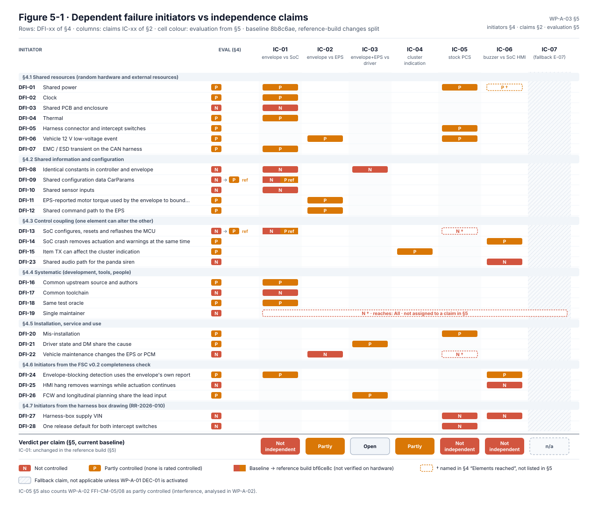
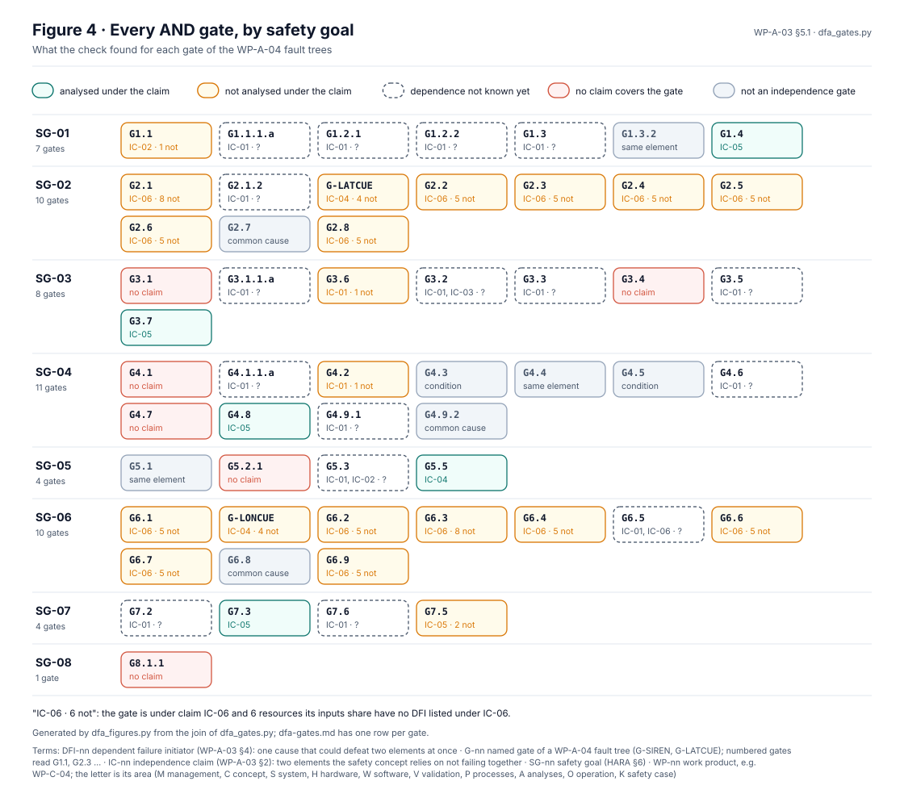
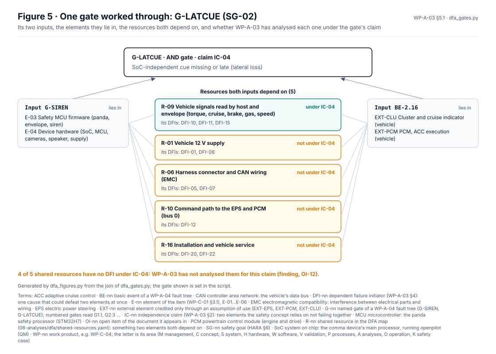

# WP-A-03 Dependent Failure Analysis

| Field | Value |
|---|---|
| Work product | WP-A-03 Dependent failure analysis (DFA), system level |
| Standard reference | ISO 26262-9:2018 §7 (analysis of dependent failures); ISO 26262-9 §5 (independence for decomposition, by reference); ISO 26262-5:2018 §7 (hardware DFA input); ISO 26262-6:2018 §7 (software-level DFA input, detailed in [WP-W-04](../05-software/WP-W-04-software-safety-analysis.md)) |
| Version | 0.22 (§4 Figure 4-1 added: the initiators of `fmea/analyses/dfa.yaml` on the two decomposition channels, cascading across the wall and common causes from below, coloured by assessment with the missing measures, generated by [`figures/fig_a03_two_channel.py`](figures/fig_a03_two_channel.py); no finding, claim or rating changed; 2026-10-26). 0.21 (§5.1 Figures 5-2 to 5-6 added: the AND gate check drawn on the item boundary of WP-C-01 Figure 3-2, how the check works, claims against shared resources, every gate by safety goal and one gate worked through, generated by [`dfa/dfa_figures.py`](dfa/dfa_figures.py); no finding, claim or rating changed; 2026-10-26). 0.20 (§5.1 added: every AND gate of the WP-A-04 trees checked against the claims of §2 and a shared-resource map, generated by [`dfa/dfa_gates.py`](dfa/dfa-gates.md); findings in OI-12, no rating changed; 2026-10-21). 0.19 (DFI-24 current measure: `controlsMismatch` ≤ 0.5 s since #51; rating unchanged; 2026-10-20). 0.18 (lead decision DQ-055 A applied: DFI-08 measure and OI-3 record that every envelope limit is derived independently of the controller tuning, with the controller set lower; confirms DQ-007 C; rating unchanged; 2026-10-17). 0.17 (DFI-13 note cites SWF-090 of the SW FMEA rev 1.4, the row for the relay-malfunction latch; no content change; 2026-10-17). 0.16 (panda pinned at `0a7da85`, jherrodthomas/panda#17: DFI-13 note, a relay malfunction now blocks TOYOTA until ignition off, so every part of the mode-cycle fix is coded; rating unchanged; `dfa.yaml` rev 0.13, DFI-07 stays open pending the bench checks; 2026-10-17). 0.15 (OI-11 points at the SW FMEA actions that now carry the DFI-25 and DFI-29…DFI-33 measures: SWF-ACT-036, -040, -058, -065, -070, -073, -075, -076; no rating changed; 2026-10-17). 0.14 (opendbc pinned at `515b9a2`, jherrodthomas/opendbc#15: DFI-13 note, a mode cycle no longer re-grants authority without a new engagement, relay-malfunction re-detection still lags 1–2 s; rating unchanged; `dfa.yaml` DFI-07 insufficient → open, rev 0.12; 2026-10-17). 0.13 (shared root causes in the host software reported by the SW FMEA rev 1.0/1.1: §4.8 DFI-29…DFI-33, DFI-25 note on alert masking; IC-03 and IC-06 lists extended, verdicts unchanged; 2026-10-16). 0.12 (SW FMEA references point at the merged rows SWF-054…057 of sw-fmea.yaml rev 1.0 instead of their pull requests; no content change; 2026-10-16). 0.11 (lead decision DQ-209 option A applied: comma's harness box is kept and bench-tested, readback not pursued; DFI-27 and DFI-28 stay **N** and are carried as a design residual conditional on VS-HW-22…24 and the SG-07 deviation DQ-320; IC-05 stays not independent; 2026-10-16). 0.10 (shared root causes from the SW FMEA: DFI-13 note on a mode cycle clearing the envelope's fault reactions, DFI-10 note on the host side; no rating changed; 2026-10-16). 0.9 (answered lead decisions applied to the DFA part: DQ-007 C closes OI-3 and sets the route for DFI-08; DQ-064 A for DFI-05; DQ-050 A, DQ-051 A, DQ-063 A noted in OI-2, OI-5 and the scope; no rating changed; 2026-10-16). 0.8 (DFI-13 status note for the reference release variant, panda `a55bdfc`; no rating changed; 2026-10-16). 0.7 (harness-box supply and release default from [RR-2026-010](../04-hardware/reviews/RR-2026-010.md): §4.7 DFI-27, DFI-28; DFI-01 and DFI-05 corrected for the solid-state intercept switches; IC-05 now not independent; 2026-10-16). 0.6 (heartbeat-loss siren, panda `c33343b`; EPS-siren worst case 1.26 s; 2026-10-13). 0.5 (§5 Figure 5-1 DFI-versus-claim matrix added, generated from §4 and §5 by `figures/fig_a03_dfi_matrix.py`; no rating changed; 2026-10-13). 0.4 (status update 2026-10-12: dated status notes for the reference build at `bf6ce8c` on DFI-09, -10, -11, -13, -14; DFI-09 and DFI-13 rated P in the reference build; IC-01 updated; nothing verified on hardware or reviewed independently). History: 0.3 (DFI-24 measure TSR-626; 2026-10-12) |
| Status | Draft |
| ASIL / scope | SG-01 (ASIL C ⚠; stays C until the HARA is re-rated after the controllability tests, DQ-063 A) and SG-02…SG-07 (ASIL B). Elements: E-03 envelope, E-01/E-02 SoC stack, E-04 device hardware, E-05 harness, EXT-EPS, EXT-PCM, EXT-CLU, driver |
| Author | Assurance team (initial draft) |
| Reviewer(s) | TBD (I1); input to G2 confirmation review |
| Approver | Safety manager |
| Baseline | `bf6ce8c` (status update 2026-10-12; opendbc `7993399`, panda `b790fca`). Analysis originally at `8b8c6ae` (opendbc `229dc70`, panda `92eb565`); "Existing measures" and "Eval" describe that baseline unless a dated status note says otherwise |

## 1. Purpose and scope

The LionDriver safety concept rests on several independence claims: the envelope catches SoC faults; the EPS bounds what passes the envelope; the driver controls what the EPS lets through; the stock PCS is not affected by the item. A dependent failure (common cause or cascading) that defeats both sides of such a claim is a single point of failure in disguise. This DFA identifies dependent failure initiators (DFIs), the coupling factors that let them reach more than one element, evaluates whether they are sufficiently controlled, and states the required measures.

The software-internal DFA of the panda firmware (shared memory, shared execution time) is in [WP-A-02](WP-A-02-coexistence-freedom-from-interference.md) (interference) and [WP-W-04](../05-software/WP-W-04-software-safety-analysis.md). Hardware-level DFA of the STM32H7 (on-die common cause) belongs to [WP-H-03](../04-hardware/WP-H-03-hardware-safety-analysis-fmeda.md). This document is the system-level view and links the three.

## 2. Independence and freedom-from-common-cause claims examined

| ID | Claim | Who relies on it | Elements that must not fail together |
|---|---|---|---|
| IC-01 | A fault in the SoC command path is detected or bounded by the envelope | WP-C-04 §4.2 (envelope-only ASIL allocation); all SG | E-01/E-02 (command generator) vs E-03 (limiter/monitor) |
| IC-02 | The EPS limits LKA torque and times out independently of the item | HARA C2 ratings HE-01.x, HE-05.2 (AOU-01R); FSR-01.13 | E-03 vs EXT-EPS |
| IC-03 | The driver can control envelope-bounded worst-case actuation | All C ratings; option (c) strategy | E-03 + EXT-EPS vs driver (AOU-02R, AOU-06R) |
| IC-04 | The vehicle's cruise indicator shows engagement independently of the item HMI | FSR-05.05, AOU-12 | E-01 HMI vs EXT-CLU |
| IC-05 | The stock PCS keeps working with the item installed, engaged or not | SG-07, AOU-04R | E-03/E-05 vs stock camera/radar/PCM |
| IC-06 | The panda buzzer warns on SoC loss independently of the SoC HMI | FSR-02.05, SG-02/SG-06 | E-01 HMI (ui/soundd) vs E-03 siren path |
| IC-07 | (Fallback only) E-07 independent actuation monitor vs E-03 | [WP-A-01](WP-A-01-asil-decomposition.md) DEC-01 | E-03 vs E-07 |

## 3. Method

1. List DFIs by the categories that ISO 26262-9 §7 asks to consider: random hardware failures of shared resources, development (systematic) faults, manufacturing and installation faults, service faults, environmental conditions, failures of common external resources, and stress from use.
2. For each DFI, name the coupling factor(s): **shared resource** (power, clock, PCB, connector, memory), **shared information input** (same CAN signal, same configuration data), **systematic coupling** (same requirements, constants, people, tools, upstream source), **physical/environmental proximity** (thermal, vibration, EMC), **communication/control coupling** (one element configures, resets or reflashes the other).
3. Evaluate per claim IC-xx: *controlled* (a measure prevents the coupling or detects its effect in time), *partly controlled*, or *not controlled*.
4. State the required measure and the TSR of [WP-S-02](../03-system/WP-S-02-technical-safety-requirements.md) (Draft v0.1) that implements it, or record that none exists (OI-7).

Rating legend for evaluation: **C** controlled, **P** partly controlled, **N** not controlled, **n/a** coupling does not reach both elements.

## 4. Dependent failure initiators

*Figure 4-1.* What can make both decomposition channels fail together. The initiators are those of
[`fmea/analyses/dfa.yaml`](fmea/analyses/dfa.yaml), which assesses the panda/SoC decompositions of the FSC; they carry
that file's DFI numbers, which differ from the DFI numbers of §4.1–4.8 below. Arrows across the wall are cascading
initiators (the SoC makes the panda fail); lines from below are common causes (one root reaches both channels),
dashed where the root lies outside the item. Colour is the `dfa.yaml` assessment (red insufficient, amber open,
green safe by design); the grey text names the measures still required and counts those that exist but are not
verified. Generated from `dfa.yaml` by [`figures/fig_a03_two_channel.py`](figures/fig_a03_two_channel.py). Source:
[`figures/fig-a03-4-1-two-channel.svg`](figures/fig-a03-4-1-two-channel.svg); change `dfa.yaml` and regenerate.

### 4.1 Shared resources (random hardware and external resources)

| ID | Initiator | Coupling factor | Elements reached | Effect | Existing measures (code / design) | Eval | Required measure |
|---|---|---|---|---|---|---|---|
| DFI-01 | **Shared power**: 12 V harness supply (IF-08), device input stage and regulators feed both SoC and MCU. Brown-out, dips at engine crank, regulator fault, connector intermittency | Shared resource | E-01, E-03, E-05 intercept-switch drive (IC-01, IC-05, IC-06) | SoC misbehaves (corrupted commands) while MCU also runs out of spec, so the monitor is unreliable when needed; MCU and SoC reset together; the switch drive (SBU1) stops and the pull-down selects the stock path while the box stays powered. *2026-10-16:* this row covers loss downstream of the harness box; loss of the box supply itself also unpowers the switches (DFI-27) | Input voltage measured and reported only (`panda/board/boards/cuatro.h:28-30`, HWSR-505b); `PVD_AVD_IRQHandler` is a stub, PVD not enabled (`stm32h7/interrupt_handlers.h:7`); BOR level not set in code; NMI/HardFault → reset (`early_init.h:73-80`); SBU1 undriven on MCU reset gives pass-through through R2+R3 (HWSR-502, RR-2026-010 HB-02, from the drawing, unconfirmed) | **P** | Brown-out reset level and PVD → safe state (TSR-505); relay de-energise-to-safe on supply loss (TSR-506, TSR-706, AOU-13); HIL power-dip tests (WP-V-05 VS-FI-15) |
| DFI-02 | **Clock**: MCU uses HSE 25 MHz → PLL (`panda/board/stm32h7/clock.h:4-6, 78-89`). Whether HSE is shared with the SoC is unknown (schematic) | Shared resource (if shared); timing reference for all MCU timeouts | E-03 (IC-01) | Slow clock lengthens every timeout (RX, heartbeat) and rate window; fast clock shortens them (availability) | Clock security system on HSE enabled (`clock.h:118-119`), CSS → NMI → reset (HWSR-504); interrupt-rate checks report-only (`drivers/interrupts.h:33-35`) | **P** | Clock-frequency cross-check against an independent oscillator (LSI/HSI) (TSR-504, HWSR-504a); confirm HSE not shared with SoC |
| DFI-03 | **Shared PCB and enclosure**: SoC and MCU on one board in one housing on the windscreen | Physical proximity | E-01, E-03, E-04 | Mechanical damage, cracked solder, moisture affect both | COTS product; no supplier evidence (WP-M-01 §9) | **N** | Hardware qualification and environmental tests ([WP-H-07](../04-hardware/WP-H-07-hardware-component-qualification.md)); latent-fault start-up tests |
| DFI-04 | **Thermal**: SoC heat in a sun-loaded windscreen enclosure raises MCU temperature | Physical proximity | E-01, E-03 | Both elements out of temperature range together; SoC throttles (late commands) while MCU drifts | Host thermal policy uses SoC sensors only (`openpilot/system/hardware/hardwared.py:320-329`); host faults on `overheat` and fan < 500 rpm for > 15 s (onboard review, `selfdrive/selfdrived/selfdrived.py:282-283, 291-294`); MCU DTS read and reported, no firmware reaction (`stm32h7/lldts.h`) | **P** | MCU DTS out-of-range → safe state (TSR-509); thermal qualification of the device in the reference vehicle (WP-H-07) |
| DFI-05 | **Harness connector and intercept switches**: one harness carries bus 0, bus 2, ignition and the switch control line SBU1 (*2026-10-16:* the "relay" is two DG419LE analog switches in the harness box, [RR-2026-010](../04-hardware/reviews/RR-2026-010.md) HB-01; the Toyota A harness has no 12 V wire, HB-08) | Shared resource | E-03 actuation, E-05 intercept switches, stock camera→car path (IC-05) | Connector fault can cut the stock PCS path **and** the item's ability to detect it; a switch stuck in intercept (latch-up, IN held high) keeps intercepting with no detection; loss of the SBU1 drive releases to pass-through (safe, while the box is powered) | Harness orientation detection (`drivers/harness.h:54-90`); relay malfunction by traffic (camera control messages on car side), 1–2 s grace (`opendbc_repo/opendbc/safety/safety.h:215-220, 372-380`); no position readback (GAP-12; the box has no feedback line, RR-2026-010 F-06) | **P** | Switch position readback (TSR-506, HWSR-506a; not pursued under DQ-209 A, 2026-10-16; the DQ-064 A reaction (warn that stock emergency braking is unavailable and refuse engagement) therefore has no trigger with this box); de-energised = stock path confirmed (AOU-13, TSR-702); connector keying/latching (TSR-703) |
| DFI-06 | **Vehicle 12 V low-voltage event** (cranking, alternator fault) affects the EPS, PCM and the device together | Common external resource | EXT-EPS, EXT-PCM, E-03 (IC-02, IC-05) | EPS reduces or drops assist and the item loses power simultaneously; loss of lateral control without an item warning | Out of item control. EPS own diagnostics (assumed) | **P** | AoU on EPS behaviour at low voltage (extend AOU-01R); item warning on supply out-of-range while engaged (TSR-505; SoC warning TSR-606) |
| DFI-07 | **EMC / ESD transient on the CAN harness** | Physical proximity | E-03 RX path and SoC (via panda) | Burst of corrupted frames on all buses; frame drops | CAN CRC in the controller; bus-off recovery (`drivers/fdcan.h:76-84`); error counters to health | **P** | EMC qualification (WP-H-07); bus-off → safe state and warning (TSR-508, HWSR-508b) |

### 4.2 Shared information and configuration

| ID | Initiator | Coupling factor | Elements reached | Effect | Existing measures | Eval | Required measure |
|---|---|---|---|---|---|---|---|
| DFI-08 | **Identical constants in controller and envelope.** Controller limits equal envelope limits: `STEER_MAX = 1500`, `STEER_ERROR_MAX = 350`, delta up/down 15/25 (`opendbc_repo/opendbc/car/toyota/values.py:20-21, 44-47`) vs envelope 1500/350/15/25 (`opendbc_repo/opendbc/safety/modes/toyota.h:173-177`); accel −3.5/+2.0 (`values.py:39-43`, `opendbc_repo/opendbc/car/interfaces.py:25-26`) vs `toyota.h:207-210`. Same upstream authors, no derivation record (GAP-04) | Systematic coupling (same source of the values) | E-01 controller and E-03 envelope (IC-01, IC-03) | (1) An unsafe limit value is wrong in both places, so the envelope never trips and the error is invisible. (2) Zero margin: normal operation runs at the enforcement boundary, so envelope interventions cannot be used as a fault indicator | Tests check the envelope against values copied in the tests (`opendbc_repo/opendbc/safety/tests/test_toyota.py:139-155`), not against a requirement (GAP-14) | **N** | Derive envelope limits from controllability evidence in a separate, reviewed record, physically per speed (lead decision DQ-007 C, 2026-10-14: lower steering authority so SG-01 can drop to ASIL B; DQ-055 A, 2026-10-14: every envelope limit derived independently of the controller tuning) (WP-C-04 §4.2; TSR-102, TSR-103, TSR-201, TSR-202, TSR-204, TSR-205); controller limits set with margin below envelope (FSR-01.14, TSR-605); tests reference requirement IDs, not code constants (WP-W-06) |
| DFI-09 | **Shared configuration data `CarParams`.** Fingerprinting on the SoC selects the platform; the same `CarParams` sets controller tuning and, through `safetyConfigs`, the envelope mode and `safetyParam` (EPS scale 73) sent by pandad (`openpilot/selfdrive/pandad/panda_safety.cc:56-70`). Stored in the unauthenticated params store | Shared information input; control coupling | E-01 and E-03 (IC-01) | Wrong fingerprint or tampered `CarParams` gives a wrong controller **and** a wrong envelope configuration (e.g. wrong EPS scale changes the measured-torque check, `toyota.h:104`), so the monitor shares the controller's error | Host compares panda-reported mode/param with `CarParams` after 10 s (onboard review, `selfdrived.py:351-366`) — same source, so not independent. *Status 2026-10-12 (`bf6ce8c`):* reference build locks the envelope configuration in firmware: only SILENT, NOOUTPUT, ELM327 and TOYOTA with parameter 73; alternative experience fixed at 0 (`0xdf` refused); configuration requests refused in a car mode (TSR-512, TSR-513, `board/reference_lock.h`). A wrong fingerprint can no longer select another envelope configuration; the controller still depends on `CarParams` | **N** at `8b8c6ae`; **P** in the reference build (2026-10-12) | Fixed safety mode and param in envelope firmware for the reference configuration (FSR-01.10; TSR-512); envelope rejects any other value (WP-A-02 FFI-CM-06) |
| DFI-10 | **Shared sensor inputs.** Envelope and controller both use the same CAN signals: driver/EPS torque `0x260`, cruise state `0x1D2`, brake `0x226`, speed `0xAA` | Shared information input | E-01, E-03 (IC-01) | A stuck or wrong vehicle signal misleads the controller and the envelope check at the same time (e.g. stuck "cruise active" keeps authority; stuck EPS torque reading shifts the measured-tracking window) | Checksums on `0x260`, `0x1D2`; RX timeouts ≈2 s (`safety.h:321-344`). *Status 2026-10-12 (`bf6ce8c`):* RX timeout 5 periods at 100 Hz, ≤ 0.16 s (`0x262` ≈ 0.21 s); reference build cross-checks CRUISE_ACTIVE against `0x1D3` MAIN_ON (TSR-405(c)); cross-checks (a), (b), (d) of TSR-405 open. *2026-10-16:* the host also checks no counter on these messages (`fmea/analyses/sw-fmea.yaml` SWF-056, SWF-057), so a frozen frame with a valid checksum passes both; the decoding code is diverse (hand-coded C against DBC), the signal definitions are shared (DFI-16) | **N** for stuck-with-valid-checksum (GAP-01); unchanged 2026-10-12 except a stuck "cruise active" with main off | Per-signal E2E or plausibility strategy using independent signals (e.g. `0x226` brake vs deceleration, wheel speed vs EPS-reported speed) (TSR-404, TSR-405, FSR-01.06) |
| DFI-11 | **EPS-reported motor torque used by the envelope to bound the EPS.** The measured-tracking check (`opendbc_repo/opendbc/safety/lateral.h:10-23`) uses torque reported by the EPS that it is meant to protect against | Shared information input | E-03, EXT-EPS (IC-02) | An EPS fault that misreports torque defeats the envelope's measured-tracking check and the EPS's own limit together | Magnitude limit and rate limit do not depend on the EPS report. *Status 2026-10-12 (`bf6ce8c`):* reference build: while EPS_STATUS LKA_STATE is in the fault set {0, 3, 9, 11, 17, 21, 25}, STEERING_LKA frames with torque or a steer request are refused (TSR-110, opendbc `338f5fc`); fault codes still to be confirmed for the reference EPS firmware | **P** | Keep magnitude/rate limits independent of EPS feedback (TSR-101, TSR-103); EPS status monitoring (TSR-110); treat measured tracking as diagnostic only; EPS fault-state monitoring in the envelope (FSR-02.01, GAP-03) |
| DFI-12 | **Shared command path to the EPS.** The EPS executes the command the envelope passed | Shared information input | E-03, EXT-EPS (IC-02) | An in-envelope but wrong command (wrong direction within limits) is not limited by the EPS either | Envelope bounds magnitude/rate; EPS bounds magnitude (assumed) | **P** (by design, both limit magnitude only) | Accept as design: controllability of envelope-bounded worst case must be shown (option (c), AOU-02R); no independence credit for EPS (WP-A-01 §5) |

### 4.3 Control coupling (one element can alter the other)

| ID | Initiator | Coupling factor | Elements reached | Effect | Existing measures | Eval | Required measure |
|---|---|---|---|---|---|---|---|
| DFI-13 | **SoC configures, resets and reflashes the MCU**: `0xdc`, `0xc5`, `0xe7`, `0xd1`, `0xd8` (`panda/board/main_comms.h`), boot pins (`openpilot/common/hardware/comma/hardware.py:401-419`), recovery flashes a development bootstub (`openpilot/selfdrive/pandad/pandad.py:34-39`) | Communication/control coupling | E-01 → E-03 (IC-01, IC-05) | A single SoC fault or compromise disables or replaces the monitor of the SoC | See WP-A-02 §6.2. *Status 2026-10-12 (`bf6ce8c`):* reference build: mode/parameter lock and refusal of `0xc5`, `0xe7`, `0xd8`, `0xd1` param 1 and the other TSR-513 requests in a car mode (`reference_lock.h`), counted as `requestsRejected`; boot pins, recovery bootstub, RDP/WRP and signature open. *2026-10-16 (`1033d98`, panda `a55bdfc`):* the reference release variant builds the panda with `RELEASE=1`, so a release bootstub no longer accepts the debug key (`board/bootstub.c:66-71`), checked in CI by compile flags only (`safety.yaml` `panda_reference_release_build`, ATC-19); no release-key build has run, and boot pins, RDP/WRP and onroad flashing stay open (`fmea/analyses/dfa.yaml` DFI-09 rev 0.7). *2026-10-16 (opendbc `9a13f60`):* the lock still lets the SoC go TOYOTA → NOOUTPUT → TOYOTA at any time (`reference_lock.h:56-62`), and every mode set clears the cruise edge state and the latched TX-rate, EPS-fault, RX-check and relay-malfunction flags (`safety.h:578-620`). A faulty SoC can therefore undo the envelope's fault reaction and regain authority while cruise stays on, inside the envelope limits (`dfa.yaml` DFI-07 rev 0.9, DM-25; `fmea/analyses/sw-fmea.yaml` SWF-054, SWF-055). Fix in jherrodthomas/opendbc#15, not pinned. *2026-10-17 (opendbc `515b9a2`, pinned by `3ba8ca10`):* the fix is pinned. After a mode set, authority needs CRUISE_ACTIVE = 0 and then a new rising edge (ATC-26); a TX-rate revocation blocks engagement until one full 250 ms window passes without a rejected frame (ATC-20); every RX check, EPS_STATUS included, must be valid again before a grant. Still open: the relay-malfunction check is suspended for 1–2 s after each mode set, and nothing is verified on hardware (`dfa.yaml` DFI-07 rev 0.12, insufficient → open). *2026-10-17 (panda `0a7da85`, pinned by `e5109376`):* the reference lock latches a relay malfunction for the ignition cycle and refuses TOYOTA until the ignition goes off (`reference_lock.h`, `main.c`), so a mode cycle no longer hides a stuck harness switch. Every part of DM-25 is coded and unit-tested; none is verified on the board (`dfa.yaml` DFI-07 rev 0.13, still open; `fmea/analyses/sw-fmea.yaml` SWF-090) | **N** at `8b8c6ae`; **P** in the reference build (2026-10-12) | WP-A-02 measures (safety-mode lock, command rejection in car modes, RDP/WRP, signature) (TSR-511…TSR-514) (GAP-09, GAP-24, GAP-38) |
| DFI-14 | **SoC crash removes actuation and warnings at the same time.** `controlsd`, `selfdrived`, `ui` and `soundd` all run on the SoC (`openpilot/system/manager/process_config.py:89-97`) | Shared resource (SoC) | E-01 actuation and E-01 HMI (IC-06) | Loss of lateral/longitudinal control with no visual/acoustic warning from the SoC | Panda siren on heartbeat loss, 3 s, after 5 s detection (`panda/board/main.c:193-201`). *Status 2026-10-12 (`bf6ce8c`):* authority revoked 0.3 s after the last heartbeat (TSR-407, panda `c2e5d93`); the siren still follows only the 5 s path (TSR-516(a) open). *2026-10-13:* when the heartbeat loss revokes authority that was granted, the panda sounds the siren at once, ≈ 0.56 s after the last heartbeat, in all builds (TSR-516(a)/(b), panda `c33343b`, `drivers/heartbeat_siren.h`; WP-S-04 T-07a); not verified on hardware; the 4–5 s path remains for authority that ended within the 5 s before the loss (WP-S-04 OI-9) | **P** (timing, GAP-06) | SoC-independent acoustic warning within the SG-02/SG-06 budget (FSR-02.05, TSR-407, TSR-516); EXT-CLU cruise indicator stays as an independent cue (IC-04, AOU-12) |
| DFI-15 | **Item TX can affect the cluster indication**: `0x412` LKAS_HUD is sent by the item; the cruise indicator is assumed PCM-driven | Communication coupling | E-01 vs EXT-CLU (IC-04) | Driver sees an indication generated by the faulty element | AOU-12 (unverified) | **P** | Verify AOU-12 by vehicle test ([WP-S-09](../03-system/WP-S-09-system-verification.md) VS-SQ-07) |
| DFI-23 | **Shared audio path for the panda siren.** On tres the "fake siren" drives speaker mixing in an audio codec over I2C5 (`panda/board/drivers/fake_siren.h:5, 41-43`, `boards/tres.h:129-132`); on cuatro the MCU drives an amplifier via SAI4 (`boards/cuatro.h:87-96`). Whether codec, amplifier and speaker are shared with the SoC audio is unknown (WP-H-02 HE-17) | Shared resource; control coupling (SoC may also configure the codec) | E-01 HMI and E-03 siren (IC-06) | An SoC fault (or the SoC powering down the codec/amplifier) silences both the SoC alerts and the SoC-independent siren | None identified | **N** (until hardware confirmed) | Confirm audio topology (WP-H-02); if shared, add a siren-path start-up test (TSR-515) and require the siren path to work with the SoC powered down (TSR-516; WP-H-06 VS-HW-21) |

### 4.4 Systematic (development, tools, people)

| ID | Initiator | Coupling factor | Elements reached | Effect | Existing measures | Eval | Required measure |
|---|---|---|---|---|---|---|---|
| DFI-16 | **Common upstream source and authors** for controller (`opendbc/car/toyota`) and envelope (`opendbc/safety/modes/toyota.h`) in one repository | Systematic coupling | E-01, E-03 (IC-01) | Same misunderstanding of the vehicle (e.g. EPS fault codes, signal semantics) in both | Separate code paths; safety code MISRA-checked, 100 % line coverage, mutation testing (upstream CI only, GAP-13) | **P** | Requirements-based verification of the envelope from TSRs (not from controller behaviour); independent I1/I2 review of envelope changes (T-09) |
| DFI-17 | **Common toolchain** (arm-none-eabi-gcc 13.2.1 comma-packaged, SCons, cppcheck) | Systematic coupling | E-03 code and (for DEC-01) E-07 | Compiler defect affects all firmware | None qualified (GAP-34) | **N** | Tool classification and qualification ([WP-P-07](../07-supporting/WP-P-07-tool-classification-qualification.md)); target-hardware testing on HIL (GAP-13: tests run on x86 host) |
| DFI-18 | **Same test oracle** for envelope and controller: process replay and safety replay reuse logs recorded with the same stack (`openpilot/selfdrive/test/process_replay/test_processes.py:70`; `opendbc_repo/opendbc/safety/tests/safety_replay/replay_drive.py`) | Systematic coupling | E-01, E-03 | Regression tests confirm consistency with the past, not correctness | — | **P** | Requirements-based tests and fault injection independent of recorded behaviour ([WP-S-08](../03-system/WP-S-08-system-integration-test.md), [WP-V-05](../06-validation/WP-V-05-fault-injection.md)) |
| DFI-19 | **Single maintainer** writes, reviews and approves (T-09) | Systematic coupling (people) | All | Same blind spot in specification, implementation and review | External I1/I3 reviewers planned ([WP-M-06](../01-management/WP-M-06-confirmation-measures-plan.md)) | **N** today | External reviewer for all ASIL work products; confirmation review |

### 4.5 Installation, service and use

| ID | Initiator | Coupling factor | Elements reached | Effect | Existing measures | Eval | Required measure |
|---|---|---|---|---|---|---|---|
| DFI-20 | **Mis-installation** (wrong harness variant, partially seated connector, poor mount) | Common installation step | E-04, E-05, stock path (IC-05) | Relay/harness fault plus degraded camera calibration | Harness status detection; `calibrationd` checks (AOU-08) | **P** | Installation checklist and post-install check of the stock PCS path ([WP-O-01](../09-production-operation/WP-O-01-installation-and-provisioning-control.md)); TSR-805 |
| DFI-21 | **Driver state and DM share the cause**: fatigue/distraction that degrades controllability is also what DM must detect; glare or sunglasses degrade both driver vision and DM (`docs/LIMITATIONS.md:53-56`) | Shared environment | DRV, E-01/DM (IC-03) | Controllability assumption fails when DM is least effective | DM wheel-touch fallback on high uncertainty (`openpilot/selfdrive/monitoring/policy.py:82-83`) | **P** | Handled under ISO 21448 (WP-C-04 §7, [WP-C-08](../02-concept/WP-C-08-driver-hmi-misuse-analysis.md)); not credited for ASIL |
| DFI-22 | **Vehicle maintenance changes the EPS or PCM** (reflash, part swap) | Service | EXT-EPS, EXT-PCM (IC-02, IC-05) | AoU evidence becomes invalid without notice | Fingerprint lists include multiple EPS FW versions (`opendbc_repo/opendbc/car/toyota/fingerprints.py`) | **N** | Record ECU FW versions of the reference vehicle (WP-C-01 OI-1); verify ECU FW before engagement (TSR-803) and after service (TSR-808); an automatic refusal on unknown FW has no TSR yet (OI-7) |

### 4.6 Initiators from the FSC v0.2 completeness check

The fsc-builder completeness check of [WP-C-04](../02-concept/WP-C-04-functional-safety-concept.md) §14 tags every block-diagram node with the resources it shares ([`fsc/fsc_model.py`](../02-concept/fsc/fsc_model.py)). [RR-2026-004](../02-concept/reviews/RR-2026-004.md) F-07 asks that the DFA cover those paths. This table maps each shared-resource tag to the initiators above. All tags are covered; the new FSRs of WP-C-04 v0.2 add three initiators (DFI-24…DFI-26).

| Shared resource (FSC tag) | FSC nodes that share it | Initiators |
|---|---|---|
| `vehicle_12v`, `harness` | N04…N08, N17, N18 | DFI-01, DFI-05, DFI-06, DFI-07, DFI-27, DFI-28 |
| `device_supply` | N01…N03, N10…N14, N19, N20 | DFI-01, DFI-06, DFI-27 |
| `device_pcb` | N01…N03, N09, N13, N14 | DFI-03, DFI-04, DFI-07 |
| `spi` (SoC-to-panda command stream, N09) | N09 → N15 | DFI-13; interference in [WP-A-02](WP-A-02-coexistence-freedom-from-interference.md) §6.1, §6.2 |
| SoC reset and boot lines (N13 → N14, GAP-38) | N13, N14 | DFI-13; WP-A-02 §6.2 |
| `soc` | N10…N13, N19 | DFI-14, DFI-24, DFI-25, DFI-26 |
| `mcu`, `mcu_clock` | N14…N16, N20 | DFI-02; on-die items go to WP-H-03 (OI-6) |
| `can_bus0`, `can_bus1`, `can_bus2` | N04…N07, N18 | DFI-07, DFI-10 |
| `windscreen_zone` | N01, N02 | DFI-04 |

| ID | Initiator | Coupling factor | Elements reached | Effect | Existing measures | Eval | Required measure |
|---|---|---|---|---|---|---|---|
| DFI-24 | **Envelope-blocking detection uses the envelope's own report.** The SoC learns that the envelope does not grant authority from `pandaStates.controlsAllowed`, which `pandad` publishes from the panda health packet (FSR-02.10, TSR-621). A panda or SPI fault that blocks actuation and also freezes or misreports the health data leaves the SoC engaged and silent | Shared information input (the faulty element reports on itself) | E-03, E-01 HMI (IC-01, IC-06) | Lateral or longitudinal control lost while the SoC shows engaged, with no take-over request (SG-02, SG-06; HE-02.4) | `pandaStates` alive limit 1 s (WP-S-03 §9) → `commIssue`; `controlsMismatch` ≤ 0.5 s after the first mismatched sample (TSR-621, `selfdrive/selfdrived/selfdrived.py:361-366`; ≈2 s before #51) | **P** | Treat stale or missing `pandaStates` as a mismatch within the TSR-621 budget; also detect blocking from vehicle-side evidence that does not come from the panda's own report (EPS-applied torque or actual acceleration not following the command while engaged). Vehicle-response check: TSR-626 (WP-S-02 v0.3) |
| DFI-25 | **HMI hang removes warnings while actuation continues.** Unlike DFI-14 (SoC crash), a hung UI render loop or stalled audio stream leaves `controlsd` and the panda heartbeat running, so the envelope keeps authority and the siren does not sound | Shared resource (SoC scheduler, GPU, audio stack) | E-01 HMI vs E-01 control and E-03 siren (IC-06) | Take-over requests and announced decelerations are not perceived (SG-02, SG-06; H-07; FSR-02.11, FSR-04.05) | `processNotRunning` on a crashed `ui`/`soundd` only (`selfdrive/selfdrived/selfdrived.py:398-404`). *2026-10-16 (SW FMEA SWF-035, SWF-082):* the same single HMI path also fails without a hang. Alert selection shows one alert by priority, then start frame (`alertmanager.py:63`), so the DM level 2 prompt and the take-over alert (MID) are masked under `speedTooHigh`, and level 3 (HIGH) under `aeb`/`fcw` or a later HIGH alert; a `ui` or `soundd` that never started is not reported (`manager.py:110-112`) | **N** | HMI liveness heartbeats with immediate disable and siren take-over (TSR-622, TSR-516); audible minimum (TSR-623); cluster cruise state as independent cue (TSR-309, AOU-12) |
| DFI-26 | **FCW and longitudinal planning share the lead input.** A false lead (model or radar) raises a false FCW, which can trigger reflex braking, and makes the planner brake at the same time | Shared information input | E-01 FCW, E-01 planner, driver (IC-03) | Driver braking and item deceleration add up with a close follower (SG-04; HE-04.5) | Envelope deceleration bound −3.5 m/s² (SM-07); no jerk bound (GAP-04) | **P** | Deceleration and jerk bounds in the envelope, independent of the planner (TSR-202, TSR-205); FCW input freshness and false-rate target (TSR-625); false-positive lead validation under ISO 21448 ([WP-V-02](../06-validation/WP-V-02-sotif-vv-strategy.md)) |

### 4.7 Initiators from the harness box drawing (RR-2026-010)

[RR-2026-010](../04-hardware/reviews/RR-2026-010.md) found that comma's v3 harness box has no relay: two Vishay DG419LE CMOS switches, powered from the box supply VIN, carry the stock camera-to-car CAN, and one pull-down sets their default. Two of its findings couple elements that the claims of §2 treat as separate: F-02 (one supply for the switches, the device and the ignition sense) and F-03 (one release default for both switches). Both come from the published drawing; whether the shipped box matches it is not checked (WP-H-06 VS-HW-02), and nothing here is measured. The panda/SoC decompositions of the FSC see the same initiators in [`fmea/analyses/dfa.yaml`](fmea/analyses/dfa.yaml) DFI-20, DFI-21 (rev 0.6).

| ID | Initiator | Coupling factor | Elements reached | Effect | Existing measures | Eval | Required measure |
|---|---|---|---|---|---|---|---|
| DFI-27 | **Harness-box supply VIN.** VIN is the ignition line through Schottky D1, or comma power when installed. It powers both intercept switches (V+ and VL of U1, U2) and, through OBD-C VBUS, the whole device; the ignition sense (Q6) hangs on the same ignition line (RR-2026-010 HB-03, HB-06). Causes: ignition branch to the box or D1 open without comma power; VIN shorted (TVS D4, wiring) (DFMEA DFM-020) | Shared resource | E-01, E-03, E-05 intercept switches, stock camera→car path (IC-05, IC-06) | One loss switches off the device (actuation, HMI and siren all silent) **and** leaves U1/U2 unpowered, so pass-through is not guaranteed; the clamp diodes D2/D3 pull CAN0 and CAN2 towards the dead rail. Stock PCS/AEB and LKA may be lost, and the car-side ADAS bus disturbed, with no LionDriver warning. Item actuation is fail-silent. With comma power installed, an open ignition branch instead keeps everything powered but reads ignition off: the host goes offroad and the panda releases its ELM327 lock (panda `a55bdfc` `board/main.c:213`, `board/reference_lock.h:38-43`; Toyota has no CAN ignition in `opendbc/safety/ignition.h`) | None in the item: VIN is not supervised, and the device that would supervise it loses power with it. The reference harness lists comma power v3 (`fmea/baseline.yaml`), which removes the open-ignition cause as a single fault, but not a VIN short; that it is fitted on the reference car is not recorded (WP-C-01 OI-2). The vehicle's own reaction to a missing camera (cluster warning) is assumed, not verified | **N** (kept by design, DQ-209 A) | *Decided 2026-10-16 (DQ-209 option A):* comma's box is kept; no LionDriver adapter and no switch readback. The coupling stays and is argued as a residual: bench tests VS-HW-22, VS-HW-24 (DFMEA DFM-ACT-014; `dfa.yaml` DM-23) record what the unpowered box does, and the tested behaviour becomes an assumption of use (WP-H-01 HWSR-702 deviation). If a bench test fails, the decision goes back to the lead (WP-H-04 §5.3, DQ-320). Vehicle cue on loss of the stock camera to be confirmed (AOU-04R). ELM327 lock released only on an ignition-off confirmed by a second source (`dfa.yaml` DM-24) |
| DFI-28 | **One release default for both intercept switches.** One control line (SBU1) drives IN of U1 (CAN_H) and U2 (CAN_L), and one pull-down, R2 + R3 (2 × 120 Ω in series), is all that selects pass-through when the device does not drive SBU1 (RR-2026-010 HB-01, HB-02, F-03) | Shared resource (common control line and default) | E-05 both switches, E-03 release path, stock camera→car path (IC-05) | R2 or R3 open: whenever the device stops driving SBU1 (MCU reset, watchdog, hang, device power loss) IN floats, so both switches can stay in intercept, or take different positions, while the panda is silent. The fault is latent until the release is needed | None: no position feedback, and SBU1 also carries the orientation-detect load, so the device reads back its drive, not the switch (RR-2026-010 F-06). FMEDA SG-009 FMD-C-011 and DFMEA DFM-010.C3 rate it with no monitor | **N** (kept by design, DQ-209 A) | Bench test VS-HW-23 (pull-down open) and pull-down integrity (HWSR-506e). Position readback (HWSR-506a) is not pursued under DQ-209 A, so the fault stays latent between bench tests; this is part of the SG-07 SPFM shortfall accepted as a recorded deviation, conditional on the bench tests (WP-H-04 §5.3, DQ-320) |

### 4.8 Initiators from the SW FMEA (host software)

The SW FMEA session reported these shared root causes on 2026-10-16, from [`fmea/analyses/sw-fmea.yaml`](fmea/analyses/sw-fmea.yaml) rev 1.0/1.1 at BL-005. A sample was re-checked in the code at `liondriver-dev` `69392b3`: `NUM_READERS 15` (`msgq_repo/msgq/msgq.h:9`), the frame-step DM policy timers (`openpilot/selfdrive/monitoring/policy.py:228, 237`), the cabin-camera dialog publishing `selfdriveState` (`openpilot/selfdrive/ui/mici/onroad/cabin_camera_dialog.py:48, 113-116`) and alert selection by priority then start frame (`openpilot/selfdrive/selfdrived/alertmanager.py:63`). The other code references are the SW FMEA's. All of these sit inside the SoC (E-01), which no claim of §2 treats as independent of itself; they matter where an E-01 function is the second line behind another E-01 function, or where the driver is (IC-03, IC-06). The SoC-internal software analysis is [WP-W-04](../05-software/WP-W-04-software-safety-analysis.md).

| ID | Initiator | Coupling factor | Elements reached | Effect | Existing measures | Eval | Required measure |
|---|---|---|---|---|---|---|---|
| DFI-29 | **One IPC (msgq) for host control and host supervision.** `controlsd`, `plannerd`, `card` and the `selfdrived` monitors that TSR-615/TSR-621 credit all exchange messages over msgq. A lapped reader skips messages silently; a 16th subscriber evicts every reader (`msgq.h:9`, `msgq.cc:196-207`); payloads carry no checksum; "alive" means received within 10 periods against the 2 of TSR-602 (`messaging/__init__.py:138-178`) (SWF-080, SWF-081) | Shared resource (IPC) | E-01 control, E-01 supervision and HMI (IC-06) | One IPC fault can corrupt a control input and blind the host monitor meant to catch it; the SoC alerts that rest on those monitors (DFI-24, DFI-25 measures) fail with it | None specific: msgq is a QM component (WP-P-08 SC-08, GAP-20). The envelope (E-03) still bounds what reaches the vehicle | **N** | Sequence or E2E protection and a reader-count guard on the control and supervision topics; alive limits set to the TSR-602 budget; host supervision of control not credited unless it is independent of msgq. Handed to the SW FMEA and software sessions (OI-11) |
| DFI-30 | **One model output (`modelV2`) feeds lateral, longitudinal and FCW.** `modelV2.valid` means only that a calibration has been seen (`modeld.py:434`); the small model has no finiteness check (`modeld.py:210-211`); calibration is used without checking `calStatus` (`modeld.py:367-375`) (SWF-072) | Shared information input | E-01 lateral, E-01 longitudinal, E-01 FCW, driver (IC-03) | One bad model output reaches `controlsd` (curvature), `radard`/`plannerd` (leads) and FCW together: wrong steering, wrong braking and a missing or false warning at the same time (SG-02, SG-04, SG-06; widens DFI-26 from the lead input to the whole model output) | Envelope magnitude and rate limits independent of the model (E-03); DM | **P** | Finiteness and plausibility checks on `modelV2` before use; `calStatus` checked; FCW not credited as independent of the planner (BE-6.10, WP-A-04); envelope deceleration and jerk bounds (TSR-202, TSR-205) |
| DFI-31 | **A second publisher of `selfdriveState` (comma four UI).** While the cabin-camera dialog is open the UI publishes `selfdriveState` with only `alertSound` set; `controlsd`, `plannerd`, `dmonitoringd` and `soundd` read it. The dialog opens offroad but stays up to 2.5 s after going onroad (`mici/layouts/main.py:112-124`), and it sets `IsDriverViewEnabled`, which puts DM in demo mode (SWF-085.C1) | Communication coupling (QM UI into the control state channel) | E-01 UI, E-01 control state, E-01 DM, driver (IC-03, IC-06) | Default-valued messages (`enabled=false`) interleave with `selfdrived`'s for up to 2.5 s after start, and DM is in demo mode in the same window | None. Comma four only; the comma 3X UI is a different path, and the reference device is still open (DQ-011) | **N** (comma four) | One publisher per control topic, enforced at subscribe time; the dialog closed before onroad; DM not in demo mode while onroad (SWF-085) |
| DFI-32 | **One CPU load slows lateral control and stretches the DM escalation.** The DM policy timers count frames, not time: one step per `driverStateV2` (`policy.py:228, 237`). CPU overload or thermal throttling slows `modeld` (lateral input latency) and lengthens the 5/8/13 s escalation and the forced-stop timer together; a 16 Hz DM model still passes the frequency check (SWF-061.C1, SFM-012.C1) | Shared resource (SoC CPU) | E-01 lateral, E-01 DM, driver (IC-03) | Control degrades at the same time as the driver's attention prompt comes later than designed | DM model frequency check (too loose to catch it); host thermal policy (DFI-04) | **N** | DM timers driven by wall-clock time; frequency check tight enough to catch the slowdown; DM escalation budget (WP-A-05 OI-6) |
| DFI-33 | **The forced stop and normal deceleration share one unchecked chain.** `noResponseForceDecel` goes DM policy → `controlsd` → `plannerd`, with no freshness check in any process (`controlsd.py:49-51, 236`; `longitudinal_planner.py:84`), and `controlsd` does not read `longitudinalPlan.valid` (SWF-086.C1, SWF-043, SWF-065.C1) | Shared information path | E-01 planner, E-01 SG-010 reaction, driver (IC-03) | A `plannerd` stall removes the normal deceleration and the SG-010 terminal reaction (forced stop) together, until `selfdrived` soft-disables | `selfdrived` process and alive checks (soft disable); envelope bounds (E-03) | **N** | Freshness check of `longitudinalPlan` and of the forced-stop command in `controlsd`; terminal reaction not routed only through `plannerd` |

## 5. Evaluation per independence claim

| Claim | Not controlled DFIs | Partly controlled DFIs | Verdict (current baseline) | Condition to accept |
|---|---|---|---|---|
| IC-01 envelope vs SoC | DFI-03, -08, -09, -10, -13, -17 (2026-10-12, reference build: DFI-09 and -13 move to partly controlled) | DFI-01, -02, -04, -07, -16, -18, -24 (2026-10-12, reference build: also DFI-09, -13) | **Not independent** (unchanged 2026-10-12: DFI-03, -08, -10, -17 still not controlled; boot control open) | WP-A-02 command lock and boot protection; fixed safety config; E2E/plausibility on RX; limits derived independently with margin; PVD/BOR; HIL target tests |
| IC-02 envelope vs EPS | DFI-22 | DFI-06, -11, -12 | **Partly**; EPS is an external measure, not an independent element (no ASIL credit, WP-A-01 §5) | AOU-01R verified for the recorded EPS FW; envelope limits not dependent on EPS feedback |
| IC-03 envelope+EPS vs driver | DFI-08, -31, -32, -33 | DFI-21, -26, -30 | **Open** until controllability tests | Envelope-bounded worst case shown controllable (C1 target). DQ-007 C makes this the route for SG-01; if the tests fail, the fallback E-07 is decided then (DQ-050 A) |
| IC-04 cluster indication | — | DFI-15 | **Partly** | AOU-12 verified |
| IC-05 stock PCS | DFI-27, -28 | DFI-01, -05, -06, -20 plus WP-A-02 FFI-CM-05/08 | **Not independent** (2026-10-16: one box supply and one pull-down reach the item and the stock path, RR-2026-010; was partly). Kept by design under DQ-209 A: the claim is not restored, the residual is argued instead | Bench tests VS-HW-22…24 pass and their results are recorded as an assumption of use (DQ-209 A; SG-07 deviation DQ-320, WP-H-04 §5.3); AOU-04R/AOU-13 verified; reject `0xe7` in car modes; whitelist fix |
| IC-06 buzzer vs SoC HMI | DFI-23, -25, -27, -29, -31 | DFI-14, -24 | **Not independent** until the audio topology is known | FSR-02.05 timing met; siren path independent of SoC audio |
| IC-07 (fallback E-07) | n/a | n/a | Not applicable unless DEC-01 activated | WP-A-01 IR-01…IR-10 |

*Figure 5-1.* One row per DFI of §4, one column per claim of §2; a filled cell is a DFI listed under that claim in this table (red not controlled, amber partly controlled), split where the reference build changes the rating. A dashed cell with † marks a claim named in a §4 "Elements reached" cell but not listed here. Generated from §4 and this table by [`figures/fig_a03_dfi_matrix.py`](figures/fig_a03_dfi_matrix.py). Source: [`figures/fig-a03-5-1-dfi-claim-matrix.svg`](figures/fig-a03-5-1-dfi-claim-matrix.svg); change §4 or §5 and regenerate.

### 5.1 Fault tree AND gates against the claims

Every AND gate of the WP-A-04 trees claims that its inputs do not fail together. [`dfa/dfa-gates.md`](dfa/dfa-gates.md) is
generated by [`dfa/dfa_gates.py`](dfa/dfa_gates.py) from the trees, a classification of each gate
([`dfa/and-gates.yaml`](dfa/and-gates.yaml): the elements its inputs lie in and the claim of §2 that covers it) and a
shared-resource map of the item ([`dfa/shared-resources.yaml`](dfa/shared-resources.yaml): what each element depends
on, by the coupling categories of §3, and the DFIs of §4 that analyse it). For each gate across elements it lists the
resources two of its inputs share and whether their DFIs are listed under the gate's claim. CI fails when a tree gains
an AND gate that is not classified. The findings are review input (OI-12); the classification and the map are an
AI-assisted draft and need review.

The figures below are generated from the same join by [`dfa/dfa_figures.py`](dfa/dfa_figures.py) (CI checks that
they are current). [`dfa/README.md`](dfa/README.md) explains them and the limits of the check; there they are
numbered 1 to 5.

*Figure 5-2.* The claims of §2 on the item boundary of WP-C-01 Figure 3-2. A chip R-nn is a shared resource the
element depends on; a badge is a claim, coloured by its verdict in the table above, with the resources not analysed
under it listed on the right. Red "no claim" marks AND gates across elements that no claim covers (OI-12).

*Figure 5-3.* How the check works, with the current count of gates in each outcome. "Analysed under the claim" means
a DFI of every shared resource is listed under the claim; whether the claim holds is the verdict above.

*Figure 5-4.* Claims against shared resources. An amber cell is a shared resource with no DFI listed under that
claim: where the claim's review should look first.

*Figure 5-5.* The same result per gate, by safety goal; [`dfa/dfa-gates.md`](dfa/dfa-gates.md) has one row per gate.

*Figure 5-6.* One gate worked through: G-LATCUE (SG-02, claim IC-04), where four of the five shared resources have
no DFI under IC-04.

## 6. Required measures (summary)

| Measure | DFIs | TSR reference |
|---|---|---|
| BOR level, PVD → safe state; supply out-of-range warning | DFI-01, -06 | TSR-505 |
| Relay de-energise-to-safe, contact readback, connector keying | DFI-01, -05 | TSR-506, TSR-702, TSR-703 |
| Clock cross-check | DFI-02 | TSR-504 |
| MCU temperature reaction | DFI-04 | TSR-509 |
| Bus-off / error-passive → safe state | DFI-07 | TSR-508 |
| Independent limit derivation, margin, requirement-based tests | DFI-08, -16, -18 | TSR-102, TSR-103, TSR-201, TSR-202, TSR-204, TSR-205, TSR-605 |
| Safety mode/param fixed in firmware; a mode change does not undo the envelope's fault reactions (`dfa.yaml` DM-25) | DFI-09, -13 | TSR-512; SWSR-311, SWSR-518 |
| E2E / plausibility on gating signals | DFI-10 | TSR-401…TSR-406 |
| Magnitude/rate limits independent of EPS feedback; EPS status monitoring | DFI-11 | TSR-101, TSR-103, TSR-110 |
| Command lock, boot protection, signature | DFI-13 | TSR-511…TSR-514 |
| SoC-independent warning timing and audio path | DFI-14, DFI-23 | TSR-407, TSR-515, TSR-516 |
| Tool qualification; HIL target tests | DFI-17 | — (WP-P-07, WP-S-08) |
| External independent review | DFI-19 | — (WP-M-06) |
| Installation check, ECU FW verification | DFI-20, -22 | TSR-803, TSR-805, TSR-808, TSR-620 |
| Envelope-blocking detection not only from the envelope's own report | DFI-24 | TSR-621, TSR-626 |
| HMI liveness supervision, audible minimum, independent cues | DFI-25 | TSR-622, TSR-623, TSR-516, TSR-309 |
| Deceleration and jerk bounds independent of the planner; FCW input validity | DFI-26 | TSR-202, TSR-205, TSR-625 |
| Host software (SW FMEA): msgq sequence/E2E and reader guard; `modelV2` finiteness and `calStatus`; one publisher per control topic; wall-clock DM timers; freshness of `longitudinalPlan` and the forced-stop command; alert arbitration that cannot mask a take-over or DM prompt | DFI-25, -29…-33 | — (TSR-602, TSR-615, TSR-621, TSR-202, TSR-205; SW FMEA actions) |
| Harness box, decided DQ-209 A (keep comma's box, no readback): bench tests of box supply loss, pull-down open and supply stress; pull-down integrity; ELM327 lock not released on the ignition line alone | DFI-27, -28 | — (HWSR-502a, HWSR-506a, HWSR-506e, HWSR-702; WP-H-06 VS-HW-22…VS-HW-24) |

## 7. Mapping to WP-S-03 independence claims

| [WP-S-03 §7](../03-system/WP-S-03-technical-safety-concept-architecture.md#7-freedom-from-interference-and-independence) claim | Covered here by |
|---|---|
| DFA-1 shared power supply | DFI-01, DFI-06, DFI-27 |
| DFA-2 shared PCB, enclosure, thermal | DFI-03, DFI-04, DFI-07 |
| DFA-3 shared speaker/codec | DFI-23 |
| DFA-4 driver and envelope both rely on PCM cruise state | DFI-10 (shared sensor inputs), DFI-15 |
| IND-1 fallback second limiter | IC-07; [WP-A-01](WP-A-01-asil-decomposition.md) IR-01…IR-10 |
| FFI-1…FFI-6 | [WP-A-02](WP-A-02-coexistence-freedom-from-interference.md) §9 |
| Shared-resource paths of the FSC completeness check (WP-C-04 §14, RR-2026-004 F-07) | §4.6 |

## 8. Open items

| ID | Item | Owner | Needed by |
|---|---|---|---|
| OI-1 | Re-check TSR references when WP-S-02 leaves Draft | Safety engineer | G2 |
| OI-2 | Obtain or reverse-engineer the device power and clock tree (schematic) to close DFI-01/DFI-02 evaluation. If the shared-board initiators (DFI-01…DFI-04) leave the panda short of its ASIL, an external monitor is allowed in principle, within an agreed budget (lead decision DQ-051 A, 2026-10-14) | HW lead | G2 |
| OI-3 | ~~Maintainer decision on separating the derivation of envelope limits from controller tuning (DFI-08)~~ **Decided:** DQ-007 C (2026-10-14), envelope limits derived physically per speed from controllability, controller below them with margin (FSR-01.14). DQ-055 A (2026-10-14) confirms it for every envelope limit: derived independently of the controller tuning, controller set lower. The derivation record and the limits themselves remain the DFI-08 measure | Maintainer | G2 |
| OI-4 | Characterise EPS behaviour at low supply voltage and with misreported torque (DFI-06, DFI-11) as part of AOU-01R tests | Safety engineer | G2 |
| OI-5 | Repeat this DFA for IC-07 if DEC-01 is activated. Whether to activate it is decided after the controllability tests (DQ-050 A, 2026-10-14) | Safety engineer | G2 (conditional) |
| OI-6 | Hand the on-die STM32H7 common-cause items (shared RAM, flash, clock tree, supply domain) to WP-H-03 | HW lead | G3 |
| OI-7 | Report to the WP-S-02 author: no TSR makes the envelope refuse engagement when the vehicle ECU firmware differs from the verified record (DFI-22); TSR-803 is a procedural check only. **Partly closed:** TSR-620 (WP-S-02) now prevents engagement on an unverified ECU firmware set, allocated to the QM SoC with B-sup from TSR-512 | Safety engineer | G2 |
| OI-8 | ~~Report to the WP-S-02 author: no TSR detects envelope blocking from vehicle-side evidence independent of the panda's own report (DFI-24)~~ **Closed:** TSR-626 (WP-S-02 v0.3) | Safety engineer | G2 |
| OI-9 | Re-assess DFI-27 and DFI-28 and the IC-05 verdict once the bench tests VS-HW-22…VS-HW-24 have run (DQ-209 answered A, 2026-10-16; a failed test returns the decision to the lead, DQ-320); confirm the box revision fitted to the reference car and whether comma power is installed (WP-C-01 OI-2) | Safety engineer | G2 |
| OI-10 | Report to the WP-H-03 author: FM-IGN-02 calls an open ignition line the safe direction; it also releases the panda's ELM327 lock while driving (DFI-27; `dfa.yaml` DFI-08, DM-24) | Safety engineer | G2 |
| OI-11 | Required measures of DFI-29…DFI-33 and the DFI-25 alert-masking note: handed over, now tracked as SW FMEA actions. DFI-25 → SWF-ACT-036, -070; DFI-29 → SWF-ACT-075, freshness in SWF-ACT-040; DFI-30 → SWF-ACT-065; DFI-31 → SWF-ACT-076; DFI-32 → SWF-ACT-058; DFI-33 → SWF-ACT-073, freshness in SWF-ACT-040. Closes when those actions are implemented and verified; none has a TSR yet except where §6 names one | Safety engineer | G2 |
| OI-12 | Review the findings of [`dfa/dfa-gates.md`](dfa/dfa-gates.md): AND gates across elements with no claim of §2 (the PCM's own bounds and pedal arbitration, AOU-05R, have no claim; the SG-08 driver-monitoring chain is outside this DFA's scope), and shared resources whose DFIs are not listed under the gate's claim; then add claims or DFIs, or record why not | Safety engineer | G2 |
