# WP-A-05 System-Theoretic Process Analysis (STPA)

| Field | Value |
|---|---|
| Work product | WP-A-05 System-theoretic process analysis (STPA) of the reference configuration |
| Standard reference | STPA Handbook (Leveson and Thomas, 2018), steps 1–4; ISO 21448:2022 §6–§7 (STPA as a method for hazards from functional insufficiencies and reasonably foreseeable misuse); ISO 26262-9:2018 §8 (supplementary system-level analysis); ISO/PAS 8800:2024 (control-structure view of the ML stack) |
| Version | 0.15 (LS-05 and LS-20 credit the TSR-516(b) arrival siren (panda `8a69ccf`) and the TSR-516(c) engaged-mismatch siren (panda `f4803c5`); new LS-37, selfdrived stops while the heartbeat goes on, covered in the reference build; found by the FSC requirement-routes walk (#395); 2026-10-21). 0.14 (§5.8: Figures 5-7 to 5-10, one card per loss scenario, generated by figures/stpa_ls_scenes.py; no scenario, status or link changed; 2026-10-19). 0.13 (LS-13, CC-18: the 60 km/h entry floor exists since #287 (`belowHighwaySpeed`, reference platform); not verified in the vehicle and no parent TSR yet, and a speed floor does not see road type, so LS-13 stays a known gap; DQ-402 (stay engaged below the floor) added to its decisions; 2026-10-19). 0.12 (Figures 4-2 to 4-4: scene cards per controller for §4.1–§4.3, generated by figures/stpa_scenes.py; 2026-10-19). 0.11 (DQ-280 A applied: off a highway the item refuses to engage, below a highway speed floor for now and from road-type data later (WP-C-07 FM-08); new CC-18; OI-15 closed; LS-13 stays a known gap until the gate exists; 2026-10-18). 0.10 (LS-09: TSR-634 implemented in `policy.py` (SWSR-634), not yet validated; still a known gap; 2026-10-17). 0.9 (LS-09 and OI-6 point to the TSR-634 speed table in WP-C-08 v0.5 §5.4; 2026-10-17). 0.8 (DQ-077 applied: in the wheel-touch fallback the reminders come faster at highway speed; LS-09 links the new TSR-634 and OI-6 is closed; 2026-10-17). 0.7 (DQ-365 applied: UCA-21, CC-17 and LS-35 state the decided reaction, stop in lane, stay stopped and held, re-engagement locked out until the driver responds (TSR-633), with the hold credited to the PCM (AOU-16); OI-14 closed; Figure 5-5 updated; 2026-10-16). 0.6 (figures: every figure, 2-1, 3-1 … 3-7, 4-1 and 5-1 … 5-6, generated by `figures/fig_a05_stpa.py` and checked in CI, including STPA control loops for C1, C2 and C3 and block diagrams of the main scenarios (§5.7); CA-11 and CA-12 added to the §3.3 table, where Figure 3-1 already drew them; §1 states the STAMP basis; 2026-10-16). 0.5 (the lead's answers applied to the control structure: DQ-022 gas pauses speed control only (new UCA-07, LS-36), DQ-053 back off on a steering override and show it (CC-1, CC-2, OI-2), DQ-054 engaged flag kept across a panda reset (OI-3), DQ-205 unresponsive driver gets its own hazard with an ASIL A goal (new UCA-21, LS-35, CC-17); every known gap linked to what addresses it, or why it stays open (§5.6, `stpa-map.yaml`); System FMEA monitoring actions SFM-ACT-012…018 linked; LS-26, LS-27 re-classified as known gaps (the FMEA causes exist); LS-31 covered; 2026-10-16). 0.4 (re-baselined to `liondriver-dev` `1033d98`, panda `a55bdfc`, opendbc `9a13f60`: code references re-checked, host changes since v0.3 credited (TSR-615, TSR-621 engagement grace, assured-configuration log CA-008, relaxed following distance CA-011, alpha-longitudinal interlock CA-001); harness box re-based on RR-2026-010: the intercept element is two powered analog switches with a pull-down default and no position feedback (§3.5); new UCA-36, UCA-63, LS-32…LS-34; 2026-10-16). 0.3.2 (OI-1 decided: H-STPA-1 foreseeable misuse in SOTIF and the HARA, WP-C-08 §6.1, HARA entry open; LS-31 covered by the Chill mode default, B-06; decision register DQ-001, DQ-003; 2026-10-14). 0.3.1 (LS-06 covered: PCM-edge authority gated on the heartbeat's engaged flag, TSR-301, opendbc `9a13f60`; OI-9 closed; 2026-10-14). 0.3 (step 4 for every UCA, re-checked against the current code; step 3 extended to openpilot internals, configuration, calibration and updates (OI-7); loss scenarios linked to the fault trees, FMEAs and TSRs in [stpa-map.yaml](stpa-map.yaml), checked by `fmea_lint.py`; six new findings, OI-9…OI-11; 2026-10-13). 0.2 (§3.1 control-structure diagram redrawn as Figure 3-1; text version kept; 2026-10-13). 0.1 |
| Status | Draft (steps 1–4 complete for every UCA of §4; external UCAs rest on assumptions of use). Harness-box scenarios rest on the published v3 drawing; whether the shipped box matches it is not known (RR-2026-010 VS-HW-02) |
| ASIL / scope | SG-01 (ASIL C ⚠) … SG-07; SOTIF (SH-) and misuse (WP-C-08) |
| Author | Claude (AI-assisted draft) |
| Reviewer(s) | TBD (I1) |
| Approver | Safety manager |
| Baseline | Steps 1–3 written at BL-003 (panda `c2e5d93`, opendbc `5b5a4ba`); v0.3 re-checked against `liondriver-dev` `26104ab` (panda `a55bdfc`, opendbc `a57b667`, reference build default). **v0.4 re-checked against `liondriver-dev` `1033d98` (panda `a55bdfc`, opendbc `9a13f60`, reference build default).** Proposed but not pinned: opendbc `a0938fa` / `3ed789a` (ATC-20, ATC-26, jherrodthomas/opendbc#15); not credited. Harness box: published v3 drawing (RR-2026-010) |

## 1. Purpose and scope

The HARA ([WP-C-03](../02-concept/WP-C-03-hara.md)), the FTA/FMEA ([WP-A-04](WP-A-04-system-fta-fmea.md), [WP-W-04](../05-software/WP-W-04-software-safety-analysis.md), [`fmea/`](fmea/fmea-plan.md)) and the DFA ([WP-A-03](WP-A-03-dependent-failure-analysis.md)) start from component failures. STPA starts from the control structure. It finds hazards that arise when every component works as specified but the control actions are unsafe in context: wrong process models (the driver believes the item is off; openpilot believes the driver is attentive), missing or late feedback, conflicting controllers (driver, openpilot, EPS, PCM, stock ADAS), and unsafe interactions between modes.

Scope: the reference configuration CFG-001 (Corolla E210 · ZRE212 · US: US sedan, model years 2020–2022, 1.8 L CVT, TSS 2.0; comma 3X with integrated panda, openpilot longitudinal, Chill Mode per D-08) while driving on public roads. The vehicle ECUs (EPS, PCM, brake ECU, stock ADAS camera, instrument cluster) are in the control structure as controllers outside the item; their unsafe control actions are recorded as assumptions, not analysed.

Method: STPA is the hazard-analysis method of STAMP, the systems-theoretic accident model (Leveson). This document is the item's STAMP analysis; step 4 classifies causal factors by the STPA Handbook's control-loop categories (Figure 5-1). Field incidents are analysed with the STAMP incident method, CAST, in the field-monitoring process (proposed, see OI-16).

Not in scope here: cybersecurity attackers (TARA, [WP-C-09](../02-concept/WP-C-09-tara.md)), installation and service processes (PFMEA), Experimental Mode (excluded from claims, D-08).

## 2. Step 1 — Purpose of the analysis

### 2.1 Losses

| ID | Loss |
|---|---|
| L-1 | Death or injury of vehicle occupants |
| L-2 | Death or injury of other road users (including vulnerable road users) |
| L-3 | Damage to the vehicle or to property outside it |
| L-4 | Loss of the stock vehicle safety functions the owner relies on (PCS/AEB, LTA/LDA) |

L-4 is a loss in its own right because the owner did not consent to losing them by installing the item, and it leads to L-1…L-3.

### 2.2 System-level hazards

The functional-safety hazards of the HARA are used as the system-level hazards, so that STPA results trace to the same safety goals. STPA adds one hazard that the HARA rates inside other hazards.

| ID | System-level hazard | Losses | Safety goal |
|---|---|---|---|
| H-01 | Unintended or excessive lateral motion | L-1, L-2, L-3 | SG-01 |
| H-02 | Unannounced loss or degradation of lateral control | L-1, L-2, L-3 | SG-02 |
| H-03 | Unintended acceleration | L-1, L-2, L-3 | SG-03 |
| H-04 | Unintended or excessive deceleration | L-1, L-2, L-3 | SG-04 |
| H-05 | Driver unable to override or disengage | L-1, L-2, L-3 | SG-05 |
| H-06 | Unannounced loss of longitudinal deceleration | L-1, L-2, L-3 | SG-06 |
| H-07 | Displayed system state differs from actual state (mode confusion) | L-1, L-2, L-3 | (rated within H-02, H-05, H-06) |
| H-08 | Suppression of the vehicle's stock pre-collision braking | L-4, L-1, L-2 | SG-07 |
| H-STPA-1 | The vehicle is driven with the item engaged while the driver is not supervising it | L-1, L-2, L-3 | H-09 (WP-C-03 v0.4, situations OS-17/OS-18, SG-08 ASIL A): foreseeable misuse in both SOTIF and the HARA, decided 2026-10-14 ([WP-C-08](../02-concept/WP-C-08-driver-hmi-misuse-analysis.md) §6.1, decision register DQ-003, DQ-205) |

### 2.3 System-level constraints

| ID | Constraint | Hazard |
|---|---|---|
| SC-1 | Lateral motion caused by the item must stay within what the driver can control, and must be zero while the item is not engaged | H-01 |
| SC-2 | Any loss or degradation of lateral or longitudinal control while engaged must be announced to the driver in time to take over | H-02, H-06 |
| SC-3 | Positive acceleration must be commanded only while engaged and must stay within the controllable envelope | H-03 |
| SC-4 | Deceleration must stay within what the driver and following traffic can control | H-04 |
| SC-5 | The driver must be able to override or disengage at any time by braking, cancelling, steering or accelerating, and the item must yield at once | H-05 |
| SC-6 | The state the driver perceives (engaged, overriding, disengaged, Chill/Experimental) must match the actual state | H-07 |
| SC-7 | The stock PCS/AEB function must remain available and unaltered whether the item is engaged or not | H-08 |
| SC-8 | The item must be engaged only while the driver supervises it, and must reach a minimal-risk behaviour when the driver stops supervising (v0.5: for an unresponsive driver this becomes the H-09 ASIL A goal, DQ-205) | H-STPA-1 |

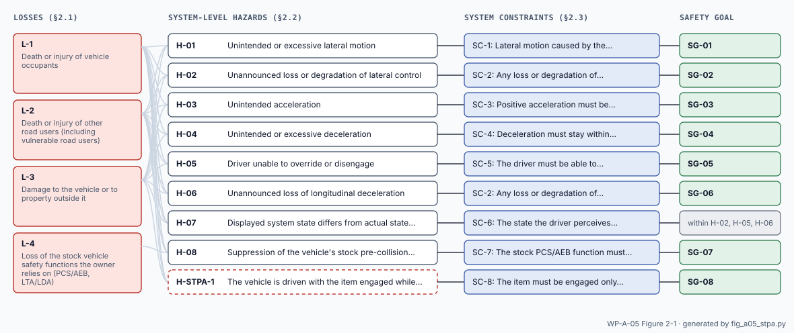

*Figure 2-1.* Losses, hazards, constraints and safety goals. H-STPA-1 has no goal yet (H-09, DQ-205); H-07 is rated within H-02, H-05 and H-06. Generated by [`figures/fig_a05_stpa.py`](figures/fig_a05_stpa.py) from this document (§2.1–§2.3).

## 3. Step 2 — Control structure

### 3.1 Diagram


*Figure 3-1.* Controllers are drawn top to bottom by authority. Control actions (orange) point down, feedback (teal) points up, each tagged with its ID from §3.3; CA-07 (alerts to the driver) and FB-07 (driver camera) run against that direction by nature. Grey controllers are outside the item; their UCAs are recorded as assumptions (§4.4). The harness box (§3.5) is an actuator, not a controller: it executes CA-09, carries the stock camera path (CA-13) in pass-through, depends on the box supply, and reports nothing back (dashed: no feedback). Generated by [`figures/fig_a05_stpa.py`](figures/fig_a05_stpa.py) (layout by hand in the script). The check fails if a CA or FB of the §3.3 table is not drawn, or if the figure names an ID that does not exist; change the script together with §3.2 and §3.3.

<details><summary>Text version of Figure 3-1</summary>

```
                          ┌───────────────────────────────────────────────┐
                          │ C1 Driver                                     │
                          │ process model: item state, road, own role     │
                          └──┬─────────┬─────────┬──────────┬─────────▲───┘
            CA-01 engage /    │ CA-03    │ CA-04   │ CA-02     │         │ FB-01 HMI (UI, sounds,
            resume (buttons)  │ steer    │ pedals  │ brake /   │         │ siren), FB-02 cluster,
                              │ torque   │         │ cancel    │         │ FB-03 vehicle motion
             ┌────────────────▼──┐      │         │           │         │
             │ C5 PCM / ACC      │◄─────┼─────────┘           │         │
             │ (cruise state,    │      │                     │         │
             │  powertrain, brk) │      │      FB-05 CAN (cruise, brake, gas, torque, speed)
             └─┬────────▲────────┘      │                     │         │
   CA-12 accel │        │ CA-06 accel   │                     │         │
   / brake     │        │ (0x343)       │                     │         │
               │  ┌─────┴──────────────────────────────┐      │  ┌──────┴───────────────────────┐
               │  │ C3 panda safety model (MCU)        │◄─────┼──┤ C2 openpilot on the SoC       │
               │  │ block/forward, limits, authority,  │ CA-05│  │ modeld, planner, controlsd,   │
               │  │ intercept drive, heartbeat, wdog   │ CA-06│  │ selfdrived, dmonitoringd,     │
               │  └─┬───────┬──────────────▲───────────┘ CA-08│  │ pandad, ui/soundd             │
               │    │CA-09  │CA-10         │ FB-04 panda       │  └──▲────────────▲───────────────┘
               │    │SBU1   │ TX block /   │ state (health)    │     │ FB-06 road  │ FB-07 driver
               │    │       │ controls off │                   │     │ cameras     │ camera (DM)
             ┌─▼────▼───────▼──┐   ┌────────┴───────┐         │
             │ C4 EPS ECU      │   │ C6 stock ADAS  │ CA-13 PCS brake / LKA: through the harness box
             │ (assist + LKA)  │   │ camera (PCS)   │──────────────► C5   (pass-through, or forwarded by C3)
             └────────┬────────┘   └────────────────┘
               (CA-09 ends at the harness box: 2 × DG419LE switches, pull-down to pass-through,
                powered from the box supply IGN/D1 or comma power; no position feedback, §3.5)
                      ▼ CA-11 rack torque          CA-03 steering torque (mechanical, adds at the rack)
             ┌──────────────────────────────────────────────────────────┐
             │ Controlled process: vehicle lateral and longitudinal motion │
             └──────────────────────────────────────────────────────────┘
```

</details>

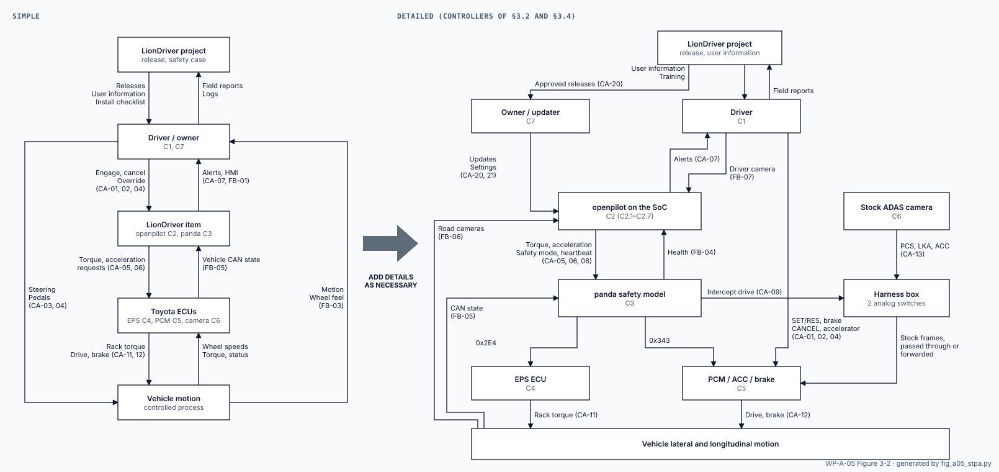

*Figure 3-2.* The same structure, simple and detailed, including the level above the driver: the LionDriver project releases software and user information and receives field reports; the owner installs updates. Laid out by hand in [`figures/fig_a05_stpa.py`](figures/fig_a05_stpa.py); every CA/FB ID it names is checked against §3.3 and §3.4.

### 3.2 Controllers, responsibilities and process models

| ID | Controller | Responsibilities (relevant to the losses) | Process-model variables that matter |
|---|---|---|---|
| C1 | Driver | Supervise at all times; engage only in suitable conditions; override or disengage when the item misbehaves; respond to alerts | Item engaged / overriding / disengaged; lateral vs longitudinal authority; Chill vs Experimental; what the item can handle (curves, lights, stopped vehicles); whether stock AEB is available |
| C2 | openpilot (SoC) | Plan and command lateral torque and acceleration within the envelope; detect faults and driver inattention; alert; disengage on driver input | Driver attentive; driver overriding; vehicle state (speed, cruise, brake, gas); own health; panda state; model confidence |
| C3 | panda safety model | Pass only commands within limits and only while authority is granted; withdraw authority on brake, cruise off, stale data, lost SoC; keep stock PCS path | controls_allowed; cruise engaged; brake/gas pressed; message freshness; SoC alive; intercept drive *as commanded* (the actual switch position is not fed back, §3.5); safety mode |
| C4 | EPS ECU (external) | Apply driver assist; apply LKA torque within its own limits; fault out LKA on implausible requests | LKA request valid; driver torque |
| C5 | PCM / ACC / brake ECU (external) | Hold cruise state; execute acceleration requests within its own limits; cancel cruise on brake | Cruise engaged; brake pedal; requested acceleration |
| C6 | Stock ADAS camera (external) | Detect collision risk; command PCS braking and warnings | Obstacles; own state (it keeps running while its LKA/ACC messages are blocked) |

Figures 3-3 to 3-5 draw the three controllers of the item's loop as classic STPA control loops: how each decides (control algorithm), what it believes (process model), and which of those beliefs the loss scenarios of §5 show can be wrong.

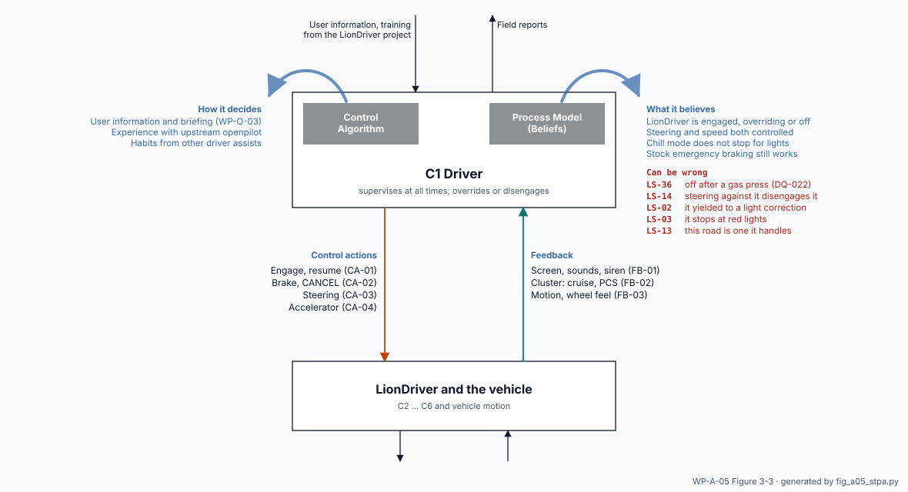

*Figure 3-3.* Control loop of the driver (C1).

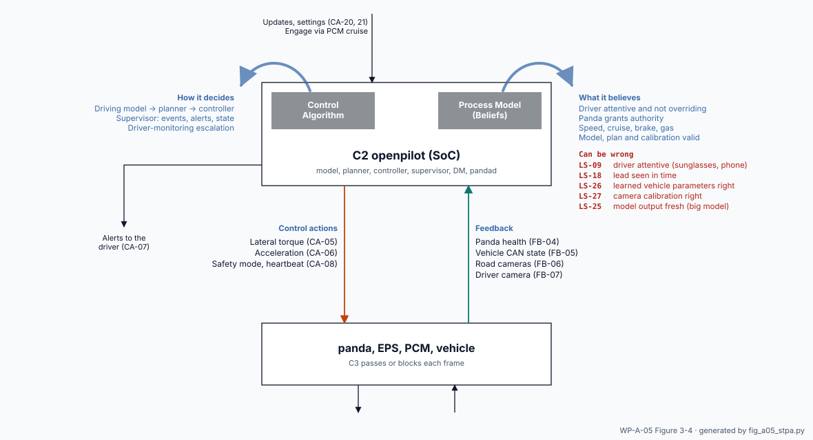

*Figure 3-4.* Control loop of openpilot (C2).

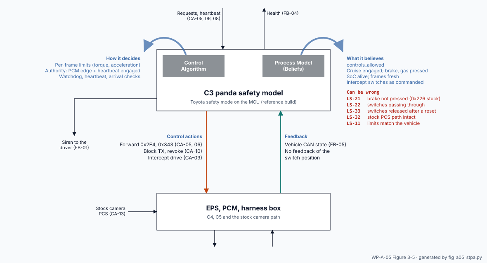

*Figure 3-5.* Control loop of the panda safety model (C3). The missing feedback of the intercept-switch position is part of the figure (§3.5).

Figures 3-3 to 3-5 are laid out in [`figures/fig_a05_stpa.py`](figures/fig_a05_stpa.py); the IDs they name are checked against §3.3 and §5.

### 3.3 Control actions and feedback

| ID | Control action | From → to | Channel |
|---|---|---|---|
| CA-01 | Engage / resume (cruise SET, RES) | C1 → C5, followed by C2 and C3 | Cruise buttons; PCM cruise state on `0x1D2`, `pcmCruise` (openpilot state tied to PCM cruise) |
| CA-02 | Disengage (brake pedal, CANCEL) | C1 → C5, C2, C3 | Pedal / button; `0x226`, `0x1D2` |
| CA-03 | Steering input | C1 → vehicle, sensed by C2 and C3 | Mechanical; `0x260` driver torque (`steeringPressed` above 100 raw) |
| CA-04 | Accelerator input (override) | C1 → C5, sensed by C2 and C3 | Pedal; GAS_RELEASED on `0x1D2` |
| CA-05 | Lateral torque request | C2 → C3 → C4 | `0x2E4` STEERING_LKA (torque, STEER_REQUEST) |
| CA-06 | Acceleration request (incl. cancel request) | C2 → C3 → C5 | `0x343` ACC_CONTROL |
| CA-07 | Alerts and take-over requests; DM escalation | C2 → C1 | UI, soundd; panda siren on SoC loss |
| CA-08 | Set safety mode; heartbeat with engaged flag | C2 (pandad) → C3 | SPI `0xdc`, `0xf3` |
| CA-09 | Drive the intercept switches (SBU1 high = intercept; undriven = pass-through through the pull-down) | C3 → harness box | SBU1 line of the OBD-C cable (device-side driver UK-06) to the switch inputs (RR-2026-010 HB-01, HB-02) |
| CA-10 | Block TX / withdraw controls_allowed | C3 internal → C4, C5 | Frames not sent |
| CA-11 | Rack torque (LKA assist) | C4 → vehicle | EPS motor; adds to the driver's torque at the rack (external controller, §4.4) |
| CA-12 | Drive torque and braking | C5 → vehicle | Powertrain and brake actuators (external controller, §4.4) |
| CA-13 | PCS brake request and warnings | C6 → C5: through the powered harness-box switches in pass-through, or forwarded by C3 while intercepting | `0x283`, `0x344`, `0x411` |

| ID | Feedback | From → to |
|---|---|---|
| FB-01 | Engagement state, alerts, Chill/Experimental indicator | C2 → C1 (UI, sounds); siren from C3 |
| FB-02 | Cruise indicator, LKA/LTA indicator, PCS warnings | Cluster (C5/C6) → C1 |
| FB-03 | Vehicle motion, steering-wheel feel | Vehicle → C1 |
| FB-04 | Panda health (mode, controls_allowed, faults, watchdog reset, refused requests) | C3 → C2 |
| FB-05 | Vehicle CAN state (cruise, brake, gas, steering torque, wheel speeds, EPS status) | Vehicle → C2, C3 |
| FB-06 | Road cameras, model outputs | → C2 |
| FB-07 | Driver camera (face, eyes, phone) and wheel touch | C1 → C2 |

**Missing feedback (v0.4).** Nothing reports the intercept-switch position to C3 or C2 (RR-2026-010 F-06; SBU1 reads back the drive, not the switch). C3 learns of a switch that stays in pass-through only indirectly, from a stock camera frame on the bus the harness should separate, after the 1 s transition allowance (`safety.h:525-533`). A switch that stays in intercept after release, or a stock path cut by the box itself, is seen by nobody in the item (§3.5, LS-32, LS-33).

### 3.4 Inside openpilot, configuration, calibration and updates (v0.3, OI-7)

The structure of §3.1–§3.3 treats openpilot (C2) as one controller. Version 0.3 opens it up along the ML control loop (ISO/PAS 8800: model → planner → controller) and adds the control actions that configure the item rather than move the vehicle. These do not change Figure 3-1; they refine C2 and add one controller outside the vehicle (C7).

| ID | Sub-controller | Processes | Responsibilities | Process-model variables that matter |
|---|---|---|---|---|
| C2.1 | Driving model | `modeld` | Desired curvature and acceleration (`modelV2.action`), lead estimates, hard-brake and gas-press predictions | Camera image valid; calibration; model confidence |
| C2.2 | Longitudinal planner | `radard`, `plannerd` | Lead tracks and longitudinal plan (`aTarget`, `shouldStop`, `fcw`, `allowThrottle`). The Corolla TSS2 has no radar parsed (`radarUnavailable`), so leads come from the same model as the path (`toyota/interface.py:91`) | Leads present and distance; set speed; personality |
| C2.3 | Controller | `controlsd`, Toyota `CarController` | Turn the plan into torque and acceleration requests while `latActive`/`longActive` | Inputs fresh and finite; engagement state; learned vehicle parameters |
| C2.4 | Supervisor | `selfdrived` | Engagement state machine, events, alerts; gates `latActive`/`longActive` | Panda state; process health; driver state; PCM cruise |
| C2.5 | Driver monitoring | `dmonitoringmodeld`, `dmonitoringd` | Awareness estimate and escalation | Face and eye visibility; wheel touch |
| C2.6 | Calibration and learning | `calibrationd`, `paramsd`, `torqued`, `lagd` | Camera extrinsics; steer ratio, stiffness and angle offset; lateral acceleration factor and friction; actuator lag | Calibration status; estimator validity |
| C2.7 | Panda interface | `pandad` | Flash the panda firmware at start; configure the safety mode, parameter and alternative experience; heartbeat; forward `sendcan` | Panda signature and reference-build flag; CarParams; onroad state |
| C7 | Updater and owner settings (outside the vehicle loop) | `updated`; the owner through the settings UI | Install software updates (offroad only, swapped in at reboot); set driving mode, personality and toggles | Release identity; parameter values |

| ID | Control action | From → to | Channel |
|---|---|---|---|
| CA-14 | Desired curvature and acceleration, lead estimates | C2.1 → C2.2, C2.3 | `modelV2` (`action.desiredCurvature`, `action.desiredAcceleration`, leads, `meta`) |
| CA-15 | Longitudinal plan | C2.2 → C2.3 | `longitudinalPlan` (`aTarget`, `shouldStop`, `allowThrottle`, `fcw`) |
| CA-16 | Lateral and longitudinal activation | C2.4 → C2.3 | `selfdriveState` (enabled, active); `latActive`/`longActive` in `controlsd.py:110-131` |
| CA-17 | Calibration and learned parameters | C2.6 → C2.1, C2.3 | `liveCalibration`, `liveParameters`, `liveTorqueParameters`, `liveDelay` |
| CA-18 | Safety configuration requests: ELM327 for fingerprinting, car safety mode with parameter and alternative experience, NOOUTPUT offroad, power save | C2.7 → C3 | SPI `0xdc`, `0xdf`, `0xe7` (`panda_safety.cc:5-88`) |
| CA-19 | Flash the panda firmware | C2.7 → C3 | Bootloader over SPI, at pandad start (`pandad.py:20-51`) |
| CA-20 | Install a software update | C7 → C2, C3 (through CA-19 at the next start) | `updated` (offroad only, `process_config.py:114`), swap at reboot |
| CA-21 | Driving mode, personality and toggles | C7 (owner) → C2 | Params (`ExperimentalMode`, `LongitudinalPersonality`, `DisengageOnAccelerator`, …). Since v0.4 `selfdrived` logs every deviation from the assured values (`assured_config.py`, CA-008) and the personality defaults to relaxed (`params_keys.h:92`, CA-011) |
| CA-22 | Car-interface initialisation: ECU knockout of the stock radar or ADAS ECU over UDS, which some platforms use for alpha longitudinal | C2 (`card`) → stock ADAS ECU | `CI.init` at the first controls-ready step (`card.py:238-245`); gated by the stock-AEB interlock since v0.4 (`stock_aeb_interlock.py`, LD-FSR-001, CA-001) |

| ID | Feedback | From → to |
|---|---|---|
| FB-08 | Model and plan validity (message `valid`, alive, age; model confidence) | C2.1, C2.2 → C2.3, C2.4 |
| FB-09 | Calibration and estimator status (`calStatus`, `vehicleParameters.valid`, `lateralTorqueParameters.valid`) | C2.6 → C2.4 |
| FB-10 | Panda signature, reference-build flag, configured safety mode and parameter | C3 → C2.7, C2.4 |
| FB-11 | Update and release state (installed version, update failed, offroad alerts) | C7 → C1 |

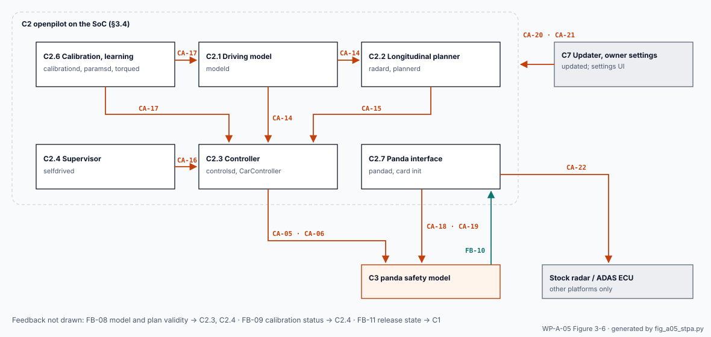

*Figure 3-6.* Control structure inside openpilot (the tables above). Laid out in [`figures/fig_a05_stpa.py`](figures/fig_a05_stpa.py).

### 3.5 Harness box: the intercept element (v0.4, RR-2026-010)

Up to v0.3 the analysis treated the intercept element as an electromechanical relay. RR-2026-010 read comma.ai's published v3 harness-box drawing: there is no relay. The element that executes CA-09 is:

| Property | Published v3 drawing (RR-2026-010 §2) | What it changes in the control structure |
|---|---|---|
| Actuator | Two DG419LE analog SPDT switches (U1 on CAN_H, U2 on CAN_L), both inputs on SBU1 (HB-01) | CA-09 ends at two powered ICs, not a coil. Switching takes microseconds, so there is no drop-out bounce; failure modes are stuck in either position, channel open or short, latch-up and loss of supply (DFMEA DFM-010, DFM-011, DFM-013) |
| Default | SBU1 pulled to GND through R2 + R3 (2 × 120 Ω); undriven means pass-through, the camera's CAN joined to the car's (HB-02) | Release after a reset, watchdog or hang relies on the pull-down. If R2 or R3 is open, the inputs float and the switches may stay in intercept with the MCU silent (DFM-010.C3, F-03) → LS-33 |
| Supply | V+ and VL on the box supply VIN: ignition through D1, or comma power (HB-03); Schottky clamps D2/D3 from both buses to VIN and GND (HB-04) | The stock camera path (CA-13) passes active parts that need power **in pass-through too**. Box supply lost while the car runs: the switch state is undefined and the clamps load both buses, so the stock camera may be cut off and the car's bus disturbed, independent of C2 and C3 (DFM-020, DFM-021, F-02, F-07) → LS-32 |
| Feedback | None (F-06) | C3's process model holds the commanded drive only. No controller in the item can see that CA-13 no longer reaches C5 → UCA-36 |

HWSR-702 ("no active component in the stock path") cannot be met with this box (F-01). Whether to accept and test it, or build a LionDriver adapter with a passive fail-safe relay and a readback contact, is DQ-209, queued for the lead. The loss scenarios below hold for the comma box as drawn; option B of DQ-209 would change LS-32 and LS-33 and add the missing feedback.

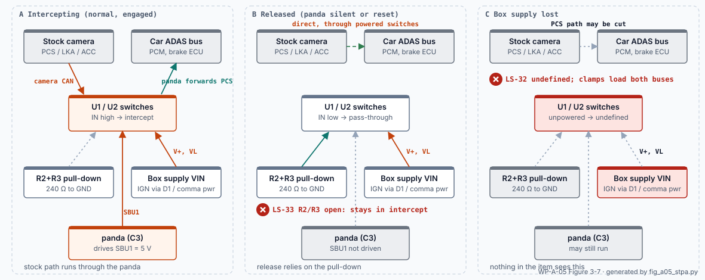

*Figure 3-7.* The harness box in its three states, from the published v3 drawing (RR-2026-010). Not confirmed on the bench (DFM-ACT-014).

## 4. Step 3 — Unsafe control actions

Types: **N** not provided causes hazard; **P** provided causes hazard; **T** too early, too late or wrong order; **D** stopped too soon or applied too long.

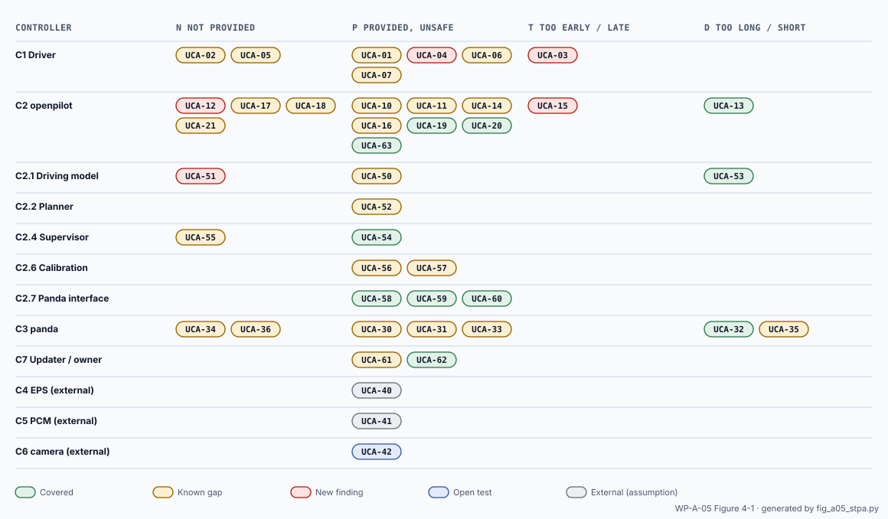

*Figure 4-1.* Every UCA by controller and type, coloured by the worst status of its loss scenarios. An empty cell is a guide word for which no UCA was found. Generated by [`figures/fig_a05_stpa.py`](figures/fig_a05_stpa.py) from this document (§4) and [stpa-map.yaml](stpa-map.yaml).

### 4.1 Driver (C1)

| UCA | Type | Unsafe control action | Hazards |
|---|---|---|---|
| UCA-01 | P | Driver engages in conditions outside what the item handles (tight curve, construction, faded lines, low sun) | H-01, H-02, H-STPA-1 |
| UCA-02 | N | Driver does not disengage (brake or cancel) when the item steers or accelerates unexpectedly | H-01, H-03, H-05 |
| UCA-03 | T | Driver brakes or steers too late after a take-over request or after a silent loss of control | H-02, H-06 |
| UCA-04 | P | Driver applies steering torque below the override threshold while the item keeps commanding the opposite way, and believes the item has yielded | H-05, H-07 |
| UCA-05 | N | Driver does not supervise (looks away, hands off for long periods) while engaged | H-STPA-1 |
| UCA-06 | P | Driver expects the item to stop for a red light, stop sign or stationary vehicle and does not brake (Chill Mode does not stop for lights) | H-06, H-STPA-1, H-07 |
| UCA-07 | P | Driver releases the accelerator after an override believing the item is off, and does not expect it to resume speed control (braking towards the set speed or a lead, or accelerating back to it); v0.5, from DQ-022 | H-07, H-03, H-04 |

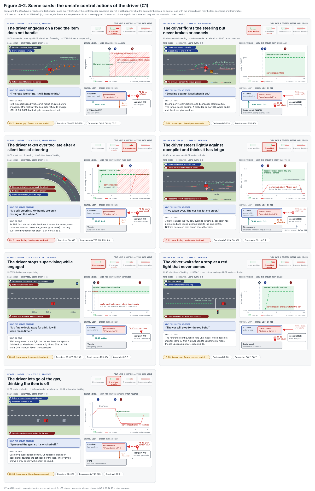

*Figure 4-2.* One scene card per UCA of the driver: when the control action is needed against what happens, what the driver believes, and which link of the loop fails. Generated by [`figures/stpa_scenes.py`](figures/stpa_scenes.py), through `figures/fig_a05_stpa.py`, from this table, §5 and [stpa-map.yaml](stpa-map.yaml); the scenes and charts are schematic, not test results.

### 4.2 openpilot (C2)

| UCA | Type | Unsafe control action | Hazards |
|---|---|---|---|
| UCA-10 | P | Lateral torque commanded while the driver is steering against it | H-05 |
| UCA-11 | P | Lateral torque commanded that moves the vehicle out of lane (wrong desired curvature, model error) | H-01 |
| UCA-12 | N | Lateral torque not commanded in a curve while engaged and no alert given (lateral inactive, torque saturated, temporary EPS fault) | H-02 |
| UCA-13 | D | Lateral torque request held at a stale value after the SoC stalls (frames still sent) | H-01 |
| UCA-14 | P | Positive acceleration commanded towards a stopped or slower lead | H-03 |
| UCA-15 | T | Deceleration commanded too late for a lead vehicle (cut-in, late detection) | H-06 |
| UCA-16 | P | Hard deceleration commanded without a real obstacle (false positive) | H-04 |
| UCA-17 | N | Take-over alert not given, or given after the driver can react, when lateral or longitudinal control is lost | H-02, H-06, H-07 |
| UCA-18 | N | No escalation when the driver stops supervising (DM fails to detect, or escalation slower than the situation needs) | H-STPA-1 |
| UCA-19 | P | Acceleration or torque commanded while openpilot is not engaged but PCM cruise is (state mismatch) | H-01, H-03, H-04, H-07 |
| UCA-20 | P | Wrong safety mode or parameter sent to the panda (wrong fingerprint) | H-01, H-03, H-05 |
| UCA-21 | N | No *specified and assured* minimal-risk behaviour when the driver stays unresponsive after the last escalation step. Today the item slows to a stop in the lane, but that reaction rests on QM driver-monitoring and planner software, has no requirement, no announcement and no standstill hold (v0.5, from DQ-205). The decided reaction (DQ-365) is the stop in the lane, then stay stopped and held with re-engagement locked out until the driver responds (TSR-633). The hold is credited to the PCM under ACC (WP-C-01 AOU-16, not yet tested; WP-A-04 UE-8.11), and the lockout is missing today (v0.7) | H-STPA-1 |

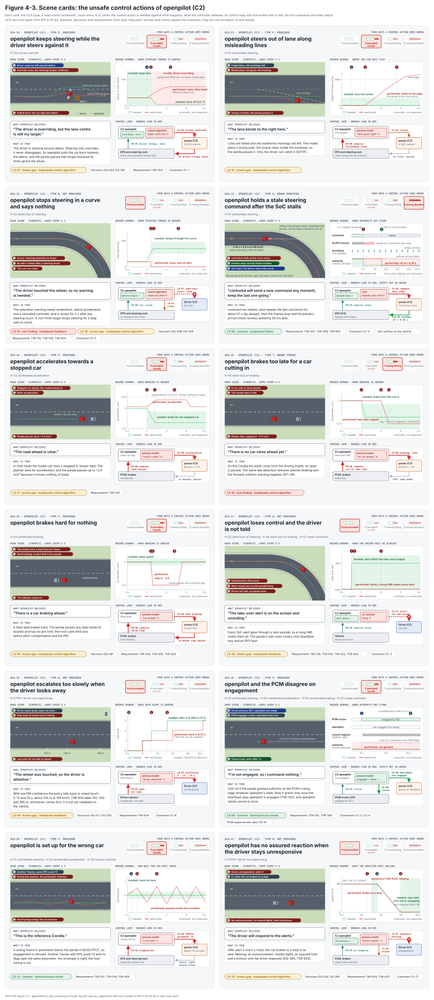

*Figure 4-3.* One scene card per UCA of openpilot. Generated by [`figures/stpa_scenes.py`](figures/stpa_scenes.py), through `figures/fig_a05_stpa.py`, from this table, §5 and [stpa-map.yaml](stpa-map.yaml); the scenes and charts are schematic, not test results.

### 4.3 panda safety model (C3)

| UCA | Type | Unsafe control action | Hazards |
|---|---|---|---|
| UCA-30 | P | Passes a torque or acceleration request outside the controllable envelope (limits not derived from the vehicle) | H-01, H-03, H-04 |
| UCA-31 | P | Keeps authority after the driver brakes or cancels | H-05, H-01, H-03 |
| UCA-32 | D | Keeps authority too long after SoC loss or stale vehicle data | H-01, H-02 |
| UCA-33 | P | Drives the intercept switches (or keeps them in intercept, by drive or by a failed release) while not forwarding stock PCS messages | H-08 |
| UCA-34 | N | Does not block stock camera LKA/ACC messages the item replaces while it transmits (the switches stay in pass-through) | H-01, H-04 |
| UCA-35 | D | Withdraws authority abruptly while engaged (spurious RX timeout, watchdog reset) without the SoC announcing it | H-02, H-06, H-07 |
| UCA-36 | N | Item stays engageable, and engaged, while the stock PCS path through the harness box is interrupted (box supply lost, switch stuck, clamp short), because neither C3 nor C2 has feedback of that path (v0.4) | H-08 |

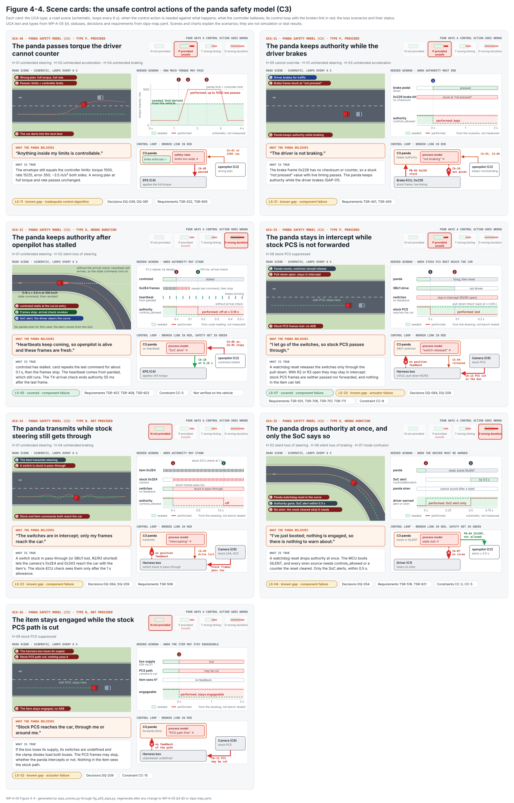

*Figure 4-4.* One scene card per UCA of the panda safety model. Generated by [`figures/stpa_scenes.py`](figures/stpa_scenes.py), through `figures/fig_a05_stpa.py`, from this table, §5 and [stpa-map.yaml](stpa-map.yaml); the scenes and charts are schematic, not test results.

### 4.4 External controllers (recorded as assumptions)

| UCA | Controller | Unsafe control action | Hazards | Assumption |
|---|---|---|---|---|
| UCA-40 | C4 EPS | Applies an LKA request beyond what the driver can counter, or drops LKA without the cluster showing it | H-01, H-02 | AOU-01, AOU-02 |
| UCA-41 | C5 PCM | Executes an acceleration request beyond its own limits; does not cancel cruise on brake | H-03, H-05 | AOU-03, AOU-05 |
| UCA-42 | C6 camera | Stops issuing PCS when it no longer sees its own LKA/ACC feedback | H-08 | AOU-04 |

### 4.5 Controller constraints

| ID | Constraint | From UCA |
|---|---|---|
| CC-1 | openpilot shall stop commanding lateral torque, or limit it to a level the driver overrides without effort, while the driver applies opposing torque. v0.5, decided by the lead (DQ-053, option A): the item backs off on a steering override, in the panda (TSR-304) and on the SoC (SWF-ACT-046); thresholds wait on DQ-081 | UCA-10, UCA-04 |
| CC-2 | The HMI shall show lateral and longitudinal authority separately, including the overriding state, and the active driving personality/mode. v0.5: a steering override shows a cue (DQ-053) and an accelerator override shows an on-screen override alert, to be checked in the HMI clinic (DQ-022) | UCA-04, UCA-06, UCA-07, UCA-19 |
| CC-3 | openpilot shall announce every loss of lateral or longitudinal capability while engaged within the take-over budget, including losses that start in the panda | UCA-12, UCA-17, UCA-35 |
| CC-4 | openpilot shall not command actuation when its engagement state differs from the PCM cruise state, and shall cancel cruise when they differ | UCA-19 |
| CC-5 | The panda shall withdraw authority within the FTTI after SoC loss or stale data, and the SoC shall detect a panda reset and alert | UCA-32, UCA-35, UCA-13 |
| CC-6 | Driver monitoring shall escalate fast enough for the current speed and road, and shall not allow engagement while the driver is not supervising | UCA-05, UCA-18, UCA-01 |
| CC-17 | When the driver stays unresponsive after the last escalation step, the item shall keep the lane and decelerate to a standstill within the envelope limits with the alert sounding, announced before it starts (TSR-624), then keep the vehicle stopped and held and lock out re-engagement and resumption until the driver responds (DQ-365, TSR-633), assured to the H-09 goal (DQ-205) | UCA-21 |
| CC-18 | Off a highway the item shall refuse to engage; a warning alone is not enough (DQ-280, option A). Until road-type data is available (WP-C-07 FM-08), it shall refuse engagement below a highway speed floor (60 km/h, set by the lead on 2026-10-19). v0.13: implemented as an entry check on the reference platform (#287); not yet verified in the vehicle | UCA-01 |
| CC-7 | User information shall state what the item does not handle in Chill Mode (lights, stop signs, stopped vehicles at speed, sharp curves) | UCA-01, UCA-06 |
| CC-8 | The intercept switches shall be driven only while the panda forwards every non-replaced stock message, and shall return to pass-through when released, including after a reset and with a pull-down fault | UCA-33 |
| CC-15 | The item shall detect an interrupted stock PCS path through the harness box (switch position, box supply) and then refuse engagement and warn the driver; until the hardware allows it, the residual risk shall be argued from bench tests (DQ-209, DQ-064) | UCA-36 |

### 4.6 Inside openpilot, configuration, calibration and updates (v0.3, OI-7)

UCAs of the control actions of §3.4. Several restate, at sub-controller level, UCAs of §4.2 (noted in the last column); they are kept because the causes, and so the constraints, sit in a different process.

| UCA | Controller | Type | Unsafe control action | Hazards | Refines |
|---|---|---|---|---|---|
| UCA-50 | C2.1 | P | Desired curvature or acceleration provided from a degraded input (occluded or blinded camera, calibration invalid or wrong) with no drop in the confidence that gates its use | H-01, H-03, H-04 | UCA-11, UCA-14, UCA-16 |
| UCA-51 | C2.1, C2.2 | N | A lead is not provided (missed or late detection). Planner braking and the FCW both depend on it, because on the Corolla the leads come from the same model as the path | H-06 | UCA-15, UCA-17 |
| UCA-52 | C2.2 | P | `allowThrottle` provided from a wrong gas-press prediction, so positive acceleration is planned towards a slower lead | H-03 | UCA-14 |
| UCA-53 | C2.1, C2.2 | D | Plan or model output held after its publisher stops or lags | H-01, H-03, H-04, H-06 | UCA-13 |
| UCA-54 | C2.4 | P | `latActive`/`longActive` provided while the panda does not grant authority, or while the PCM cruise state differs | H-07, H-02, H-06 | UCA-19 |
| UCA-55 | C2.4 | N | Disengagement not provided when a supervised input is invalid, because its event is masked (big-model loading) | H-02, H-06 | UCA-17 |
| UCA-56 | C2.6 | P | Learned steer ratio, stiffness, angle offset or lateral acceleration factor applied while wrong; bounded only to 0.5–2× the platform value (`paramsd.py:47`) | H-01, H-02 | UCA-11, UCA-12 |
| UCA-57 | C2.6 | P | Camera calibration kept after the device has moved on its mount by less than the recalibration threshold (spread above 4° pitch or 2° yaw, `calibrationd.py:35-36, 164-167`) | H-01, H-04 | UCA-11 |
| UCA-58 | C2.7 | P | A car safety mode or parameter requested for the wrong vehicle (fingerprint) or before the panda firmware is confirmed as the reference build | H-01, H-03, H-05 | UCA-20 |
| UCA-59 | C2.7 | P | ELM327, power save, a mode change or a reset/boot-mode request provided while driving | H-01, H-03, H-02, H-06, H-08 | — |
| UCA-60 | C2.7 | P | Panda flashed with firmware other than the assured reference build (the bundled image is wrong, or a rollback brings an older one) | H-01, H-03, H-05, H-08 | — |
| UCA-61 | C7 | P | Update installed that is not an approved LionDriver release, or that swaps in partly | All | — |
| UCA-62 | C7 (owner) | P | Driving mode or toggles set outside the reference configuration (Experimental Mode, aggressive personality, developer toggles) | H-03, H-04, H-06, H-STPA-1 | UCA-06 |
| UCA-63 | C2 (`card`) | P | ECU knockout or alpha longitudinal provided on a vehicle, silencing the stock radar or ADAS ECU and with it PCS/AEB (v0.4, CA-22) | H-08 | UCA-33 |

Controller constraints added for these UCAs:

| ID | Constraint | From UCA |
|---|---|---|
| CC-9 | openpilot shall not actuate on model or plan outputs that are stale, invalid or produced from an invalid calibration, and shall announce the resulting loss of control | UCA-50, UCA-53, UCA-55 |
| CC-10 | Learned vehicle parameters shall be bounded to ranges validated for the reference vehicle, and leaving the range shall be treated as a fault | UCA-56 |
| CC-11 | A change of device attitude after calibration shall be detected and shall prevent engagement until recalibrated | UCA-57 |
| CC-12 | A car safety mode shall be configured only on a reference panda and only for the reference vehicle; diagnostic, power-save and reset requests shall be refused while a car mode is active | UCA-58, UCA-59 |
| CC-13 | Only approved releases shall be installed, and the panda firmware shall match the release record | UCA-60, UCA-61 |
| CC-14 | The reference configuration shall be enforced, or deviations shown to the driver, at every start | UCA-62 |
| CC-16 | The item shall never disable or silence a stock ADAS ECU on a vehicle unless an approved safety case shows that stock AEB is preserved (LD-FSR-001) | UCA-63 |

## 5. Step 4 — Loss scenarios

v0.1 wrote scenarios for the priority UCAs only. v0.3 re-checks those against the current code and adds a scenario for every other UCA of §4.1–§4.3 and §4.6. The UCAs of external controllers (§4.4) rest on assumptions of use, except UCA-42, whose behaviour has a scenario because the item causes it.

**Code basis (v0.3):** `liondriver-dev` `26104ab`, panda `a55bdfc`, opendbc `a57b667`. Since BL-003 the reference build has become the default build (`SConstruct:274-283`). Its features are therefore credited here, and the status records which scenarios they change.

**Code basis (v0.4):** `liondriver-dev` `1033d98`, panda `a55bdfc` (unchanged), opendbc `9a13f60`. Every code reference below was re-read at this commit and corrected where lines moved. Changes since v0.3 that the scenarios now credit: the PCM-edge heartbeat gate (opendbc `9a13f60`, TSR-301) and the host's 0.3 s engagement grace for `controlsMismatch` (TSR-621); TSR-615 immediate disables on heartbeat loss, TX-rate revocation and a rising `safetyTxBlocked` count (`supervision.py`, `selfdrived.py:368-375`; in the code since #51, not credited in v0.3); the assured-configuration check that logs, but does not show or block, platform, parameter and software-origin deviations (`assured_config.py`, CA-008); the relaxed following-distance default (CA-011); the stock-AEB interlock on alpha longitudinal and ECU knockout (`stock_aeb_interlock.py`, CA-001); Chill mode by default (DQ-001). The pending opendbc changes ATC-20 and ATC-26 (re-grant only after a full TX-rate window and after a new engagement) are not pinned and not credited. The harness box is re-based on RR-2026-010 (§3.5). None of this is verified on the bench or the vehicle.

**Status:**
- *covered*: a requirement, mechanism or analysis row exists and the scenario is controlled, or will be once the requirement is implemented.
- *known gap*: another analysis already records the gap.
- *new*: no other analysis records it (§6).
- *open test*: it can only be settled on the vehicle or the bench.

Every scenario is linked to fault-tree events of [WP-A-04](WP-A-04-system-fta-fmea.md), FMEA failure modes and TSRs in [stpa-map.yaml](stpa-map.yaml). `tools/safety/fmea_lint.py` checks that every UCA has a scenario, that every link exists, and that each cited event lies in the fault tree of the scenario's hazard.

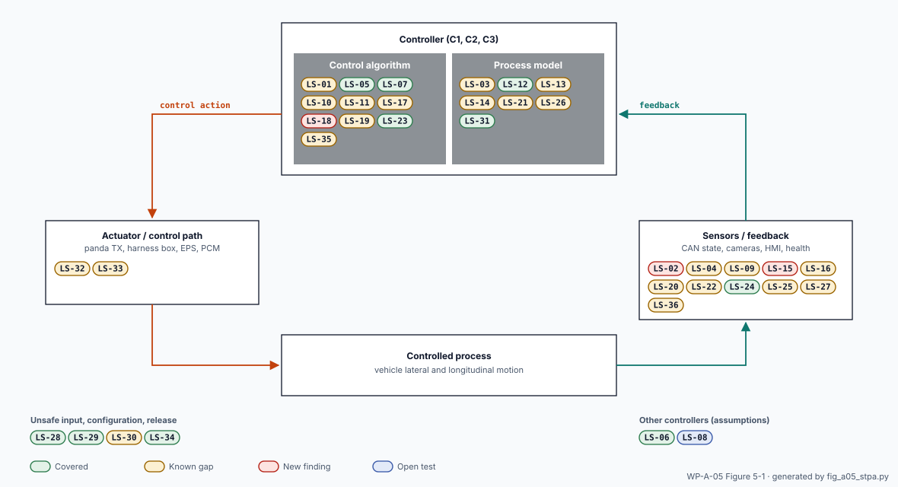

*Figure 5-1.* Where the loss scenarios sit in the control loop, by the causal-factor type in each scenario's Type column (a scenario with two types sits at the first). Generated by [`figures/fig_a05_stpa.py`](figures/fig_a05_stpa.py) from this document and [stpa-map.yaml](stpa-map.yaml).

### 5.1 Priority scenarios of v0.1, re-checked

| ID | UCA | Scenario (current code) | Type | Covered by | Status |
|---|---|---|---|---|---|
| LS-01 | UCA-10 | The driver steers against the item to avoid an obstacle. `steeringPressed` (driver torque above 100 raw) still only freezes the torque integrator (`latcontrol_torque.py:92`). It moves the state machine to `overriding`, which is an active state (`state.py:8, 43-45`), so `latActive` stays true (`controlsd.py:114-115`). The panda's LKA limits have no driver-torque term (`toyota.h:298-303`). The freshness and finiteness gates added since BL-003 do not use driver torque | Inadequate control algorithm | TSR-304; SWF-038, SWF-044, SFM-018; BE-5.05, BE-5.06 | Known gap, unchanged in the code. Decided 2026-10-14: back off on override and show a cue (DQ-053; OI-2). Not implemented: TSR-304, SWF-ACT-046, SFM-ACT-016 (§5.6) |
| LS-02 | UCA-04 | The driver applies corrective torque below the 100-raw threshold (`values.py:585`). No override is detected, so the item neither yields nor shows anything. Above the threshold the only cue is the grey border of the `overriding` state (`ui_state.py:189-190`), which gas override and pre-enable share; `steerOverride` has no text or sound (`events.py:741-747`). *v0.1 said there was no cue at all; corrected* | Inadequate feedback | SFM-018, SFM-028; BE-5.10 | New (sub-threshold case; CC-1, CC-2). The cue is decided (DQ-053); how far below 100 raw a correction counts is part of DQ-081 |
| LS-03 | UCA-06 | The driver has used Experimental Mode before (it was the upstream default), or reads upstream docs, and expects stops at lights; the reference configuration runs Chill Mode (D-08) | Flawed process model | WP-C-08 MC-09; D-08, B-06; PFM-011, PFM-015 | Known gap; depends on B-06 and user information (CC-7). See LS-31 |
| LS-04 | UCA-35 | The panda watchdog resets the MCU while engaged (SWF-019). The MCU boots in SILENT with the siren off, and every siren source needs `controls_allowed` or a counter that the reset clears (`main.c:145-162, 347-353`); nothing survives the reset but its cause (`main.c:389-393`). Since BL-003 the SoC reacts. The panda reports SILENT/NO_OUTPUT and `controlsAllowed` false, so `controlsMismatch` gives an immediate-disable alert within 0.5 s of the first post-reset `pandaStates` (`selfdrived.py:53-56, 357-366, 570-574`). After the reset the panda boots in SILENT with the switches undriven, so the harness box returns to pass-through, provided its pull-down and supply are intact (LS-32, LS-33). `pandaWatchdogReset` itself is only a permanent alert. The SPI reconnect time after the reset is not measured | Component failure; inadequate feedback | TSR-516, TSR-621; SWF-019, SWF-029, SWF-034, SFM-015, DFM-017; BE-2.14 | Partly mitigated: SoC alert only; the SoC-independent siren still cannot sound. Decided 2026-10-14: keep an engaged flag across the reset so the siren sounds (DQ-054; OI-3); not implemented |
| LS-05 | UCA-32, UCA-13 | `controlsd` stalls while `pandad` keeps sending heartbeats. `card` repeats the last `carControl` only while it is alive, about 0.1 s (`card.py:247-251`). After that the actuation frames stop and the TX-arrival check revokes authority 50 ms later for `0x2E4` (100 ms for `0x343`) (`toyota.h:600-611`), about 0.16 s in all. `controlsd` itself stops actuating on stale inputs (`controlsd.py:118-120`). Heartbeat loss revokes in 0.3 s with a siren. Since panda `8a69ccf` with opendbc `4d1a056` (reference build) the arrival revocation sounds the siren (TSR-516(b), DQ-404 A), about 0.31 s after the last `0x2E4`; plant run F-04b: 0.25–0.29 s ([silent-stall.md](../sim/results/silent-stall.md), synthetic). What is left: about 0.1 s of a repeated in-limit command (BE-1.23, by design) | Component failure (control loop) | TSR-407, TSR-408, TSR-516, TSR-602; SWF-020, SWF-023, SWF-040, SWF-043, SWF-047, SFM-006; BE-1.19, BE-1.21, BE-1.22, BE-2.17 | Covered (reference build, default since `e84f850`); not verified on the vehicle |
| LS-06 | UCA-19 | The driver presses SET while openpilot is not ready; the PCM engages cruise but openpilot stays disengaged. `controlsd` requests cancel at once (`controlsd.py:195`; CANCEL_REQ every third `0x343` frame, `carcontroller.py:187, 253, 269-273`) and `cruiseMismatch` alerts after 1.0 s (`selfdrived.py:57, 464-468`; a prompt, not a disable). **Until v0.3:** the panda granted `controls_allowed` on the PCM rising edge whatever openpilot's state; only the engaged-mismatch check, three 1 Hz ticks (`main.c:240-244`), or the cancel removed it. **v0.4 code:** in the reference build the rising edge only opens a 1 s window, and authority is granted once the heartbeat reports openpilot engaged (`safety.h:442-463, 683-703`); the upstream build keeps the old grant. The host does not count `controlsMismatch` samples in the first 0.3 s after engaging (`supervision.py`, TSR-621), and the 0.5 s bound from the first mismatched frame still holds | Flawed process model (C3); unsafe external controller | TSR-308; SWF-039, SWF-048, SFM-021; BE-3.13, BE-4.13, BE-5.10 | Covered (v0.3.1): since opendbc `9a13f60` the reference build grants authority on the PCM edge only once the heartbeat reports openpilot engaged, within 1 s (TSR-301; OI-9 closed). Alert at 1 s (TSR-308); open test for the PCM response (OI-4) |
| LS-07 | UCA-33 | The panda hangs with the intercept switches driven. The independent watchdog starts at the first intercept drive (`harness.h:16-21`), times out after about 90 ms in window mode and is fed only after main-loop progress (`hw_watchdog.h:20-37, 66-76`). The reset stops driving SBU1, and the pull-down returns both switches to pass-through within microseconds; there is no relay drop-out time (RR-2026-010 HB-02). That release needs the pull-down intact (LS-33) and the box powered (LS-32). A forwarding failure with the MCU still running (queue overflow, camera-side bus fault) is not caught | Component failure | TSR-501, TSR-706, TSR-707, TSR-711; DFM-004, DFM-006, SWF-018; BE-7.01, BE-7.04, BE-7.06, BE-7.10 | Covered for a hang (bench confirmation open, DFM-ACT-003; the device-side SBU1 driver is unknown, UK-06); known gap for forwarding stalls |
| LS-08 | UCA-42 | The stock camera receives no feedback for its blocked LKA/ACC messages and sets a fault that also disables PCS | Unsafe behaviour of an external controller | AOU-04, HARA SG-07; SFM-033; UE-7.14 | Open test: needs a vehicle test (OI-5) |
| LS-09 | UCA-18, UCA-05 | Sunglasses or low light lower DM confidence; the policy falls back to wheel touch (5/15/25 s) while the driver is looking at a phone; at motorway speed 25 s is several hundred metres unsupervised | Inadequate feedback (sensor) | WP-A-03 DFI-21; SOTIF; SFM-022, SFM-023 | Known gap under SOTIF until TSR-634 is validated: the lead decided speed-dependent wheel-touch escalation (DQ-077 A, v0.8); the speed table is in WP-C-08 §5.4 (alert k at 5/15/25 s or 150/240/395 m, whichever comes first). Implemented 2026-10-17 (SWSR-634, unit tests only); vehicle validation per WP-V-02 §4.4 open |
| LS-10 | UCA-11 | Lane lines are faded or misleading (construction); the model plans a wrong curvature; torque stays within the envelope, so the panda does not act; the driver is the only control | Inadequate control algorithm (ML) | SOTIF WP-C-06, WP-C-05; SFM-003; BE-1.03 | Known gap under SOTIF |
| LS-11 | UCA-30 | Envelope limits still equal the controller limits: torque 1500, rate 15/25, error 350 (`toyota.h:298-303` against `values.py:20-21, 46-47`); deceleration −3.5 m/s² on both sides. Only the acceleration bound differs (+2.0 in the panda, ACCEL_MAX 1.5 without RAISED_ACCEL_LIMIT) | Inadequate control algorithm (design) | TSR-202, TSR-605; SWF-001, SWF-003, SFM-029; BE-1.01, BE-3.01, BE-4.01 | Known gap, unchanged (DFI-08, DFI-14) |
| LS-12 | UCA-20, UCA-58 | A wrong fingerprint selects another platform. The reference build is now the default: pandad configures a car mode only on a reference panda (`panda_safety.cc:73-81`), and the panda accepts only TOYOTA with parameter 73 (`reference_lock.h`). A wrong brand or parameter therefore leaves the panda in NOOUTPUT, and `controlsMismatch` prevents engagement. What is left: another Toyota with EPS scale 73 and no flags gets the same parameter, so the envelope is right but the host tuning is wrong; and a build with `LIONDRIVER_REFERENCE=` empty removes the lock. Since v0.4 the release script builds the reference variant unless the upstream variant is named (`release_variant.sh`, ATC-19), and `selfdrived` logs a platform other than the Corolla TSS2 as outside the assured configuration (CA-008), without blocking it | Flawed process model (C2) | TSR-512, TSR-514, TSR-619; SWF-013, SWF-022, SWF-028, SFM-032, PFM-013; BE-1.05, BE-1.08 | Covered in the default build; known gap for same-parameter Toyotas (host only) and for the opt-out build (release process, PFM-001) |

### 5.2 Scenarios for the other UCAs of §4.1–§4.3

| ID | UCA | Scenario | Type | Covered by | Status |
|---|---|---|---|---|---|
| LS-13 | UCA-01 | The driver engages on a road the item does not handle (tight curve, roadworks, low sun). Engagement needs only a PCM rising edge, no NO_ENTRY event (since #287, on the reference platform, none but the 60 km/h floor) and, in the reference build, the heartbeat's engaged flag within 1 s (`car_events.py:184-188`, `safety.h:683-703`). Nothing checks curve radius, road type or glare before entry | Flawed process model (C1); no ODD gate | SFM-013; SOTIF WP-C-06; BE-1.03 | Known gap under SOTIF (CC-6, CC-7, CC-18). The ODD is highways only (DQ-023), and off a highway the item refuses to engage (DQ-280 A, 2026-10-18): below a highway speed floor now, from road-type data later (WP-C-07 FM-08). Since #287 (2026-10-19) the reference platform refuses entry below 60 km/h: `selfdrived` raises the NO_ENTRY event `belowHighwaySpeed` while `vEgo` is below `HIGHWAY_SPEED_FLOOR` (`selfdrived.py:520-521`, `assured_config.py:36`). Unit-tested, not verified in the vehicle, no parent TSR yet. The floor stands in for road type: a rural road or a tight curve driven above 60 km/h still passes it, and an engaged item keeps going below it (DQ-402, queued) (§5.6) |
| LS-14 | UCA-02 | The driver steers against the item and expects that to disengage it. By design steering only overrides (`state.py:43`), so torque continues as in LS-01, and the driver never brakes or cancels | Flawed process model (C1) | TSR-304; SFM-018, SFM-028, SWF-038; BE-5.05, BE-5.10 | Known gap (with LS-01, OI-2); the back-off and cue decided by DQ-053 address it |
| LS-15 | UCA-03, UCA-12 | An EPS temporary fault starts while the driver touches the wheel. `car_events` then adds no event at all (`no_steer_warning`, `car_events.py:163-168`), or only the silent variant within 1.5 s of steering (`car_events.py:171-173`), while `latActive` drops (`controlsd.py:114`). The only cue is the EPS-fault siren after 1 s persistence, worst case 1.26 s (`eps_fault_siren.h:17`), and only for fault codes the panda decodes | Inadequate feedback | TSR-110, TSR-516; SFM-005, SWF-032; BE-2.01, BE-2.08 | New: no FMEA cause names the suppressed take-over alert (§6). The siren persistence is to drop to about 0.7 s (DQ-048, answered; not implemented: `eps_fault_siren.h:17` is still 1 s) |
| LS-16 | UCA-12 | The item stops steering in a curve without an alert: the saturation warning needs undershoot above 1.2, lateral acceleration above 1.0 and a saturated controller, and is suppressed for 2 s after any `steeringPressed` (`selfdrived.py:471-484`). A non-finite target drops `latActive` for that step without an event (`controlsd.py:125-128`) | Inadequate control algorithm; inadequate feedback | TSR-604; SFM-004, SFM-005, SWF-045; BE-2.04, BE-2.11 | Known gap |
| LS-17 | UCA-14, UCA-52 | The model misses a stationary or slower lead in Chill Mode (or `allowThrottle` is set from a wrong gas-press prediction, `longitudinal_planner.py:95-97`). The planner plans acceleration, and the panda passes up to +2.0 m/s² while authority is granted, because it knows nothing of leads (`toyota.h:333-336`). Since v0.4 the default following distance is relaxed (CA-011), which gives more time but does not change the mechanism | Inadequate control algorithm (ML) | TSR-201; SFM-008, SFM-010, SWF-046; BE-3.02, BE-3.06, BE-3.07 | Known gap under SOTIF |
| LS-18 | UCA-15, UCA-51 | A cut-in or a slowing lead is detected late. On the Corolla the leads come from the driving model (no radar parsed, `toyota/interface.py:91`), so the same miss removes planner braking and the FCW together (DFI-26). Deceleration is capped at −3.5 m/s² (`values.py:43`); beyond that the item relies on stock PCS being forwarded (AOU-04) | Inadequate control algorithm (ML); common cause | SFM-010, SFM-012; SOTIF; BE-6.01 | New: the SG-06 tree has events for a lost plan, not a late one (§6) |
| LS-19 | UCA-16 | A false lead brakes hard. The envelope passes any in-bound step (BE-4.07). The host jerk limit is applied before pitch compensation and the PID (BE-4.17), and the envelope has no jerk limit (BE-4.05) | Inadequate control algorithm | TSR-205, TSR-605; SFM-009, SWF-046; BE-4.05, BE-4.06, BE-4.07, BE-4.17 | Known gap (WP-A-04 v0.9) |
| LS-20 | UCA-17 | A take-over request is not perceived. `pandaWatchdogReset`, `controlsMismatch` and `commIssue` all reach the driver through `ui` and `soundd`, so a hung HMI mutes them all. The panda siren covers heartbeat loss, an EPS fault, an arrival revocation (TSR-516(b), panda `8a69ccf`) and an engaged mismatch (TSR-516(c), panda `f4803c5`, LS-37), but not an RX timeout, a TX failure or a platform fault, and nothing at all while the SoC still commands normally and only the HMI is hung. TSR-615 adds immediate disables for heartbeat loss, a TX-rate revocation and a rising `safetyTxBlocked` count (`selfdrived.py:368-375`), but these too reach the driver only through `ui` and `soundd`. `commIssue` is a soft disable, so actuation continues for 3 s (`events.py:858-860`) | Inadequate feedback | TSR-516, TSR-622, TSR-623; SFM-026, SFM-027, SWF-035; BE-2.12, BE-2.13, BE-2.14, BE-2.15 | Known gap (SPF-09, DFI-25) |
| LS-21 | UCA-31 | The brake frame `0x226` has no checksum or counter (`toyota.h:69`), so a stuck "not pressed" value with live timing passes, and the panda keeps authority while the driver brakes. A stuck `0x1D2` CRUISE_ACTIVE is now caught against MAIN_ON (`toyota.h:122-145`), but not if MAIN_ON is stuck too | Component failure; flawed process model (C3) | TSR-401, TSR-405; SWF-005, SWF-008, SWF-009, SFM-017; BE-1.16, BE-1.17, BE-5.01, BE-5.03 | Known gap (GAP-01) |
| LS-22 | UCA-34 | The intercept switches stay in pass-through while the item transmits (DFM-011: a switch stuck in NC, the SBU1 drive lost or held low, R2/R3 shorted), so stock and item `0x2E4`/`0x343` both reach the car. No switch position is fed back; the stock-ECU check sees the camera's frames only after the 1 s transition allowance (`safety.h:525-533`) | Component failure; missing feedback | TSR-506; DFM-011, SWF-010, SWF-012, SFM-034; BE-4.19, BE-4.20, BE-4.21 | Known gap (GAP-12; WP-A-04 G4.8) |

### 5.3 Scenarios for the UCAs of §4.6

| ID | UCA | Scenario | Type | Covered by | Status |
|---|---|---|---|---|---|
| LS-23 | UCA-53 | `modeld` or `plannerd` stops or lags while engaged. `controlsd` now drops `latActive`/`longActive` when `modelV2` or `longitudinalPlan` is older than 0.5 s (`controlsd.py:33-38, 118-120`), and `selfdrived` raises `commIssue` from the same checks | Component failure (control loop) | TSR-602; SWF-043, SFM-006; BE-1.19, BE-4.18, BE-6.05 | Covered (#51); `commIssue` stays a soft disable (LS-20) |
| LS-24 | UCA-54 | The panda revokes authority (RX timeout, arrival check) while `selfdriveState` is still engaged. Since #51 two consecutive `pandaStates` with `controlsAllowed` false, at most 0.5 s, give `controlsMismatch`, an immediate disable (`selfdrived.py:53-56, 570-574`). Since 2026-10-14 samples in the first 0.3 s after engaging are not counted (the panda grants on the heartbeat, LS-06); the 0.5 s bound from the first mismatched frame is unchanged. A TX-rate revocation and a heartbeat loss also disable at once through TSR-615 | Inadequate feedback | TSR-621, TSR-615; SWF-034, SFM-028; BE-2.02, BE-2.09, BE-6.02 | Covered (#51); not verified on the vehicle |
| LS-25 | UCA-55 | While the external big model (E-06) loads or warms up, `selfdrived` suppresses `commIssue` and the localizer checks (`selfdrived.py:429-430, 449`). `controlsd` drops actuation on the stale model, so control ends without a take-over alert | Inadequate feedback | TSR-603; SWF-043, SFM-005; BE-2.03 | Known gap; does not arise if E-06 stays out of the reference configuration (WP-C-01 OI-4); the lead decided to exclude it (DQ-021, 2026-10-14), and the engagement guard that enforces it is SWF-ACT-031, not implemented. The masking is BE-1.20 in the SG-01 tree (stale torque held); since `controlsd` drops actuation itself, its effect is now an SG-02 loss without alert, for which the SG-02 tree has no masking event |
| LS-26 | UCA-56 | After a tyre, alignment or load change, `paramsd` and `torqued` learn a steer ratio, stiffness or lateral-acceleration factor that is wrong for the moment. They are bounded only to 0.5–2× the platform value (`paramsd.py:47`) and by validity flags. The panda bounds the torque, not the tracking, so the vehicle under- or over-steers in curves within the envelope | Flawed process model (C2.6) | SWF-042, SFM-004; BE-1.02, BE-2.03 | Known gap (v0.5; v0.3 *new*): the FMEA now carries the cause (SFM-002.C4, SWF-042.C2, SWF-042.C3) with bounds in SWF-ACT-045 (TSR-605); CC-10 (bounds validated for the reference vehicle) has no requirement yet. Whether learned values are frozen in validation drives is DQ-072 |
| LS-27 | UCA-50, UCA-57 | The device moves on its windscreen mount (heat, a knock) by less than the recalibration threshold (`calibrationd.py:35-36, 164-167`), or the road camera is partly blinded. The model output keeps its confidence, and the path is biased within the envelope | Flawed process model (C2.1, C2.6); inadequate feedback | SFM-003, PFM-009; SOTIF; BE-1.03 | Known gap (v0.5; v0.3 *new*): SFM-003.C4 (device mount moved after calibration) covers it; the in-operation check of CC-11 has no requirement yet; the tolerance band is DQ-175 and PFM-ACT-007 |
| LS-28 | UCA-59 | A pandad defect or a compromised SoC requests ELM327, power save or a mode change while driving, or asserts reset or BOOT0. The panda refuses mode changes in a car mode (reference lock), refuses ELM327 until the ignition is off, and refuses `0xe7` in a car mode. v0.4: on Toyota the panda's ignition is the harness line alone (`main.c:213`), so with comma power keeping the box powered, an open ignition branch or an open Q6 reads the ignition as off while driving and releases the ELM327 lock (DFA DFI-13c, DFI-08 before dfa.yaml rev 0.16; RR-2026-010 F-09; DFM-014 covers only the reverse, Q6 short). Reset and BOOT0 are GPIO lines from the SoC, which the panda cannot refuse; the intercept is released through the pull-down (LS-33), and control ends with the SoC's own alert only | Unsafe control input (C2.7) | TSR-511, TSR-512, TSR-513; SWF-013, SWF-015, DFM-016; BE-1.08, BE-1.09, BE-2.06, BE-7.02 | Covered for commands; known gap for reset and BOOT0 (GAP-38), and for an ELM327 request after a false ignition-off from the harness (DFA DFI-13c, DM-24 required) |
| LS-29 | UCA-60 | A release bundles a panda image built without the reference flag, or a rollback brings an older one. pandad flashes whatever matches the bundled signature (`pandad.py:20-51`), then refuses to configure a car mode, because the reference-build flag is missing (`panda_safety.cc:73-81`). A DEBUG image with the flag set would pass | Flawed process (release) | TSR-514, TSR-619; SWF-028, PFM-001, PFM-002, PFM-017; BE-1.18 | Covered for a non-reference image (item unavailable, safe); known gap for a DEBUG reference image (PFM-001) |
| LS-30 | UCA-61 | The owner installs from the upstream installer or a development branch, or `updated` pulls a branch that is not a release. `updated` runs only offroad and swaps at reboot (`process_config.py:114`), so no partial update reaches a drive, but nothing checks that the software is an approved release. Since v0.4 `selfdrived` logs a software origin other than the LionDriver repository, or a dirty tree, as outside the assured configuration (`assured_config.py`, CA-008): the drive is identifiable afterwards, but the driver is not told and engagement is not refused | Flawed process (installation, update) | PFM-005, PFM-016 | Known gap (PFMEA) |
| LS-31 | UCA-62 | `ExperimentalMode` defaulted to on (`params_keys.h:43` at v0.3). A device that has not been set up per the release instructions starts in Experimental Mode, outside the reference configuration (D-08) | Flawed process model (C7) | PFM-011, PFM-015 | Covered (v0.5): default set to off 2026-10-14 (B-06, decision register DQ-001, [change record](../07-supporting/impact/change-2026-10-14-chill-mode-default.md)). Residual: devices set up before the change keep a stored `1`; since v0.4 it is logged as a deviation (CA-008) but not shown to the driver, and the boot check of PFM-ACT-008 is open (CC-14) |

### 5.4 Harness box and car interface (v0.4)

Scenarios that v0.3 could not write, because the intercept element was taken to be a relay (§3.5), and one for the car-interface control action CA-22. The harness-box scenarios are derived from the published drawing and are not confirmed on the bench (DFMEA DFM-ACT-014; WP-H-06 VS-HW-22…VS-HW-24).

| ID | UCA | Scenario | Type | Covered by | Status |
|---|---|---|---|---|---|
| LS-32 | UCA-36 | The ignition branch to the harness box opens (crimp, connector, D1) on a car without comma power, or the box supply shorts (TVS D4). U1/U2 lose V+ and VL while the camera and the car stay powered; their state is then undefined, and the clamp diodes D2/D3 pull both buses towards the dead supply rail. The stock camera's PCS frames may no longer reach the car, whether the panda intercepts or not, and the car-side bus may be disturbed. A shorted clamp diode (DFM-021) loads a bus the same way with the box powered. The same supply feeds the device (WP-A-03 DFI-27). Nothing in the item sees the stock path: C3 forwards into a path it cannot check, and with the switches in pass-through C3 is not in the path at all. If the car-side bus is disturbed, the panda's RX checks revoke authority and the SoC alerts (LS-24); if only the camera side is cut, the item stays engageable while stock PCS is lost (L-4) | Actuator failure (control path); missing feedback | DFM-020, DFM-021, SFM-033; BE-7.12; RR-2026-010 F-02, F-07 | Known gap: DQ-209 (accept and test comma's box, or a LionDriver adapter with a passive relay and readback) is queued for the lead; bench tests DFM-ACT-014. The SG-07 tree has no event for a box-supply loss yet (BE-7.12 models a broken passive path) |
| LS-33 | UCA-33 | Pull-down R2 or R3 is open (latent). The item works normally while the panda drives SBU1, so nothing shows the fault. When the panda stops driving, after a watchdog reset (LS-07), a hang, a SILENT boot or an unplugged cable, the switch inputs float and the switches may stay in intercept. Stock PCS frames are then neither passed through nor forwarded, and the item, being in reset or silent, cannot know. The same holds for a switch stuck in the intercept position (DFM-010.C1) | Actuator failure (control path); missing feedback | DFM-010, SWF-018; BE-7.09, BE-7.10; RR-2026-010 F-03; HWSR-506e | Known gap: latent single point on the SG-07 release path, no monitor (MSR M 10) until readback exists (DQ-209, DQ-064). The watchdog release credited in LS-07 assumes this pull-down |
| LS-34 | UCA-63 | On a radar-ACC platform, alpha longitudinal makes the car port disable the stock radar ECU over UDS at `CI.init`, which turns PCS off (FI-2026-001 RC-01). Since v0.4 `card` refuses the alpha request on any vehicle, removes the stored toggle, hides it in the settings, skips `CI.init` and forces passive mode if the returned CarParams still show openpilot longitudinal on an alpha platform (`card.py:97-125, 238-245`, `stock_aeb_interlock.py`). The reference Corolla TSS2 is camera-ACC and gets openpilot longitudinal without the alpha toggle, so its behaviour does not change | Unsafe control action (C2, configuration) | SFM-033, PFM-011; LD-FSR-001; change record CA-001 | Covered (unit-tested, not verified on a vehicle); applies to every non-reference platform that runs the fork |

### 5.5 Scenarios from the lead's decisions (v0.5)

Two answered decisions change the driver's role or what C2 must do, so they get their own UCA and scenario.

| ID | UCA | Scenario | Type | Covered by | Status |
|---|---|---|---|---|---|
| LS-35 | UCA-21 | The driver falls asleep or becomes unwell. Awareness falls to zero after 13 s (vision policy) or 25 s (wheel-touch policy) without attention (`policy.py:31-36`), and the policy raises alert level three, shown as `driverDistracted3` / `driverUnresponsive3`, "DISENGAGE IMMEDIATELY" (`events.py:564-570`). After a further 5 s at that level (`_NO_RESPONSE_TIMEOUT`, `policy.py:44, 435-454`), `noResponseForceDecel` sets `forceDecel` (`controlsd.py:236-237`), and the planner sets the cruise target to zero (`longitudinal_planner.py:84-85`). The Corolla then brakes towards a stop in the lane, still steering. On the Corolla the stock escalation signal `driverMonitoringEscalation` is not used (only the Volkswagen port reads it). What is not there: no requirement or ASIL for this reaction, no alert that announces the slow-down (TSR-624), no hazard lights, no hold at standstill of its own (the hold rests on the PCM under ACC, AOU-16, not yet tested; WP-A-04 UE-8.11), no lockout until the driver responds (the lockout in `policy.py:359-372` acts only after a disengagement, TSR-611), and the reaction depends on the same QM chain (driver-monitoring model, planner) whose failure LS-09 describes. *v0.5 first said nothing slows the car; corrected the same day* | Inadequate control algorithm (minimal-risk behaviour not specified) | SFM-025; SFM-ACT-005; DQ-205 | Known gap: the HARA rates it as H-09 with SG-08, ASIL A (WP-C-03 v0.4, DQ-205); the reaction is decided (DQ-365, v0.7): stop in the lane, stay stopped and held, re-engagement locked out until the driver responds (TSR-633, not met today) |
| LS-36 | UCA-07 | The driver presses the accelerator to pass, sees the grey border and no text, and takes the item to be off. On release, `gasPressedOverride` ends and longitudinal control resumes towards the set speed or the lead: the car brakes or accelerates without the driver expecting it. The override has no text or sound (`events.py:733-739`), and the grey `OVERRIDE` status is shared with steering override and pre-enable (`ui_state.py:189-190`). `DisengageOnAccelerator` defaults to off (`params_keys.h:36`) and is not in the assured-configuration list, so an owner who turns it on changes this behaviour without a logged deviation | Flawed process model (C1); inadequate feedback | TSR-305; SFM-028, SFM-020; WP-C-08 MC-08 | Known gap: the lead kept today's behaviour (DQ-022, option A) on condition of an on-screen override alert checked in the HMI clinic; neither exists yet |
| LS-37 | UCA-17, UCA-13 | `selfdrived` stops (crash or hang) while `controlsd`, `card` and `pandad` run on. `controlsd` stops actuating within about 0.1 s, but `card` keeps sending `STEERING_LKA` without a torque request, so the TX-arrival check (TSR-408) does not revoke, and the heartbeat goes on with engaged=0 once `selfdriveState` is stale. Until panda `f4803c5` only the 1 Hz engaged-mismatch check revoked, after 2–3 s, with no siren; openpilot's own alert comes at 5 s (`soundd` `SELFDRIVE_STATE_TIMEOUT`). Since `f4803c5` (reference build, `engaged_mismatch.h`) the panda revokes 0.3 s after the first not-engaged heartbeat (TSR-307(a)) and sounds the siren if PCM cruise is still active 0.5 s after it (TSR-516(c)); plant run: revoked 0.39–0.48 s, siren 0.63–0.88 s after the stop ([engaged-mismatch.md](../sim/results/engaged-mismatch.md), synthetic). What is left: the guard stays silent if the PCM drops cruise within 0.5 s of the cancel, which keeps an ordinary disengagement silent but is not measured (WP-W-02 OI-18) | Component failure (control loop); inadequate feedback | TSR-307, TSR-516; SWF-036, SWF-039; BE-2.14, BE-2.21 | Covered (reference build, panda `f4803c5`); not verified on hardware; HIL case open (WP-V-05 VS-FI-10(b2)) |

### 5.6 Disposition of the known gaps (v0.5)

Each scenario with status *known gap* is linked to what addresses it, or says why it stays open. The same links are in [stpa-map.yaml](stpa-map.yaml) (`actions`, `decisions`, `open_because`). *Addressed* means a requirement, FMEA action or decision exists, not that it is implemented; nothing below is verified on the vehicle.

| LS | Addressed by | Why it stays open |
|---|---|---|
| LS-01 | TSR-304 (panda), SWF-ACT-046 (SoC), SFM-ACT-016, SWF-ACT-039; DQ-053 (decided: back off and show a cue) | Not implemented; override torque and time thresholds wait on DQ-081 and the EPS override measurement (AOU-02R) |
| LS-03 | PFM-ACT-010 (user information, WP-O-03), PFM-ACT-008 (reference defaults checked at boot); DQ-001 (applied) | User information is not written; owners who used upstream Experimental Mode keep their expectation (CC-7) |
| LS-04 | TSR-516, TSR-621 (SoC alert), SWF-ACT-011 and DFM-ACT-003 (bench); DQ-054 (decided: engaged flag across the reset) | The firmware change and the TSR-516 amendment are not made; the siren behaviour after a reset is not confirmed on the bench |
| LS-09 | SFM-ACT-005, SFM-ACT-009, SFM-ACT-017; DQ-205 (applied: H-09, SG-08 ASIL A); TSR-634; DQ-077 (applied: faster reminders at highway speed) | SOTIF residual until TSR-634 is validated (speed table in WP-C-08 §5.4; implemented, SWSR-634); the HARA now rates the unresponsive driver (H-09, SG-08 ASIL A, WP-C-03 v0.4) |
| LS-10 | SFM-ACT-009 (SOTIF / PAS 8800 evidence for the driving model), SFM-ACT-014 (steering-direction plausibility monitor) | SOTIF residual by nature: a model error inside the envelope is controlled by the driver and argued by validation (WP-V-02), not removed |
| LS-11 | TSR-202, TSR-605, SFM-ACT-001, SWF-ACT-003, SFM-ACT-012; DQ-081 (queued: envelope values); DQ-039 (answered: test on a car other than the lead's) | The envelope cannot be derived without vehicle measurements, and none exist yet |
| LS-13 | DQ-023 (decided: highways only); DQ-280 (decided 2026-10-18: refuse to engage off-highway, by a speed floor until road-type data exists); CC-18; WP-C-07 FM-08 (road-type restriction, if feasible) | Entry floor implemented (#287, `belowHighwaySpeed`, 60 km/h, reference platform). Open: parent TSR and SWSR (safety concept); vehicle check of the no-entry alert and the stock-cruise cancel (change record OI-5); roads above the floor that are not highways, until FM-08; staying engaged below the floor (DQ-402) |
| LS-14 | As LS-01, plus PFM-ACT-010 (user information: steering overrides, it does not disengage) | As LS-01 |
| LS-16 | TSR-604, SWF-ACT-041 (non-finite input → disable with alert), SFM-ACT-017 (FTTI row for insufficient lateral control), SFM-ACT-018 (compare EPS acceptance with the command); DQ-059 (decided: re-rate controllability for tight curves) | The saturation warning stays suppressed for 2 s after a steering press and has no FTTI row; TSR-604 is partly implemented |
| LS-17 | TSR-201; SFM-ACT-009 | SOTIF residual: the envelope has no lead information, so a missed lead is argued by validation |
| LS-19 | TSR-205, TSR-605, TSR-624, SWF-ACT-005 (envelope jerk check), SWF-ACT-045, SWF-ACT-050; DQ-081 (queued: jerk limits) | Not implemented; jerk values wait on DQ-081 and powertrain characterisation |
| LS-20 | TSR-615 (partly met), TSR-622, TSR-623, TSR-627, SFM-ACT-007, SWF-ACT-035, SWF-ACT-036, SWF-ACT-037 | HMI liveness supervision and the SOFT_DISABLE review are not implemented; the panda siren does not cover a hung HMI, an RX timeout, a TX failure or a platform fault |
| LS-21 | TSR-401, TSR-405, SWF-ACT-006 (PCM cancels cruise on brake, as the diverse path), SFM-ACT-012 | GAP-01: `0x226` carries no checksum or counter; the diverse path needs a vehicle test |
| LS-22 | TSR-506, DFM-ACT-007 (readback in a LionDriver adapter); DQ-064 (decided: warn and refuse to engage); DQ-209 (queued) | Readback needs a hardware change that DQ-209 decides; until then only the 1 s stock-ECU check acts |
| LS-25 | TSR-603, SWF-ACT-031 (guard against the big-model path); DQ-021 (decided: exclude it) | The guard that enforces the exclusion is not implemented |
| LS-26 | SWF-ACT-045 (TSR-605 margins), SWF-ACT-040; DQ-072 (open: freeze learned values in validation) | CC-10 (bounds validated for the reference vehicle) has no requirement; the bounds need vehicle data |
| LS-27 | SFM-ACT-003, SFM-ACT-014, PFM-ACT-007; DQ-175 (queued: mount tolerance band) | CC-11 (detect an attitude change in operation) has no requirement |
| LS-30 | PFM-ACT-004, PFM-ACT-011; DQ-075 (decided: signed releases); CA-008 logs the origin | Signed releases and the installer are not built; nothing refuses non-release software |
| LS-32 | DFM-ACT-014 (bench tests), DFM-ACT-007; DQ-209 (queued) | Waits on the lead's choice of harness (DQ-209) and the bench results |
| LS-33 | DFM-ACT-014, DFM-ACT-007; DQ-064 (decided), DQ-209 (queued) | Latent fault with no monitor until readback exists |
| LS-35 | SFM-ACT-005, TSR-624 (announce item deceleration), TSR-633 (stop, hold, lock out until the driver responds); DQ-205 (applied: H-09, SG-08 ASIL A); DQ-365 (applied: the reaction) | Today's stop in the lane has no announcement or lockout, and its standstill hold rests on the untested AOU-16 (TSR-633 not met; UE-8.11); the forced stop is a single point in the SG-08 fault tree (WP-A-04 §13, MCS-08.7, BE-8.08) |
| LS-36 | TSR-305; PFM-ACT-010; DQ-022 (decided: keep the behaviour, add an on-screen override alert) | The override alert and the HMI clinic do not exist |

The System FMEA monitoring actions are linked where they act on a scenario: SFM-ACT-012 (measured panda and vehicle reactions) on LS-11 and LS-21; SFM-ACT-013 (host check of `controls_allowed` while disengaged) on LS-06; SFM-ACT-014 on LS-10 and LS-27; SFM-ACT-015 (stale commands and inputs) on LS-05 and LS-23; SFM-ACT-016 on LS-01 and LS-14; SFM-ACT-017 on LS-09, LS-16 and LS-18; SFM-ACT-018 (silent loss of the actuation path) on LS-04, LS-15 and LS-16.

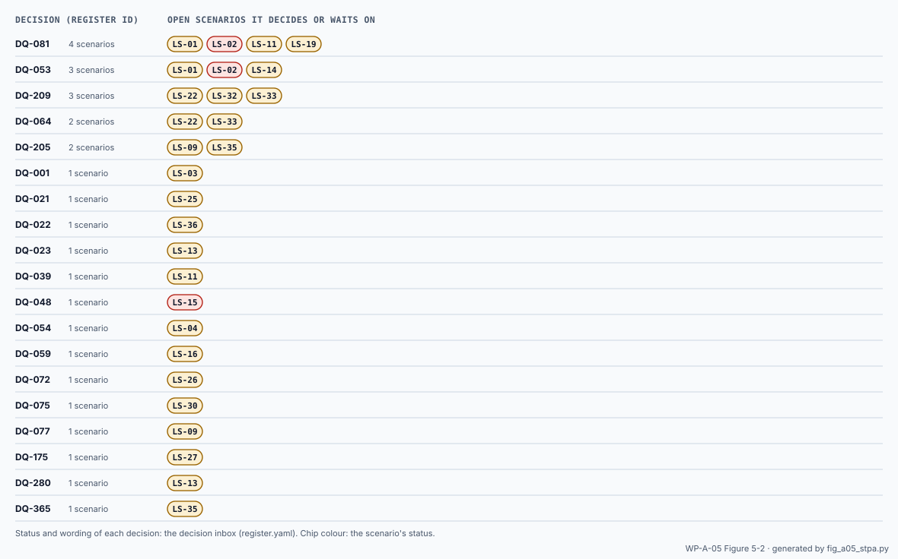

*Figure 5-2.* Lead decisions and the open scenarios they decide or wait on. Generated from [stpa-map.yaml](stpa-map.yaml); the [decision register](../01-management/decisions/register.yaml) is used only to check that each ID exists, so the figure does not change when an answer is recorded. Status and wording are in the decision inbox.

### 5.7 Scenario block diagrams (v0.6)

The scenarios with the most parts in them, drawn as block diagrams of the real parts. A red cross marks where the scenario breaks the chain; a dashed green block is a fix the lead has decided. Code references are those of the scenario rows above.

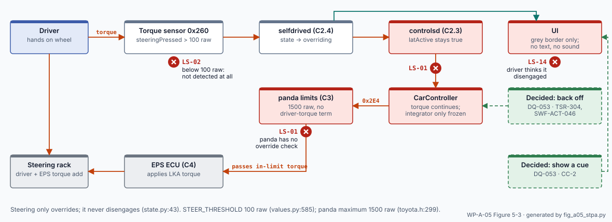

*Figure 5-3.* The driver steers against LionDriver (LS-01, LS-02, LS-14).

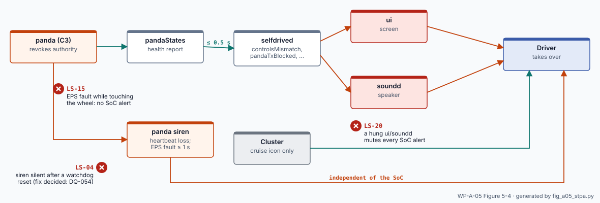

*Figure 5-4.* How a take-over request reaches the driver (LS-04, LS-15, LS-20).

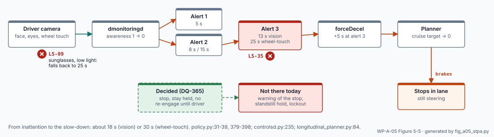

*Figure 5-5.* The driver stops responding (LS-09, LS-35).

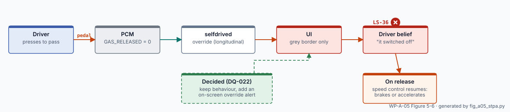

*Figure 5-6.* Accelerator override and release (LS-36).

Figures 5-3 to 5-6 are laid out in [`figures/fig_a05_stpa.py`](figures/fig_a05_stpa.py); every LS and DQ they name is checked against [stpa-map.yaml](stpa-map.yaml) and the register.

### 5.8 Scenario cards (v0.14)

One card per loss scenario of §5.1–§5.5, on four sheets by the controller of its first UCA (C1; C2; C2.x and C7; C3 to C6). Each card tells the scenario in three steps: the cause, what the controller then believes or never learns (the step is named after the scenario's causal-factor type: *Feedback*, *Belief*, *Algorithm*, *Effect* or *Then*), and the unsafe control action. Below it are a road scene, the Covered-by IDs of its row, and its status and open reason from [stpa-map.yaml](stpa-map.yaml). A covered scenario with a residual (a known gap, an open test, or no vehicle verification) shows that residual from its Status cell, and the build fails if a covered row names one the card leaves out. The steps are short paraphrases. Each quotes a phrase of its row (or of its UCA), and the build fails if that phrase changes, so a changed row needs its card redrawn. The scenes are schematic.

#### Driver

Sheets: **Driver** · [openpilot](#openpilot) · [Inside openpilot](#inside-openpilot-configuration-and-updates) · [Panda and car](#panda-harness-box-and-car)

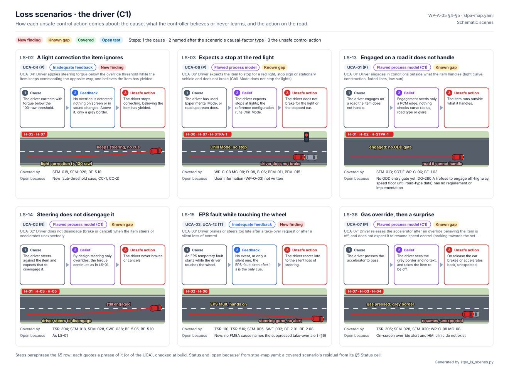

*Figure 5-7.* How the driver's unsafe control actions come about (controller C1).

#### openpilot

Sheets: [Driver](#driver) · **openpilot** · [Inside openpilot](#inside-openpilot-configuration-and-updates) · [Panda and car](#panda-harness-box-and-car)

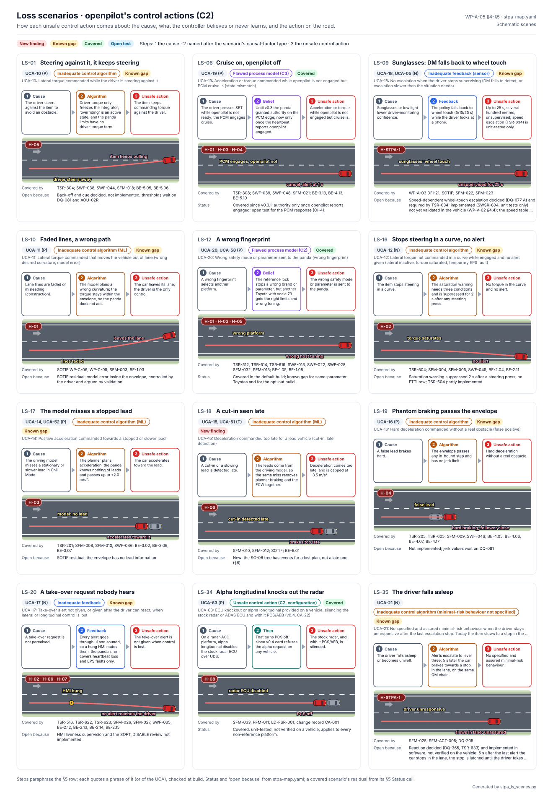

*Figure 5-8.* openpilot's control actions (controller C2).

#### Inside openpilot, configuration and updates

Sheets: [Driver](#driver) · [openpilot](#openpilot) · **Inside openpilot** · [Panda and car](#panda-harness-box-and-car)

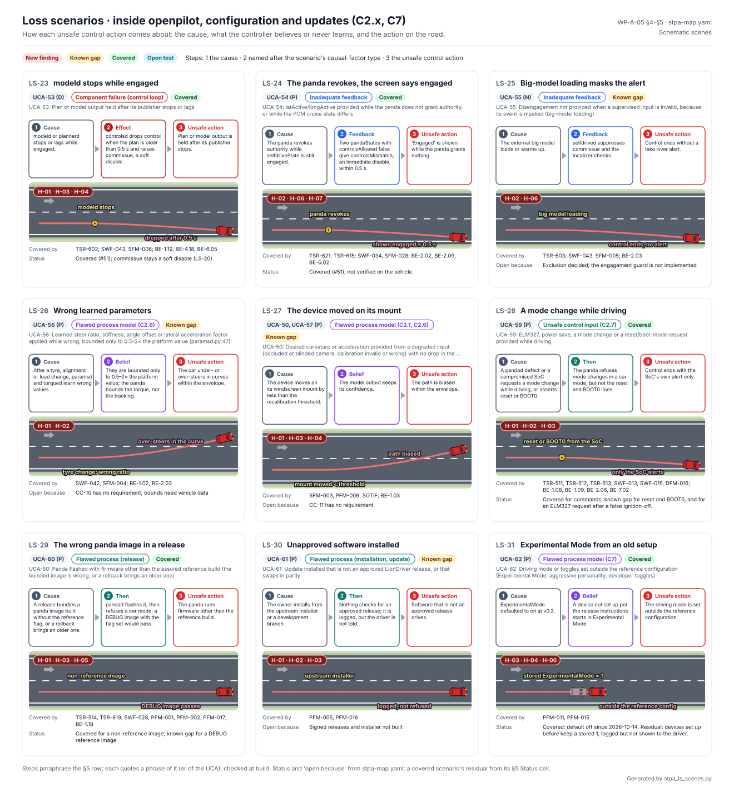

*Figure 5-9.* Inside openpilot, configuration and updates (sub-controllers C2.1 to C2.7, updater C7).

#### Panda, harness box and car

Sheets: [Driver](#driver) · [openpilot](#openpilot) · [Inside openpilot](#inside-openpilot-configuration-and-updates) · **Panda and car**

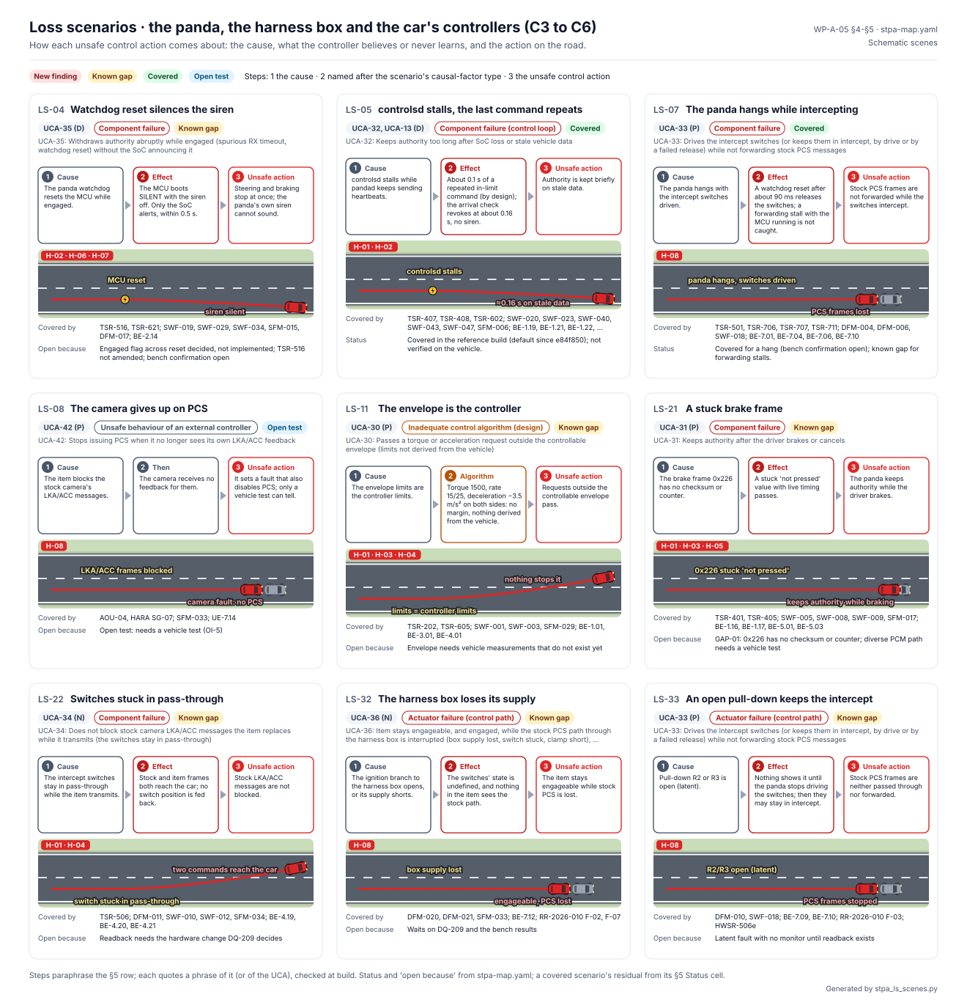

*Figure 5-10.* The panda, the harness box and the car's controllers (C3 to C6).

Figures 5-7 to 5-10 are generated by [`figures/stpa_ls_scenes.py`](figures/stpa_ls_scenes.py) through [`figures/fig_a05_stpa.py`](figures/fig_a05_stpa.py); do not edit them by hand.

## 6. Results

v0.5 result, from `fmea_lint.py --report`: *43 UCAs (41 with a loss scenario, 2 external); 36 loss scenarios (covered 10, known gap 22, new 3, open test 1)*. Every known gap is dispositioned in §5.6.

**Changes in v0.5 (the lead's answers and the known gaps):**
- **Decisions applied to the control structure.** DQ-053: CC-1 and CC-2 now say the item backs off on a steering override and shows it (OI-2 decided). DQ-054: OI-3 decided, an engaged flag survives a panda reset. DQ-022: the accelerator pauses speed control only, so a new driver UCA (UCA-07) and LS-36 record the surprise on release and the override alert it needs. DQ-205: the unresponsive driver becomes H-09 with an ASIL A goal; new UCA-21, LS-35 and CC-17 record that today's reaction (a stop in the lane 5 s after the last alert) is not specified, announced or assured.
- **Re-classified.** LS-26 and LS-27 were *new* because no FMEA cause covered them. The FMEA now has SFM-002.C4 and SWF-042.C2/C3 (learned parameters), and SFM-003.C4 (mount moved after calibration), so both are known gaps; their requirements (CC-10, CC-11) are still missing. LS-31 is covered by the Chill default (its status line already said so at v0.3.2; the map now agrees).
- **One question queued for the lead:** DQ-280 (off a highway: refuse to engage, or only warn). What the car does when the driver stays unresponsive is DQ-365, queued by the FTA session for the same goal; the STPA adds LS-35 to its sources instead of asking twice.

v0.4 result: *41 UCAs (39 with a loss scenario, 2 external); 34 loss scenarios (covered 9, known gap 19, new 5, open test 1)*. v0.3.1 had 39 UCAs and 31 scenarios (covered 8, known gap 17, new 5, open test 1); v0.3 had covered 7, new 6; LS-06 is covered since the heartbeat gate (OI-9).

**Changes in v0.4 (re-baseline to `1033d98` and the harness box):**
- **No scenario changed status from the code re-check.** Line references moved in `selfdrived.py`, `card.py`, `params_keys.h` and opendbc `safety.h`, and were corrected. LS-20 and LS-24 now credit TSR-615; LS-24 records the 0.3 s engagement grace, which keeps the 0.5 s bound; LS-06 describes the heartbeat gate as code rather than as a proposal.
- **The assured-configuration check (CA-008) identifies deviations but neither shows nor blocks them.** It helps LS-12, LS-30 and LS-31 after the fact; CC-14 ("enforced, or shown to the driver") stays open.
- **The harness box is not a relay (RR-2026-010).** The release default now rests on a pull-down and the stock camera path on the box supply, and nothing feeds the switch position back (§3.5). Two known gaps follow: LS-32 (box supply lost or a clamp diode short cuts the stock PCS path, with nothing in the item able to see it) and LS-33 (an open pull-down leaves the switches in intercept after a reset, which undoes the watchdog release credited in LS-07). Both wait on DQ-209, queued for the lead. LS-07 and LS-22 are rewritten for switches: no drop-out time, and no position readback.
- **New control action CA-22 (ECU knockout).** LS-34 is covered by the stock-AEB interlock (CA-001); it does not change the reference Corolla.

**Changes since v0.1, from the re-check against the current code (§5.1):**
- **LS-05 is now covered.** In the reference build, now the default, TX-arrival supervision revokes authority about 0.16 s after a `controlsd` stall.
- **LS-12 is covered in the default build.** The panda refuses a wrong mode or parameter, and pandad configures a car mode only on a reference panda.
- **LS-07 is covered for a hang.** The watchdog reset releases the intercept in about 90 ms (v0.4: through the pull-down, see LS-33).
- **LS-04 is partly mitigated.** The SoC now gives an immediate-disable alert within 0.5 s, but the SoC-independent siren still cannot sound after a reset (OI-3).
- **LS-06:** the alert now comes after 1 s instead of 6 s.
- **LS-02 corrected:** an above-threshold override does have a cue, a generic grey border.

**New findings (status *new* in [stpa-map.yaml](stpa-map.yaml); v0.5: LS-26 and LS-27 are known gaps now, see §5.6):**

| Scenario | Finding | Goes to |
|---|---|---|
| LS-02 | Steering corrections below the override threshold are never detected; above it the only cue is a grey border shared with other states | TSR-304 / OI-2; HMI requirements (CC-2) |
| LS-06 | The panda grants authority on the PCM rising edge whatever openpilot's state. For up to 3 s, until the engaged-mismatch check or the cancel acts, a QM host fault could actuate while the driver sees openpilot disengaged | WP-S-02 (gate the PCM edge on the heartbeat's engaged flag, or shorten the mismatch window); WP-A-04 SG-03/SG-04 G3.3.1/G4.6.1 **Closed in v0.3.1:** TSR-301 heartbeat condition, opendbc `9a13f60` |
| LS-15 | An EPS temporary fault that starts while the driver touches the wheel suppresses the take-over alert by design; the EPS-fault siren after 1 s is the only cue | SW FMEA (cause under SWF-032); TSR-516 timing |
| LS-18 | One model provides the path, the leads and the FCW, so one late detection removes braking and the warning together; the SG-06 tree models a lost plan, not a late one | WP-C-06; WP-A-03 DFI-26 |
| LS-26 | Learned vehicle parameters are bounded only to 0.5–2× the platform value; no FMEA cause, TSR or fault-tree event covers a learned value wrong for the vehicle | System and SW FMEA; WP-S-02 (CC-10) |
| LS-27 | Calibration that becomes wrong in operation has no FMEA row; PFM-009 covers only the installation tolerance | System FMEA; CC-11 |

**Corrections found by the cross-check.** The map check found that five UCAs named too few hazards: their scenarios need fault-tree events that sit in other goals' trees. UCA-02 now includes H-05, UCA-19 H-01 and H-04, UCA-31 H-01 and H-03, and UCA-59 H-01 and H-03. LS-25 showed that the masking event BE-1.20 lives only in the SG-01 tree. Since `controlsd` drops actuation on stale inputs, its effect is now an SG-02 loss without alert.

**Unchanged from v0.1:**
- **H-STPA-1** (unsupervised driver while engaged) is to be treated as foreseeable misuse in both SOTIF and the HARA (OI-1, decided 2026-10-14, WP-C-08 §6.1). Both sides are recorded: the HARA rates it as OS-17/OS-18 with hazard H-09 and SG-08, ASIL A (WP-C-03 v0.4).
- **Still open by design:** LS-08 (stock camera behaviour) and LS-09 (DM escalation times).
- **Most scenarios (32 of 36 at v0.5; 28 of 34 at v0.4; 25 of 31 at v0.3) are covered or known gaps** recorded by the HARA, the FSC/TSC, the FTA/FMEA, the DFA or WP-C-08. That gives those items independent support from a method that does not start from component failures.

## 7. Open items

| ID | Item | Owner | Needed by |
|---|---|---|---|
| OI-1 | Decided 2026-10-14 (decision register DQ-003): H-STPA-1 is foreseeable misuse in both SOTIF and the HARA, recorded in [WP-C-08](../02-concept/WP-C-08-driver-hmi-misuse-analysis.md) §6.1. HARA entry added in WP-C-03 v0.4 (H-09, SG-08); closed | Safety engineer | G1 |
| OI-2 | LS-01/LS-02: add a SoC-side counterpart to TSR-304 (stop or reduce commanded torque during a driver override) and decide how to treat sub-threshold driver torque (CC-1); add an override indication to the HMI requirements (CC-2). **Decided 2026-10-14 (DQ-053, option A): back off on override and show a cue.** Open: the SoC requirement and the HMI requirement in WP-S-02 (safety-concept session), SWF-ACT-046, TSR-304 implementation, thresholds (DQ-081) | Safety engineer | G2 |
| OI-3 | LS-04 (v0.3: the code shows it cannot; the SoC alert within 0.5 s is the only reaction): confirm on the bench whether the siren sounds after a watchdog reset while engaged; if not, keep an engagement flag across reset (e.g. backup SRAM or a reset-cause check) or amend TSR-516; specify the SoC alert time for this path against SG-02/SG-06. **Decided 2026-10-14 (DQ-054, option A): keep an engaged flag across the reset so the siren sounds.** Open: bench confirmation, the panda firmware change and the TSR-516 amendment | Safety engineer | G2 |
| OI-4 | LS-06: measure whether the PCM honours CANCEL_REQ and what it does with cruise engaged and no `0x343` from openpilot (hold, coast, fault). v0.3: the 1 s alert of TSR-308 is implemented | Safety engineer | G2 |
| OI-5 | LS-08: vehicle test that stock PCS stays available with the intercept switches driven and openpilot longitudinal active (also HARA, AOU-04) | Safety engineer | G2 |
| OI-6 | ~~LS-09: derive DM escalation times from speed and road type instead of fixed 5/15/25 s (DQ-077 open)~~ **Closed in v0.8:** DQ-077 A, required by TSR-634 (WP-S-02 v0.31); the speed table is in WP-C-08 §5.4 (v0.5) and the implementation is tracked against TSR-634 (implemented 2026-10-17, SWSR-634; validation open) | SOTIF lead | G3 |
| OI-7 | ~~Extend step 3 to the remaining control actions and to the ML-internal control loop~~ **Closed in v0.3** (§3.4, §4.6, §5.3) | Safety engineer | G3 |
| OI-8 | Independent (I1) review of this analysis | Safety manager | G2 |
| OI-9 | ~~LS-06: decide how to remove the window in which the panda grants authority on the PCM edge without openpilot (gate on the heartbeat's engaged flag, or a shorter mismatch time) and add the requirement to WP-S-02~~ **Closed 2026-10-14:** heartbeat gate chosen and implemented (TSR-301, opendbc `9a13f60`, `change-2026-10-14-pcm-engage-heartbeat-gate.md`); not verified on the vehicle | Safety engineer | G2 |
| OI-10 | LS-15, LS-26, LS-27: add the FMEA causes and failure modes these scenarios found (suppressed EPS-fault alert, learned-parameter bounds, calibration in operation). v0.5: LS-26 and LS-27 are covered by existing causes (SFM-002.C4, SWF-042.C2/C3, SFM-003.C4); LS-15 still has none | Safety engineer | G2 |
| OI-11 | LS-18: add late lead detection, and its common cause with the FCW, to WP-C-06 and WP-A-03 DFI-26 | SOTIF lead | G3 |
| OI-12 | LS-32, LS-33 (v0.4): settle the harness-box scenarios on the bench (DFM-ACT-014; WP-H-06 VS-HW-22, VS-HW-23), and re-write them once the lead answers DQ-209. Add box-supply loss, pull-down open and clamp short to the SG-07 fault tree (WP-A-04 G7.1/G7.3). The DFA has taken the box supply and the single pull-down as dependent-failure initiators (WP-A-03 v0.7 DFI-27, DFI-28; `dfa.yaml` DFI-27a, DFI-27b), both not controlled | Safety engineer | G2 |
| OI-13 | Credit the pending opendbc changes ATC-20 and ATC-26 (jherrodthomas/opendbc#15) in LS-04 and LS-24 once LionDriver pins them | Safety engineer | G2 |
| OI-14 | LS-35 (v0.5): ~~add H-09 and SG-08 to the HARA and a fault tree to WP-A-04, then map H-STPA-1 to it~~ done: WP-C-03 v0.4 (H-09, SG-08 ASIL A), WP-A-04 v1.3 §13 (SG-08 tree); `stpa-map.yaml` maps H-STPA-1 to SG-08 and links LS-09 and LS-35 to its events. ~~Specify the zero-awareness reaction once DQ-365 is answered~~ **Closed in v0.7:** DQ-365 A, stated in UCA-21, CC-17 and LS-35 and required by TSR-633; implementing it is tracked against TSR-633, and LS-35 stays a known gap until then | Safety engineer | G1 |
| OI-15 | LS-13 (v0.5): ~~specify the off-highway reaction once DQ-280 is answered~~ **Closed in v0.11:** DQ-280 A, stated in CC-18 and LS-13; the requirement and the entry gate are still to come (safety concept, implementation), and LS-13 stays a known gap until the gate exists. v0.13: the gate exists (#287); LS-13 stays a known gap for the reasons in §5.6 | Safety engineer | G1 |
| OI-16 | Name CAST, the STAMP incident-analysis method, as the Class A method of the field-monitoring process (`docs/safety/field-monitoring/PROCESS.md` §5.5 lists "STPA unsafe control actions" today), reusing Figures 3-1 to 3-5 as its control structure. Process owner's change; recommended here | Safety manager | G2 |
| OI-17 | ~~Bring Figure 3-1 under the generator~~ **Closed in v0.6:** generated by `figures/fig_a05_stpa.py`, same drawing, with a check that every CA and FB of §3.3 is drawn | Safety engineer | G2 |
