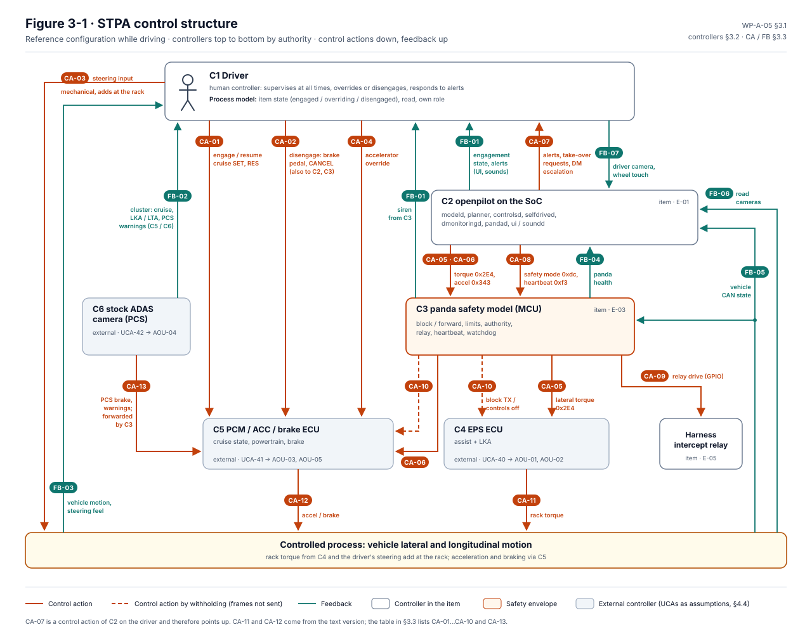

# WP-A-05 System-Theoretic Process Analysis (STPA)

| Field | Value |
|---|---|
| Work product | WP-A-05 System-theoretic process analysis (STPA) of the reference configuration |
| Standard reference | STPA Handbook (Leveson and Thomas, 2018), steps 1–4; ISO 21448:2022 §6–§7 (STPA as a method for hazards from functional insufficiencies and reasonably foreseeable misuse); ISO 26262-9:2018 §8 (supplementary system-level analysis); ISO/PAS 8800:2024 (control-structure view of the ML stack) |
| Version | 0.2 (§3.1 control-structure diagram redrawn as Figure 3-1; text version kept; 2026-10-13). 0.1 |
| Status | Draft (steps 1–3 complete for the control actions below; step 4 for the highest-priority UCAs only) |
| ASIL / scope | SG-01 (ASIL C ⚠) … SG-07; SOTIF (SH-) and misuse (WP-C-08) |
| Author | Claude (AI-assisted draft) |
| Reviewer(s) | TBD (I1) |
| Approver | Safety manager |
| Baseline | BL-003 code (panda `c2e5d93`, opendbc `5b5a4ba`, LionDriver `liondriver-dev` #32). The control structure is the same as at `8b8c6ae` |

## 1. Purpose and scope

The HARA ([WP-C-03](../02-concept/WP-C-03-hara.md)), the FTA/FMEA ([WP-A-04](WP-A-04-system-fta-fmea.md), [WP-W-04](../05-software/WP-W-04-software-safety-analysis.md), [`fmea/`](fmea/fmea-plan.md)) and the DFA ([WP-A-03](WP-A-03-dependent-failure-analysis.md)) start from component failures. STPA starts from the control structure. It finds hazards that arise when every component works as specified but the control actions are unsafe in context: wrong process models (the driver believes the item is off; openpilot believes the driver is attentive), missing or late feedback, conflicting controllers (driver, openpilot, EPS, PCM, stock ADAS), and unsafe interactions between modes.

Scope: the reference configuration (2020 Corolla LE, TSS2, comma 3X with integrated panda, openpilot longitudinal, Chill Mode per D-08) while driving on public roads. The vehicle ECUs (EPS, PCM, brake ECU, stock ADAS camera, instrument cluster) are in the control structure as controllers outside the item; their unsafe control actions are recorded as assumptions, not analysed.

Not in scope here: cybersecurity attackers (TARA, [WP-C-09](../02-concept/WP-C-09-tara.md)), installation and service processes (PFMEA), Experimental Mode (excluded from claims, D-08).

## 2. Step 1 — Purpose of the analysis

### 2.1 Losses

| ID | Loss |
|---|---|
| L-1 | Death or injury of vehicle occupants |
| L-2 | Death or injury of other road users (including vulnerable road users) |
| L-3 | Damage to the vehicle or to property outside it |
| L-4 | Loss of the stock vehicle safety functions the owner relies on (PCS/AEB, LTA/LDA) |

L-4 is a loss in its own right because the owner did not consent to losing them by installing the item, and it leads to L-1…L-3.

### 2.2 System-level hazards

The functional-safety hazards of the HARA are used as the system-level hazards, so that STPA results trace to the same safety goals. STPA adds one hazard that the HARA rates inside other hazards.

| ID | System-level hazard | Losses | Safety goal |
|---|---|---|---|
| H-01 | Unintended or excessive lateral motion | L-1, L-2, L-3 | SG-01 |
| H-02 | Unannounced loss or degradation of lateral control | L-1, L-2, L-3 | SG-02 |
| H-03 | Unintended acceleration | L-1, L-2, L-3 | SG-03 |
| H-04 | Unintended or excessive deceleration | L-1, L-2, L-3 | SG-04 |
| H-05 | Driver unable to override or disengage | L-1, L-2, L-3 | SG-05 |
| H-06 | Unannounced loss of longitudinal deceleration | L-1, L-2, L-3 | SG-06 |
| H-07 | Displayed system state differs from actual state (mode confusion) | L-1, L-2, L-3 | (rated within H-02, H-05, H-06) |
| H-08 | Suppression of the vehicle's stock pre-collision braking | L-4, L-1, L-2 | SG-07 |
| H-STPA-1 | The vehicle is driven with the item engaged while the driver is not supervising it | L-1, L-2, L-3 | none: SOTIF and misuse ([WP-C-08](../02-concept/WP-C-08-driver-hmi-misuse-analysis.md)); see OI-1 |

### 2.3 System-level constraints

| ID | Constraint | Hazard |
|---|---|---|
| SC-1 | Lateral motion caused by the item must stay within what the driver can control, and must be zero while the item is not engaged | H-01 |
| SC-2 | Any loss or degradation of lateral or longitudinal control while engaged must be announced to the driver in time to take over | H-02, H-06 |
| SC-3 | Positive acceleration must be commanded only while engaged and must stay within the controllable envelope | H-03 |
| SC-4 | Deceleration must stay within what the driver and following traffic can control | H-04 |
| SC-5 | The driver must be able to override or disengage at any time by braking, cancelling, steering or accelerating, and the item must yield at once | H-05 |
| SC-6 | The state the driver perceives (engaged, overriding, disengaged, Chill/Experimental) must match the actual state | H-07 |
| SC-7 | The stock PCS/AEB function must remain available and unaltered whether the item is engaged or not | H-08 |
| SC-8 | The item must be engaged only while the driver supervises it, and must reach a minimal-risk behaviour when the driver stops supervising | H-STPA-1 |

## 3. Step 2 — Control structure

### 3.1 Diagram



*Figure 3-1.* Controllers are drawn top to bottom by authority. Control actions (orange) point down, feedback (teal) points up, each tagged with its ID from §3.3; CA-07 (alerts to the driver) and FB-07 (driver camera) run against that direction by nature. Grey controllers are outside the item; their UCAs are recorded as assumptions (§4.4). Source: [`figures/fig-a05-3-1-stpa-control-structure.svg`](figures/fig-a05-3-1-stpa-control-structure.svg); change it together with §3.2 and §3.3.

<details><summary>Text version of Figure 3-1</summary>

```
                          ┌───────────────────────────────────────────────┐
                          │ C1 Driver                                     │
                          │ process model: item state, road, own role     │
                          └──┬─────────┬─────────┬──────────┬─────────▲───┘
            CA-01 engage /    │ CA-03    │ CA-04   │ CA-02     │         │ FB-01 HMI (UI, sounds,
            resume (buttons)  │ steer    │ pedals  │ brake /   │         │ siren), FB-02 cluster,
                              │ torque   │         │ cancel    │         │ FB-03 vehicle motion
             ┌────────────────▼──┐      │         │           │         │
             │ C5 PCM / ACC      │◄─────┼─────────┘           │         │
             │ (cruise state,    │      │                     │         │
             │  powertrain, brk) │      │      FB-05 CAN (cruise, brake, gas, torque, speed)
             └─┬────────▲────────┘      │                     │         │
   CA-12 accel │        │ CA-06 accel   │                     │         │
   / brake     │        │ (0x343)       │                     │         │
               │  ┌─────┴──────────────────────────────┐      │  ┌──────┴───────────────────────┐
               │  │ C3 panda safety model (MCU)        │◄─────┼──┤ C2 openpilot on the SoC       │
               │  │ block/forward, limits, authority,  │ CA-05│  │ modeld, planner, controlsd,   │
               │  │ relay, heartbeat, watchdog         │ CA-06│  │ selfdrived, dmonitoringd,     │
               │  └─┬───────┬──────────────▲───────────┘ CA-08│  │ pandad, ui/soundd             │
               │    │CA-09  │CA-10         │ FB-04 panda       │  └──▲────────────▲───────────────┘
               │    │relay  │ TX block /   │ state (health)    │     │ FB-06 road  │ FB-07 driver
               │    │       │ controls off │                   │     │ cameras     │ camera (DM)
             ┌─▼────▼───────▼──┐   ┌────────┴───────┐         │
             │ C4 EPS ECU      │   │ C6 stock ADAS  │ CA-13 PCS brake / LKA (forwarded through C3)
             │ (assist + LKA)  │   │ camera (PCS)   │──────────────► C5
             └────────┬────────┘   └────────────────┘
                      ▼ CA-11 rack torque          CA-03 steering torque (mechanical, adds at the rack)
             ┌──────────────────────────────────────────────────────────┐
             │ Controlled process: vehicle lateral and longitudinal motion │
             └──────────────────────────────────────────────────────────┘
```

</details>

### 3.2 Controllers, responsibilities and process models

| ID | Controller | Responsibilities (relevant to the losses) | Process-model variables that matter |
|---|---|---|---|
| C1 | Driver | Supervise at all times; engage only in suitable conditions; override or disengage when the item misbehaves; respond to alerts | Item engaged / overriding / disengaged; lateral vs longitudinal authority; Chill vs Experimental; what the item can handle (curves, lights, stopped vehicles); whether stock AEB is available |
| C2 | openpilot (SoC) | Plan and command lateral torque and acceleration within the envelope; detect faults and driver inattention; alert; disengage on driver input | Driver attentive; driver overriding; vehicle state (speed, cruise, brake, gas); own health; panda state; model confidence |
| C3 | panda safety model | Pass only commands within limits and only while authority is granted; withdraw authority on brake, cruise off, stale data, lost SoC; keep stock PCS path | controls_allowed; cruise engaged; brake/gas pressed; message freshness; SoC alive; relay state; safety mode |
| C4 | EPS ECU (external) | Apply driver assist; apply LKA torque within its own limits; fault out LKA on implausible requests | LKA request valid; driver torque |
| C5 | PCM / ACC / brake ECU (external) | Hold cruise state; execute acceleration requests within its own limits; cancel cruise on brake | Cruise engaged; brake pedal; requested acceleration |
| C6 | Stock ADAS camera (external) | Detect collision risk; command PCS braking and warnings | Obstacles; own state (it keeps running while its LKA/ACC messages are blocked) |

### 3.3 Control actions and feedback

| ID | Control action | From → to | Channel |
|---|---|---|---|
| CA-01 | Engage / resume (cruise SET, RES) | C1 → C5, followed by C2 and C3 | Cruise buttons; PCM cruise state on `0x1D2`, `pcmCruise` (openpilot state tied to PCM cruise) |
| CA-02 | Disengage (brake pedal, CANCEL) | C1 → C5, C2, C3 | Pedal / button; `0x226`, `0x1D2` |
| CA-03 | Steering input | C1 → vehicle, sensed by C2 and C3 | Mechanical; `0x260` driver torque (`steeringPressed` above 100 raw) |
| CA-04 | Accelerator input (override) | C1 → C5, sensed by C2 and C3 | Pedal; GAS_RELEASED on `0x1D2` |
| CA-05 | Lateral torque request | C2 → C3 → C4 | `0x2E4` STEERING_LKA (torque, STEER_REQUEST) |
| CA-06 | Acceleration request (incl. cancel request) | C2 → C3 → C5 | `0x343` ACC_CONTROL |
| CA-07 | Alerts and take-over requests; DM escalation | C2 → C1 | UI, soundd; panda siren on SoC loss |
| CA-08 | Set safety mode; heartbeat with engaged flag | C2 (pandad) → C3 | SPI `0xdc`, `0xf3` |
| CA-09 | Drive the intercept relay | C3 → harness | GPIO |
| CA-10 | Block TX / withdraw controls_allowed | C3 internal → C4, C5 | Frames not sent |
| CA-13 | PCS brake request and warnings | C6 → C5 (forwarded by C3) | `0x283`, `0x344`, `0x411` |

| ID | Feedback | From → to |
|---|---|---|
| FB-01 | Engagement state, alerts, Chill/Experimental indicator | C2 → C1 (UI, sounds); siren from C3 |
| FB-02 | Cruise indicator, LKA/LTA indicator, PCS warnings | Cluster (C5/C6) → C1 |
| FB-03 | Vehicle motion, steering-wheel feel | Vehicle → C1 |
| FB-04 | Panda health (mode, controls_allowed, faults, watchdog reset, refused requests) | C3 → C2 |
| FB-05 | Vehicle CAN state (cruise, brake, gas, steering torque, wheel speeds, EPS status) | Vehicle → C2, C3 |
| FB-06 | Road cameras, model outputs | → C2 |
| FB-07 | Driver camera (face, eyes, phone) and wheel touch | C1 → C2 |

## 4. Step 3 — Unsafe control actions

Types: **N** not provided causes hazard; **P** provided causes hazard; **T** too early, too late or wrong order; **D** stopped too soon or applied too long.

### 4.1 Driver (C1)

| UCA | Type | Unsafe control action | Hazards |
|---|---|---|---|
| UCA-01 | P | Driver engages in conditions outside what the item handles (tight curve, construction, faded lines, low sun) | H-01, H-02, H-STPA-1 |
| UCA-02 | N | Driver does not disengage (brake or cancel) when the item steers or accelerates unexpectedly | H-01, H-03 |
| UCA-03 | T | Driver brakes or steers too late after a take-over request or after a silent loss of control | H-02, H-06 |
| UCA-04 | P | Driver applies steering torque below the override threshold while the item keeps commanding the opposite way, and believes the item has yielded | H-05, H-07 |
| UCA-05 | N | Driver does not supervise (looks away, hands off for long periods) while engaged | H-STPA-1 |
| UCA-06 | P | Driver expects the item to stop for a red light, stop sign or stationary vehicle and does not brake (Chill Mode does not stop for lights) | H-06, H-STPA-1, H-07 |

### 4.2 openpilot (C2)

| UCA | Type | Unsafe control action | Hazards |
|---|---|---|---|
| UCA-10 | P | Lateral torque commanded while the driver is steering against it | H-05 |
| UCA-11 | P | Lateral torque commanded that moves the vehicle out of lane (wrong desired curvature, model error) | H-01 |
| UCA-12 | N | Lateral torque not commanded in a curve while engaged and no alert given (lateral inactive, torque saturated, temporary EPS fault) | H-02 |
| UCA-13 | D | Lateral torque request held at a stale value after the SoC stalls (frames still sent) | H-01 |
| UCA-14 | P | Positive acceleration commanded towards a stopped or slower lead | H-03 |
| UCA-15 | T | Deceleration commanded too late for a lead vehicle (cut-in, late detection) | H-06 |
| UCA-16 | P | Hard deceleration commanded without a real obstacle (false positive) | H-04 |
| UCA-17 | N | Take-over alert not given, or given after the driver can react, when lateral or longitudinal control is lost | H-02, H-06, H-07 |
| UCA-18 | N | No escalation when the driver stops supervising (DM fails to detect, or escalation slower than the situation needs) | H-STPA-1 |
| UCA-19 | P | Acceleration or torque commanded while openpilot is not engaged but PCM cruise is (state mismatch) | H-03, H-07 |
| UCA-20 | P | Wrong safety mode or parameter sent to the panda (wrong fingerprint) | H-01, H-03, H-05 |

### 4.3 panda safety model (C3)

| UCA | Type | Unsafe control action | Hazards |
|---|---|---|---|
| UCA-30 | P | Passes a torque or acceleration request outside the controllable envelope (limits not derived from the vehicle) | H-01, H-03, H-04 |
| UCA-31 | P | Keeps authority after the driver brakes or cancels | H-05 |
| UCA-32 | D | Keeps authority too long after SoC loss or stale vehicle data | H-01, H-02 |
| UCA-33 | P | Drives the relay (or keeps it driven) while not forwarding stock PCS messages | H-08 |
| UCA-34 | N | Does not block stock camera LKA/ACC messages the item replaces while it transmits | H-01, H-04 |
| UCA-35 | D | Withdraws authority abruptly while engaged (spurious RX timeout, watchdog reset) without the SoC announcing it | H-02, H-06, H-07 |

### 4.4 External controllers (recorded as assumptions)

| UCA | Controller | Unsafe control action | Hazards | Assumption |
|---|---|---|---|---|
| UCA-40 | C4 EPS | Applies an LKA request beyond what the driver can counter, or drops LKA without the cluster showing it | H-01, H-02 | AOU-01, AOU-02 |
| UCA-41 | C5 PCM | Executes an acceleration request beyond its own limits; does not cancel cruise on brake | H-03, H-05 | AOU-03, AOU-05 |
| UCA-42 | C6 camera | Stops issuing PCS when it no longer sees its own LKA/ACC feedback | H-08 | AOU-04 |

### 4.5 Controller constraints

| ID | Constraint | From UCA |
|---|---|---|
| CC-1 | openpilot shall stop commanding lateral torque, or limit it to a level the driver overrides without effort, while the driver applies opposing torque | UCA-10, UCA-04 |
| CC-2 | The HMI shall show lateral and longitudinal authority separately, including the overriding state, and the active driving personality/mode | UCA-04, UCA-06, UCA-19 |
| CC-3 | openpilot shall announce every loss of lateral or longitudinal capability while engaged within the take-over budget, including losses that start in the panda | UCA-12, UCA-17, UCA-35 |
| CC-4 | openpilot shall not command actuation when its engagement state differs from the PCM cruise state, and shall cancel cruise when they differ | UCA-19 |
| CC-5 | The panda shall withdraw authority within the FTTI after SoC loss or stale data, and the SoC shall detect a panda reset and alert | UCA-32, UCA-35, UCA-13 |
| CC-6 | Driver monitoring shall escalate fast enough for the current speed and road, and shall not allow engagement while the driver is not supervising | UCA-05, UCA-18, UCA-01 |
| CC-7 | User information shall state what the item does not handle in Chill Mode (lights, stop signs, stopped vehicles at speed, sharp curves) | UCA-01, UCA-06 |
| CC-8 | The relay shall be driven only while the panda forwards every non-replaced stock message, and released otherwise | UCA-33 |

## 5. Step 4 — Loss scenarios (priority UCAs)

Priority: UCAs that the component-failure analyses do not already cover, and UCAs of the panda that the ASIL claims rest on. Each scenario names where it is covered today, or **new**.

| ID | UCA | Scenario | Type | Covered by | Status |
|---|---|---|---|---|---|
| LS-01 | UCA-10 | The driver steers against the item to avoid an obstacle. `steeringPressed` (driver torque above 100 raw) only freezes the torque integrator (`latcontrol_torque.py:92`); `latActive` stays true (`controlsd.py:100`), so the SoC keeps commanding torque up to the panda limit and the driver fights the item for the whole manoeuvre | Inadequate control algorithm | FSR-05.03, TSR-304 (envelope reduces opposing torque); AOU-02 | Known gap: TSR-304 not implemented (WP-W-04 SWF-07, GAP-02). STPA adds that the SoC side keeps commanding too (OI-2) |
| LS-02 | UCA-04 | The driver applies corrective torque below the 100-raw threshold. No override is detected, so the item neither yields nor shows anything; the driver concludes it has yielded or will yield. Above the threshold `steerOverride` exists but has no HMI indication (WP-C-08 §4) | Flawed process model (driver) via missing feedback | WP-C-08 (steerOverride row, no indication) | **New:** the sub-threshold case cannot be indicated at all (CC-1, CC-2) |
| LS-03 | UCA-06 | The driver has used Experimental Mode before (it was the upstream default), or reads upstream docs, and expects stops at lights; the reference configuration runs Chill Mode (D-08) | Flawed process model | WP-C-08 MC-09; D-08, B-06 | Covered; depends on B-06 and user information (CC-7) |
| LS-04 | UCA-35 | The panda watchdog resets the MCU while engaged (SW FMEA SWF-019). Steering and ACC stop. The MCU restarts in SILENT with its engagement memory cleared, so the SoC-independent siren of TSR-516(b) is unlikely to sound; only the SoC alert added in #30 (`watchdogReset`) remains | Feedback missing after the controller restarts | TSR-516, SWF-019, panda#6 | **New:** TSR-516(b) cannot be met across an MCU reset as designed; confirm on the bench (OI-3) |
| LS-05 | UCA-32, UCA-13 | `controlsd` stalls but `pandad` keeps sending heartbeats with `engaged=1`; the last frames repeat or stop; the panda keeps authority until the heartbeat logic sees an engaged mismatch (about 3 s). Heartbeat loss itself is caught in 0.3 s since panda#7, but the heartbeat only shows that pandad is alive | Feedback (process model of C3 not updated) | WP-W-04 SWF-25, SWF-28; SW FMEA SWF-014.C2 | Covered as a gap (TSR-307a, SWSR-408/409) |
| LS-06 | UCA-19 | The driver presses SET while openpilot is not ready; the PCM engages cruise but openpilot stays disengaged. With openpilot longitudinal the stock ACC commands are blocked, so the PCM shows cruise on with no acceleration command until `cruiseMismatch` after 6 s (`selfdrived.py:423-426`) | Conflicting controllers | FSR-05.06, TSR-308 (≤ 1 s) | Known gap: TSR-308 not met (GAP-19); PCM behaviour without `0x343` unknown (OI-4) |
| LS-07 | UCA-33 | The panda hangs with the relay driven; stock PCS frames no longer reach the car | Component failure (control action not executed) | DFMEA DFM-004, watchdog at BL-002 | Covered (watchdog); relay drive-circuit behaviour unconfirmed (DFM-ACT-003) |
| LS-08 | UCA-42 | The stock camera receives no feedback for its blocked LKA/ACC messages and sets a fault that also disables PCS | Unsafe behaviour of an external controller | AOU-04, HARA SG-07 | Open: needs a vehicle test (OI-5) |
| LS-09 | UCA-18, UCA-05 | Sunglasses or low light lower DM confidence; the policy falls back to wheel touch (5/15/25 s) while the driver is looking at a phone; at motorway speed 25 s is several hundred metres unsupervised | Inadequate feedback (sensor) | WP-A-03 DFI-21; SOTIF | Covered under SOTIF; escalation-time budget not derived (OI-6) |
| LS-10 | UCA-11 | Lane lines are faded or misleading (construction); the model plans a wrong curvature; torque stays within the envelope, so the panda does not act; the driver is the only control | Inadequate control algorithm (ML) | SOTIF WP-C-06, WP-C-05 | Covered under SOTIF |
| LS-11 | UCA-30 | Envelope limits equal the controller limits (copied constants), so a wrong value is not caught by either | Inadequate control algorithm (design) | WP-A-03 DFI-08; SW FMEA SWF-001.C1 | Covered as a gap |
| LS-12 | UCA-20 | A wrong fingerprint selects another platform; in a non-reference build the panda accepts any mode and parameter | Flawed process model (C2) | SW FMEA SWF-013.C2; mode lock (reference build) | Covered as a gap until the reference build is the only build (SWF-ACT-009) |

## 6. Results

- **Most scenarios confirm known gaps.** LS-01, LS-03, LS-05, LS-06, LS-07, LS-11 and LS-12 reach requirements or gaps that the HARA, FSC/TSC, WP-C-08, the FMEAs or the DFA already record (TSR-304, TSR-308, MC-09, SWF-014, DFM-004, DFI-08, SWF-013.C2). That gives those items independent support from a method that does not start from component failures.
- **New findings:**
  - LS-02: steering corrections below the override threshold are never detected, so no HMI can show them.
  - LS-04: the SoC-independent siren (TSR-516(b)) cannot sound after a watchdog reset, because the reset clears the panda's engagement memory.
- **Hazard not rated by the HARA:** H-STPA-1 (unsupervised driver while engaged). The HARA treats driver-monitoring failure as a latent fault of a measure that controllability relies on (WP-C-04 §7). STPA shows it as a hazard with its own control loop (C2 → C1 → C2), which matters for SOTIF and for UL 4600-style arguments.
- **Open by design:** LS-08 (stock camera behaviour with its messages blocked) and LS-09 (DM escalation times) need vehicle tests and SOTIF work.

## 7. Open items

| ID | Item | Owner | Needed by |
|---|---|---|---|
| OI-1 | Decide whether H-STPA-1 becomes a hazard in WP-C-03 / WP-C-05 or stays a SOTIF hazard; record in WP-C-08 | Safety engineer | G1 |
| OI-2 | LS-01/LS-02: add a SoC-side counterpart to TSR-304 (stop or reduce commanded torque during a driver override) and decide how to treat sub-threshold driver torque (CC-1); add an override indication to the HMI requirements (CC-2) | Safety engineer | G2 |
| OI-3 | LS-04: confirm on the bench whether the siren sounds after a watchdog reset while engaged; if not, keep an engagement flag across reset (e.g. backup SRAM or a reset-cause check) or amend TSR-516; specify the SoC alert time for this path against SG-02/SG-06 | Safety engineer | G2 |
| OI-4 | LS-06: measure what the PCM does with cruise engaged and no `0x343` from openpilot (hold, coast, fault); input to closing TSR-308 (1 s) | Safety engineer | G2 |
| OI-5 | LS-08: vehicle test that stock PCS stays available with the relay driven and openpilot longitudinal active (also HARA, AOU-04) | Safety engineer | G2 |
| OI-6 | LS-09: derive DM escalation times from speed and road type instead of fixed 5/15/25 s | SOTIF lead | G3 |
| OI-7 | Extend step 3 to the remaining control actions (pandad configuration requests, calibration, updates) and to the ML-internal control loop (model → planner → controller, ISO/PAS 8800) | Safety engineer | G3 |
| OI-8 | Independent (I1) review of this analysis | Safety manager | G2 |
