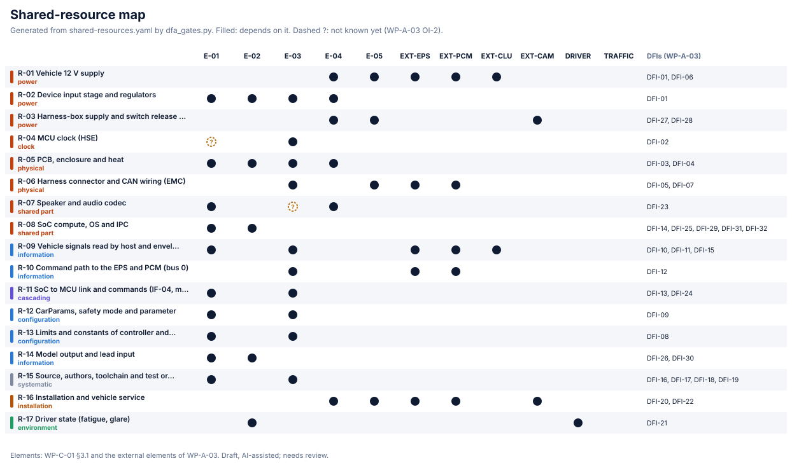

# AND gates, independence claims and shared resources

Generated by [`dfa_gates.py`](dfa_gates.py) from the fault trees of [WP-A-04](../WP-A-04-system-fta-fmea.md), the classification in [`and-gates.yaml`](and-gates.yaml), the map in [`shared-resources.yaml`](shared-resources.yaml) and the DFIs and claims of [WP-A-03](../WP-A-03-dependent-failure-analysis.md); do not edit. Findings are input to the WP-A-03 review, not a verdict. Draft, AI-assisted: the classification and the map need review.

Every AND gate claims that its inputs do not fail together. A gate whose inputs lie in different elements is an independence claim; the resources those elements share are where a dependent failure can start. DFI numbers are those of WP-A-03, which the decomposition-level DFA `fmea/analyses/dfa.yaml` also uses.

## Summary

55 AND gates: 47 across elements, 3 within one element, 3 that draw a common cause as one event, 2 with a driving situation.

| Finding | Count |
|---|---|
| Gates across elements with no independence claim | 6 |
| Shared resources not analysed under the gate's claim (claim, resource) | 15 |
| Shared resources with an unknown dependence | 2 |

## Findings

### Gates across elements with no independence claim

| Gate | Goal | Inputs | Note |
|---|---|---|---|
| G3.1 | SG-03 | G3.1.1 → E-01, E-03 UE-3.05 → EXT-PCM | the PCM's own acceleration bound (AOU-05R) has no independence claim; IC-02 covers the EPS only |
| G3.4 | SG-03 | BE-3.11 → EXT-PCM, E-03 UE-3.12 → EXT-PCM | a stuck PCM gas signal and the PCM's pedal arbitration; no claim covers the PCM |
| G4.1 | SG-04 | G4.1.1 → E-01, E-03 UE-4.04 → EXT-PCM | as G3.1, for deceleration |
| G4.7 | SG-04 | BE-4.14 → E-03 UE-4.15 → EXT-PCM | as G3.1 |
| G5.2.1 | SG-05 | UE-5.13 → EXT-PCM BE-5.12 → E-03 | as G3.1 |
| G8.1.1 | SG-08 | BE-8.03 → E-04, E-02 G8.1.2 → E-01 | WP-A-03 covers SG-01…SG-07; no claim for the driver-monitoring chain of SG-08 (DFI-21 is related) |

### Shared resources not analysed under the gate's claim

Two inputs of the gate that lie in different elements share the resource, but none of its DFIs is listed under the gate's claim in WP-A-03 §5 or tagged with it in §4.

| Claim | Resource | Its DFIs | Gates |
|---|---|---|---|
| IC-01 | R-10 Command path to the EPS and PCM (bus 0) | DFI-12 | G3.6, G4.2 |
| IC-02 | R-06 Harness connector and CAN wiring (EMC) | DFI-05, DFI-07 | G1.1 |
| IC-04 | R-01 Vehicle 12 V supply | DFI-01, DFI-06 | G-LATCUE, G-LONCUE |
| IC-04 | R-06 Harness connector and CAN wiring (EMC) | DFI-05, DFI-07 | G-LATCUE, G-LONCUE |
| IC-04 | R-10 Command path to the EPS and PCM (bus 0) | DFI-12 | G-LATCUE, G-LONCUE |
| IC-04 | R-16 Installation and vehicle service | DFI-20, DFI-22 | G-LATCUE, G-LONCUE |
| IC-05 | R-09 Vehicle signals read by host and envelope (torque, cruise, brake, gas, speed) | DFI-10, DFI-11, DFI-15 | G7.5 |
| IC-05 | R-10 Command path to the EPS and PCM (bus 0) | DFI-12 | G7.5 |
| IC-06 | R-05 PCB, enclosure and heat | DFI-03, DFI-04 | G2.1, G2.2, G2.3, G2.4, G2.5, G2.6, G2.8, G6.1, G6.2, G6.3, G6.4, G6.6, G6.7, G6.9 |
| IC-06 | R-06 Harness connector and CAN wiring (EMC) | DFI-05, DFI-07 | G2.1, G6.3 |
| IC-06 | R-09 Vehicle signals read by host and envelope (torque, cruise, brake, gas, speed) | DFI-10, DFI-11, DFI-15 | G2.1, G2.2, G2.3, G2.4, G2.5, G2.6, G2.8, G6.1, G6.2, G6.3, G6.4, G6.6, G6.7, G6.9 |
| IC-06 | R-10 Command path to the EPS and PCM (bus 0) | DFI-12 | G2.1, G6.3 |
| IC-06 | R-12 CarParams, safety mode and parameter | DFI-09 | G2.1, G2.2, G2.3, G2.4, G2.5, G2.6, G2.8, G6.1, G6.2, G6.3, G6.4, G6.6, G6.7, G6.9 |
| IC-06 | R-13 Limits and constants of controller and envelope | DFI-08 | G2.1, G2.2, G2.3, G2.4, G2.5, G2.6, G2.8, G6.1, G6.2, G6.3, G6.4, G6.6, G6.7, G6.9 |
| IC-06 | R-16 Installation and vehicle service | DFI-20, DFI-22 | G2.1, G6.3 |

### Shared resources with an unknown dependence

| Resource | Unknown for | Gates it may reach |
|---|---|---|
| R-04 MCU clock (HSE) | E-01 | G1.1.1.a, G1.2.1, G1.2.2, G1.3, G3.1.1.a, G3.6, G3.2, G3.3, G3.5, G2.1, G2.1.2, G2.2, G2.3, G2.4, G2.5, G2.6, G2.8, G4.1.1.a, G4.2, G4.6, G4.9.1, G5.3, G6.1, G6.2, G6.3, G6.4, G6.5, G6.6, G6.7, G6.9, G7.2, G7.6 |
| R-07 Speaker and audio codec | E-03 | G1.1.1.a, G1.2.1, G1.2.2, G1.3, G3.1.1.a, G3.6, G3.2, G3.3, G3.5, G2.1.2, G4.1.1.a, G4.2, G4.6, G4.9.1, G5.3, G7.2, G7.6 |

## Shared-resource map

| ID | Resource | Category | Elements | Unknown | DFIs |
|---|---|---|---|---|---|
| R-01 | Vehicle 12 V supply | power | E-04, E-05, EXT-EPS, EXT-PCM, EXT-CLU | — | DFI-01, DFI-06 |
| R-02 | Device input stage and regulators | power | E-01, E-02, E-03, E-04 | — | DFI-01 |
| R-03 | Harness-box supply and switch release default | power | E-04, E-05, EXT-CAM | — | DFI-27, DFI-28 |
| R-04 | MCU clock (HSE) | clock | E-03 | E-01 | DFI-02 |
| R-05 | PCB, enclosure and heat | physical | E-01, E-02, E-03, E-04 | — | DFI-03, DFI-04 |
| R-06 | Harness connector and CAN wiring (EMC) | physical | E-03, E-05, EXT-EPS, EXT-PCM | — | DFI-05, DFI-07 |
| R-07 | Speaker and audio codec | shared part | E-01, E-04 | E-03 | DFI-23 |
| R-08 | SoC compute, OS and IPC | shared part | E-01, E-02 | — | DFI-14, DFI-25, DFI-29, DFI-31, DFI-32 |
| R-09 | Vehicle signals read by host and envelope (torque, cruise, brake, gas, speed) | information | E-01, E-03, EXT-CLU, EXT-EPS, EXT-PCM | — | DFI-10, DFI-11, DFI-15 |
| R-10 | Command path to the EPS and PCM (bus 0) | information | E-03, EXT-EPS, EXT-PCM | — | DFI-12 |
| R-11 | SoC to MCU link and commands (IF-04, mode, reset, flash) | cascading | E-01, E-03 | — | DFI-13, DFI-24, DFI-34, DFI-35 |
| R-12 | CarParams, safety mode and parameter | configuration | E-01, E-03 | — | DFI-09 |
| R-13 | Limits and constants of controller and envelope | configuration | E-01, E-03 | — | DFI-08 |
| R-14 | Model output and lead input | information | E-01, E-02 | — | DFI-26, DFI-30 |
| R-15 | Source, authors, toolchain and test oracle | systematic | E-01, E-03 | — | DFI-16, DFI-17, DFI-18, DFI-19, DFI-36 |
| R-16 | Installation and vehicle service | installation | E-04, E-05, EXT-EPS, EXT-PCM, EXT-CAM | — | DFI-20, DFI-22 |
| R-17 | Driver state (fatigue, glare) | environment | E-02, DRIVER | — | DFI-21 |

## AND gates

Shared: resources that reach two inputs lying in different elements (? = only through an unknown dependence). DFIs: those of the shared resources that WP-A-03 lists under the claim.

| Gate | Goal | Kind | Claim | Inputs → elements | Shared | DFIs under the claim | Note |
|---|---|---|---|---|---|---|---|
| G1.1 | SG-01 | independence | IC-02 | G1.1.1 → E-01, E-03 UE-1.11 → EXT-EPS | R-06, R-09, R-10 | DFI-11, DFI-12 |  |
| G1.1.1.a | SG-01 | independence | IC-01 | G-SoC → E-01, E-02 G-ENV → E-03 | R-02, R-04?, R-05, R-07?, R-09, R-11, R-12, R-13, R-15 | DFI-01, DFI-02, DFI-03, DFI-04, DFI-08, DFI-09, DFI-10, DFI-13, DFI-16, DFI-17, DFI-18, DFI-24, DFI-34, DFI-35, DFI-36 |  |
| G1.2.1 | SG-01 | independence | IC-01 | G1.2.1.a → E-03 BE-1.15 → E-01 | R-02, R-04?, R-05, R-07?, R-09, R-11, R-12, R-13, R-15 | DFI-01, DFI-02, DFI-03, DFI-04, DFI-08, DFI-09, DFI-10, DFI-13, DFI-16, DFI-17, DFI-18, DFI-24, DFI-34, DFI-35, DFI-36 |  |
| G1.2.2 | SG-01 | independence | IC-01 | G1.2.2.a → E-03 BE-1.15 → E-01 | R-02, R-04?, R-05, R-07?, R-09, R-11, R-12, R-13, R-15 | DFI-01, DFI-02, DFI-03, DFI-04, DFI-08, DFI-09, DFI-10, DFI-13, DFI-16, DFI-17, DFI-18, DFI-24, DFI-34, DFI-35, DFI-36 |  |
| G1.3 | SG-01 | independence | IC-01 | G1.3.1 → E-01 G1.3.2 → E-03 | R-02, R-04?, R-05, R-07?, R-09, R-11, R-12, R-13, R-15 | DFI-01, DFI-02, DFI-03, DFI-04, DFI-08, DFI-09, DFI-10, DFI-13, DFI-16, DFI-17, DFI-18, DFI-24, DFI-34, DFI-35, DFI-36 |  |
| G1.3.2 | SG-01 | same element | — | BE-1.22 → E-03 BE-1.23 → E-03 | — | — | two envelope design gaps (BE-1.23 by design) |
| G1.4 | SG-01 | independence | IC-05 | G1.4.1 → E-05, EXT-CAM BE-4.21 → E-03 | R-06 | DFI-05 |  |
| G3.1 | SG-03 | independence | **none** | G3.1.1 → E-01, E-03 UE-3.05 → EXT-PCM | R-06, R-09, R-10 | — | the PCM's own acceleration bound (AOU-05R) has no independence claim; IC-02 covers the EPS only |
| G3.1.1.a | SG-03 | independence | IC-01 | G3.1.1.b → E-01, E-02 G-LENV → E-03 | R-02, R-04?, R-05, R-07?, R-09, R-11, R-12, R-13, R-15 | DFI-01, DFI-02, DFI-03, DFI-04, DFI-08, DFI-09, DFI-10, DFI-13, DFI-16, DFI-17, DFI-18, DFI-24, DFI-34, DFI-35, DFI-36 |  |
| G3.6 | SG-03 | independence | IC-01 | BE-4.17 → E-01 BE-3.03 → E-03 UE-3.05 → EXT-PCM | R-02, R-04?, R-05, R-06, R-07?, R-09, R-10, R-11, R-12, R-13, R-15 | DFI-01, DFI-02, DFI-03, DFI-04, DFI-07, DFI-08, DFI-09, DFI-10, DFI-13, DFI-16, DFI-17, DFI-18, DFI-24, DFI-34, DFI-35, DFI-36 | the PCM input has no claim, as G3.1 |
| G3.2 | SG-03 | independence | IC-01, IC-03 | BE-3.06 → E-01, E-02 BE-3.07 → E-03 UE-3.08 → DRIVER | R-02, R-04?, R-05, R-07?, R-09, R-11, R-12, R-13, R-15, R-17 | DFI-01, DFI-02, DFI-03, DFI-04, DFI-08, DFI-09, DFI-10, DFI-13, DFI-16, DFI-17, DFI-18, DFI-21, DFI-24, DFI-34, DFI-35, DFI-36 |  |
| G3.3 | SG-03 | independence | IC-01 | G3.3.1 → E-03 BE-3.13 → E-01 | R-02, R-04?, R-05, R-07?, R-09, R-11, R-12, R-13, R-15 | DFI-01, DFI-02, DFI-03, DFI-04, DFI-08, DFI-09, DFI-10, DFI-13, DFI-16, DFI-17, DFI-18, DFI-24, DFI-34, DFI-35, DFI-36 |  |
| G3.4 | SG-03 | independence | **none** | BE-3.11 → EXT-PCM, E-03 UE-3.12 → EXT-PCM | — | — | a stuck PCM gas signal and the PCM's pedal arbitration; no claim covers the PCM |
| G3.5 | SG-03 | independence | IC-01 | Any of BE-1.19, BE-1.21 → E-01 BE-1.22 → E-03 | R-02, R-04?, R-05, R-07?, R-09, R-11, R-12, R-13, R-15 | DFI-01, DFI-02, DFI-03, DFI-04, DFI-08, DFI-09, DFI-10, DFI-13, DFI-16, DFI-17, DFI-18, DFI-24, DFI-34, DFI-35, DFI-36 |  |
| G3.7 | SG-03 | independence | IC-05 | G3.7.1 → E-05, EXT-CAM BE-4.21 → E-03 | R-06 | DFI-05 |  |
| G2.1 | SG-02 | independence | IC-06 | G2.1.0 → EXT-EPS, E-01 G2.1.1 → E-01 G-LATCUE → E-03, E-04, EXT-CLU | R-01, R-02, R-04?, R-05, R-06, R-07, R-09, R-10, R-11, R-12, R-13, R-15, R-16 | DFI-01, DFI-23, DFI-24, DFI-36 |  |
| G2.1.2 | SG-02 | independence | IC-01 | BE-7.20 → E-03 BE-2.20 → E-01 | R-02, R-04?, R-05, R-07?, R-09, R-11, R-12, R-13, R-15 | DFI-01, DFI-02, DFI-03, DFI-04, DFI-08, DFI-09, DFI-10, DFI-13, DFI-16, DFI-17, DFI-18, DFI-24, DFI-34, DFI-35, DFI-36 | the envelope is to stop a SoC diagnostic frame; cascading over IF-04 is also WP-A-02 FFI-CM-09 |
| G-LATCUE | SG-02 | independence | IC-04 | G-SIREN → E-03, E-04 BE-2.16 → EXT-CLU, EXT-PCM | R-01, R-06, R-09, R-10, R-16 | DFI-15 |  |
| G2.2 | SG-02 | independence | IC-06 | BE-2.02 → E-03 G2.2.1 → E-01 G-LATCUE → E-03, E-04, EXT-CLU | R-02, R-04?, R-05, R-07, R-09, R-11, R-12, R-13, R-15 | DFI-01, DFI-23, DFI-24, DFI-36 |  |
| G2.3 | SG-02 | independence | IC-06 | BE-2.03 → E-01, E-02 G2.3.1 → E-01 G-LATCUE → E-03, E-04, EXT-CLU | R-02, R-04?, R-05, R-07, R-09, R-11, R-12, R-13, R-15 | DFI-01, DFI-23, DFI-24, DFI-36 |  |
| G2.4 | SG-02 | independence | IC-06 | BE-2.04 → E-01 G2.4.1 → E-01 G-LATCUE → E-03, E-04, EXT-CLU | R-02, R-04?, R-05, R-07, R-09, R-11, R-12, R-13, R-15 | DFI-01, DFI-23, DFI-24, DFI-36 |  |
| G2.5 | SG-02 | independence | IC-06 | G2.5.1 → E-01 G-LATCUE → E-03, E-04, EXT-CLU | R-02, R-04?, R-05, R-07, R-09, R-11, R-12, R-13, R-15 | DFI-01, DFI-23, DFI-24, DFI-36 | the SoC fault that removes control and the SoC warning together is drawn as one event (DFI-14) |
| G2.6 | SG-02 | independence | IC-06 | BE-2.06 → E-01, E-03 G2.6.1 → E-01 G-LATCUE → E-03, E-04, EXT-CLU | R-02, R-04?, R-05, R-07, R-09, R-11, R-12, R-13, R-15 | DFI-01, DFI-23, DFI-24, DFI-36 |  |
| G2.7 | SG-02 | common cause | — | BE-2.07 → E-04 UE-2.18 → DRIVER | — | — | the 12 V loss removes the SoC warning and the siren together; drawn as one event (DFI-01, DFI-06) |
| G2.8 | SG-02 | independence | IC-06 | BE-2.23 → E-01, E-03 G2.8.1 → E-01 G-LATCUE → E-03, E-04, EXT-CLU | R-02, R-04?, R-05, R-07, R-09, R-11, R-12, R-13, R-15 | DFI-01, DFI-23, DFI-24, DFI-36 |  |
| G4.1 | SG-04 | independence | **none** | G4.1.1 → E-01, E-03 UE-4.04 → EXT-PCM | R-06, R-09, R-10 | — | as G3.1, for deceleration |
| G4.1.1.a | SG-04 | independence | IC-01 | BE-4.02 → E-01, E-02 G-LENV → E-03 | R-02, R-04?, R-05, R-07?, R-09, R-11, R-12, R-13, R-15 | DFI-01, DFI-02, DFI-03, DFI-04, DFI-08, DFI-09, DFI-10, DFI-13, DFI-16, DFI-17, DFI-18, DFI-24, DFI-34, DFI-35, DFI-36 |  |
| G4.2 | SG-04 | independence | IC-01 | BE-4.17 → E-01 BE-4.05 → E-03 UE-4.04 → EXT-PCM | R-02, R-04?, R-05, R-06, R-07?, R-09, R-10, R-11, R-12, R-13, R-15 | DFI-01, DFI-02, DFI-03, DFI-04, DFI-07, DFI-08, DFI-09, DFI-10, DFI-13, DFI-16, DFI-17, DFI-18, DFI-24, DFI-34, DFI-35, DFI-36 | the PCM input has no claim, as G3.1 |
| G4.3 | SG-04 | condition | — | G4.3.1 → E-01, E-02 BE-4.07 → E-03 UE-4.08 → TRAFFIC | — | — | SoC and envelope inputs as IC-01; following traffic is exposure |
| G4.4 | SG-04 | same element | — | BE-4.09 → E-01 G4.4.1 → E-01 | — | — | an intended DM deceleration and its announcement, both host software |
| G4.5 | SG-04 | condition | — | BE-4.11 → E-01, E-02 UE-4.12 → TRAFFIC | — | — |  |
| G4.6 | SG-04 | independence | IC-01 | G4.6.1 → E-03 BE-4.13 → E-01 | R-02, R-04?, R-05, R-07?, R-09, R-11, R-12, R-13, R-15 | DFI-01, DFI-02, DFI-03, DFI-04, DFI-08, DFI-09, DFI-10, DFI-13, DFI-16, DFI-17, DFI-18, DFI-24, DFI-34, DFI-35, DFI-36 |  |
| G4.7 | SG-04 | independence | **none** | BE-4.14 → E-03 UE-4.15 → EXT-PCM | R-06, R-09, R-10 | — | as G3.1 |
| G4.8 | SG-04 | independence | IC-05 | G4.8.1 → E-05, EXT-CAM BE-4.21 → E-03 | R-06 | DFI-05 |  |
| G4.9.1 | SG-04 | independence | IC-01 | BE-4.22 → E-01 BE-4.23 → E-03 | R-02, R-04?, R-05, R-07?, R-09, R-11, R-12, R-13, R-15 | DFI-01, DFI-02, DFI-03, DFI-04, DFI-08, DFI-09, DFI-10, DFI-13, DFI-16, DFI-17, DFI-18, DFI-24, DFI-34, DFI-35, DFI-36 |  |
| G4.9.2 | SG-04 | common cause | — | BE-4.24 → EXT-PCM UE-4.25 → EXT-PCM | — | — | one stuck gas signal defeats the host and the envelope checks; drawn as one event (DFI-10) |
| G5.1 | SG-05 | same element | — | G5.1.1 → E-03 G5.1.2 → E-03 | — | — |  |
| G5.2.1 | SG-05 | independence | **none** | UE-5.13 → EXT-PCM BE-5.12 → E-03 | R-06, R-09, R-10 | — | as G3.1 |
| G5.3 | SG-05 | independence | IC-01, IC-02 | BE-5.05 → E-03 BE-5.06 → E-01 UE-5.07 → EXT-EPS | R-02, R-04?, R-05, R-06, R-07?, R-09, R-10, R-11, R-12, R-13, R-15 | DFI-01, DFI-02, DFI-03, DFI-04, DFI-07, DFI-08, DFI-09, DFI-10, DFI-11, DFI-12, DFI-13, DFI-16, DFI-17, DFI-18, DFI-24, DFI-34, DFI-35, DFI-36 |  |
| G5.5 | SG-05 | independence | IC-04 | BE-5.10 → E-01 BE-5.11 → EXT-CLU | R-09 | DFI-15 |  |
| G6.1 | SG-06 | independence | IC-06 | BE-6.01 → E-01, E-02 G6.1.1 → E-01 G-LONCUE → E-03, E-04, EXT-CLU | R-02, R-04?, R-05, R-07, R-09, R-11, R-12, R-13, R-15 | DFI-01, DFI-23, DFI-24, DFI-36 |  |
| G-LONCUE | SG-06 | independence | IC-04 | G-SIREN → E-03, E-04 BE-6.06 → EXT-CLU, EXT-PCM | R-01, R-06, R-09, R-10, R-16 | DFI-15 |  |
| G6.2 | SG-06 | independence | IC-06 | BE-6.02 → E-03 G6.2.1 → E-01 G-LONCUE → E-03, E-04, EXT-CLU | R-02, R-04?, R-05, R-07, R-09, R-11, R-12, R-13, R-15 | DFI-01, DFI-23, DFI-24, DFI-36 |  |
| G6.3 | SG-06 | independence | IC-06 | BE-6.03 → EXT-PCM G6.3.1 → E-01 G-LONCUE → E-03, E-04, EXT-CLU | R-01, R-02, R-04?, R-05, R-06, R-07, R-09, R-10, R-11, R-12, R-13, R-15, R-16 | DFI-01, DFI-23, DFI-24, DFI-36 |  |
| G6.4 | SG-06 | independence | IC-06 | BE-6.04 → E-01 G6.4.1 → E-01 G-LONCUE → E-03, E-04, EXT-CLU | R-02, R-04?, R-05, R-07, R-09, R-11, R-12, R-13, R-15 | DFI-01, DFI-23, DFI-24, DFI-36 |  |
| G6.5 | SG-06 | independence | IC-01, IC-06 | BE-6.05 → E-01 BE-1.22 → E-03 G-LONCUE → E-03, E-04, EXT-CLU | R-02, R-04?, R-05, R-07, R-09, R-11, R-12, R-13, R-15 | DFI-01, DFI-02, DFI-03, DFI-04, DFI-08, DFI-09, DFI-10, DFI-13, DFI-16, DFI-17, DFI-18, DFI-23, DFI-24, DFI-34, DFI-35, DFI-36 |  |
| G6.6 | SG-06 | independence | IC-06 | G6.6.1 → E-01 G-LONCUE → E-03, E-04, EXT-CLU | R-02, R-04?, R-05, R-07, R-09, R-11, R-12, R-13, R-15 | DFI-01, DFI-23, DFI-24, DFI-36 | as G2.5 (DFI-14) |
| G6.7 | SG-06 | independence | IC-06 | BE-2.06 → E-01, E-03 G6.7.1 → E-01 G-LONCUE → E-03, E-04, EXT-CLU | R-02, R-04?, R-05, R-07, R-09, R-11, R-12, R-13, R-15 | DFI-01, DFI-23, DFI-24, DFI-36 |  |
| G6.8 | SG-06 | common cause | — | BE-2.07 → E-04 UE-6.07 → DRIVER | — | — | as G2.7 |
| G6.9 | SG-06 | independence | IC-06 | BE-6.09 → E-01, E-02 G6.9.1 → E-01 G-LONCUE → E-03, E-04, EXT-CLU | R-02, R-04?, R-05, R-07, R-09, R-11, R-12, R-13, R-15 | DFI-01, DFI-23, DFI-24, DFI-36 |  |
| G7.2 | SG-07 | independence | IC-01 | BE-7.07 → E-03 BE-7.08 → E-01 | R-02, R-04?, R-05, R-07?, R-09, R-11, R-12, R-13, R-15 | DFI-01, DFI-02, DFI-03, DFI-04, DFI-08, DFI-09, DFI-10, DFI-13, DFI-16, DFI-17, DFI-18, DFI-24, DFI-34, DFI-35, DFI-36 |  |
| G7.3 | SG-07 | independence | IC-05 | G7.3.1 → E-05 BE-7.10 → E-03, E-04 | R-01, R-03, R-06, R-16 | DFI-01, DFI-05, DFI-06, DFI-20, DFI-22, DFI-27, DFI-28 |  |
| G7.6 | SG-07 | independence | IC-01 | BE-7.20 → E-03 BE-7.21 → E-01 | R-02, R-04?, R-05, R-07?, R-09, R-11, R-12, R-13, R-15 | DFI-01, DFI-02, DFI-03, DFI-04, DFI-08, DFI-09, DFI-10, DFI-13, DFI-16, DFI-17, DFI-18, DFI-24, DFI-34, DFI-35, DFI-36 |  |
| G7.5 | SG-07 | independence | IC-05 | BE-7.13 → E-01, E-03 UE-7.14 → EXT-PCM | R-06, R-09, R-10 | DFI-05 |  |
| G8.1.1 | SG-08 | independence | **none** | BE-8.03 → E-04, E-02 G8.1.2 → E-01 | R-02, R-05, R-07, R-08, R-14 | — | WP-A-03 covers SG-01…SG-07; no claim for the driver-monitoring chain of SG-08 (DFI-21 is related) |

Elements: E-01 SoC software (openpilot); E-02 ML models (driving, driver monitoring); E-03 Safety MCU firmware (panda, envelope, siren); E-04 Device hardware (SoC, MCU, cameras, speaker, supply); E-05 Harness and harness box; EXT-EPS EPS (vehicle); EXT-PCM PCM, ACC execution (vehicle); EXT-CLU Cluster and cruise indicator (vehicle); EXT-CAM Stock forward camera and PCS (vehicle); DRIVER Driver; TRAFFIC Other road users.
