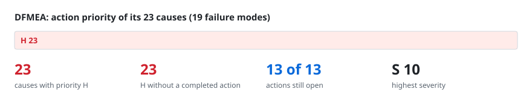
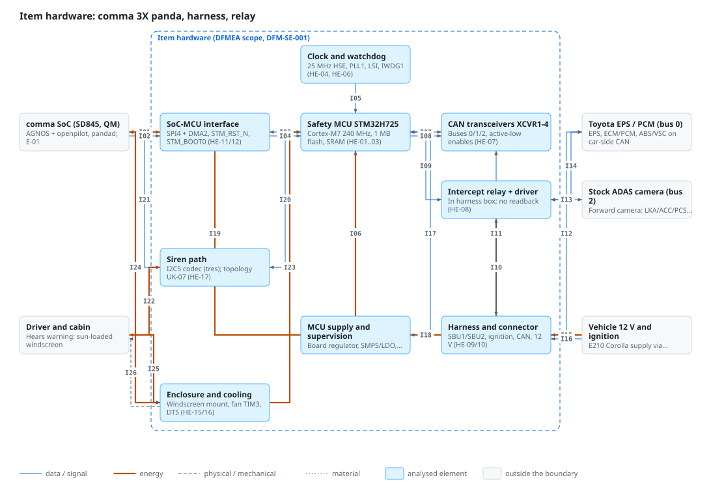
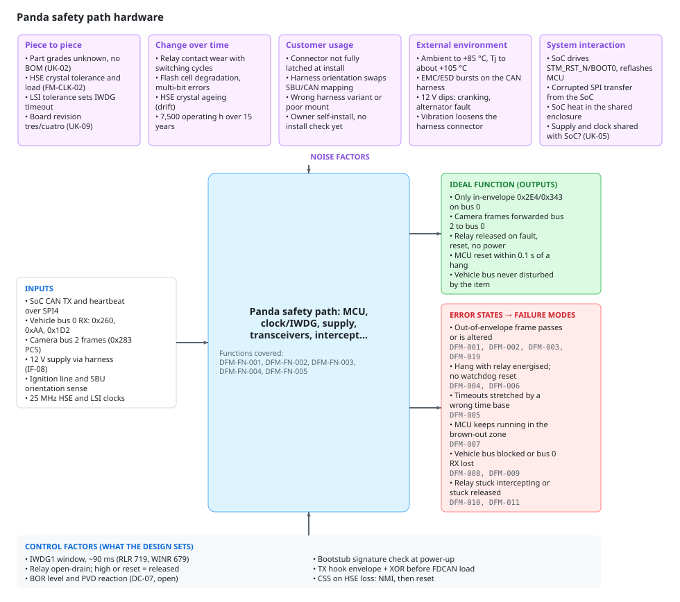
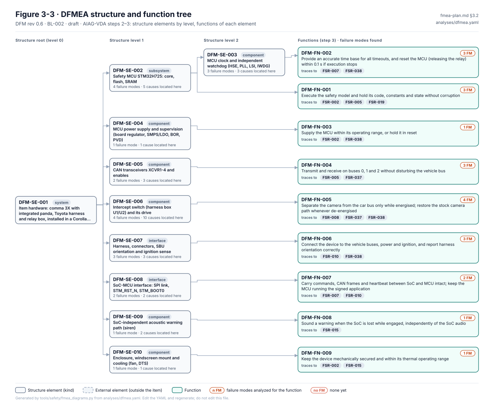
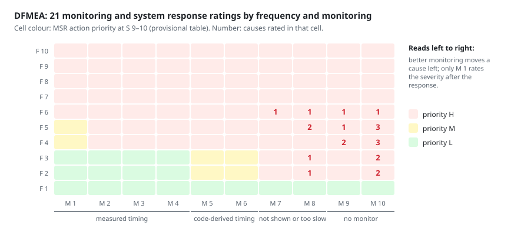

# DFMEA review: device, integrated panda, harness, vehicle interfaces

> Generated from [`analyses/dfmea.yaml`](../../analyses/dfmea.yaml) and [`diagrams/dfmea.yaml`](../../diagrams/dfmea.yaml) by `tools/safety/fmea_review_md.py`. Edit the YAML and regenerate; never edit this page. A styled workbook of the same data is [`dfmea-review.xlsx`](dfmea-review.xlsx).

| Revision | Status | Baseline | Rating tables | Updated |
|---|---|---|---|---|
| 0.11 | draft | BL-007 | RT-3 | 2026-10-16 |

**Scope.** Safety-relevant hardware of AC-001 at BL-007 (hardware as at BL-002): comma 3X panda section (STM32H725, clock and watchdog, MCU supply, CAN transceivers), Toyota harness and relay box, SoC-MCU interface, siren path, enclosure and cooling. SoC, cameras and other QM hardware only where they couple into these (WP-A-03).

**Team.** Jherrod Thomas (Project maintainer, safety lead (reviewer/approver)); Claude (AI assistant) (Drafting assistance; ratings require human review)

## How to review

Read the diagrams first, then the worksheet. Comment on this page's lines in a pull request, or open an issue that names the failure mode or cause ID. For a rating, say which value you would give and why; the scales are in [rating-tables.md](../../rating-tables.md). Action priority follows the AIAG-VDA table and is checked by `fmea_lint.py`, so challenge S, O or D, not the AP.

## Contents

- [Block and boundary diagram](#1-block-and-boundary-diagram)
- [P-diagram](#2-p-diagram)
- [Structure and functions](#3-structure-and-functions)
- [Worksheet](#4-worksheet)
- [Actions](#5-actions)
- [Priority H causes without a completed action](#6-priority-h-causes-without-a-completed-action)
- [Monitoring and system response](#7-monitoring-and-system-response)

## 1. Block and boundary diagram

**Interface matrix.** Each line in the diagram, with what crosses it.

| ID | From | To | Type | What crosses | Source |
|---|---|---|---|---|---|
| I01 | comma SoC (SD845, QM) | SoC-MCU interface | data ⇄  | SPI: CAN TX, 0xf3, 0xdc | assurance/03-system/WP-S-05-hsi-specification.md §4.1, §4.2 (HSI-01..03) |
| I02 | comma SoC (SD845, QM) | SoC-MCU interface | data | STM_RST_N / STM_BOOT0 | assurance/03-system/WP-S-05-hsi-specification.md §7, §11.3 S-25 (HSI-08) |
| I03 | SoC-MCU interface | Safety MCU STM32H725 | data ⇄  | SPI4 DMA2 to SRAM1/2 | assurance/03-system/WP-S-05-hsi-specification.md §2 HSI-01, §8 |
| I04 | SoC-MCU interface | Safety MCU STM32H725 | data | NRST / BOOT0 pins | assurance/04-hardware/WP-H-02-hardware-design.md §3.1, §3.2 HE-12 |
| I05 | Clock and watchdog | Safety MCU STM32H725 | data | PLL1 clock; IWDG reset | assurance/04-hardware/WP-H-02-hardware-design.md §2, §3.2 HE-04/HE-06, §4 |
| I06 | MCU supply and supervision | Safety MCU STM32H725 | energy | MCU rail (SMPS/LDO) | assurance/04-hardware/WP-H-02-hardware-design.md §3.2 HE-05, §3.4 |
| I07 | Safety MCU STM32H725 | CAN transceivers XCVR1-4 | data ⇄  | FDCAN1-3 TX/RX | assurance/04-hardware/WP-H-02-hardware-design.md §3.3 |
| I08 | Safety MCU STM32H725 | CAN transceivers XCVR1-4 | data | XCVR enables PG11/PB10 | assurance/04-hardware/WP-H-02-hardware-design.md §3.2 HE-07; WP-S-05 §5 |
| I09 | Safety MCU STM32H725 | Intercept switch (box U1/U2) + drive | data | Relay drive PA8/PA3 OD | assurance/03-system/WP-S-05-hsi-specification.md §6, §11.3 S-22 (HSI-05) |
| I10 | Harness and connector | Intercept switch (box U1/U2) + drive | energy | Coil supply (UK-03) | assurance/04-hardware/WP-H-02-hardware-design.md §3.4, §5 UK-03 |
| I11 | CAN transceivers XCVR1-4 | Harness and connector | data ⇄  | CAN bus 0/1/2 pairs | assurance/04-hardware/WP-H-02-hardware-design.md §3.1, §3.3 |
| I12 | Harness and connector | Toyota EPS / PCM (bus 0) | data ⇄  | Bus 0: 0x2E4,0x343,0x260 | assurance/02-concept/WP-C-01-item-definition.md §3.4 IF-01, IF-02 |
| I13 | Stock ADAS camera (bus 2) | Intercept switch (box U1/U2) + drive | data ⇄  | Bus 2 camera CAN (IF-03) | assurance/02-concept/WP-C-01-item-definition.md §3.4 IF-03; WP-H-02 §3.1 |
| I14 | Intercept switch (box U1/U2) + drive | Toyota EPS / PCM (bus 0) | data ⇄  | Stock path 0x283 PCS | assurance/04-hardware/WP-H-02-hardware-design.md §3.1 (relay de-energised); WP-S-05 §11.1 S-15 |
| I15 | Vehicle 12 V and ignition | Harness and connector | energy | 12 V + GND (IF-08) | assurance/02-concept/WP-C-01-item-definition.md §3.4 IF-08 |
| I16 | Vehicle 12 V and ignition | Harness and connector | data | Ignition line (SBU) | assurance/04-hardware/WP-H-02-hardware-design.md §3.1, §3.2 HE-10 |
| I17 | Harness and connector | Safety MCU STM32H725 | data | SBU1/2 sense PC4/PA1 | assurance/03-system/WP-S-05-hsi-specification.md §6, §11.3 S-23, S-24 (HSI-06/07) |
| I18 | Harness and connector | MCU supply and supervision | energy | 12 V device input | assurance/04-hardware/WP-H-02-hardware-design.md §3.4 |
| I19 | MCU supply and supervision | comma SoC (SD845, QM) | energy | SoC/PMIC rail, shared? | assurance/04-hardware/WP-H-02-hardware-design.md §3.4, §5 UK-05; WP-A-03 DFI-01 |
| I20 | Safety MCU STM32H725 | Siren path | data | Siren I2C5 PC10/PC11 | assurance/04-hardware/WP-H-02-hardware-design.md §3.2 HE-17; WP-S-05 §11.3 S-27 |
| I21 | comma SoC (SD845, QM) | Siren path | data | Shared codec/amp? UK-07 | assurance/08-analyses/WP-A-03-dependent-failure-analysis.md §4.3 DFI-23 |
| I22 | Siren path | Driver and cabin | energy | Acoustic warning 4 Hz | assurance/03-system/WP-S-05-hsi-specification.md §7, §11.3 S-27 |
| I23 | Enclosure and cooling | Safety MCU STM32H725 | energy | Cooling; DTS die temp | assurance/04-hardware/WP-H-02-hardware-design.md §3.2 HE-15, HE-16 |
| I24 | comma SoC (SD845, QM) | Enclosure and cooling | energy | SoC heat (DFI-04) | assurance/08-analyses/WP-A-03-dependent-failure-analysis.md §4.1 DFI-04 |
| I25 | Driver and cabin | Enclosure and cooling | energy | Sun load on windscreen | assurance/08-analyses/WP-A-03-dependent-failure-analysis.md §4.1 DFI-04 |
| I26 | Enclosure and cooling | Driver and cabin | physical | Windscreen mount | assurance/08-analyses/fmea/analyses/dfmea.yaml DFM-SE-010, DFM-FN-009 |

## 2. P-diagram

| Function covered | Description |
|---|---|
| `DFM-FN-001` | Execute the safety model and hold its code, constants and state without corruption |
| `DFM-FN-002` | Provide an accurate time base for all timeouts, and reset the MCU (releasing the relay) within 0.1 s if execution stops |
| `DFM-FN-003` | Supply the MCU within its operating range, or hold it in reset |
| `DFM-FN-004` | Transmit and receive on buses 0, 1 and 2 without disturbing the vehicle bus |
| `DFM-FN-005` | Separate the camera from the car bus only while energised; restore the stock camera path whenever de-energised |

| Control factor | Source |
|---|---|
| IWDG1 window, ~90 ms (RLR 719, WINR 679) | assurance/04-hardware/WP-H-02-hardware-design.md §4; panda/board/drivers/hw_watchdog.h (TSR-501) |
| Relay open-drain; high or reset = released | assurance/03-system/WP-S-05-hsi-specification.md §6, §11.3 S-22 (TSR-506, TSR-706) |
| BOR level and PVD reaction (DC-07, open) | assurance/04-hardware/WP-H-02-hardware-design.md §4, §6 DC-07 (TSR-505); DFM-ACT-005 |
| Bootstub signature check at power-up | assurance/03-system/WP-S-05-hsi-specification.md §7 (TSR-511); panda/board/bootstub.c |
| TX hook envelope + XOR before FDCAN load | assurance/03-system/WP-S-05-hsi-specification.md §4.3, §11.2 S-17 (TSR-108, TSR-517) |
| CSS on HSE loss: NMI, then reset | assurance/04-hardware/WP-H-02-hardware-design.md §3.5, §4 (TSR-504); panda/board/stm32h7/clock.h |

## 3. Structure and functions

The failure chains (element → function → failure mode → causes) are drawn in [figures/generated](../../figures/generated/README.md).

| Element | Kind | Functions |
|---|---|---|
| `DFM-SE-001` Item hardware: comma 3X with integrated panda, Toyota harness and relay box, installed in a Corolla E210 · ZRE212 · US (CFG-001) | system | — |
| &nbsp;&nbsp;&nbsp;`DFM-SE-002` Safety MCU STM32H725: core, flash, SRAM | subsystem | `DFM-FN-001` Execute the safety model and hold its code, constants and state without corruption |
| &nbsp;&nbsp;&nbsp;&nbsp;&nbsp;&nbsp;`DFM-SE-003` MCU clock and independent watchdog (HSE, PLL, LSI, IWDG) | component | `DFM-FN-002` Provide an accurate time base for all timeouts, and reset the MCU (releasing the relay) within 0.1 s if execution stops |
| &nbsp;&nbsp;&nbsp;`DFM-SE-004` MCU power supply and supervision (board regulator, SMPS/LDO, BOR, PVD) | component | `DFM-FN-003` Supply the MCU within its operating range, or hold it in reset |
| &nbsp;&nbsp;&nbsp;`DFM-SE-005` CAN transceivers XCVR1-4 and enables | component | `DFM-FN-004` Transmit and receive on buses 0, 1 and 2 without disturbing the vehicle bus |
| &nbsp;&nbsp;&nbsp;`DFM-SE-006` Intercept switch (harness box U1/U2) and its drive | component | `DFM-FN-005` Separate the camera from the car bus only while energised; restore the stock camera path whenever de-energised |
| &nbsp;&nbsp;&nbsp;`DFM-SE-007` Harness, connectors, SBU orientation and ignition sense | interface | `DFM-FN-006` Connect the device to the vehicle buses, power and ignition, and report harness orientation correctly |
| &nbsp;&nbsp;&nbsp;`DFM-SE-008` SoC-MCU interface: SPI link, STM_RST_N, STM_BOOT0 | interface | `DFM-FN-007` Carry commands, CAN frames and heartbeat between SoC and MCU intact; keep the MCU running the signed application |
| &nbsp;&nbsp;&nbsp;`DFM-SE-009` SoC-independent acoustic warning path (siren) | component | `DFM-FN-008` Sound a warning when the SoC is lost while engaged, independently of the SoC audio |
| &nbsp;&nbsp;&nbsp;`DFM-SE-010` Enclosure, windscreen mount and cooling (fan, DTS) | component | `DFM-FN-009` Keep the device mechanically secured and within its thermal operating range |

## 4. Worksheet

One table per failure mode, grouped by structure element. S is the failure mode's severity (its worst end effect); each cause has its own occurrence (O), detection (D) and action priority (AP).

### `DFM-SE-002` Safety MCU STM32H725: core, flash, SRAM

#### DFM-001 · Safety check computes a wrong result (permanent CPU or data-path fault)

🔴 **H** · **S 10** · guideword *degraded* · function `DFM-FN-001` Execute the safety model and hold its code, constants and state without corruption

Effects:

- **End:** Uncontrollable steering or unintended acceleration (HZ-002, S 10)
- **End:** Contributes to HZ-005 (HZ-005, S 10)
- **End:** Contributes to HZ-006 (deceleration limit or authority evaluated wrongly) (HZ-006, S 10)
- **Next higher:** Out-of-envelope or unauthorised command passes the panda
- **Local:** Torque/acceleration limit or controls_allowed evaluated wrongly

| Cause | Prevention | Detection | O | D | AP | Actions |
|---|---|---|:-:|:-:|:-:|---|
| `DFM-001.C1` Permanent fault in the Cortex-M7 core or bus matrix; single core, no lockstep, no CPU self-test | • COTS comma 3X design in volume field use; no supplier reliability data, schematic or BOM available to LionDriver (WP-H-02 UK-01, UK-02) assurance/04-hardware/WP-H-02-hardware-design.md | • No LionDriver hardware verification or qualification test exists for this cause (WP-H-06/WP-H-07 not started; no HIL bench, D-04) | 3 | 10 | 🔴 **H** | DFM-ACT-001 |

Safety mechanisms: (1) None in the MCU at BL-002. Host compares controls_allowed after about 2 s (QM, does not check limits). EPS and PCM own limits (AOU-01, AOU-05)

[Monitoring and system response](#7-monitoring-and-system-response): `DFM-001.C1` mechanism 1: M 9 · F 6 · S after response 10 → 🔴 **H**

Note: WP-H-03 FM-CPU-01. High diagnostic coverage is not credible without hardware redundancy.

#### DFM-002 · Code or limit constants corrupted in flash during operation

🔴 **H** · **S 10** · guideword *degraded* · function `DFM-FN-001` Execute the safety model and hold its code, constants and state without corruption

Effects:

- **End:** Steering or acceleration beyond the envelope (HZ-002, S 10)
- **End:** Contributes to HZ-005 (HZ-005, S 10)
- **Next higher:** Panda enforces wrong limits
- **Local:** Wrong limit value or wrong instruction

| Cause | Prevention | Detection | O | D | AP | Actions |
|---|---|---|:-:|:-:|:-:|---|
| `DFM-002.C1` Multi-bit flash error or cell degradation; double-error ECC flag not handled; image signature checked at boot only | • COTS comma 3X design in volume field use; no supplier reliability data, schematic or BOM available to LionDriver (WP-H-02 UK-01, UK-02) assurance/04-hardware/WP-H-02-hardware-design.md • Bootstub signature check at power-up (bootstub.c:47-72); flash ECC corrects single bits in silicon panda/board/bootstub.c | • No LionDriver hardware verification or qualification test exists for this cause (WP-H-06/WP-H-07 not started; no HIL bench, D-04) | 2 | 10 | 🔴 **H** | DFM-ACT-002 |

Safety mechanisms: (1) Boot-time signature only. Periodic code CRC exists on panda branch liondriver/g1-layer1 (TSR-MCU-09), not pinned at BL-002

[Monitoring and system response](#7-monitoring-and-system-response): `DFM-002.C1` mechanism 1: M 9 · F 4 · S after response 10 → 🔴 **H**

Note: WP-H-03 FM-FLS-02.

#### DFM-003 · Safety state in SRAM corrupted (controls_allowed, limits, counters, stack)

🔴 **H** · **S 10** · guideword *degraded* · function `DFM-FN-001` Execute the safety model and hold its code, constants and state without corruption

Effects:

- **End:** Unintended steering or acceleration (HZ-001, S 10)
- **End:** Contributes to HZ-002 (HZ-002, S 10)
- **End:** Contributes to HZ-005 (HZ-005, S 10)
- **End:** Contributes to HZ-006 (deceleration limit or authority corrupted) (HZ-006, S 10)
- **Next higher:** Unauthorised or out-of-envelope command passes
- **Local:** Wrong authority or limit decision, or crash

| Cause | Prevention | Detection | O | D | AP | Actions |
|---|---|---|:-:|:-:|:-:|---|
| `DFM-003.C1` Double-bit soft error or permanent SRAM fault; RAMECC monitors not configured, ECC interrupt not registered | • COTS comma 3X design in volume field use; no supplier reliability data, schematic or BOM available to LionDriver (WP-H-02 UK-01, UK-02) assurance/04-hardware/WP-H-02-hardware-design.md | • No LionDriver hardware verification or qualification test exists for this cause (WP-H-06/WP-H-07 not started; no HIL bench, D-04) | 3 | 10 | 🔴 **H** | DFM-ACT-002 |
| `DFM-003.C2` Wrong-address write by the SPI DMA (no MPU) | • COTS comma 3X design in volume field use; no supplier reliability data, schematic or BOM available to LionDriver (WP-H-02 UK-01, UK-02) assurance/04-hardware/WP-H-02-hardware-design.md | • No LionDriver hardware verification or qualification test exists for this cause (WP-H-06/WP-H-07 not started; no HIL bench, D-04) | 3 | 10 | 🔴 **H** | DFM-ACT-002 |

Safety mechanisms: (1) None at BL-002. RAMECC handling, redundant storage and start-up RAM test exist on panda branch liondriver/g1-layer1 (TSR-MCU-07, -08, -10), not pinned

[Monitoring and system response](#7-monitoring-and-system-response): `DFM-003.C1` mechanism 1: M 10 · F 5 · S after response 10 → 🔴 **H** `DFM-003.C2` mechanism 1: M 10 · F 3 · S after response 10 → 🔴 **H**

Note: WP-H-03 FM-RAM-02/03, FM-CPU-07.

#### DFM-019 · Approved CAN frame altered between the TX check and the bus

🔴 **H** · **S 10** · guideword *intermittent* · function `DFM-FN-004` Transmit and receive on buses 0, 1 and 2 without disturbing the vehicle bus

Effects:

- **End:** Steering torque above the controllable bound (HZ-002, S 10)
- **End:** Contributes to HZ-005 (acceleration above the bound) (HZ-005, S 10)
- **End:** Contributes to HZ-006 (deceleration below the bound) (HZ-006, S 10)
- **Next higher:** Out-of-envelope steering or acceleration frame reaches the vehicle with a valid CAN CRC
- **Local:** A frame that passed safety_tx_hook changes in the FDCAN message RAM, the FDCAN core or the transceiver

| Cause | Prevention | Detection | O | D | AP | Actions |
|---|---|---|:-:|:-:|:-:|---|
| `DFM-019.C1` Soft error or permanent fault in the copy into FDCAN message RAM, the message RAM or the FDCAN core. The packet XOR is checked at the FDCAN load (fdcan.h:100) and covers only the software queue; the CAN CRC is computed after the fault | • COTS comma 3X design in volume field use; no supplier reliability data, schematic or BOM available to LionDriver (WP-H-02 UK-01, UK-02) assurance/04-hardware/WP-H-02-hardware-design.md • Packet XOR checked before the FDCAN load (software queue only) panda/board/drivers/fdcan.h | • No LionDriver hardware verification or qualification test exists for this cause (WP-H-06/WP-H-07 not started; no HIL bench, D-04) | 3 | 10 | 🔴 **H** | DFM-ACT-013 |
| `DFM-019.C2` Transceiver fault that changes bits on TX without a CAN error (not credible for a single bit, which the CAN CRC and the bit monitoring of the transmitting controller detect; kept until the transceiver part is known, WP-H-02 UK-01) | • COTS comma 3X design in volume field use; no supplier reliability data, schematic or BOM available to LionDriver (WP-H-02 UK-01, UK-02) assurance/04-hardware/WP-H-02-hardware-design.md | • No LionDriver hardware verification or qualification test exists for this cause (WP-H-06/WP-H-07 not started; no HIL bench, D-04) | 2 | 10 | 🔴 **H** | DFM-ACT-013 |

Safety mechanisms: (1) None after the FDCAN load (SPF-02). TSR-517 specifies a TX read-back of own frames; not implemented at BL-002

[Monitoring and system response](#7-monitoring-and-system-response): `DFM-019.C1` mechanism 1: M 10 · F 4 · S after response 10 → 🔴 **H** `DFM-019.C2` mechanism 1: M 10 · F 2 · S after response 10 → 🟠 M

Note: WP-A-04 BE-1.10 and BE-4.03 (SPF-02); FMEDA SG-001 FMD-002 and FMD-010. The same TX path carries 0x2E4 and 0x343, so the rates of the SG-001 rows apply to the longitudinal path; SG-04 has no FMEDA of its own yet.

### `DFM-SE-003` MCU clock and independent watchdog (HSE, PLL, LSI, IWDG)

#### DFM-004 · MCU execution stops with the relay energised

🔴 **H** · **S 10** · guideword *stuck* · function `DFM-FN-002` Provide an accurate time base for all timeouts, and reset the MCU (releasing the relay) within 0.1 s if execution stops

Effects:

- **End:** Stock AEB unavailable until power cycle (HZ-011, S 10)
- **Next higher:** Camera path stays cut; no stock PCS messages to the car
- **Local:** Checks, TX and forwarding stop; relay holds last state

| Cause | Prevention | Detection | O | D | AP | Actions |
|---|---|---|:-:|:-:|:-:|---|
| `DFM-004.C1` Hang in an ISR or main loop, unused vector to Default_Handler, or assert_fatal loop | • IWDG (LSI), 90 ms nominal, window mode, started on every relay drive and fed only after safety-task and main-loop progress (BL-002, panda#1, #3); a reset floats the relay GPIO panda/board/drivers/hw_watchdog.h | • Watchdog HIL test with injected hangs (FAULT_INJECTION build); targeted, not yet run (no HIL bench, D-04) panda/tests/hitl/test_10_hw_watchdog.py | 3 | 8 | 🔴 **H** | DFM-ACT-003 |

Safety mechanisms: (1) IWDG reset releases the relay if the drive circuit is de-energise-to-safe (HWSR-502, unconfirmed, UK-06)

[Monitoring and system response](#7-monitoring-and-system-response): `DFM-004.C1` mechanism 1: M 7 · F 6 · S after response 10 → 🔴 **H**

Note: WP-H-03 FM-CPU-03/05. Before BL-002 there was no reset path (O was 7).

#### DFM-005 · MCU time base wrong

🔴 **H** · **S 10** · guideword *drift* · function `DFM-FN-002` Provide an accurate time base for all timeouts, and reset the MCU (releasing the relay) within 0.1 s if execution stops

Effects:

- **End:** Stale data used beyond the detection budget (HZ-002, S 10)
- **End:** Contributes to HZ-008 (HZ-008, S 10)
- **Next higher:** RX and heartbeat timeouts longer than specified; CAN errors
- **Local:** All timeouts and the CAN bit timing shift

| Cause | Prevention | Detection | O | D | AP | Actions |
|---|---|---|:-:|:-:|:-:|---|
| `DFM-005.C1` HSE crystal drift or PLL misconfiguration; no cross-check against an independent oscillator | • COTS comma 3X design in volume field use; no supplier reliability data, schematic or BOM available to LionDriver (WP-H-02 UK-01, UK-02) assurance/04-hardware/WP-H-02-hardware-design.md • Clock security system on HSE loss (NMI, reset); register readback of RCC, report-only panda/board/stm32h7/clock.h | • No LionDriver hardware verification or qualification test exists for this cause (WP-H-06/WP-H-07 not started; no HIL bench, D-04) | 3 | 10 | 🔴 **H** | DFM-ACT-004 |

Note: WP-H-03 FM-CLK-02/03. HSE loss itself is covered by CSS (FM-CLK-01).

#### DFM-006 · Watchdog does not reset the MCU when execution stops

🔴 **H** · **S 10** · guideword *loss* · function `DFM-FN-002` Provide an accurate time base for all timeouts, and reset the MCU (releasing the relay) within 0.1 s if execution stops

Effects:

- **End:** Stock AEB unavailable until power cycle (HZ-011, S 10)
- **Next higher:** A later hang leaves the relay energised
- **Local:** Latent: the hang reaction is missing

| Cause | Prevention | Detection | O | D | AP | Actions |
|---|---|---|:-:|:-:|:-:|---|
| `DFM-006.C1` LSI oscillator failure or IWDG fault; reset path never proven in operation | • COTS comma 3X design in volume field use; no supplier reliability data, schematic or BOM available to LionDriver (WP-H-02 UK-01, UK-02) assurance/04-hardware/WP-H-02-hardware-design.md | • Watchdog HIL test proves the reset path on the bench; not yet run panda/tests/hitl/test_10_hw_watchdog.py | 2 | 8 | 🔴 **H** | DFM-ACT-003 |

Note: WP-H-03 FM-CLK-04. A latent fault of a safety mechanism (LFM).

### `DFM-SE-004` MCU power supply and supervision (board regulator, SMPS/LDO, BOR, PVD)

#### DFM-007 · MCU operates in the brown-out zone

🔴 **H** · **S 10** · guideword *insufficient* · function `DFM-FN-003` Supply the MCU within its operating range, or hold it in reset

Effects:

- **End:** Unintended steering or acceleration (HZ-002, S 10)
- **End:** Contributes to HZ-005 (HZ-005, S 10)
- **Next higher:** Wrong safety decisions while still running
- **Local:** Undefined logic behaviour, flash read errors

| Cause | Prevention | Detection | O | D | AP | Actions |
|---|---|---|:-:|:-:|:-:|---|
| `DFM-007.C1` Vehicle supply dip (cranking, alternator fault) with BOR level not set and PVD not enabled | • COTS comma 3X design in volume field use; no supplier reliability data, schematic or BOM available to LionDriver (WP-H-02 UK-01, UK-02) assurance/04-hardware/WP-H-02-hardware-design.md | • No LionDriver hardware verification or qualification test exists for this cause (WP-H-06/WP-H-07 not started; no HIL bench, D-04) | 5 | 10 | 🔴 **H** | DFM-ACT-005 |

Safety mechanisms: (1) None at BL-002 (PVD handler stub; BOR level unknown, UK-04)

[Monitoring and system response](#7-monitoring-and-system-response): `DFM-007.C1` mechanism 1: M 10 · F 5 · S after response 10 → 🔴 **H**

Note: WP-H-03 FM-PWR-02; WP-A-03 DFI-01, DFI-06 (common cause with the EPS and the SoC).

### `DFM-SE-005` CAN transceivers XCVR1-4 and enables

#### DFM-008 · Car-side transceiver holds the bus dominant

🔴 **H** · **S 10** · guideword *stuck* · function `DFM-FN-004` Transmit and receive on buses 0, 1 and 2 without disturbing the vehicle bus

Effects:

- **End:** Loss of assist and stock functions (HZ-004, S 10)
- **End:** Contributes to HZ-011 (HZ-011, S 10)
- **Next higher:** EPS, PCM and ADAS messages lost
- **Local:** Vehicle CAN bus 0 blocked

| Cause | Prevention | Detection | O | D | AP | Actions |
|---|---|---|:-:|:-:|:-:|---|
| `DFM-008.C1` XCVR1 TX driver fault or TXD stuck low | • COTS comma 3X design in volume field use; no supplier reliability data, schematic or BOM available to LionDriver (WP-H-02 UK-01, UK-02) assurance/04-hardware/WP-H-02-hardware-design.md | • No LionDriver hardware verification or qualification test exists for this cause (WP-H-06/WP-H-07 not started; no HIL bench, D-04) | 3 | 10 | 🔴 **H** | DFM-ACT-006 |

Safety mechanisms: (1) Transceiver dominant-timeout (part dependent, unknown); FDCAN error counters read, core reset on bus-off; no safety reaction

[Monitoring and system response](#7-monitoring-and-system-response): `DFM-008.C1` mechanism 1: M 8 · F 5 · S after response 10 → 🔴 **H**

Note: WP-H-03 FM-CAN-01. Vehicle ECUs detect the bus failure themselves.

#### DFM-009 · Car-side transceiver receives nothing

🔴 **H** · **S 10** · guideword *open* · function `DFM-FN-004` Transmit and receive on buses 0, 1 and 2 without disturbing the vehicle bus

Effects:

- **End:** Item disengages; loss of lateral control (HZ-004, S 10)
- **Next higher:** Panda RX checks time out; controls withdrawn
- **Local:** No RX of vehicle messages

| Cause | Prevention | Detection | O | D | AP | Actions |
|---|---|---|:-:|:-:|:-:|---|
| `DFM-009.C1` XCVR1 RX open or stuck recessive | • COTS comma 3X design in volume field use; no supplier reliability data, schematic or BOM available to LionDriver (WP-H-02 UK-01, UK-02) assurance/04-hardware/WP-H-02-hardware-design.md | • Per-message RX timeout test (opendbc, CI) verifies the reaction in software, not the transceiver fault opendbc_repo/opendbc/safety/tests/test_toyota.py | 3 | 9 | 🔴 **H** | DFM-ACT-006 |

Safety mechanisms: (1) RX timeout after 5 periods (BL-002, about 0.16 s) withdraws controls; SoC alerts on panda state

[Monitoring and system response](#7-monitoring-and-system-response): `DFM-009.C1` mechanism 1: M 6 · F 5 · S after response 10 → 🔴 **H**

Note: WP-H-03 FM-CAN-02. Detected and safe-direction; severity stays 10 because the end effect is loss of lateral control while engaged.

### `DFM-SE-006` Intercept switch (harness box U1/U2) and its drive

#### DFM-010 · Intercept switch stays in intercept when released

🔴 **H** · **S 10** · guideword *stuck* · function `DFM-FN-005` Separate the camera from the car bus only while energised; restore the stock camera path whenever de-energised

Effects:

- **End:** Stock AEB unavailable (HZ-011, S 10)
- **Next higher:** Stock PCS and LKA messages do not reach the car
- **Local:** Camera disconnected from the car while the panda forwards nothing or is off

| Cause | Prevention | Detection | O | D | AP | Actions |
|---|---|---|:-:|:-:|:-:|---|
| `DFM-010.C1` Analog switch U1 or U2 stuck in the intercept (NO) position, or its IN input damaged high | • COTS comma 3X design in volume field use; no supplier reliability data, schematic or BOM available to LionDriver (WP-H-02 UK-01, UK-02) assurance/04-hardware/WP-H-02-hardware-design.md | • No LionDriver hardware verification or qualification test exists for this cause (WP-H-06/WP-H-07 not started; no HIL bench, D-04) | 3 | 10 | 🔴 **H** | DFM-ACT-007 |
| `DFM-010.C2` SBU1 drive stuck high (device-side driver or MCU pin, UK-06) | • COTS comma 3X design in volume field use; no supplier reliability data, schematic or BOM available to LionDriver (WP-H-02 UK-01, UK-02) assurance/04-hardware/WP-H-02-hardware-design.md | • No LionDriver hardware verification or qualification test exists for this cause (WP-H-06/WP-H-07 not started; no HIL bench, D-04) | 3 | 10 | 🔴 **H** | DFM-ACT-007 |
| `DFM-010.C3` Pull-down R2 or R3 open, so IN floats when the device stops driving SBU1 (reset, watchdog, hang, unplugged cable) | • COTS comma 3X design in volume field use; no supplier reliability data, schematic or BOM available to LionDriver (WP-H-02 UK-01, UK-02) assurance/04-hardware/WP-H-02-hardware-design.md | • No LionDriver hardware verification or qualification test exists for this cause (WP-H-06/WP-H-07 not started; no HIL bench, D-04) | 3 | 10 | 🔴 **H** | DFM-ACT-007, DFM-ACT-014 |
| `DFM-010.C4` U1/U2 overstressed or latched up by box supply transients above the DG419LE absolute maximum (V+ = VL = VIN with no regulator; the SMF16A clamp D4 only starts to conduct above its 16 V stand-off). Damage can leave the switch in either position or open a channel (also DFM-011, DFM-013) | • COTS comma 3X design in volume field use; no supplier reliability data, schematic or BOM available to LionDriver (WP-H-02 UK-01, UK-02) assurance/04-hardware/WP-H-02-hardware-design.md • D4 SMF16A TVS on VIN (harness box v3). Its clamp level against the DG419LE rating is not shown: datasheet limits not confirmed (RR-2026-010 F-05) assurance/04-hardware/reviews/RR-2026-010.md | • No LionDriver hardware verification or qualification test exists for this cause (WP-H-06/WP-H-07 not started; no HIL bench, D-04) | 4 | 10 | 🔴 **H** | DFM-ACT-014, DFM-ACT-015 |

Safety mechanisms: (1) None: no relay readback (GAP-12)

[Monitoring and system response](#7-monitoring-and-system-response): `DFM-010.C1` mechanism 1: M 10 · F 6 · S after response 10 → 🔴 **H** `DFM-010.C2` mechanism 1: M 10 · F 4 · S after response 10 → 🔴 **H** `DFM-010.C3` mechanism 1: M 10 · F 2 · S after response 10 → 🟠 M `DFM-010.C4` mechanism 1: M 10 · F 4 · S after response 10 → 🔴 **H**

Note: WP-H-03 FM-REL-02/04: a single-point path for the PCS goal that no firmware change can close. RR-2026-010 F-03: the release default rests on R2+R3 (HWSR-506e).

#### DFM-011 · Intercept switch stays in pass-through when driven

🔴 **H** · **S 10** · guideword *stuck* · function `DFM-FN-005` Separate the camera from the car bus only while energised; restore the stock camera path whenever de-energised

Effects:

- **End:** Erratic or excessive steering or braking (HZ-002, S 10)
- **End:** Contributes to HZ-006 (HZ-006, S 10)
- **Next higher:** Conflicting steering and ACC commands
- **Local:** Stock camera LKA/ACC messages reach the car together with panda TX

| Cause | Prevention | Detection | O | D | AP | Actions |
|---|---|---|:-:|:-:|:-:|---|
| `DFM-011.C1` Analog switch U1 or U2 stuck in the pass-through (NC) position, or SBU1 drive lost or held low (driver open, R2/R3 short) | • COTS comma 3X design in volume field use; no supplier reliability data, schematic or BOM available to LionDriver (WP-H-02 UK-01, UK-02) assurance/04-hardware/WP-H-02-hardware-design.md | • Relay-malfunction tests in the opendbc suite exercise the software reaction, not the relay opendbc_repo/opendbc/safety/tests/test_toyota.py | 3 | 9 | 🔴 **H** | DFM-ACT-007 |
| `DFM-011.C2` The 5 V SBU1 drive does not reach the DG419LE logic-high threshold with VL tied to VIN (about 14 V), so the switch does not change over or changes over only at some temperatures (RR-2026-010 F-05; thresholds at VL = VIN not confirmed) | • COTS comma 3X design in volume field use; no supplier reliability data, schematic or BOM available to LionDriver (WP-H-02 UK-01, UK-02) assurance/04-hardware/WP-H-02-hardware-design.md • Field use: openpilot on TSS2 Toyotas with this box would raise relayMalfunction on every drive if the switch never changed over, which suggests it switches at nominal conditions. Margin over temperature and supply is not shown assurance/04-hardware/reviews/RR-2026-010.md | • Relay-malfunction tests in the opendbc suite exercise the software reaction, not the switch threshold opendbc_repo/opendbc/safety/tests/test_toyota.py | 2 | 9 | 🔴 **H** | DFM-ACT-014, DFM-ACT-015 |

Safety mechanisms: (1) Relay malfunction detection: stock camera message on the car side after a 1 s grace blocks all TX (safety.h stock_ecu_check). Since BL-006, reference build: the malfunction is latched for the ignition cycle and TOYOTA is refused until ignition off, so a safety-mode change does not clear it (panda#17, DFA DM-25, SW FMEA SWF-090)

[Monitoring and system response](#7-monitoring-and-system-response): `DFM-011.C1` mechanism 1: M 8 · F 6 · S after response 10 → 🔴 **H** `DFM-011.C2` mechanism 1: M 8 · F 2 · S after response 10 → 🟠 M

Note: WP-H-03 FM-REL-01. The BL-006 latch changes the reaction, not the switch; S, O, D and M unchanged.

#### DFM-020 · Harness box loses its supply while the car is on

🔴 **H** · **S 10** · guideword *loss* · function `DFM-FN-005` Separate the camera from the car bus only while energised; restore the stock camera path whenever de-energised

Effects:

- **End:** Stock AEB unavailable (HZ-011, S 10)
- **End:** Lateral assist lost without a LionDriver warning (HZ-004, S 10)
- **Next higher:** Stock camera cut off from the car and the car-side ADAS CAN disturbed; the device is also unpowered
- **Local:** U1/U2 unpowered, so pass-through is not guaranteed; D2/D3 clamp CAN0 and CAN2 towards the dead VIN rail, which the device input loads (derived from the v3 drawing, to confirm on the bench)

| Cause | Prevention | Detection | O | D | AP | Actions |
|---|---|---|:-:|:-:|:-:|---|
| `DFM-020.C1` Ignition branch to the box open (crimp, connector) or D1 open, without comma power installed | • COTS comma 3X design in volume field use; no supplier reliability data, schematic or BOM available to LionDriver (WP-H-02 UK-01, UK-02) assurance/04-hardware/WP-H-02-hardware-design.md | • No LionDriver hardware verification or qualification test exists for this cause (WP-H-06/WP-H-07 not started; no HIL bench, D-04) | 5 | 10 | 🔴 **H** | DFM-ACT-014 |
| `DFM-020.C2` Box VIN shorted to ground (TVS D4 short, connector or wiring) | • COTS comma 3X design in volume field use; no supplier reliability data, schematic or BOM available to LionDriver (WP-H-02 UK-01, UK-02) assurance/04-hardware/WP-H-02-hardware-design.md | • No LionDriver hardware verification or qualification test exists for this cause (WP-H-06/WP-H-07 not started; no HIL bench, D-04) | 3 | 10 | 🔴 **H** | DFM-ACT-014 |

Safety mechanisms: (1) None: no supervision of the harness box supply (RR-2026-010 F-02)

[Monitoring and system response](#7-monitoring-and-system-response): `DFM-020.C1` mechanism 1: M 10 · F 5 · S after response 10 → 🔴 **H** `DFM-020.C2` mechanism 1: M 10 · F 3 · S after response 10 → 🔴 **H**

Note: RR-2026-010 F-02. HWSR-502a holds for device power loss only. Comma power keeps the box supplied from a second source (DQ-209 option C).

#### DFM-021 · Clamp diode short loads or grounds a vehicle bus in the harness box

🔴 **H** · **S 10** · guideword *short* · function `DFM-FN-005` Separate the camera from the car bus only while energised; restore the stock camera path whenever de-energised

Effects:

- **End:** Stock AEB unavailable (HZ-011, S 10)
- **End:** Loss of lateral control with a late or no warning (HZ-004, S 10)
- **Next higher:** Car-side ADAS CAN or the camera bus cannot communicate; stock PCS messages lost
- **Local:** D2 (car side, CAN0) or D3 (camera side, CAN2) shorts a CAN line to GND or VIN in either switch state

| Cause | Prevention | Detection | O | D | AP | Actions |
|---|---|---|:-:|:-:|:-:|---|
| `DFM-021.C1` Schottky clamp D2 or D3 (BAS40SDW) short or leaky | • COTS comma 3X design in volume field use; no supplier reliability data, schematic or BOM available to LionDriver (WP-H-02 UK-01, UK-02) assurance/04-hardware/WP-H-02-hardware-design.md | • No LionDriver hardware verification or qualification test exists for this cause (WP-H-06/WP-H-07 not started; no HIL bench, D-04) | 3 | 10 | 🔴 **H** | DFM-ACT-014 |

Safety mechanisms: (1) RX timeouts withdraw control; host canError and canBusMissing alerts

[Monitoring and system response](#7-monitoring-and-system-response): `DFM-021.C1` mechanism 1: M 8 · F 3 · S after response 10 → 🔴 **H**

Note: RR-2026-010 F-07.

### `DFM-SE-007` Harness, connectors, SBU orientation and ignition sense

#### DFM-012 · Harness disconnected or intermittent while driving

🔴 **H** · **S 10** · guideword *connection* · function `DFM-FN-006` Connect the device to the vehicle buses, power and ignition, and report harness orientation correctly

Effects:

- **End:** Loss of lateral control while engaged (HZ-004, S 10)
- **Next higher:** Item disengages; relay releases if the coil loses drive
- **Local:** Panda loses CAN, power or relay drive

| Cause | Prevention | Detection | O | D | AP | Actions |
|---|---|---|:-:|:-:|:-:|---|
| `DFM-012.C1` Connector not fully latched at installation, or vibration loosens it | • Owner installation per comma instructions; no LionDriver installation check yet (WP-O-01) assurance/09-production-operation/WP-O-01-installation-and-provisioning-control.md | • No LionDriver hardware verification or qualification test exists for this cause (WP-H-06/WP-H-07 not started; no HIL bench, D-04) | 5 | 10 | 🔴 **H** | DFM-ACT-008 |

Safety mechanisms: (1) RX timeouts and host canBusMissing alert

[Monitoring and system response](#7-monitoring-and-system-response): `DFM-012.C1` mechanism 1: M 9 · F 5 · S after response 10 → 🔴 **H**

Note: WP-H-03 FM-HAR-01; WP-A-03 DFI-20.

#### DFM-013 · Stock camera path open inside the harness box

🔴 **H** · **S 10** · guideword *open* · function `DFM-FN-006` Connect the device to the vehicle buses, power and ignition, and report harness orientation correctly

Effects:

- **End:** Stock AEB unavailable (HZ-011, S 10)
- **Next higher:** No stock PCS messages to the car
- **Local:** Camera disconnected from the car

| Cause | Prevention | Detection | O | D | AP | Actions |
|---|---|---|:-:|:-:|:-:|---|
| `DFM-013.C1` Open in the harness box stock path (U1/U2 channel open, solder joint, connector contact) | • COTS comma 3X design in volume field use; no supplier reliability data, schematic or BOM available to LionDriver (WP-H-02 UK-01, UK-02) assurance/04-hardware/WP-H-02-hardware-design.md | • No LionDriver hardware verification or qualification test exists for this cause (WP-H-06/WP-H-07 not started; no HIL bench, D-04) | 3 | 10 | 🔴 **H** | DFM-ACT-008 |

Note: WP-H-03 FM-HAR-04.

#### DFM-014 · Ignition sense reads on when the ignition is off

🔴 **H** · **S 10** · guideword *short* · function `DFM-FN-006` Connect the device to the vehicle buses, power and ignition, and report harness orientation correctly

Effects:

- **End:** Longer actuation window after SoC loss (HZ-002, S 10)
- **Next higher:** Slower withdrawal after SoC loss; device stays powered
- **Local:** Heartbeat timeout uses the 5 s ignition-on value

| Cause | Prevention | Detection | O | D | AP | Actions |
|---|---|---|:-:|:-:|:-:|---|
| `DFM-014.C1` Ignition sense line shorted | • COTS comma 3X design in volume field use; no supplier reliability data, schematic or BOM available to LionDriver (WP-H-02 UK-01, UK-02) assurance/04-hardware/WP-H-02-hardware-design.md | • No LionDriver hardware verification or qualification test exists for this cause (WP-H-06/WP-H-07 not started; no HIL bench, D-04) | 3 | 10 | 🔴 **H** | DFM-ACT-008 |
| `DFM-014.C2` Ignition-sense transistor Q6 (DMN3200U, harness box) drain-source short, holding SBU2 low | • COTS comma 3X design in volume field use; no supplier reliability data, schematic or BOM available to LionDriver (WP-H-02 UK-01, UK-02) assurance/04-hardware/WP-H-02-hardware-design.md | • No LionDriver hardware verification or qualification test exists for this cause (WP-H-06/WP-H-07 not started; no HIL bench, D-04) | 3 | 10 | 🔴 **H** | DFM-ACT-008, DFM-ACT-014 |

Note: WP-H-03 FM-IGN-02. Line open is the safe direction (2 s timeout).

### `DFM-SE-008` SoC-MCU interface: SPI link, STM_RST_N, STM_BOOT0

#### DFM-015 · Corrupted SoC-to-MCU transfer accepted

🔴 **H** · **S 10** · guideword *emc* · function `DFM-FN-007` Carry commands, CAN frames and heartbeat between SoC and MCU intact; keep the MCU running the signed application

Effects:

- **End:** Wrong in-envelope actuation, or a wrong configuration request (HZ-002, S 10)
- **Next higher:** Wrong command executed; a TX frame still passes the envelope checks
- **Local:** A command or CAN frame is changed in transit and passes the 8-bit XOR

| Cause | Prevention | Detection | O | D | AP | Actions |
|---|---|---|:-:|:-:|:-:|---|
| `DFM-015.C1` Bit errors on the SPI link (EMC, signal integrity); 8-bit XOR only, no sequence counter | • COTS comma 3X design in volume field use; no supplier reliability data, schematic or BOM available to LionDriver (WP-H-02 UK-01, UK-02) assurance/04-hardware/WP-H-02-hardware-design.md • 8-bit XOR on header and data, NACK on mismatch (drivers/spi.h:97-138); reference lock limits what a corrupted 0xdc can select (default build from BL-005, LionDriver panda/board/drivers/spi.h | • No LionDriver hardware verification or qualification test exists for this cause (WP-H-06/WP-H-07 not started; no HIL bench, D-04) | 4 | 10 | 🔴 **H** | DFM-ACT-009 |

Note: WP-H-03 FM-SPI-01; GAP-10.

#### DFM-016 · MCU forced into the ROM bootloader or reflashed by the SoC

🔴 **H** · **S 10** · guideword *connection* · function `DFM-FN-007` Carry commands, CAN frames and heartbeat between SoC and MCU intact; keep the MCU running the signed application

Effects:

- **End:** Any actuation hazard (unverified image), or loss of function (HZ-002, S 10)
- **End:** Contributes to HZ-005 (HZ-005, S 10)
- **Next higher:** Without a safety model, or with an unsigned image
- **Local:** The MCU runs no or unverified safety firmware

| Cause | Prevention | Detection | O | D | AP | Actions |
|---|---|---|:-:|:-:|:-:|---|
| `DFM-016.C1` SoC drives STM_BOOT0/STM_RST_N (fault or compromise); no RDP/WRP; pandad recovery flashes a development bootstub | • COTS comma 3X design in volume field use; no supplier reliability data, schematic or BOM available to LionDriver (WP-H-02 UK-01, UK-02) assurance/04-hardware/WP-H-02-hardware-design.md | • No LionDriver hardware verification or qualification test exists for this cause (WP-H-06/WP-H-07 not started; no HIL bench, D-04) | 4 | 10 | 🔴 **H** | DFM-ACT-010 |

Safety mechanisms: (1) Bootstub signature check, but the debug key is accepted in debug builds and RDP/WRP are not set (GAP-24, GAP-38). D-09/D-10 decided, not implemented

[Monitoring and system response](#7-monitoring-and-system-response): `DFM-016.C1` mechanism 1: M 9 · F 4 · S after response 10 → 🔴 **H**

Note: WP-H-03 FM-BT0-01; LD-DES-001. BL-005: the panda reports a reference build in health (panda#12) and pandad configures a car mode only on such a panda (LionDriver #41). That check runs on the SoC, the element that causes this failure, so it is not credited here.

### `DFM-SE-009` SoC-independent acoustic warning path (siren)

#### DFM-017 · No SoC-independent warning on SoC loss

🔴 **H** · **S 10** · guideword *loss* · function `DFM-FN-008` Sound a warning when the SoC is lost while engaged, independently of the SoC audio

Effects:

- **End:** Loss of control without timely warning (HZ-004, S 10)
- **End:** Contributes to HZ-012 (HZ-012, S 10)
- **Next higher:** Driver not warned when control is withdrawn after SoC loss
- **Local:** Siren silent

| Cause | Prevention | Detection | O | D | AP | Actions |
|---|---|---|:-:|:-:|:-:|---|
| `DFM-017.C1` Siren shares the codec, amplifier or speaker with the SoC audio, which the faulty SoC powers down | • COTS comma 3X design in volume field use; no supplier reliability data, schematic or BOM available to LionDriver (WP-H-02 UK-01, UK-02) assurance/04-hardware/WP-H-02-hardware-design.md | • No LionDriver hardware verification or qualification test exists for this cause (WP-H-06/WP-H-07 not started; no HIL bench, D-04) | 5 | 10 | 🔴 **H** | DFM-ACT-011, DFM-ACT-016 |
| `DFM-017.C2` Siren path fault stays latent (no self-test) | • COTS comma 3X design in volume field use; no supplier reliability data, schematic or BOM available to LionDriver (WP-H-02 UK-01, UK-02) assurance/04-hardware/WP-H-02-hardware-design.md | • No LionDriver hardware verification or qualification test exists for this cause (WP-H-06/WP-H-07 not started; no HIL bench, D-04) | 4 | 10 | 🔴 **H** | DFM-ACT-011, DFM-ACT-016 |

Safety mechanisms: (1) BL-005: the panda commands the siren itself when the 0.3 s heartbeat monitor revokes granted authority (panda#15, heartbeat_siren.h) and when an EPS fault persists 0.7 s while engaged (panda#14, eps_fault_siren.h; 0.7 s since panda bf8102a, DQ-048, siren at most 0.96 s after fault onset by design, WP-S-04 T-28; not yet timed on hardware, DFM-ACT-016). BL-007, reference build: also when the TX-arrival check revokes (panda 8a69ccf, DQ-404 A, TSR-516(b)) and 0.5 s after a not-engaged heartbeat while PCM cruise stays on (panda f4803c5, engaged_mismatch.h, TSR-516(c)); an EPS-fault siren still sounds after a revocation (DQ-367). Every trigger relies on the speaker path that DFM-017.C1 questions; the bench HIL tests test_15 and test_16 confirm the siren by ear and are not run in CI

[Monitoring and system response](#7-monitoring-and-system-response): `DFM-017.C1` mechanism 1: M 10 · F 5 · S after response 10 → 🔴 **H** `DFM-017.C2` mechanism 1: M 10 · F 4 · S after response 10 → 🔴 **H**

Note: WP-H-03 FM-SIR-01; WP-A-03 DFI-23. BL-005 makes this path the SoC-independent cue of TSR-516(b), so a shared or SoC-powered audio stage now defeats a specified warning, not only a convenience. Ratings unchanged: no hardware evidence either way (WP-H-02 UK-07)

### `DFM-SE-010` Enclosure, windscreen mount and cooling (fan, DTS)

#### DFM-018 · MCU runs above its temperature rating

🔴 **H** · **S 10** · guideword *thermal* · function `DFM-FN-009` Keep the device mechanically secured and within its thermal operating range

Effects:

- **End:** Unintended actuation or loss of control (HZ-002, S 10)
- **End:** Contributes to HZ-004 (HZ-004, S 10)
- **Next higher:** Unreliable safety checks or loss of function
- **Local:** Timing and memory errors; possible resets

| Cause | Prevention | Detection | O | D | AP | Actions |
|---|---|---|:-:|:-:|:-:|---|
| `DFM-018.C1` Sun-loaded windscreen enclosure plus SoC heat; fan stall; MCU temperature grade unknown (UK-02) | • COTS comma 3X design in volume field use; no supplier reliability data, schematic or BOM available to LionDriver (WP-H-02 UK-01, UK-02) assurance/04-hardware/WP-H-02-hardware-design.md • Host thermal policy and fan check (QM); MCU DTS read but no firmware reaction panda/board/stm32h7/lldts.h | • No LionDriver hardware verification or qualification test exists for this cause (WP-H-06/WP-H-07 not started; no HIL bench, D-04) | 4 | 10 | 🔴 **H** | DFM-ACT-012 |

Note: WP-H-03 FM-TMP-01; WP-A-03 DFI-04.

## 5. Actions

| ID | Kind | Action | Owner | Status | Causes | Revised S/O/D → AP |
|---|---|---|---|---|---|---|
| DFM-ACT-001 | prevention | Add a LionDriver CPU self-test at start-up and periodically (WP-H-03 finding 4). No vendor self-test library is licensed (decision DQ-069 option B, 2026-10-19), so CPU coverage is claimed only as low and the ASIL C SPFM target is likely missed (WP-H-04 OI-6, G2) | Jherrod Thomas | open | DFM-001.C1 | — |
| DFM-ACT-002 | design_change | Integrate the G1 layer 1 MCU measures (RAMECC handling, redundant storage, code CRC, start-up RAM test, fault escalation) from panda branch liondriver/g1-layer1 after review and HIL evidence | Jherrod Thomas | open | DFM-002.C1, DFM-003.C1, DFM-003.C2 | — |
| DFM-ACT-003 | detection | Run the watchdog HIL test (test_10_hw_watchdog) on the bench and confirm the relay releases on reset (HWSR-502, UK-06) (D-04). The lead deferred the HIL bench (DQ-049, 2026-10-14), so this waits for the bench | Jherrod Thomas | open | DFM-004.C1, DFM-006.C1 | — |
| DFM-ACT-004 | design_change | Cross-check the HSE-derived time base against LSI or HSI and react on deviation (HWSR-504a) | Jherrod Thomas | open | DFM-005.C1 | — |
| DFM-ACT-005 | design_change | Set the BOR level in the option bytes and enable PVD with a safe-state reaction (WP-H-02 DC-07); read the option bytes of a reference device (UK-04) | Jherrod Thomas | open | DFM-007.C1 | — |
| DFM-ACT-006 | design_change | Disable a transceiver and enter the safe state on persistent error or bus-off (HWSR-508, WP-H-02 DC-04) | Jherrod Thomas | open | DFM-008.C1, DFM-009.C1 | — |
| DFM-ACT-007 | design_change | Add relay readback in a LionDriver harness adapter (WP-H-02 DC-03) and confirm the de-energised contact state (UK-03). Not implemented by decision DQ-209 option A (2026-10-16): comma's box is kept and its failure behaviour is bench-tested (DFM-ACT-014) and argued as residual risk; the de-energised state is covered by DFM-ACT-014 | Jherrod Thomas | not_implemented | DFM-010.C1, DFM-010.C2, DFM-010.C3, DFM-011.C1 | — |
| DFM-ACT-008 | detection | Define the installation check, including a stock PCS/AEB function check and a harness latch check (WP-O-01, TSR-805) | Jherrod Thomas | open | DFM-012.C1, DFM-013.C1, DFM-014.C1, DFM-014.C2 | — |
| DFM-ACT-009 | design_change | Replace the 8-bit XOR with a CRC and add a sequence counter on the SoC-MCU link (GAP-10) | Jherrod Thomas | open | DFM-015.C1 | — |
| DFM-ACT-010 | design_change | Implement D-09/D-10: LionDriver signing key, no debug key in release builds, WRP + RDP1, remove the development-bootstub recovery (LD-DES-001 DR-10..DR-16) | Jherrod Thomas | open | DFM-016.C1 | — |
| DFM-ACT-011 | detection | Confirm the siren audio topology (UK-07) and add a start-up siren self-test (TSR-515/516) | Jherrod Thomas | open | DFM-017.C1, DFM-017.C2 | — |
| DFM-ACT-012 | design_change | React to MCU DTS out of range with the safe state (HWSR-509, DC-10); obtain the MCU temperature grade (UK-02) | Jherrod Thomas | open | DFM-018.C1 | — |
| DFM-ACT-013 | design_change | Implement TSR-517: read back the item's own TX frames from the bus and compare with the approved frame, revoking on a mismatch; enable RAMECC handling for the FDCAN message RAM if the H725 provides it | Jherrod Thomas | open | DFM-019.C1, DFM-019.C2 | — |
| DFM-ACT-014 | detection | Bench-test the harness box failure behaviour (RR-2026-010): box unpowered with car and camera powered; R2/R3 forced open with the device silent; supply at 14-16 V against the DG419LE ratings; pass-through signal integrity; clamp-diode short on CAN0; confirm the shipped box matches the v3 drawing (VS-HW-02). The decided route for the harness box (DQ-209 option A, 2026-10-16); procedures in WP-H-06 §3.1 | Jherrod Thomas | open | DFM-010.C3, DFM-010.C4, DFM-011.C2, DFM-014.C2, DFM-020.C1, DFM-020.C2, DFM-021.C1 | — |
| DFM-ACT-015 | detection | Read the Vishay DG417LE/DG418LE/DG419LE datasheet (document 76432) and record the absolute maximum V+ to V-, VL and IN ratings, the single-supply operating range and VINH/VINL at VL = V+ = 14 V; compare with VIN including the D4 clamp level. If a limit is exceeded, raise it with comma.ai and with DQ-209 (RR-2026-010 F-05; blocked at 2026-10-16: vendor and datasheet hosts unreachable from the analysis environment) | Jherrod Thomas | open | DFM-010.C4, DFM-011.C2 | — |
| DFM-ACT-016 | detection | Time the EPS-fault warning chain on the HIL bench (WP-S-04 T-28): inject a persistent LKA_STATE fault on 0x262 while authority is granted and measure fault onset to audible siren against the 0.96 s design worst case and the SG-02 1 s budget (margin 0.04 s), with the speaker phase varied. Persistence 0.7 s since panda bf8102a (DQ-048). Waits for the HIL bench, which the lead deferred (DQ-049, 2026-10-14) | Jherrod Thomas | open | DFM-017.C1, DFM-017.C2 | — |

## 6. Priority H causes without a completed action

| Cause | Failure mode | S/O/D | Open actions |
|---|---|---|---|
| `DFM-001.C1` | Safety check computes a wrong result (permanent CPU or data-path fault) | 10/3/10 | DFM-ACT-001 |
| `DFM-002.C1` | Code or limit constants corrupted in flash during operation | 10/2/10 | DFM-ACT-002 |
| `DFM-003.C1` | Safety state in SRAM corrupted (controls_allowed, limits, counters, stack) | 10/3/10 | DFM-ACT-002 |
| `DFM-003.C2` | Safety state in SRAM corrupted (controls_allowed, limits, counters, stack) | 10/3/10 | DFM-ACT-002 |
| `DFM-004.C1` | MCU execution stops with the relay energised | 10/3/8 | DFM-ACT-003 |
| `DFM-005.C1` | MCU time base wrong | 10/3/10 | DFM-ACT-004 |
| `DFM-006.C1` | Watchdog does not reset the MCU when execution stops | 10/2/8 | DFM-ACT-003 |
| `DFM-007.C1` | MCU operates in the brown-out zone | 10/5/10 | DFM-ACT-005 |
| `DFM-008.C1` | Car-side transceiver holds the bus dominant | 10/3/10 | DFM-ACT-006 |
| `DFM-009.C1` | Car-side transceiver receives nothing | 10/3/9 | DFM-ACT-006 |
| `DFM-010.C1` | Intercept switch stays in intercept when released | 10/3/10 | DFM-ACT-007 |
| `DFM-010.C2` | Intercept switch stays in intercept when released | 10/3/10 | DFM-ACT-007 |
| `DFM-010.C3` | Intercept switch stays in intercept when released | 10/3/10 | DFM-ACT-007, DFM-ACT-014 |
| `DFM-010.C4` | Intercept switch stays in intercept when released | 10/4/10 | DFM-ACT-014, DFM-ACT-015 |
| `DFM-011.C1` | Intercept switch stays in pass-through when driven | 10/3/9 | DFM-ACT-007 |
| `DFM-011.C2` | Intercept switch stays in pass-through when driven | 10/2/9 | DFM-ACT-014, DFM-ACT-015 |
| `DFM-012.C1` | Harness disconnected or intermittent while driving | 10/5/10 | DFM-ACT-008 |
| `DFM-013.C1` | Stock camera path open inside the harness box | 10/3/10 | DFM-ACT-008 |
| `DFM-014.C1` | Ignition sense reads on when the ignition is off | 10/3/10 | DFM-ACT-008 |
| `DFM-014.C2` | Ignition sense reads on when the ignition is off | 10/3/10 | DFM-ACT-008, DFM-ACT-014 |
| `DFM-015.C1` | Corrupted SoC-to-MCU transfer accepted | 10/4/10 | DFM-ACT-009 |
| `DFM-016.C1` | MCU forced into the ROM bootloader or reflashed by the SoC | 10/4/10 | DFM-ACT-010 |
| `DFM-017.C1` | No SoC-independent warning on SoC loss | 10/5/10 | DFM-ACT-011, DFM-ACT-016 |
| `DFM-017.C2` | No SoC-independent warning on SoC loss | 10/4/10 | DFM-ACT-011, DFM-ACT-016 |
| `DFM-018.C1` | MCU runs above its temperature rating | 10/4/10 | DFM-ACT-012 |
| `DFM-019.C1` | Approved CAN frame altered between the TX check and the bus | 10/3/10 | DFM-ACT-013 |
| `DFM-019.C2` | Approved CAN frame altered between the TX check and the bus | 10/2/10 | DFM-ACT-013 |
| `DFM-020.C1` | Harness box loses its supply while the car is on | 10/5/10 | DFM-ACT-014 |
| `DFM-020.C2` | Harness box loses its supply while the car is on | 10/3/10 | DFM-ACT-014 |
| `DFM-021.C1` | Clamp diode short loads or grounds a vehicle bus in the harness box | 10/3/10 | DFM-ACT-014 |

## 7. Monitoring and system response

FMEA-MSR rates what happens in the car when a cause occurs: does a diagnostic catch it, and does the system reach a safe state within the fault-tolerant time interval (FTTI)? It adds frequency (F), monitoring (M) and the severity after the response, with its own action priority; S, O, D and AP above are unchanged. Scales: [rating-tables.md §7](../../rating-tables.md#7-fmea-msr--monitoring-and-system-response-added-in-rt-2); scope and plan: [msr-plan.md](../../msr-plan.md); FTTI rows: [WP-S-04 §3.7](../../../../03-system/WP-S-04-timing-ftti-budget.md#37-summary-of-fttis-and-budgets).

**Coverage:** 23 of 23 in-scope causes rated, 0 rated elsewhere (`msr: complete`).

Sorted by monitoring, weakest first. Timing is detection + reaction time against the FTTI of the cited WP-S-04 row.

| Cause | Diagnostic → system response | Timing | S after | F | M | MSR AP | Actions |
|---|---|---|:-:|:-:|:-:|:-:|---|
| `DFM-010.C1` Analog switch U1 or U2 stuck in the intercept (NO) position, or its IN input damaged high | None: no relay readback (GAP-12) → None | unknown | 10 | 6 | **10** | 🔴 **H** | DFM-ACT-007 |
| `DFM-003.C1` Double-bit soft error or permanent SRAM fault; RAMECC monitors not configured, ECC interrupt not registered | None at BL-002: RAMECC monitors not configured, no redundant storage → None | unknown | 10 | 5 | **10** | 🔴 **H** | DFM-ACT-002 |
| `DFM-007.C1` Vehicle supply dip (cranking, alternator fault) with BOR level not set and PVD not enabled | None at BL-002: PVD handler is a stub and the BOR level is unknown (UK-04) → None | unknown | 10 | 5 | **10** | 🔴 **H** | DFM-ACT-005 |
| `DFM-017.C1` Siren shares the codec, amplifier or speaker with the SoC audio, which the faulty SoC powers down | None: nothing checks that the speaker path works without the SoC; the panda siren commands assume it does → None | unknown | 10 | 5 | **10** | 🔴 **H** | DFM-ACT-011, DFM-ACT-016 |
| `DFM-020.C1` Ignition branch to the box open (crimp, connector) or D1 open, without comma power installed | None: the box supply is not supervised, and the device loses power with it → None | unknown | 10 | 5 | **10** | 🔴 **H** | DFM-ACT-014 |
| `DFM-010.C2` SBU1 drive stuck high (device-side driver or MCU pin, UK-06) | None: no relay readback (GAP-12) → None | unknown | 10 | 4 | **10** | 🔴 **H** | DFM-ACT-007 |
| `DFM-010.C4` U1/U2 overstressed or latched up by box supply transients above the DG419LE absolute maximum (V+ = VL = VIN with no regulator; the SMF16A clamp D4 only starts to conduct above its 16 V stand-off). Damage can leave the switch in either position or open a channel (also DFM-011, DFM-013) | None: no relay readback (GAP-12) and no supervision of the box supply → None | unknown | 10 | 4 | **10** | 🔴 **H** | DFM-ACT-014, DFM-ACT-015 |
| `DFM-017.C2` Siren path fault stays latent (no self-test) | None: no siren self-test at start-up or in operation (WP-H-04 OI-4) → None | unknown | 10 | 4 | **10** | 🔴 **H** | DFM-ACT-011, DFM-ACT-016 |
| `DFM-019.C1` Soft error or permanent fault in the copy into FDCAN message RAM, the message RAM or the FDCAN core. The packet XOR is checked at the FDCAN load (fdcan.h:100) and covers only the software queue; the CAN CRC is computed after the fault | None after the FDCAN load: no TX read-back (TSR-517 not implemented) → None | unknown | 10 | 4 | **10** | 🔴 **H** | DFM-ACT-013 |
| `DFM-003.C2` Wrong-address write by the SPI DMA (no MPU) | None at BL-002: no MPU and no redundant storage of the safety state → None | unknown | 10 | 3 | **10** | 🔴 **H** | DFM-ACT-002 |
| `DFM-020.C2` Box VIN shorted to ground (TVS D4 short, connector or wiring) | None: the box supply is not supervised, and the device loses power with it → None | unknown | 10 | 3 | **10** | 🔴 **H** | DFM-ACT-014 |
| `DFM-010.C3` Pull-down R2 or R3 open, so IN floats when the device stops driving SBU1 (reset, watchdog, hang, unplugged cable) | None: the open pull-down is latent while the device drives SBU1, and no readback exists (GAP-12) → None | unknown | 10 | 2 | **10** | 🟠 M | DFM-ACT-007, DFM-ACT-014 |
| `DFM-019.C2` Transceiver fault that changes bits on TX without a CAN error (not credible for a single bit, which the CAN CRC and the bit monitoring of the transmitting controller detect; kept until the transceiver part is known, WP-H-02 UK-01) | None: no TX read-back (TSR-517 not implemented) → None | unknown | 10 | 2 | **10** | 🟠 M | DFM-ACT-013 |
| `DFM-001.C1` Permanent fault in the Cortex-M7 core or bus matrix; single core, no lockstep, no CPU self-test | None in the MCU at BL-002. The host compares controls_allowed after about 2 s (QM); it does not check limits → None for a wrong limit result | unknown | 10 | 6 | **9** | 🔴 **H** | DFM-ACT-001 |
| `DFM-012.C1` Connector not fully latched at installation, or vibration loosens it | RX timeouts and host canBusMissing cover a partial disconnect only; a full disconnect also removes the device supply, so nothing warns → Relay drops out with the supply; stock camera restored | unknown | 10 | 5 | **9** | 🔴 **H** | DFM-ACT-008 |
| `DFM-002.C1` Multi-bit flash error or cell degradation; double-error ECC flag not handled; image signature checked at boot only | Bootstub signature check at power-up only; no periodic code CRC in the pinned firmware → None during the drive | unknown | 10 | 4 | **9** | 🔴 **H** | DFM-ACT-002 |
| `DFM-016.C1` SoC drives STM_BOOT0/STM_RST_N (fault or compromise); no RDP/WRP; pandad recovery flashes a development bootstub | Bootstub signature check exists but accepts the debug key in debug builds; RDP and WRP not set (GAP-24) → None for a signed debug image | unknown | 10 | 4 | **9** | 🔴 **H** | DFM-ACT-010 |
| `DFM-011.C1` Analog switch U1 or U2 stuck in the pass-through (NC) position, or SBU1 drive lost or held low (driver open, R2/R3 short) | Relay malfunction: a stock camera frame on the car side after the 1 s grace blocks all TX (T-08, 1-2 s) → All TX blocked; host raises relayMalfunction (IMMEDIATE_DISABLE) | 2000 + 10 ms vs FTTI 500 ms ❌ (code-derived) | 10 | 6 | **8** | 🔴 **H** | DFM-ACT-007 |
| `DFM-008.C1` XCVR1 TX driver fault or TXD stuck low | FDCAN error counters; core reset on bus-off. The transceiver dominant timeout is part dependent and unknown → A core reset does not release a transceiver that holds the bus dominant; no safe-state reaction | unknown | 10 | 5 | **8** | 🔴 **H** | DFM-ACT-006 |
| `DFM-021.C1` Schottky clamp D2 or D3 (BAS40SDW) short or leaky | RX timeouts withdraw control and the host raises CAN errors; nothing restores the bus → Authority withdrawn and the driver warned; the stock camera path stays broken | unknown | 10 | 3 | **8** | 🔴 **H** | DFM-ACT-014 |
| `DFM-011.C2` The 5 V SBU1 drive does not reach the DG419LE logic-high threshold with VL tied to VIN (about 14 V), so the switch does not change over or changes over only at some temperatures (RR-2026-010 F-05; thresholds at VL = VIN not confirmed) | Relay malfunction: a stock camera frame on the car side after the 1 s grace blocks all TX (T-08, 1-2 s) → All TX blocked; host raises relayMalfunction (IMMEDIATE_DISABLE) | 2000 + 10 ms vs FTTI 500 ms ❌ (code-derived) | 10 | 2 | **8** | 🟠 M | DFM-ACT-014, DFM-ACT-015 |
| `DFM-004.C1` Hang in an ISR or main loop, unused vector to Default_Handler, or assert_fatal loop | IWDG expires about 90 ms after the last feed (T-09a); BL-005 reports a watchdog reset in health (panda#6). Timing fits on paper. On the box side, an undriven SBU1 is pulled to pass-through by R2+R3 (RR-2026-010 HB-02); the device-side driver state in reset is still unconfirmed (UK-06) and the LSI tolerance leaves no shown margin (OI-7), so the response is not credited → MCU reset; relay de-energised if the drive circuit is de-energise-to-safe; stock camera CAN restored | 90 + 100 ms vs FTTI 200 ms ✅ (code-derived) | 10 | 6 | **7** | 🔴 **H** | DFM-ACT-003 |
| `DFM-009.C1` XCVR1 RX open or stuck recessive | RX timeout after 5 periods (rx_timeout_periods, safety.h rx_check_lagging; about 0.16 s) withdraws controls_allowed. BL-005: selfdrived raises controlsMismatch after 2 consecutive pandaStates samples, at most 0.5 s after the first mismatched frame (TSR-621, supervision.py). At BL-002 the host counter took about 2 s → Authority withdrawn at once; controlsMismatch IMMEDIATE_DISABLE with a take-over alert | 160 + 500 ms vs FTTI 1000 ms ✅ (code-derived) | 10 | 5 | **6** | 🔴 **H** | DFM-ACT-006 |
