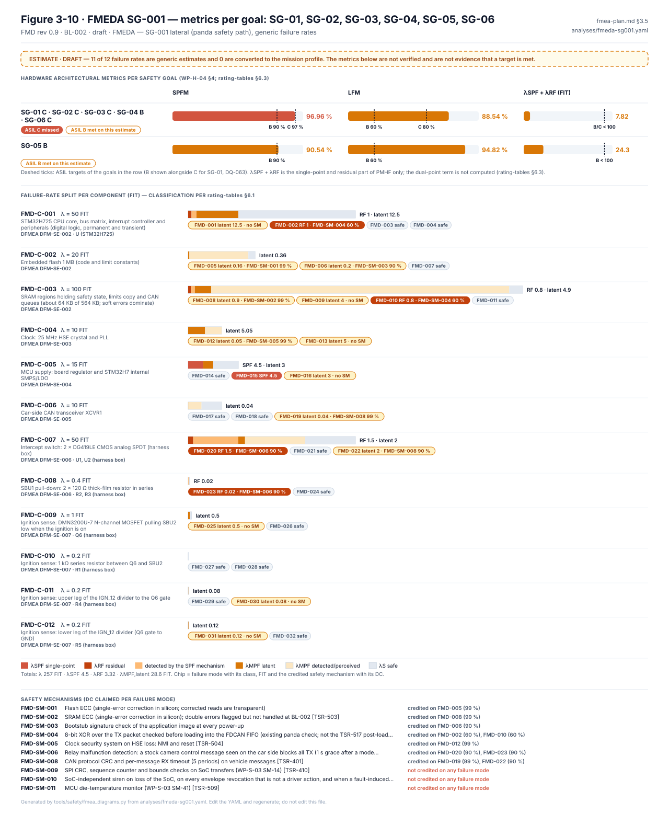

# FMEDA review: FMEDA — SG-001 lateral (panda safety path), generic failure rates

> Generated from [`analyses/fmeda-sg001.yaml`](../../analyses/fmeda-sg001.yaml) by `tools/safety/fmeda_review_md.py`. Edit the YAML and regenerate; never edit this page.

| Revision | Status | Baseline | Rating tables | Updated |
|---|---|---|---|---|
| 0.9 | draft | BL-002 | RT-1 | 2026-11-19 |

**Scope.** Random hardware faults of the panda section that can let an out-of-envelope or unauthorised steering request reach the EPS (LD-HARA-001 SG-001, ASIL D; assurance WP-C-03 SG-01, ASIL C pending OI-1). Reference device at BL-002. By decision DQ-362 (2026-10-18) the rows also stand for assurance SG-02, SG-03, SG-06 (ASIL C) and SG-05 (ASIL B), classified for SG-001; per-goal notes in WP-H-03 §6.4

> ⚠️ **Estimate.** 11 of 12 failure rates are generic order-of-magnitude estimates, and 0 are converted to the mission profile. The metrics show where the design falls short. They are not evidence that a target is met.

### At a glance

Both drawn by `tools/safety/fmeda_views.py`. The [live worksheet](https://claude.ai/artifact/GqXdK8QZmYi2EVSbj3FiSp) (private link) has every row for every goal, with filters, search and each row's notes.

## How to review

Start with the metrics per goal, then the failure modes that drive them (SPF and latent rows). Comment on this page's lines in a pull request, or open an issue naming the row ID (FMD-…). For a rate or DC, say which value you would use and its source. To try values before asking for a change, use the [what-if page](https://claude.ai/artifact/FwMt6jccCRfNSZ3BbGJHr1) (private link; it holds a snapshot of this revision). The same data as a workbook with live formulas: [`fmeda-sg001-review.xlsx`](fmeda-sg001-review.xlsx).

## Contents

- [Metrics per goal](#1-metrics-per-goal)
- [Components and failure-rate sources](#2-components-and-failure-rate-sources)
- [Failure modes](#3-failure-modes)
- [Rows classified differently for another goal](#4-rows-classified-differently-for-another-goal)
- [Safety mechanisms](#5-safety-mechanisms)
- [Open items](#6-open-items)
- [Revision history](#7-revision-history)

## 1. Metrics per goal

Targets from WP-H-04 §4. LD-HARA-001 rates this file's goal SG-001 at ASIL D; that rating is shown for reference only.

| Goal | ASIL | SPFM | LFM | λSPF + λRF (FIT) | Result | Basis |
|---|---|---:|---:|---:|---|---|
| SG-01 | C | 96.96 % | 88.54 % | 7.82 | 🔴 missed: SPFM < 97 % | WP-C-03 SG-01 at ASIL C until the HARA re-rates it, with the ASIL B result shown alongside (DQ-063). LD-HARA-001 SG-001 is rated D |
| SG-01 | B (alongside) | 96.96 % | 88.54 % | 7.82 | 🟠 met on this estimate |  |
| SG-02 | C | 96.96 % | 88.54 % | 7.82 | 🔴 missed: SPFM < 97 % | WP-C-03 v0.4; the shared rows are reused with the SG-01 classification (DQ-362 option A, WP-H-03 §6.4) |
| SG-03 | C | 96.96 % | 88.54 % | 7.82 | 🔴 missed: SPFM < 97 % | WP-C-03 v0.4; 0x343 leaves through the same TX path, rows reused with the SG-01 classification (DQ-362 option A) |
| SG-04 | B | 96.96 % | 88.54 % | 7.82 | 🟠 met on this estimate | WP-C-03 v0.4; rows reused with the SG-01 classification (DQ-002) |
| SG-05 | B | 90.54 % | 94.82 % | 24.3 | 🟠 met on this estimate | WP-C-03 v0.4; rows reused (DQ-362 option A), with FMD-001 and FMD-009 single-point for this goal (FTA BE-5.02) |
| SG-06 | C | 96.96 % | 88.54 % | 7.82 | 🔴 missed: SPFM < 97 % | WP-C-03 v0.4; the shared rows are reused with the SG-01 classification (DQ-362 option A, WP-H-03 §6.4) |

Total safety-related λ 257.0 FIT. λSPF + λRF is the single-point and residual part of PMHF only; the dual-point term is not computed (rating-tables §6.3). 🟠 means met on generic estimates, not verified.

## 2. Components and failure-rate sources

| ID | Part | λ (FIT) | Rate kind | Handbook reference | Ref. temp. | Converted | Wire ends |
|---|---|---:|---|---|---:|---|---|
| FMD-C-001 | STM32H725 CPU core, bus matrix, interrupt controller and peripherals (digital logic, permanent and transient) | 50 | generic | — | — | no | — |
| FMD-C-002 | Embedded flash 1 MB (code and limit constants) | 20 | generic | — | — | no | — |
| FMD-C-003 | SRAM regions holding safety state, limits copy and CAN queues (about 64 KB of 564 KB; soft errors dominate) | 100 | generic | — | — | no | — |
| FMD-C-004 | Clock: 25 MHz HSE crystal and PLL | 10 | generic | — | — | no | — |
| FMD-C-005 | MCU supply: board regulator and STM32H7 internal SMPS/LDO | 15 | generic | — | — | no | — |
| FMD-C-006 | Car-side CAN transceiver XCVR1 | 10 | generic | — | — | no | — |
| FMD-C-007 | Intercept switch: 2 × DG419LE CMOS analog SPDT (harness box) | 50 | handbook | SN 29500-2 Table 5, CMOS/BiCMOS analog and mixed-signal ICs (quoted from TI functional-safety reports; standard not read) | 55 °C | no | HB.U1.6-J3.A8, HB.U2.6-J3.A8, HB.J1.4-U1.2, HB.J1.6-U2.1, HB.J1.16-U1.1, HB.J1.18-U2.2 |
| FMD-C-008 | SBU1 pull-down: 2 × 120 Ω thick-film resistor in series | 0.4 | generic | — | — | no | HB.R2/R3.1-J3.A8 |
| FMD-C-009 | Ignition sense: DMN3200U-7 N-channel MOSFET pulling SBU2 low when the ignition is on | 1 | generic | — | — | no | — |
| FMD-C-010 | Ignition sense: 1 kΩ series resistor between Q6 and SBU2 | 0.2 | generic | — | — | no | — |
| FMD-C-011 | Ignition sense: upper leg of the IGN_12 divider to the Q6 gate | 0.2 | generic | — | — | no | — |
| FMD-C-012 | Ignition sense: lower leg of the IGN_12 divider (Q6 gate to GND) | 0.2 | generic | — | — | no | — |

Rate source text per component

- **FMD-C-001:** Generic estimate, order of magnitude of handbook values (SN 29500 / IEC TR 62380 class) for this part type at the mission profile below; not looked up for the actual part. No BOM or supplier data available (WP-H-02 UK-02)
- **FMD-C-002:** Generic estimate, order of magnitude of handbook values (SN 29500 / IEC TR 62380 class) for this part type at the mission profile below; not looked up for the actual part. No BOM or supplier data available (WP-H-02 UK-02)
- **FMD-C-003:** Generic estimate, order of magnitude of handbook values (SN 29500 / IEC TR 62380 class) for this part type at the mission profile below; not looked up for the actual part. No BOM or supplier data available (WP-H-02 UK-02)
- **FMD-C-004:** Generic estimate, order of magnitude of handbook values (SN 29500 / IEC TR 62380 class) for this part type at the mission profile below; not looked up for the actual part. No BOM or supplier data available (WP-H-02 UK-02)
- **FMD-C-005:** Generic estimate, order of magnitude of handbook values (SN 29500 / IEC TR 62380 class) for this part type at the mission profile below; not looked up for the actual part. No BOM or supplier data available (WP-H-02 UK-02)
- **FMD-C-006:** Generic estimate, order of magnitude of handbook values (SN 29500 / IEC TR 62380 class) for this part type at the mission profile below; not looked up for the actual part. No BOM or supplier data available (WP-H-02 UK-02)
- **FMD-C-007:** SN 29500-2 reference value for CMOS/BiCMOS analog and mixed-signal ICs (Table 5, supply up to 50 V): 25 FIT per IC at a virtual junction temperature of 55 °C, as quoted in TI functional-safety FIT reports (TPS1663 SFFS110, LM73605 SFFS410, LMR36015-Q1 SNVA922); other TI reports (OPA991-Q1, TPS22965-Q1) quote 20 FIT, and the higher value is used. 2 × 25 FIT. Secondary source: the standard itself was not read (not reachable from the analysis environment), and no temperature or stress conversion to the mission profile is applied. Part number DG419LE from the harness box v3 drawing (RR-2026-010 HB-01); shipped parts unconfirmed (VS-HW-02)
- **FMD-C-008:** Generic estimate (SMD thick-film chip resistor, 2 × about 0.2 FIT). Part class known from the harness box v3 drawing (RR-2026-010 HB-02); maps to the SN 29500 passive-component class, but no reference value could be obtained (standard not reachable, 2026-10-16). Stays generic until the source is confirmed (WP-H-03 OI-2); shipped parts unconfirmed (VS-HW-02)
- **FMD-C-009:** Generic estimate; part class known from the harness box v3 drawing (RR-2026-010 HB-06), no reference value held (SN 29500 not reachable). Rate and mode split as the component FMEDA of the harness box (WP-H-03 §6.5, harness-box-parts.yaml); shipped parts unconfirmed (VS-HW-02)
- **FMD-C-010:** Generic estimate; part class known from the harness box v3 drawing (RR-2026-010 HB-06), no reference value held (SN 29500 not reachable). Rate and mode split as the component FMEDA of the harness box (WP-H-03 §6.5, harness-box-parts.yaml); shipped parts unconfirmed (VS-HW-02)
- **FMD-C-011:** Generic estimate; part class known from the harness box v3 drawing (RR-2026-010 HB-06), no reference value held (SN 29500 not reachable). Rate and mode split as the component FMEDA of the harness box (WP-H-03 §6.5, harness-box-parts.yaml); shipped parts unconfirmed (VS-HW-02)
- **FMD-C-012:** Generic estimate; part class known from the harness box v3 drawing (RR-2026-010 HB-06), no reference value held (SN 29500 not reachable). Rate and mode split as the component FMEDA of the harness box (WP-H-03 §6.5, harness-box-parts.yaml); shipped parts unconfirmed (VS-HW-02)

## 3. Failure modes

Classified for this file's own goal (rating-tables §6.1). λ is the component rate × distribution.

| Row | Component | Failure mode | Dist. | λ (FIT) | Class | Mechanism (DC) | DFMEA | Other goals |
|---|---|---|---:|---:|---|---|---|---|
| FMD-001 | FMD-C-001 | Wrong result of a limit or authority check (permanent or transient) | 25 % | 12.5 | 🟡 MPF, latent part | — | DFM-001 | SG-05 |
| FMD-002 | FMD-C-001 | Frame content altered after the TX check (data-path fault) | 5 % | 2.5 | 🟠 RF | FMD-SM-004 (60 %) | DFM-019 | — |
| FMD-003 | FMD-C-001 | Hang or unexpected exception (no TX) | 40 % | 20.0 | safe | — | DFM-004 | — |
| FMD-004 | FMD-C-001 | Other faults without effect on the safety path | 30 % | 15.0 | safe | — | — | — |
| FMD-005 | FMD-C-002 | Single-bit error | 80 % | 16.0 | MPF, detected and latent parts | FMD-SM-001 (99 %) | DFM-002 | — |
| FMD-006 | FMD-C-002 | Multi-bit error in limit constants or check code | 10 % | 2 | MPF, detected and latent parts | FMD-SM-003 (90 %) | DFM-002 | — |
| FMD-007 | FMD-C-002 | Multi-bit error elsewhere (crash, hang) | 10 % | 2 | safe | — | DFM-002 | — |
| FMD-008 | FMD-C-003 | Single-bit upset | 90 % | 90.0 | MPF, detected and latent parts | FMD-SM-002 (99 %) | DFM-003 | — |
| FMD-009 | FMD-C-003 | Multi-bit upset in authority or limit variables | 4 % | 4 | 🟡 MPF, latent part | — | DFM-003 | SG-05 |
| FMD-010 | FMD-C-003 | Multi-bit upset in the TX queue after the check | 2 % | 2 | 🟠 RF | FMD-SM-004 (60 %) | DFM-019 | — |
| FMD-011 | FMD-C-003 | Multi-bit upset elsewhere (stack, buffers: crash or dropped frame) | 4 % | 4 | safe | — | DFM-003 | — |
| FMD-012 | FMD-C-004 | Oscillation stops | 50 % | 5 | MPF, detected and latent parts | FMD-SM-005 (99 %) | DFM-005 | — |
| FMD-013 | FMD-C-004 | Frequency drift (all timeouts and rate windows scale) | 50 % | 5 | 🟡 MPF, latent part | — | DFM-005 | — |
| FMD-014 | FMD-C-005 | Loss of supply | 50 % | 7.5 | safe | — | DFM-007 | — |
| FMD-015 | FMD-C-005 | Under-voltage in the brown-out zone or over-voltage (erratic logic) | 30 % | 4.5 | 🔴 SPF | — | DFM-007 | — |
| FMD-016 | FMD-C-005 | Ripple or noise | 20 % | 3 | 🟡 MPF, latent part | — | DFM-007 | — |
| FMD-017 | FMD-C-006 | TX stuck dominant | 30 % | 3 | safe | — | DFM-008 | — |
| FMD-018 | FMD-C-006 | RX open or stuck recessive | 30 % | 3 | safe | — | DFM-009 | — |
| FMD-019 | FMD-C-006 | Bit errors on the line | 40 % | 4 | MPF, detected and latent parts | FMD-SM-008 (99 %) | — | — |
| FMD-020 | FMD-C-007 | Stuck in pass-through while driven (stock LKA and item commands both reach the EPS) | 30 % | 15.0 | 🟠 RF | FMD-SM-006 (90 %) | DFM-011 | — |
| FMD-021 | FMD-C-007 | Stuck in intercept, or IN input damaged high | 30 % | 15.0 | safe | — | DFM-010 | — |
| FMD-022 | FMD-C-007 | Channel open, increased on-resistance, leakage or latch-up | 40 % | 20.0 | MPF, detected and latent parts | FMD-SM-008 (90 %) | DFM-013 | — |
| FMD-023 | FMD-C-008 | Short (SBU1 held low, so the switch cannot reach intercept) | 40 % | 0.16 | 🟠 RF | FMD-SM-006 (90 %) | DFM-011 | — |
| FMD-024 | FMD-C-008 | Open (IN floats when SBU1 is undriven) | 60 % | 0.24 | safe | — | DFM-010 | — |
| FMD-025 | FMD-C-009 | Drain-source short (SBU2 held low, ignition sense reads on with the ignition off) | 50 % | 0.5 | 🟡 MPF, latent part | — | DFM-014 | — |
| FMD-026 | FMD-C-009 | Open (SBU2 never pulled low, ignition sense reads off while driving) | 50 % | 0.5 | safe | — | DFM-024 | — |
| FMD-027 | FMD-C-010 | Open (ignition sense reads off while driving) | 60 % | 0.12 | safe | — | DFM-024 | — |
| FMD-028 | FMD-C-010 | Short (SBU2 pulled low through Q6 alone) | 40 % | 0.08 | safe | — | DFM-024 | — |
| FMD-029 | FMD-C-011 | Open (Q6 stays off, ignition sense reads off while driving) | 60 % | 0.12 | safe | — | DFM-024 | — |
| FMD-030 | FMD-C-011 | Short (Q6 gate at the full ignition voltage) | 40 % | 0.08 | 🟡 MPF, latent part | — | DFM-014 | — |
| FMD-031 | FMD-C-012 | Open (Q6 gate at the full ignition voltage) | 60 % | 0.12 | 🟡 MPF, latent part | — | DFM-014 | — |
| FMD-032 | FMD-C-012 | Short (Q6 stays off, ignition sense reads off while driving) | 40 % | 0.08 | safe | — | DFM-024 | — |

Notes per failure mode

- **FMD-001:** Needs a SoC command outside the envelope as second fault. No CPU self-test, so fully latent. Also stands for SG-05 (FTA BE-5.02, DQ-362): a wrong authority check that keeps authority after the brake or cancel needs no second fault there, so for SG-05 it is effectively single-point; the classification here is for SG-001 only
- **FMD-002:** Only the software-queue part is covered by the XOR; the FDCAN copy and message RAM are not (TSR-517). Also covers SG-04 (deceleration): 0x343 leaves through the same TX path as 0x2E4, so this row and its rates stand for FTA event BE-4.03 too (decision register DQ-002, 2026-10-14), and for SG-03 (unintended acceleration, FTA BE-3.04) by DQ-362 (2026-10-18)
- **FMD-003:** Safe for SG-001: no LKA frames, the EPS times out (AOU-01). Relevant to SG-009. Not safe for SG-02/SG-06 (DQ-362): actuation stops, and the goal is violated if no warning follows; the warning comes from the host (controlsMismatch, TSR-621), not from the hung panda
- **FMD-005:** Corrected by ECC; counted as multiple-point detected
- **FMD-006:** Needs a SoC command outside the wrong limit; boot signature finds permanent faults at the next power-up
- **FMD-008:** Corrected by ECC
- **FMD-009:** Needs a SoC command outside the envelope or while not engaged; double-error flag not handled (latent). Also stands for SG-05 (FTA BE-5.02, DQ-362): a corrupted controls_allowed that stays true after the brake is effectively single-point there; the classification here is for SG-001 only
- **FMD-010:** Also covers SG-04 (deceleration), as FMD-002 (decision register DQ-002, 2026-10-14), and SG-03 (FTA BE-3.04, DQ-362)
- **FMD-012:** CSS reset; no frames
- **FMD-013:** Rate limits are per frame and the EPS has its own limits; violation needs a second fault. No cross-check (TSR-504)
- **FMD-014:** MCU off, relay released. For SG-02/SG-06 (DQ-362) the loss itself is the hazard unless the host warns (FTA BE-2.07)
- **FMD-015:** Undefined behaviour while running; BOR level not set and PVD not enabled at BL-002 (TSR-505)
- **FMD-017:** Bus blocked: no LKA torque; SG-003 effect, not SG-001. For SG-02/SG-06 (DQ-362): actuation lost, warning from the host (FTA BE-2.06)
- **FMD-018:** RX timeout withdraws authority. For SG-02/SG-06 (DQ-362): actuation lost, warning from the host (FTA BE-6.02)
- **FMD-019:** CAN CRC. Also stands for SG-03 (FTA BE-3.04, DQ-362)
- **FMD-020:** Usually detected after the mode change and before engagement; detection inside the FTTI while engaged is not shown
- **FMD-021:** No effect on SG-001; see SG-009
- **FMD-022:** RX timeouts and CAN errors
- **FMD-023:** Same effect as FMD-020: stock path stays joined while driven
- **FMD-024:** No effect on SG-001; latent for SG-009
- **FMD-025:** Heartbeat timeout keeps its 5 s ignition-on value: a longer actuation window only after a second fault (SoC loss). No mechanism detects it (WP-H-03 FM-IGN-02)
- **FMD-026:** Safe for SG-001 (WP-H-03 FM-IGN-01): heartbeat timeout 2 s, pandad closes the relay (pass-through, should_close_relay) and the device goes offroad. Loss of the item without its take-control warning: DFM-024, HZ-004
- **FMD-027:** As FMD-026. The SBU2 side stays high, so the orientation detection still picks the R2/R3 side (lower voltage) as the switch line: orientation unchanged
- **FMD-028:** With the ignition on and the switch undriven, the SBU2 side reads lower than the 240 Ω R2/R3 side, so harness.h detects the orientation flipped (WP-H-03 FM-HAR-02): the intercept drive goes to the ignition line, the switch stays in pass-through and the relay-malfunction check (FMD-SM-006) blocks all TX. Safe for SG-001; item unavailable. Relies on Q6 on-resistance well below 240 Ω (datasheet value, not measured)
- **FMD-029:** As FMD-026
- **FMD-030:** Classified as FMD-025, the worse Q6 outcome for SG-001, until the Q6 gate rating against the ignition voltage is checked (resistor values and the shipped part unconfirmed, VS-HW-02). Conservative
- **FMD-031:** As FMD-030, conservative
- **FMD-032:** As FMD-026

## 4. Rows classified differently for another goal

| Goal | Row | Own class | Class for the goal | Reason |
|---|---|---|---|---|
| SG-05 | FMD-001 | MPF, latent part | SPF | Authority wrongly kept after the brake or cancel needs no second fault (FTA BE-5.02, WP-H-03 §6.4) |
| SG-05 | FMD-009 | MPF, latent part | SPF | A corrupted controls_allowed that stays true after the brake needs no second fault (FTA BE-5.02, WP-H-03 §6.4) |

## 5. Safety mechanisms

WP-S-03 is the [safety mechanism catalogue](../../../../03-system/WP-S-03-technical-safety-concept-architecture.md#6-safety-mechanism-catalogue).

| ID | WP-S-03 §6 | Mechanism | DC basis | Requirement | Credited on |
|---|---|---|---|---|---|
| FMD-SM-001 | SM-17 | Flash ECC (single-error correction in silicon; corrected reads are transparent) | ISO 26262-5 Annex D, Table D.6 (memory): ECC, high for single-bit faults | — | FMD-005 (99 %) |
| FMD-SM-002 | SM-17 | SRAM ECC (single-error correction in silicon); double errors flagged but not handled at BL-002 | ISO 26262-5 Annex D, Table D.6: ECC, high for single-bit faults; double errors not credited | TSR-503 | FMD-008 (99 %) |
| FMD-SM-003 | SM-17 | Bootstub signature check of the application image at every power-up | Annex D, Table D.6: memory signature at start-up; credited for latent permanent faults only (once per drive cycle) | — | FMD-006 (90 %) |
| FMD-SM-004 | — | 8-bit XOR over the TX packet checked before loading into the FDCAN FIFO (existing panda check; not the TSR-517 post-load read-back, WP-S-03 SM-38, which is not implemented) | Annex D, Table D.7 (communication): checksum, low; covers the software TX queue only. It has no row in the WP-S-03 §6 catalogue and traces to no TSR | — | FMD-002 (60 %), FMD-010 (60 %) |
| FMD-SM-005 | SM-18 | Clock security system on HSE loss: NMI and reset | Annex D, Table D.9 (clock): CSS for clock loss, high for stop; does not detect drift | TSR-504 | FMD-012 (99 %) |
| FMD-SM-006 | SM-24 | Relay malfunction detection: a stock camera control message seen on the car side blocks all TX (1 s grace after a mode change) | Analysis: detects relay-not-intercepting before or within about 1-2 s of engagement; medium | TSR-710 | FMD-020 (90 %), FMD-023 (90 %) |
| FMD-SM-008 | SM-09 | CAN protocol CRC and per-message RX timeout (5 periods) on vehicle messages | Annex D, Table D.7: CRC, high for transmission errors; RX timeout for loss | TSR-401 | FMD-019 (99 %), FMD-022 (90 %) |
| FMD-SM-009 | SM-14 | SPI CRC, sequence counter and bounds checks on SoC transfers (WP-S-03 SM-14) | Not credited: the SoC-MCU SPI link has no row in this FMEDA (it is analysed qualitatively in WP-H-03 §4.8, FM-SPI-01…03), and the link today carries an 8-bit XOR only (GAP-10). A row and a DC claim follow when the CRC and counter are implemented | TSR-410 | none (not credited) |
| FMD-SM-010 | SM-23 | SoC-independent siren on loss of the SoC, on every envelope revocation that is not a driver action, and when a fault-induced ACC cancel has no effect (WP-S-03 SM-23) | Not credited: the siren is a warning to the driver, not a detection of a hardware fault, so it gives no diagnostic coverage in the ISO 26262-5 sense. It is the warning path the SG-02/SG-06 rows rely on (DQ-362) and is argued in the FTA (WP-A-04) | TSR-516 | none (not credited) |
| FMD-SM-011 | SM-41 | MCU die-temperature monitor (WP-S-03 SM-41) | Not credited: today the temperature is reported only, with no reaction (WP-H-03 FM-TMP-01, HWSR-509), so it detects nothing in the sense of Annex D. The sensor has no row; it gets one with the MCU internal FMEDA (WP-H-03 §2, item 5) | TSR-509 | none (not credited) |

## 6. Open items

From the workbook's `11_Open_Items` tab.

- **OI-1:** FMD-001 (FMD-C-001): latent fault without coverage: Wrong result of a limit or authority check (permanent or transient)
- **OI-2:** FMD-001 (FMD-C-001): single-point fault for SG-05 without a safety mechanism: Wrong result of a limit or authority check (permanent or transient)
- **OI-3:** FMD-009 (FMD-C-003): latent fault without coverage: Multi-bit upset in authority or limit variables
- **OI-4:** FMD-009 (FMD-C-003): single-point fault for SG-05 without a safety mechanism: Multi-bit upset in authority or limit variables
- **OI-5:** FMD-013 (FMD-C-004): latent fault without coverage: Frequency drift (all timeouts and rate windows scale)
- **OI-6:** FMD-015 (FMD-C-005): single-point fault without a safety mechanism: Under-voltage in the brown-out zone or over-voltage (erratic logic)
- **OI-7:** FMD-016 (FMD-C-005): latent fault without coverage: Ripple or noise
- **OI-8:** FMD-025 (FMD-C-009): latent fault without coverage: Drain-source short (SBU2 held low, ignition sense reads on with the ignition off)
- **OI-9:** FMD-030 (FMD-C-011): latent fault without coverage: Short (Q6 gate at the full ignition voltage)
- **OI-10:** FMD-031 (FMD-C-012): latent fault without coverage: Open (Q6 gate at the full ignition voltage)
- **OI-11:** 11 of 12 failure rates are generic estimates: replace with handbook or supplier values per part (WP-H-03 §2.3, OI-10)
- **OI-12:** No rate is converted to the mission profile (IEC 61709)
- **OI-13:** Dual-point PMHF term not computed

## 7. Revision history

| Revision | Date | Change |
|---|---|---|
| 0.1 | 2026-10-10 | Stub without components |
| 0.2 | 2026-10-12 | First quantitative FMEDA at BL-002 with generic failure rates |
| 0.3 | 2026-10-15 | Relay re-based to the harness box v3 analog switches U1/U2 and its pull-down, supply and clamps (RR-2026-010) |
| 0.4 | 2026-10-16 | U1/U2 at the SN 29500-2 reference value, 2 × 25 FIT (secondary quote); box discretes keep generic rates with their SN 29500 class named |
| 0.5 | 2026-10-18 | Rows reused for SG-02, SG-03, SG-05 and SG-06 (DQ-362 A), a note per goal; no rate, classification or metric change |
| 0.6 | 2026-10-20 | Wire-end IDs of the WireViz drawings added; no rate, classification or metric change |
| 0.7 | 2026-10-20 | Format review: targets per goal (C with B alongside for SG-01), SG-05 classification of FMD-001 and FMD-009, rate kind and wire ends as fields; SG-01 metrics unchanged |
| 0.8 | 2026-11-01 | Mechanisms linked to the WP-S-03 §6 catalogue (catalogue_ref); FMD-SM-004 (TX XOR) no longer tagged TSR-517, which is the post-load read-back SM-38; SM-14, SM-23 and SM-41 listed as not credited, with the reason; no rate, classification or metric change |
| 0.9 | 2026-11-19 | WP-H-03 OI-11 and OI-12 (Claude, I0): FMD-C-007 DG419LE split aligned with the SG-009 file and the harness box part list (30/30/40 %); Q6, R1, R4 and R5 of the ignition sense added as FMD-C-009…012. SG-01 λ 255 → 257 FIT, SPFM 96.84 → 96.96 %, LFM 88.94 → 88.54 %, λSPF + λRF 8.1 → 7.8 FIT |
