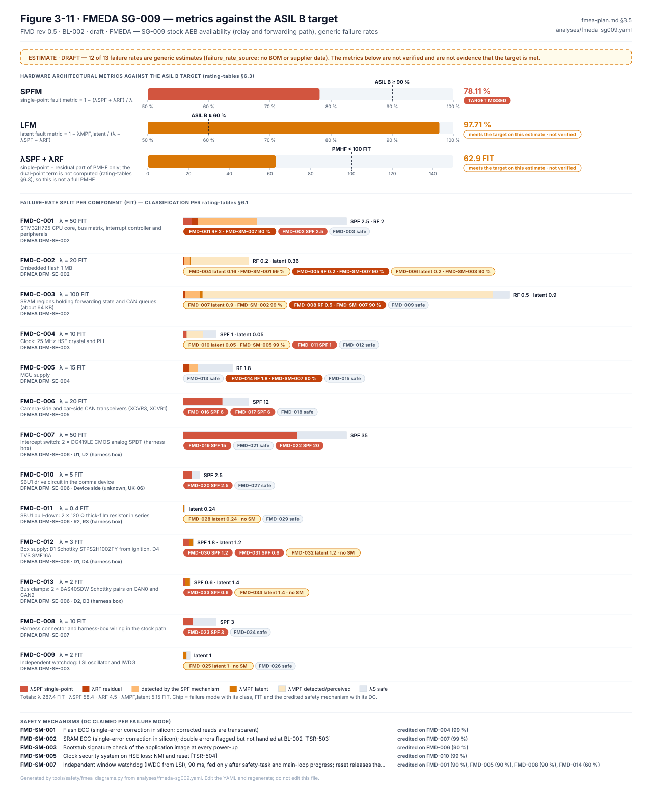

# FMEDA review: FMEDA — SG-009 stock AEB availability (relay and forwarding path), generic failure rates

> Generated from [`analyses/fmeda-sg009.yaml`](../../analyses/fmeda-sg009.yaml) by `tools/safety/fmeda_review_md.py`. Edit the YAML and regenerate; never edit this page.

| Revision | Status | Baseline | Rating tables | Updated |
|---|---|---|---|---|
| 0.8 | draft | BL-002 | RT-1 | 2026-10-27 |

**Scope.** Random hardware faults of the panda section and harness that can keep the stock camera's PCS messages from reaching the car (LD-HARA-001 SG-009, ASIL B; assurance WP-C-03 SG-07, ASIL B). Reference device at BL-002

> ⚠️ **Estimate.** 12 of 13 failure rates are generic order-of-magnitude estimates, and 0 are converted to the mission profile. The metrics show where the design falls short. They are not evidence that a target is met.

### At a glance

Both drawn by `tools/safety/fmeda_views.py`. The [live worksheet](https://claude.ai/artifact/PCbGoJH1mrjZGDmEzegu7N) (private link) has every row for every goal, with filters, search and each row's notes.

## How to review

Start with the metrics per goal, then the failure modes that drive them (SPF and latent rows). Comment on this page's lines in a pull request, or open an issue naming the row ID (FMD-…). For a rate or DC, say which value you would use and its source. To try values before asking for a change, use the [what-if page](https://claude.ai/artifact/6btZjojvGtcyZdYrhzsR8Z) (private link; it holds a snapshot of this revision). The same data as a workbook with live formulas: [`fmeda-sg009-review.xlsx`](fmeda-sg009-review.xlsx).

## Contents

- [Metrics per goal](#1-metrics-per-goal)
- [Components and failure-rate sources](#2-components-and-failure-rate-sources)
- [Failure modes](#3-failure-modes)
- [Rows classified differently for another goal](#4-rows-classified-differently-for-another-goal)
- [Safety mechanisms](#5-safety-mechanisms)
- [Open items](#6-open-items)
- [Revision history](#7-revision-history)

## 1. Metrics per goal

Targets from WP-H-04 §4. LD-HARA-001 rates this file's goal SG-009 at ASIL B; that rating is shown for reference only.

| Goal | ASIL | SPFM | LFM | λSPF + λRF (FIT) | Result | Basis |
|---|---|---:|---:|---:|---|---|
| SG-07 | B | 78.11 % | 97.71 % | 62.9 | 🔴 missed: SPFM < 90 % | WP-C-03 SG-07 (LD-HARA-001 SG-009); the SPFM shortfall is a recorded deviation, conditional on the harness box bench tests (DQ-320, WP-H-04 §5.3) |

Total safety-related λ 287.4 FIT. λSPF + λRF is the single-point and residual part of PMHF only; the dual-point term is not computed (rating-tables §6.3). 🟠 means met on generic estimates, not verified.

## 2. Components and failure-rate sources

| ID | Part | λ (FIT) | Rate kind | Handbook reference | Ref. temp. | Converted | Wire ends |
|---|---|---:|---|---|---:|---|---|
| FMD-C-001 | STM32H725 CPU core, bus matrix, interrupt controller and peripherals | 50 | generic | — | — | no | — |
| FMD-C-002 | Embedded flash 1 MB | 20 | generic | — | — | no | — |
| FMD-C-003 | SRAM regions holding forwarding state and CAN queues (about 64 KB) | 100 | generic | — | — | no | — |
| FMD-C-004 | Clock: 25 MHz HSE crystal and PLL | 10 | generic | — | — | no | — |
| FMD-C-005 | MCU supply | 15 | generic | — | — | no | — |
| FMD-C-006 | Camera-side and car-side CAN transceivers (XCVR3, XCVR1) | 20 | generic | — | — | no | — |
| FMD-C-007 | Intercept switch: 2 × DG419LE CMOS analog SPDT (harness box) | 50 | handbook | SN 29500-2 Table 5, CMOS/BiCMOS analog and mixed-signal ICs (quoted from TI functional-safety reports; standard not read) | 55 °C | no | HB.U1.6-J3.A8, HB.U2.6-J3.A8, HB.J1.4-U1.2, HB.J1.6-U2.1, HB.J1.16-U1.1, HB.J1.18-U2.2 |
| FMD-C-010 | SBU1 drive circuit in the comma device | 5 | generic | — | — | no | OC.W1.11 |
| FMD-C-011 | SBU1 pull-down: 2 × 120 Ω thick-film resistor in series | 0.4 | generic | — | — | no | HB.R2/R3.1-J3.A8 |
| FMD-C-012 | Box supply: D1 Schottky STPS2H100ZFY from ignition, D4 TVS SMF16A | 3 | generic | — | — | no | HB.J1.2-D1.A, HB.D1.K-J3.A4, HB.J2.4-J3.A4 |
| FMD-C-013 | Bus clamps: 2 × BAS40SDW Schottky pairs on CAN0 and CAN2 | 2 | generic | — | — | no | — |
| FMD-C-008 | Harness connector and harness-box wiring in the stock path | 10 | generic | — | — | no | TA.W1.1, TA.W1.2, TA.W2.1, TA.W2.2, HB.J1.4-U1.2, HB.J1.6-U2.1, HB.J1.16-U1.1, HB.J1.18-U2.2, OC.W1.1, OC.W1.2, OC.W1.3, OC.W1.4, OC.W1.5, OC.W1.6, OC.W1.7, OC.W1.8, OC.W1.9, OC.W1.10, OC.W1.11, OC.W1.12 |
| FMD-C-009 | Independent watchdog: LSI oscillator and IWDG | 2 | generic | — | — | no | — |

Rate source text per component

- **FMD-C-001:** Generic estimate, order of magnitude of handbook values (SN 29500 / IEC TR 62380 class) for this part type at the mission profile below; not looked up for the actual part. No BOM or supplier data available (WP-H-02 UK-02)
- **FMD-C-002:** Generic estimate, order of magnitude of handbook values (SN 29500 / IEC TR 62380 class) for this part type at the mission profile below; not looked up for the actual part. No BOM or supplier data available (WP-H-02 UK-02)
- **FMD-C-003:** Generic estimate, order of magnitude of handbook values (SN 29500 / IEC TR 62380 class) for this part type at the mission profile below; not looked up for the actual part. No BOM or supplier data available (WP-H-02 UK-02)
- **FMD-C-004:** Generic estimate, order of magnitude of handbook values (SN 29500 / IEC TR 62380 class) for this part type at the mission profile below; not looked up for the actual part. No BOM or supplier data available (WP-H-02 UK-02)
- **FMD-C-005:** Generic estimate, order of magnitude of handbook values (SN 29500 / IEC TR 62380 class) for this part type at the mission profile below; not looked up for the actual part. No BOM or supplier data available (WP-H-02 UK-02)
- **FMD-C-006:** Generic estimate, order of magnitude of handbook values (SN 29500 / IEC TR 62380 class) for this part type at the mission profile below; not looked up for the actual part. No BOM or supplier data available (WP-H-02 UK-02)
- **FMD-C-007:** SN 29500-2 reference value for CMOS/BiCMOS analog and mixed-signal ICs (Table 5, supply up to 50 V): 25 FIT per IC at a virtual junction temperature of 55 °C, as quoted in TI functional-safety FIT reports (TPS1663 SFFS110, LM73605 SFFS410, LMR36015-Q1 SNVA922); other TI reports (OPA991-Q1, TPS22965-Q1) quote 20 FIT, and the higher value is used. 2 × 25 FIT. Secondary source: the standard itself was not read (not reachable from the analysis environment), and no temperature or stress conversion to the mission profile is applied. Part number DG419LE from the harness box v3 drawing (RR-2026-010 HB-01); shipped parts unconfirmed (VS-HW-02)
- **FMD-C-010:** Generic estimate for a small-signal driver stage; circuit unknown (WP-H-02 UK-01, UK-06)
- **FMD-C-011:** Generic estimate (SMD thick-film chip resistor, 2 × about 0.2 FIT). Part class known from the harness box v3 drawing (RR-2026-010 HB-02); maps to the SN 29500 passive-component class, but no reference value could be obtained (standard not reachable, 2026-10-16). Stays generic until the source is confirmed (WP-H-03 OI-2); shipped parts unconfirmed (VS-HW-02)
- **FMD-C-012:** Generic estimate (power Schottky rectifier STPS2H100ZFY about 2 FIT; TVS diode SMF16A about 1 FIT). The part is known from the harness box v3 drawing (RR-2026-010 HB-01..HB-06) and maps to the SN 29500 discrete-semiconductor class, but no reference value could be obtained: the standard and the vendor FIT reports were not reachable from the analysis environment (2026-10-16). Stays generic until the safety manager confirms the source (WP-H-03 OI-2) and the value is looked up; shipped parts unconfirmed (VS-HW-02)
- **FMD-C-013:** Generic estimate (small-signal Schottky diode array BAS40SDW, 2 × about 1 FIT). The part is known from the harness box v3 drawing (RR-2026-010 HB-01..HB-06) and maps to the SN 29500 discrete-semiconductor class, but no reference value could be obtained: the standard and the vendor FIT reports were not reachable from the analysis environment (2026-10-16). Stays generic until the safety manager confirms the source (WP-H-03 OI-2) and the value is looked up; shipped parts unconfirmed (VS-HW-02)
- **FMD-C-008:** Generic estimate, order of magnitude of handbook values (SN 29500 / IEC TR 62380 class) for this part type at the mission profile below; not looked up for the actual part. No BOM or supplier data available (WP-H-02 UK-02)
- **FMD-C-009:** Generic estimate, order of magnitude of handbook values (SN 29500 / IEC TR 62380 class) for this part type at the mission profile below; not looked up for the actual part. No BOM or supplier data available (WP-H-02 UK-02)

## 3. Failure modes

Classified for this file's own goal (rating-tables §6.1). λ is the component rate × distribution.

| Row | Component | Failure mode | Dist. | λ (FIT) | Class | Mechanism (DC) | DFMEA | Other goals |
|---|---|---|---:|---:|---|---|---|---|
| FMD-001 | FMD-C-001 | Hang or unexpected exception with the relay driven (forwarding stops) | 40 % | 20.0 | 🟠 RF | FMD-SM-007 (90 %) | DFM-004 | — |
| FMD-002 | FMD-C-001 | Wrong forwarding decision (stock PCS frame dropped while forwarding runs) | 5 % | 2.5 | 🔴 SPF | — | DFM-001 | — |
| FMD-003 | FMD-C-001 | Other faults without effect on forwarding | 55 % | 27.5 | safe | — | — | — |
| FMD-004 | FMD-C-002 | Single-bit error | 80 % | 16.0 | MPF, detected and latent parts | FMD-SM-001 (99 %) | DFM-002 | — |
| FMD-005 | FMD-C-002 | Multi-bit error causing a hang with the relay driven | 10 % | 2 | 🟠 RF | FMD-SM-007 (90 %) | DFM-002 | — |
| FMD-006 | FMD-C-002 | Multi-bit error in the forwarding table or code | 10 % | 2 | MPF, detected and latent parts | FMD-SM-003 (90 %) | DFM-002 | — |
| FMD-007 | FMD-C-003 | Single-bit upset | 90 % | 90.0 | MPF, detected and latent parts | FMD-SM-002 (99 %) | DFM-003 | — |
| FMD-008 | FMD-C-003 | Multi-bit upset leading to a hang with the relay driven | 5 % | 5 | 🟠 RF | FMD-SM-007 (90 %) | DFM-003 | — |
| FMD-009 | FMD-C-003 | Multi-bit upset elsewhere (single dropped frame) | 5 % | 5 | safe | — | DFM-003 | — |
| FMD-010 | FMD-C-004 | Oscillation stops | 50 % | 5 | MPF, detected and latent parts | FMD-SM-005 (99 %) | DFM-005 | — |
| FMD-011 | FMD-C-004 | Frequency drift beyond CAN bit-timing tolerance (forwarding fails with the relay driven) | 10 % | 1 | 🔴 SPF | — | DFM-005 | — |
| FMD-012 | FMD-C-004 | Small drift without effect | 40 % | 4 | safe | — | DFM-005 | — |
| FMD-013 | FMD-C-005 | Loss of supply | 50 % | 7.5 | safe | — | DFM-007 | — |
| FMD-014 | FMD-C-005 | Brown-out zone or over-voltage with the relay driven | 30 % | 4.5 | 🟠 RF | FMD-SM-007 (60 %) | DFM-007 | — |
| FMD-015 | FMD-C-005 | Ripple or noise | 20 % | 3 | safe | — | DFM-007 | — |
| FMD-016 | FMD-C-006 | TX stuck dominant (blocks the joined bus when the relay is released) | 30 % | 6 | 🔴 SPF | — | DFM-008 | — |
| FMD-017 | FMD-C-006 | RX open (camera frames not received for forwarding) | 30 % | 6 | 🔴 SPF | — | DFM-009 | — |
| FMD-018 | FMD-C-006 | Other | 40 % | 8 | safe | — | — | — |
| FMD-019 | FMD-C-007 | Stuck in intercept, or IN input damaged high | 30 % | 15.0 | 🔴 SPF | — | DFM-010 | — |
| FMD-021 | FMD-C-007 | Stuck in pass-through | 30 % | 15.0 | safe | — | DFM-011 | — |
| FMD-022 | FMD-C-007 | Channel open, increased on-resistance, leakage or latch-up in the stock path | 40 % | 20.0 | 🔴 SPF | — | DFM-013 | — |
| FMD-020 | FMD-C-010 | Driver stuck on (SBU1 held high) | 50 % | 2.5 | 🔴 SPF | — | DFM-010 | — |
| FMD-027 | FMD-C-010 | Driver open (SBU1 undriven) | 50 % | 2.5 | safe | — | DFM-011 | — |
| FMD-028 | FMD-C-011 | Open (IN floats when SBU1 is undriven) | 60 % | 0.24 | 🟡 MPF, latent part | — | DFM-010 | — |
| FMD-029 | FMD-C-011 | Short (SBU1 held low) | 40 % | 0.16 | safe | — | DFM-011 | — |
| FMD-030 | FMD-C-012 | D1 open: box unpowered without comma power | 40 % | 1.2 | 🔴 SPF | — | DFM-020 | — |
| FMD-031 | FMD-C-012 | D4 short: box VIN to ground | 20 % | 0.6 | 🔴 SPF | — | DFM-020 | — |
| FMD-032 | FMD-C-012 | Other (D1 short, D4 open: protection lost) | 40 % | 1.2 | 🟡 MPF, latent part | — | DFM-020 | — |
| FMD-033 | FMD-C-013 | Short or leakage on a CAN line | 30 % | 0.6 | 🔴 SPF | — | DFM-021 | — |
| FMD-034 | FMD-C-013 | Open (clamp lost) | 70 % | 1.4 | 🟡 MPF, latent part | — | DFM-021 | — |
| FMD-023 | FMD-C-008 | Open in the stock camera path | 30 % | 3 | 🔴 SPF | — | DFM-013 | — |
| FMD-024 | FMD-C-008 | Connector loose (whole device off the bus) | 70 % | 7 | safe | — | DFM-012 | — |
| FMD-025 | FMD-C-009 | Watchdog does not expire (LSI stopped, IWDG fault) | 50 % | 1 | 🟡 MPF, latent part | — | DFM-006 | — |
| FMD-026 | FMD-C-009 | Spurious early reset | 50 % | 1 | safe | — | DFM-006 | — |

Notes per failure mode

- **FMD-001:** Watchdog reset releases the relay (if the drive circuit is de-energise-to-safe, UK-06). For SG-02/SG-06 (DQ-362): actuation lost, warning from the host (FTA BE-2.06)
- **FMD-002:** No mechanism compares forwarded with received frames
- **FMD-006:** Wrong blocking of a PCS message; boot signature finds permanent faults at the next power-up
- **FMD-009:** PCS messages repeat; one lost frame is tolerated
- **FMD-010:** CSS reset releases the relay
- **FMD-013:** Relay de-energises (stock path restored), if de-energise-to-safe (UK-03)
- **FMD-014:** Watchdog catches a resulting hang, not wrong forwarding
- **FMD-016:** No mechanism; a stuck transceiver also disturbs the stock path (WP-H-03 FM-CAN-03)
- **FMD-017:** With the relay driven, camera messages are lost; RX checks cover car-side messages only
- **FMD-019:** No readback (TSR-506, DFM-ACT-007)
- **FMD-021:** Stock path stays connected: safe for SG-009
- **FMD-022:** Installation check only (DFM-ACT-008); no in-field detection of the stock path
- **FMD-020:** No readback; a watchdog reset does not release a shorted driver
- **FMD-027:** Pull-down selects pass-through: safe for SG-009
- **FMD-028:** Latent: violates SG-009 only together with a device that stops driving SBU1 while intercepting (reset, hang); no check (HWSR-506e)
- **FMD-029:** Pass-through: safe for SG-009
- **FMD-030:** Switch unpowered, pass-through not guaranteed (RR-2026-010 F-02, to confirm on the bench). The device loses power with the box, so for SG-02/SG-06 (DQ-362) actuation is lost and only the host can warn (FTA BE-2.07, DFM-020)
- **FMD-031:** As FMD-030
- **FMD-032:** Latent loss of reverse or transient protection
- **FMD-033:** Car or camera bus loaded in either switch state (RR-2026-010 F-07). The harness box SPICE pilot (PR #510; idealised model, generic transceivers; a prediction, no credit) splits the mode: a lower-diode short to GND on CAN_H loses dominant bits; an upper-diode short to VIN holds the line near 13 V, outside the receiver common-mode range; CAN_L to GND and 1 kOhm leakage leave readable levels. A D3 short on camera CAN_H to GND also stops the joined stock bus in pass-through. The whole mode stays single-point until VS-HW-24 (d) measures the split on a real box
- **FMD-034:** Latent loss of bus protection
- **FMD-023:** Installation check only (DFM-ACT-008)
- **FMD-024:** SBU1 undriven, the pull-down selects pass-through and the stock path is restored, if the box stays powered
- **FMD-025:** Latent until a hang occurs; no periodic proof of the reset path
- **FMD-026:** Releases the relay: safe for SG-009 (SG-003 effect, SW FMEA SWF-019)

## 4. Rows classified differently for another goal

None: every row classifies the same for every target goal.

## 5. Safety mechanisms

| ID | Mechanism | DC basis | Requirement | Credited on |
|---|---|---|---|---|
| FMD-SM-001 | Flash ECC (single-error correction in silicon; corrected reads are transparent) | ISO 26262-5 Annex D, Table D.6 (memory): ECC, high for single-bit faults | — | FMD-004 (99 %) |
| FMD-SM-002 | SRAM ECC (single-error correction in silicon); double errors flagged but not handled at BL-002 | ISO 26262-5 Annex D, Table D.6: ECC, high for single-bit faults; double errors not credited | TSR-503 | FMD-007 (99 %) |
| FMD-SM-003 | Bootstub signature check of the application image at every power-up | Annex D, Table D.6: memory signature at start-up; credited for latent permanent faults only (once per drive cycle) | — | FMD-006 (90 %) |
| FMD-SM-005 | Clock security system on HSE loss: NMI and reset | Annex D, Table D.9 (clock): CSS for clock loss, high for stop; does not detect drift | TSR-504 | FMD-010 (99 %) |
| FMD-SM-007 | Independent window watchdog (IWDG from LSI), 90 ms, fed only after safety-task and main-loop progress; reset releases the relay | Annex D, Table D.10 (processing units): watchdog with separate time base and time window, medium; HIL not run. Credit provisional: the lead accepts it in place of the interim residuals once an independent reviewer checks it and the LSI tolerance (DQ-114); HIL fault injection deferred with the bench (DQ-049) | TSR-501 | FMD-001 (90 %), FMD-005 (90 %), FMD-008 (90 %), FMD-014 (60 %) |

## 6. Open items

From the workbook's `11_Open_Items` tab.

- **OI-1:** FMD-002 (FMD-C-001): single-point fault without a safety mechanism: Wrong forwarding decision (stock PCS frame dropped while forwarding runs)
- **OI-2:** FMD-011 (FMD-C-004): single-point fault without a safety mechanism: Frequency drift beyond CAN bit-timing tolerance (forwarding fails with the relay driven)
- **OI-3:** FMD-016 (FMD-C-006): single-point fault without a safety mechanism: TX stuck dominant (blocks the joined bus when the relay is released)
- **OI-4:** FMD-017 (FMD-C-006): single-point fault without a safety mechanism: RX open (camera frames not received for forwarding)
- **OI-5:** FMD-019 (FMD-C-007): single-point fault without a safety mechanism: Stuck in intercept, or IN input damaged high
- **OI-6:** FMD-022 (FMD-C-007): single-point fault without a safety mechanism: Channel open, increased on-resistance, leakage or latch-up in the stock path
- **OI-7:** FMD-020 (FMD-C-010): single-point fault without a safety mechanism: Driver stuck on (SBU1 held high)
- **OI-8:** FMD-028 (FMD-C-011): latent fault without coverage: Open (IN floats when SBU1 is undriven)
- **OI-9:** FMD-030 (FMD-C-012): single-point fault without a safety mechanism: D1 open: box unpowered without comma power
- **OI-10:** FMD-031 (FMD-C-012): single-point fault without a safety mechanism: D4 short: box VIN to ground
- **OI-11:** FMD-032 (FMD-C-012): latent fault without coverage: Other (D1 short, D4 open: protection lost)
- **OI-12:** FMD-033 (FMD-C-013): single-point fault without a safety mechanism: Short or leakage on a CAN line
- **OI-13:** FMD-034 (FMD-C-013): latent fault without coverage: Open (clamp lost)
- **OI-14:** FMD-023 (FMD-C-008): single-point fault without a safety mechanism: Open in the stock camera path
- **OI-15:** FMD-025 (FMD-C-009): latent fault without coverage: Watchdog does not expire (LSI stopped, IWDG fault)
- **OI-16:** 12 of 13 failure rates are generic estimates: replace with handbook or supplier values per part (WP-H-03 §2.3, OI-10)
- **OI-17:** No rate is converted to the mission profile (IEC 61709)
- **OI-18:** Dual-point PMHF term not computed

## 7. Revision history

| Revision | Date | Change |
|---|---|---|
| 0.1 | 2026-10-10 | Stub without components |
| 0.2 | 2026-10-12 | First quantitative FMEDA at BL-002 with generic failure rates |
| 0.3 | 2026-10-15 | Relay re-based to the harness box v3 analog switches U1/U2 and its pull-down, supply and clamps (RR-2026-010) |
| 0.4 | 2026-10-16 | U1/U2 at the SN 29500-2 reference value, 2 × 25 FIT (secondary quote); box discretes keep generic rates with their SN 29500 class named |
| 0.5 | 2026-10-18 | Rows that stop actuation noted for SG-02 and SG-06 (DQ-362 A); their metric is the shared SG-01 estimate; no metric change |
| 0.6 | 2026-10-20 | Wire-end IDs of the WireViz drawings added; no rate, classification or metric change |
| 0.7 | 2026-10-20 | Format review: target as data, rate kind and wire ends as fields; no rate, classification or metric change |
| 0.8 | 2026-10-27 | FMD-033 note: harness box SPICE pilot predictions per short path (PR #510); whole mode stays single-point; no rate, classification or metric change |
