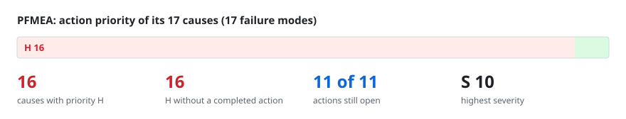
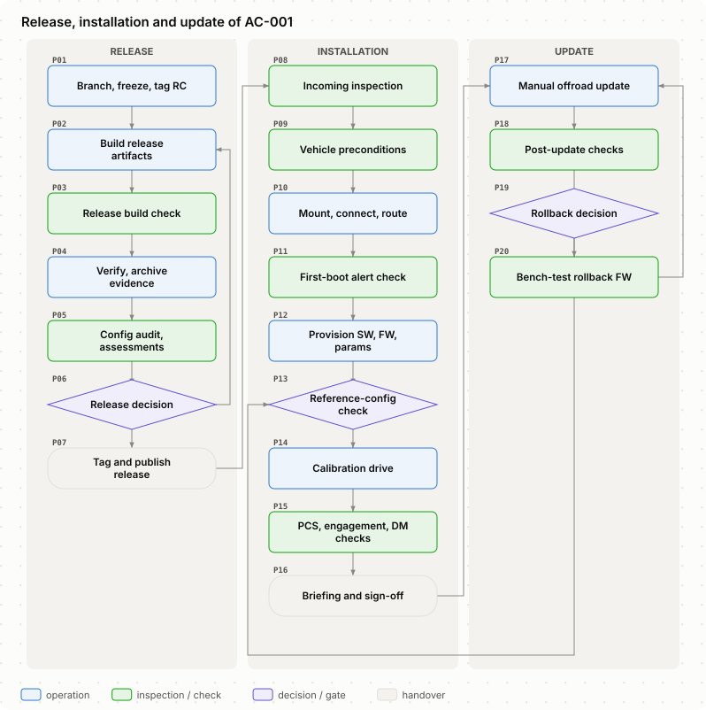
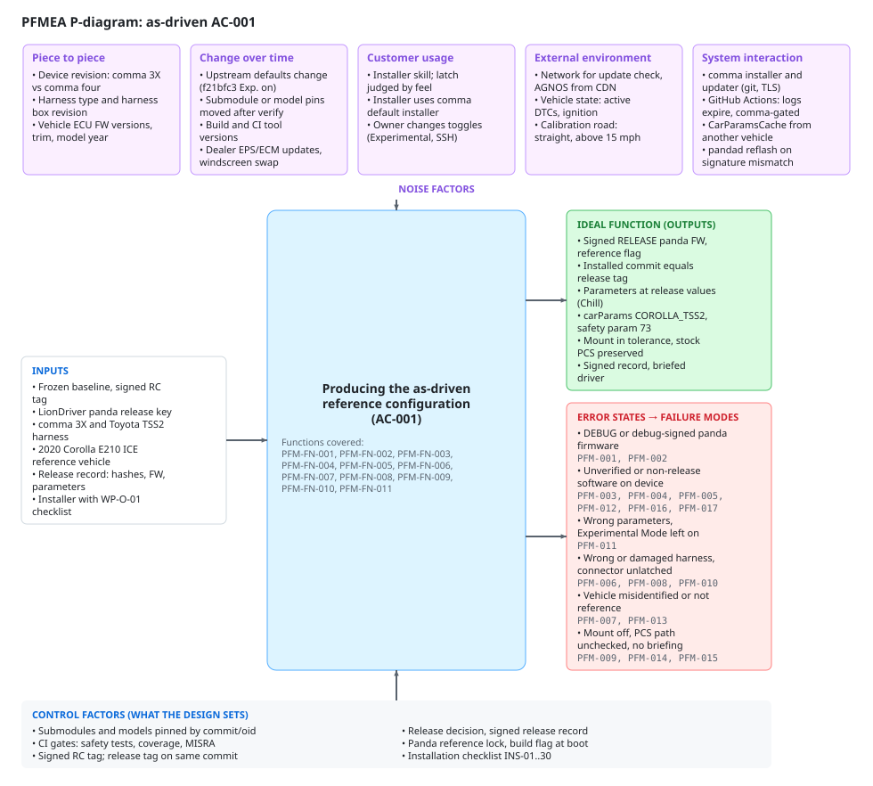
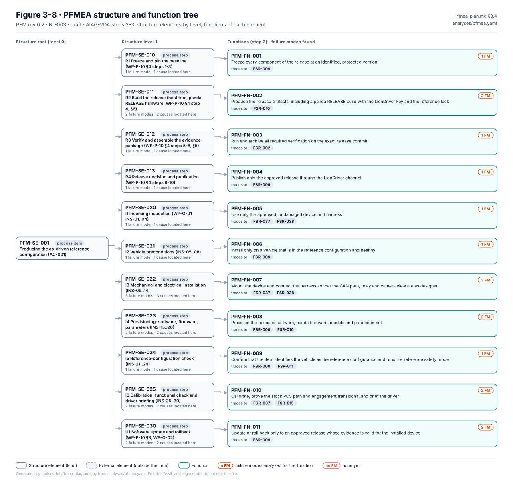

# PFMEA review: build, release, install, calibration, OTA

> Generated from [`analyses/pfmea.yaml`](../../analyses/pfmea.yaml) and [`diagrams/pfmea.yaml`](../../diagrams/pfmea.yaml) by `tools/safety/fmea_review_md.py`. Edit the YAML and regenerate; never edit this page. A styled workbook of the same data is [`pfmea-review.xlsx`](pfmea-review.xlsx).

| Revision | Status | Baseline | Rating tables | Updated |
|---|---|---|---|---|
| 0.4 | draft | BL-007 | RT-1 | 2026-10-26 |

**Scope.** Release (WP-P-10), installation and provisioning (WP-O-01) and software update/rollback for the reference configuration AC-001, as defined at BL-003. Calibration and fingerprinting are covered as installation steps.

**Team.** Jherrod Thomas (Project maintainer, safety lead (reviewer/approver)); Claude (AI assistant) (Drafting assistance; ratings require human review)

## How to review

Read the diagrams first, then the worksheet. Comment on this page's lines in a pull request, or open an issue that names the failure mode or cause ID. For a rating, say which value you would give and why; the scales are in [rating-tables.md](../../rating-tables.md). Action priority follows the AIAG-VDA table and is checked by `fmea_lint.py`, so challenge S, O or D, not the AP.

## Contents

- [Process flow](#1-process-flow)
- [P-diagram](#2-p-diagram)
- [Structure and functions](#3-structure-and-functions)
- [Worksheet](#4-worksheet)
- [Actions](#5-actions)
- [Priority H causes without a completed action](#6-priority-h-causes-without-a-completed-action)

## 1. Process flow

| Step | Name | Lane | Kind | Process element |
|---|---|---|---|---|
| P01 | Branch, freeze, tag RC | Release | operation | PFM-SE-010 R1 Freeze and pin the baseline (WP-P-10 §4 steps 1-3) |
| P02 | Build release artifacts | Release | operation | PFM-SE-011 R2 Build the release (host tree, panda RELEASE firmware; WP-P-10 §4 step 4, §6) |
| P03 | Release build check | Release | inspection | PFM-SE-011 R2 Build the release (host tree, panda RELEASE firmware; WP-P-10 §4 step 4, §6) |
| P04 | Verify, archive evidence | Release | operation | PFM-SE-012 R3 Verify and assemble the evidence package (WP-P-10 §4 steps 5-8, §5) |
| P05 | Config audit, assessments | Release | inspection | PFM-SE-012 R3 Verify and assemble the evidence package (WP-P-10 §4 steps 5-8, §5) |
| P06 | Release decision | Release | decision | PFM-SE-013 R4 Release decision and publication (WP-P-10 §4 steps 9-10) |
| P07 | Tag and publish release | Release | handover | PFM-SE-013 R4 Release decision and publication (WP-P-10 §4 steps 9-10) |
| P08 | Incoming inspection | Installation | inspection | PFM-SE-020 I1 Incoming inspection (WP-O-01 INS-01..04) |
| P09 | Vehicle preconditions | Installation | inspection | PFM-SE-021 I2 Vehicle preconditions (INS-05..08) |
| P10 | Mount, connect, route | Installation | operation | PFM-SE-022 I3 Mechanical and electrical installation (INS-09..14) |
| P11 | First-boot alert check | Installation | inspection | PFM-SE-022 I3 Mechanical and electrical installation (INS-09..14) |
| P12 | Provision SW, FW, params | Installation | operation | PFM-SE-023 I4 Provisioning: software, firmware, parameters (INS-15..20) |
| P13 | Reference-config check | Installation | decision | PFM-SE-024 I5 Reference-configuration check (INS-21..24) |
| P14 | Calibration drive | Installation | operation | PFM-SE-025 I6 Calibration, functional check and driver briefing (INS-25..30) |
| P15 | PCS, engagement, DM checks | Installation | inspection | PFM-SE-025 I6 Calibration, functional check and driver briefing (INS-25..30) |
| P16 | Briefing and sign-off | Installation | handover | PFM-SE-025 I6 Calibration, functional check and driver briefing (INS-25..30) |
| P17 | Manual offroad update | Update | operation | PFM-SE-030 U1 Software update and rollback (WP-P-10 §8, WP-O-02) |
| P18 | Post-update checks | Update | inspection | PFM-SE-030 U1 Software update and rollback (WP-P-10 §8, WP-O-02) |
| P19 | Rollback decision | Update | decision | PFM-SE-030 U1 Software update and rollback (WP-P-10 §8, WP-O-02) |
| P20 | Bench-test rollback FW | Update | inspection | PFM-SE-030 U1 Software update and rollback (WP-P-10 §8, WP-O-02) |

## 2. P-diagram

| Function covered | Description |
|---|---|
| `PFM-FN-001` | Freeze every component of the release at an identified, protected version |
| `PFM-FN-002` | Produce the release artifacts, including a panda RELEASE build with the LionDriver key and the reference lock |
| `PFM-FN-003` | Run and archive all required verification on the exact release commit |
| `PFM-FN-004` | Publish only the approved release through the LionDriver channel |
| `PFM-FN-005` | Use only the approved, undamaged device and harness |
| `PFM-FN-006` | Install only on a vehicle that is in the reference configuration and healthy |
| `PFM-FN-007` | Mount the device and connect the harness so that the CAN path, relay and camera view are as designed |
| `PFM-FN-008` | Provision the released software, panda firmware, models and parameter set |
| `PFM-FN-009` | Confirm that the item identifies the vehicle as the reference configuration and runs the reference safety mode |
| `PFM-FN-010` | Calibrate, prove the stock PCS path and engagement transitions, and brief the driver |
| `PFM-FN-011` | Update or roll back only to an approved release whose evidence is valid for the installed device |

| Control factor | Source |
|---|---|
| Submodules and models pinned by commit/oid | assurance/07-supporting/WP-P-10-release-management.md §4 step 2 (D-01, D-05) |
| CI gates: safety tests, coverage, MISRA | .github/workflows/safety.yaml (incl. reference build variant) |
| Signed RC tag; release tag on same commit | assurance/07-supporting/WP-P-10-release-management.md §4 steps 3, 10 |
| Release decision, signed release record | assurance/07-supporting/WP-P-10-release-management.md §4 step 9, §7 (WP-K-06) |
| Panda reference lock, build flag at boot | panda/board/reference_lock.h (TSR-512/513/514) |
| Installation checklist INS-01..30 | assurance/09-production-operation/WP-O-01-installation-and-provisioning-control.md §3 |

## 3. Structure and functions

The failure chains (element → function → failure mode → causes) are drawn in [figures/generated](../../figures/generated/README.md).

| Element | Kind | Functions |
|---|---|---|
| `PFM-SE-001` Producing the as-driven reference configuration (AC-001) | process_item | — |
| &nbsp;&nbsp;&nbsp;`PFM-SE-010` R1 Freeze and pin the baseline (WP-P-10 §4 steps 1-3) | process_step | `PFM-FN-001` Freeze every component of the release at an identified, protected version |
| &nbsp;&nbsp;&nbsp;`PFM-SE-011` R2 Build the release (host tree, panda RELEASE firmware; WP-P-10 §4 step 4, §6) | process_step | `PFM-FN-002` Produce the release artifacts, including a panda RELEASE build with the LionDriver key and the reference lock |
| &nbsp;&nbsp;&nbsp;`PFM-SE-012` R3 Verify and assemble the evidence package (WP-P-10 §4 steps 5-8, §5) | process_step | `PFM-FN-003` Run and archive all required verification on the exact release commit |
| &nbsp;&nbsp;&nbsp;`PFM-SE-013` R4 Release decision and publication (WP-P-10 §4 steps 9-10) | process_step | `PFM-FN-004` Publish only the approved release through the LionDriver channel |
| &nbsp;&nbsp;&nbsp;`PFM-SE-020` I1 Incoming inspection (WP-O-01 INS-01..04) | process_step | `PFM-FN-005` Use only the approved, undamaged device and harness |
| &nbsp;&nbsp;&nbsp;`PFM-SE-021` I2 Vehicle preconditions (INS-05..08) | process_step | `PFM-FN-006` Install only on a vehicle that is in the reference configuration and healthy |
| &nbsp;&nbsp;&nbsp;`PFM-SE-022` I3 Mechanical and electrical installation (INS-09..14) | process_step | `PFM-FN-007` Mount the device and connect the harness so that the CAN path, relay and camera view are as designed |
| &nbsp;&nbsp;&nbsp;`PFM-SE-023` I4 Provisioning: software, firmware, parameters (INS-15..20) | process_step | `PFM-FN-008` Provision the released software, panda firmware, models and parameter set |
| &nbsp;&nbsp;&nbsp;`PFM-SE-024` I5 Reference-configuration check (INS-21..24) | process_step | `PFM-FN-009` Confirm that the item identifies the vehicle as the reference configuration and runs the reference safety mode |
| &nbsp;&nbsp;&nbsp;`PFM-SE-025` I6 Calibration, functional check and driver briefing (INS-25..30) | process_step | `PFM-FN-010` Calibrate, prove the stock PCS path and engagement transitions, and brief the driver |
| &nbsp;&nbsp;&nbsp;`PFM-SE-030` U1 Software update and rollback (WP-P-10 §8, WP-O-02) | process_step | `PFM-FN-011` Update or roll back only to an approved release whose evidence is valid for the installed device |

## 4. Worksheet

One table per failure mode, grouped by structure element. S is the failure mode's severity (its worst end effect); each cause has its own occurrence (O), detection (D) and action priority (AP).

### `PFM-SE-010` R1 Freeze and pin the baseline (WP-P-10 §4 steps 1-3)

#### PFM-003 · A component enters the release at a different version than verified

🟢 L · **S 10** · guideword *wrong_version* · function `PFM-FN-001` Freeze every component of the release at an identified, protected version

Effects:

- **End:** Unverified behaviour of the envelope or controller (HZ-002, S 10)
- **End:** Contributes to HZ-005 (HZ-005, S 10)
- **Next higher:** Device runs unverified safety code or models
- **Local:** Baseline manifest does not match what was built

| Cause | Prevention | Detection | O | D | AP | Actions |
|---|---|---|:-:|:-:|:-:|---|
| `PFM-003.C1` Submodule pin moved after verification, or tinygrad tracked by branch | • Submodules pinned by commit on LionDriver forks (D-01); tinygrad by commit • Fork CI runs the safety suite on the pinned submodules .github/workflows/safety.yaml | • Safety tests, MISRA and mutation run on every change of the pins opendbc_repo/opendbc/safety/tests/test_toyota.py | 3 | 4 | 🟢 L | PFM-ACT-003 |

### `PFM-SE-011` R2 Build the release (host tree, panda RELEASE firmware; WP-P-10 §4 step 4, §6)

#### PFM-001 · panda firmware released as a DEBUG build, or without LIONDRIVER_REFERENCE

🔴 **H** · **S 10** · guideword *wrong_configuration* · function `PFM-FN-002` Produce the release artifacts, including a panda RELEASE build with the LionDriver key and the reference lock

Effects:

- **End:** Envelope can be bypassed or misconfigured (HZ-002, S 10)
- **End:** Contributes to HZ-005 (HZ-005, S 10)
- **End:** Contributes to HZ-006 (HZ-006, S 10)
- **Next higher:** Device runs firmware that accepts any safety mode (and ALLOUTPUT in DEBUG)
- **Local:** Release artifact built with the wrong flags

| Cause | Prevention | Detection | O | D | AP | Actions |
|---|---|---|:-:|:-:|:-:|---|
| `PFM-001.C1` The release is built with a bypass of the release defaults: PANDA_DEBUG_BUILD set (build_release.sh then builds the panda without RELEASE=1, with ALLOW_DEBUG) or RELEASE_VARIANT=upstream / an empty LIONDRIVER_REFERENCE, neither of which needs a recorded override. Up to BL-003 panda/SConscript defaulted to DEBUG and no build path set LIONDRIVER_REFERENCE; since BL-005 the root SConstruct and tools/release/release_variant.sh default to the reference build and build_release.sh builds the panda with RELEASE=1 | • Technical defaults: SConstruct sets LIONDRIVER_REFERENCE=1 unless it is set; release_variant.sh selects the reference variant and refuses an unknown one; build_release.sh builds RELEASE=1 unless PANDA_DEBUG_BUILD is set. Proven in CI, but a variable bypasses them (O 5). Signing with a LionDriver key is PFM-002 tools/release/release_variant.sh | • CI job panda reference release build (safety.yaml, WP-W-03 ATC-19): variant selection checks, then RELEASE=1 build and an assertion that every firmware compile carries -DLIONDRIVER_REFERENCE and none -DALLOW_DEBUG. Proven automated check at a later station (CI, not the publication step, and signed with the debug key), so D 5. At run time pandad refuses a car mode on a non-reference panda (TSR-619); INS-17 reads the version string (human check) .github/workflows/safety.yaml | 5 | 5 | 🔴 **H** | PFM-ACT-001 |

#### PFM-002 · panda firmware signed with the debug key or a key not controlled by LionDriver

🔴 **H** · **S 10** · guideword *unverified_artifact* · function `PFM-FN-002` Produce the release artifacts, including a panda RELEASE build with the LionDriver key and the reference lock

Effects:

- **End:** Unverified envelope firmware in the vehicle (HZ-002, S 10)
- **End:** Contributes to HZ-005 (HZ-005, S 10)
- **Next higher:** Bootstub accepts images that anyone can sign
- **Local:** Artifact signature not traceable to LionDriver

| Cause | Prevention | Detection | O | D | AP | Actions |
|---|---|---|:-:|:-:|:-:|---|
| `PFM-002.C1` No LionDriver release key yet (D-09 decided, not implemented); debug private key is in the repository | • Decision D-09; WP-P-10 §6 key rules assurance/07-supporting/WP-P-10-release-management.md | • INS-17 compares the signature with the release record (record format not yet in use) assurance/09-production-operation/WP-O-01-installation-and-provisioning-control.md | 8 | 8 | 🔴 **H** | PFM-ACT-002 |

### `PFM-SE-012` R3 Verify and assemble the evidence package (WP-P-10 §4 steps 5-8, §5)

#### PFM-004 · Release made without the required verification on the release commit

🔴 **H** · **S 10** · guideword *incomplete* · function `PFM-FN-003` Run and archive all required verification on the exact release commit

Effects:

- **End:** Undetected defect in a deployed configuration (HZ-002, S 10)
- **End:** Contributes to HZ-005 (HZ-005, S 10)
- **End:** Contributes to HZ-011 (HZ-011, S 10)
- **Next higher:** Release decision taken on partial evidence
- **Local:** Evidence package incomplete

| Cause | Prevention | Detection | O | D | AP | Actions |
|---|---|---|:-:|:-:|:-:|---|
| `PFM-004.C1` No HIL bench or vehicle test capability yet (D-04, GAP-30); evidence package location not defined (WP-P-10 OI-2) | • WP-P-10 §3 gate criteria and §5 evidence package (draft) assurance/07-supporting/WP-P-10-release-management.md | • Release record review (WP-K-06), human, not yet used assurance/10-safety-case/WP-K-06-release-record.md | 9 | 8 | 🔴 **H** | PFM-ACT-003 |

### `PFM-SE-013` R4 Release decision and publication (WP-P-10 §4 steps 9-10)

#### PFM-005 · Device installed from the upstream installer or a development branch instead of the LionDriver release

🔴 **H** · **S 10** · guideword *wrong_version* · function `PFM-FN-004` Publish only the approved release through the LionDriver channel

Effects:

- **End:** Unassured configuration driven (HZ-002, S 10)
- **End:** Contributes to HZ-005 (HZ-005, S 10)
- **Next higher:** Upstream or development software on the device (no reference lock, Experimental default)
- **Local:** Wrong software source

| Cause | Prevention | Detection | O | D | AP | Actions |
|---|---|---|:-:|:-:|:-:|---|
| `PFM-005.C1` Installer URL entered by hand; comma's default installer is the natural path; no LionDriver release channel yet | • Procedure defined in a draft work product; no release or third-party installation has been made with it yet assurance/09-production-operation/WP-O-01-installation-and-provisioning-control.md | • INS-15: installed commit compared with the tag's commit (human check) assurance/09-production-operation/WP-O-01-installation-and-provisioning-control.md | 8 | 8 | 🔴 **H** | PFM-ACT-004 |

### `PFM-SE-020` I1 Incoming inspection (WP-O-01 INS-01..04)

#### PFM-006 · Wrong or damaged harness installed

🔴 **H** · **S 10** · guideword *damage* · function `PFM-FN-005` Use only the approved, undamaged device and harness

Effects:

- **End:** Stock AEB unavailable or CAN faults while driving (HZ-011, S 10)
- **End:** Contributes to HZ-004 (HZ-004, S 10)
- **Next higher:** Relay or CAN path faulty from the start
- **Local:** Harness not the approved type or with damaged pins, latches or relay box

| Cause | Prevention | Detection | O | D | AP | Actions |
|---|---|---|:-:|:-:|:-:|---|
| `PFM-006.C1` Visual inspection only; harness revision not recorded against an approved list | • INS-02, INS-03 checklist (draft) assurance/09-production-operation/WP-O-01-installation-and-provisioning-control.md | • INS-03 visual inspection; INS-14 no relay or CAN alert at first boot assurance/09-production-operation/WP-O-01-installation-and-provisioning-control.md | 7 | 8 | 🔴 **H** | PFM-ACT-005 |

### `PFM-SE-021` I2 Vehicle preconditions (INS-05..08)

#### PFM-007 · Item installed on a vehicle outside the reference configuration

🔴 **H** · **S 10** · guideword *wrong_configuration* · function `PFM-FN-006` Install only on a vehicle that is in the reference configuration and healthy

Effects:

- **End:** Safety argument does not hold for this vehicle (HZ-002, S 10)
- **End:** Contributes to HZ-011 (HZ-011, S 10)
- **Next higher:** Assumptions of use (EPS, PCM, PCS behaviour) no longer valid
- **Local:** ECU firmware, trim or condition differs from the reference record

| Cause | Prevention | Detection | O | D | AP | Actions |
|---|---|---|:-:|:-:|:-:|---|
| `PFM-007.C1` Exact ECU firmware compare is a manual step; the reference ECU versions are not recorded yet (WP-C-01 OI-1). Since BL-007 the EPS and ABS/VSC fault codes are read automatically at every stationary start and an active code or a failed read refuses engagement (TSR-629, DQ-132 A, vehicle_dtc.py; unit-tested with mocked UDS answers, not verified on the vehicle): that checks the car's health (AOU-09), not its configuration, so the rating is unchanged | • INS-05..08, INS-21 (draft) assurance/09-production-operation/WP-O-01-installation-and-provisioning-control.md | • INS-21 FW query script output compared by hand with the reference record assurance/09-production-operation/WP-O-01-installation-and-provisioning-control.md | 8 | 7 | 🔴 **H** | PFM-ACT-006 |

### `PFM-SE-022` I3 Mechanical and electrical installation (INS-09..14)

#### PFM-008 · Harness connector not fully latched

🔴 **H** · **S 10** · guideword *incomplete* · function `PFM-FN-007` Mount the device and connect the harness so that the CAN path, relay and camera view are as designed

Effects:

- **End:** Loss of lateral control or of the stock path while driving (HZ-004, S 10)
- **End:** Contributes to HZ-011 (HZ-011, S 10)
- **Next higher:** Intermittent CAN or relay drive while driving
- **Local:** Connector seated but not locked

| Cause | Prevention | Detection | O | D | AP | Actions |
|---|---|---|:-:|:-:|:-:|---|
| `PFM-008.C1` Latch engagement judged by feel; no positive check | • INS-11 instruction (draft) assurance/09-production-operation/WP-O-01-installation-and-provisioning-control.md | • INS-11 pull test by hand; INS-14 alerts at first boot assurance/09-production-operation/WP-O-01-installation-and-provisioning-control.md | 7 | 8 | 🔴 **H** | PFM-ACT-005 |

#### PFM-009 · Device mounted outside the position and attitude tolerance

🔴 **H** · **S 10** · guideword *wrong_parameter* · function `PFM-FN-007` Mount the device and connect the harness so that the CAN path, relay and camera view are as designed

Effects:

- **End:** Lateral control steers off the lane centre (HZ-003, S 10)
- **Next higher:** Small, stable pose error not caught by calibration limits
- **Local:** Camera pose differs from the calibration assumption

| Cause | Prevention | Detection | O | D | AP | Actions |
|---|---|---|:-:|:-:|:-:|---|
| `PFM-009.C1` Mount tolerance band not defined (WP-O-01 OI-2); calibration limits are wide (pitch -5.2..+9.7 deg, yaw +/-4 deg) | • INS-09 photo instruction (draft) assurance/09-production-operation/WP-O-01-installation-and-provisioning-control.md | • INS-25 calibration converges; only angles outside the wide limits are rejected assurance/09-production-operation/WP-O-01-installation-and-provisioning-control.md | 8 | 8 | 🔴 **H** | PFM-ACT-007 |

#### PFM-010 · Harness routed through an airbag deployment zone

🔴 **H** · **S 10** · guideword *wrong_step* · function `PFM-FN-007` Mount the device and connect the harness so that the CAN path, relay and camera view are as designed

Effects:

- **End:** Occupant injury in a crash
- **Next higher:** Cable obstructs or is thrown by the curtain airbag
- **Local:** Cable crosses the A-pillar or headliner airbag path

| Cause | Prevention | Detection | O | D | AP | Actions |
|---|---|---|:-:|:-:|:-:|---|
| `PFM-010.C1` Routing left to the installer's judgement; airbag zones not marked for the reference vehicle | • INS-12 instruction (draft) assurance/09-production-operation/WP-O-01-installation-and-provisioning-control.md | • INS-12 routing photo (human review) assurance/09-production-operation/WP-O-01-installation-and-provisioning-control.md | 7 | 8 | 🔴 **H** | PFM-ACT-005 |

Note: Occupant-injury effect not traced to a HARA hazard (outside the item's functions); rated S10 per RT-1 §4.1.

### `PFM-SE-023` I4 Provisioning: software, firmware, parameters (INS-15..20)

#### PFM-011 · Parameters not at the reference values (Experimental Mode on, debug or maneuver modes, SSH)

🔴 **H** · **S 10** · guideword *wrong_parameter* · function `PFM-FN-008` Provision the released software, panda firmware, models and parameter set

Effects:

- **End:** Model-driven longitudinal behaviour or debug control in the vehicle (HZ-005, S 10)
- **End:** Contributes to HZ-006 (HZ-006, S 10)
- **Next higher:** Unassessed behaviour enabled or attack surface opened
- **Local:** Parameter set differs from the release record

| Cause | Prevention | Detection | O | D | AP | Actions |
|---|---|---|:-:|:-:|:-:|---|
| `PFM-011.C1` An assured setting (ExperimentalMode, LongitudinalPersonality, AlphaLongitudinalEnabled, the joystick and maneuver debug modes) is set by hand away from its reference value and the entry gate fails to refuse engagement. Up to BL-003 the upstream default turned Experimental Mode on (B-06) and parameters were set by hand only | • Technical controls in BL-007: ExperimentalMode defaults off (params_keys.h, chill-mode default); on the reference platform the item does not engage while any ASSURED_PARAMS setting differs from its assured value (#287, DQ-221 A) and a change made while engaged is held until disengagement (#342, DQ-403 A); the reference build neither registers nor ships the joystick and maneuver processes (DQ-131 A). Not bypassable without a code change (O 4) openpilot/selfdrive/selfdrived/assured_config.py | • Automated check at the step itself: NO_ENTRY settingNotAssured at every engagement attempt; test_assured_config.py and test_reference_build.py in the CI unit_tests job, the release file list checked in the panda reference release build job. Targeted, not proven by mutation and not verified on the vehicle, so D 7. INS-19 parameter dump compared by hand openpilot/selfdrive/selfdrived/tests/test_assured_config.py | 4 | 7 | 🔴 **H** | PFM-ACT-008 |
| `PFM-011.C2` SSH enabled by hand and left on (SshEnabled defaults off); the entry gate does not check it | • D-08 decided; INS-19 parameter list (draft); SshEnabled has no default value, so it is off until set assurance/09-production-operation/WP-O-01-installation-and-provisioning-control.md | • INS-19 parameter dump compared by hand assurance/09-production-operation/WP-O-01-installation-and-provisioning-control.md | 8 | 8 | 🔴 **H** | PFM-ACT-008 |

#### PFM-012 · Model weights on the device differ from the release

🔴 **H** · **S 10** · guideword *wrong_version* · function `PFM-FN-008` Provision the released software, panda firmware, models and parameter set

Effects:

- **End:** Unvalidated lateral and longitudinal behaviour (HZ-003, S 10)
- **End:** Contributes to HZ-007 (HZ-007, S 10)
- **Next higher:** Unvalidated driving model
- **Local:** Model files not those of the release

| Cause | Prevention | Detection | O | D | AP | Actions |
|---|---|---|:-:|:-:|:-:|---|
| `PFM-012.C1` Model files changed by an update or local edit | • Models pinned by LFS object id in the release tree (D-05) | • INS-18 hash compare with the release record (manual, script not proven) assurance/09-production-operation/WP-O-01-installation-and-provisioning-control.md | 3 | 7 | 🔴 **H** | PFM-ACT-006 |

### `PFM-SE-024` I5 Reference-configuration check (INS-21..24)

#### PFM-013 · Item identifies the vehicle wrongly (fuzzy fingerprint or cached CarParams of another car)

🔴 **H** · **S 10** · guideword *wrong_configuration* · function `PFM-FN-009` Confirm that the item identifies the vehicle as the reference configuration and runs the reference safety mode

Effects:

- **End:** Wrong limits enforced (HZ-002, S 10)
- **End:** Contributes to HZ-005 (HZ-005, S 10)
- **Next higher:** Wrong controller tuning and, without the lock, wrong envelope
- **Local:** carParams not those of TOYOTA_COROLLA_TSS2 with parameter 73

| Cause | Prevention | Detection | O | D | AP | Actions |
|---|---|---|:-:|:-:|:-:|---|
| `PFM-013.C1` Fuzzy fingerprint accepted at runtime; CarParamsCache can skip the FW query | • Reference lock accepts only TOYOTA with parameter 73 (reference build only, panda#4) panda/board/reference_lock.h | • INS-22/23 read carParams and pandaStates against the expected values (human check of logs) assurance/09-production-operation/WP-O-01-installation-and-provisioning-control.md | 5 | 6 | 🔴 **H** | PFM-ACT-006 |

### `PFM-SE-025` I6 Calibration, functional check and driver briefing (INS-25..30)

#### PFM-014 · Stock PCS path not verified after installation

🔴 **H** · **S 10** · guideword *step_omitted* · function `PFM-FN-010` Calibrate, prove the stock PCS path and engagement transitions, and brief the driver

Effects:

- **End:** Stock AEB unavailable while the owner relies on it (HZ-011, S 10)
- **Next higher:** Relay or forwarding fault undetected
- **Local:** INS-27 skipped or done without log review

| Cause | Prevention | Detection | O | D | AP | Actions |
|---|---|---|:-:|:-:|:-:|---|
| `PFM-014.C1` Log review of forwarded and intercepted messages is manual and needs tools the installer may not have | • INS-27 instruction (draft) assurance/09-production-operation/WP-O-01-installation-and-provisioning-control.md | • relayMalfunction alert covers only the relay-not-intercepting case opendbc_repo/opendbc/safety/safety.h | 8 | 9 | 🔴 **H** | PFM-ACT-009 |

#### PFM-015 · Driver not briefed on the item's limits and Chill Mode behaviour

🔴 **H** · **S 10** · guideword *step_omitted* · function `PFM-FN-010` Calibrate, prove the stock PCS path and engagement transitions, and brief the driver

Effects:

- **End:** Late or no driver intervention (HZ-012, S 10)
- **End:** Contributes to HZ-007 (HZ-007, S 10)
- **Next higher:** Driver's process model wrong (expects stops at lights, misreads override)
- **Local:** INS-30 acknowledgement missing

| Cause | Prevention | Detection | O | D | AP | Actions |
|---|---|---|:-:|:-:|:-:|---|
| `PFM-015.C1` User information (WP-O-03) not yet written for the reference configuration | • INS-30 instruction (draft) assurance/09-production-operation/WP-O-01-installation-and-provisioning-control.md | • Signed acknowledgement (human) assurance/09-production-operation/WP-O-01-installation-and-provisioning-control.md | 8 | 8 | 🔴 **H** | PFM-ACT-010 |

Note: STPA WP-A-05 LS-02, LS-03.

### `PFM-SE-030` U1 Software update and rollback (WP-P-10 §8, WP-O-02)

#### PFM-016 · Device updates to software that is not an approved LionDriver release

🔴 **H** · **S 10** · guideword *wrong_version* · function `PFM-FN-011` Update or roll back only to an approved release whose evidence is valid for the installed device

Effects:

- **End:** Unassured configuration driven (HZ-002, S 10)
- **End:** Contributes to HZ-005 (HZ-005, S 10)
- **Next higher:** Unverified software and possibly panda firmware installed
- **Local:** Update fetched from an uncontrolled branch

| Cause | Prevention | Detection | O | D | AP | Actions |
|---|---|---|:-:|:-:|:-:|---|
| `PFM-016.C1` Updates are git fetches from a configurable branch with no signature check beyond TLS (GAP-26) | • LionDriver controls its release branch (planned) assurance/07-supporting/WP-P-10-release-management.md | • None at the device; next installation check only | 8 | 10 | 🔴 **H** | PFM-ACT-011 |

#### PFM-017 · Rollback to a release whose evidence does not cover the installed panda firmware

🔴 **H** · **S 10** · guideword *wrong_sequence* · function `PFM-FN-011` Update or roll back only to an approved release whose evidence is valid for the installed device

Effects:

- **End:** Unverified combination in the vehicle (HZ-002, S 10)
- **Next higher:** Envelope behaviour not the one verified with that host
- **Local:** Host software and panda firmware from different releases

| Cause | Prevention | Detection | O | D | AP | Actions |
|---|---|---|:-:|:-:|:-:|---|
| `PFM-017.C1` Rollback procedure for the device side not defined yet (WP-O-02) | • WP-P-10 §8 rule: rollback only to a release valid for the installed device assurance/07-supporting/WP-P-10-release-management.md | • pandad reflashes panda firmware that does not match the host tree openpilot/selfdrive/pandad/pandad.py | 7 | 7 | 🔴 **H** | PFM-ACT-011 |

## 5. Actions

| ID | Kind | Action | Owner | Status | Causes | Revised S/O/D → AP |
|---|---|---|---|---|---|---|
| PFM-ACT-001 | design_change | Make RELEASE=1 LIONDRIVER_REFERENCE=1 with the LionDriver key the only release build, and add an automated release check (version contains RELEASE, ALLOW_DEBUG absent, reference lock present) that blocks publication (WP-P-10 §6; SW FMEA SWF-ACT-009) | Jherrod Thomas | in_progress | PFM-001.C1 | — |
| PFM-ACT-002 | design_change | Generate the LionDriver release key offline and define the signing procedure (D-09); remove the debug key from release builds | Jherrod Thomas | open | PFM-002.C1 | — |
| PFM-ACT-003 | detection | Build the HIL bench (D-04) and define the evidence package location and contents (WP-P-10 §5, OI-2) before the first vehicle-test baseline | Jherrod Thomas | open | PFM-003.C1, PFM-004.C1 | — |
| PFM-ACT-004 | design_change | Set up the LionDriver release channel and an installer that installs only signed release tags and records the installed commit (INS-15) | Jherrod Thomas | open | PFM-005.C1 | — |
| PFM-ACT-005 | prevention | Turn WP-O-01 into a recorded checklist (R-DEV, R-INS) with photos and sign-off, and include harness approval list, latch check and airbag-zone routing diagram for the reference vehicle | Jherrod Thomas | open | PFM-006.C1, PFM-008.C1, PFM-010.C1 | — |
| PFM-ACT-006 | detection | Write a configuration-check script for INS-18 and INS-21..24 that compares ECU FW versions, model hashes, carParams and pandaStates with the release record and refuses engagement on mismatch (TSR-803) | Jherrod Thomas | open | PFM-007.C1, PFM-012.C1, PFM-013.C1 | — |
| PFM-ACT-007 | prevention | Define the mount position and attitude tolerance band (WP-O-01 OI-2) and check the converged calibration against it | Jherrod Thomas | open | PFM-009.C1 | — |
| PFM-ACT-008 | design_change | Ship the reference parameter set as release defaults (Chill Mode, B-06; debug modes off; SSH off) and check it at boot | Jherrod Thomas | in_progress | PFM-011.C1, PFM-011.C2 | — |
| PFM-ACT-009 | detection | Provide a log-analysis tool for INS-27 that proves forwarding of stock PCS messages and blocking of intercepted ones | Jherrod Thomas | open | PFM-014.C1 | — |
| PFM-ACT-010 | prevention | Write the user information for the reference configuration (WP-O-03), covering Chill Mode limits and override behaviour | Jherrod Thomas | open | PFM-015.C1 | — |
| PFM-ACT-011 | design_change | Signed updates from a LionDriver-controlled branch, and a bench-tested rollback procedure for the device side (GAP-26, WP-S-07, WP-O-02) | Jherrod Thomas | open | PFM-016.C1, PFM-017.C1 | — |

## 6. Priority H causes without a completed action

| Cause | Failure mode | S/O/D | Open actions |
|---|---|---|---|
| `PFM-001.C1` | panda firmware released as a DEBUG build, or without LIONDRIVER_REFERENCE | 10/5/5 | PFM-ACT-001 |
| `PFM-002.C1` | panda firmware signed with the debug key or a key not controlled by LionDriver | 10/8/8 | PFM-ACT-002 |
| `PFM-004.C1` | Release made without the required verification on the release commit | 10/9/8 | PFM-ACT-003 |
| `PFM-005.C1` | Device installed from the upstream installer or a development branch instead of the LionDriver release | 10/8/8 | PFM-ACT-004 |
| `PFM-006.C1` | Wrong or damaged harness installed | 10/7/8 | PFM-ACT-005 |
| `PFM-007.C1` | Item installed on a vehicle outside the reference configuration | 10/8/7 | PFM-ACT-006 |
| `PFM-008.C1` | Harness connector not fully latched | 10/7/8 | PFM-ACT-005 |
| `PFM-009.C1` | Device mounted outside the position and attitude tolerance | 10/8/8 | PFM-ACT-007 |
| `PFM-010.C1` | Harness routed through an airbag deployment zone | 10/7/8 | PFM-ACT-005 |
| `PFM-011.C1` | Parameters not at the reference values (Experimental Mode on, debug or maneuver modes, SSH) | 10/4/7 | PFM-ACT-008 |
| `PFM-011.C2` | Parameters not at the reference values (Experimental Mode on, debug or maneuver modes, SSH) | 10/8/8 | PFM-ACT-008 |
| `PFM-012.C1` | Model weights on the device differ from the release | 10/3/7 | PFM-ACT-006 |
| `PFM-013.C1` | Item identifies the vehicle wrongly (fuzzy fingerprint or cached CarParams of another car) | 10/5/6 | PFM-ACT-006 |
| `PFM-014.C1` | Stock PCS path not verified after installation | 10/8/9 | PFM-ACT-009 |
| `PFM-015.C1` | Driver not briefed on the item's limits and Chill Mode behaviour | 10/8/8 | PFM-ACT-010 |
| `PFM-016.C1` | Device updates to software that is not an approved LionDriver release | 10/8/10 | PFM-ACT-011 |
| `PFM-017.C1` | Rollback to a release whose evidence does not cover the installed panda firmware | 10/7/7 | PFM-ACT-011 |
