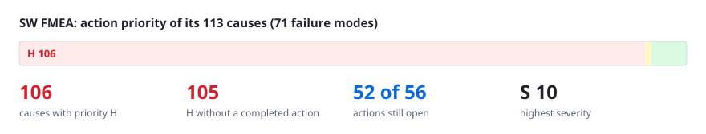
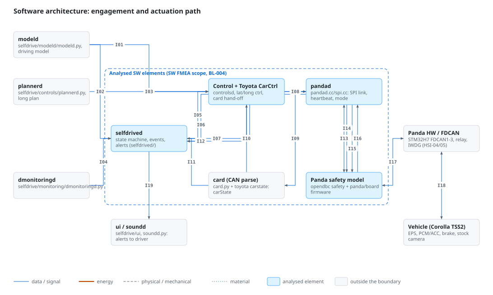
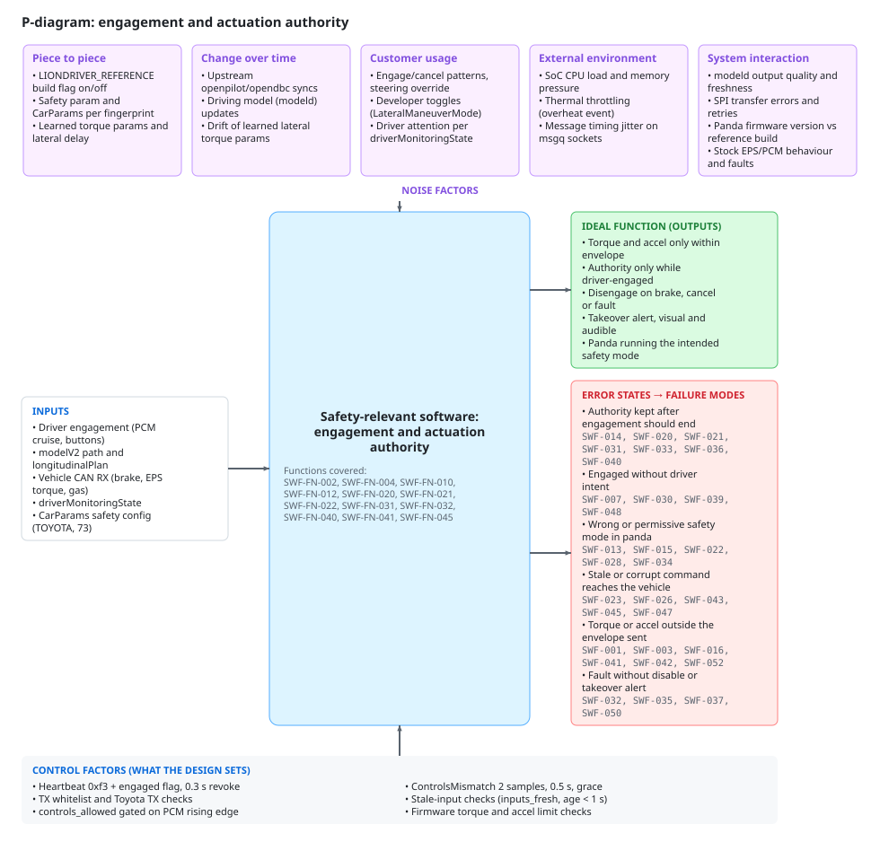
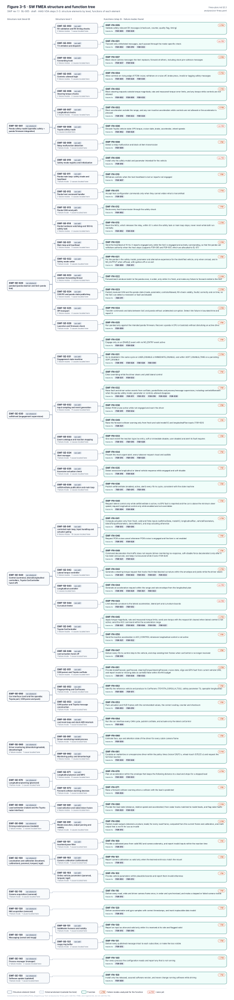

# SW FMEA review: safety-relevant software elements

> Generated from [`analyses/sw-fmea.yaml`](../../analyses/sw-fmea.yaml) and [`diagrams/sw-fmea.yaml`](../../diagrams/sw-fmea.yaml) by `tools/safety/fmea_review_md.py`. Edit the YAML and regenerate; never edit this page. A styled workbook of the same data is [`sw-fmea-review.xlsx`](sw-fmea-review.xlsx).

| Revision | Status | Baseline | Rating tables | Updated |
|---|---|---|---|---|
| 1.15 | draft | BL-007 | RT-2 | 2026-10-17 |

**Scope.** P1 elements for AC-001 at BL-007 (frozen; liondriver-dev 9fe3eb2, panda 3a8b7c2, opendbc 4d1a056; the LIONDRIVER_REFERENCE build is the default; rows of code unchanged since an earlier baseline keep that rating): panda safety model (opendbc safety core, Toyota mode, panda firmware integration incl. hardware watchdog, SWF-001..019, SWF-054, SWF-055), pandad (SWF-020..029), selfdrived (SWF-030..039), controlsd with the Toyota CarController hand-off (SWF-040..053). P2 elements: card and the Toyota port (SWF-056..060), driver monitoring (SWF-061..064), plannerd (SWF-065..069), radard (SWF-070, SWF-071). P3 elements: modeld as a software element (SWF-072..074; model performance is SOTIF), localization and calibration (SWF-075..077), camerad (SWF-078), sensord (SWF-079), messaging (SWF-080, SWF-081), manager (SWF-082, SWF-083), updated (SWF-084). Rev 1.1: driver-monitoring demo mode (SWF-085) and the forced stop after the terminal alert (SWF-086), for FTA finding F-37. Rev 1.2: no driver-override check on the LKA path in the envelope (SWF-087), for F-28. Rev 1.9: start-up fault-code read (SWF-091), panda siren (SWF-092), stock-AEB stand-down (SWF-093).

**Team.** Jherrod Thomas (Project maintainer, safety lead (reviewer/approver)); Claude (AI assistant) (Drafting assistance; ratings require human review)

## How to review

Read the diagrams first, then the worksheet. Comment on this page's lines in a pull request, or open an issue that names the failure mode or cause ID. For a rating, say which value you would give and why; the scales are in [rating-tables.md](../../rating-tables.md). Action priority follows the AIAG-VDA table and is checked by `fmea_lint.py`, so challenge S, O or D, not the AP.

## Contents

- [Block and boundary diagram](#1-block-and-boundary-diagram)
- [P-diagram](#2-p-diagram)
- [Structure and functions](#3-structure-and-functions)
- [Worksheet](#4-worksheet)
- [Actions](#5-actions)
- [Priority H causes without a completed action](#6-priority-h-causes-without-a-completed-action)

## 1. Block and boundary diagram

**Interface matrix.** Each line in the diagram, with what crosses it.

| ID | From | To | Type | What crosses | Source |
|---|---|---|---|---|---|
| I01 | modeld | Control + Toyota CarCtrl | data | modelV2 (20 Hz) | assurance/05-software/WP-W-03-software-architecture.md §4.2; openpilot/selfdrive/controls/controlsd.py:35 |
| I02 | modeld | selfdrived | data | modelV2 (alive check) | openpilot/selfdrive/selfdrived/selfdrived.py:100, 184 |
| I03 | plannerd | Control + Toyota CarCtrl | data | longitudinalPlan | assurance/05-software/WP-W-03-software-architecture.md §4.2; openpilot/selfdrive/controls/controlsd.py:36 |
| I04 | dmonitoringd | selfdrived | data | driverMonitoringState | openpilot/selfdrive/selfdrived/selfdrived.py:100-101 |
| I05 | selfdrived | Control + Toyota CarCtrl | data | selfdriveState (100 Hz) | assurance/05-software/WP-W-03-software-architecture.md §4.2; openpilot/selfdrive/controls/controlsd.py:110-114 |
| I06 | Control + Toyota CarCtrl | selfdrived | data | controlsState+carControl | openpilot/selfdrive/controls/controlsd.py:52; openpilot/selfdrive/selfdrived/selfdrived.py:103 |
| I07 | selfdrived | pandad | data | selfdriveState.enabled | openpilot/selfdrive/pandad/pandad.cc:421, 439 |
| I08 | Control + Toyota CarCtrl | pandad | data | sendcan (100 Hz) | openpilot/selfdrive/car/card.py:234-238; openpilot/selfdrive/pandad/pandad.cc:64, 79 |
| I09 | pandad | card (CAN parse) | data | can (RX frames) | openpilot/selfdrive/pandad/pandad.cc:104 |
| I10 | card (CAN parse) | Control + Toyota CarCtrl | data | carState (100 Hz) | assurance/05-software/WP-W-03-software-architecture.md §4.2; openpilot/selfdrive/car/card.py:69 |
| I11 | card (CAN parse) | selfdrived | data | carState (events) | assurance/05-software/WP-W-03-software-architecture.md §4.2; openpilot/selfdrive/selfdrived/selfdrived.py:166 |
| I12 | pandad | selfdrived | data | pandaStates (10 Hz) | openpilot/selfdrive/pandad/pandad.cc:285; openpilot/selfdrive/selfdrived/selfdrived.py:344-356, 562 |
| I13 | pandad | Panda safety model | data ⇄  | SPI CAN ep 1/3 | assurance/03-system/WP-S-05-hsi-specification.md §2 HSI-03, §11.2 S-16/S-17; openpilot/selfdrive/pandad/panda.cc:189-196 |
| I14 | pandad | Panda safety model | data | heartbeat 0xf3 engaged | openpilot/selfdrive/pandad/pandad.cc:328; panda/board/main_comms.h:299-305; WP-S-05 §11.2 S-18 |
| I15 | pandad | Panda safety model | data | safety mode 0xdc | openpilot/selfdrive/pandad/panda_safety.cc:80, 87; WP-S-05 §4.2, §11.2 S-19 |
| I16 | Panda safety model | pandad | data | health 0xd2 | assurance/03-system/WP-S-05-hsi-specification.md §11.2 S-21; WP-W-03 §3.3 SI-13 |
| I17 | Panda safety model | Panda HW / FDCAN | data ⇄  | tx/rx/fwd hooks | assurance/05-software/WP-W-03-software-architecture.md §3.3 SI-01/SI-02; opendbc_repo/opendbc/safety/safety.h:201, 293 |
| I18 | Panda HW / FDCAN | Vehicle (Corolla TSS2) | data ⇄  | CAN 0x2E4/0x343, RX | assurance/03-system/WP-S-05-hsi-specification.md §2 HSI-04, §11.1; opendbc_repo/opendbc/safety/modes/toyota.h:11-17, 48 |
| I19 | selfdrived | ui / soundd | data | selfdriveState alerts | openpilot/selfdrive/ui/soundd.py:56-59, 149; WP-W-03 §4.1 host.hmi |

## 2. P-diagram

| Function covered | Description |
|---|---|
| `SWF-FN-002` | Block steering requests outside torque magnitude, rate and measured-torque-error limits, and any torque while controls are not allowed |
| `SWF-FN-004` | Allow controls on rising edge of PCM cruise; withdraw on cruise off, brake press, invalid or lagging safety messages |
| `SWF-FN-010` | Withdraw controls when the host heartbeat is lost or reports not engaged |
| `SWF-FN-012` | Route every host transmission through the safety check |
| `SWF-FN-020` | Send the heartbeat at 10 Hz. It reports engaged only while the SoC is engaged and actively commanding, so that the panda can withdraw authority when the host stops (supports FSR-005 and FSR-007, which are allocated to EL-07) |
| `SWF-FN-021` | Put the panda in the safety model, parameter and alternative experience for the identified vehicle, only when onroad, and in NO_OUTPUT when offroad, with ignition off or on exit |
| `SWF-FN-022` | Forward each sendcan batch to the panda once, in order, only while it is fresh, and make any failure to forward visible to the SoC |
| `SWF-FN-031` | Go to disabled in the same cycle on USER_DISABLE or IMMEDIATE_DISABLE, and within SOFT_DISABLE_TIME on a persisting SOFT_DISABLE |
| `SWF-FN-032` | Raise fault and driver-action events from carState, pandaStates and process/message supervision, including controlsMismatch when the panda safety model, parameter or controls-allowed disagrees |
| `SWF-FN-040` | Request lateral control only while selfdriveState is active, no EPS fault is reported and the car is above the minimum steer speed; request longitudinal control only while enabled and not overridden |
| `SWF-FN-041` | Compute actuation only from fresh, valid and finite inputs (selfdriveState, modelV2, longitudinalPlan, vehicleParameters, lateralTorqueParameters, deviceMotion), and stop actuating otherwise |
| `SWF-FN-045` | Apply torque magnitude, rate and measured-torque limits; send zero torque with the request bit cleared when lateral control is not active; send the ACC command within the acceleration range |

| Control factor | Source |
|---|---|
| Heartbeat 0xf3 + engaged flag, 0.3 s revoke | openpilot/selfdrive/pandad/pandad.cc:328, 439; panda/board/drivers/heartbeat_monitor.h:15; panda/board/main.c:240-242 |
| TX whitelist and Toyota TX checks | opendbc_repo/opendbc/safety/safety.h:232-241, 293; opendbc_repo/opendbc/safety/modes/toyota.h:297 |
| controls_allowed gated on PCM rising edge | opendbc_repo/opendbc/safety/safety.h:683-711 (pcm_cruise_check), 500-520 (generic_rx_checks) |
| ControlsMismatch 2 samples, 0.5 s, grace | openpilot/selfdrive/selfdrived/selfdrived.py:53-56, 138, 565-574; openpilot/selfdrive/selfdrived/supervision.py:4 (TSR-621) |
| Stale-input checks (inputs_fresh, age < 1 s) | openpilot/selfdrive/controls/controlsd.py:34-36, 119-120; openpilot/selfdrive/pandad/pandad.cc:79; openpilot/selfdrive/car/card.py:234 |
| TX arrival 50/100 ms, TX rate budget | opendbc_repo/opendbc/safety/modes/toyota.h:586-606 (TSR-408, TSR-518; reference build) |
| Firmware torque and accel limit checks | opendbc_repo/opendbc/safety/lateral.h:10-150; opendbc_repo/opendbc/safety/longitudinal.h:3-12 (SWF-FN-002/003) |

## 3. Structure and functions

The failure chains (element → function → failure mode → causes) are drawn in [figures/generated](../../figures/generated/README.md).

| Element | Kind | Functions |
|---|---|---|
| `SWF-SE-001` Panda safety model (opendbc safety + panda firmware integration) | sw_element | — |
| &nbsp;&nbsp;&nbsp;`SWF-SE-002` RX validation and RX timing checks | sw_unit | `SWF-FN-005` Validate safety-relevant RX messages (checksum, counter, quality flag, timing) |
| &nbsp;&nbsp;&nbsp;`SWF-SE-003` TX whitelist and dispatch | sw_unit | `SWF-FN-001` Transmit only whitelisted messages, each passed through the mode-specific check |
| &nbsp;&nbsp;&nbsp;`SWF-SE-004` Forwarding hook | sw_unit | `SWF-FN-007` Block stock-camera messages the item replaces; forward all others, including stock pre-collision messages |
| &nbsp;&nbsp;&nbsp;`SWF-SE-005` Controls-allowed logic | sw_unit | `SWF-FN-004` Allow controls on rising edge of PCM cruise; withdraw on cruise off, brake press, invalid or lagging safety messages |
| &nbsp;&nbsp;&nbsp;`SWF-SE-006` Steering torque checks | sw_unit | `SWF-FN-002` Block steering requests outside torque magnitude, rate and measured-torque-error limits, and any torque while controls are not allowed `SWF-FN-014` Back steering torque off toward zero while the driver overrides, and reject frames that increase torque opposing the driver beyond a driver allowance (TSR-304; not implemented on the LKA path) |
| &nbsp;&nbsp;&nbsp;`SWF-SE-007` Longitudinal checks | sw_unit | `SWF-FN-003` Block acceleration outside the range, and any non-inactive acceleration while controls are not allowed or the accelerator is pressed |
| &nbsp;&nbsp;&nbsp;`SWF-SE-008` Toyota safety mode | sw_unit | `SWF-FN-006` Decode Toyota vehicle state: EPS torque, cruise state, brake, accelerator, wheel speeds |
| &nbsp;&nbsp;&nbsp;`SWF-SE-009` Relay malfunction detection | sw_unit | `SWF-FN-008` Detect a relay malfunction and block all item transmission |
| &nbsp;&nbsp;&nbsp;`SWF-SE-010` Safety mode registry and initialization | sw_unit | `SWF-FN-009` Install only the safety model and parameter intended for the vehicle |
| &nbsp;&nbsp;&nbsp;`SWF-SE-011` Panda main loop: safety mode and heartbeat | sw_unit | `SWF-FN-010` Withdraw controls when the host heartbeat is lost or reports not engaged `SWF-FN-015` Sound the panda siren when the panda revokes granted authority because the host stopped (heartbeat loss, TX arrival, engaged mismatch while PCM cruise stays on), independently of the SoC alerts (TSR-516(b), (c)) |
| &nbsp;&nbsp;&nbsp;`SWF-SE-012` Panda host command handler | sw_unit | `SWF-FN-011` Accept host configuration commands only when they cannot widen what is transmitted |
| &nbsp;&nbsp;&nbsp;`SWF-SE-013` Panda CAN send path | sw_unit | `SWF-FN-012` Route every host transmission through the safety check |
| &nbsp;&nbsp;&nbsp;`SWF-SE-014` Panda hardware watchdog and 100 Hz safety task | sw_unit | `SWF-FN-013` Reset the MCU, which releases the relay, within 0.1 s when the safety task or main loop stops; never reset while both run normally |
| `SWF-SE-020` pandad (panda daemon and SoC-panda link) | sw_element | — |
| &nbsp;&nbsp;&nbsp;`SWF-SE-021` Main loop and heartbeat | sw_unit | `SWF-FN-020` Send the heartbeat at 10 Hz. It reports engaged only while the SoC is engaged and actively commanding, so that the panda can withdraw authority when the host stops (supports FSR-005 and FSR-007, which are allocated to EL-07) |
| &nbsp;&nbsp;&nbsp;`SWF-SE-022` Safety mode setter | sw_unit | `SWF-FN-021` Put the panda in the safety model, parameter and alternative experience for the identified vehicle, only when onroad, and in NO_OUTPUT when offroad, with ignition off or on exit |
| &nbsp;&nbsp;&nbsp;`SWF-SE-023` sendcan forwarding thread | sw_unit | `SWF-FN-022` Forward each sendcan batch to the panda once, in order, only while it is fresh, and make any failure to forward visible to the SoC |
| &nbsp;&nbsp;&nbsp;`SWF-SE-024` CAN RX and panda state publishing | sw_unit | `SWF-FN-023` Publish received CAN and the panda state (mode, parameter, controlsAllowed, RX-check validity, faults) correctly and on time, so the SoC can detect a mismatch or fault and disable |
| &nbsp;&nbsp;&nbsp;`SWF-SE-025` SPI transport | sw_unit | `SWF-FN-024` Transfer commands and data between SoC and panda without undetected corruption. Detect link failure in bounded time and report it |
| &nbsp;&nbsp;&nbsp;`SWF-SE-026` Launcher and firmware check | sw_unit | `SWF-FN-025` Run pandad only against the intended panda firmware. Recover a panda in DFU or bootstub without disturbing an active drive |
| `SWF-SE-030` selfdrived (engagement supervision) | sw_element | — |
| &nbsp;&nbsp;&nbsp;`SWF-SE-031` Engagement state machine | sw_unit | `SWF-FN-030` Engage only on an ENABLE event with no NO_ENTRY event active `SWF-FN-031` Go to disabled in the same cycle on USER_DISABLE or IMMEDIATE_DISABLE, and within SOFT_DISABLE_TIME on a persisting SOFT_DISABLE `SWF-FN-037` Enter overriding while the driver steers and yield lateral control |
| &nbsp;&nbsp;&nbsp;`SWF-SE-032` Input sampling and event generation | sw_unit | `SWF-FN-032` Raise fault and driver-action events from carState, pandaStates and process/message supervision, including controlsMismatch when the panda safety model, parameter or controls-allowed disagrees `SWF-FN-038` Detect PCM cruise active while not engaged and warn the driver `SWF-FN-049` Raise the forward collision warning only from fresh and valid modelV2 and longitudinalPlan inputs (TSR-625) |
| &nbsp;&nbsp;&nbsp;`SWF-SE-033` Event catalogue and reaction mapping | sw_unit | `SWF-FN-033` Give each event the reaction type (no entry, soft or immediate disable, user disable) and alert its fault requires |
| &nbsp;&nbsp;&nbsp;`SWF-SE-034` Alert manager | sw_unit | `SWF-FN-034` Present the most urgent alert; every takeover request visual and audible |
| &nbsp;&nbsp;&nbsp;`SWF-SE-035` Excessive actuation check | sw_unit | `SWF-FN-035` Detect excessive longitudinal or lateral vehicle response while engaged and soft-disable |
| &nbsp;&nbsp;&nbsp;`SWF-SE-036` selfdriveState publication and main loop | sw_unit | `SWF-FN-036` Publish selfdriveState (enabled, active, alert) every 10 ms cycle, consistent with the state machine |
| `SWF-SE-040` Control (controlsd, lateral/longitudinal controllers, Toyota CarController hand-off) | sw_element | — |
| &nbsp;&nbsp;&nbsp;`SWF-SE-041` controlsd main loop, input handling and actuator gating | sw_unit | `SWF-FN-040` Request lateral control only while selfdriveState is active, no EPS fault is reported and the car is above the minimum steer speed; request longitudinal control only while enabled and not overridden `SWF-FN-041` Compute actuation only from fresh, valid and finite inputs (selfdriveState, modelV2, longitudinalPlan, vehicleParameters, lateralTorqueParameters, deviceMotion), and stop actuating otherwise `SWF-FN-046` Request PCM cruise cancel whenever PCM cruise is engaged and the item is not enabled `SWF-FN-048` Command deceleration that traffic does not require (driver-monitoring no-response, soft-disable force deceleration) only after it has been announced, and keep it announced while it lasts (TSR-624) |
| &nbsp;&nbsp;&nbsp;`SWF-SE-042` Lateral torque controller | sw_unit | `SWF-FN-042` Generate a steering torque request that tracks the limited desired curvature within the envelope and yields while the driver steers |
| &nbsp;&nbsp;&nbsp;`SWF-SE-043` Longitudinal controller | sw_unit | `SWF-FN-044` Generate an acceleration request within the range and rate envelope from the longitudinal plan `SWF-FN-057` Request no positive acceleration while the car reports a stock AEB event (TSR-713, SWSR-713h, DQ-300 A), from the first frame of the event, in the host request and in the final ACCEL_CMD |
| &nbsp;&nbsp;&nbsp;`SWF-SE-044` Curvature limiter | sw_unit | `SWF-FN-043` Limit desired curvature to the lateral acceleration, lateral jerk and curvature bounds |
| &nbsp;&nbsp;&nbsp;`SWF-SE-045` Toyota CarController | sw_unit | `SWF-FN-045` Apply torque magnitude, rate and measured-torque limits; send zero torque with the request bit cleared when lateral control is not active; send the ACC command within the acceleration range `SWF-FN-050` Send the inactive acceleration in ACC_CONTROL whenever longitudinal control is not active |
| &nbsp;&nbsp;&nbsp;`SWF-SE-046` card actuation hand-off | sw_unit | `SWF-FN-047` Deliver every 10 ms control step to the vehicle, and stop sending item frames when carControl is no longer received |
| `SWF-SE-050` Car interface (card and the opendbc Toyota port, CAN parse and pack) | sw_element | — |
| &nbsp;&nbsp;&nbsp;`SWF-SE-051` CAN parser and Toyota carState | sw_unit | `SWF-FN-051` Provide brakePressed, gasPressed, steeringTorque/steeringPressed, cruise state, vEgo and EPS fault from current vehicle CAN, and report invalid or missing data as canValid false within the RX budget |
| &nbsp;&nbsp;&nbsp;`SWF-SE-052` Fingerprinting and CarParams | sw_unit | `SWF-FN-052` Identify the reference vehicle and produce its CarParams (TOYOTA_COROLLA_TSS2, safety parameter 73, openpilot longitudinal) |
| &nbsp;&nbsp;&nbsp;`SWF-SE-053` CAN packer and Toyota message construction | sw_unit | `SWF-FN-053` Pack actuation and HUD frames with the commanded values, the correct scaling, counter and checksum |
| &nbsp;&nbsp;&nbsp;`SWF-SE-054` card main loop and stock AEB interlock | sw_unit | `SWF-FN-054` Run the car interface every CAN cycle, publish carState, and actuate only the latest carControl `SWF-FN-055` Raise the EPS-fault warning while engaged (TSR-607); the take-over request, with the lighter prompt only for the first 1.5 s after an override or at standstill, and at least the lighter prompt when the fault lasts over 1.5 s while the driver keeps steering `SWF-FN-056` At start-up, while the item cannot engage and the car is stationary, read the EPS and ABS/VSC fault codes, and refuse engagement while either reports an active code or the read fails (TSR-629, SWSR-629..629d; selfdrived dtc_entry_events) |
| `SWF-SE-060` Driver monitoring (dmonitoringmodeld, dmonitoringd) | sw_element | — |
| &nbsp;&nbsp;&nbsp;`SWF-SE-061` Driver-monitoring model process | sw_unit | `SWF-FN-060` Estimate face, eye and attention state of the driver for every cabin camera frame |
| &nbsp;&nbsp;&nbsp;`SWF-SE-062` Monitoring policy and dmonitoringd | sw_unit | `SWF-FN-061` Escalate an inattentive or unresponsive driver within the policy times (vision 5/8/13 s, wheel-touch 5/15/25 s) and request the terminal reaction |
| `SWF-SE-070` Longitudinal planning (plannerd) | sw_element | — |
| &nbsp;&nbsp;&nbsp;`SWF-SE-071` Longitudinal planner and MPC | sw_unit | `SWF-FN-070` Plan an acceleration within the envelope that keeps the following distance to a lead and stops for a stopped lead |
| &nbsp;&nbsp;&nbsp;`SWF-SE-072` Forward collision warning decision | sw_unit | `SWF-FN-071` Raise a forward collision warning when a collision with the lead is predicted |
| `SWF-SE-080` Lead estimation (radard and the Toyota radar interface) | sw_element | — |
| &nbsp;&nbsp;&nbsp;`SWF-SE-081` Lead selection and radar/vision fusion | sw_unit | `SWF-FN-080` Provide the lead state (distance, relative speed and acceleration) from radar tracks matched to model leads, and flag radar faults |
| `SWF-SE-090` Driving model process (modeld) | sw_element | — |
| &nbsp;&nbsp;&nbsp;`SWF-SE-091` Model execution, output parsing and validity | sw_unit | `SWF-FN-090` Publish model outputs (desired curvature, leads) for every road frame, computed from the current frame and calibration, and mark output that is not fit for use as invalid |
| `SWF-SE-100` Localization and calibration (locationd, calibrationd, paramsd, torqued, lagd) | sw_element | — |
| &nbsp;&nbsp;&nbsp;`SWF-SE-101` locationd pose filter | sw_unit | `SWF-FN-100` Provide a calibrated pose from valid IMU and camera odometry, and report invalid inputs within the reaction time |
| &nbsp;&nbsp;&nbsp;`SWF-SE-102` Camera calibration (calibrationd) | sw_unit | `SWF-FN-101` Report camera calibration as valid only when the learned extrinsics match the mount |
| &nbsp;&nbsp;&nbsp;`SWF-SE-103` Online vehicle parameters (paramsd, torqued, lagd) | sw_unit | `SWF-FN-102` Provide vehicle parameters within plausible bounds and report them invalid otherwise |
| `SWF-SE-110` Camera acquisition (camerad) | sw_element | `SWF-FN-110` Deliver every road, wide and driver camera frame once, in order and synchronised, and make a stopped or failed camera visible |
| `SWF-SE-120` IMU acquisition (sensord) | sw_element | `SWF-FN-120` Deliver accelerometer and gyro samples with correct timestamps, and mark implausible data invalid |
| `SWF-SE-130` Messaging (cereal and msgq) | sw_element | — |
| &nbsp;&nbsp;&nbsp;`SWF-SE-131` SubMaster liveness and validity | sw_unit | `SWF-FN-130` Report an input as alive and valid only while it is received at its rate and flagged valid |
| &nbsp;&nbsp;&nbsp;`SWF-SE-132` msgq ring buffer | sw_unit | `SWF-FN-131` Deliver every published message intact to each subscriber, or make the loss visible |
| `SWF-SE-140` Process manager (manager) | sw_element | `SWF-FN-140` Run every process the configuration needs and report any that is not running |
| `SWF-SE-150` Software update (updated) | sw_element | `SWF-FN-150` Install only the released, assured software version, and never change running software while driving |

## 4. Worksheet

One table per failure mode, grouped by structure element. S is the failure mode's severity (its worst end effect); each cause has its own occurrence (O), detection (D) and action priority (AP).

### `SWF-SE-002` RX validation and RX timing checks

#### SWF-005 · Corrupted brake-pressed value accepted

🔴 **H** · **S 10** · guideword *corrupted* · function `SWF-FN-005` Validate safety-relevant RX messages (checksum, counter, quality flag, timing)

Effects:

- **End:** Automation not released on brake (HZ-008, S 10)
- **Next higher:** Controls not withdrawn on driver braking
- **Local:** Brake press read as released

| Cause | Prevention | Detection | O | D | AP | Actions |
|---|---|---|:-:|:-:|:-:|---|
| `SWF-005.C1` BRAKE_MODULE (0x226) has no checksum or counter in the vehicle DBC; the RX check ignores checksum, counter and quality and checks timing only | • CAN CRC protects the transport; the vehicle message itself has no end-to-end protection (toyota_nodsu_pt.dbc:18-21; toyota.h:46) opendbc_repo/opendbc/dbc/generator/toyota/toyota_nodsu_pt.dbc | • No test targets this cause | 3 | 9 | 🔴 **H** | SWF-ACT-006 |

Safety mechanisms: (1) PCM cancels cruise on its own brake input and the panda follows PCM_CRUISE (checksum-checked); credit needs FSC FOI-006 · (2) Reference build, BL-006 (ATC-25, opendbc#18) catches a truncated or over-long BRAKE_MODULE frame as an RX fault; a value corrupted at the right length still passes

Note: Diverse path: the PCM cancels cruise on its own brake input and the panda follows PCM_CRUISE (checksum-checked). That credit needs FSC FOI-006.

#### SWF-006 · Stale brake, cruise or EPS data used beyond the detection budget

🔴 **H** · **S 10** · guideword *value_stale* · function `SWF-FN-005` Validate safety-relevant RX messages (checksum, counter, quality flag, timing)

Effects:

- **End:** Automation not released, or limits computed from stale data (HZ-008, S 10)
- **End:** Contributes to HZ-002 (HZ-002, S 10)
- **End:** Contributes to HZ-006 (stale cruise state keeps authority; braking while not engaged, HE-04.4) (HZ-006, S 10)
- **Next higher:** Brake press or cruise-off not seen; torque measurement stale
- **Local:** Safety decisions based on old messages

| Cause | Prevention | Detection | O | D | AP | Actions |
|---|---|---|:-:|:-:|:-:|---|
| `SWF-006.C1` An RX check lags only after 5 nominal periods plus one 10 ms safety-task period (0x1D2 about 0.16 s, 0x226 about 0.14 s, 0x260 0.11 s, 0xAA about 0.07 s); the budget is not yet confirmed against an FTTI (HARA OI-004) or against real inter-frame gaps (tools/can_gaps) | • Toyota rx_timeout_periods = 5 (TSR-401, opendbc#1); safety_tick moved to a 100 Hz safety task (panda#3, SWSR-401a) opendbc_repo/opendbc/safety/safety.h | • Per-message 5-period timeout test for every Toyota RX check, in the CI safety suite opendbc_repo/opendbc/safety/tests/test_toyota.py | 4 | 3 | 🔴 **H** | SWF-ACT-007 |

Safety mechanisms: (1) RX timeout after 5 periods withdraws controls (TSR-401); SoC alerts on panda state

### `SWF-SE-004` Forwarding hook

#### SWF-010 · Stock camera steering or ACC messages forwarded while the item transmits

🔴 **H** · **S 10** · guideword *commission* · function `SWF-FN-007` Block stock-camera messages the item replaces; forward all others, including stock pre-collision messages

Effects:

- **End:** Erratic or excessive steering or braking (HZ-002, S 10)
- **End:** Contributes to HZ-006 (HZ-006, S 10)
- **Next higher:** Combined or alternating commands
- **Local:** Stock and item commands both on the vehicle bus

| Cause | Prevention | Detection | O | D | AP | Actions |
|---|---|---|:-:|:-:|:-:|---|
| `SWF-010.C1` check_relay flag missing for a replaced message in the TX table, or defect in safety_fwd_hook | • MISRA C:2012 checks on the safety code opendbc_repo/opendbc/safety/tests/misra • 100% line coverage enforced by the safety test runner opendbc_repo/opendbc/safety/tests/test.sh • Upstream code review; no documented safety requirements for the safety model (tests derived from implementation) | • opendbc safety suite with 100% line coverage and mutation tests, run by fork CI on every change (.github/workflows/safety.yaml, CR-CI-05). At BL-002 the Toyota tests pass locally (287, 34 skipped); mutation was last run locally at BL-001 (2705/2705 killed). Tests are derived from the implementation, not from requirements opendbc_repo/opendbc/safety/tests/test_toyota.py | 5 | 3 | 🔴 **H** | SWF-ACT-002 |

Safety mechanisms: (1) check_relay entries block forwarding of every message the item replaces

#### SWF-011 · Stock pre-collision (AEB) messages blocked

🔴 **H** · **S 10** · guideword *omission* · function `SWF-FN-007` Block stock-camera messages the item replaces; forward all others, including stock pre-collision messages

Effects:

- **End:** Loss of stock AEB (HZ-011, S 10)
- **Next higher:** Stock AEB cannot act
- **Local:** PRE_COLLISION 0x283 / 0x344 from the stock camera do not reach the vehicle

| Cause | Prevention | Detection | O | D | AP | Actions |
|---|---|---|:-:|:-:|:-:|---|
| `SWF-011.C1` TX table change marks 0x283/0x344 check_relay, or a forwarding defect; at BL-001 both are check_relay=false and forwarded (toyota.h:22-23) | • MISRA C:2012 checks on the safety code opendbc_repo/opendbc/safety/tests/misra • 100% line coverage enforced by the safety test runner opendbc_repo/opendbc/safety/tests/test.sh • Upstream code review; no documented safety requirements for the safety model (tests derived from implementation) | • opendbc safety suite with 100% line coverage and mutation tests, run by fork CI on every change (.github/workflows/safety.yaml, CR-CI-05). At BL-002 the Toyota tests pass locally (287, 34 skipped); mutation was last run locally at BL-001 (2705/2705 killed). Tests are derived from the implementation, not from requirements opendbc_repo/opendbc/safety/tests/test_toyota.py | 5 | 3 | 🔴 **H** | SWF-ACT-002 |

Safety mechanisms: (1) Only messages the item replaces are blocked; 0x283/0x344 are forwarded

Note: Partial answer to HARA OI-003: the panda does not block stock pre-collision messages from the camera. BL-002 removes 0x344 and the DSU messages from the TX whitelist (TSR-705, opendbc#2), so the SoC can no longer send them; 0x283 is allowed with a zero payload only. Forwarding is unchanged. In-vehicle confirmation of stock AEB is still needed.

### `SWF-SE-005` Controls-allowed logic

#### SWF-007 · Controls allowed without a driver engagement

🔴 **H** · **S 10** · guideword *commission* · function `SWF-FN-004` Allow controls on rising edge of PCM cruise; withdraw on cruise off, brake press, invalid or lagging safety messages

Effects:

- **End:** Unintended engagement (HZ-010, S 10)
- **End:** Contributes to HZ-006 (braking while not engaged, HE-04.4) (HZ-006, S 10)
- **Next higher:** Item actuation permitted
- **Local:** controls_allowed true without a cruise rising edge

| Cause | Prevention | Detection | O | D | AP | Actions |
|---|---|---|:-:|:-:|:-:|---|
| `SWF-007.C1` Defect in pcm_cruise_check or PCM_CRUISE decoding (toyota.h rx hook, 0x1D2 bit 5) | • MISRA C:2012 checks on the safety code opendbc_repo/opendbc/safety/tests/misra • 100% line coverage enforced by the safety test runner opendbc_repo/opendbc/safety/tests/test.sh • Upstream code review; no documented safety requirements for the safety model (tests derived from implementation) | • opendbc safety suite with 100% line coverage and mutation tests, run by fork CI on every change (.github/workflows/safety.yaml, CR-CI-05). At BL-002 the Toyota tests pass locally (287, 34 skipped); mutation was last run locally at BL-001 (2705/2705 killed). Tests are derived from the implementation, not from requirements opendbc_repo/opendbc/safety/tests/test_toyota.py | 5 | 3 | 🔴 **H** | SWF-ACT-002 |

Safety mechanisms: (1) Controls granted only on a PCM cruise rising edge with every RX check valid (TSR-306) · (2) Reference build (BL-005): the grant also needs heartbeat_engaged within 1 s of the edge (TSR-301, WP-A-05 LS-06); unit-tested and mutated in the reference variant in CI

Note: BL-002: a cruise rising edge grants controls only if every RX check is valid and not lagging at that moment (rx_checks_allow_engagement, TSR-306, opendbc#3). BL-005: in the reference build (now the default) the edge only opens a 1 s window, and authority is granted once the heartbeat reports openpilot engaged (pcm_engage_check, safety.h:442-462, TSR-301, opendbc#14; test_pcm_edge_needs_heartbeat_engaged). A PCM decoding defect alone therefore no longer grants authority; the rating is kept at O5 because the cause is a defect in the core, which the second condition narrows but does not remove (a heartbeat engaged while the host is engaged is the normal case).

#### SWF-008 · Controls not withdrawn on brake press

🔴 **H** · **S 10** · guideword *omission* · function `SWF-FN-004` Allow controls on rising edge of PCM cruise; withdraw on cruise off, brake press, invalid or lagging safety messages

Effects:

- **End:** Automation not released on brake (HZ-008, S 10)
- **Next higher:** Item keeps actuating
- **Local:** controls_allowed stays true while the driver brakes

| Cause | Prevention | Detection | O | D | AP | Actions |
|---|---|---|:-:|:-:|:-:|---|
| `SWF-008.C1` Host-supplied safety parameter selects the wrong brake message (ALT_BRAKE flag), so brake presses are never seen | • Reference-build lock: 0xdc accepts TOYOTA only with parameter 73 (no flags) and, once TOYOTA is active, only NOOUTPUT or SILENT; 0xdf refused (reference_lock.h, panda#4, TSR-512/513). BL-005: the default build since #36 (SConstruct:272-283), so the lock is in the firmware pandad flashes (SWF-013.C2) panda/board/reference_lock.h | • Host unit tests compiled against the real firmware headers, run by panda CI (test.sh): reference_lock and hw_watchdog, 14 tests, pass at BL-002 locally. Not on target hardware panda/tests/reference_lock/test_reference_lock.py | 3 | 4 | 🟢 L | SWF-ACT-009 |
| `SWF-008.C2` Defect in generic_rx_checks brake edge logic (safety.h:354-357) | • MISRA C:2012 checks on the safety code opendbc_repo/opendbc/safety/tests/misra • 100% line coverage enforced by the safety test runner opendbc_repo/opendbc/safety/tests/test.sh • Upstream code review; no documented safety requirements for the safety model (tests derived from implementation) | • opendbc safety suite with 100% line coverage and mutation tests, run by fork CI on every change (.github/workflows/safety.yaml, CR-CI-05). At BL-002 the Toyota tests pass locally (287, 34 skipped); mutation was last run locally at BL-001 (2705/2705 killed). Tests are derived from the implementation, not from requirements opendbc_repo/opendbc/safety/tests/test_toyota.py | 5 | 3 | 🔴 **H** | SWF-ACT-002 |

Safety mechanisms: (1) Brake rising edge withdraws controls; PCM cruise cancel as diverse path

#### SWF-009 · Controls not withdrawn when PCM cruise disengages

🔴 **H** · **S 10** · guideword *omission* · function `SWF-FN-004` Allow controls on rising edge of PCM cruise; withdraw on cruise off, brake press, invalid or lagging safety messages

Effects:

- **End:** Automation not released on cancel (HZ-008, S 10)
- **Next higher:** Item keeps actuating after the driver cancels
- **Local:** controls_allowed stays true after cruise off

| Cause | Prevention | Detection | O | D | AP | Actions |
|---|---|---|:-:|:-:|:-:|---|
| `SWF-009.C1` Defect in pcm_cruise_check (safety.h:518-527) | • MISRA C:2012 checks on the safety code opendbc_repo/opendbc/safety/tests/misra • 100% line coverage enforced by the safety test runner opendbc_repo/opendbc/safety/tests/test.sh • Upstream code review; no documented safety requirements for the safety model (tests derived from implementation) | • opendbc safety suite with 100% line coverage and mutation tests, run by fork CI on every change (.github/workflows/safety.yaml, CR-CI-05). At BL-002 the Toyota tests pass locally (287, 34 skipped); mutation was last run locally at BL-001 (2705/2705 killed). Tests are derived from the implementation, not from requirements opendbc_repo/opendbc/safety/tests/test_toyota.py | 5 | 3 | 🔴 **H** | SWF-ACT-002 |

Safety mechanisms: (1) Cruise off withdraws controls in pcm_cruise_check

#### SWF-054 · Authority granted again after a TX-rate revocation while the host still exceeds the rate budget

🟢 L · **S 10** · guideword *commission* · function `SWF-FN-004` Allow controls on rising edge of PCM cruise; withdraw on cruise off, brake press, invalid or lagging safety messages

Effects:

- **End:** Item actuation resumes under a host that has already shown a fault, for the frames that pass inside the rate budget (HZ-002, S 10)
- **End:** Contributes to HZ-010 (engagement accepted from a faulted host) (HZ-010, S 10)
- **Next higher:** The panda keeps rejecting the excess frames and revokes again after 3 rejected frames, so authority alternates with each driver re-engagement
- **Local:** The next PCM rising edge (with heartbeat engaged) grants controls_allowed although the host is still flooding an actuation ID

| Cause | Prevention | Detection | O | D | AP | Actions |
|---|---|---|:-:|:-:|:-:|---|
| `SWF-054.C1` Defect in the TX-rate engagement block: rx_checks_allow_engagement must refuse a grant until one full 250 ms window passes without a rejected frame after a TX-rate revocation (SWSR-518 amended per DQ-079). Implemented in the reference build by opendbc#15 (ATC-20, a0938fa), in the pin since BL-006 | • Requirement amended (WP-W-02 SWSR-518, DQ-079) and implemented in the reference build; MISRA C:2012 in CI in both variants assurance/07-supporting/impact/change-2026-10-13-tx-rate-reengagement.md | • test_tx_rate_no_reengagement_while_excess_persists (test_toyota.py), run with 100 % line coverage and mutation in the reference variant in CI (safety.yaml mutation_reference); the back-to-back model checks the requirement with the tx_rate_regrant deviation removed (B2B-TOY-AUTH §11). Not on target opendbc_repo/opendbc/safety/tests/test_toyota.py | 3 | 4 | 🟢 L | SWF-ACT-054 |

Safety mechanisms: (1) Per-ID TX rate supervision still rejects the excess frames and revokes again after 3 rejections (TSR-518); selfdrived raises pandaTxRateExceeded (immediate disable) while the latched report flag is set

Note: The driver must act (cruise rising edge) for the re-grant, and the heartbeat must report engaged (TSR-301). Re-rated at BL-006 to O3 D4 (AP L), as the other reference-variant envelope rows; the upstream build keeps the BL-005 behaviour.

#### SWF-055 · Authority returns after a safety-mode change without a new driver engagement

🟢 L · **S 10** · guideword *commission* · function `SWF-FN-004` Allow controls on rising edge of PCM cruise; withdraw on cruise off, brake press, invalid or lagging safety messages

Effects:

- **End:** Steering and acceleration resume without the driver's decision, after a fault or a host request (HZ-010, S 10)
- **End:** Contributes to HZ-002 (a host that was revoked for flooding regains authority through the mode reset, which also clears the ATC-20 block) (HZ-002, S 10)
- **End:** Contributes to HZ-006 (the regained authority passes longitudinal commands too; braking without the driver's engagement, HE-04.4) (HZ-006, S 10)
- **Next higher:** controls_allowed granted again (once the RX checks are valid and the heartbeat reports engaged) after a host mode request, a heartbeat-loss recovery or a harness change, with the driver doing nothing
- **Local:** set_safety_hooks clears cruise_engaged_prev, so CRUISE_ACTIVE still 1 is read as a rising edge on the next PCM_CRUISE frame

| Cause | Prevention | Detection | O | D | AP | Actions |
|---|---|---|:-:|:-:|:-:|---|
| `SWF-055.C1` Defect in the mode-set edge rule: after a safety-mode change a rising edge must count only after CRUISE_ACTIVE = 0 has been received (SWSR-311 amended per DQ-080, pcm_cruise_seen_disengaged). Implemented in the reference build by opendbc#15 (ATC-26, 3ed789a), in the pin since BL-006 | • Requirement amended (WP-W-02 SWSR-311, DQ-080) and implemented in the reference build; in the reference build only TOYOTA can be active (safety-mode lock), so the path is a mode re-set to the same mode assurance/07-supporting/impact/change-2026-10-14-mode-set-regrant.md | • test_no_grant_after_mode_set_without_new_engagement (test_toyota.py), run with 100 % line coverage and mutation in the reference variant in CI; back-to-back scenario D19b with the mode_set_regrant deviation removed (B2B-TOY-AUTH §11). Not on target opendbc_repo/opendbc/safety/tests/test_toyota.py | 3 | 4 | 🟢 L | SWF-ACT-054 |

Safety mechanisms: (1) The grant still needs every RX check valid and the heartbeat engaged flag (TSR-306, TSR-301): a host that is not engaged gets nothing back. selfdrived disengages on a safety-mode change it did not expect only after 10 s (SWF-034.C2)

Note: Found by the back-to-back test (B2B-06), recorded in the SW FMEA at rev 0.8 to apply DQ-080. Re-rated at BL-006 to O3 D4 (AP L).

#### SWF-089 · Authority granted while PCM cruise main is off, through an engagement window left open by a refused cruise edge

🟢 L · **S 10** · guideword *commission* · function `SWF-FN-004` Allow controls on rising edge of PCM cruise; withdraw on cruise off, brake press, invalid or lagging safety messages

Effects:

- **End:** Brief actuation without the driver's cruise engagement, from an implausible PCM state (HZ-010, S 10)
- **End:** Contributes to HZ-006 (the grant covers longitudinal commands; braking without the driver's engagement for up to the 150 ms tolerance, HE-04.4) (HZ-006, S 10)
- **Next higher:** The item holds authority while main is off until the 150 ms main-off tolerance revokes it
- **Local:** pcm_engage_pending stays set after toyota_cruise_main_check refuses a CRUISE_ACTIVE edge for MAIN_ON = 0, so a heartbeat-engaged flag within 1 s grants controls_allowed

| Cause | Prevention | Detection | O | D | AP | Actions |
|---|---|---|:-:|:-:|:-:|---|
| `SWF-089.C1` Defect in the reference-build engagement window (LS-06, TSR-301): the window was opened before the MAIN_ON = 0 refusal and not closed by it, against SWSR-405(c). Found by the state-machine charts (SM-F1, #158) after BL-005; fixed by opendbc#17 (032bbef, pcm_engage_cancel), in the pin since BL-006 | • Requirement SWSR-405(c); reference-build code with MISRA C:2012 in CI in both variants assurance/07-supporting/impact/change-2026-10-17-pin-98d3be1.md | • test_main_off_closes_engagement_window (test_toyota.py, both paths and a control case; removing either call fails it), run with 100 % line coverage and mutation in the reference variant in CI. Not on target opendbc_repo/opendbc/safety/tests/test_toyota.py | 3 | 4 | 🟢 L | — |

Safety mechanisms: (1) The 150 ms main-off tolerance revokes authority (TSR-405); the grant also needs the heartbeat engaged flag (TSR-301)

Note: Present in the reference build at BL-005 (window from opendbc#14); not rated at BL-005. Upstream build unaffected (no engagement window).

### `SWF-SE-006` Steering torque checks

#### SWF-001 · Steering request above the torque or torque-rate limit for the vehicle is passed

🔴 **H** · **S 10** · guideword *value_high* · function `SWF-FN-002` Block steering requests outside torque magnitude, rate and measured-torque-error limits, and any torque while controls are not allowed

Effects:

- **End:** Uncontrollable steering intervention (HZ-002, S 10)
- **Next higher:** Lateral deviation faster than the driver can correct
- **Local:** Out-of-envelope torque request reaches the EPS

| Cause | Prevention | Detection | O | D | AP | Actions |
|---|---|---|:-:|:-:|:-:|---|
| `SWF-001.C1` Panda torque limits (max 1500, rate up 15 / down 25, error 350) are the same constants as the SoC controller's and are not derived from a vehicle envelope | • Limits copied from upstream vehicle tuning; no independent envelope (FSC FOI-001, DFA DFI-08) opendbc_repo/opendbc/safety/modes/toyota.h:172-177; opendbc_repo/opendbc/car/toyota/values.py:20-50 | • No test targets this cause | 6 | 9 | 🔴 **H** | SWF-ACT-003 |
| `SWF-001.C2` Implementation defect in steer_torque_cmd_checks or dist_to_meas_check | • MISRA C:2012 checks on the safety code opendbc_repo/opendbc/safety/tests/misra • 100% line coverage enforced by the safety test runner opendbc_repo/opendbc/safety/tests/test.sh • Upstream code review; no documented safety requirements for the safety model (tests derived from implementation) | • opendbc safety suite with 100% line coverage and mutation tests, run by fork CI on every change (.github/workflows/safety.yaml, CR-CI-05). At BL-002 the Toyota tests pass locally (287, 34 skipped); mutation was last run locally at BL-001 (2705/2705 killed). Tests are derived from the implementation, not from requirements opendbc_repo/opendbc/safety/tests/test_toyota.py | 5 | 3 | 🔴 **H** | SWF-ACT-002 |
| `SWF-001.C3` Wrong EPS torque factor in the host-supplied safety parameter scales measured torque, widening the measured-torque-error check | • Reference-build lock: 0xdc accepts TOYOTA only with parameter 73 (no flags) and, once TOYOTA is active, only NOOUTPUT or SILENT; 0xdf refused (reference_lock.h, panda#4, TSR-512/513). BL-005: the default build since #36 (SConstruct:272-283), so the lock is in the firmware pandad flashes (SWF-013.C2) panda/board/reference_lock.h | • Host unit tests compiled against the real firmware headers, run by panda CI (test.sh): reference_lock and hw_watchdog, 14 tests, pass at BL-002 locally. Not on target hardware panda/tests/reference_lock/test_reference_lock.py | 3 | 4 | 🟢 L | SWF-ACT-009 |

Safety mechanisms: (1) Panda torque magnitude, rate and measured-torque-error checks block the frame · (2) EPS limits LKA torque itself (external measure, AOU-01, unverified)

#### SWF-002 · Steering torque passed while controls are not allowed

🔴 **H** · **S 10** · guideword *commission* · function `SWF-FN-002` Block steering requests outside torque magnitude, rate and measured-torque-error limits, and any torque while controls are not allowed

Effects:

- **End:** Unintended steering while not engaged (HZ-001, S 10)
- **Next higher:** Unexpected steering input
- **Local:** Torque request reaches the EPS outside an engagement

| Cause | Prevention | Detection | O | D | AP | Actions |
|---|---|---|:-:|:-:|:-:|---|
| `SWF-002.C1` Defect in the not-allowed torque check (lateral.h:111-114) or in controls_allowed bookkeeping | • MISRA C:2012 checks on the safety code opendbc_repo/opendbc/safety/tests/misra • 100% line coverage enforced by the safety test runner opendbc_repo/opendbc/safety/tests/test.sh • Upstream code review; no documented safety requirements for the safety model (tests derived from implementation) | • opendbc safety suite with 100% line coverage and mutation tests, run by fork CI on every change (.github/workflows/safety.yaml, CR-CI-05). At BL-002 the Toyota tests pass locally (287, 34 skipped); mutation was last run locally at BL-001 (2705/2705 killed). Tests are derived from the implementation, not from requirements opendbc_repo/opendbc/safety/tests/test_toyota.py | 5 | 3 | 🔴 **H** | SWF-ACT-002 |

Safety mechanisms: (1) Panda blocks non-zero torque and the steer-request bit while controls are not allowed

Note: Depends on controls_allowed being correct; see SWF-007..SWF-009. Steering only, so its effects cite HZ-001 and not HZ-006 or HZ-010 (lint warnings from FTA BE-1.25, which also cites it in the SG-03 and SG-04 trees). The controls_allowed bookkeeping part of SWF-002.C1 reaches longitudinal authority and engagement only through SWF-007..SWF-009, which carry HZ-010 and HZ-006.

#### SWF-087 · Envelope passes LKA torque that opposes the driver while the driver overrides the steering

🔴 **H** · **S 10** · guideword *omission* · function `SWF-FN-014` Back steering torque off toward zero while the driver overrides, and reject frames that increase torque opposing the driver beyond a driver allowance (TSR-304; not implemented on the LKA path)

Effects:

- **End:** Item resists the driver's steering within the panda torque bound (HZ-009, S 10)
- **Next higher:** The only override check is the host's MAX_USER_TORQUE of 500 units (carcontroller.py:33, 83); with a host fault, or below 500 units by design (SWF-038), torque up to the 1500 limit keeps opposing the driver
- **Local:** STEERING_LKA (0x2E4) frames that oppose the driver pass: the Toyota LKA check is magnitude, rate and measured-torque error only (TorqueMotorLimited); STEER_TORQUE_DRIVER is decoded (toyota.h:221-223) but used only on the LTA path (toyota.h:421-424)

| Cause | Prevention | Detection | O | D | AP | Actions |
|---|---|---|:-:|:-:|:-:|---|
| `SWF-087.C1` By design the envelope has no driver-override check on the LKA path (GAP-02): TSR-304 (driver allowance, and back-off while the driver torque exceeds T_ovr; decided as DQ-053, 2026-10-14) is not implemented in toyota.h, in either build | • Upstream design (a bounded torque the driver can overpower); requirement TSR-304 not implemented, so O 8 (RT-2 §2), as the other by-design gaps opendbc_repo/opendbc/safety/modes/toyota.h | • test_toyota.py tests the measured-torque limit (MotorTorqueSteeringSafetyTest, MAX_TORQUE_ERROR 350); no test of torque opposing the driver on the LKA path | 8 | 10 | 🔴 **H** | SWF-ACT-074 |

Safety mechanisms: (1) Panda torque magnitude (1500), rate (up 15, down 25) and measured-torque-error (350) limits bound what can oppose the driver (SWF-001, FSR-032) · (2) Host lateral cut-off at 500 units of driver torque (carcontroller.py:83; QM)

Note: Realises BE-5.05 (WP-A-04 G5.3, SPF-12) on the envelope side; the host side is SWF-038 and SWF-044. Whether the bounded torque is hazardous depends on the measured override force (FSR-031 vehicle test, not done).

### `SWF-SE-007` Longitudinal checks

#### SWF-003 · Acceleration request outside the intended envelope is passed

🔴 **H** · **S 10** · guideword *value_high* · function `SWF-FN-003` Block acceleration outside the range, and any non-inactive acceleration while controls are not allowed or the accelerator is pressed

Effects:

- **End:** Unintended acceleration or excessive deceleration (HZ-005, S 10)
- **End:** Contributes to HZ-006 (HZ-006, S 10)
- **Next higher:** Vehicle accelerates or brakes harder than designed
- **Local:** Acceleration request beyond the item design reaches the powertrain

| Cause | Prevention | Detection | O | D | AP | Actions |
|---|---|---|:-:|:-:|:-:|---|
| `SWF-003.C1` Panda upper bound +2.0 m/s² equals the SoC limit (RAISED_ACCEL_LIMIT is set for every TSS2 car, values.py:39-43) and is not derived from a validated Corolla envelope; no margin between controller and envelope | • Panda limit taken from the platform maximum, not a vehicle envelope (assurance GAP-04, WP-A-03 DFI-08) opendbc_repo/opendbc/safety/modes/toyota.h:207-210 | • No test targets this cause | 6 | 9 | 🔴 **H** | SWF-ACT-003 |
| `SWF-003.C2` Implementation defect in longitudinal_accel_checks | • MISRA C:2012 checks on the safety code opendbc_repo/opendbc/safety/tests/misra • 100% line coverage enforced by the safety test runner opendbc_repo/opendbc/safety/tests/test.sh • Upstream code review; no documented safety requirements for the safety model (tests derived from implementation) | • opendbc safety suite with 100% line coverage and mutation tests, run by fork CI on every change (.github/workflows/safety.yaml, CR-CI-05). At BL-002 the Toyota tests pass locally (287, 34 skipped); mutation was last run locally at BL-001 (2705/2705 killed). Tests are derived from the implementation, not from requirements opendbc_repo/opendbc/safety/tests/test_toyota.py | 5 | 3 | 🔴 **H** | SWF-ACT-002 |
| `SWF-003.C3` Panda lower bound -3.5 m/s² (toyota.h:335) equals the SoC ACCEL_MIN and is not derived from the controllability of following traffic (HE-04.1) or a validated Corolla deceleration envelope; no margin between controller and envelope | • Panda limit taken from the platform minimum, not a vehicle envelope (assurance GAP-04, TSR-202 without rationale, WP-A-03 DFI-08 / DM-10) opendbc_repo/opendbc/safety/modes/toyota.h:333-336 | • No test targets this cause | 6 | 9 | 🔴 **H** | SWF-ACT-003 |

Safety mechanisms: (1) Panda acceleration range check blocks the frame · (2) PCM limits requested acceleration (external measure, AOU-05, unverified)

#### SWF-004 · Step change of deceleration request to the minimum is passed

🔴 **H** · **S 10** · guideword *early* · function `SWF-FN-003` Block acceleration outside the range, and any non-inactive acceleration while controls are not allowed or the accelerator is pressed

Effects:

- **End:** Unexpected hard braking; rear-end collision by following traffic (HZ-006, S 10)
- **Next higher:** Hard braking without onset
- **Local:** Request jumps from 0 to -3.5 m/s² in one frame

| Cause | Prevention | Detection | O | D | AP | Actions |
|---|---|---|:-:|:-:|:-:|---|
| `SWF-004.C1` longitudinal_accel_checks checks the range only; no rate or jerk limit on acceleration requests | • Range check only (longitudinal.h:8-12); FSC FSR-021 asks for a jerk envelope opendbc_repo/opendbc/safety/longitudinal.h | • No test targets this cause | 8 | 9 | 🔴 **H** | SWF-ACT-005 |

Safety mechanisms: (1) None in the panda (no rate or jerk check); PCM rate limiting assumed, not characterised (OI-002)

#### SWF-017 · Item deceleration passed while the driver presses the accelerator

🔴 **H** · **S 10** · guideword *commission* · function `SWF-FN-003` Block acceleration outside the range, and any non-inactive acceleration while controls are not allowed or the accelerator is pressed

Effects:

- **End:** Braking against driver input (HZ-006, S 10)
- **Next higher:** Item brakes against the driver
- **Local:** Braking request passes during accelerator override

| Cause | Prevention | Detection | O | D | AP | Actions |
|---|---|---|:-:|:-:|:-:|---|
| `SWF-017.C1` Defect in get_longitudinal_allowed (controls_allowed && !gas_pressed_prev) or GAS_RELEASED decoding (0x1D2 bit 4) | • MISRA C:2012 checks on the safety code opendbc_repo/opendbc/safety/tests/misra • 100% line coverage enforced by the safety test runner opendbc_repo/opendbc/safety/tests/test.sh • Upstream code review; no documented safety requirements for the safety model (tests derived from implementation) | • opendbc safety suite with 100% line coverage and mutation tests, run by fork CI on every change (.github/workflows/safety.yaml, CR-CI-05). At BL-002 the Toyota tests pass locally (287, 34 skipped); mutation was last run locally at BL-001 (2705/2705 killed). Tests are derived from the implementation, not from requirements opendbc_repo/opendbc/safety/tests/test_toyota.py | 5 | 3 | 🔴 **H** | SWF-ACT-002 |

Safety mechanisms: (1) Non-inactive acceleration refused while the accelerator is pressed (get_longitudinal_allowed)

Note: FSC FSR-024 is verified in code at BL-001: only the inactive acceleration passes while the accelerator is pressed.

#### SWF-053 · Active deceleration request ends in one step when authority is revoked

🔴 **H** · **S 10** · guideword *early* · function `SWF-FN-003` Block acceleration outside the range, and any non-inactive acceleration while controls are not allowed or the accelerator is pressed

Effects:

- **End:** Uncontrolled change of deceleration at disengagement (FSR-04.03) (HZ-006, S 10)
- **Next higher:** Step in the requested acceleration at the transition to the safe state; the PCM's own ramp is not characterised (AOU-05R)
- **Local:** Once controls_allowed clears, only the inactive acceleration passes (longitudinal.h:8-12, toyota.h:349), so the request goes from the active deceleration to the inactive value in one frame

| Cause | Prevention | Detection | O | D | AP | Actions |
|---|---|---|:-:|:-:|:-:|---|
| `SWF-053.C1` By design, the envelope has no ramp-out state after revocation, and the host stops its own request in the same cycle (LongControl off); FSR-04.03 relies on the PCM (TSR-208) | • None in the item; PCM coasting behaviour assumed (TSR-208, AOU-05R, unverified) opendbc_repo/opendbc/safety/longitudinal.h | • No test targets this cause | 8 | 9 | 🔴 **H** | SWF-ACT-053 |

Safety mechanisms: (1) None in the item; PCM ramp to coasting assumed (TSR-208)

Note: WP-A-04 BE-4.14 (SG-04 G4.7).

### `SWF-SE-009` Relay malfunction detection

#### SWF-012 · Relay malfunction not detected

🔴 **H** · **S 10** · guideword *omission* · function `SWF-FN-008` Detect a relay malfunction and block all item transmission

Effects:

- **End:** Erratic or excessive steering (HZ-002, S 10)
- **End:** Contributes to HZ-006 (stock ACC and item 0x343 combine on the bus) (HZ-006, S 10)
- **Next higher:** Conflicting steering commands
- **Local:** Stock camera stays on the bus while the item transmits

| Cause | Prevention | Detection | O | D | AP | Actions |
|---|---|---|:-:|:-:|:-:|---|
| `SWF-012.C1` Defect in stock_ecu_check, or a replaced message without check_relay; detection starts 1 s after a mode change (safety.h:372-380) | • MISRA C:2012 checks on the safety code opendbc_repo/opendbc/safety/tests/misra • 100% line coverage enforced by the safety test runner opendbc_repo/opendbc/safety/tests/test.sh • Upstream code review; no documented safety requirements for the safety model (tests derived from implementation) | • opendbc safety suite with 100% line coverage and mutation tests, run by fork CI on every change (.github/workflows/safety.yaml, CR-CI-05). At BL-002 the Toyota tests pass locally (287, 34 skipped); mutation was last run locally at BL-001 (2705/2705 killed). Tests are derived from the implementation, not from requirements opendbc_repo/opendbc/safety/tests/test_toyota.py | 5 | 3 | 🔴 **H** | SWF-ACT-002 |

Safety mechanisms: (1) Relay malfunction detection blocks all TX after a stock message appears on the car side

#### SWF-090 · Relay-malfunction reaction cleared by a safety-mode change before the malfunction is detected again

🟢 L · **S 10** · guideword *omission* · function `SWF-FN-008` Detect a relay malfunction and block all item transmission

Effects:

- **End:** Item and stock camera commands combine on the bus until the malfunction is detected again (HZ-002, S 10)
- **End:** Contributes to HZ-006 (stock ACC and item 0x343 combine on the bus, as SWF-012) (HZ-006, S 10)
- **Next higher:** A mode cycle (host request or heartbeat-loss recovery) followed by a quick re-engagement grants authority with the harness relay still faulty
- **Local:** set_safety_hooks clears relay_malfunction, and stock_ecu_check looks again only after the new mode has run for more than 1 s

| Cause | Prevention | Detection | O | D | AP | Actions |
|---|---|---|:-:|:-:|:-:|---|
| `SWF-090.C1` Defect at BL-005 (DFA DM-25): the relay-malfunction reaction lived in opendbc state that a mode change resets. Fixed in the reference build by panda#17 (0a7da85): the reference lock latches a relay malfunction for the ignition cycle and refuses TOYOTA until ignition off, in the pin since BL-006 | • Reference lock (TSR-619 family) extended by DFA DM-25; MISRA C:2012 clean in both variants; firmware built with -Werror assurance/07-supporting/impact/change-2026-10-17-relay-malfunction-latch.md | • Host unit tests compiled against the real firmware headers, run by panda CI (reference_lock suite, 18 tests, 4 new; 3 fail without the gate). Not on target hardware panda/tests/reference_lock/test_reference_lock.py | 3 | 4 | 🟢 L | — |

Safety mechanisms: (1) Reference lock: a latched relay malfunction refuses TOYOTA until ignition off; SILENT and NOOUTPUT stay available (panda#17) · (2) Relay malfunction detection blocks all TX after a stock message appears on the car side (SWF-012)

Note: Found by the DFA (WP-A-03 DM-25) after BL-005; not rated at BL-005. Upstream build unaffected by the fix.

### `SWF-SE-011` Panda main loop: safety mode and heartbeat

#### SWF-014 · Controls withdrawn later than the FTTI after host loss

🟢 L · **S 10** · guideword *late* · function `SWF-FN-010` Withdraw controls when the host heartbeat is lost or reports not engaged

Effects:

- **End:** Continued actuation without a supervising SoC (HZ-002, S 10)
- **End:** Contributes to HZ-005 (HZ-005, S 10)
- **Next higher:** Last SoC messages can keep passing if still sent
- **Local:** controls_allowed persists several seconds without a valid heartbeat

| Cause | Prevention | Detection | O | D | AP | Actions |
|---|---|---|:-:|:-:|:-:|---|
| `SWF-014.C1` Heartbeat from pandad missing (pandad, SPI or SoC down): authority revoked after 0.3 s, checked at 100 Hz (TSR-407, panda#7) | • heartbeat_monitor: no 0xf3 for > 0.3 s in a car mode clears controls_allowed (panda c2e5d93); SILENT after 5 s unchanged (TSR-510) panda/board/drivers/heartbeat_monitor.h | • Host unit test of the heartbeat monitor in panda CI (test.sh); HITL RX/heartbeat test not run (no bench, D-04) panda/tests/heartbeat_monitor/test_heartbeat_monitor.py | 3 | 4 | 🟢 L | SWF-ACT-007 |
| `SWF-014.C2` controlsd, card or the pandad send thread stalls while pandad keeps sending heartbeats with engaged=1: the heartbeat shows pandad liveness only. At BL-004 authority was withdrawn only by the engaged-mismatch counter after about 3 s. BL-005: card stops sending once carControl is older than 0.1 s (card.py:247), and the reference build (now the default) revokes authority when STEERING_LKA has not arrived for 50 ms or, with openpilot longitudinal, ACC_CONTROL for 100 ms (TSR-408, opendbc#11, toyota.h:599-606). Residual: a loop that keeps sending fresh frames with a frozen value (SWF-020, SWF-043), and the 0.1 s card window before frames stop | • TX arrival supervision in the 100 Hz safety task, started at the grant (safety.h tx_arrival_checks, toyota.h:599-606); timeouts from TSR-408, not yet confirmed on reference drive logs (IA tx-arrival OI-1). The engaged-mismatch path (about 3 s at BL-006) revokes 0.3 s after the first not-engaged heartbeat since panda f4803c5, reference build, after BL-006 (TSR-307(a)) opendbc_repo/opendbc/safety/modes/toyota.h | • Reference-variant safety tests test_tx_arrival_supervision (at the timeout allowed, 1 us later revoked), test_tx_arrival_starts_at_grant and test_tx_arrival_acc_control_only_with_openpilot_longitudinal, run with 100 % line coverage and the reference-variant mutation job in CI (safety.yaml, green at 20569e9). Host-compiled; the HIL check of stopping card while engaged is not run (IA tx-arrival OI-4, D-04) opendbc_repo/opendbc/safety/tests/test_toyota.py | 3 | 4 | 🟢 L | SWF-ACT-007 |
| `SWF-014.C3` Defect in the engaged-mismatch check of the reference build (engaged_mismatch.h, panda f4803c5/895dc44, BL-007; TSR-307(a)): authority kept longer than 0.3 s after the first not-engaged heartbeat while granted, or the episode not started or ended early, so a host that drops engagement but keeps the heartbeat alive keeps authority up to the 1 Hz count (about 3 s) | • engaged_mismatch_tick in the 100 Hz safety task, reference build only (the default build since BL-005); LionDriver change with a requirement (TSR-307(a)); MISRA clean in both builds; reviewed in the PR, not independently. O 3 as the other reference-build panda mechanisms with host tests panda/board/drivers/engaged_mismatch.h | • tests/engaged_mismatch (10 host tests: revoke at 0.3 s in a stall, silent on a cancel at 0.1 s and 0.4 s, no episode without authority or with the heartbeat engaged again), run by the safety.yaml panda host tests job on every change. Mutants of the revoke time, the siren time and the episode end were checked by hand, not in CI. HIL test_16 is bench-only and not run (no rating credit) panda/tests/engaged_mismatch/test_engaged_mismatch.py | 3 | 4 | 🟢 L | SWF-ACT-007 |

Safety mechanisms: (1) Heartbeat loss: authority revoked after 0.3 s (TSR-407); SILENT after 5 s; engaged mismatch after about 3 s; siren for 3 s when the 0.3 s revocation removes granted authority (panda c33343b, all builds, BL-005); TX arrival revocation in 50/100 ms (TSR-408, reference build). After BL-006, reference build: the siren also sounds when the TX arrival check revokes (panda 8a69ccf, DQ-404 A, TSR-516(b)), and the engaged mismatch revokes 0.3 s after the first not-engaged heartbeat, with the siren 0.5 s after that heartbeat while PCM cruise stays on (panda f4803c5, TSR-307(a), TSR-516(c)); plant model 0.39-0.48 s revocation and 0.63-0.88 s siren after selfdrived stops (assurance/sim/results/engaged-mismatch.md, synthetic, no rating credit)

Note: Re-rated at BL-007 (rev 1.9): C1 and C2 stay O3 D4 AP L (their mechanisms did not change; the engaged-mismatch path is now 0.3 s in the reference build, which shortens the residual of C2 but does not change its rating). The new check itself is C3, O3 D4 AP L. The 2026-10-21 open note is closed.

#### SWF-092 · Panda siren not sounded when the panda revokes granted authority after the host stops

🟢 L · **S 10** · guideword *omission* · function `SWF-FN-015` Sound the panda siren when the panda revokes granted authority because the host stopped (heartbeat loss, TX arrival, engaged mismatch while PCM cruise stays on), independently of the SoC alerts (TSR-516(b), (c))

Effects:

- **End:** Driver not warned that lateral or longitudinal control has ended (HZ-004, S 10)
- **End:** Driver misinformed about the automation state (HZ-012, S 10)
- **Next higher:** If the SoC is also down or its alerts are masked, nothing warns the driver that steering and ACC commands have stopped (UI and soundd only after 5 s, SWF-036)
- **Local:** Authority revoked silently on a heartbeat loss, a TX-arrival revocation or an engaged mismatch while PCM cruise stays on

| Cause | Prevention | Detection | O | D | AP | Actions |
|---|---|---|:-:|:-:|:-:|---|
| `SWF-092.C1` Defect in the panda siren starts (heartbeat_siren.h, engaged_mismatch.h, main.c; panda c33343b, 8a69ccf, f4803c5): the start input not set on a revocation that removed granted authority, the 0.5 s mismatch siren not started while cruise stays on, or a siren on an ordinary disengagement that drops cruise within 0.5 s | • Reference-build firmware with requirements (TSR-516(b), (c); DQ-404 A); MISRA clean; reviewed in the PR, not independently. O 3 as the other reference-build panda mechanisms with host tests panda/board/drivers/heartbeat_siren.h | • tests/heartbeat_siren and tests/engaged_mismatch host tests (siren at 0.5 s in a stall, silent on a cancel, no siren after a cruise drop), run by the safety.yaml panda host tests job; HIL test_15 and test_16 confirm the siren by ear on the bench only (no rating credit) panda/tests/heartbeat_siren/test_heartbeat_siren.py | 3 | 4 | 🟢 L | SWF-ACT-007 |
| `SWF-092.C2` Defect in the opendbc report of a TX-arrival revocation (safety.h, opendbc 0ff85e6): the flag not set when the TX-arrival check revokes granted authority, set on another revocation, or not cleared, so the panda does not start the siren or starts it wrongly (TSR-516(b)) | • Reference-only opendbc code with a requirement (TSR-516(b), DQ-404 A); 100 % line coverage gate; O 3 as SWF-054.C1 opendbc_repo/opendbc/safety/safety.h | • test_toyota.py TX-arrival revocation report tests in the reference variant, with the reference-variant mutation job in CI (safety.yaml); D 4 opendbc_repo/opendbc/safety/tests/test_toyota.py | 3 | 4 | 🟢 L | SWF-ACT-007 |

Safety mechanisms: (1) SoC alerts on a panda revocation while selfdrived runs (controlsMismatch, pandaHeartbeatLost; SWF-034); UI and soundd critical alert after 5 s without selfdriveState (SWF-036); cluster indication when item frames stop (XM-04, unverified)

Note: New at BL-007 (rev 1.9; change records panda-tx-arrival-siren OI-4 and panda-engaged-mismatch OI-4). The siren is not verified on the vehicle.

### `SWF-SE-012` Panda host command handler

#### SWF-013 · Wrong or permissive safety mode accepted from the host

🟢 L · **S 10** · guideword *wrong_mode* · function `SWF-FN-011` Accept host configuration commands only when they cannot widen what is transmitted

Effects:

- **End:** Any actuation hazard (HZ-002, S 10)
- **End:** Contributes to HZ-005 (HZ-005, S 10)
- **End:** Contributes to HZ-006 (HZ-006, S 10)
- **Next higher:** Item messages unchecked or checked against wrong limits
- **Local:** Panda enforces a different model or none (ALLOUTPUT)

| Cause | Prevention | Detection | O | D | AP | Actions |
|---|---|---|:-:|:-:|:-:|---|
| `SWF-013.C1` Defect in the reference-build allow-list for 0xdc/0xdf and the car-mode request gate | • Reference-build lock: 0xdc accepts TOYOTA only with parameter 73 (no flags) and, once TOYOTA is active, only NOOUTPUT or SILENT; 0xdf refused (reference_lock.h, panda#4, TSR-512/513). BL-005: the default build since #36 (SConstruct:272-283), so the lock is in the firmware pandad flashes (SWF-013.C2) panda/board/reference_lock.h | • Host unit tests compiled against the real firmware headers, run by panda CI (test.sh): reference_lock and hw_watchdog, 14 tests, pass at BL-002 locally. Not on target hardware panda/tests/reference_lock/test_reference_lock.py | 3 | 4 | 🟢 L | SWF-ACT-004 |
| `SWF-013.C2` Firmware built without LIONDRIVER_REFERENCE, so set_safety_mode accepts any mode and parameter and debug builds include SAFETY_ALLOUTPUT. Since BL-005 this needs a deliberate opt-out: LIONDRIVER_REFERENCE set empty for the openpilot build, or RELEASE_VARIANT=upstream for the release script | • The openpilot build sets LIONDRIVER_REFERENCE=1 around the panda SConscript unless the variable is already set (SConstruct:272-283, #36), and builds pandad with the same setting (#41). The release script selects the reference variant by default and refuses a stray empty value (tools/release/release_variant.sh, #80) SConstruct • pandad (reference build) configures a car safety mode only on a panda whose health packet carries HEALTH_FLAG_REFERENCE_BUILD; otherwise the panda stays in NOOUTPUT and selfdrived raises controlsMismatch and pandaNotReferenceBuild (panda_safety.cc:73-83, selfdrived.py:380-384; TSR-619, TSR-514). A build opted out on both sides (firmware and pandad) is not caught openpilot/selfdrive/pandad/panda_safety.cc | • CI job panda_reference_release_build: builds the panda firmware with RELEASE=1 through release_variant.sh and fails unless every compile carries -DLIONDRIVER_REFERENCE and none -DALLOW_DEBUG; the variant selection is checked with an empty and an upstream value (negative cases). Green on liondriver-dev (safety run 91, 20569e9). Checks the configuration and build, not the signed release image .github/workflows/safety.yaml • panda host test test_reference_build_reported_in_health_flags (the flag pandad reads is set only in the reference build) panda/tests/reference_lock/test_reference_lock.py | 3 | 4 | 🟢 L | SWF-ACT-009 |

Safety mechanisms: (1) Reference-build mode and parameter lock (panda#4); SoC cross-checks the panda mode after 10 s (QM); pandad refuses a car mode on a non-reference panda (TSR-619)

#### SWF-015 · Diagnostic (ELM327) mode accepted while driving

🔴 **H** · **S 10** · guideword *wrong_mode* · function `SWF-FN-011` Accept host configuration commands only when they cannot widen what is transmitted

Effects:

- **End:** Loss of assist or stock function while driving (HZ-004, S 10)
- **End:** Contributes to HZ-011 (HZ-011, S 10)
- **Next higher:** ECU reset or diagnostic session on EPS/ADAS
- **Local:** Diagnostic frames allowed to vehicle ECUs

| Cause | Prevention | Detection | O | D | AP | Actions |
|---|---|---|:-:|:-:|:-:|---|
| `SWF-015.C1` ELM327 TX hook allows any ISO 15765 diagnostic frame with no service, ignition or motion condition. BL-005, reference build (default): once TOYOTA has been accepted with the ignition on, ELM327 is refused until the ignition goes off (panda#16, LD-DES-001 DR-05, DFA DFI-13c). Before the car mode in each ignition cycle (fingerprinting, radar disable), or for a whole drive in which the car mode is never set, the content is still unrestricted | • No vehicle-state or service condition on frame content (elm327.h:6-35) opendbc_repo/opendbc/safety/modes/elm327.h • Reference lock ignition gate: reference_car_mode_this_ignition, cleared by the 1 Hz tick while the ignition is off (reference_lock.h:24-66). The cached ignition lags by up to 1 s panda/board/reference_lock.h | • panda host tests test_elm327_refused_after_the_car_mode_while_ignition_on, test_elm327_allowed_again_after_ignition_off and test_refused_elm327_counted, run in CI (safety.yaml panda_host_tests). Targeted at the gate, not proven by mutation; nothing tests frame content panda/tests/reference_lock/test_reference_lock.py | 4 | 8 | 🔴 **H** | SWF-ACT-010 |

Safety mechanisms: (1) None for frame content. The reference lock blocks ELM327 after the car mode until ignition off (BL-005); the item cannot engage in ELM327

### `SWF-SE-013` Panda CAN send path

#### SWF-016 · Host transmission bypasses the safety check

🔴 **H** · **S 10** · guideword *omission* · function `SWF-FN-012` Route every host transmission through the safety check

Effects:

- **End:** Any actuation hazard (HZ-002, S 10)
- **End:** Contributes to HZ-005 (HZ-005, S 10)
- **Next higher:** Unchecked message on the bus
- **Local:** Host message sent without safety_tx_hook

| Cause | Prevention | Detection | O | D | AP | Actions |
|---|---|---|:-:|:-:|:-:|---|
| `SWF-016.C1` A host TX path calls can_send with skip_tx_hook=true | • Both host TX entries pass skip_tx_hook=false (can_comms.h:97,118); only forwarding and the body use skip=true panda/board/can_comms.h • MISRA C checks on panda firmware panda/tests/misra • Upstream code review; no coverage gate on panda board code | • Panda HITL safety tests (hardware needed; not run here) panda/tests/hitl/test_6_safety.py | 3 | 8 | 🔴 **H** | SWF-ACT-008 |

Safety mechanisms: (1) None at run time; correctness of the two host TX entries by inspection

### `SWF-SE-014` Panda hardware watchdog and 100 Hz safety task

#### SWF-018 · Safety checks stop running while the relay is driven

🔴 **H** · **S 10** · guideword *omission* · function `SWF-FN-013` Reset the MCU, which releases the relay, within 0.1 s when the safety task or main loop stops; never reset while both run normally

Effects:

- **End:** Continued actuation without supervision; stock AEB unavailable (HZ-002, S 10)
- **End:** Contributes to HZ-011 (HZ-011, S 10)
- **Next higher:** Stale authority kept; stock camera path stays cut
- **Local:** RX timeout, heartbeat and TX checks no longer evaluated; relay held energised

| Cause | Prevention | Detection | O | D | AP | Actions |
|---|---|---|:-:|:-:|:-:|---|
| `SWF-018.C1` Main loop or safety task hangs or is starved (defect, interrupt storm, peripheral lock-up) after the relay has been driven | • IWDG from LSI, 90 ms nominal timeout, window mode (5 ms closed), fed only from the 100 Hz safety task after main-loop progress; started on every path that drives the relay (TSR-501/502, HWSR-501b, panda#1, #3). A reset floats the relay GPIO panda/board/drivers/hw_watchdog.h | • Host unit tests compiled against the real firmware headers, run by panda CI (test.sh): reference_lock and hw_watchdog, 14 tests, pass at BL-002 locally. Not on target hardware panda/tests/reference_lock/test_reference_lock.py • HIL test of the watchdog with injected hangs (FAULT_INJECTION debug build); not run, no HIL bench yet (D-04) panda/tests/hitl/test_10_hw_watchdog.py | 4 | 7 | 🔴 **H** | SWF-ACT-011 |

Safety mechanisms: (1) IWDG window watchdog resets the MCU within about 90 ms; reset releases the relay

Note: New in BL-002. Before BL-002 a hang left the relay driven with no reset (assurance GAP-43).

#### SWF-019 · Spurious MCU reset while engaged

🔴 **H** · **S 10** · guideword *commission* · function `SWF-FN-013` Reset the MCU, which releases the relay, within 0.1 s when the safety task or main loop stops; never reset while both run normally

Effects:

- **End:** Loss of lateral and longitudinal control without the item's own handback warning (HZ-004, S 10)
- **End:** Contributes to HZ-012 (HZ-012, S 10)
- **Next higher:** Item steering and ACC end abruptly; stock camera path returns
- **Local:** Panda resets and restarts in SILENT; relay drops

| Cause | Prevention | Detection | O | D | AP | Actions |
|---|---|---|:-:|:-:|:-:|---|
| `SWF-019.C1` LSI frequency outside the range assumed for the 5 ms closed window and the 90 ms timeout, or safety-task jitter, makes a normal feed early or late | • Timing chosen with margin at nominal f_LSI = 32 kHz; the LSI range is still to be confirmed from the STM32H725 datasheet (IA watchdog open item) panda/board/drivers/hw_watchdog.h | • Host unit tests compiled against the real firmware headers, run by panda CI (test.sh): reference_lock and hw_watchdog, 14 tests, pass at BL-002 locally. Not on target hardware panda/tests/reference_lock/test_reference_lock.py • HIL test of the watchdog with injected hangs (FAULT_INJECTION debug build); not run, no HIL bench yet (D-04) panda/tests/hitl/test_10_hw_watchdog.py | 5 | 8 | 🔴 **H** | SWF-ACT-011 |

Safety mechanisms: (1) None in the panda; the SoC raises an alert when it loses the panda (QM)

Note: New failure mode introduced by the watchdog (WP-W-04 OI-3). The SoC's own disengagement alert depends on it noticing the panda reset.

### `SWF-SE-021` Main loop and heartbeat

#### SWF-020 · Heartbeat reports engaged while no fresh command reaches the panda

🔴 **H** · **S 10** · guideword *value_stale* · function `SWF-FN-020` Send the heartbeat at 10 Hz. It reports engaged only while the SoC is engaged and actively commanding, so that the panda can withdraw authority when the host stops (supports FSR-005 and FSR-007, which are allocated to EL-07)

Effects:

- **End:** Actuation authority held without a supervising control loop; stale in-limit command replayed (HZ-002, S 10)
- **End:** Steering or ACC commands stop while the device and panda still show engaged (HZ-004, S 10)
- **Next higher:** Panda keeps controls_allowed. The engaged-mismatch counter never runs. Queued frames up to 1 s old can still pass (SWF-023), or none arrive
- **Local:** 0xf3 carries engaged=1 while card/controlsd have stalled or sendcan is not forwarded

| Cause | Prevention | Detection | O | D | AP | Actions |
|---|---|---|:-:|:-:|:-:|---|
| `SWF-020.C1` engaged is derived only from selfdriveState alive (<0.1 s), valid and enabled (pandad.cc:424). Neither carControl/sendcan freshness nor the forwarding thread's progress goes into the heartbeat, which is sent from the main thread (pandad.cc:313), so the heartbeat shows pandad and selfdrived liveness only (host side of SWF-014.C2; TSR-409 / TSR-602 not implemented) | • Upstream design, reviewed; no requirement binds the heartbeat to command freshness at BL-004 (WP-A-04 BE-1.22, GAP-10) openpilot/selfdrive/pandad/pandad.cc:421-430 | • No test targets this cause | 8 | 10 | 🔴 **H** | SWF-ACT-020, SWF-ACT-029 |

Safety mechanisms: (1) Panda torque, rate and real-time delta limits (max_rt_delta 450 per 250 ms) and the acceleration range bound the magnitude of a replayed command. They do not detect an in-limit stale value (WP-A-04 SPF-14) · (2) selfdrived commIssue/processNotRunning (SOFT_DISABLE, QM) drops enabled. pandad then sends engaged=0, and the panda withdraws authority after 3 mismatches at 1 Hz, about 3 s (SWF-014.C2); since panda f4803c5, reference build, after BL-006, 0.3 s after the first not-engaged heartbeat (TSR-307(a)) · (3) BL-005, reference build: when no STEERING_LKA arrives for 50 ms (ACC_CONTROL 100 ms) the panda revokes authority whatever the heartbeat says (TSR-408, SWF-014.C2). It covers the "none arrive" branch only; frames that keep arriving with a stale value are not detected

Note: card stops sending once carControl is older than 0.1 s (card.py:247), so after a controlsd stall frames usually stop rather than freeze. The stale-replay path needs a stall of pandad or card shorter than 1 s (SWF-023). Within that window the panda cannot tell a dead control loop from a live one. BL-005: unchanged in pandad, so O and D are kept; the effect is now bounded by TX arrival supervision in the panda when frames stop. The heartbeat flag is also what the panda now waits for before granting on a PCM edge (TSR-301), so its meaning matters more than at BL-004.

#### SWF-021 · Heartbeat gap longer than the 0.3 s panda budget while engaged

🔴 **H** · **S 10** · guideword *late* · function `SWF-FN-020` Send the heartbeat at 10 Hz. It reports engaged only while the SoC is engaged and actively commanding, so that the panda can withdraw authority when the host stops (supports FSR-005 and FSR-007, which are allocated to EL-07)

Effects:

- **End:** Loss of lateral and longitudinal control. At BL-004 the SoC alert followed only after 200 mismatch frames (about 2 s); at BL-005 within 0.5 s (controlsMismatch, TSR-621) or at once on pandaState.heartbeatLost (pandaHeartbeatLost, TSR-615), and the panda siren sounds about 0.56 s after the last heartbeat (HZ-004, S 10)
- **End:** Contributes to HZ-007 (ACC requests blocked while shown engaged) (HZ-007, S 10)
- **Next higher:** Panda revokes controls_allowed (TSR-407) and blocks item frames, while selfdrived still shows engaged and controlsd keeps commanding
- **Local:** Three or more 10 Hz heartbeats missing

| Cause | Prevention | Detection | O | D | AP | Actions |
|---|---|---|:-:|:-:|:-:|---|
| `SWF-021.C1` The heartbeat is skipped whenever the health read fails: process_panda_state returns before send_heartbeat (pandad.cc:299-303, 313). A control transfer that cannot complete retries without bound (SWF-027.C1), so the main loop stops sending heartbeats while it waits | • Upstream code, reviewed, -Werror. The 0.3 s panda budget is new in panda#7 (changed operating condition). pandad heartbeat jitter under SPI errors has not been characterised against it panda/board/drivers/heartbeat_monitor.h | • Hardware test with SPI error injection (SPI_ERR_PROB=0.001). It checks that pandaStates intervals stay below 8 periods (0.8 s), which does not cover the 0.3 s budget. It is not designed for this cause and was not run for BL-004 openpilot/selfdrive/pandad/tests/test_pandad_spi.py | 7 | 9 | 🔴 **H** | SWF-ACT-021, SWF-ACT-029 |
| `SWF-021.C2` The heartbeat shares the 100 Hz loop with CAN RX, three get_can_state reads, fan/IR writes and serial_read, which loops until the panda log is empty (pandad.cc:414-448, panda.cc:47-60). A loop overrun delays the heartbeat | • Real-time priority 54 on isolated core 3 (main.cc:107-113); RateKeeper; upstream review openpilot/selfdrive/pandad/main.cc | • As SWF-021.C1 (timing report in the hardware SPI test, not designed for the 0.3 s budget, not run) openpilot/selfdrive/pandad/tests/test_pandad_spi.py | 6 | 9 | 🔴 **H** | SWF-ACT-021, SWF-ACT-029 |

Safety mechanisms: (1) selfdrived controlsMismatch (IMMEDIATE_DISABLE, QM) after 2 consecutive pandaStates samples with controlsAllowed false, and at most 0.5 s after the first mismatched frame (supervision.py ControlsMismatch, TSR-621, #51; 200 cumulative frames at BL-004). pandaHeartbeatLost (immediate disable) on pandaState.heartbeatLost (TSR-615). Both need pandaStates to keep arriving · (2) Panda siren for 3 s when the 0.3 s revocation removes granted authority, about 0.56 s after the last heartbeat (panda c33343b, all builds; WP-S-04 T-07a); host unit test panda/tests/heartbeat_siren in CI, not on target. Independent of the SoC

Note: Revocation is the safe direction for authority. The hazard is the silent gap: the panda blocks frames while the SoC shows engaged. At BL-004 it lasted about 2 s; at BL-005 the SoC alert comes within 0.5 s and the panda siren at about 0.56 s (SWF-034.C1). The causes in pandad are unchanged, so O and D are kept.

### `SWF-SE-022` Safety mode setter

#### SWF-022 · Wrong safety model, parameter or alternative experience written to the panda

🔴 **H** · **S 10** · guideword *wrong_mode* · function `SWF-FN-021` Put the panda in the safety model, parameter and alternative experience for the identified vehicle, only when onroad, and in NO_OUTPUT when offroad, with ignition off or on exit

Effects:

- **End:** Any actuation hazard within the wrongly configured envelope (HZ-002, S 10)
- **End:** Contributes to HZ-008 (wrong brake source via the ALT_BRAKE flag, SWF-008.C1) (HZ-008, S 10)
- **End:** Contributes to HZ-006 (deceleration checked against a wrong envelope) (HZ-006, S 10)
- **Next higher:** Item frames checked against wrong limits, wrong brake message or no car model
- **Local:** Panda enforces a model or parameter other than the reference (TOYOTA, 73, alternative experience 0), or stays in ELM327

| Cause | Prevention | Detection | O | D | AP | Actions |
|---|---|---|:-:|:-:|:-:|---|
| `SWF-022.C1` setSafetyMode writes safety_configs[0] model and param and alternative_experience exactly as found in CarParams (panda_safety.cc:56-70). There is no allow-list for the reference configuration. A fingerprinting or CarParams error, such as a wrong EPS factor or flags, reaches the panda. At BL-004 the panda accepted any mode; at BL-005 the reference lock refuses anything but TOYOTA/73 (SWF-013), so the remaining effect is the safe direction (no engagement) | • Upstream code, reviewed. FirmwareQueryDone and ControlsReady are cleared on every onroad transition (common/params_keys.h:28, 44), so a previous drive's CarParams is not reused. No documented requirement for the host check openpilot/selfdrive/pandad/panda_safety.cc | • No test targets this cause; test_pandad.py (hardware) checks only that pandad starts | 7 | 10 | 🔴 **H** | SWF-ACT-022, SWF-ACT-028 |
| `SWF-022.C2` set_safety_model, set_alternative_experience and the OBD multiplexing switch ignore the control_write result and never read the mode back (panda.cc:39-45, panda_safety.cc:33-36, 68-69). safety_configured_ is set true unconditionally (panda_safety.cc:12-13), so a write the panda drops or refuses is not retried during the drive. ObdMultiplexingChanged is acknowledged before the panda has confirmed the mode | • Upstream code, reviewed. A failed SPI write retries without bound (TIMEOUT 0), so a lost write shows up as a hang (SWF-027), not a silent loss. A refusal by the panda (reference lock, or 0xdf in a car mode, main_comms.h:262-267) is silent openpilot/selfdrive/pandad/spi.cc:205-239 | • No test targets this cause | 4 | 10 | 🔴 **H** | SWF-ACT-022 |

Safety mechanisms: (1) selfdrived controlsMismatch after 10 s compares pandaStates mode, param and alternative experience against CarParams (QM). Both come from the same CarParams, so it detects a lost or altered write but not a wrong CarParams · (2) Panda reference-build lock (TOYOTA with parameter 73 only, alternative experience fixed). Not active at BL-004; the default build at BL-005 (SWF-013.C2), so a wrong car mode, parameter or alternative experience from CarParams is refused by the panda and selfdrived raises controlsMismatch

Note: The setting order is correct: ELM327 first (a non-car mode, so 0xdf is accepted), then alternative experience, then the car mode. In the safe direction (mode never set), the item stays unavailable with a controlsMismatch alert. In the unsafe direction (wrong car mode or param accepted), the panda is the only barrier. It was not locked at BL-004; at BL-005 it is, in the default build. pandad is unchanged, so O and D are kept: the rating is of the host element, and the lock is a safety mechanism of another element.

### `SWF-SE-023` sendcan forwarding thread

#### SWF-023 · Stale or burst-replayed sendcan frames forwarded to the panda

🔴 **H** · **S 10** · guideword *value_stale* · function `SWF-FN-022` Forward each sendcan batch to the panda once, in order, only while it is fresh, and make any failure to forward visible to the SoC

Effects:

- **End:** Stale in-limit steering command applied after the situation changed (HZ-003, S 10)
- **End:** Contributes to HZ-002 (torque change compressed in time, bounded by the panda real-time delta) (HZ-002, S 10)
- **End:** Contributes to HZ-005 (stale positive acceleration request) (HZ-005, S 10)
- **End:** Contributes to HZ-006 (stale deceleration request) (HZ-006, S 10)
- **Next higher:** Panda receives commands that no longer match the vehicle state, compressed in time
- **Local:** Frames up to 1 s old forwarded, or a backlog sent back-to-back after a pandad or SPI stall

| Cause | Prevention | Detection | O | D | AP | Actions |
|---|---|---|:-:|:-:|:-:|---|
| `SWF-023.C1` The age gate is 1 s (pandad.cc:78-79). That exceeds the 0.9 s preliminary SG-001 FTTI and is 100 control periods long. The sendcan subscriber is a non-conflated FIFO (pandad.cc:64; services.py sendcan MEDIUM queue), so a backlog of up to 1 s is forwarded in order but back-to-back. No newest-only policy applies per address (WP-W-04 SWF-47, SWSR-411) | • Upstream design, reviewed; no derived freshness requirement at BL-004 openpilot/selfdrive/pandad/pandad.cc:59-87 | • No test targets this cause | 8 | 10 | 🔴 **H** | SWF-ACT-023, SWF-ACT-024 |

Safety mechanisms: (1) Panda per-frame torque rate (up 15 / down 25) and real-time delta (450 per 250 ms) checks limit how fast a burst can change torque. The acceleration range check applies. The per-ID TX rate supervision (TSR-518) is compiled only in the reference build and is not credited · (2) Heartbeat revocation after 0.3 s bounds replay after a pandad stall of more than 0.3 s, because the main loop stalls with the same SPI lock

Note: pandad also ignores the sendcan valid flag (card sets valid=CS.canValid, card.py:238), so frames built on invalid CAN input are forwarded. The window is short because selfdrived disables on canError, but the flag is not used as a barrier.

#### SWF-024 · sendcan frames silently not forwarded while engaged

🔴 **H** · **S 10** · guideword *omission* · function `SWF-FN-022` Forward each sendcan batch to the panda once, in order, only while it is fresh, and make any failure to forward visible to the SoC

Effects:

- **End:** Loss of lateral control without a timely item alert (System FMEA SFM-005.C2) (HZ-004, S 10)
- **End:** Loss of ACC deceleration without a timely item alert (System FMEA SFM-011.C2) (HZ-007, S 10)
- **Next higher:** No steering or ACC messages on the bus while selfdrived, controlsd and the panda all show engaged
- **Local:** Frames dropped in pandad with only a log line (pandad.cc:83-85) or a failed bulk write

| Cause | Prevention | Detection | O | D | AP | Actions |
|---|---|---|:-:|:-:|:-:|---|
| `SWF-024.C1` Clock-domain mismatch. card stamps sendcan logMonoTime with Python time.monotonic(), which is CLOCK_MONOTONIC (pandad_api_impl.py:42, card.py:236-238). pandad compares it with nanos_since_boot(), which is CLOCK_BOOTTIME (common/timing.h:10-14). The two differ by the time spent suspended since boot. If that exceeds 1 s, every frame is dropped and only a LOGE is written. The check can only become stricter, never more permissive | • None specific. Whether the comma 3X ever suspends after boot while openpilot runs (offset > 0) is not established | • No test targets this cause; no test exercises the age gate | 5 | 10 | 🔴 **H** | SWF-ACT-023, SWF-ACT-026, SWF-ACT-024 |
| `SWF-024.C2` A bulk write that fails after its retries (5 ms timeout, clamped to 20 ms per ACK wait) drops the rest of the batch. can_send ignores the result (spi.cc:149-177, panda.cc:210-214) | • Upstream code, reviewed; the failure latches comms_healthy, which leads to canError (in-field mechanism above) openpilot/selfdrive/pandad/spi.cc:164-167 | • Hardware SPI corruption test (SPI_ERR_PROB). It checks received frames, not dropped TX, and was not run for BL-004 openpilot/selfdrive/pandad/tests/test_pandad_spi.py | 6 | 9 | 🔴 **H** | SWF-ACT-026, SWF-ACT-029 |

Safety mechanisms: (1) For SPI write failures only: comms_healthy latches false (spi.cc:166). can is then published invalid (pandad.cc:93-97), card reports canValid false, and selfdrived raises canError (IMMEDIATE_DISABLE, QM) · (2) EPS/PCM fault signals on missing messages (steerTempUnavailable, accFaulted); stock behaviour on missing LKA/ACC frames not characterised (XM-02)

Note: FAKESEND (pandad.cc:400) also drops every frame. It is a test hook that no launch path sets (SWF-028.C2).

### `SWF-SE-024` CAN RX and panda state publishing

#### SWF-025 · pandaStates.faults reports a relay malfunction that did not occur

🟠 M · **S 8** · guideword *corrupted* · function `SWF-FN-023` Publish received CAN and the panda state (mode, parameter, controlsAllowed, RX-check validity, faults) correctly and on time, so the SoC can detect a mismatch or fault and disable

Effects:

- **End:** Immediate disengagement while engaged, with a take-control alert; item unavailable for the drive
- **Next higher:** selfdrived relayMalfunction (IMMEDIATE_DISABLE, permanent NO_ENTRY)
- **Local:** faults list sized from all set bits, with an unfilled entry left at enum value 0 (relayMalfunction)

| Cause | Prevention | Detection | O | D | AP | Actions |
|---|---|---|:-:|:-:|:-:|---|
| `SWF-025.C1` initFaults(fault_bits.count()) counts every set bit of faults_pkt, but the fill loop maps only bits 0..26 (relayMalfunction..heartbeatLoopWatchdog, pandad.cc:257-268). The panda defines bit 27 FAULT_INTERRUPT_RATE_SOUND_DMA (panda/board/sys/sys.h:47, used in stm32h7/sound.h:162-163), and cereal FaultType has no entry for it (log.capnp:596-625). When bit 27 is set, the last list entry stays 0 = relayMalfunction | • Fixed in #48 (3534bc2): fill_panda_faults sizes the list from the bits that have a FaultType (mask up to PANDA_FAULT_TYPE_MAX) and returns the rest, which are logged, so no entry is left at the default; interruptRateSoundDma @27 added. New C++ with a unit test, -Werror build, merged by the owner; no independent review, no C++ static analysis, no documented pandad requirements openpilot/selfdrive/pandad/pandad.cc | • tests/test_pandad_faults (bit 27 alone and with unknown bits 28/31, only unknown bits, every bit but bit 0, a real relay fault; PANDA_FAULT_TYPE_MAX equals the last FaultType in the schema). Built with extras and run by test_native.py in CI unit_tests on every PR. Proven: fails with the old sizing (mutation in the impact record). Pass-fail openpilot/selfdrive/pandad/tests/test_pandad_faults.cc | 5 | 4 | 🟠 M | SWF-ACT-025, SWF-ACT-024 |

Safety mechanisms: (1) None; the alert itself is correct in form, only its cause is false

Note: Found by code inspection. How often the sound DMA interrupt-rate fault fires on the 3X is unknown; the defect is certain. Related observation: pandad publishes the LionDriver fields epsFault, txRateExceeded and requestsRejected (pandad.cc:136-139), but no SoC process reads them (grep over openpilot/*.py), so an EPS-fault refusal by the panda reaches the driver only through the stock EPS fault path. That is for EL-04 to decide.

#### SWF-029 · Item unavailable for the rest of the drive after a transient link error or a panda reset

🔴 **H** · **S 8** · guideword *omission* · function `SWF-FN-023` Publish received CAN and the panda state (mode, parameter, controlsAllowed, RX-check validity, faults) correctly and on time, so the SoC can detect a mismatch or fault and disable

Effects:

- **End:** Immediate disengagement with a take-control alert, then no re-engagement until the next drive
- **Next higher:** canError or controlsMismatch, with permanent NO_ENTRY for the drive
- **Local:** can published empty and invalid until ignition off, or the panda held in NO_OUTPUT until offroad

| Cause | Prevention | Detection | O | D | AP | Actions |
|---|---|---|:-:|:-:|:-:|---|
| `SWF-029.C1` One failed bulk transfer latches comms_healthy false (spi.cc:166), and nothing resets it. can_receive then discards every read (panda.cc:221-223), and pandad reconnects only when ignition is off (pandad.cc:305-311) | • Upstream design, intended fail-safe; reviewed openpilot/selfdrive/pandad/pandad.cc:305-311 | • No test targets this cause | 6 | 10 | 🔴 **H** | SWF-ACT-029 |
| `SWF-029.C2` After a panda reset while onroad (watchdog, SWF-019), the panda boots in SILENT (panda main.c:339). pandad switches it to NO_OUTPUT (pandad.cc:229-232), and because safety_configured_ stays true (panda_safety.cc:6-14) the car mode is never re-applied during that drive | • Upstream design, reviewed; safe direction (no actuation) openpilot/selfdrive/pandad/panda_safety.cc | • No test targets this cause | 6 | 10 | 🔴 **H** | SWF-ACT-029 |

Safety mechanisms: (1) canError and controlsMismatch alerts (IMMEDIATE_DISABLE, QM) make the loss visible

### `SWF-SE-025` SPI transport

#### SWF-026 · Corrupted command or vehicle data accepted across the SPI link

🔴 **H** · **S 10** · guideword *corrupted* · function `SWF-FN-024` Transfer commands and data between SoC and panda without undetected corruption. Detect link failure in bounded time and report it

Effects:

- **End:** Wrong in-limit steering or acceleration command reaches the vehicle if its Toyota checksum also passes (HZ-003, S 10)
- **Next higher:** The panda checks a corrupted command, or the SoC uses corrupted vehicle state or panda state
- **Local:** A frame or health packet with bit errors passes both link checks

| Cause | Prevention | Detection | O | D | AP | Actions |
|---|---|---|:-:|:-:|:-:|---|
| `SWF-026.C1` Both integrity checks are 8-bit XOR over the same bytes: the SPI frame checksum (spi.cc:189-202) and the CAN header checksum (panda.cc:284-290). Any even number of bit errors in the same bit position passes both, so they are not independent | • Upstream protocol with two XOR checks; the SPI layer re-syncs on error (spi.cc:394-404); spi_error_count is reported in pandaStates openpilot/selfdrive/pandad/spi.cc | • Hardware test injects random TX/RX corruption (SPI_ERR_PROB) and checks that received CAN frames were sent. It does not measure the residual undetected-error rate. Not run for BL-004 openpilot/selfdrive/pandad/tests/test_pandad_spi.py | 4 | 9 | 🔴 **H** | SWF-ACT-027 |

Safety mechanisms: (1) Panda safety checks (limits, controls_allowed, TX whitelist) apply to the frame as received · (2) Toyota message checksum, computed on the SoC before SPI and verified by the EPS/PCM. Diverse from XOR, but credited only if XM-02 is confirmed · (3) Panda RX checks on its own CAN view are independent of the SoC's RX path

Note: The hardware corruption rate on the 3X SPI bus is a DFMEA/FMEDA input. Here the cause is the weak software detection.

#### SWF-027 · pandad hangs or restarts while engaged

🔴 **H** · **S 10** · guideword *hang* · function `SWF-FN-024` Transfer commands and data between SoC and panda without undetected corruption. Detect link failure in bounded time and report it

Effects:

- **End:** Loss of lateral and longitudinal control. The SoC alert depends on selfdrived noticing missing pandaStates or CAN (HZ-004, S 10)
- **End:** Contributes to HZ-012 (driver misinformed while the device still shows engaged) (HZ-012, S 10)
- **Next higher:** Panda revokes authority after 0.3 s or is reset and releases the relay; steering and ACC end abruptly
- **Local:** No heartbeat, no can and no pandaStates. On restart, pandad.py resets or DFU-recovers the panda

| Cause | Prevention | Detection | O | D | AP | Actions |
|---|---|---|:-:|:-:|:-:|---|
| `SWF-027.C1` Unbounded SPI blocking. Control transfers use TIMEOUT 0, so spi_transfer_retry never times out (spi.cc:205-232). The loop also ends when connected becomes false, but no code ever clears connected (panda_comms.h:17). The fail-recovery loop waits for three NACKs without a limit (spi.cc:394-404). A panda that stops answering therefore blocks pandad, with the SPI lock held for both threads | • Upstream code, reviewed, -Werror; no requirement for bounded link-failure detection openpilot/selfdrive/pandad/spi.cc | • Hardware tests start pandad with the panda in reset, DFU or bootstub (startup recovery only, not a loss during a drive). Not run for BL-004 openpilot/selfdrive/pandad/tests/test_pandad.py | 7 | 9 | 🔴 **H** | SWF-ACT-021, SWF-ACT-029 |
| `SWF-027.C2` pandad crashes: asserts on a sendcan frame longer than 64 bytes or with a non-DLC length (panda.cc:181-182), asserts in spi_transfer (spi.cc:319-320), or the uncaught runtime_error from connect() when the firmware is out of date (pandad.cc:52-54). pandad.py then resets or DFU-recovers the internal panda on every restart (pandad.py:79-91). The new pandad briefly sets ELM327 param 1 while driving before it restores the car mode (panda_safety.cc:24-27) | • Upstream code, reviewed, ruff/ty on pandad.py; sendcan contents come from opendbc packers (fixed DLCs) openpilot/selfdrive/pandad/pandad.py | • Startup-recovery hardware tests only (not a crash while driving); not run for BL-004 openpilot/selfdrive/pandad/tests/test_pandad.py | 6 | 9 | 🔴 **H** | SWF-ACT-021, SWF-ACT-029 |

Safety mechanisms: (1) Panda heartbeat monitor revokes authority after 0.3 s (TSR-407). SILENT and a 3 s siren follow after the 1 Hz heartbeat timeout. 2026-10-13 (panda c33343b, all builds, not credited in the ratings): the siren also sounds at the revocation when authority was granted, about 0.56 s after the last heartbeat · (2) selfdrived commIssue (SOFT_DISABLE) and canError (IMMEDIATE_DISABLE) when pandaStates or can stop (QM). manager does not flag a hung pandad, because the process is still running

Note: pandad.py also exits the setup loop with an AssertionError if more than one panda is listed (pandad.py:96), for example an external USB panda. The item is then unavailable but not hazardous. pandad leaves the panda in NO_OUTPUT on exit only when onroad and not engaged (pandad.cc:451-456). When engaged, it relies on the panda heartbeat timeout.

### `SWF-SE-026` Launcher and firmware check

#### SWF-028 · pandad runs against panda firmware that is not the assured reference build

🔴 **H** · **S 10** · guideword *commission* · function `SWF-FN-025` Run pandad only against the intended panda firmware. Recover a panda in DFU or bootstub without disturbing an active drive

Effects:

- **End:** Any actuation hazard within an unlocked envelope (HZ-002, S 10)
- **End:** Contributes to HZ-005 (HZ-005, S 10)
- **End:** Contributes to HZ-006 (deceleration checked by an unlocked envelope) (HZ-006, S 10)
- **Next higher:** A wrong mode or param from the host (SWF-022) is accepted. TX rate and whitelist restrictions are absent
- **Local:** Panda runs firmware without the reference mode lock, the Toyota TX rate checks or the reference TX whitelist, or a reference build that is not the assured release image

| Cause | Prevention | Detection | O | D | AP | Actions |
|---|---|---|:-:|:-:|:-:|---|
| `SWF-028.C1` pandad.py and up_to_date() compare the panda signature with the panda_h7.bin.signed built from the checkout (pandad.py:16-18, 29-49; panda.cc:116-127). At BL-004 that build was not LIONDRIVER_REFERENCE. At BL-005 it is by default, and pandad checks the reference-build flag (TSR-619). Remaining: the flag says "a reference build", not "the assured release image" (any LIONDRIVER_REFERENCE build of any commit sets it), and a build opted out on both sides passes | • Reference build by default for firmware and pandad from one setting (SConstruct:272-283, selfdrive/pandad/SConscript); release variant script (#80) SConstruct • Reference-build flag checked before the car mode is set (panda_reference_build, panda_safety.cc:40-44, 73-83); new LionDriver code, reviewed by its author only, no pandad unit test openpilot/selfdrive/pandad/panda_safety.cc | • No host test of the pandad check. The panda side (flag set only in the reference build) is unit-tested in panda CI; the release build check is in CI (SWF-013.C2). Neither is designed to detect a non-assured reference image panda/tests/reference_lock/test_reference_lock.py | 5 | 10 | 🔴 **H** | SWF-ACT-028 |
| `SWF-028.C2` Test hooks are read from the environment in the production binary: BOARDD_SKIP_FW_CHECK skips the firmware check (pandad.cc:52), STARTED spoofs ignition so the car mode is kept with ignition off (pandad.cc:223-225), FAKESEND drops TX, and SPI_ERR_PROB corrupts transfers (spi.cc:280). Since DQ-425 A (after BL-007) manager removes them on the device in the reference build, so the remaining cause is a defect in that guard, a new hook not in its list, or pandad started outside manager | • Reference build on the device (DQ-425 A, after BL-007): manager removes the test-only switches from its environment before it starts any process and logs the ones it removed (system/manager/reference_env.py); every process it starts inherits that environment. A process started by hand from a shell bypasses it (cybersecurity, CSG-03) openpilot/system/manager/reference_env.py • No launch path sets these variables (grep over launch scripts, manager and tests; only tests set SPI_ERR_PROB and BOARDD_LOOPBACK). Setting them needs a shell on the device, which is a cybersecurity and PFMEA concern openpilot/system/manager/process_config.py | • test_reference_env.py (6 tests: each switch removed, PC and non-reference builds unchanged, removed before BLOCK is read and before any process starts, each switch still read somewhere) in the CI unit_tests job, proven by mutants RE-1..RE-4 (tools/ci/host_mutation.py); D 4 openpilot/system/manager/test/test_reference_env.py | 2 | 4 | 🟢 L | SWF-ACT-028 |

Safety mechanisms: (1) The signature check confirms only that the panda matches the firmware in panda/board/obj · (2) BL-005: pandad sets a car mode only when the panda reports HEALTH_FLAG_REFERENCE_BUILD; otherwise NOOUTPUT, controlsMismatch and pandaNotReferenceBuild (TSR-619, TSR-514)

### `SWF-SE-031` Engagement state machine

#### SWF-030 · selfdrived enters an engaged state with a NO_ENTRY condition active or without an ENABLE event

🔴 **H** · **S 10** · guideword *commission* · function `SWF-FN-030` Engage only on an ENABLE event with no NO_ENTRY event active

Effects:

- **End:** Unintended engagement (bounded by the panda grant on a PCM cruise rising edge) (HZ-010, S 10)
- **Next higher:** controlsd sets latActive/longActive; pandad heartbeat reports engaged
- **Local:** selfdriveState.enabled/active true although entry conditions are not met

| Cause | Prevention | Detection | O | D | AP | Actions |
|---|---|---|:-:|:-:|:-:|---|
| `SWF-030.C1` Defect in the DISABLED branch of the state machine (ENABLE checked before NO_ENTRY, state.py:78-90) or in Events.contains (events.py:74-75) | • Upstream code with review; ruff and ty run in fork CI static_analysis; unit tests derived from the implementation; no software requirements scripts/lint/lint.sh:45,55; .github/workflows/tests.yaml | • test_no_entry and test_no_entry_pre_enable (ENABLE with NO_ENTRY stays disabled), run by tests.yaml unit_tests on every push and PR; not proven by mutation openpilot/selfdrive/selfdrived/tests/test_state_machine.py | 6 | 8 | 🔴 **H** | SWF-ACT-030 |
| `SWF-030.C2` Test-only environment flags reach the vehicle: REPLAY sets the state to enabled when a panda reports controlsAllowed, bypassing ENABLE/NO_ENTRY (selfdrived.py:496-497); SIMULATION ignores cabinCameraState and managerState and makes every SubMaster alive/freq check pass once seen (selfdrived.py:88-89; cereal/messaging/__init__.py:211,265-266). Since DQ-425 A (after BL-007) manager removes REPLAY, SIMULATION and TESTING_CLOSET on the device in the reference build; the remaining cause is a defect in that guard or selfdrived started outside manager | • Reference build on the device (DQ-425 A, after BL-007): manager removes the test-only switches from its environment before it starts any process and logs the ones it removed (system/manager/reference_env.py); every process it starts inherits that environment. A process started by hand from a shell bypasses it (cybersecurity, CSG-03) openpilot/system/manager/reference_env.py • Neither flag is set by the launch scripts or the manager (launch_*.sh, system/manager); nothing refuses to run or engage with them set openpilot/selfdrive/selfdrived/selfdrived.py:29-31 | • test_reference_env.py (6 tests: each switch removed, PC and non-reference builds unchanged, removed before BLOCK is read and before any process starts, each switch still read somewhere) in the CI unit_tests job, proven by mutants RE-1..RE-4 (tools/ci/host_mutation.py); D 4 openpilot/system/manager/test/test_reference_env.py | 2 | 4 | 🟢 L | SWF-ACT-031 |

Safety mechanisms: (1) Panda grants controls only on a PCM cruise rising edge with all RX checks valid (SWF-007, FSR-035); TX blocked otherwise · (2) Panda withdraws controls on heartbeat engaged mismatch (about 3 s at BL-006, SWF-014; 0.3 s since panda f4803c5, reference build, after BL-006, TSR-307(a))

Note: test_state_machine covers the state machine only; the generation of NO_ENTRY events is not unit tested (see SWF-032, SWF-034). REPLAY still needs the panda to have granted controls, so the PCM rising edge remains required.

#### SWF-033 · Disengagement later than the fault tolerance time

🔴 **H** · **S 10** · guideword *late* · function `SWF-FN-031` Go to disabled in the same cycle on USER_DISABLE or IMMEDIATE_DISABLE, and within SOFT_DISABLE_TIME on a persisting SOFT_DISABLE

Effects:

- **End:** Lateral control continues on stale input (HZ-003, S 10)
- **End:** Longitudinal control continues on stale input (late deceleration for a lead) (HZ-007, S 10)
- **Next higher:** controlsd keeps actuating on stale or missing model, plan, calibration or panda data
- **Local:** State stays softDisabling (active) for 3 s or longer after an input is lost or stale

| Cause | Prevention | Detection | O | D | AP | Actions |
|---|---|---|:-:|:-:|:-:|---|
| `SWF-033.C1` Loss or staleness of an input to the control law is handled as SOFT_DISABLE (commIssue, commIssueAvgFreq, processNotRunning, modeldLagging, selfdrivedLagging; events.py:853-872, 886-896), i.e. 3 s of continued actuation (state.py:7, 38-41); sensorDataInvalid only after 10 s without IMU data (selfdrived.py:423-424). TSR-601 asks immediate disable; no event is justified against an FTTI (SFM-016, GAP-16) | • Reaction types chosen upstream; FSC WD-01 notes the 3 s must be justified per event (not done) openpilot/selfdrive/selfdrived/events.py | • test_soft_disable_timer checks that the timer is 3 s; it is not designed to show that 3 s is within the FTTI openpilot/selfdrive/selfdrived/tests/test_state_machine.py | 8 | 9 | 🔴 **H** | SWF-ACT-035 |
| `SWF-033.C2` Every timer counts loop iterations, not time: soft_disable_timer (state.py:20, 40), mismatch_counter, cruise_mismatch_counter and the sm.frame gates (selfdrived.py:343, 423, 430). The loop is paced by the carState receive (20 ms timeout) with monitor_time only (selfdrived.py:85, 611-613) and does blocking Params writes (selfdrived.py:225, 311, 473), so when it slows, every timeout stretches (3 s soft disable is 6 s at 50 Hz) | • Upstream code with review; ruff and ty in fork CI; no unit test of selfdrived.py event generation; no software requirements scripts/lint/lint.sh:45,55 | • No test targets this cause | 6 | 10 | 🔴 **H** | SWF-ACT-035 |

Safety mechanisms: (1) Takeover alert with sound during soft disable (SoftDisableAlert, events.py:161-166) · (2) Panda bounds torque and acceleration (SWF-001, SWF-003); no panda check of command freshness (SWF-014.C2)

#### SWF-038 · Lateral control keeps commanding torque while the driver steers

🔴 **H** · **S 10** · guideword *commission* · function `SWF-FN-037` Enter overriding while the driver steers and yield lateral control

Effects:

- **End:** Item resists the driver's steering within the panda torque bound (HZ-009, S 10)
- **Next higher:** controlsd keeps latActive true; the torque controller only freezes its integrator
- **Local:** State overriding is in ACTIVE_STATES, so selfdriveState.active stays true

| Cause | Prevention | Detection | O | D | AP | Actions |
|---|---|---|:-:|:-:|:-:|---|
| `SWF-038.C1` By design, overriding counts as active (state.py:8, 43-45); controlsd sets latActive from selfdriveState.active (controlsd.py:100-101) and latcontrol_torque freezes only the integrator on steeringPressed (latcontrol_torque.py:92). FSR-033 ("stop commanding torque while driver steering input is detected") is not implemented as written | • Upstream design intent (driver overpowers a bounded torque); no LionDriver requirement analysis of the deviation openpilot/selfdrive/selfdrived/state.py:8 | • test_maintain_states checks that overriding persists with OVERRIDE events; it does not check commanded torque openpilot/selfdrive/selfdrived/tests/test_state_machine.py | 8 | 9 | 🔴 **H** | SWF-ACT-039 |

Safety mechanisms: (1) Panda torque magnitude, rate and measured-torque-error limits (SWF-001, FSR-032) · (2) Driver can overpower the EPS LKA torque (assumed; FSR-031 vehicle test planned, not done)

Note: FSC FSR-033 cites test_state_machine.py as verification; that test cannot show the torque is withdrawn. Whether this is hazardous depends on the measured override force (FSR-031).

### `SWF-SE-032` Input sampling and event generation

#### SWF-031 · selfdrived does not disengage on driver brake or cancel

🔴 **H** · **S 10** · guideword *omission* · function `SWF-FN-031` Go to disabled in the same cycle on USER_DISABLE or IMMEDIATE_DISABLE, and within SOFT_DISABLE_TIME on a persisting SOFT_DISABLE

Effects:

- **End:** Automation not released on brake or cancel by the SoC (panda withdraws independently) (HZ-008, S 10)
- **Next higher:** controlsd keeps latActive/longActive; heartbeat keeps engaged=1
- **Local:** No pedalPressed / pcmDisable / buttonCancel event, state stays engaged

| Cause | Prevention | Detection | O | D | AP | Actions |
|---|---|---|:-:|:-:|:-:|---|
| `SWF-031.C1` carState is read from its own socket with a 20 ms timeout and the previous carState is reused when nothing arrives (selfdrived.py:85, 477-478); carState is not in the SubMaster, so it has no alive/freq check. A card stall freezes brakePressed, cruiseState and canValid, so no driver-action event is raised; the stall is only seen indirectly (selfdrivedLagging after about 0.2 s, carOutput commIssue after 0.1 s), both SOFT_DISABLE (3 s or longer, SWF-033.C2) | • Upstream design (TODO at selfdrived.py:84); ruff + ty; no freshness check on carState (TSR-602 asks it of controlsd only) openpilot/selfdrive/selfdrived/selfdrived.py:84-85 | • No test targets this cause | 6 | 10 | 🔴 **H** | SWF-ACT-032 |
| `SWF-031.C2` Defect in the brake/gas rising-edge logic (selfdrived.py:258-261), in the canValid gate on car events (selfdrived.py:247-249), or in the USER_DISABLE priority of the state machine (state.py:31-33) | • Upstream code with review; ruff and ty in fork CI; no unit test of selfdrived.py event generation; no software requirements scripts/lint/lint.sh:45,55 | • test_user_disable covers the state-machine part (USER_DISABLE from every state), CI unit_tests, not proven; the pedal edge logic is exercised only by process_replay over recorded segments (generic regression, includes a Corolla TSS2 segment) openpilot/selfdrive/selfdrived/tests/test_state_machine.py | 7 | 8 | 🔴 **H** | SWF-ACT-030 |

Safety mechanisms: (1) Panda withdraws controls on brake rising edge and PCM cruise off from vehicle CAN, independently of the SoC (SWF-008, SWF-009, FSR-029) · (2) PCM cancels cruise on its own brake input (XM-03, FOI-006, unverified) · (3) A card stall also stops sendcan, so no new item frames reach the panda (card.py:234-240)

Note: With canValid false, car events are skipped but canError (IMMEDIATE_DISABLE) is raised (selfdrived.py:383-386), so that branch is not a cause. FSR-030 verification cites test_state_machine, which does not exercise brake detection.

#### SWF-034 · Panda/host disagreement on safety mode or controls-allowed detected late or not at all

🔴 **H** · **S 10** · guideword *late* · function `SWF-FN-032` Raise fault and driver-action events from carState, pandaStates and process/message supervision, including controlsMismatch when the panda safety model, parameter or controls-allowed disagrees

Effects:

- **End:** Steering or ACC stops while the device shows engaged; no takeover request (HZ-004, S 10)
- **End:** Driver misinformed about the automation state (HZ-012, S 10)
- **End:** Contributes to HZ-002 through a wrong safety parameter not detected (HZ-002, S 10)
- **Next higher:** Panda blocks item frames while the device and pandad report engaged; or the panda runs a wrong model or parameter unnoticed
- **Local:** controlsMismatch raised late; state stays engaged

| Cause | Prevention | Detection | O | D | AP | Actions |
|---|---|---|:-:|:-:|:-:|---|
| `SWF-034.C1` Defect in the BL-005 controlsMismatch supervision (supervision.py ControlsMismatch: 2 consecutive pandaStates samples, at most 0.5 s from the first mismatched frame, samples in the first 0.3 s after engaging not counted for the heartbeat-gated grant), so a real mismatch is reported late or not at all. At BL-004 the cause was the upstream threshold of 200 cumulative cycles (about 2 s); #51 replaced it (TSR-621). The 0.3 s grace is a deliberate blind window for the count, bounded by the 0.5 s timer | • New LionDriver code (#51, openpilot/selfdrive/selfdrived/supervision.py | • test_supervision.py (13 tests: consecutive samples, single-sample absorption, 0.5 s bound with stale samples, engagement grace). Not run in CI at BL-005 (plain classes, collected as 0 tests; passed by hand 2026-10-16); run in CI since #179 (487d4ef, SWF-ACT-055). Targeted at the cause, not proven by mutation openpilot/selfdrive/selfdrived/tests/test_supervision.py | 5 | 8 | 🔴 **H** | SWF-ACT-030, SWF-ACT-033, SWF-ACT-055 |
| `SWF-034.C2` Safety model, parameter and alternative-experience mismatch is ignored for the first 10 s after selfdrived starts (sm.frame*DT_CTRL > 10, selfdrived.py:343), so an engagement in that window with a wrong mode or parameter that still grants controls is not refused | • Initialization takes up to 6 s (selfdrived.py:482-485); the wrong mode itself needs SWF-013 (reference lock not built at BL-004; default build at BL-005, so a wrong mode or parameter is refused by the panda and no grant follows) openpilot/selfdrive/selfdrived/selfdrived.py:342-344 | • No test targets this cause | 4 | 10 | 🔴 **H** | SWF-ACT-033 |
| `SWF-034.C3` Stale pandaStates (pandad stalled): the last message, with controlsAllowed true, is reused, so the mismatch supervision does not count; only commIssue after the 1 s alive window (10 Hz service), then a 3 s soft disable (TSR-626a asks 0.2 s). The panda itself revokes at 0.3 s (heartbeat loss) and sounds the siren at about 0.56 s (BL-005), so the driver is warned by the panda before the SoC | • Upstream code with review; ruff and ty in fork CI; no unit test of selfdrived.py event generation; no software requirements scripts/lint/lint.sh:45,55 | • No test targets this cause | 6 | 10 | 🔴 **H** | SWF-ACT-033 |

Safety mechanisms: (1) Panda itself blocks the item frames, so the mismatch is a loss of control, not extra actuation · (2) Cluster shows LKA/ACC state from stock ECUs once item frames stop (XM-04, FOI-005, unverified)

#### SWF-039 · PCM cruise active while selfdrived is not engaged, without warning or reaction

🔴 **H** · **S 10** · guideword *wrong_mode* · function `SWF-FN-038` Detect PCM cruise active while not engaged and warn the driver

Effects:

- **End:** Stock cruise active without the driver knowing (HZ-012, S 10)
- **Next higher:** Device shows disengaged while the cluster shows cruise on; panda controls_allowed may be granted until the heartbeat mismatch revokes it
- **Local:** cruiseMismatch raised after 6 s and ignored (BL-004); after 1 s with an alert since

| Cause | Prevention | Detection | O | D | AP | Actions |
|---|---|---|:-:|:-:|:-:|---|
| `SWF-039.C1` At BL-004 cruiseMismatch had no reaction or alert and was raised only after 6 s. Since #51 (BL-005) it is raised after 1 s (CRUISE_MISMATCH_TIME, selfdrived.py:464-468) with "Stock Cruise Still Engaged / Press Cancel or Brake" and a repeating prompt (TSR-308). Remaining cause: a defect in the new reaction, and the counter counts loop iterations, not time (SWF-033.C2). The cancel request itself is SWF-048 | • controlsd requests ACC cancel while PCM cruise is on and the item is not enabled (EL-03); cruiseMismatch alert after 1 s. New LionDriver code, reviewed by its author only, ruff and ty openpilot/selfdrive/controls/controlsd.py:195 | • test_events_defined only checks that the event exists; no test drives the 1 s timer or the alert, and the vehicle check is open (SWF-ACT-049) openpilot/selfdrive/selfdrived/tests/test_alerts.py | 5 | 9 | 🔴 **H** | SWF-ACT-034, SWF-ACT-049 |

Safety mechanisms: (1) Panda engaged-mismatch counter revokes controls after about 3 s when the heartbeat says not engaged (SWF-014; BL-006). Since panda f4803c5, reference build, after BL-006, it revokes 0.3 s after the first not-engaged heartbeat (TSR-307(a)) and sounds the panda siren 0.5 s after that heartbeat while PCM cruise stays on (TSR-516(c)), so cruise left on after the item disengages is announced by the panda independently of the SoC; an ordinary disengagement stays silent when PCM cruise drops within 0.5 s (change-2026-10-21-panda-engaged-mismatch)

Note: Vehicle behaviour with PCM cruise on and the item not sending a valid ACC command is not characterised for the Corolla (uncertain). BL-005: in the reference build the panda grants on a PCM edge only with the heartbeat engaged flag (TSR-301), so a stock cruise engagement the host does not take no longer grants authority for up to 3 s. Re-rated at BL-007 (rev 1.9), O and D unchanged, since the cause is in a host element whose code did not change, and the 0.3 s engaged-mismatch revoke with its siren (SWF-014.C3) is a mechanism of another element, listed under safety mechanisms (rev 0.8 rule). It bounds the effect and gives the driver an SoC-independent warning; the System FMEA credits it at item level.

#### SWF-051 · Forward collision warning raised from stale or invalid model or planner input

🔴 **H** · **S 10** · guideword *value_stale* · function `SWF-FN-049` Raise the forward collision warning only from fresh and valid modelV2 and longitudinalPlan inputs (TSR-625)

Effects:

- **End:** Reflex hard braking by the driver with a close follower (HE-04.5) (HZ-006, S 10)
- **Next higher:** False forward collision warning
- **Local:** fcw event from modelV2.meta.hardBrakePredicted or longitudinalPlan.fcw with no alive, valid or age check of its own (selfdrived.py:475-480)

| Cause | Prevention | Detection | O | D | AP | Actions |
|---|---|---|:-:|:-:|:-:|---|
| `SWF-051.C1` Defect in the FCW freshness gate (after BL-007, TSR-625, change-2026-10-29-fcw-input-freshness): modelV2 or longitudinalPlan not checked for validity or for an age within 2 nominal periods (supervision.fcw_inputs_fresh), or selfdrived raising FCW without the gate, so a held or invalid message keeps raising FCW. Up to rev 1.14 there was no gate (O 7, D 10) | • LionDriver change with a requirement (TSR-625, SWSR-625): FCW only while both inputs are valid and received within 2 periods (10 selfdrived frames); reviewed in the PR, not independently; O 5 assurance/07-supporting/impact/change-2026-10-29-fcw-input-freshness.md | • Proven by mutation in CI: test_fcw_freshness.py (the gate, and the real SelfdriveD.update_events with a hard-brake prediction) fails on each hand-written mutant of this cause (FC-1..FC-5: validity, the 2-period bound, never received, the planner input, the call in selfdrived), tools/ci/host_mutation.py in the tests.yaml unit_tests job; so D 4 (RT-2), from D 10 (rev 1.15) openpilot/selfdrive/selfdrived/tests/test_fcw_freshness.py | 5 | 4 | 🔴 **H** | SWF-ACT-051 |

Safety mechanisms: (1) FCW freshness gate (TSR-625, rev 1.15); commIssue soft-disables control when modelV2 or longitudinalPlan is not alive or not valid

Note: WP-A-04 BE-4.11 (SG-04 G4.5). False leads that trigger a valid FCW are SOTIF (SFM-009.C1, WP-C-06).

### `SWF-SE-033` Event catalogue and reaction mapping

#### SWF-032 · A detected or reportable fault leads to no disable reaction while engaged

🔴 **H** · **S 10** · guideword *omission* · function `SWF-FN-033` Give each event the reaction type (no entry, soft or immediate disable, user disable) and alert its fault requires

Effects:

- **End:** Item continues, or the panda stops it while the driver is told it is engaged (HZ-012, S 10)
- **End:** Contributes to HZ-004 (loss of lateral control without timely warning) (HZ-004, S 10)
- **Next higher:** State stays enabled; device shows engaged
- **Local:** No event, or an event without a disable type, for a fault condition

| Cause | Prevention | Detection | O | D | AP | Actions |
|---|---|---|:-:|:-:|:-:|---|
| `SWF-032.C1` Panda fault flags other than relayMalfunction get no reaction in selfdrived (pandaStates.faults: interruptRate*, heartbeatLoopWatchdog, registerDivergent, ...), and SPI error bursts are not supervised (IA host-supervision OI-2). At BL-004 heartbeatLost, safetyTxBlocked and txRateExceeded were not read either; since #51 they are (pandaTxRateExceeded, pandaHeartbeatLost, pandaTxBlocked, immediate disable; selfdrived.py:367-375, TSR-615). The EPS-fault flag is covered by the EPS status events from card | • TSR-615 implemented for the three flags; the remaining fault bits are a recorded gap, present by design openpilot/selfdrive/selfdrived/selfdrived.py:367-378 | • test_supervision.py tests TxBlockedMonitor (baseline, rise while engaged, panda reset); nothing tests the other fault bits openpilot/selfdrive/selfdrived/tests/test_supervision.py | 8 | 10 | 🔴 **H** | SWF-ACT-033 |
| `SWF-032.C3` Defect in the BL-005 flag reactions: a wrong field, a missed panda index, or the safetyTxBlocked baseline not moved after a panda reset, so a flag the panda raises gives no disable (selfdrived.py:367-375, supervision.py TxBlockedMonitor) | • New LionDriver code (#51), AI-drafted, reviewed by its author only; ruff and ty in CI openpilot/selfdrive/selfdrived/supervision.py | • test_supervision.py: TxBlockedMonitor baseline, rise while engaged and panda-reset tests. Not run in CI at BL-005 (plain classes, collected as 0 tests; passed by hand 2026-10-16); run in CI since #179 (487d4ef, SWF-ACT-055). Targeted, not proven by mutation; the txRateExceeded and heartbeatLost branches in selfdrived.py have no test openpilot/selfdrive/selfdrived/tests/test_supervision.py | 5 | 8 | 🔴 **H** | SWF-ACT-030 |
| `SWF-032.C2` Diagnostics masked on the big-model path: commIssue is suppressed for every service while ChestnutLoading is set and for 5 s after, and posenet, locationd, paramsd and modeldLagging checks are skipped (selfdrived.py:389-393, 412, 466; GAP-17, TSR-603). Active only when the chestnut models are compiled and the accelerator or a USB-C cable is detected (modeld.py:232); nothing enforces its absence in the reference configuration | • bigModelLoading is NO_ENTRY (events.py:407-409), so masking at start-up blocks engagement until load ends; the 5 s settling window has no NO_ENTRY openpilot/selfdrive/selfdrived/events.py:407-414 | • No test targets this cause (test_onroad checks ChestnutActive on device only) | 4 | 10 | 🔴 **H** | SWF-ACT-031 |

Safety mechanisms: (1) Panda blocks TX on its own faults, heartbeat loss (0.3 s) and TX violations (SWF-014, SWF-016); the host may then show engaged until controlsMismatch (SWF-034)

Note: SFM-014.C3 (commIssue suppressed by no_system_errors, selfdrived.py:389-390) was checked: suppression needs another NO_ENTRY and SOFT/IMMEDIATE event in the same cycle, so a disable reaction is still present; only the alert text and log name the wrong fault. Not rated as a cause. The canError alert reads "Unknown Vehicle Variant" for any CAN validity loss (events.py:928-936), against TSR-606 (fault class in the text); HMI quality issue, noted only.

### `SWF-SE-034` Alert manager

#### SWF-035 · Takeover request masked by a lower-urgency alert

🔴 **H** · **S 10** · guideword *wrong_mode* · function `SWF-FN-034` Present the most urgent alert; every takeover request visual and audible

Effects:

- **End:** Missing or late handback warning (HZ-012, S 10)
- **End:** Contributes to HZ-004 (HZ-004, S 10)
- **End:** Contributes to HZ-013 (a driver-monitoring escalation masked, so an inattentive driver is not told; the forced stop still follows) (HZ-013, S 10)
- **Next higher:** Driver not told to take over during the soft-disable period
- **Local:** Another alert is selected instead of the soft-disable takeover alert; soundd plays that alert's sound

| Cause | Prevention | Detection | O | D | AP | Actions |
|---|---|---|:-:|:-:|:-:|---|
| `SWF-035.C1` Selection is by priority, then start frame (alertmanager.py:63). SoftDisableAlert is Priority.MID (events.py:161-166), below speedTooHigh (WARNING, HIGH, promptRepeat, events.py:995-1000), aeb/stockAeb (PERMANENT, HIGHEST, no sound, events.py:471-485) and driverDistracted3/driverUnresponsive3 (HIGH); the takeover text and warningSoft can be hidden for the first 2.5 s and only the last 0.5 s becomes ImmediateDisableAlert (events.py:224-228). The same rule masks the driver-monitoring escalation: driverDistracted2 / driverUnresponsive2 (MID, events.py:532-563) under speedTooHigh, and the level 3 alerts (HIGH) under aeb or fcw (HIGHEST) or a later-starting HIGH alert | • Upstream code with review; ruff and ty run in fork CI static_analysis; unit tests derived from the implementation; no software requirements scripts/lint/lint.sh:45,55; .github/workflows/tests.yaml | • test_alertmanager checks alert duration only; test_alerts checks text/size sanity; neither checks priority between takeover and other alerts openpilot/selfdrive/selfdrived/tests/test_alertmanager.py | 6 | 9 | 🔴 **H** | SWF-ACT-036 |

Safety mechanisms: (1) The masking alerts are themselves visual (driverDistracted3 also audible, warningImmediate); ImmediateDisableAlert is HIGHEST · (2) Cluster indication once the item stops (XM-04, unverified)

Note: speedTooHigh needs vEgo above MAX_CTRL_SPEED (149 km/h, opendbc interfaces.py:23-24); aeb/stockAeb coincide with an emergency, where the AEB alert may be the right one but its lack of sound also removes the takeover sound. driverDistracted3 masking is benign (also a takeover-type alert). DFA WP-A-03 DFI-25 (one HMI path for take-over and DM alerts; masking is a failure without a hang).

### `SWF-SE-035` Excessive actuation check

#### SWF-037 · Excessive vehicle response while engaged not detected

🔴 **H** · **S 10** · guideword *omission* · function `SWF-FN-035` Detect excessive longitudinal or lateral vehicle response while engaged and soft-disable

Effects:

- **End:** Excessive acceleration caused by another fault continues (multiple-point with the primary cause) (HZ-005, S 10)
- **End:** Excessive deceleration continues (HZ-006, S 10)
- **End:** Excessive lateral response continues (HZ-002, S 10)
- **Next higher:** No soft disable from the secondary monitor
- **Local:** excessiveActuation not latched

| Cause | Prevention | Detection | O | D | AP | Actions |
|---|---|---|:-:|:-:|:-:|---|
| `SWF-037.C1` Thresholds at twice the envelope: longitudinal above 2*ACCEL_MAX (4 m/s²) or below 2*ACCEL_MIN (-7 m/s²), lateral above 2*ISO_LATERAL_ACCEL (6 m/s²), for more than 0.25 s, lateral only after 1 s of latActive without steering input (helpers.py:12-13, 30, 39-41, 49); reaction is SOFT_DISABLE (events.py:795-798). Responses between the envelope and twice the envelope are never detected; matches TSR-617 as written | • Upstream thresholds, kept by TSR-617; not derived from a vehicle envelope (FSC FOI-001) openpilot/selfdrive/selfdrived/helpers.py:12-13 | • No test targets this cause (no unit test of helpers.py) | 8 | 10 | 🔴 **H** | SWF-ACT-038 |
| `SWF-037.C2` The counter is reset whenever \|aEgo - IMU acceleration\| >= 2 m/s² (device_motion_valid, helpers.py:45-46), which also holds in wheel slip or lock during a gross event (SFM-030.C2); no check until a calibrated pose exists (selfdrived.py:308); latched pose reused when deviceMotion stops (selfdrived.py:304-306) | • Upstream code with review; ruff and ty in fork CI; no unit test of selfdrived.py event generation; no software requirements scripts/lint/lint.sh:45,55 | • No test targets this cause | 6 | 10 | 🔴 **H** | SWF-ACT-038 |

Safety mechanisms: (1) Panda acceleration range and torque limits are the primary bound (SWF-001, SWF-003)

Note: Secondary monitor (latent-fault candidate, SFM-030). The longitudinal check is gated by carControl.longActive, so braking during an override is not checked.

### `SWF-SE-036` selfdriveState publication and main loop

#### SWF-036 · selfdrived stops publishing selfdriveState (crash or hang) while engaged

🔴 **H** · **S 10** · guideword *crash* · function `SWF-FN-036` Publish selfdriveState (enabled, active, alert) every 10 ms cycle, consistent with the state machine

Effects:

- **End:** Steering and ACC stop within about 0.1 s with no device takeover warning for 5 s (HZ-004, S 10)
- **End:** Driver misinformed about the automation state (HZ-012, S 10)
- **Next higher:** pandad sends heartbeat engaged=0 after about 0.1 s (pandad.cc:424); controlsd blocks on poll (controlsd.py:43); card stops sendcan once carControl is not alive (card.py:234); ui and soundd show the critical "System Unresponsive" alert only after 5 s (ui/onroad/alert_renderer.py:30, 100-102; soundd.py:23, 56-59)
- **Local:** No selfdriveState; no alerts generated

| Cause | Prevention | Detection | O | D | AP | Actions |
|---|---|---|:-:|:-:|:-:|---|
| `SWF-036.C1` Unhandled exception on unexpected input content or state (e.g. callback alerts, events from car_events); selfdrived is excluded from the fuzz test (test_fuzzy.py:13 NOT_TESTED) | • Upstream code with review; ruff and ty in fork CI; no unit test of selfdrived.py event generation; no software requirements scripts/lint/lint.sh:45,55 | • process_replay runs selfdrived over recorded segments in CI (generic; would catch a crash on those inputs only) openpilot/selfdrive/test/process_replay/test_processes.py | 7 | 9 | 🔴 **H** | SWF-ACT-037 |
| `SWF-036.C2` Hang or starvation of the Python process (blocking Params writes in the 100 Hz loop, selfdrived.py:225, 311, 473; GIL contention with params_thread; CPU load); no process watchdog for selfdrived (process_config.py:97) | • Real-time priority CTRL_HIGH on core 4 (selfdrived.py:620); manager restarts a dead process but not a hung one (system/manager/process.py:223-238) openpilot/selfdrive/selfdrived/selfdrived.py:619-622 | • No test targets this cause | 5 | 10 | 🔴 **H** | SWF-ACT-037 |

Safety mechanisms: (1) Panda withdraws controls on engaged mismatch (about 3 s at BL-006) and heartbeat loss (0.3 s) (SWF-014). Since panda f4803c5, reference build, after BL-006, the engaged mismatch revokes 0.3 s after the first not-engaged heartbeat (TSR-307(a)) and the panda siren sounds 0.5 s after it while PCM cruise stays on (TSR-516(c)); plant model, selfdrived stopped with the heartbeat going on, 0.39-0.48 s revocation and 0.63-0.88 s siren (assurance/sim/results/engaged-mismatch.md, synthetic, no rating credit) · (2) UI and soundd critical alert after 5 s without selfdriveState (EL-05, QM) · (3) Cluster indication from stock ECUs when item frames stop (XM-04, unverified)

Note: Re-rated at BL-007 (rev 1.9), O and D unchanged, since the cause is in a host element whose code did not change, and the 0.3 s engaged-mismatch revoke with its siren (SWF-014.C3) is a mechanism of another element, listed under safety mechanisms (rev 0.8 rule). It bounds the effect and gives the driver an SoC-independent warning; the System FMEA credits it at item level.

### `SWF-SE-041` controlsd main loop, input handling and actuator gating

#### SWF-040 · Actuation continues on a stale engagement state after selfdrived stops publishing

🔴 **H** · **S 10** · guideword *value_stale* · function `SWF-FN-040` Request lateral control only while selfdriveState is active, no EPS fault is reported and the car is above the minimum steer speed; request longitudinal control only while enabled and not overridden

Effects:

- **End:** About 3 s of unsupervised lateral control at BL-004; at BL-005 actuation stops 0.1 s after the last selfdriveState (latActive false), and the panda revokes 50 ms after frames stop (HZ-003, S 10)
- **End:** Unsupervised longitudinal control for the same window (HZ-005, S 10)
- **Next higher:** Steering and acceleration continue with no supervision of model, localizer or comm faults; pandad drops heartbeat engaged after 0.1 s (pandad.cc:424) but the panda withdraws only after the engaged-mismatch count, about 3 s (panda main.c:226-232, SWF-014.C2); 0.3 s since panda f4803c5, reference build, after BL-006 (TSR-307(a))
- **Local:** sm.update(15) times out and the loop keeps running on the last selfdriveState (active=True); latActive and longActive stay true and carControl keeps being published

| Cause | Prevention | Detection | O | D | AP | Actions |
|---|---|---|:-:|:-:|:-:|---|
| `SWF-040.C1` At BL-004 controlsd read selfdriveState.enabled/active with no alive, valid or age check. Since #51 (BL-005) latActive and longActive need selfdriveState alive on the wall clock (10 periods, 0.1 s; controlsd.py:118-120, input_freshness.py, TSR-602). Remaining: CC.enabled still takes the unchecked selfdriveState (controlsd.py:110), so the cancel request and HUD follow a stale state (SWF-048); the bound is 10 periods, not the 2 of TSR-602 (IA host-supervision OI-1); no event is raised by controlsd itself; carControl.valid is still CS.canValid only | • TSR-602 gate in controlsd (inputs_fresh), new LionDriver code reviewed by its author only; ruff and ty in CI openpilot/selfdrive/controls/lib/input_freshness.py | • test_input_freshness.py (6 tests: bound per service, wall clock for selfdriveState, inputs not yet seen). Not run in CI at BL-005 (plain classes, collected as 0 tests; passed by hand 2026-10-16); run in CI since #179 (487d4ef, SWF-ACT-055). Targeted at the gate logic, not proven by mutation; no test stops selfdrived while engaged openpilot/selfdrive/controls/tests/test_input_freshness.py | 5 | 8 | 🔴 **H** | SWF-ACT-040, SWF-ACT-047 |

Safety mechanisms: (1) pandad sends heartbeat engaged=false 0.1 s after selfdriveState stops; panda withdraws controls after 3 mismatches at 1 Hz (about 3 s at BL-006; since panda f4803c5, reference build, after BL-006, 0.3 s after the first not-engaged heartbeat with the siren 0.5 s after it while cruise stays on, TSR-307(a), TSR-516(c)); panda withdraws on brake and PCM cruise off independently (SWF-008, SWF-009) · (2) BL-005: controlsd gates latActive/longActive on fresh selfdriveState (TSR-602); the panda revokes when STEERING_LKA or ACC_CONTROL stop arriving (TSR-408, reference build) · (3) Torque magnitude/rate and acceleration range limits in the panda and CarController bound the actuation (SWF-001, SWF-003)

Note: Host counterpart of SWF-014.C2. If selfdrived dies, selfdrived's own commIssue/processNotRunning cannot be raised, so no device alert is given either (manager does not alert). The 3 s figure is the panda mismatch path at BL-004; TSR-307a (0.3 s) is not implemented at BL-006 and is implemented in the reference build since panda f4803c5. BL-005 bounds the actuation, not the missing alert; the driver sees "Controls Mismatch" only if selfdrived is alive, so after a selfdrived crash the panda revocation is silent apart from the siren rules (SWF-036, SWF-ACT-037); since panda f4803c5 those rules sound the siren 0.5 s after the first not-engaged heartbeat while PCM cruise stays on (TSR-516(c)). Re-rated at BL-007 (rev 1.9), O and D unchanged, since the cause is in a host element whose code did not change, and the 0.3 s engaged-mismatch revoke with its siren (SWF-014.C3) is a mechanism of another element, listed under safety mechanisms (rev 0.8 rule). It bounds the effect and gives the driver an SoC-independent warning; the System FMEA credits it at item level.

#### SWF-043 · Lateral and longitudinal commands computed from stale or frozen model and planner outputs

🔴 **H** · **S 10** · guideword *value_frozen* · function `SWF-FN-041` Compute actuation only from fresh, valid and finite inputs (selfdriveState, modelV2, longitudinalPlan, vehicleParameters, lateralTorqueParameters, deviceMotion), and stop actuating otherwise

Effects:

- **End:** Vehicle follows a frozen curvature out of the lane (HZ-003, S 10)
- **End:** Frozen positive acceleration toward a lead (HZ-005, S 10)
- **End:** Frozen deceleration request (HZ-006, S 10)
- **End:** No response to a slowing lead during the frozen window (HZ-007, S 10)
- **Next higher:** Constant curvature and acceleration commanded through the alive window (0.5 s for modelV2/longitudinalPlan at 20 Hz) and the 3 s soft-disable that follows, since softDisabling is an active state (state.py:7-8). BL-005: controlsd stops actuating once the input is 10 periods (0.5 s) older than selfdriveState (TSR-602), so the 3 s soft-disable no longer actuates on the held value; a frozen value inside the 0.5 s, or a publisher that keeps sending a frozen value, is not caught
- **Local:** desiredCurvature and aTarget held at their last values while the publisher is stopped or lagging

| Cause | Prevention | Detection | O | D | AP | Actions |
|---|---|---|:-:|:-:|:-:|---|
| `SWF-043.C1` At BL-004 modelV2 and longitudinalPlan were used with no alive, valid or age check. Since #51 (BL-005) latActive needs modelV2 and longActive needs longitudinalPlan within 10 periods (0.5 s) of selfdriveState on the log clock (input_freshness.py, TSR-602). Remaining: 10 periods instead of the 2 of TSR-602 (IA host-supervision OI-1); valid is not checked; an input not yet seen is left to selfdrived; a publisher that keeps sending a frozen value passes | • TSR-602 gate (inputs_fresh) on the log clock, new LionDriver code reviewed by its author only; ruff and ty in CI openpilot/selfdrive/controls/lib/input_freshness.py | • test_input_freshness.py (bound per service on the log clock). Not run in CI at BL-005 (plain classes, collected as 0 tests; passed by hand 2026-10-16); run in CI since #179 (487d4ef, SWF-ACT-055). Targeted at the gate, not proven by mutation. No test stops modeld or plannerd while engaged openpilot/selfdrive/controls/tests/test_input_freshness.py | 5 | 8 | 🔴 **H** | SWF-ACT-040, SWF-ACT-048 |
| `SWF-043.C2` selfdrived suppresses commIssue while the big model is loading or settling (selfdrived.py:391-393), so held modelV2 got no reaction for that window at BL-004. Since #51 the controlsd freshness gate stops lateral actuation on a modelV2 more than 0.5 s old whatever selfdrived suppresses; the alert is still masked (TSR-603) | • TSR-603 (no masking while engaged) not met (WP-W-04 SWF-44, GAP-17); controlsd freshness gate independent of the masking (BL-005) openpilot/selfdrive/controls/lib/input_freshness.py | • test_onroad TestChestnutOnroad needs device hardware; not run | 5 | 10 | 🔴 **H** | SWF-ACT-040 |

Safety mechanisms: (1) selfdrived commIssue (alive window 10 periods) and modeldLagging soft-disable with a 3 s audible take-over warning · (2) Panda bounds torque and acceleration range only; clip_curvature bounds rate of change of a frozen value to zero, not its level · (3) BL-005: controlsd freshness gate (TSR-602), latActive/longActive false on an input older than 10 periods

Note: DFA WP-A-03 DFI-33 (the forced stop and normal deceleration share one unchecked chain).

#### SWF-045 · A non-finite input latches the controller state and silently zeroes lateral (or longitudinal) output while engaged

🔴 **H** · **S 10** · guideword *corrupted* · function `SWF-FN-041` Compute actuation only from fresh, valid and finite inputs (selfdriveState, modelV2, longitudinalPlan, vehicleParameters, lateralTorqueParameters, deviceMotion), and stop actuating otherwise

Effects:

- **End:** Loss of lateral control while engaged without a driver warning, for the rest of the drive (BL-004) or while the input stays non-finite (BL-005) (HZ-004, S 10)
- **End:** No deceleration for a lead while ACC is shown engaged (HZ-007, S 10)
- **End:** Driver misinformed about automation state (HZ-012, S 10)
- **Next higher:** Zero torque (and, for aTarget, zero acceleration) commanded with latActive/longActive true and no event; the HMI and cluster still show the item engaged
- **Local:** At BL-004 self.desired_curvature and the torque PID integrator became NaN and stayed NaN, the sanitiser replaced the outputs with 0 and only logged. At BL-005 the step with a non-finite input runs with latActive or longActive false and the controllers reset (controlsd.py:122-131, 141-144, 155-160); the output is zero for as long as the input stays non-finite, without an event

| Cause | Prevention | Detection | O | D | AP | Actions |
|---|---|---|:-:|:-:|:-:|---|
| `SWF-045.C1` A NaN desired curvature (modelV2 or lateralManeuverPlan) or roll. At BL-004 it latched self.desired_curvature and the PID integrator for the drive (reproduced with the BL-004 clip_curvature and PIDController in isolation, scratch probe). Since #51 (BL-005) the step runs with latActive false, the controller is reset and desired_curvature is reset if non-finite (controlsd.py:122-128, 141-142, 155-156), so the latch is gone. Remaining: a persistent non-finite input silently zeroes lateral output while the item shows engaged, with no event or alert (TSR-604 asks an immediate disable; IA host-supervision OI-4); other inputs (vEgo, curvature from carState, vehicleParameters) are not guarded | • Per-step finiteness guard on the desired curvature, roll, aTarget and lateralDelay (#51), new LionDriver code reviewed by its author only; upstream sanitiser still replaces non-finite actuators by 0 and logs. TSR-604 met in part (GAP-19); modeld checks finiteness only for the big model openpilot/selfdrive/controls/controlsd.py:122-131 | • controlsd and card are excluded from the process fuzz test because NaN/inf break them (test_fuzzy.py:10-13); no NaN injection test openpilot/selfdrive/test/process_replay/test_fuzzy.py | 5 | 10 | 🔴 **H** | SWF-ACT-041, SWF-ACT-044 |
| `SWF-045.C2` A NaN aTarget made the LongControl PID integrator NaN even with ki=0 (0·NaN), so accel stayed NaN, sanitised to 0, until the state machine left pid (longcontrol.py:65-80). Since #51 (BL-005) a non-finite aTarget sets longActive false and 0 is passed instead, and LongControl is reset (controlsd.py:129-131, 143-144). Remaining: zero acceleration request, no event, while the input stays non-finite | • Planner clips aTarget (longitudinal_planner.py:149) but np.clip keeps NaN; controlsd finiteness guard since openpilot/selfdrive/controls/controlsd.py:129-131 | • test_longcontrol.py covers state transitions only openpilot/selfdrive/controls/tests/test_longcontrol.py | 5 | 10 | 🔴 **H** | SWF-ACT-041, SWF-ACT-044 |

Safety mechanisms: (1) None that detects the latch; steerSaturated cannot fire (abs(NaN) comparisons are false); FCW from the planner remains

Note: Occurrence of a NaN at the inputs is not evidenced; the rating reflected the absence of any guard rather than an observed rate. BL-005: O 6->5 for the untested guard; still AP H because the remaining failure is silent (SWF-ACT-041 asks for the event and alert).

#### SWF-048 · PCM cruise cancel not requested, or not effective, when the item is not enabled

🔴 **H** · **S 10** · guideword *omission* · function `SWF-FN-046` Request PCM cruise cancel whenever PCM cruise is engaged and the item is not enabled

Effects:

- **End:** Stock/PCM cruise active while the driver believes the item is off (HZ-012, S 10)
- **End:** Control not released when the driver cancels through the device (HZ-008, S 10)
- **Next higher:** PCM cruise stays engaged; the panda keeps controls allowed until the heartbeat-mismatch revoke (about 3 s at BL-006; since panda f4803c5, reference build, after BL-006, 0.3 s after the first not-engaged heartbeat, with the panda siren 0.5 s after it while cruise stays on, TSR-307(a), TSR-516(c))
- **Local:** CANCEL_REQ not set while CS.cruiseState.enabled and the item is disengaged

| Cause | Prevention | Detection | O | D | AP | Actions |
|---|---|---|:-:|:-:|:-:|---|
| `SWF-048.C1` cancel = CS.cruiseState.enabled and not CC.enabled (controlsd.py:163), where CC.enabled is the unchecked selfdriveState (SWF-040.C1), and it is sent only inside the 33 Hz ACC_CONTROL frame (carcontroller.py:187, 253) while card is actuating. The selfdrived backstop does nothing: cruiseMismatch fires after 6 s (selfdrived.py:428-431) but has no alert or disable type (events.py:458-460, commented out) | • Upstream review and lint | • opendbc test_models checks that a cancel frame passes the panda model, not that cancel is requested on each disengagement path; not run in LionDriver CI opendbc_repo/opendbc/car/tests/test_models.py | 6 | 9 | 🔴 **H** | SWF-ACT-040, SWF-ACT-049 |

Safety mechanisms: (1) PCM cancels on brake (XM-03, external); panda withdraws controls on brake and PCM cruise off, and on heartbeat mismatch after about 3 s

Note: Re-rated at BL-007 (rev 1.9), O and D unchanged, since the cause is in a host element whose code did not change, and the 0.3 s engaged-mismatch revoke with its siren (SWF-014.C3) is a mechanism of another element, listed under safety mechanisms (rev 0.8 rule). It bounds the effect and gives the driver an SoC-independent warning; the System FMEA credits it at item level.

#### SWF-049 · Desired curvature taken from the developer lateral-maneuver plan instead of the driving model

🟢 L · **S 10** · guideword *wrong_mode* · function `SWF-FN-041` Compute actuation only from fresh, valid and finite inputs (selfdriveState, modelV2, longitudinalPlan, vehicleParameters, lateralTorqueParameters, deviceMotion), and stop actuating otherwise

Effects:

- **End:** Vehicle steered off the lane path at normal magnitude (HZ-003, S 10)
- **Next higher:** Lateral control no longer follows the lane
- **Local:** Scripted curvature steps and sine/jitter maneuvers (±0.5 m/s² and more) are commanded; a stopped publisher leaves its last curvature in use

| Cause | Prevention | Detection | O | D | AP | Actions |
|---|---|---|:-:|:-:|:-:|---|
| `SWF-049.C1` controlsd uses lateralManeuverPlan whenever its last message was valid (controlsd.py:123-124), with no alive check (SubMaster valid changes only on receipt, cereal/messaging/__init__.py:261) and no check of the mode; selfdrived ignores lateralManeuverPlan in its alive/valid checks (selfdrived.py:87). Up to BL-006 the path was enabled by the LateralManeuverMode developer toggle. Since DQ-131 A (be0b4ff, BL-007) the reference build neither registers nor ships lateral_maneuversd, maneuversd or joystick (process_config.py REFERENCE_EXCLUDED_PROCS), so nothing publishes lateralManeuverPlan, and selfdrived refuses engagement while a debug param is set (DQ-221 A). Remaining: the subscription and the path stay in controlsd, and the processes come back in a build that carries the upstream_build marker (a build-path defect, as SWF-013.C2) | • Reference build without the maneuver and joystick processes (DQ-131 A, TSR-613 in part); the default build is the reference build; entry refusal while a debug param is set as a second barrier (#287). O 3 as the other reference-build mechanisms with tests. Operational rule kept (WP-V-07 bans developer modes; INS-19) openpilot/system/manager/process_config.py | • Proven by mutation in CI (after BL-007): the tests fail on each hand-written mutant of this cause (PC-1, PC-2), tools/ci/host_mutation.py in the tests.yaml unit_tests job; so D 4 (RT-2), from D 8 tools/ci/host_mutants.toml • test_reference_build.py (debug processes not registered, debug params do not change the control processes, the reference release ships no debug process, the default build is the reference build), run by the CI unit_tests job; not proven by mutation (D 8) openpilot/system/manager/test/test_reference_build.py | 3 | 4 | 🟢 L | SWF-ACT-047 |

Safety mechanisms: (1) lateral_maneuversd aborts on steering or gas press; processNotRunning soft-disable if it crashes while the toggle is set; panda torque limits

Note: Occurrence rated on the prevention controls, not on how often a user enables developer mode. Re-rated at BL-007 (rev 1.9); D 4 once the exclusion is proven by mutation, and the path itself goes once controlsd drops the subscription (SWF-ACT-047).

#### SWF-050 · Item-initiated deceleration starts without a prior announcement

🔴 **H** · **S 10** · guideword *omission* · function `SWF-FN-048` Command deceleration that traffic does not require (driver-monitoring no-response, soft-disable force deceleration) only after it has been announced, and keep it announced while it lasts (TSR-624)

Effects:

- **End:** Unannounced item-initiated deceleration; rear-end collision by following traffic (HE-04.3) (HZ-006, S 10)
- **Next higher:** Vehicle slows toward standstill; the soft-disable alert and the deceleration begin together
- **Local:** forceDecel set in the same cycle as softDisabling or noResponseForceDecel (controlsd.py:236-237); the planner sets the cruise target to 0 at once (longitudinal_planner.py:84-85)

| Cause | Prevention | Detection | O | D | AP | Actions |
|---|---|---|:-:|:-:|:-:|---|
| `SWF-050.C1` Defect in the announcement of the driver-monitoring no-response stop (TSR-624, #374, BL-007): the DM policy publishes the time left before the stop (driverMonitoringState.noResponseDecelIn) and the terminal alert counts down to it ("Driver Distracted - Car Stops in N s", then "Car Is Stopping"), replaced by the minimum-risk alert once latched; a wrong countdown, a stop that starts less than 1 s after the announcement or a missing alert text or sound. A fault soft-disable deceleration starts with its alert by requirement (TSR-624 as amended by DQ-407 A: at most -1.2 m/s² over the 3 s soft disable, alert from the first frame), so it is no longer a failure of this mode | • LionDriver change to upstream code with a requirement (TSR-624, SWSR-624) and targeted unit tests; reviewed in the PR, not independently; O 5 as the other new host code with targeted tests openpilot/selfdrive/selfdrived/events.py • The fault soft-disable alert sounds from the first frame of its deceleration, which is bounded by A_CRUISE_MIN (-1.2 m/s²) for SOFT_DISABLE_TIME (3 s); TSR-624 accepts this order (DQ-407 A) openpilot/selfdrive/selfdrived/state.py | • Proven by mutation in CI (after BL-007): the tests fail on each hand-written mutant of this cause (AN-1, AN-2), tools/ci/host_mutation.py in the tests.yaml unit_tests job; so D 4 (RT-2), from D 8 tools/ci/host_mutants.toml • test_monitoring.py (the countdown runs 5 s to 0 and the stop starts at least 1 s after the announcement) and test_minimum_risk.py (alert texts and sounds, the new event wired), run by the CI unit_tests job; not proven by mutation (D 8, RT-2) openpilot/selfdrive/monitoring/test_monitoring.py | 5 | 4 | 🔴 **H** | SWF-ACT-050 |

Safety mechanisms: (1) Soft-disable alert (audible, 3 s) at onset; panda deceleration bound -3.5 m/s² (SWF-003). No jerk bound in the envelope (SWF-004); since opendbc f4e6166 (BL-007) the final ACCEL_CMD is rate-limited to 4.5 m/s³ on the host (TSR-624 ramp part, below the provisional j_down of 5 m/s³)

Note: WP-A-04 BE-4.10 (SG-04 G4.4); SFM-026 covers an alert that is not presented at all. Re-rated at BL-007 (rev 1.9): C1 was the missing lead time (O8 D10) up to BL-006; it now rates a defect in the countdown.

### `SWF-SE-042` Lateral torque controller

#### SWF-042 · Steering torque request too high, biased or overshooting within the CarController and panda limits

🔴 **H** · **S 10** · guideword *value_high* · function `SWF-FN-042` Generate a steering torque request that tracks the limited desired curvature within the envelope and yields while the driver steers

Effects:

- **End:** Vehicle steered toward or across the lane boundary at normal intervention magnitude (HZ-003, S 10)
- **End:** Abrupt steering pull at engagement (HZ-002, S 10)
- **Next higher:** Lateral pull or overshoot within 1500 units and 15/25 units per frame
- **Local:** Torque request differs from what the desired curvature needs (step on engagement, steady bias or overshoot)

| Cause | Prevention | Detection | O | D | AP | Actions |
|---|---|---|:-:|:-:|:-:|---|
| `SWF-042.C1` Defect in the integrator reset (after BL-007, change-2026-10-29-lateral-integrator-reset): LatControlTorque.reset or LatControlPID.reset does not clear the PID, or controlsd does not call LaC.reset() when lateral control ends, so the integrator from the last engagement (bounded by the lat-accel limits, pid.py:48-55) is added on the next one. Up to rev 1.12 the reset was missing in both controllers (O 7, D 10) | • LionDriver change: both controllers reset their PID in reset(), as LatControlCurvature does (latcontrol_torque.py, latcontrol_pid.py); targeted unit tests; reviewed in the PR, not independently; no requirement yet (SWF-ACT-043); O 5 assurance/07-supporting/impact/change-2026-10-29-lateral-integrator-reset.md | • Proven by mutation in CI: test_latcontrol.py (TestLatControlReset, the reference Corolla TSS2 torque controller, PID and curvature) and test_controlsd_call_sites.py (TestLateralResetCallSite, the real Controls.state_control) fail on each hand-written mutant of this cause (LR-1..LR-3: either reset, and the controlsd call), tools/ci/host_mutation.py in the tests.yaml unit_tests job; so D 4 (RT-2), from D 10 (rev 1.13) openpilot/selfdrive/controls/tests/test_latcontrol.py | 5 | 4 | 🔴 **H** | SWF-ACT-042, SWF-ACT-043 |
| `SWF-042.C2` lateralTorqueParameters applied when all_checks and useParams pass with no plausibility bound in controlsd (controlsd.py:86-90); torqued clips latAccelFactor (±30 %) and friction but not latAccelOffset (torqued.py:229-232), which enters the feed-forward directly (latcontrol_torque.py:111) as a steady lateral bias | • torqued factor/friction sanity bounds and filtering; offset estimator tested for accuracy, not bounded openpilot/selfdrive/locationd/torqued.py | • test_torqued_lat_accel_offset.py checks the estimate on synthetic data, not a bound on what controlsd applies openpilot/selfdrive/controls/tests/test_torqued_lat_accel_offset.py | 6 | 9 | 🔴 **H** | SWF-ACT-045 |
| `SWF-042.C3` vehicleParameters (steerRatio, stiffness, angleOffset, roll) used with no alive or valid check, only a 0.1 floor (controlsd.py:77-83); roll also widens the clip_curvature lateral-acceleration bound by roll·g (drive_helpers.py:36-39), up to about ±1.7 m/s² at the paramsd roll limit of ±10° (paramsd.py:18) | • paramsd rate limits and bounds roll and angle offset (paramsd.py:16-19, 143-147) and publishes valid; selfdrived soft-disables on paramsdTemporaryError. controlsd itself does not check openpilot/selfdrive/locationd/paramsd.py | • process_replay runs controlsd with recorded vehicleParameters; not designed for implausible values openpilot/selfdrive/test/process_replay/test_processes.py | 6 | 9 | 🔴 **H** | SWF-ACT-040, SWF-ACT-045 |

Safety mechanisms: (1) clip_curvature limits desired curvature to 5 m/s³ lateral jerk and 3.0 m/s² (+ roll) lateral acceleration · (2) CarController torque limits: 1500, 15 up / 25 down per frame, 350 from measured EPS torque (same constants as the panda, SWF-001.C1) · (3) Panda torque magnitude, rate and measured-error checks (SWF-001); steerSaturated warning in selfdrived (driver alert only) · (4) No independent lane-departure monitor (FSR-014 gap, FOI-004); nothing bounds lane-keeping error

#### SWF-044 · Steering torque kept up while the driver steers against the item

🔴 **H** · **S 10** · guideword *commission* · function `SWF-FN-042` Generate a steering torque request that tracks the limited desired curvature within the envelope and yields while the driver steers

Effects:

- **End:** Item resists driver steering input (HZ-009, S 10)
- **Next higher:** Driver fights up to 1500 units of item torque
- **Local:** Torque command continues during a driver override below 500 units of driver torque

| Cause | Prevention | Detection | O | D | AP | Actions |
|---|---|---|:-:|:-:|:-:|---|
| `SWF-044.C1` overriding is an active state (state.py:8), so latActive stays true (controlsd.py:100); steeringPressed (driver torque > 100, values.py:585) only freezes the integrator (latcontrol_torque.py:121); CarController cuts torque only above 500 units of driver torque (carcontroller.py:33, 83) | • No SoC requirement to reduce torque on override (STPA LS-01, OI-2; TSR-304 envelope counterpart not implemented, GAP-02) assurance/08-analyses/WP-A-05-stpa.md | • No test | 7 | 10 | 🔴 **H** | SWF-ACT-046 |

Safety mechanisms: (1) Panda torque limit 1500 and rate limits; driver can overpower the EPS (AOU-02, unverified on the Corolla) · (2) CarController drops lat_active above 500 units of driver torque

Note: STPA cites latcontrol_torque.py:92 for the integrator freeze; at BL-004 the line is 121.

### `SWF-SE-043` Longitudinal controller

#### SWF-093 · Positive acceleration requested while the car reports a stock AEB event

🔴 **H** · **S 10** · guideword *commission* · function `SWF-FN-057` Request no positive acceleration while the car reports a stock AEB event (TSR-713, SWSR-713h, DQ-300 A), from the first frame of the event, in the host request and in the final ACCEL_CMD

Effects:

- **End:** Stock AEB braking reduced or delayed by the item's acceleration request (HZ-011, S 10)
- **Next higher:** The item's drive request competes with the car's emergency braking; whether the engine computer gives AEB priority is AOU-04R (not tested)
- **Local:** actuators.accel or the final ACCEL_CMD above 0 m/s² while carState.stockAeb is set

| Cause | Prevention | Detection | O | D | AP | Actions |
|---|---|---|:-:|:-:|:-:|---|
| `SWF-093.C1` Defect in the host stand-down (longcontrol.stock_aeb_stand_down, controlsd; DQ-300 A, #292, BL-007): the target or the upper PID limit not capped at 0 m/s² while carState.stockAeb is set, or capped one frame late | • LionDriver change with a requirement (TSR-713, SWSR-713h) and targeted unit tests; reviewed in the PR, not independently; O 5 assurance/07-supporting/impact/change-2026-10-19-stock-aeb-stand-down.md | • Proven by mutation in CI (after BL-007): the tests fail on each hand-written mutant of this cause (AE-1..AE-3: stock_aeb_stand_down and its call in controlsd, test_controlsd_call_sites.py), tools/ci/host_mutation.py in the tests.yaml unit_tests job; so D 4 (RT-2), from D 8 (rev 1.12). A mutant that caps the target but passes the uncapped PID limits on is equivalent on the reference tuning (ki 0) and is not counted tools/ci/host_mutants.toml • test_stock_aeb.py (cap from the first frame, braking kept), run by the CI unit_tests job since the LFS mirror returned; not proven by mutation (D 8) openpilot/selfdrive/controls/tests/test_stock_aeb.py | 5 | 4 | 🔴 **H** | SWF-ACT-081 |
| `SWF-093.C2` Defect in the opendbc cap of the final ACCEL_CMD during stock AEB (opendbc f4e6166, BL-007): the PID and pitch terms added after the host request lift the command above 0, or the cap waits for the rate limit instead of applying from the first frame | • LionDriver change to the opendbc Toyota port with a requirement (TSR-713) and targeted tests; O 5 opendbc_repo/opendbc/car/toyota/carcontroller.py | • opendbc test_carcontroller.py (6 cases; 3 fail on the previous code), run by the LionDriver tests.yaml unit_tests job (step "Run opendbc Toyota car tests"); targeted, not proven by mutation (D 8). Corrected from D 9 after BL-007: rev 1.9 said it was not run opendbc_repo/opendbc/car/toyota/tests/test_carcontroller.py | 5 | 8 | 🔴 **H** | SWF-ACT-081 |

Safety mechanisms: (1) The car's own AEB priority over the ACC request (AOU-04R, untested); envelope acceleration bound +2.0 m/s² (SWF-003)

Note: New at BL-007 (rev 1.9). An AEB event the car does not report on PRE_COLLISION is not seen by either cause; that and the engine computer's priority are System FMEA SFM-036 and the AOU-04R vehicle test.

### `SWF-SE-045` Toyota CarController

#### SWF-041 · Non-zero steering torque or the steer request bit sent while lateral control is not active

🔴 **H** · **S 10** · guideword *commission* · function `SWF-FN-045` Apply torque magnitude, rate and measured-torque limits; send zero torque with the request bit cleared when lateral control is not active; send the ACC command within the acceleration range

Effects:

- **End:** Unintended steering while the item is not engaged (HZ-001, S 10)
- **Next higher:** Blocked by the panda when controls are not allowed; passed when PCM cruise is still engaged (e.g. after a host disable before the cancel takes effect, or within the 3 s heartbeat-mismatch window)
- **Local:** STEERING_LKA carries torque or STEER_REQUEST=1 while latActive is false

| Cause | Prevention | Detection | O | D | AP | Actions |
|---|---|---|:-:|:-:|:-:|---|
| `SWF-041.C1` Defect in the disengaged-output path; apply_torque is forced to 0 and the request bit follows lat_active only through carcontroller.py:83, 109-113 and common_fault_avoidance (lateral.py:174-195), with last_torque reset so re-engagement ramps from 0 | • Upstream review; ruff and ty; simple explicit gating. No requirement-based test; opendbc test_models checks TX frames pass the panda only for a default, cancel and resume CarControl (test_models.py:284-321) and is not run by LionDriver CI opendbc_repo/opendbc/car/tests/test_models.py | • openpilot test_car_interfaces runs CarController.apply with random CarControl but asserts nothing about the output; process_replay covers card on the Corolla segment against refs from the same code openpilot/selfdrive/car/tests/test_car_interfaces.py; .github/workflows/tests.yaml | 6 | 9 | 🔴 **H** | SWF-ACT-043 |

Safety mechanisms: (1) Panda blocks non-zero torque and the request bit while controls are not allowed (SWF-002) · (2) Host cancels PCM cruise when not enabled (SWF-046 analysis), which removes controls-allowed in the panda

#### SWF-046 · ACC acceleration command differs from controlsd's request (higher, lower or faster changing) within the panda range

🔴 **H** · **S 10** · guideword *value_high* · function `SWF-FN-045` Apply torque magnitude, rate and measured-torque limits; send zero torque with the request bit cleared when lateral control is not active; send the ACC command within the acceleration range

Effects:

- **End:** Unintended acceleration (HZ-005, S 10)
- **End:** Unintended or excessive deceleration (HZ-006, S 10)
- **Next higher:** Acceleration or braking stronger than planned, with the jerk limit bypassed by the terms added after it
- **Local:** ACCEL_CMD = request + up to ±1.5 m/s² pitch compensation + CarController PID, clipped to [-3.5, +2.0]

| Cause | Prevention | Detection | O | D | AP | Actions |
|---|---|---|:-:|:-:|:-:|---|
| `SWF-046.C1` Pitch comes from CC.orientationNED, which controlsd fills from deviceMotion with no validity check (controlsd.py:69-71, 158-160), and is added after the 4 m/s³ windup/winddown limit (carcontroller.py:197-238), so an implausible pitch moves the sent command by up to ±1.5 m/s². Up to BL-006 the sent command also had no rate limit; since opendbc f4e6166 (BL-007, TSR-713) a final limit of 4.5 m/s³ applies after the pitch and PID terms, so the remaining cause is the unchecked pitch value | • Pitch compensation clipped to ±1.5 m/s² and high-pass filtered; final clip to the panda range (carcontroller.py:231-232, 250). No margin below the envelope (TSR-605 partial) opendbc_repo/opendbc/car/toyota/carcontroller.py • BL-007: final ACCEL_CMD rate limit of 4.5 m/s³ (135 raw per frame) after the pitch and PID terms, below the provisional 5 m/s³ envelope bound (opendbc f4e6166, WP-W-02 §2.5). It bounds how fast the pitch term can move the command, not its value opendbc_repo/opendbc/car/toyota/carcontroller.py | • process_replay covers card on the Corolla segment; not designed for implausible pitch or step requests. opendbc test_carcontroller.py (6 cases, BL-007, run by the tests.yaml unit_tests job) targets the final rate limit and the stock-AEB cap, not the pitch input openpilot/selfdrive/test/process_replay/test_processes.py | 6 | 9 | 🔴 **H** | SWF-ACT-045 |
| `SWF-046.C2` controlsd passes aTarget through unchanged up to the panda limits (LongControl is feed-forward for Toyota, ki=kp=0, interfaces.py:212-214; limits = ACCEL_MIN/MAX, toyota/interface.py:21-22), so the host adds no margin or jerk bound of its own | • Planner jerk and accel limits only; TSR-605 margin not implemented openpilot/selfdrive/controls/lib/longitudinal_planner.py | • test_longcontrol.py covers state transitions, not limits openpilot/selfdrive/controls/tests/test_longcontrol.py | 7 | 10 | 🔴 **H** | SWF-ACT-045 |

Safety mechanisms: (1) Panda acceleration range check [-3.5, +2.0] (SWF-003); no jerk check in the panda (SWF-004) · (2) PCM limits requested acceleration (AOU-05, unverified); selfdrived ExcessiveActuationCheck soft-disable

#### SWF-052 · Negative acceleration sent in ACC_CONTROL while longitudinal control is not active

🔴 **H** · **S 10** · guideword *commission* · function `SWF-FN-050` Send the inactive acceleration in ACC_CONTROL whenever longitudinal control is not active

Effects:

- **End:** Braking while not engaged (HE-04.4) (HZ-006, S 10)
- **Next higher:** The panda refuses it while controls are not allowed (SWF-FN-003); with a false authority (SWF-006, SWF-007, SWF-013) the PCM brakes
- **Local:** 0x343 ACCEL_CMD below 0 while CC.longActive is false

| Cause | Prevention | Detection | O | D | AP | Actions |
|---|---|---|:-:|:-:|:-:|---|
| `SWF-052.C1` The Toyota CarController takes pcm_accel_cmd from actuators.accel with no longActive gate (carcontroller.py:197-250); the inactive value relies on LongControl returning 0 in its off state (longcontrol.py:65-67), so a defect or stale carControl upstream passes through | • Upstream review, ruff and ty in CI; no requirement for the inactive value on the host opendbc_repo/opendbc/car/toyota/carcontroller.py | • process_replay covers card on the Corolla segment; not designed for a non-zero request while not engaged openpilot/selfdrive/test/process_replay/test_processes.py | 6 | 9 | 🔴 **H** | SWF-ACT-052 |

Safety mechanisms: (1) Panda refuses any acceleration other than the inactive value while controls are not allowed (longitudinal_accel_checks)

Note: WP-A-04 BE-4.13 (SG-04 G4.6).

### `SWF-SE-046` card actuation hand-off

#### SWF-047 · Control step late, repeated or missing, or item frames dropped, while engaged

🔴 **H** · **S 10** · guideword *late* · function `SWF-FN-047` Deliver every 10 ms control step to the vehicle, and stop sending item frames when carControl is no longer received

Effects:

- **End:** Abrupt loss of steering assist in a curve; the soft-disable alert comes at the same time, not before (HZ-004, S 10)
- **Next higher:** Stale torque target applied for up to 10 frames, then STEERING_LKA/ACC_CONTROL stop and the EPS/PCM time out
- **Local:** card reuses the last carControl for up to 0.1 s, then sends no item frames; or the panda blocks frames the host believes sent

| Cause | Prevention | Detection | O | D | AP | Actions |
|---|---|---|:-:|:-:|:-:|---|
| `SWF-047.C1` controlsd raises on input it does not guard and exits; the 100 Hz loop has no exception handling. The example of BL-004, int(NaN) when lateralDelay is not finite (latcontrol_torque.py:100), is guarded since #51 (falls back to steerActuatorDelay, controlsd.py:158-160); other inputs are not | • Upstream review, ruff, ty; excluded from fuzzing (test_fuzzy.py:13) | • No test injects non-finite lateralDelay | 6 | 10 | 🔴 **H** | SWF-ACT-041, SWF-ACT-044 |
| `SWF-047.C2` Loop overrun or scheduling delay (Python, CTRL_HIGH on core 4, controlsd.py:238); Ratekeeper only monitors (228-233) and the loop is paced by selfdriveState; card actuates the latest carControl each CAN cycle as long as it is alive within 10 periods (card.py:234; cereal/messaging/__init__.py:265) | • Real-time priority and core pinning; upstream CPU budget (test_onroad.py:46, 16 % for controlsd) openpilot/selfdrive/test/test_onroad.py | • test_onroad test_timings checks carControl/controlsState period (max/min and RSD); targeted at this cause but needs device hardware (Jenkinsfile:265) and is not run by LionDriver CI openpilot/selfdrive/test/test_onroad.py | 6 | 8 | 🔴 **H** | SWF-ACT-048 |
| `SWF-047.C3` CarController torque limits equal the panda limits (values.py:20-21, 46-47 vs safety/modes/toyota.h:269-274), so any rounding or future change of one side (SWF-ACT-003) makes the panda block frames. At BL-004 the host never read pandaState.safetyTxBlocked, so blocked frames showed only as EPS LKA time-outs; since | • Constants copied from the same source; no consistency check between host and panda limits opendbc_repo/opendbc/car/toyota/values.py | • opendbc test_models::test_panda_safety_tx_cases sends only inactive, cancel and resume CarControl through the panda model and is not run in LionDriver CI opendbc_repo/opendbc/car/tests/test_models.py | 5 | 10 | 🔴 **H** | SWF-ACT-043, SWF-ACT-044 |

Safety mechanisms: (1) card stops actuating 0.1 s after carControl stops (card.py:234); selfdrived commIssue/processNotRunning soft-disable alert; EPS LKA message time-out (vehicle) · (2) Per-ID TX rate supervision (opendbc#10, panda#13) and TX arrival supervision (TSR-408): reference build, the default at BL-005; the panda revokes on a burst or a gap, and selfdrived reacts to txRateExceeded (pandaTxRateExceeded) and to the revocation (controlsMismatch within 0.5 s)

### `SWF-SE-051` CAN parser and Toyota carState

#### SWF-056 · Vehicle input lost, delayed or frozen while carState still reports it as current and valid

🔴 **H** · **S 10** · guideword *value_stale* · function `SWF-FN-051` Provide brakePressed, gasPressed, steeringTorque/steeringPressed, cruise state, vEgo and EPS fault from current vehicle CAN, and report invalid or missing data as canValid false within the RX budget

Effects:

- **End:** Automated control not released on a driver brake or cancel seen only by the host (HZ-008, S 10)
- **End:** Contributes to HZ-009 (driver steering not seen) and HZ-007 (old vEgo in planning) (HZ-009, S 10)
- **Next higher:** selfdrived misses a brake or cancel edge; controlsd keeps steering against a driver input or plans with an old speed
- **Local:** brakePressed, gasPressed, steeringPressed, cruise state or vEgo held at an old value with canValid true

| Cause | Prevention | Detection | O | D | AP | Actions |
|---|---|---|:-:|:-:|:-:|---|
| `SWF-056.C1` Frozen frames are not detectable on the host: no Toyota RX message carries a counter, and BRAKE_MODULE 0x226 and WHEEL_SPEEDS 0xAA carry neither checksum nor counter (toyota_nodsu_pt.dbc:18, _toyota_2017.dbc:67). A repeated frame keeps the parser alive and valid | • Vehicle-side design; the parser checks timing only for these messages opendbc_repo/opendbc/can/parser.py | • No test targets this cause | 3 | 10 | 🔴 **H** | SWF-ACT-056 |
| `SWF-056.C2` Message timeouts are learned at run time. A message read by carstate.py is registered on first access with an assumed 1 Hz, i.e. a 10 s timeout, until more than 1 s of samples gives its rate (parser.py:77-81, 166-171). A message that stops in that first window is flagged after up to 10 s | • Upstream opendbc/openpilot code, reviewed upstream; ruff and ty in LionDriver CI; no LionDriver software requirements for the element; no field-exposure credit (RT-1 §2.2) | • opendbc can tests (test_packer_parser can_valid and timeout cases) exist but are not run by LionDriver CI opendbc_repo/opendbc/can/tests/test_packer_parser.py | 3 | 9 | 🔴 **H** | SWF-ACT-056, SWF-ACT-044 |
| `SWF-056.C3` A frame with a bad checksum is dropped without a timestamp refresh, so the last good value stays in carState until the message times out (10 learned periods) and canValid then needs 5 consecutive invalid evaluations (parser.py:51-65, 184-199): about 0.3 s for BRAKE_MODULE before the host sees invalid data | • Upstream opendbc/openpilot code, reviewed upstream; ruff and ty in LionDriver CI; no LionDriver software requirements for the element; no field-exposure credit (RT-1 §2.2) | • As SWF-056.C2 (opendbc can tests not run by LionDriver CI) opendbc_repo/opendbc/can/tests/test_packer_parser.py | 6 | 9 | 🔴 **H** | SWF-ACT-056, SWF-ACT-044 |

Safety mechanisms: (1) Panda RX checks with a 5-period timeout and its own brake edge, gas and cruise-off handling withdraw authority independently of carState (SWF-006, SWF-008, SWF-009) · (2) selfdrived canError / canTimeout on canValid false (immediate disable, selfdrived.py:420-423)

Note: The panda sees the same frames and has the same frozen-frame limit for 0x226 (SWF-005.C1). The host path matters for the release on brake when the panda grant is kept (selfdrived is the only USER_DISABLE path for the cancel button).

#### SWF-057 · Safety-relevant carState field decoded with the wrong sign, scale or bit for the Corolla TSS2

🔴 **H** · **S 10** · guideword *corrupted* · function `SWF-FN-051` Provide brakePressed, gasPressed, steeringTorque/steeringPressed, cruise state, vEgo and EPS fault from current vehicle CAN, and report invalid or missing data as canValid false within the RX budget

Effects:

- **End:** Automated control not released on brake or cancel (HZ-008, S 10)
- **End:** Item resists driver steering (driver torque mis-read) (HZ-009, S 10)
- **End:** Contributes to HZ-010 (spurious cruise enable) and HZ-007 (wrong vEgo) (HZ-010, S 10)
- **Next higher:** Wrong engagement, override or disengagement decisions; wrong speed in planning and lateral limits
- **Local:** brakePressed, gasPressed, steeringTorque, cruise state, EPS fault or vEgo wrong while valid

| Cause | Prevention | Detection | O | D | AP | Actions |
|---|---|---|:-:|:-:|:-:|---|
| `SWF-057.C1` Defect in the Toyota DBC or in carstate.py signal use (steeringTorque sign, GAS_RELEASED inversion, LKA_STATE fault codes, PCM_CRUISE decoding; carstate.py:19-22, 59-167) | • Upstream opendbc/openpilot code, reviewed upstream; ruff and ty in LionDriver CI; no LionDriver software requirements for the element; no field-exposure credit (RT-1 §2.2) | • process_replay (CI) replays the TOYOTA3 Corolla TSS2 segment and compares with reference logs made from the same code, so it cannot find a defect already present at the baseline; not designed for this cause openpilot/selfdrive/test/process_replay/test_processes.py | 6 | 9 | 🔴 **H** | SWF-ACT-044 |
| `SWF-057.C2` Short frames are not rejected: the parser skips only frames over 64 bytes and reads missing bytes as 0 (parser.py:219, dbc.py:66), so a truncated BRAKE_MODULE reads BRAKE_PRESSED = 0 with no checksum to catch it. Host code unchanged at BL-006; the panda-side length fault is implemented in the reference build since BL-006 (opendbc#18, a safety mechanism of SWF-057) | • Upstream opendbc/openpilot code, reviewed upstream; ruff and ty in LionDriver CI; no LionDriver software requirements for the element; no field-exposure credit (RT-1 §2.2) | • No test targets this cause | 3 | 10 | 🔴 **H** | SWF-ACT-056 |

Safety mechanisms: (1) Panda decodes brake, gas, cruise and EPS torque itself from the same frames (toyota.h rx hook), so a host-only decoding defect is bounded by the envelope; a DBC error shared by both is not (DFA) · (2) Reference build, BL-006: a wrong-length frame of an RX-checked message (BRAKE_MODULE 0x226 among them) is an RX fault that clears controls_allowed in the same call and blocks a grant until a frame of the right length arrives (ATC-25, SWSR-402, opendbc#18); test_wrong_length_is_rx_fault in CI

Note: Host side of System FMEA SFM-003.C2, SFM-009.C3, SFM-013.C2, SFM-017.C1, SFM-018.C1, SFM-019.C1, SFM-020.C1.

### `SWF-SE-052` Fingerprinting and CarParams

#### SWF-058 · CarParams of another platform or parameter set used on the reference car

🔴 **H** · **S 10** · guideword *wrong_mode* · function `SWF-FN-052` Identify the reference vehicle and produce its CarParams (TOYOTA_COROLLA_TSS2, safety parameter 73, openpilot longitudinal)

Effects:

- **End:** Lateral or longitudinal control outside what the analyses assume, within the panda envelope (HZ-002, S 10)
- **End:** Contributes to HZ-005 (HZ-005, S 10)
- **Next higher:** Host controllers and CarController use limits and scaling of another car; the panda refuses a mode or parameter other than TOYOTA/73
- **Local:** Wrong platform, tune, limits or flags in CarParams

| Cause | Prevention | Detection | O | D | AP | Actions |
|---|---|---|:-:|:-:|:-:|---|
| `SWF-058.C1` Fuzzy fingerprint: when no exact FW match is found, Toyota platform codes select a platform (fw_versions.py:146-170, values.py:449-480); the Corolla TSS2 shares its platform with the Lexus UX Hybrid and the Corolla Cross (values.py:201-215). CP.fuzzyFingerprint is recorded but nothing acts on it | • Upstream opendbc/openpilot code, reviewed upstream; ruff and ty in LionDriver CI; no LionDriver software requirements for the element; no field-exposure credit (RT-1 §2.2) | • opendbc test_fw_fingerprint exists but is not run by LionDriver CI opendbc_repo/opendbc/car/tests/test_fw_fingerprint.py | 4 | 9 | 🔴 **H** | SWF-ACT-057 |
| `SWF-058.C2` The FINGERPRINT environment variable overrides identification, and cached CarParams FW are reused when the VIN is known, so a replaced ECU is not re-queried (car_helpers.py:93-98, 140-142) | • No launch path sets FINGERPRINT; the cache is upstream behaviour. Since DQ-425 A (after BL-007) manager removes FINGERPRINT on the device in the reference build (test_reference_env.py, mutants RE-1..RE-4); the VIN-cache reuse is unchanged, so O and D are kept opendbc_repo/opendbc/car/car_helpers.py | • No test targets this cause | 2 | 10 | 🔴 **H** | SWF-ACT-057 |

Safety mechanisms: (1) Panda reference lock: only TOYOTA with parameter 73 (SWF-013, default build at BL-005); pandad refuses a car mode on a non-reference panda · (2) assured_config logs a platform outside the assured scope (CA-008); logging only, no engagement block

Note: No match gives MOCK (dashcamOnly, card passive), the safe direction. The CA-001 stock AEB interlock passes on the Corolla TSS2 (not RADAR_ACC, test_stock_aeb_interlock.py:75-80) and is not a cause here.

### `SWF-SE-053` CAN packer and Toyota message construction

#### SWF-059 · Actuation frame packed with a value other than the one commanded

🔴 **H** · **S 10** · guideword *corrupted* · function `SWF-FN-053` Pack actuation and HUD frames with the commanded values, the correct scaling, counter and checksum

Effects:

- **End:** Steering torque other than commanded (HZ-002, S 10)
- **End:** Acceleration other than commanded (HZ-005, S 10)
- **Next higher:** The panda checks the packed value against its limits; an in-limit wrong value passes
- **Local:** STEERING_LKA torque or ACC_CONTROL acceleration differs from the CarController output

| Cause | Prevention | Detection | O | D | AP | Actions |
|---|---|---|:-:|:-:|:-:|---|
| `SWF-059.C1` Scaling or signal-definition defect in the packer or toyotacan.py; out-of-range values are masked to the signal width without an error (packer.py:24-27, 62), so a scaling defect can wrap instead of saturating | • Upstream opendbc/openpilot code, reviewed upstream; ruff and ty in LionDriver CI; no LionDriver software requirements for the element; no field-exposure credit (RT-1 §2.2) | • process_replay (CI) replays the TOYOTA3 Corolla TSS2 segment and compares with reference logs made from the same code, so it cannot find a defect already present at the baseline; not designed for this cause; it compares sendcan openpilot/selfdrive/test/process_replay/test_processes.py | 4 | 9 | 🔴 **H** | SWF-ACT-044 |

Safety mechanisms: (1) Panda torque, rate and acceleration checks on the packed frame (SWF-001, SWF-003)

Note: Host side of System FMEA SFM-008.C3. Upstream clips torque and acceleration before packing (carcontroller.py:105-106, 250), so a wrap needs a scaling defect, not an out-of-range command.

### `SWF-SE-054` card main loop and stock AEB interlock

#### SWF-060 · card stops while engaged

🔴 **H** · **S 10** · guideword *crash* · function `SWF-FN-054` Run the car interface every CAN cycle, publish carState, and actuate only the latest carControl

Effects:

- **End:** Loss of lateral and longitudinal control with an alert (HZ-004, S 10)
- **End:** Contributes to HZ-007 (ACC requests stop while engaged, as SWF-021) (HZ-007, S 10)
- **Next higher:** The panda revokes 50 ms after the last STEERING_LKA (TSR-408); selfdrived raises controlsMismatch, commIssue and processNotRunning; manager does not restart card
- **Local:** No carState and no sendcan

| Cause | Prevention | Detection | O | D | AP | Actions |
|---|---|---|:-:|:-:|:-:|---|
| `SWF-060.C1` Unhandled exception: the loop has no exception handling (card.py:277-284). A non-finite torque or acceleration raises in the CarController (int(round(nan)), carcontroller.py:105; math.floor in packer.py:24); controlsd sanitises its actuators (controlsd.py:172-181), so the path needs a value made non-finite inside card (CarState or pitch compensation) | • Upstream opendbc/openpilot code, reviewed upstream; ruff and ty in LionDriver CI; no LionDriver software requirements for the element; no field-exposure credit (RT-1 §2.2) | • test_car_interfaces fuzzes update and apply for all platforms in CI; generic, not designed for non-finite input. card is in the test_fuzzy NOT_TESTED list openpilot/selfdrive/car/tests/test_car_interfaces.py | 5 | 9 | 🔴 **H** | SWF-ACT-044 |

Safety mechanisms: (1) Panda TX arrival supervision (TSR-408, reference build) and selfdrived controlsMismatch within 0.5 s (TSR-621)

Note: card running on stale CAN is SWF-056; the carControl hand-off is SWF-047 (SWF-SE-046).

#### SWF-088 · EPS-fault warning held at the low-priority prompt, or not given, for the whole of a temporary EPS fault while engaged

🔴 **H** · **S 10** · guideword *late* · function `SWF-FN-055` Raise the EPS-fault warning while engaged (TSR-607); the take-over request, with the lighter prompt only for the first 1.5 s after an override or at standstill, and at least the lighter prompt when the fault lasts over 1.5 s while the driver keeps steering

Effects:

- **End:** Driver not prompted to take over while lateral control is lost; lane departure (counterpart of SFM-038.C1) (HZ-004, S 10)
- **Next higher:** The item stays engaged with lateral assist lost; the envelope refuses lateral frames (EPS-fault refusal, reference build) and the panda siren sounds after about 1 s of a persistent fault while authority is granted (0.7 s since panda bf8102a, DQ-048)
- **Local:** steerTempUnavailableSilent (LOW priority, small alert with prompt chime, no soft disable; events.py:516-521) instead of steerTempUnavailable (soft disable), or no EPS event at all while the driver keeps steering

| Cause | Prevention | Detection | O | D | AP | Actions |
|---|---|---|:-:|:-:|:-:|---|
| `SWF-088.C1` Defect in the EPS-fault escalation: after a steering override in the last 1.5 s or at standstill, steerTempUnavailableSilent is allowed only while steer_fault_frames <= STEER_FAULT_SILENT_FRAMES (1.5 s), then steerTempUnavailable (car_events.py:17, 169-187; TSR-607 (b), DQ-342 A, #174). At BL-005 the silent warning stayed latched for the whole fault (GAP-03) | • LionDriver change to upstream code with a requirement (TSR-607 (b)) and targeted unit tests; reviewed in the PR, not independently; O 5 as the other new host code with targeted tests (SWF-034.C1) assurance/07-supporting/impact/change-2026-10-17-eps-fault-escalation.md | • Proven by mutation in CI (after BL-007): the tests fail on each hand-written mutant of this cause (CE-1, CE-2), tools/ci/host_mutation.py in the tests.yaml unit_tests job; so D 4 (RT-2), from D 8 tools/ci/host_mutants.toml • test_steer_fault_warning.py (7 unittest tests, collected by the unit_tests job); targeted at the escalation, not proven by mutation (D 8 at best, RT-2), not on the vehicle openpilot/selfdrive/car/tests/test_steer_fault_warning.py | 5 | 4 | 🔴 **H** | SWF-ACT-077, SWF-ACT-078 |
| `SWF-088.C2` Defect in the EPS-fault prompt while the driver keeps steering: after 1.5 s of a fault that started while steering, steerTempUnavailableSilent is raised until release, then the take-over request (car_events.py:169-176; TSR-607 (c), DQ-366 A, f350f5b). At BL-005 no event was raised while steering | • LionDriver change to upstream code with a requirement (TSR-607 (c)) and a targeted unit test; reviewed in the PR, not independently; O 5 openpilot/selfdrive/car/car_events.py | • Proven by mutation in CI (after BL-007): the tests fail on each hand-written mutant of this cause (CE-3), tools/ci/host_mutation.py in the tests.yaml unit_tests job; so D 4 (RT-2), from D 8 tools/ci/host_mutants.toml • test_steer_fault_warning.py (the steering-held case), collected by the unit_tests job; not proven by mutation, not on the vehicle openpilot/selfdrive/car/tests/test_steer_fault_warning.py | 5 | 4 | 🔴 **H** | SWF-ACT-077, SWF-ACT-078 |

Safety mechanisms: (1) Panda EPS-fault siren after the EPS reports a fault for 1 s while authority is granted (TSR-516(b), at BL-006 up to 1.26 s from onset); independent of the SoC alerts. Since panda bf8102a (after BL-006) the persistence is 0.7 s, at most 0.96 s from onset within the SG-02 1 s budget (DQ-048 A, WP-S-04 OI-8 closed), and a fault seen while engaged still sounds after authority is revoked (DQ-367, panda#18) · (2) Envelope refuses lateral actuation from the first EPS-fault frame (TSR-110, reference build), so the item does not steer on a faulted EPS

Note: Realises BE-2.08 with SFM-038 (F-28); System FMEA SFM-038.C1 inherits this occurrence. The panda's epsFault field is still not read by any SoC process (SWF-025 notes, SFM-ACT-024). Re-rated at BL-006; D can drop to 4 once SWF-ACT-078 proves the tests.

#### SWF-091 · Engagement allowed while the EPS or ABS/VSC reports an active fault code at start-up

🔴 **H** · **S 10** · guideword *omission* · function `SWF-FN-056` At start-up, while the item cannot engage and the car is stationary, read the EPS and ABS/VSC fault codes, and refuse engagement while either reports an active code or the read fails (TSR-629, SWSR-629..629d; selfdrived dtc_entry_events)

Effects:

- **End:** Steering assist lost or degraded while engaged on a faulted EPS (HZ-004, S 10)
- **End:** Braking or stability control degraded while the item controls longitudinal motion (HZ-007, S 10)
- **Next higher:** The item engages on a car whose steering or stability control already has a stored fault; only the driver's lamp check (TSR-811, OPS-01) and the live fault signals (EPS status 0x262, espDisabled, accFaulted) remain
- **Local:** VehicleDtcStatus records the car as healthy, or no fault-code no-entry event is raised, although an ECU reports an active code

| Cause | Prevention | Detection | O | D | AP | Actions |
|---|---|---|:-:|:-:|:-:|---|
| `SWF-091.C1` Defect in the read (vehicle_dtc.py, BL-007): status bits parsed wrongly (active = status AND availability AND 0x8B), a wrong ECU address taken from the firmware-query table, an exempt code that should count, or a failed read reported as healthy instead of failed (SWSR-629b, 629c) | • LionDriver change with requirements (TSR-629, SWSR-629..629d; DQ-132 A) and targeted unit tests; reviewed in the PR, not independently. A read that is silent, negative, malformed, reports no supported active bits or has no address counts as failed and refuses engagement (fail closed). O 5 as the other new host code with targeted tests assurance/07-supporting/impact/change-2026-10-25-startup-fault-code-read.md | • Proven by mutation in CI (after BL-007): the tests fail on each hand-written mutant of this cause (DT-1..DT-5), tools/ci/host_mutation.py in the tests.yaml unit_tests job; so D 4 (RT-2), from D 8 tools/ci/host_mutants.toml • test_vehicle_dtc.py (each active bit alone, unsupported bit ignored, exempt code, silent, 0x7F 0x19 0x11, malformed, availability 0x30, no address, raised error, retry count), run by the CI unit_tests job with mocked UDS responses; not proven by mutation (D 8). Whether the reference car's EPS and ABS/VSC answer 0x19 is open (VS-SQ-20, change record OI-1) openpilot/selfdrive/car/tests/test_vehicle_dtc.py | 5 | 4 | 🔴 **H** | SWF-ACT-080 |
| `SWF-091.C2` Defect in the entry check (selfdrived dtc_entry_events, add_reference_entry_events): the record not read at start, a missing record not treated as not read, the check skipped outside REPLAY or the simulator, or the no-entry events (epsFaultCode, brakeFaultCode, faultCodeReadFailed) not raised on the reference platform | • LionDriver change with a requirement (SWSR-629d) and targeted unit tests; reviewed in the PR, not independently; O 5 openpilot/selfdrive/selfdrived/selfdrived.py | • Proven by mutation in CI (after BL-007): the tests fail on each hand-written mutant of this cause (DT-6..DT-11: dtc_entry_events, the start-up read of the record in selfdrived, a missing record, the REPLAY and simulator exemption), tools/ci/host_mutation.py in the tests.yaml unit_tests job; so D 4 (RT-2), from D 8 (rev 1.12) tools/ci/host_mutants.toml • test_vehicle_dtc_entry.py (each outcome raises its no-entry event on the reference platform; other platforms unchanged), run by the CI unit_tests job; not proven by mutation (D 8) openpilot/selfdrive/selfdrived/tests/test_vehicle_dtc_entry.py | 5 | 4 | 🔴 **H** | SWF-ACT-080 |

Safety mechanisms: (1) The driver's warning-lamp check before driving (TSR-811, OPS-01, AOU-09, AOU-10), the only check for engine, camera and radar codes · (2) Live fault signals while driving (EPS status 0x262 and the steering-fault events, TSR-110 envelope refusal; espDisabled, accFaulted)

Note: New at BL-007 (rev 1.9; change record startup-fault-code-read OI-3). A read sent while moving is not a failure mode here: the read runs only in the firmware-query window, where pandad holds the panda in ELM327 (no actuation), after 20 standstill samples, and the Toyota safety mode does not pass 0x7a1 or 0x7b0 once a car mode is set (SWF-015). A read that never answers refuses engagement (availability, not rated). A code that sets after the start-up read is outside TSR-629 by decision (DQ-132 A: start-up only) and is covered by the live fault signals.

### `SWF-SE-060` Driver monitoring (dmonitoringmodeld, dmonitoringd)

#### SWF-064 · dmonitoringd or dmonitoringmodeld stops while engaged

🔴 **H** · **S 8** · guideword *crash* · function `SWF-FN-061` Escalate an inattentive or unresponsive driver within the policy times (vision 5/8/13 s, wheel-touch 5/15/25 s) and request the terminal reaction

Effects:

- **End:** Disengagement after the 3 s soft disable with an alert; no driver monitoring for the rest of the drive
- **Next higher:** selfdrived commIssue and processNotRunning (SOFT_DISABLE); manager does not restart the process
- **Local:** No driverMonitoringState

| Cause | Prevention | Detection | O | D | AP | Actions |
|---|---|---|:-:|:-:|:-:|---|
| `SWF-064.C1` Unhandled exception: brakeDisengageProbs[0] is read without a length check (policy.py:503); model and warp loading have no error handling (dmonitoringmodeld.py:22-48); no try/except in either loop | • Upstream opendbc/openpilot code, reviewed upstream; ruff and ty in LionDriver CI; no LionDriver software requirements for the element; no field-exposure credit (RT-1 §2.2) | • dmonitoringd is replayed in process_replay (CI) on recorded inputs; generic. Both processes are in the test_fuzzy NOT_TESTED list openpilot/selfdrive/test/process_replay/test_processes.py | 5 | 9 | 🔴 **H** | SWF-ACT-058 |

Safety mechanisms: (1) selfdrived commIssue / processNotRunning soft disable with alert (events.py:858-876)

Note: Severity 8: the effect is a disengagement with an alert, not linked to a hazard (as SWF-025, SWF-029). The 3 s soft disable without monitoring is within the 13 s policy budget.

#### SWF-086 · Forced deceleration not requested, not passed on, or not carried to a stop after the terminal alert

🔴 **H** · **S 10** · guideword *omission* · function `SWF-FN-061` Escalate an inattentive or unresponsive driver within the policy times (vision 5/8/13 s, wheel-touch 5/15/25 s) and request the terminal reaction

Effects:

- **End:** Automated control continues with an unresponsive driver, or the stop takes too long (HZ-013, S 10)
- **Next higher:** plannerd keeps v_cruise at the set speed, or slows at -1.2 m/s² only; lateral control continues
- **Local:** noResponseForceDecel false, stale, or not turned into controlsState.forceDecel; or the planner decelerates too weakly to stop in a useful time

| Cause | Prevention | Detection | O | D | AP | Actions |
|---|---|---|:-:|:-:|:-:|---|
| `SWF-086.C1` The request crosses three processes with no freshness check on the flag: controlsd reads driverMonitoringState.noResponseForceDecel without an alive or valid check (controlsd.py:49-51, 236), and plannerd reads controlsState.forceDecel the same way (longitudinal_planner.py:84); its own valid flag is not read by controlsd (SWF-065.C1). A stopped dmonitoringd leaves the last value in place until selfdrived soft-disables (SWF-064). BL-007: once the first request arrives, selfdrived latches it (TSR-633, minimum_risk.py) and controlsd keeps forceDecel on from selfdriveState, so a later dmonitoringd stop or reset no longer drops the stop (SWF-062.C1); a request that never arrives, and the unchecked controlsd-to-plannerd link, remain, so O and D are kept | • Upstream openpilot code, reviewed upstream; ruff and ty in LionDriver CI; no LionDriver software requirements for the element; no field-exposure credit (RT-1 §2.2) | • test_longitudinal sets controlsState.forceDecel directly in the plant (CI) and so tests the planner end only; nothing tests the policy-to-controlsd link or a stale flag openpilot/selfdrive/test/longitudinal_maneuvers/test_longitudinal.py | 5 | 9 | 🔴 **H** | SWF-ACT-073 |
| `SWF-086.C2` By design the forced stop is only v_cruise = 0 on the cruise candidate: the planner slows at A_CRUISE_MIN, -1.2 m/s², jerk-limited (longitudinal_planner.py:22, 50-52, 84-85), about 25 s and 390 m from 110 km/h, with no stop-time requirement. BL-007: TSR-633 is implemented for the hold and the lockout (SWF-062.C1), but it sets no stop time or deceleration, and the -1.2 m/s² stop is gentler than the about 3 m/s² (10 s from 30 m/s) that DQ-365 A described; queued for the lead. The Toyota port does not use CC.driverMonitoringEscalation (read only by the Volkswagen port, carcontroller.py:131) | • Upstream design; no LionDriver requirement for the stop time or deceleration (TSR-633 sets none), so O 8 (RT-2 §2) openpilot/selfdrive/controls/lib/longitudinal_planner.py | • test_longitudinal force_decel maneuvers (CI) fail only if the plant does not decelerate at all (acceleration above -0.04 m/s² while moving, maneuver.py:84-86); no check of the stop time openpilot/selfdrive/test/longitudinal_maneuvers/test_longitudinal.py | 8 | 8 | 🔴 **H** | SWF-ACT-059, SWF-ACT-073 |

Safety mechanisms: (1) selfdrived soft disable when dmonitoringd or controlsd stops (commIssue, processNotRunning; SWF-064)

Note: Realises BE-8.08 (SW FMEA rev 1.1). Late escalation before the flag (frame-counted timers) is SWF-061.C1; whether the forced stop is the SG-010 safe state is SWF-062. DFA WP-A-03 DFI-33 (the forced stop and normal deceleration share one unchecked chain).

### `SWF-SE-061` Driver-monitoring model process

#### SWF-063 · Driver state stale, frozen or non-finite while dmonitoringd treats it as valid

🔴 **H** · **S 10** · guideword *value_frozen* · function `SWF-FN-060` Estimate face, eye and attention state of the driver for every cabin camera frame

Effects:

- **End:** Automated control continues with an inattentive driver without escalation (HZ-013, S 10)
- **Next higher:** The policy judges the driver attentive, or keeps an old attentive pose, so awareness does not count down
- **Local:** Face pose, eyes or face probability held or NaN with driverStateV2.valid true

| Cause | Prevention | Detection | O | D | AP | Actions |
|---|---|---|:-:|:-:|:-:|---|
| `SWF-063.C1` No finiteness or validity check: driverStateV2 is always published valid (dmonitoringmodeld.py:99) and neither process checks for NaN. By code reading a NaN pose with a finite std compares false against the pose thresholds, so the driver counts as attentive (policy.py:258-276); a NaN face probability counts as no face (the conservative direction). Not tested | • Upstream opendbc/openpilot code, reviewed upstream; ruff and ty in LionDriver CI; no LionDriver software requirements for the element; no field-exposure credit (RT-1 §2.2) | • No test injects non-finite model output; dmonitoringmodeld is excluded from process replay and test_fuzzy, and model_replay is not run in CI | 4 | 10 | 🔴 **H** | SWF-ACT-058, SWF-ACT-060 |
| `SWF-063.C2` Empty face arrays make _update_states return early, so face_detected and the last pose stay as they were while the event logic runs (policy.py:294-296) | • Upstream opendbc/openpilot code, reviewed upstream; ruff and ty in LionDriver CI; no LionDriver software requirements for the element; no field-exposure credit (RT-1 §2.2) | • No test targets this cause | 4 | 10 | 🔴 **H** | SWF-ACT-058 |

Safety mechanisms: (1) High model std (> 0.3) blocks the distracted decision and, after 10 s, falls back to the wheel-touch policy (policy.py:82-83, 307-338)

Note: If dmonitoringmodeld stops, dmonitoringd publishes nothing (its loop waits on driverStateV2) and selfdrived raises commIssue and processNotRunning (soft disable); that path is SWF-064.

### `SWF-SE-062` Monitoring policy and dmonitoringd

#### SWF-061 · Escalation of an inattentive or unresponsive driver later than the policy times

🔴 **H** · **S 10** · guideword *late* · function `SWF-FN-061` Escalate an inattentive or unresponsive driver within the policy times (vision 5/8/13 s, wheel-touch 5/15/25 s) and request the terminal reaction

Effects:

- **End:** Automated control continues with an inattentive driver longer than the policy allows (HZ-013, S 10)
- **Next higher:** Driver warned late; forced deceleration and lockout later
- **Local:** Pre-alert, alert or terminal step reached after more than 5/8/13 s (vision) or 5/15/25 s (wheel-touch)

| Cause | Prevention | Detection | O | D | AP | Actions |
|---|---|---|:-:|:-:|:-:|---|
| `SWF-061.C1` Defect in the elapsed-time countdown (SWSR-635a, #366, BL-007): the awareness step, the distraction filter and the wheel-touch distance follow the time since the previous evaluated cabin frame, from the frame index (0.05 s per index) and capped at 2 s; a wrong index difference, a wrong cap or a step still counted per message stretches the timers. Up to BL-006 the timers counted messages, so a DM model running at 16 Hz stretched the 13 s terminal to about 16 s (alert 1 at 21.2 s at 5 Hz). Also the uncertain-output rule (SWSR-635b): a face with an uncertain pose now counts as not attentive, and past orange the countdown keeps running when the face is lost; before, the alert could stay at orange and the terminal step never came | • LionDriver change to upstream code with requirements (SWSR-635a, SWSR-635b; TSR-635) and targeted unit tests; reviewed in the PR, not independently; O 5 as the other new host code with targeted tests. The frame-index clock depends on the cabin camera frame counter being correct (SWF-078) assurance/07-supporting/impact/change-2026-10-20-dm-first-alert-time.md | • Proven by mutation in CI (after BL-007): the tests fail on each hand-written mutant of this cause (PO-1, PO-2, PO-3), tools/ci/host_mutation.py in the tests.yaml unit_tests job; so D 4 (RT-2), from D 8 tools/ci/host_mutants.toml • test_monitoring.py TestFirstAlertTime (5 tests: skipped frames, uncertain pose, face lost past orange) and test_somehow_indecisive_model (vision timers 5 / 8 / 13 s), run by the CI unit_tests job; 6 fail without the change; not proven by mutation (D 8, RT-2) openpilot/selfdrive/monitoring/test_monitoring.py | 5 | 4 | 🔴 **H** | SWF-ACT-058 |
| `SWF-061.C2` Defect in the awareness arithmetic, thresholds or recovery factor (1 - T1/T3, 1 - T2/T3, recovery 1.25-5; policy.py:31-52, 226-237, 398-418) | • Upstream code with policy unit tests that are not requirements-based; ruff and ty in CI openpilot/selfdrive/monitoring/policy.py | • test_monitoring.py scenarios (distracted, invisible, uncertain, last-second responder) in CI; targeted at the policy, not proven by mutation openpilot/selfdrive/monitoring/test_monitoring.py | 6 | 8 | 🔴 **H** | SWF-ACT-058 |
| `SWF-061.C3` Exemptions reset or hold awareness: below 2.8 m/s awareness is held at the pre-alert level, and under the wheel-touch policy any steering or gas input resets it (policy.py:29, 376, 389, 502). A light accelerator touch satisfies the wheel-touch policy | • Upstream design, as FSR-039 states the wheel-touch times; whether a gas touch is acceptable evidence of attention is not recorded openpilot/selfdrive/monitoring/policy.py | • test_monitoring.py covers the wheel-touch fallback; not designed for this cause openpilot/selfdrive/monitoring/test_monitoring.py | 6 | 9 | 🔴 **H** | SWF-ACT-058 |
| `SWF-061.C4` Defect in the wheel-touch distance track (TSR-634, SWSR-634, #221, BL-007): alert k fires at 5/15/25 s or 150/240/395 m since the last driver input, whichever comes first; a wrong distance integration (speed source, units), a missing reset on driver input or a distance that raises no alert above the alert speed leaves only the time track, so at highway speed the strongest alert comes after the fixed 25 s | • LionDriver change with a requirement (SWSR-634, DQ-077 A) and targeted unit tests; reviewed in the PR, not independently; O 5 assurance/07-supporting/impact/change-2026-10-17-dm-wheeltouch-distance.md | • Proven by mutation in CI (after BL-007): the tests fail on each hand-written mutant of this cause (WT-1), tools/ci/host_mutation.py in the tests.yaml unit_tests job; so D 4 (RT-2), from D 8 tools/ci/host_mutants.toml • test_monitoring.py, 6 distance tests (constant speeds 0-120 km/h, ±1.5 m/s² ramps, interaction reset, vision recovery, disengaged, low speed), run by the CI unit_tests job; 5 fail on the previous logic; not proven by mutation; vehicle validation open (WP-V-02 §4.4) openpilot/selfdrive/monitoring/test_monitoring.py | 5 | 4 | 🔴 **H** | SWF-ACT-058 |

Safety mechanisms: (1) selfdrived commIssueAvgFreq when driverMonitoringState runs below 0.8 of its 20 Hz rate (SubMaster freq_ok)

Note: Host side of System FMEA SFM-023.C1 and SFM-023.C2. C1 re-rated and C4 added at BL-007 (rev 1.9; change records dm-first-alert-time OI-3 and dm-wheeltouch-distance OI-2). Detection performance of the model is SOTIF (SFM-022.C1, SFM-024.C1). DFA WP-A-03 DFI-32 (one CPU load slows lateral control and stretches the frame-counted DM escalation).

#### SWF-062 · Terminal unresponsive-driver state reached without the item reaching the SG-010 safe state

🔴 **H** · **S 10** · guideword *omission* · function `SWF-FN-061` Escalate an inattentive or unresponsive driver within the policy times (vision 5/8/13 s, wheel-touch 5/15/25 s) and request the terminal reaction

Effects:

- **End:** Automated control continues with an unresponsive driver (HZ-013, S 10)
- **Next higher:** After 5 s at the terminal level noResponseForceDecel sets v_cruise 0, so the car slows to a stop while lateral control continues
- **Local:** driverDistracted3 / driverUnresponsive3 shown; the item stays engaged

| Cause | Prevention | Detection | O | D | AP | Actions |
|---|---|---|:-:|:-:|:-:|---|
| `SWF-062.C1` Defect in the minimum-risk latch (TSR-633, DQ-365 A, #372, BL-007): selfdrived latches the manoeuvre from the first no-response request until the item disengages (minimum_risk.py, selfdriveState.minimumRiskManeuver), controlsd keeps forceDecel on while it is set, the terminal alert is re-raised while latched and the DM lockout runs from the takeover. A latch that clears while engaged, a forceDecel not held, or a lockout that starts at the stop lets the planner go back to the set speed and the PCM resume from standstill. Up to BL-006 the safe state was not implemented: the forced deceleration was recomputed every frame from the DM request, so a dmonitoringd restart or awareness reset dropped it. The DM events stay PERMANENT alerts by design: the decided safe state keeps lateral control on during the stop | • LionDriver change with a requirement (TSR-633, FSR-02.09) and targeted unit tests; reviewed in the PR, not independently; O 5 as the other new host code with targeted tests openpilot/selfdrive/selfdrived/minimum_risk.py | • Proven by mutation in CI (after BL-007): the tests fail on each hand-written mutant of this cause (MR-1..MR-7: the latch class, the controlsd forceDecel hold and its hand-off to the car, the alert re-raise in selfdrived and the lockout timing), tools/ci/host_mutation.py in the tests.yaml unit_tests job; so D 4 (RT-2), from D 8 (rev 1.12) tools/ci/host_mutants.toml • test_minimum_risk.py (latch set, held, cleared only on disengagement), test_monitoring.py (lockout from the takeover) and a longitudinal maneuver that stays stopped under forced deceleration while the lead drives off (test_longitudinal.py), run by the CI unit_tests job; not proven by mutation (D 8). The PCM standstill hold over time is a vehicle test (AOU-16) and not done openpilot/selfdrive/selfdrived/tests/test_minimum_risk.py | 5 | 4 | 🔴 **H** | SWF-ACT-059 |

Safety mechanisms: (1) Forced deceleration to standstill after 5 s at the terminal level (policy.py:435-436, 454; controlsd.py:236; longitudinal_planner.py:84-85); lockout (NO_ENTRY) after 2 terminal events or 1 no-response

Note: controlsd also sets CC.driverMonitoringEscalation, which no Toyota code consumes (only Volkswagen). Re-rated at BL-007 (rev 1.9). The stop deceleration itself (A_CRUISE_MIN, -1.2 m/s²) is SWF-086.C2.

#### SWF-085 · Driver monitoring evaluates the driver in demo mode while the item is engaged

🔴 **H** · **S 10** · guideword *wrong_mode* · function `SWF-FN-061` Escalate an inattentive or unresponsive driver within the policy times (vision 5/8/13 s, wheel-touch 5/15/25 s) and request the terminal reaction

Effects:

- **End:** Monitoring of the actual driver can be lost (the passenger's face monitored) while automated control continues (HZ-013, S 10)
- **Next higher:** Alerts still escalate on the camera input, with strict pose thresholds and no wheel-touch reset; but the wheel-side lock is off while engaged (policy.py:291), so the monitored seat can switch, and the policy ignores the real speed, gear and engagement
- **Local:** run_step uses a synthetic vehicle state (speed 30 m/s, enabled, no driver input, brake-disengage probability 1.0, zero calibration) instead of carState, selfdriveState and extrinsicsCalibration, and skips the input validity gate except for driverStateV2 (dmonitoringd.py:26-29; policy.py:487-496)

| Cause | Prevention | Detection | O | D | AP | Actions |
|---|---|---|:-:|:-:|:-:|---|
| `SWF-085.C1` The driver-camera view left open across the onroad transition (cabin camera dialog, ui/onroad/cabin_camera_dialog.py:18-22; ui/mici/onroad/cabin_camera_dialog.py:44, 52; the comma four UI closes it 2.5 s after going onroad, the comma 3X UI on its timeout or a touch). Since rev 1.14 (after BL-007, DQ-427, change-2026-10-29-driver-view-interlock) dmonitoringd uses demo mode only while card is not running, so the remaining cause is a defect in that check (demo_active or its call in the loop) or in the selfdrived interlock of SWF-085.C2. The comma four dialog also publishes its own selfdriveState (second publisher, SWF-ACT-076). Up to rev 1.13: demo mode applied whenever the parameter was set (O 5, D 10) | • LionDriver change with a requirement (TSR-610, SWSR-610): demo mode only while card is not running (dmonitoringd.demo_active); upstream UI disables the dialog buttons onroad; reviewed in the PR, not independently; O 5 assurance/07-supporting/impact/change-2026-10-29-driver-view-interlock.md | • Proven by mutation in CI: test_driver_view.py runs the real dmonitoringd loop offroad and started, and fails on each hand-written mutant of this cause (DV-5, DV-6, and DV-1, DV-3, DV-4 for the selfdrived side), tools/ci/host_mutation.py in the tests.yaml unit_tests job; so D 4 (RT-2), from D 10 (rev 1.14) openpilot/selfdrive/selfdrived/tests/test_driver_view.py | 5 | 4 | 🔴 **H** | SWF-ACT-072, SWF-ACT-076 |
| `SWF-085.C2` Defect in the selfdrived interlock (rev 1.14, DQ-427): IsDriverViewEnabled left set (written by tooling, or a UI crash before hide_event; cleared only at manager start, params_keys.h:61) not read at start or by the parameter thread, or driverViewActive not raised, or without its NO_ENTRY and SOFT_DISABLE. Up to rev 1.13 there was no interlock at all (GAP-20; O 8, D 10) | • LionDriver change with a requirement (TSR-610, SWSR-610): selfdrived raises driverViewActive while the parameter is set; reviewed in the PR, not independently; O 5 assurance/07-supporting/impact/change-2026-10-29-driver-view-interlock.md | • Proven by mutation in CI: test_driver_view.py (real SelfdriveD constructor, update_events and parameter thread) fails on each hand-written mutant of this cause (DV-1..DV-4), tools/ci/host_mutation.py; so D 4 (RT-2), from D 10 (rev 1.14). Fault-injection scenario VS-FI-23 (params tampering) is still not run openpilot/selfdrive/selfdrived/tests/test_driver_view.py | 5 | 4 | 🔴 **H** | SWF-ACT-072 |

Note: By code reading, demo mode does not switch the alerts off: it decouples the policy from the real vehicle state, makes the pose thresholds strict and ignores wheel touches, and removes the lock on the monitored seat. WP-A-04 MCS-08.4 describes it as disabling monitoring; the SW FMEA rates the narrower effect. Realises BE-8.06. DFA WP-A-03 DFI-31 (the comma four cabin-camera dialog is a second selfdriveState publisher).

### `SWF-SE-070` Longitudinal planning (plannerd)

#### SWF-068 · plannerd stops or runs late while engaged

🔴 **H** · **S 10** · guideword *crash* · function `SWF-FN-070` Plan an acceleration within the envelope that keeps the following distance to a lead and stops for a stopped lead

Effects:

- **End:** No deceleration for a lead for up to 0.5 s, then coasting while the item is still shown engaged during the soft disable (HZ-007, S 10)
- **Next higher:** controlsd ends longitudinal control 0.5 s after the last plan (TSR-602); the PCM then coasts; selfdrived commIssue / processNotRunning soft disable; no restart
- **Local:** longitudinalPlan stale

| Cause | Prevention | Detection | O | D | AP | Actions |
|---|---|---|:-:|:-:|:-:|---|
| `SWF-068.C1` Unhandled exception: no try/except; an unknown personality value raises NotImplementedError in the MPC cost setup (long_mpc.py:60-79) | • Upstream opendbc/openpilot code, reviewed upstream; ruff and ty in LionDriver CI; no LionDriver software requirements for the element; no field-exposure credit (RT-1 §2.2) | • plannerd is replayed in process_replay (CI); generic. plannerd is in the test_fuzzy NOT_TESTED list openpilot/selfdrive/test/process_replay/test_processes.py | 4 | 9 | 🔴 **H** | SWF-ACT-062 |
| `SWF-068.C2` Slow MPC: the loop is paced by modelV2 (20 Hz) and solve_time is published but nothing acts on it (longitudinal_planner.py:161) | • Upstream opendbc/openpilot code, reviewed upstream; ruff and ty in LionDriver CI; no LionDriver software requirements for the element; no field-exposure credit (RT-1 §2.2) | • No test targets this cause; test_onroad timing checks are device-only | 4 | 10 | 🔴 **H** | SWF-ACT-048 |

Safety mechanisms: (1) controlsd freshness gate on longitudinalPlan (TSR-602); selfdrived soft disable with alert; stock PCS/AEB

### `SWF-SE-071` Longitudinal planner and MPC

#### SWF-065 · Planned acceleration too high, or deceleration too low, for the lead

🔴 **H** · **S 10** · guideword *value_high* · function `SWF-FN-070` Plan an acceleration within the envelope that keeps the following distance to a lead and stops for a stopped lead

Effects:

- **End:** Insufficient or late deceleration for a lead (HZ-007, S 10)
- **End:** Contributes to HZ-005 (acceleration toward a lead) (HZ-005, S 10)
- **Next higher:** controlsd requests the acceleration; the panda bounds only the range -3.5..2.0 m/s²
- **Local:** aTarget above what the lead and the following distance allow

| Cause | Prevention | Detection | O | D | AP | Actions |
|---|---|---|:-:|:-:|:-:|---|
| `SWF-065.C1` Plans from invalid or stale inputs: plannerd has no validity gate of its own and uses the leads whatever radarState.valid says (long_mpc.py:313-314); longitudinalPlan.valid = sm.all_checks() is published, but controlsd does not read it, so the reaction is selfdrived commIssue (soft disable, 3 s of continued control) (longitudinal_planner.py:156; selfdrived.py:430-436) | • Upstream opendbc/openpilot code, reviewed upstream; ruff and ty in LionDriver CI; no LionDriver software requirements for the element; no field-exposure credit (RT-1 §2.2) | • process_replay (CI) replays the TOYOTA3 Corolla TSS2 segment and compares with reference logs made from the same code, so it cannot find a defect already present at the baseline; not designed for this cause openpilot/selfdrive/test/process_replay/test_processes.py | 7 | 9 | 🔴 **H** | SWF-ACT-061, SWF-ACT-040 |
| `SWF-065.C2` MPC failure: solution_status != 0 resets the solver and zeroes the trajectories, so the MPC candidate is 0 m/s² for that cycle and crash_cnt is cleared (long_mpc.py:221-242, 365-369); repeated failures lose the lead braking without an event | • Upstream opendbc/openpilot code, reviewed upstream; ruff and ty in LionDriver CI; no LionDriver software requirements for the element; no field-exposure credit (RT-1 §2.2) | • test_longitudinal maneuvers in CI exercise the MPC with leads; no solver-failure injection openpilot/selfdrive/test/longitudinal_maneuvers/test_longitudinal.py | 5 | 9 | 🔴 **H** | SWF-ACT-061, SWF-ACT-062 |
| `SWF-065.C3` If orientationNED is missing, the coast limit becomes ACCEL_MAX, which removes it (longitudinal_planner.py:76-79) | • Upstream opendbc/openpilot code, reviewed upstream; ruff and ty in LionDriver CI; no LionDriver software requirements for the element; no field-exposure credit (RT-1 §2.2) | • No test targets this cause | 4 | 10 | 🔴 **H** | SWF-ACT-061 |

Safety mechanisms: (1) Panda acceleration range (SWF-003); stock PCS/AEB forwarded (SWF-011, SG-009); FCW (SWF-066); driver brake · (2) controlsd stops longitudinal control on a longitudinalPlan older than 0.5 s or a non-finite aTarget (TSR-602, SWF-045)

Note: Host side of System FMEA SFM-008.C1 and SFM-012.C2. Following distances and MPC tuning (relaxed 1.75 s, CA-011) are SOTIF and FI-2026-001 topics, not rated here. DFA WP-A-03 DFI-33 (the forced stop and normal deceleration share one unchecked chain).

#### SWF-066 · Planned acceleration changes in a step

🔴 **H** · **S 10** · guideword *commission* · function `SWF-FN-070` Plan an acceleration within the envelope that keeps the following distance to a lead and stops for a stopped lead

Effects:

- **End:** Abrupt deceleration not required by traffic (HZ-006, S 10)
- **Next higher:** The CarController limits the rate to 0.12 m/s² per frame only while longActive; the panda has no jerk check (SWF-004)
- **Local:** aTarget jumps when the minimum switches between the MPC, cruise and e2e candidates

| Cause | Prevention | Detection | O | D | AP | Actions |
|---|---|---|:-:|:-:|:-:|---|
| `SWF-066.C1` By design the final aTarget = clip(min(candidates)) has no rate limit (longitudinal_planner.py:142-149); J_CRUISE limits the cruise candidate only and the MPC jerk is a cost, not a constraint (long_mpc.py:39, 267). TSR-624 (ramp within j_down) is not implemented | • Upstream opendbc/openpilot code, reviewed upstream; ruff and ty in LionDriver CI; no LionDriver software requirements for the element; no field-exposure credit (RT-1 §2.2) | • test_longitudinal maneuvers in CI; pass-fail on collisions, not designed for jerk openpilot/selfdrive/test/longitudinal_maneuvers/test_longitudinal.py | 7 | 9 | 🔴 **H** | SWF-ACT-050, SWF-ACT-062 |

Safety mechanisms: (1) CarController jerk limit ±0.12 m/s² per 33 Hz frame while longActive (carcontroller.py:21-22, 198-199)

Note: Planner side of SWF-004 (panda) and SWF-046 (CarController).

#### SWF-067 · Planning in a mode or following distance outside the assured configuration

🔴 **H** · **S 10** · guideword *wrong_mode* · function `SWF-FN-070` Plan an acceleration within the envelope that keeps the following distance to a lead and stops for a stopped lead

Effects:

- **End:** Insufficient deceleration margin for a braking lead (HZ-007, S 10)
- **Next higher:** Plans that the CA-002/CA-004/CA-011 analyses do not cover
- **Local:** Experimental (e2e) candidate active, or a following time shorter than relaxed (1.45 s standard, 1.25 s aggressive)

| Cause | Prevention | Detection | O | D | AP | Actions |
|---|---|---|:-:|:-:|:-:|---|
| `SWF-067.C1` Defect in the reference entry gate (DQ-221 A, #287): settings_in_scope computed wrongly in assured_config.evaluate, settingNotAssured not raised in add_reference_entry_events, reference_platform set wrongly, or distance_button_pressed still changing the personality, so the item engages in, or is moved to, a setting the analyses do not cover | • Lead decision DQ-221 A implemented in #287 (69cddaa, after BL-006); change record change-2026-10-19-reference-entry-checks; upstream review, ruff + ty. No SWSR yet (change record OI-1) assurance/07-supporting/impact/change-2026-10-19-reference-entry-checks.md | • Proven by mutation in CI (after BL-007): the tests fail on each hand-written mutant of this cause (AC-1, AC-3..AC-6: assured_config.evaluate, the reference_platform flag set at start, add_reference_entry_events and the distance button), tools/ci/host_mutation.py in the tests.yaml unit_tests job; so D 4 (RT-2), from D 8 (rev 1.12) tools/ci/host_mutants.toml • test_assured_config.py: each setting refuses entry, entry only, other platforms unchanged, distance button ignored on the reference platform. Run by the CI unit_tests job since the LFS mirror returned (tests run 39296172878 at 6126485: 1578 passed, 0 failed); not proven by mutation, so D 8, D 4 with mutation openpilot/selfdrive/selfdrived/tests/test_assured_config.py | 5 | 4 | 🔴 **H** | SWF-ACT-063 |
| `SWF-067.C2` Defect in the hold of settings changed while engaged (DQ-403 A, #342): apply_settings applies the stored ExperimentalMode or following distance while the item is engaged on the reference platform (enabled or reference_platform read wrongly, or a path that writes experimental_mode or personality directly), so a menu change takes the engaged item outside the assured configuration | • Lead decision DQ-403 A implemented in #342 (18b15cd, merged 5d4ba6e, after BL-006); change record change-2026-10-20-settings-held-while-engaged; upstream review, ruff + ty. No SWSR yet (change record OI-3) assurance/07-supporting/impact/change-2026-10-20-settings-held-while-engaged.md | • Proven by mutation in CI (after BL-007): the tests fail on each hand-written mutant of this cause (AC-2), tools/ci/host_mutation.py in the tests.yaml unit_tests job; so D 4 (RT-2), from D 8 tools/ci/host_mutants.toml • test_assured_config.py TestSettingsHeldWhileEngaged (5 tests: held while engaged, applied after disengagement, next engagement refused, applied at once while disengaged, other platforms unchanged; 4 fail on the code before #342). Run by the CI unit_tests job (tests run 39348218534 at 18b15cd: 1583 passed, 0 failed); not proven by mutation, so D 8, D 4 with mutation openpilot/selfdrive/selfdrived/tests/test_assured_config.py | 5 | 4 | 🔴 **H** | SWF-ACT-079 |

Safety mechanisms: (1) Defaults: ExperimentalMode off (DQ-001), LongitudinalPersonality relaxed (CA-011); assured_config logs every deviation with a configuration hash (CA-008) · (2) Reference platform only (DQ-221 A, #287): NO_ENTRY settingNotAssured while any ASSURED_PARAMS setting differs from its assured value (AssuredConfigStatus.settings_in_scope, re-read every 0.1 s by params_thread); the distance button no longer changes the following distance. Entry check only: an engaged item is not disengaged · (3) Reference platform only (DQ-403 A, #342): a menu change of ExperimentalMode or LongitudinalPersonality while engaged is stored (experimental_mode_setting, personality_setting) and applied by apply_settings only after disengagement; the entry gate then refuses the next engagement while the stored setting is outside the assured configuration

Note: Rated O6 D9 (AP H) as a single cause up to rev 1.4, when the distance button and the settings menu could both leave the assured configuration while driving. Re-rated in rev 1.5 after #287; D 8 in rev 1.6, once CI ran the tests. C2 was O8 D10 (setting changed while engaged took effect at once) until #342 (rev 1.7). The other ASSURED_PARAMS settings cannot change while engaged from the menu: the debug-mode toggles are enabled only offroad (ui developer.py:61, 134-136) and those params clear on the offroad transition; AlphaLongitudinalEnabled is read once when card starts (change record OI-2, by code reading). Other platforms stay outside the assured scope, allowed and logged (CA-008). The 60 km/h entry floor of the same change (DQ-280 A, belowHighwaySpeed) is an ODD entry check analysed in the STPA (CC-18, LS-13), not here.

### `SWF-SE-072` Forward collision warning decision

#### SWF-069 · Forward collision warning not raised for a predicted collision

🔴 **H** · **S 10** · guideword *omission* · function `SWF-FN-071` Raise a forward collision warning when a collision with the lead is predicted

Effects:

- **End:** Driver not warned of an imminent collision with a lead while engaged (HZ-007, S 10)
- **Next higher:** No FCW alert from the item
- **Local:** longitudinalPlan.fcw stays false

| Cause | Prevention | Detection | O | D | AP | Actions |
|---|---|---|:-:|:-:|:-:|---|
| `SWF-069.C1` FCW needs crash_cnt > 2 with leadOne.modelProb > 0.9 (long_mpc.py:338-342; longitudinal_planner.py:121): a radar-only lead (low-speed override, modelProb 0, radard.py:83, 174) never triggers it, and an MPC reset clears the counter (SWF-065.C2) | • Upstream opendbc/openpilot code, reviewed upstream; ruff and ty in LionDriver CI; no LionDriver software requirements for the element; no field-exposure credit (RT-1 §2.2) | • test_stopped_vehicle checks that a collision is preceded by FCW in its scenarios (CI); targeted, not proven openpilot/selfdrive/test/stopped_vehicle/test_stopped_vehicle.py | 6 | 8 | 🔴 **H** | SWF-ACT-064 |

Safety mechanisms: (1) Stock PCS/FCW/AEB of the TSS2 camera stays available (SWF-011, SG-009); the model hard-brake prediction also raises fcw (selfdrived.py:489-493)

Note: FCW detection performance is SOTIF; this row covers the gating logic only. The fcw event is an alert (events.py:498-504); braking is left to the stock AEB.

### `SWF-SE-081` Lead selection and radar/vision fusion

#### SWF-070 · Lead missed or reported late while a lead is present

🔴 **H** · **S 10** · guideword *omission* · function `SWF-FN-080` Provide the lead state (distance, relative speed and acceleration) from radar tracks matched to model leads, and flag radar faults

Effects:

- **End:** Insufficient or late deceleration for a lead (HZ-007, S 10)
- **Next higher:** Planner keeps the cruise speed or brakes late; FCW not raised
- **Local:** leadOne absent or at a wrong distance

| Cause | Prevention | Detection | O | D | AP | Actions |
|---|---|---|:-:|:-:|:-:|---|
| `SWF-070.C1` By design a radar track is used above 4 m/s only when matched to a model lead with probability > 0.5 and inside the match window (radard.py:113-133, 156-157); a stationary target seen only by radar is ignored (FI-2026-001 RC-02) | • Upstream opendbc/openpilot code, reviewed upstream; ruff and ty in LionDriver CI; no LionDriver software requirements for the element; no field-exposure credit (RT-1 §2.2) | • test_stopped_vehicle test_radar_only_stationary_target reproduces the gap and is marked expectedFailure (CI) openpilot/selfdrive/test/stopped_vehicle/test_stopped_vehicle.py | 7 | 8 | 🔴 **H** | SWF-ACT-064 |
| `SWF-070.C2` Radar faults reach the planner as data: plannerd uses the leads whatever radarState.valid says, and radarFault / radarTempUnavailable are SOFT_DISABLE (selfdrived.py:413-419; events.py:878-886), so a faulted lead is used for the 3 s soft disable | • Upstream opendbc/openpilot code, reviewed upstream; ruff and ty in LionDriver CI; no LionDriver software requirements for the element; no field-exposure credit (RT-1 §2.2) | • test_leads.py checks only that radarTracks are invalid without radar CAN (CI); targeted at the fault report, not at its use openpilot/selfdrive/controls/tests/test_leads.py | 5 | 8 | 🔴 **H** | SWF-ACT-061, SWF-ACT-064 |
| `SWF-070.C3` radard stops: the Kalman filter asserts 0.01 < dt < 0.2 (radard.py:33), there is no try/except and manager does not restart it; radarState then goes stale and the plan invalid (commIssue soft disable) | • Upstream opendbc/openpilot code, reviewed upstream; ruff and ty in LionDriver CI; no LionDriver software requirements for the element; no field-exposure credit (RT-1 §2.2) | • radard is fuzzed in test_fuzzy with the Corolla TSS2 fingerprint (CI, 10 examples); generic openpilot/selfdrive/test/process_replay/test_fuzzy.py | 4 | 9 | 🔴 **H** | SWF-ACT-064 |

Safety mechanisms: (1) Stock PCS/AEB forwarded (SG-009); driver

Note: Host side of System FMEA SFM-010.C1 and SFM-012.C2. Missed objects of the radar or the model are SOTIF (FI-2026-001 CA-002); the software part is the selection logic.

#### SWF-071 · False or wrong lead reported

🔴 **H** · **S 10** · guideword *commission* · function `SWF-FN-080` Provide the lead state (distance, relative speed and acceleration) from radar tracks matched to model leads, and flag radar faults

Effects:

- **End:** Unintended deceleration (HZ-006, S 10)
- **Next higher:** Planner brakes for it
- **Local:** leadOne present at a short distance where no lead is

| Cause | Prevention | Detection | O | D | AP | Actions |
|---|---|---|:-:|:-:|:-:|---|
| `SWF-071.C1` Low-speed override: below 4 m/s the closest radar track with \|y\| < 1 m and 0.75 < d < 25 m becomes leadOne without model confirmation (radard.py:24, 98-101, 167-174) | • Upstream opendbc/openpilot code, reviewed upstream; ruff and ty in LionDriver CI; no LionDriver software requirements for the element; no field-exposure credit (RT-1 §2.2) | • process_replay (CI) replays the TOYOTA3 Corolla TSS2 segment and compares with reference logs made from the same code, so it cannot find a defect already present at the baseline; not designed for this cause openpilot/selfdrive/test/process_replay/test_processes.py | 6 | 9 | 🔴 **H** | SWF-ACT-064 |
| `SWF-071.C2` Wrong track matched to the model lead (adjacent lane) inside the match window of max(25 %, 5 m) and 10 m/s (radard.py:113-133) | • Upstream opendbc/openpilot code, reviewed upstream; ruff and ty in LionDriver CI; no LionDriver software requirements for the element; no field-exposure credit (RT-1 §2.2) | • process_replay (CI) replays the TOYOTA3 Corolla TSS2 segment and compares with reference logs made from the same code, so it cannot find a defect already present at the baseline; not designed for this cause openpilot/selfdrive/test/process_replay/test_processes.py | 6 | 9 | 🔴 **H** | SWF-ACT-064 |

Safety mechanisms: (1) Panda deceleration bound -3.5 m/s² (SWF-003); driver can override with the accelerator (SWF-017)

Note: Host side of System FMEA SFM-009.C1. Radar ghosts and model false positives are SOTIF.

### `SWF-SE-090` Driving model process (modeld)

#### SWF-073 · modeld stops while engaged

🔴 **H** · **S 10** · guideword *crash* · function `SWF-FN-090` Publish model outputs (desired curvature, leads) for every road frame, computed from the current frame and calibration, and mark output that is not fit for use as invalid

Effects:

- **End:** Loss of lateral control while engaged; the take-over alert follows within about 0.5 s (HZ-004, S 10)
- **Next higher:** controlsd ends lateral control 0.5 s after the last modelV2 (TSR-602); selfdrived commIssue / processNotRunning soft disable; manager does not restart modeld
- **Local:** No modelV2

| Cause | Prevention | Detection | O | D | AP | Actions |
|---|---|---|:-:|:-:|:-:|---|
| `SWF-073.C1` Unhandled exception in the small-model path: a run exception re-raises (modeld.py:412-413); a short frame buffer or a missing output head raises (modeld.py:194; parse_model_outputs.py:24-28) | • Upstream openpilot code, reviewed upstream; ruff and ty in LionDriver CI; no LionDriver software requirements for the element; no field-exposure credit (RT-1 §2.2) | • modeld has no unit tests, is excluded from process replay (EXCLUDED_PROCS) and from test_fuzzy, and model_replay is not run in LionDriver CI; test_onroad timing checks are device-only | 4 | 10 | 🔴 **H** | SWF-ACT-065, SWF-ACT-066 |

Safety mechanisms: (1) controlsd freshness gate and selfdrived soft disable with alert

#### SWF-074 · A model file other than the released one is loaded

🔴 **H** · **S 10** · guideword *wrong_mode* · function `SWF-FN-090` Publish model outputs (desired curvature, leads) for every road frame, computed from the current frame and calibration, and mark output that is not fit for use as invalid

Effects:

- **End:** Any lateral or longitudinal hazard within the panda envelope (HZ-003, S 10)
- **Next higher:** Outputs of an unvalidated model reach the controllers
- **Local:** Driving or DM model weights or warp other than the analysed ones

| Cause | Prevention | Detection | O | D | AP | Actions |
|---|---|---|:-:|:-:|:-:|---|
| `SWF-074.C1` Models are loaded with pickle and no hash, version or signature check (helpers.py:15-20; modeld.py:158-159; dmonitoringmodeld.py:22-48; GAP-22, TSR-616); they are compiled at build time from git-LFS sources (modeld/SConscript:41-52) | • Build from pinned LFS objects; release procedure (WP-P-10) draft openpilot/selfdrive/modeld/SConscript | • No test targets this cause | 3 | 10 | 🔴 **H** | SWF-ACT-065 |

Safety mechanisms: (1) Panda envelope (SWF-001, SWF-003); driver supervision

Note: Also a PFMEA (release) and cybersecurity topic.

### `SWF-SE-091` Model execution, output parsing and validity

#### SWF-072 · modelV2 published as valid while its content is non-finite, from an old frame, or computed with an invalid calibration

🔴 **H** · **S 10** · guideword *value_stale* · function `SWF-FN-090` Publish model outputs (desired curvature, leads) for every road frame, computed from the current frame and calibration, and mark output that is not fit for use as invalid

Effects:

- **End:** Lateral control steers toward the lane boundary (HZ-003, S 10)
- **End:** Contributes to HZ-007 (wrong or missing lead) (HZ-007, S 10)
- **Next higher:** controlsd steers on it unless the curvature is non-finite (SWF-045); radard and plannerd use the leads
- **Local:** desiredCurvature or leads wrong while modelV2.valid is true

| Cause | Prevention | Detection | O | D | AP | Actions |
|---|---|---|:-:|:-:|:-:|---|
| `SWF-072.C1` modelV2.valid only says a calibration has been seen (fill_model_msg.py:59, 79; modeld.py:434). The small model's outputs get no finiteness check (modeld.py:210-211 checks the big model only; TSR-616, GAP-22): non-finite leads reach radard and plannerd | • Upstream openpilot code, reviewed upstream; ruff and ty in LionDriver CI; no LionDriver software requirements for the element; no field-exposure credit (RT-1 §2.2) | • modeld has no unit tests, is excluded from process replay (EXCLUDED_PROCS) and from test_fuzzy, and model_replay is not run in LionDriver CI; test_onroad timing checks are device-only | 4 | 10 | 🔴 **H** | SWF-ACT-065, SWF-ACT-060 |
| `SWF-072.C2` Frame-drop accounting misses repeats: dropped frames are max(0, frame_id gap - 1), so a repeated or regressing frame_id counts as 0 (modeld.py:385); drops are forced to 0 for the first 10 runs and filtered with a 10 s time constant (386-389), so modeldLagging comes late | • Upstream openpilot code, reviewed upstream; ruff and ty in LionDriver CI; no LionDriver software requirements for the element; no field-exposure credit (RT-1 §2.2) | • modeld has no unit tests, is excluded from process replay (EXCLUDED_PROCS) and from test_fuzzy, and model_replay is not run in LionDriver CI; test_onroad timing checks are device-only | 4 | 10 | 🔴 **H** | SWF-ACT-065 |
| `SWF-072.C3` The calibration is used whenever extrinsicsCalibration updates, without checking calStatus or valid (modeld.py:367-375), so a recalibrating or invalid calibration warps the input; selfdrived reacts to the calibration status separately | • Upstream openpilot code, reviewed upstream; ruff and ty in LionDriver CI; no LionDriver software requirements for the element; no field-exposure credit (RT-1 §2.2) | • modeld has no unit tests, is excluded from process replay (EXCLUDED_PROCS) and from test_fuzzy, and model_replay is not run in LionDriver CI; test_onroad timing checks are device-only | 5 | 10 | 🔴 **H** | SWF-ACT-065 |

Safety mechanisms: (1) controlsd turns lateral control off for a non-finite curvature and on a modelV2 older than 0.5 s (TSR-602, SWF-045) · (2) selfdrived calibrationInvalid / calibrationRecalibrating (SOFT_DISABLE) and modeldLagging when frameDropPerc > 1 (SOFT_DISABLE) · (3) Panda torque and acceleration bounds (SWF-001, SWF-003)

Note: Software side of System FMEA SFM-006.C2 and SFM-003.C3. Wrong curvature or leads from correct inputs is SOTIF / ISO PAS 8800 (fmea-plan §7.3). DFA WP-A-03 DFI-30 (one model output feeds lateral, longitudinal and FCW).

### `SWF-SE-101` locationd pose filter

#### SWF-077 · IMU or pose fault reported to the supervision late

🔴 **H** · **S 10** · guideword *late* · function `SWF-FN-100` Provide a calibrated pose from valid IMU and camera odometry, and report invalid inputs within the reaction time

Effects:

- **End:** Contributes to HZ-003 (roll compensation) and to an undetected excessive actuation (HZ-003, S 10)
- **Next higher:** Roll compensation, the excessive-actuation monitor and torqued work on a wrong pose
- **Local:** deviceMotion from an IMU that stopped or is implausible

| Cause | Prevention | Detection | O | D | AP | Actions |
|---|---|---|:-:|:-:|:-:|---|
| `SWF-077.C1` selfdrived ignores accelerometer and gyro in its alive/valid checks and raises sensorDataInvalid only after 10 s without data (selfdrived.py:103, 459-461); deviceMotion.sensorsOK is not consumed by selfdrived (only paramsd and torqued) | • Upstream openpilot code, reviewed upstream; ruff and ty in LionDriver CI; no LionDriver software requirements for the element; no field-exposure credit (RT-1 §2.2) | • test_locationd_scenarios.py (CI; downloads a route) covers sensor faults in locationd; not designed for the selfdrived reaction time openpilot/selfdrive/locationd/test/test_locationd_scenarios.py | 6 | 9 | 🔴 **H** | SWF-ACT-067 |

Safety mechanisms: (1) locationd sensor checks (norms, gyro vs camera yaw rate, timestamps) and locationdTemporaryError / posenetInvalid (SOFT_DISABLE)

Note: Software side of System FMEA SFM-030.C1 and SFM-031.C1.

### `SWF-SE-102` Camera calibration (calibrationd)

#### SWF-075 · Camera calibration reported valid while the extrinsics do not match the mount

🔴 **H** · **S 10** · guideword *corrupted* · function `SWF-FN-101` Report camera calibration as valid only when the learned extrinsics match the mount

Effects:

- **End:** Lateral control steers toward the lane boundary (HZ-003, S 10)
- **Next higher:** modeld warps the frames with a wrong pose; desired curvature biased
- **Local:** rpyCalib off by less than the recalibration thresholds

| Cause | Prevention | Detection | O | D | AP | Actions |
|---|---|---|:-:|:-:|:-:|---|
| `SWF-075.C1` Calibration learns only above 15 mph with a yaw rate below 2 deg/s and recalibrates only beyond the spread thresholds (calibrationd.py:33-46, 138-167, 190-201), so a mount that moved by less than the thresholds stays calibrated | • Upstream openpilot code, reviewed upstream; ruff and ty in LionDriver CI; no LionDriver software requirements for the element; no field-exposure credit (RT-1 §2.2) | • test_calibrationd.py (CI) checks status transitions on synthetic data; targeted at the thresholds, not proven openpilot/selfdrive/locationd/test/test_calibrationd.py | 5 | 8 | 🔴 **H** | SWF-ACT-067 |

Safety mechanisms: (1) Recalibration when the spread exceeds 2 deg yaw / 4 deg pitch; pitch/yaw limits; calibrationInvalid SOFT_DISABLE

Note: Software side of System FMEA SFM-003.C1, SFM-003.C4 and SFM-030.C1; the install check of the mount is PFMEA.

### `SWF-SE-103` Online vehicle parameters (paramsd, torqued, lagd)

#### SWF-076 · Learned vehicle parameters implausible while used by controlsd

🔴 **H** · **S 10** · guideword *value_high* · function `SWF-FN-102` Provide vehicle parameters within plausible bounds and report them invalid otherwise

Effects:

- **End:** Lateral control steers toward the lane boundary or overshoots (HZ-003, S 10)
- **Next higher:** Lateral controller gain or feed-forward wrong; vehicleParameters valid false raises paramsdTemporaryError only while calibrated
- **Local:** steerRatio, stiffness, roll, angle offset, torque factor or lateral delay outside a plausible range

| Cause | Prevention | Detection | O | D | AP | Actions |
|---|---|---|:-:|:-:|:-:|---|
| `SWF-076.C1` paramsd publishes values that are not clipped to its own validity bounds (paramsd.py:155-182), and controlsd uses steerRatio and stiffness with only a 0.1 floor and no validity gate (controlsd.py:88-91; SWF-042.C3) | • Upstream openpilot code, reviewed upstream; ruff and ty in LionDriver CI; no LionDriver software requirements for the element; no field-exposure credit (RT-1 §2.2) | • test_paramsd.py (CI) checks the saved-parameter handling; not designed for out-of-bound use openpilot/selfdrive/locationd/test/test_paramsd.py | 5 | 9 | 🔴 **H** | SWF-ACT-045 |

Safety mechanisms: (1) Panda torque bounds; torqued clips the factor to ±30 % and friction to ±50 %; lagd clamps the delay to 0.15..0.65 s when estimated

Note: Software side of System FMEA SFM-002.C4.

### `SWF-SE-110` Camera acquisition (camerad)

#### SWF-078 · Road camera frames stop, are dropped or lose sync without an error flag

🔴 **H** · **S 10** · guideword *omission* · function `SWF-FN-110` Deliver every road, wide and driver camera frame once, in order and synchronised, and make a stopped or failed camera visible

Effects:

- **End:** Lateral control from degraded model output (HZ-003, S 10)
- **Next higher:** modeld runs on fewer or skewed frames (SWF-072); selfdrived cameraMalfunction / cameraFrameRate only when the rate or liveness fails
- **Local:** Gaps in the frame stream, or main and wide frames out of sync

| Cause | Prevention | Detection | O | D | AP | Actions |
|---|---|---|:-:|:-:|:-:|---|
| `SWF-078.C1` camerad never marks a frame invalid (messages default to valid, cereal/messaging/messaging.h:47); frames that fail sync or arrive out of order are dropped silently (spectra.cc:1407-1481), and a sensor that fails bring-up or an I2C write is only disabled with a log (spectra.cc:320-351) | • Upstream openpilot code, reviewed upstream; ruff and ty in LionDriver CI; no LionDriver software requirements for the element; no field-exposure credit (RT-1 §2.2) | • test_camerad.py (frame skips, sync, stress) is a hardware test, not run in LionDriver CI | 5 | 10 | 🔴 **H** | SWF-ACT-068 |
| `SWF-078.C2` If the narrow or wide road stream is absent when selfdrived initialises, it is put on the ignore_alive and ignore_valid lists for the whole drive (selfdrived.py:543-549), so a camera that is not up at start is never supervised | • Upstream openpilot code, reviewed upstream; ruff and ty in LionDriver CI; no LionDriver software requirements for the element; no field-exposure credit (RT-1 §2.2) | • No test targets this cause | 3 | 10 | 🔴 **H** | SWF-ACT-068 |
| `SWF-078.C3` First-frame sync across cameras gives up after 40 frames and runs unsynchronised with only a log (spectra.cc:1550-1576); modeld only logs a main/wide skew over 10 ms (modeld.py:352-354) | • Upstream openpilot code, reviewed upstream; ruff and ty in LionDriver CI; no LionDriver software requirements for the element; no field-exposure credit (RT-1 §2.2) | • No test targets this cause | 3 | 10 | 🔴 **H** | SWF-ACT-068 |

Safety mechanisms: (1) selfdrived cameraMalfunction and cameraFrameRate (SOFT_DISABLE, selfdrived.py:406-410); modeldLagging

Note: Software side of System FMEA SFM-006.C2.

### `SWF-SE-120` IMU acquisition (sensord)

#### SWF-079 · IMU samples implausible or stuck while published as valid

🔴 **H** · **S 10** · guideword *value_frozen* · function `SWF-FN-120` Deliver accelerometer and gyro samples with correct timestamps, and mark implausible data invalid

Effects:

- **End:** Contributes to HZ-003 through a wrong pose (SWF-077) (HZ-003, S 10)
- **Next higher:** locationd rejects them only if they fail its norm and cross-checks
- **Local:** Accelerometer or gyro values out of range or repeated with valid true

| Cause | Prevention | Detection | O | D | AP | Actions |
|---|---|---|:-:|:-:|:-:|---|
| `SWF-079.C1` No range, stuck-value or plausibility check at the source: every sample after the 0.5 s warm-up is valid (sensord.py:68-70; i2c_sensor.py:58-63); init and read errors are logged and sensord keeps running without the sensor (sensord.py:73-76, 104-126); self-test only with LSM_SELF_TEST=1 | • Upstream openpilot code, reviewed upstream; ruff and ty in LionDriver CI; no LionDriver software requirements for the element; no field-exposure credit (RT-1 §2.2) | • test_sensord.py is a hardware test, not run in LionDriver CI | 4 | 10 | 🔴 **H** | SWF-ACT-067 |

Safety mechanisms: (1) locationd range and cross-checks (locationd.py:111-140)

Note: Software side of System FMEA SFM-031.C1.

### `SWF-SE-131` SubMaster liveness and validity

#### SWF-081 · An input is reported alive and valid while it is stale

🔴 **H** · **S 10** · guideword *value_stale* · function `SWF-FN-130` Report an input as alive and valid only while it is received at its rate and flagged valid

Effects:

- **End:** Contributes to HZ-003 and HZ-007 (control on held inputs) (HZ-003, S 10)
- **Next higher:** Consumers act on held values for 0.1 s (100 Hz) to 1 s (10 Hz pandaStates) before any reaction
- **Local:** SubMaster.alive true for up to 10 periods after the last message; freq_ok true on a 10 s or 1 s average

| Cause | Prevention | Detection | O | D | AP | Actions |
|---|---|---|:-:|:-:|:-:|---|
| `SWF-081.C1` By design alive means received within 10 nominal periods and freq_ok passes if the 10 s or the 1 s average is within 0.8..1.2 of the rate (__init__.py:138-178, 265-278); TSR-602 asks 2 periods. SIMULATION=1 relaxes both checks (__init__.py:213, 265-266) | • Upstream openpilot code, reviewed upstream; ruff and ty in LionDriver CI; no LionDriver software requirements for the element; no field-exposure credit (RT-1 §2.2) | • test_pub_sub_master.py (CI) tests the alive and valid semantics; targeted at the mechanism, not at the bound openpilot/cereal/messaging/tests/test_pub_sub_master.py | 7 | 8 | 🔴 **H** | SWF-ACT-040 |

Safety mechanisms: (1) controlsd freshness gate on its inputs (TSR-602); panda TX arrival and heartbeat supervision

Note: Software side of System FMEA SFM-006.C3 and SFM-005.C3. The bound is the one controlsd's TSR-602 gate reuses (IA host-supervision OI-1). DFA WP-A-03 DFI-29 (one msgq for host control and host supervision).

### `SWF-SE-132` msgq ring buffer

#### SWF-080 · Messages lost or altered between publisher and subscriber without the subscriber knowing

🔴 **H** · **S 10** · guideword *omission* · function `SWF-FN-131` Deliver every published message intact to each subscriber, or make the loss visible

Effects:

- **End:** Contributes to HZ-003 and HZ-007 through stale or wrong inputs (HZ-003, S 10)
- **Next higher:** Consumers see only gaps beyond 10 periods (SubMaster) or parse errors
- **Local:** A reader skips messages or receives a corrupted payload

| Cause | Prevention | Detection | O | D | AP | Actions |
|---|---|---|:-:|:-:|:-:|---|
| `SWF-080.C1` A lapped reader is reset to the write pointer and silently skips the lost messages (msgq.cc:72-76, 262-293, 331-333, 385-426); a 16th subscriber evicts every reader, which reconnect silently (msgq.h:9; msgq.cc:196-207, 324-327) | • Upstream openpilot code, reviewed upstream; ruff and ty in LionDriver CI; no LionDriver software requirements for the element; no field-exposure credit (RT-1 §2.2) | • msgq tests (msgq_repo/msgq/tests) are outside openpilot/ and not run by LionDriver CI | 3 | 10 | 🔴 **H** | SWF-ACT-069, SWF-ACT-075 |
| `SWF-080.C2` No checksum on payloads in shared memory: a writer defect or a memory fault reaches the consumer; only corrupt sizes are caught, by assert (abort, msgq.cc:399-400) | • Upstream openpilot code, reviewed upstream; ruff and ty in LionDriver CI; no LionDriver software requirements for the element; no field-exposure credit (RT-1 §2.2) | • No test targets this cause | 3 | 10 | 🔴 **H** | SWF-ACT-069, SWF-ACT-075 |

Safety mechanisms: (1) SubMaster alive and frequency checks in the consumers (SWF-081); capnp parse errors raise

Note: Software side of System FMEA SFM-006.C3. A draft upstream sync of msgq (sync-2026-10-10-msgq-326a9f5) is not applied. DFA WP-A-03 DFI-29 (one msgq for host control and host supervision).

### `SWF-SE-140` Process manager (manager)

#### SWF-082 · A process the drive needs is not running and is not reported

🔴 **H** · **S 10** · guideword *omission* · function `SWF-FN-140` Run every process the configuration needs and report any that is not running

Effects:

- **End:** Take-over alerts not presented while the item runs (HZ-012, S 10)
- **End:** Contributes to HZ-013 (driver-monitoring alerts not presented when soundd or ui is not running; the forced stop does not depend on them) (HZ-013, S 10)
- **Next higher:** No processNotRunning event; a process that selfdrived does not subscribe to (soundd, ui) is then not supervised at all
- **Local:** A process blocked or never started has no process entry, so managerState shows shouldBeRunning false

| Cause | Prevention | Detection | O | D | AP | Actions |
|---|---|---|:-:|:-:|:-:|---|
| `SWF-082.C1` The BLOCK environment variable or a process that never starts leaves proc None, so shouldBeRunning is false and no event fires (manager.py:110-112; process.py:121-129) | • No launch path sets BLOCK; setting it needs a shell on the device. Since DQ-425 A (after BL-007) manager removes BLOCK on the device in the reference build before reading it (test_reference_env.py); a process that never starts for another reason is still not reported, so O and D are kept openpilot/system/manager/manager.py | • test_manager.py (CI) checks blacklisted processes do not start; not designed for the missing report openpilot/system/manager/test/test_manager.py | 2 | 9 | 🔴 **H** | SWF-ACT-070 |

Safety mechanisms: (1) selfdrived commIssue for services it subscribes to that were never received (NO_ENTRY); processNotRunning for a crashed process

Note: DFA WP-A-03 DFI-25 (one HMI path for take-over and DM alerts; a ui or soundd that never started is not reported).

#### SWF-083 · A crashed process stays down for the rest of the drive

🔴 **H** · **S 8** · guideword *omission* · function `SWF-FN-140` Run every process the configuration needs and report any that is not running

Effects:

- **End:** Item unavailable after one crash, with an alert
- **Next higher:** processNotRunning (SOFT_DISABLE, NO_ENTRY) for the rest of the drive
- **Local:** No restart and no watchdog: start() returns while proc is set, so the process is restarted only after an offroad transition

| Cause | Prevention | Detection | O | D | AP | Actions |
|---|---|---|:-:|:-:|:-:|---|
| `SWF-083.C1` By design manager has no restart policy or process watchdog (process.py:142-154, 223-238) | • Upstream openpilot code, reviewed upstream; ruff and ty in LionDriver CI; no LionDriver software requirements for the element; no field-exposure credit (RT-1 §2.2) | • test_manager.py (CI); test_clean_exit is skipped; nothing tests restart behaviour openpilot/system/manager/test/test_manager.py | 8 | 9 | 🔴 **H** | SWF-ACT-070 |

Safety mechanisms: (1) processNotRunning soft disable with alert

Note: Severity 8 (availability, with alert). Not restarting is the safe direction for authority; the question is availability, so no lead decision is raised here.

### `SWF-SE-150` Software update (updated)

#### SWF-084 · An update installs software other than the released, assured version

🔴 **H** · **S 10** · guideword *wrong_mode* · function `SWF-FN-150` Install only the released, assured software version, and never change running software while driving

Effects:

- **End:** Unassured host and panda software drives the car (HZ-002, S 10)
- **End:** Contributes to HZ-006 (deceleration checked by an unassured envelope) (HZ-006, S 10)
- **Next higher:** It is swapped in at the next boot; pandad flashes the panda build of that checkout
- **Local:** The finalized overlay holds another commit of the tracked branch, or of another remote

| Cause | Prevention | Detection | O | D | AP | Actions |
|---|---|---|:-:|:-:|:-:|---|
| `SWF-084.C1` No signature or commit-pin check: updated fetches the UpdaterTargetBranch (or the current branch) from the install's origin and trusts the git transport (updated.py:237-248, 343-410); there is no automatic rollback (launch_chffrplus.sh:52-65) | • Upstream openpilot code, reviewed upstream; ruff and ty in LionDriver CI; no LionDriver software requirements for the element; no field-exposure credit (RT-1 §2.2) | • No updated tests exist | 4 | 10 | 🔴 **H** | SWF-ACT-071 |

Safety mechanisms: (1) updated runs offroad only and the swap happens at boot (launch_chffrplus.sh:46-62), so running software never changes while driving; the consistency flag is cleared at the start of a fetch · (2) pandad refuses a car mode on a non-reference panda (TSR-619); assured_config logs the commit and origin (CA-008)

Note: Also PFMEA (OTA update and rollback) and cybersecurity.

## 5. Actions

| ID | Kind | Action | Owner | Status | Causes | Revised S/O/D → AP |
|---|---|---|---|---|---|---|
| SWF-ACT-001 | detection | Run the opendbc safety suite and the mutation tests as a blocking gate in LionDriver CI for every change and submodule bump | Jherrod Thomas | completed | — | 10/5/3 → 🔴 **H** |
| SWF-ACT-002 | prevention | Requirements-based tests for the panda safety model, traced to the draft TSRs and SWSRs (assurance WP-S-02, WP-W-02); the requirements exist as drafts, the tests do not | Jherrod Thomas | open | SWF-001.C2, SWF-002.C1, SWF-003.C2, SWF-007.C1, SWF-008.C2, SWF-009.C1, SWF-010.C1, SWF-011.C1, SWF-012.C1, SWF-017.C1 | 10/3/3 → 🟢 L |
| SWF-ACT-003 | design_change | Derive steering and acceleration envelopes from vehicle measurements (FSC FOI-001, DFA DM-10) and set panda limits from them, independently of the SoC limits | Jherrod Thomas | open | SWF-001.C1, SWF-003.C1, SWF-003.C3 | — |
| SWF-ACT-004 | design_change | Implement the panda configuration lock (LD-DES-001 DR-01..DR-07, DR-05 for ELM327) | Jherrod Thomas | in_progress | SWF-013.C1 | — |
| SWF-ACT-005 | design_change | Add an acceleration-rate (jerk) check to the panda longitudinal checks, or justify the absence with characterized powertrain rate limits (OI-002) | Jherrod Thomas | open | SWF-004.C1 | — |
| SWF-ACT-006 | detection | Verify on the vehicle that the PCM cancels cruise on brake (FSC FOI-006) so PCM_CRUISE can be credited as the diverse brake path; add a safety test for brake-without-cruise-cancel | Jherrod Thomas | open | SWF-005.C1 | — |
| SWF-ACT-007 | design_change | Derive RX-lag and heartbeat timeouts from the FTTI and check them at 8 Hz or faster while controls are allowed (LD-DES-001 DR-20) | Jherrod Thomas | in_progress | SWF-006.C1, SWF-014.C1, SWF-014.C2, SWF-014.C3, SWF-092.C1, SWF-092.C2 | — |
| SWF-ACT-008 | detection | Add a unit or static check that every host TX path calls can_send with skip_tx_hook=false | Jherrod Thomas | open | SWF-016.C1 | — |
| SWF-ACT-009 | design_change | Make LIONDRIVER_REFERENCE=1 (with RELEASE=1) the only firmware build used for the reference configuration: set it in openpilot's panda build and the release procedure, and have the host check it (e.g. a version or health flag) before engaging | Jherrod Thomas | completed | SWF-001.C3, SWF-008.C1, SWF-013.C2 | 10/3/4 → 🟢 L |
| SWF-ACT-010 | design_change | Restrict ELM327 TX to the UDS services fingerprinting and radar disable need, and refuse it above standstill (WP-W-04 OI-6) | Jherrod Thomas | in_progress | SWF-015.C1 | — |
| SWF-ACT-011 | detection | Confirm the LSI range from the STM32H725 datasheet and run the watchdog HIL test (test_10_hw_watchdog) on the bench, including a long soak for spurious resets (D-04) | Jherrod Thomas | open | SWF-018.C1, SWF-019.C1 | — |
| SWF-ACT-020 | design_change | Bind the heartbeat to the command path. Send engaged=1 only while selfdriveState is enabled and the forwarding thread has sent a sendcan batch less than 0.1 s ago, or add a sequence or age field the panda checks (TSR-409, TSR-602). Coordinate with SWF-ACT-007 (panda engaged-mismatch at 0.3 s) | Jherrod Thomas | open | SWF-020.C1 | — |
| SWF-ACT-021 | design_change | Make link failure bounded and visible. Send the heartbeat independently of the health read. Give control transfers a finite timeout and bound the fail-recovery loop. Clear connected and exit on a persistent failure. Do not reset or DFU-recover the internal panda from pandad.py while onroad unless needed. In selfdrived (EL-04), raise the controlsAllowed-mismatch alert within 0.1-0.2 s instead of 200 frames | Jherrod Thomas | in_progress | SWF-021.C1, SWF-021.C2, SWF-027.C1, SWF-027.C2 | — |
| SWF-ACT-022 | design_change | Host allow-list for the reference configuration (TOYOTA, param 73, alternative experience 0) before 0xdc/0xdf. Read back the mode, param and alternative experience from health, and set safety_configured_ only on a match. Retry or refuse ControlsReady on a mismatch | Jherrod Thomas | open | SWF-022.C1, SWF-022.C2 | — |
| SWF-ACT-023 | design_change | Derive the sendcan maximum age from the FTTI and the control period (e.g. 0.1 s). Compare it in one clock domain (stamp with CLOCK_BOOTTIME, or compare with CLOCK_MONOTONIC). After a stall, keep only the newest frame per address instead of replaying the backlog. Decide whether events with valid=false are forwarded | Jherrod Thomas | open | SWF-023.C1, SWF-024.C1 | — |
| SWF-ACT-024 | detection | Add host unit tests for the pandad logic, run in CI (unit_tests via test_native.py): the sendcan age gate including the clock domain, the heartbeat engaged derivation, the fault-bit mapping, and the safety setter sequence and readback, using a fake Panda. Show they fail on mutated gates so D can be rated as proven | Jherrod Thomas | open | SWF-023.C1, SWF-024.C1, SWF-025.C1 | — |
| SWF-ACT-025 | design_change | Fix the faults mapping. Size the list from the mapped bits only, log unknown bits, and add the panda bit 27 (interruptRateSoundDma) to cereal FaultType (log.capnp, pandad.cc:257-268) | Jherrod Thomas | completed | SWF-025.C1 | 8/5/4 → 🟠 M |
| SWF-ACT-026 | design_change | Report frames that pandad drops (age gate, failed bulk write) in pandaStates or a pandad event, and have selfdrived disable with an alert while engaged (closes System FMEA SFM-005.C2 and SFM-011.C2 on the host side) | Jherrod Thomas | open | SWF-024.C1, SWF-024.C2 | — |
| SWF-ACT-027 | design_change | Replace the XOR checksums on the SPI link with a CRC (host spi.cc and panda firmware), or justify XOR with a residual-error analysis that uses the measured SPI error rate (spi_error_count) and the Toyota message checksum as a diverse check | Jherrod Thomas | open | SWF-026.C1 | — |
| SWF-ACT-028 | design_change | Build and flash only the LIONDRIVER_REFERENCE firmware for the reference configuration, and have pandad check a reference-build flag or version before setting a car mode (with SWF-ACT-009). Compile out BOARDD_SKIP_FW_CHECK, STARTED, FAKESEND, SPI_ERR_PROB and BOARDD_LOOPBACK in release builds | Jherrod Thomas | in_progress | SWF-022.C1, SWF-028.C1, SWF-028.C2 | — |
| SWF-ACT-029 | detection | Run the pandad hardware tests (test_pandad.py, test_pandad_spi.py, test_pandad_loopback.py) on a comma 3X before release. While engaged on a bench, inject: stopping selfdrived, controlsd and card; killing or hanging pandad; SPI errors; and a panda reset. Measure the time to no output and to the SoC alert (FSR-007 verification, D-04) | Jherrod Thomas | open | SWF-020.C1, SWF-021.C1, SWF-021.C2, SWF-024.C2, SWF-027.C1, SWF-027.C2, SWF-029.C1, SWF-029.C2 | — |
| SWF-ACT-030 | prevention | Requirements-based tests for selfdrived traced to FSR-030/033/034/036 and TSR-601/606/617/621: state machine, data_sample/update_events with synthetic carState, pandaStates and SubMaster faults (brake, cancel, stale or missing services, panda mismatch), helpers.py and alert priority; prove them with a mutation run on state.py, selfdrived.py and helpers.py | Jherrod Thomas | open | SWF-030.C1, SWF-031.C2, SWF-032.C3, SWF-034.C1 | 10/5/4 → 🔴 **H** |
| SWF-ACT-031 | design_change | Reference-configuration guard: refuse engagement (permanent NO_ENTRY) when REPLAY, SIMULATION or TESTING_CLOSET is set or the big-model (chestnut) path is active, and exclude that path from reference builds (TSR-603, TSR-613) | Jherrod Thomas | in_progress | SWF-030.C2, SWF-032.C2 | — |
| SWF-ACT-032 | design_change | Supervise carState freshness in selfdrived (age of the last message, at most 2 periods) and raise an immediate disable when it is stale, instead of reusing the previous carState | Jherrod Thomas | open | SWF-031.C1 | — |
| SWF-ACT-033 | design_change | Panda status supervision per TSR-615, TSR-621 and TSR-626a: controlsMismatch within 2 samples and 0.5 s (time-based); safety model/parameter mismatch as NO_ENTRY from start instead of a 10 s grace; pandaStates older than 0.2 s treated as mismatch; immediate disable on heartbeatLost, rising safetyTxBlocked, txRateExceeded and any panda fault flag | Jherrod Thomas | in_progress | SWF-032.C1, SWF-034.C1, SWF-034.C2, SWF-034.C3 | — |
| SWF-ACT-034 | design_change | Give cruiseMismatch a warning and an ACC cancel retry within 1 s (TSR-308, GAP-19) | Jherrod Thomas | completed | SWF-039.C1 | — |
| SWF-ACT-035 | design_change | Classify reactions per TSR-601 (immediate disable for loss or staleness of a control-law input) and justify each remaining SOFT_DISABLE against the FTTI (SFM-016, GAP-16); make soft-disable and mismatch timers time-based (monotonic clock); move blocking Params writes out of the 100 Hz loop | Jherrod Thomas | open | SWF-033.C1, SWF-033.C2 | — |
| SWF-ACT-036 | design_change | Rank soft and immediate disable takeover alerts above every WARNING and PERMANENT alert except FCW, keep the takeover sound when an AEB alert is shown, name the fault class in the text (canError, TSR-606), and add a test of the ordering. Rank the driver-monitoring level 2 and 3 alerts so that speedTooHigh or a later-starting HIGH alert cannot mask them (WP-A-03 DFI-25, SWF-035) | Jherrod Thomas | open | SWF-035.C1 | — |
| SWF-ACT-037 | design_change | selfdrived liveness: ui and soundd raise the critical takeover alert within 0.5 s of missing selfdriveState while engaged (EL-05 change, TSR-622); add a process watchdog for selfdrived; remove selfdrived from the fuzz NOT_TESTED list | Jherrod Thomas | open | SWF-036.C1, SWF-036.C2 | — |
| SWF-ACT-038 | design_change | Revisit TSR-617: set excessive-actuation thresholds from the vehicle envelope and fork drive logs, bound the device_motion_valid reset, check longitudinal response during override, and add unit tests for helpers.py | Jherrod Thomas | open | SWF-037.C1, SWF-037.C2 | — |
| SWF-ACT-039 | design_change | Resolve FSR-033 against the implementation: either revise FSR-033 to the actual yield strategy (integrator freeze, panda bound, override force verified by the FSR-031 vehicle test) or ramp the torque request down while steeringPressed | Jherrod Thomas | open | SWF-038.C1 | — |
| SWF-ACT-040 | design_change | Implement TSR-602 in controlsd: check age and valid of selfdriveState, carState, modelV2, longitudinalPlan, vehicleParameters and deviceMotion before use (≤ 2 periods); set latActive/longActive false and raise an immediate-disable event when stale; derive carControl.valid from these checks and have card stop actuating on carControl.valid false; give cruiseMismatch a disable type | Jherrod Thomas | in_progress | SWF-040.C1, SWF-042.C3, SWF-043.C1, SWF-043.C2, SWF-048.C1, SWF-065.C1, SWF-081.C1 | 10/3/4 → 🟢 L |
| SWF-ACT-041 | design_change | Implement TSR-604: treat any non-finite input or actuator value as a fault (immediate disable with alert), reset desired_curvature and both controllers' state, and guard lateralDelay before the int() conversion | Jherrod Thomas | in_progress | SWF-045.C1, SWF-045.C2, SWF-047.C1 | 10/3/4 → 🟢 L |
| SWF-ACT-042 | design_change | Reset the LatControlTorque PID (and LatControlPID) in reset(), or record why upstream carries the integrator over engagements; check against current upstream openpilot | Jherrod Thomas | completed | SWF-042.C1 | 10/5/4 → 🔴 **H** |
| SWF-ACT-043 | detection | Requirements-based unit tests for controlsd and the Toyota CarController (latActive/longActive gating table per FSR-006, zero torque and request bit off when not active, controller reset across disengagement, cancel on every disengagement path, active-torque frames accepted by the panda model at the limits), run in LionDriver CI and proven by mutation | Jherrod Thomas | open | SWF-041.C1, SWF-042.C1, SWF-047.C3 | — |
| SWF-ACT-044 | detection | Add NaN/inf and stale-input injection for controlsd and card (enable them in test_fuzzy.py with the Corolla fingerprint, or a dedicated test), and run the opendbc car tests (test_models, test_car_interfaces, test_lateral_limits) for Toyota in LionDriver CI | Jherrod Thomas | open | SWF-045.C1, SWF-045.C2, SWF-047.C1, SWF-047.C3, SWF-056.C2, SWF-056.C3, SWF-057.C1, SWF-059.C1, SWF-060.C1 | — |
| SWF-ACT-045 | design_change | Implement TSR-605 margins on the host: bound latAccelOffset and torque parameters in controlsd, apply the acceleration rate limit after pitch compensation and the CarController PID, gate pitch compensation on a valid calibrated pose, and keep host torque/accel limits below the panda limits | Jherrod Thomas | open | SWF-042.C2, SWF-042.C3, SWF-046.C1, SWF-046.C2, SWF-076.C1 | — |
| SWF-ACT-046 | design_change | SoC counterpart of TSR-304 (STPA OI-2, FSR-033) - ramp commanded torque toward zero while steeringPressed, or leave latActive during a lateral override, with the override threshold taken from WP-C-08 | Jherrod Thomas | open | SWF-044.C1 | — |
| SWF-ACT-047 | design_change | Implement TSR-613: remove the lateralManeuverPlan subscription and the maneuver/joystick processes from the reference build | Jherrod Thomas | in_progress | SWF-040.C1, SWF-049.C1 | — |
| SWF-ACT-048 | detection | Bench or HIL fault injection (WP-V-05) - stop or stall selfdrived, modeld, plannerd and controlsd while engaged and measure time to zero torque/acceleration and to the alert; run test_onroad timing tests on a comma 3X for each release | Jherrod Thomas | open | SWF-043.C1, SWF-047.C2, SWF-068.C2 | — |
| SWF-ACT-049 | detection | Vehicle test of PCM cancel and cluster state on each host disengagement path (fault disable, cancel button, brake, selfdrived loss) | Jherrod Thomas | open | SWF-039.C1, SWF-048.C1 | — |
| SWF-ACT-050 | design_change | Implement TSR-624: announce the driver-monitoring no-response deceleration at least 1 s before its onset (a fault soft-disable deceleration may start with its alert, DQ-407 A), and ramp both within a_min and j_down | Jherrod Thomas | completed | SWF-050.C1, SWF-066.C1 | — |
| SWF-ACT-051 | design_change | Implement TSR-625: gate FCW on fresh and valid modelV2 and longitudinalPlan, with a unit test for a stale and an invalid input | Jherrod Thomas | completed | SWF-051.C1 | 10/5/4 → 🔴 **H** |
| SWF-ACT-052 | design_change | Send the inactive acceleration from the Toyota CarController whenever CC.longActive is false, with a unit test | Jherrod Thomas | open | SWF-052.C1 | — |
| SWF-ACT-053 | detection | Vehicle test of the PCM response when the inactive value replaces an active deceleration (TSR-208, AOU-05R); if the PCM steps, specify an item-side ramp after revocation (FSR-04.03) | Jherrod Thomas | open | SWF-053.C1 | — |
| SWF-ACT-055 | detection | Make the host supervision tests run in CI: test_supervision.py and test_input_freshness.py define plain classes, which tools/test_runner.py (unittest loader) collects as 0 tests. Derive them from unittest.TestCase (or the repo's test base class), check that the unit_tests job reports them, and prove them by a mutation of supervision.py and input_freshness.py so D can drop below 8 | Jherrod Thomas | in_progress | SWF-034.C1 | — |
| SWF-ACT-054 | design_change | Pin an opendbc commit that contains jherrodthomas/opendbc#15 (ATC-20, SWSR-518 amended per DQ-079; ATC-26, SWSR-311 amended per DQ-080), with its impact records moved to Integrated, and re-rate SWF-054 and SWF-055 at the new baseline. The fork merged it as 9859cb0 (master 515b9a2 also carries opendbc#16); the LionDriver pin is still 9a13f60 | Jherrod Thomas | completed | SWF-054.C1, SWF-055.C1 | 10/3/4 → 🟢 L |
| SWF-ACT-056 | design_change | carState input supervision for the reference car: fixed RX timeouts from the DBC rates instead of the learned 1 Hz default, reject frames shorter than the DBC length for every signal carState uses, and a plausibility cross-check for the messages without checksum or counter (BRAKE_MODULE against PCM_CRUISE, WHEEL_SPEEDS against the IMU); with unit tests in LionDriver CI | Jherrod Thomas | open | SWF-056.C1, SWF-056.C2, SWF-056.C3, SWF-057.C2 | — |
| SWF-ACT-057 | design_change | Pin the reference identification: accept only an exact FW match to TOYOTA_COROLLA_TSS2 with the expected CarParams for the assured configuration (report a fuzzy match through assured_config), ignore FINGERPRINT in release builds, and re-query FW after a VIN-cache hit when an ECU version changed | Jherrod Thomas | in_progress | SWF-058.C1, SWF-058.C2 | — |
| SWF-ACT-058 | design_change | Driver monitoring robustness: time-based policy timers (monotonic clock), a finiteness and length check of driverStateV2 (non-finite or empty treated as uncertain, not attentive), a length check on brakeDisengageProbs, and unit tests for each in CI (NaN pose, 16 Hz model, empty arrays); a DM frequency check tight enough to catch a slowed model (WP-A-03 DFI-32) | Jherrod Thomas | in_progress | SWF-061.C1, SWF-061.C2, SWF-061.C3, SWF-061.C4, SWF-063.C1, SWF-063.C2, SWF-064.C1 | — |
| SWF-ACT-059 | design_change | Implement the SG-010 safe state decided in DQ-365 (A, which absorbed DQ-220; TSR-633): after the forced deceleration keep the vehicle stopped and held and lock out re-engagement and resumption until the driver responds; add a terminal-alert test that checks standstill, hold and lockout | Jherrod Thomas | completed | SWF-062.C1, SWF-086.C2 | — |
| SWF-ACT-060 | detection | Run model_replay for dmonitoringmodeld and modeld in LionDriver CI, and add a non-finite / stale output injection test for dmonitoringd and modeld consumers | Jherrod Thomas | open | SWF-063.C1, SWF-072.C1 | — |
| SWF-ACT-061 | design_change | Longitudinal input validity: plannerd treats an invalid radarState as no lead plus a fault, and controlsd sets longActive false (with an event) when longitudinalPlan.valid is false; keep the coast limit when orientationNED is missing | Jherrod Thomas | open | SWF-065.C1, SWF-065.C2, SWF-065.C3, SWF-070.C2 | — |
| SWF-ACT-062 | design_change | plannerd robustness: on an MPC failure keep the last valid solution for a bounded time and raise an event if it persists; rate-limit the final aTarget (TSR-624); handle an unknown personality as relaxed; add MPC-failure injection and plannerd fuzzing in CI | Jherrod Thomas | open | SWF-065.C2, SWF-066.C1, SWF-068.C1 | — |
| SWF-ACT-063 | design_change | Apply the lead's decision on engagement outside the assured configuration (DQ-221): refuse engagement or keep logging, with a test | Jherrod Thomas | completed | SWF-067.C1 | 10/5/8 → 🔴 **H** |
| SWF-ACT-064 | design_change | radard and FCW review against SG-005/SG-006 with the SOTIF analysis: catch the Kalman dt assertion (reset the filter), allow FCW from a confirmed radar-only lead, and decide the radar-only stationary target treatment (FI-2026-001 CA-002); tests for each | Jherrod Thomas | open | SWF-069.C1, SWF-070.C1, SWF-070.C2, SWF-070.C3, SWF-071.C1, SWF-071.C2 | — |
| SWF-ACT-065 | design_change | modeld output validity: check finiteness of every output used downstream (small model too, TSR-616), set modelV2.valid false on a non-finite output, a repeated or regressing frame_id, or an invalid calibration status; verify the model file hash at load (GAP-22). WP-A-03 DFI-30 | Jherrod Thomas | open | SWF-072.C1, SWF-072.C2, SWF-072.C3, SWF-073.C1, SWF-074.C1 | — |
| SWF-ACT-066 | detection | Unit tests for modeld output handling (parse, finiteness, frame-drop accounting) and include modeld in model_replay in LionDriver CI (with SWF-ACT-060) | Jherrod Thomas | open | SWF-073.C1 | — |
| SWF-ACT-067 | design_change | Sensor and pose supervision: make selfdrived react to deviceMotion.sensorsOK and to IMU data older than a few periods (not 10 s); add range and stuck-value checks in sensord; review the calibration recalibration thresholds against the lateral error budget | Jherrod Thomas | open | SWF-075.C1, SWF-077.C1, SWF-079.C1 | — |
| SWF-ACT-068 | design_change | Camera stream supervision: never ignore a road stream for the reference device (refuse engagement if it is absent at start), mark frames invalid on sync failure, and raise an event when a sensor is disabled; run the camerad hardware tests per release | Jherrod Thomas | open | SWF-078.C1, SWF-078.C2, SWF-078.C3 | — |
| SWF-ACT-069 | detection | Run the msgq tests in LionDriver CI and assess whether a payload checksum or a lost-message counter is needed for the safety-relevant services (selfdriveState, carControl, sendcan, pandaStates) | Jherrod Thomas | open | SWF-080.C1, SWF-080.C2 | — |
| SWF-ACT-070 | design_change | Manager supervision: report every process the configuration needs (including blocked or never started ones) in managerState, ignore BLOCK in release builds, and decide whether a crashed safety process may be restarted offroad only. WP-A-03 DFI-25 | Jherrod Thomas | in_progress | SWF-082.C1, SWF-083.C1 | — |
| SWF-ACT-071 | design_change | Update integrity: pin the update to signed release tags of the LionDriver repository and verify the signature before finalizing; define rollback (with the PFMEA OTA steps) | Jherrod Thomas | open | SWF-084.C1 | — |
| SWF-ACT-072 | design_change | Demo-mode interlock (TSR-610): selfdrived refuses engagement while IsDriverViewEnabled is set and raises a fault if it is set while engaged; the UI clears the parameter on the onroad transition; dmonitoringd ignores demo mode while started. Add a test with the item started | Jherrod Thomas | completed | SWF-085.C1, SWF-085.C2 | 10/5/4 → 🔴 **H** |
| SWF-ACT-073 | detection | End-to-end test of the terminal reaction: drive policy, controlsd and plannerd from a recorded or synthetic unresponsive-driver input and check that forceDecel is set 5 s after the terminal alert and the vehicle reaches standstill within the time set for TSR-633; add a freshness check on driverMonitoringState in controlsd, and do not route the terminal reaction through plannerd alone (WP-A-03 DFI-33) | Jherrod Thomas | open | SWF-086.C1, SWF-086.C2 | — |
| SWF-ACT-075 | design_change | msgq protection for the control and supervision topics (WP-A-03 DFI-29): sequence or E2E protection so a skipped or altered message is detected, a subscriber-count guard so a 16th reader cannot evict the others, and host supervision of control credited only where it is independent of msgq | Jherrod Thomas | open | SWF-080.C1, SWF-080.C2 | — |
| SWF-ACT-076 | design_change | One publisher per control topic, enforced at subscribe time (WP-A-03 DFI-31): the comma four cabin-camera dialog must not publish selfdriveState, and the dialog is closed before the item goes onroad | Jherrod Thomas | open | SWF-085.C1 | — |
| SWF-ACT-074 | design_change | Envelope override check (TSR-304, DQ-053): in toyota.h reject 0x2E4 frames that increase torque opposing STEER_TORQUE_DRIVER beyond the driver allowance, and back off toward zero at no less than the down rate while the override lasts; report the state to the SoC (TSR-628). Add opendbc safety tests and mutation for both branches; host counterpart SWF-ACT-046 | Jherrod Thomas | open | SWF-087.C1 | — |
| SWF-ACT-077 | design_change | Escalate the EPS-fault warning per TSR-607 (DQ-342 A, DQ-366 A): allow steerTempUnavailableSilent only for the first 1.5 s of the fault (steer_fault_frames, STEER_FAULT_SILENT_FRAMES), then the take-over request; give at least the lighter prompt when the fault lasts over 1.5 s while the driver keeps steering; unit tests | Jherrod Thomas | completed | SWF-088.C1, SWF-088.C2 | 10/5/8 → 🔴 **H** |
| SWF-ACT-078 | detection | Prove the EPS-fault warning tests: mutate the escalation in car_events.py (the STEER_FAULT_SILENT_FRAMES comparisons, the silent_steer_warning latch and the steering-held branch) and show test_steer_fault_warning.py fails on each mutant, in CI, so D can drop to 4 (System FMEA SFM-ACT-023 points to the same run) | Jherrod Thomas | completed | SWF-088.C1, SWF-088.C2 | 10/5/4 → 🔴 **H** |
| SWF-ACT-079 | design_change | Apply the lead's decision on setting changes while engaged (DQ-403): hold a menu change of an assured setting until the next engagement, disengage with a warning, or keep today's entry-only check; with a test | Jherrod Thomas | completed | SWF-067.C2 | 10/5/8 → 🔴 **H** |
| SWF-ACT-080 | detection | Start-up fault-code read: vehicle check per ECU (WP-S-09 VS-SQ-20, including whether the reference EPS and ABS/VSC answer UDS 0x19) and mutation of the status-bit and failure rules in vehicle_dtc.py and the entry check, shown to fail test_vehicle_dtc.py and test_vehicle_dtc_entry.py in CI, so D can drop to 4 | Jherrod Thomas | in_progress | SWF-091.C1, SWF-091.C2 | 10/5/4 → 🔴 **H** |
| SWF-ACT-081 | detection | Stock-AEB stand-down: mutate stock_aeb_stand_down and the opendbc cap and show test_stock_aeb.py and test_carcontroller.py fail in CI (run the opendbc Toyota car tests in LionDriver CI); AOU-04R vehicle test of the engine computer's AEB priority (System FMEA SFM-036) | Jherrod Thomas | in_progress | SWF-093.C1, SWF-093.C2 | 10/5/4 → 🔴 **H** |

## 6. Priority H causes without a completed action

| Cause | Failure mode | S/O/D | Open actions |
|---|---|---|---|
| `SWF-001.C1` | Steering request above the torque or torque-rate limit for the vehicle is passed | 10/6/9 | SWF-ACT-003 |
| `SWF-001.C2` | Steering request above the torque or torque-rate limit for the vehicle is passed | 10/5/3 | SWF-ACT-002 |
| `SWF-002.C1` | Steering torque passed while controls are not allowed | 10/5/3 | SWF-ACT-002 |
| `SWF-003.C1` | Acceleration request outside the intended envelope is passed | 10/6/9 | SWF-ACT-003 |
| `SWF-003.C2` | Acceleration request outside the intended envelope is passed | 10/5/3 | SWF-ACT-002 |
| `SWF-003.C3` | Acceleration request outside the intended envelope is passed | 10/6/9 | SWF-ACT-003 |
| `SWF-004.C1` | Step change of deceleration request to the minimum is passed | 10/8/9 | SWF-ACT-005 |
| `SWF-005.C1` | Corrupted brake-pressed value accepted | 10/3/9 | SWF-ACT-006 |
| `SWF-006.C1` | Stale brake, cruise or EPS data used beyond the detection budget | 10/4/3 | SWF-ACT-007 |
| `SWF-007.C1` | Controls allowed without a driver engagement | 10/5/3 | SWF-ACT-002 |
| `SWF-008.C2` | Controls not withdrawn on brake press | 10/5/3 | SWF-ACT-002 |
| `SWF-009.C1` | Controls not withdrawn when PCM cruise disengages | 10/5/3 | SWF-ACT-002 |
| `SWF-010.C1` | Stock camera steering or ACC messages forwarded while the item transmits | 10/5/3 | SWF-ACT-002 |
| `SWF-011.C1` | Stock pre-collision (AEB) messages blocked | 10/5/3 | SWF-ACT-002 |
| `SWF-012.C1` | Relay malfunction not detected | 10/5/3 | SWF-ACT-002 |
| `SWF-015.C1` | Diagnostic (ELM327) mode accepted while driving | 10/4/8 | SWF-ACT-010 |
| `SWF-016.C1` | Host transmission bypasses the safety check | 10/3/8 | SWF-ACT-008 |
| `SWF-017.C1` | Item deceleration passed while the driver presses the accelerator | 10/5/3 | SWF-ACT-002 |
| `SWF-018.C1` | Safety checks stop running while the relay is driven | 10/4/7 | SWF-ACT-011 |
| `SWF-019.C1` | Spurious MCU reset while engaged | 10/5/8 | SWF-ACT-011 |
| `SWF-020.C1` | Heartbeat reports engaged while no fresh command reaches the panda | 10/8/10 | SWF-ACT-020, SWF-ACT-029 |
| `SWF-021.C1` | Heartbeat gap longer than the 0.3 s panda budget while engaged | 10/7/9 | SWF-ACT-021, SWF-ACT-029 |
| `SWF-021.C2` | Heartbeat gap longer than the 0.3 s panda budget while engaged | 10/6/9 | SWF-ACT-021, SWF-ACT-029 |
| `SWF-022.C1` | Wrong safety model, parameter or alternative experience written to the panda | 10/7/10 | SWF-ACT-022, SWF-ACT-028 |
| `SWF-022.C2` | Wrong safety model, parameter or alternative experience written to the panda | 10/4/10 | SWF-ACT-022 |
| `SWF-023.C1` | Stale or burst-replayed sendcan frames forwarded to the panda | 10/8/10 | SWF-ACT-023, SWF-ACT-024 |
| `SWF-024.C1` | sendcan frames silently not forwarded while engaged | 10/5/10 | SWF-ACT-023, SWF-ACT-026, SWF-ACT-024 |
| `SWF-024.C2` | sendcan frames silently not forwarded while engaged | 10/6/9 | SWF-ACT-026, SWF-ACT-029 |
| `SWF-026.C1` | Corrupted command or vehicle data accepted across the SPI link | 10/4/9 | SWF-ACT-027 |
| `SWF-027.C1` | pandad hangs or restarts while engaged | 10/7/9 | SWF-ACT-021, SWF-ACT-029 |
| `SWF-027.C2` | pandad hangs or restarts while engaged | 10/6/9 | SWF-ACT-021, SWF-ACT-029 |
| `SWF-028.C1` | pandad runs against panda firmware that is not the assured reference build | 10/5/10 | SWF-ACT-028 |
| `SWF-029.C1` | Item unavailable for the rest of the drive after a transient link error or a panda reset | 8/6/10 | SWF-ACT-029 |
| `SWF-029.C2` | Item unavailable for the rest of the drive after a transient link error or a panda reset | 8/6/10 | SWF-ACT-029 |
| `SWF-030.C1` | selfdrived enters an engaged state with a NO_ENTRY condition active or without an ENABLE event | 10/6/8 | SWF-ACT-030 |
| `SWF-031.C1` | selfdrived does not disengage on driver brake or cancel | 10/6/10 | SWF-ACT-032 |
| `SWF-031.C2` | selfdrived does not disengage on driver brake or cancel | 10/7/8 | SWF-ACT-030 |
| `SWF-032.C1` | A detected or reportable fault leads to no disable reaction while engaged | 10/8/10 | SWF-ACT-033 |
| `SWF-032.C3` | A detected or reportable fault leads to no disable reaction while engaged | 10/5/8 | SWF-ACT-030 |
| `SWF-032.C2` | A detected or reportable fault leads to no disable reaction while engaged | 10/4/10 | SWF-ACT-031 |
| `SWF-033.C1` | Disengagement later than the fault tolerance time | 10/8/9 | SWF-ACT-035 |
| `SWF-033.C2` | Disengagement later than the fault tolerance time | 10/6/10 | SWF-ACT-035 |
| `SWF-034.C1` | Panda/host disagreement on safety mode or controls-allowed detected late or not at all | 10/5/8 | SWF-ACT-030, SWF-ACT-033, SWF-ACT-055 |
| `SWF-034.C2` | Panda/host disagreement on safety mode or controls-allowed detected late or not at all | 10/4/10 | SWF-ACT-033 |
| `SWF-034.C3` | Panda/host disagreement on safety mode or controls-allowed detected late or not at all | 10/6/10 | SWF-ACT-033 |
| `SWF-035.C1` | Takeover request masked by a lower-urgency alert | 10/6/9 | SWF-ACT-036 |
| `SWF-036.C1` | selfdrived stops publishing selfdriveState (crash or hang) while engaged | 10/7/9 | SWF-ACT-037 |
| `SWF-036.C2` | selfdrived stops publishing selfdriveState (crash or hang) while engaged | 10/5/10 | SWF-ACT-037 |
| `SWF-037.C1` | Excessive vehicle response while engaged not detected | 10/8/10 | SWF-ACT-038 |
| `SWF-037.C2` | Excessive vehicle response while engaged not detected | 10/6/10 | SWF-ACT-038 |
| `SWF-038.C1` | Lateral control keeps commanding torque while the driver steers | 10/8/9 | SWF-ACT-039 |
| `SWF-040.C1` | Actuation continues on a stale engagement state after selfdrived stops publishing | 10/5/8 | SWF-ACT-040, SWF-ACT-047 |
| `SWF-041.C1` | Non-zero steering torque or the steer request bit sent while lateral control is not active | 10/6/9 | SWF-ACT-043 |
| `SWF-042.C2` | Steering torque request too high, biased or overshooting within the CarController and panda limits | 10/6/9 | SWF-ACT-045 |
| `SWF-042.C3` | Steering torque request too high, biased or overshooting within the CarController and panda limits | 10/6/9 | SWF-ACT-040, SWF-ACT-045 |
| `SWF-043.C1` | Lateral and longitudinal commands computed from stale or frozen model and planner outputs | 10/5/8 | SWF-ACT-040, SWF-ACT-048 |
| `SWF-043.C2` | Lateral and longitudinal commands computed from stale or frozen model and planner outputs | 10/5/10 | SWF-ACT-040 |
| `SWF-044.C1` | Steering torque kept up while the driver steers against the item | 10/7/10 | SWF-ACT-046 |
| `SWF-045.C1` | A non-finite input latches the controller state and silently zeroes lateral (or longitudinal) output while engaged | 10/5/10 | SWF-ACT-041, SWF-ACT-044 |
| `SWF-045.C2` | A non-finite input latches the controller state and silently zeroes lateral (or longitudinal) output while engaged | 10/5/10 | SWF-ACT-041, SWF-ACT-044 |
| `SWF-046.C1` | ACC acceleration command differs from controlsd's request (higher, lower or faster changing) within the panda range | 10/6/9 | SWF-ACT-045 |
| `SWF-046.C2` | ACC acceleration command differs from controlsd's request (higher, lower or faster changing) within the panda range | 10/7/10 | SWF-ACT-045 |
| `SWF-047.C1` | Control step late, repeated or missing, or item frames dropped, while engaged | 10/6/10 | SWF-ACT-041, SWF-ACT-044 |
| `SWF-047.C2` | Control step late, repeated or missing, or item frames dropped, while engaged | 10/6/8 | SWF-ACT-048 |
| `SWF-047.C3` | Control step late, repeated or missing, or item frames dropped, while engaged | 10/5/10 | SWF-ACT-043, SWF-ACT-044 |
| `SWF-048.C1` | PCM cruise cancel not requested, or not effective, when the item is not enabled | 10/6/9 | SWF-ACT-040, SWF-ACT-049 |
| `SWF-052.C1` | Negative acceleration sent in ACC_CONTROL while longitudinal control is not active | 10/6/9 | SWF-ACT-052 |
| `SWF-053.C1` | Active deceleration request ends in one step when authority is revoked | 10/8/9 | SWF-ACT-053 |
| `SWF-056.C1` | Vehicle input lost, delayed or frozen while carState still reports it as current and valid | 10/3/10 | SWF-ACT-056 |
| `SWF-056.C2` | Vehicle input lost, delayed or frozen while carState still reports it as current and valid | 10/3/9 | SWF-ACT-056, SWF-ACT-044 |
| `SWF-056.C3` | Vehicle input lost, delayed or frozen while carState still reports it as current and valid | 10/6/9 | SWF-ACT-056, SWF-ACT-044 |
| `SWF-057.C1` | Safety-relevant carState field decoded with the wrong sign, scale or bit for the Corolla TSS2 | 10/6/9 | SWF-ACT-044 |
| `SWF-057.C2` | Safety-relevant carState field decoded with the wrong sign, scale or bit for the Corolla TSS2 | 10/3/10 | SWF-ACT-056 |
| `SWF-058.C1` | CarParams of another platform or parameter set used on the reference car | 10/4/9 | SWF-ACT-057 |
| `SWF-058.C2` | CarParams of another platform or parameter set used on the reference car | 10/2/10 | SWF-ACT-057 |
| `SWF-059.C1` | Actuation frame packed with a value other than the one commanded | 10/4/9 | SWF-ACT-044 |
| `SWF-060.C1` | card stops while engaged | 10/5/9 | SWF-ACT-044 |
| `SWF-061.C1` | Escalation of an inattentive or unresponsive driver later than the policy times | 10/5/4 | SWF-ACT-058 |
| `SWF-061.C2` | Escalation of an inattentive or unresponsive driver later than the policy times | 10/6/8 | SWF-ACT-058 |
| `SWF-061.C3` | Escalation of an inattentive or unresponsive driver later than the policy times | 10/6/9 | SWF-ACT-058 |
| `SWF-061.C4` | Escalation of an inattentive or unresponsive driver later than the policy times | 10/5/4 | SWF-ACT-058 |
| `SWF-063.C1` | Driver state stale, frozen or non-finite while dmonitoringd treats it as valid | 10/4/10 | SWF-ACT-058, SWF-ACT-060 |
| `SWF-063.C2` | Driver state stale, frozen or non-finite while dmonitoringd treats it as valid | 10/4/10 | SWF-ACT-058 |
| `SWF-064.C1` | dmonitoringd or dmonitoringmodeld stops while engaged | 8/5/9 | SWF-ACT-058 |
| `SWF-065.C1` | Planned acceleration too high, or deceleration too low, for the lead | 10/7/9 | SWF-ACT-061, SWF-ACT-040 |
| `SWF-065.C2` | Planned acceleration too high, or deceleration too low, for the lead | 10/5/9 | SWF-ACT-061, SWF-ACT-062 |
| `SWF-065.C3` | Planned acceleration too high, or deceleration too low, for the lead | 10/4/10 | SWF-ACT-061 |
| `SWF-068.C1` | plannerd stops or runs late while engaged | 10/4/9 | SWF-ACT-062 |
| `SWF-068.C2` | plannerd stops or runs late while engaged | 10/4/10 | SWF-ACT-048 |
| `SWF-069.C1` | Forward collision warning not raised for a predicted collision | 10/6/8 | SWF-ACT-064 |
| `SWF-070.C1` | Lead missed or reported late while a lead is present | 10/7/8 | SWF-ACT-064 |
| `SWF-070.C2` | Lead missed or reported late while a lead is present | 10/5/8 | SWF-ACT-061, SWF-ACT-064 |
| `SWF-070.C3` | Lead missed or reported late while a lead is present | 10/4/9 | SWF-ACT-064 |
| `SWF-071.C1` | False or wrong lead reported | 10/6/9 | SWF-ACT-064 |
| `SWF-071.C2` | False or wrong lead reported | 10/6/9 | SWF-ACT-064 |
| `SWF-072.C1` | modelV2 published as valid while its content is non-finite, from an old frame, or computed with an invalid calibration | 10/4/10 | SWF-ACT-065, SWF-ACT-060 |
| `SWF-072.C2` | modelV2 published as valid while its content is non-finite, from an old frame, or computed with an invalid calibration | 10/4/10 | SWF-ACT-065 |
| `SWF-072.C3` | modelV2 published as valid while its content is non-finite, from an old frame, or computed with an invalid calibration | 10/5/10 | SWF-ACT-065 |
| `SWF-073.C1` | modeld stops while engaged | 10/4/10 | SWF-ACT-065, SWF-ACT-066 |
| `SWF-074.C1` | A model file other than the released one is loaded | 10/3/10 | SWF-ACT-065 |
| `SWF-075.C1` | Camera calibration reported valid while the extrinsics do not match the mount | 10/5/8 | SWF-ACT-067 |
| `SWF-076.C1` | Learned vehicle parameters implausible while used by controlsd | 10/5/9 | SWF-ACT-045 |
| `SWF-077.C1` | IMU or pose fault reported to the supervision late | 10/6/9 | SWF-ACT-067 |
| `SWF-078.C1` | Road camera frames stop, are dropped or lose sync without an error flag | 10/5/10 | SWF-ACT-068 |
| `SWF-078.C2` | Road camera frames stop, are dropped or lose sync without an error flag | 10/3/10 | SWF-ACT-068 |
| `SWF-078.C3` | Road camera frames stop, are dropped or lose sync without an error flag | 10/3/10 | SWF-ACT-068 |
| `SWF-079.C1` | IMU samples implausible or stuck while published as valid | 10/4/10 | SWF-ACT-067 |
| `SWF-080.C1` | Messages lost or altered between publisher and subscriber without the subscriber knowing | 10/3/10 | SWF-ACT-069, SWF-ACT-075 |
| `SWF-080.C2` | Messages lost or altered between publisher and subscriber without the subscriber knowing | 10/3/10 | SWF-ACT-069, SWF-ACT-075 |
| `SWF-081.C1` | An input is reported alive and valid while it is stale | 10/7/8 | SWF-ACT-040 |
| `SWF-082.C1` | A process the drive needs is not running and is not reported | 10/2/9 | SWF-ACT-070 |
| `SWF-083.C1` | A crashed process stays down for the rest of the drive | 8/8/9 | SWF-ACT-070 |
| `SWF-084.C1` | An update installs software other than the released, assured version | 10/4/10 | SWF-ACT-071 |
| `SWF-086.C1` | Forced deceleration not requested, not passed on, or not carried to a stop after the terminal alert | 10/5/9 | SWF-ACT-073 |
| `SWF-087.C1` | Envelope passes LKA torque that opposes the driver while the driver overrides the steering | 10/8/10 | SWF-ACT-074 |
| `SWF-091.C1` | Engagement allowed while the EPS or ABS/VSC reports an active fault code at start-up | 10/5/4 | SWF-ACT-080 |
| `SWF-091.C2` | Engagement allowed while the EPS or ABS/VSC reports an active fault code at start-up | 10/5/4 | SWF-ACT-080 |
| `SWF-093.C1` | Positive acceleration requested while the car reports a stock AEB event | 10/5/4 | SWF-ACT-081 |
| `SWF-093.C2` | Positive acceleration requested while the car reports a stock AEB event | 10/5/8 | SWF-ACT-081 |
