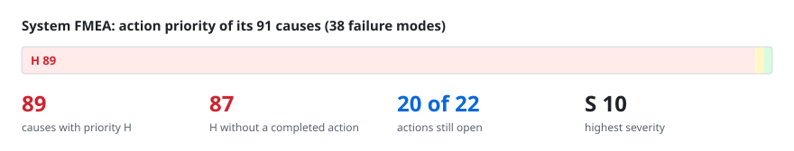
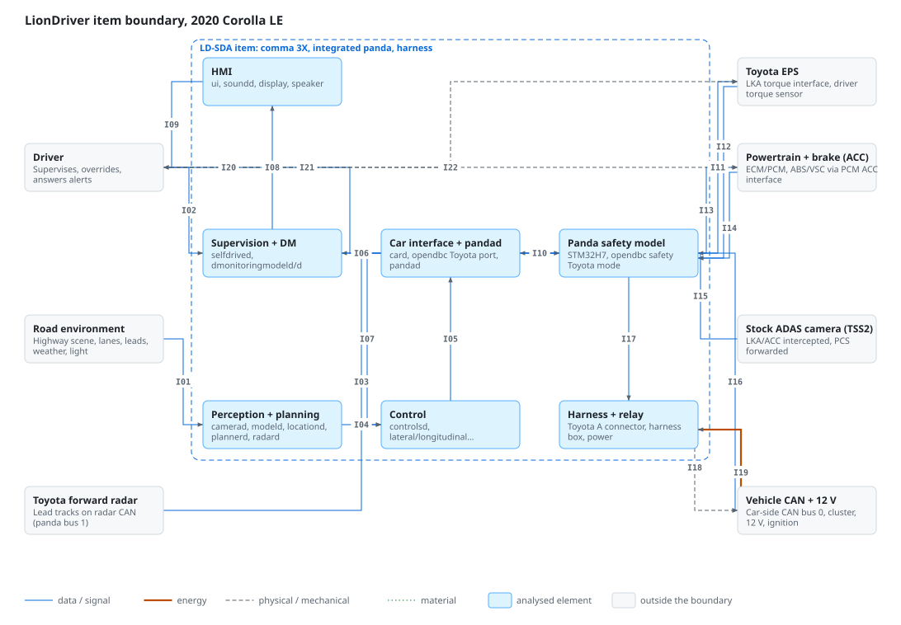
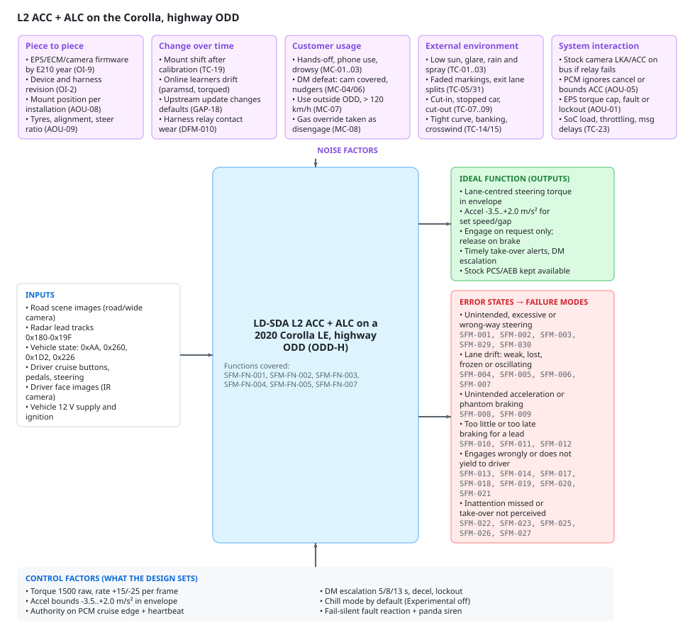
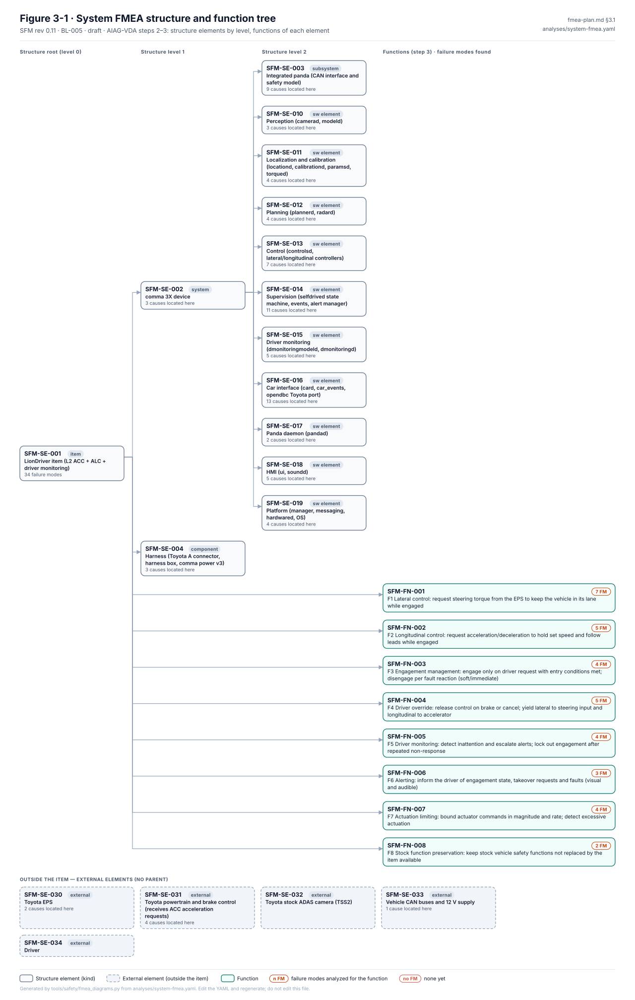
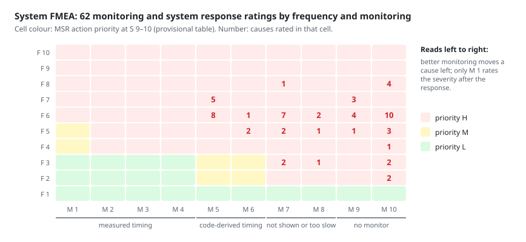

# System FMEA review: LionDriver L2 ACC/ALC item

> Generated from [`analyses/system-fmea.yaml`](../../analyses/system-fmea.yaml) and [`diagrams/system-fmea.yaml`](../../diagrams/system-fmea.yaml) by `tools/safety/fmea_review_md.py`. Edit the YAML and regenerate; never edit this page. A styled workbook of the same data is [`system-fmea-review.xlsx`](system-fmea-review.xlsx).

| Revision | Status | Baseline | Rating tables | Updated |
|---|---|---|---|---|
| 0.37 | draft | BL-007 | RT-3 | 2026-10-25 |

**Scope.** LionDriver as installed on the reference configuration CFG-001 (Corolla E210 · ZRE212 · US, US sedan MY2020-2022) with comma 3X and integrated panda, software BL-005 (structure and failure analysis written at BL-001, risk analysis at BL-004, MSR re-rated at BL-005; re-checked at BL-006 and BL-007), while the vehicle is driven by a licensed driver inside the ODD: limited-access highways only since WP-C-02 / WP-C-03 v0.4 (DQ-023), up to 110 km/h (DQ-260). Functions F1-F7 per fmea-plan.md section 3.1, plus F8 (stock vehicle safety functions are preserved), added because the harness intercepts the stock ADAS camera.

**Team.** Jherrod Thomas (Project maintainer, safety lead (reviewer/approver)); Claude (AI assistant) (Drafting assistance; content requires human review)

## How to review

Read the diagrams first, then the worksheet. Comment on this page's lines in a pull request, or open an issue that names the failure mode or cause ID. For a rating, say which value you would give and why; the scales are in [rating-tables.md](../../rating-tables.md). Action priority follows the AIAG-VDA table and is checked by `fmea_lint.py`, so challenge S, O or D, not the AP.

## Contents

- [Block and boundary diagram](#1-block-and-boundary-diagram)
- [P-diagram](#2-p-diagram)
- [Structure and functions](#3-structure-and-functions)
- [Worksheet](#4-worksheet)
- [Actions](#5-actions)
- [Priority H causes without a completed action](#6-priority-h-causes-without-a-completed-action)
- [Monitoring and system response](#7-monitoring-and-system-response)

## 1. Block and boundary diagram

**Interface matrix.** Each line in the diagram, with what crosses it.

| ID | From | To | Type | What crosses | Source |
|---|---|---|---|---|---|
| I01 | Road environment | Perception + planning | data | Road camera images | assurance/02-concept/WP-C-01-item-definition.md §3.4 IF-05 |
| I02 | Driver | Supervision + DM | data | Driver camera (IR) | assurance/02-concept/WP-C-01-item-definition.md §3.4 IF-06 |
| I03 | Toyota forward radar | Panda safety model | data | Radar tracks 0x180-0x19F | assurance/02-concept/WP-C-01-item-definition.md §3.4 IF-02 |
| I04 | Perception + planning | Control | data | modelV2 + long. plan | assurance/03-system/WP-S-03-technical-safety-concept-architecture.md §9 |
| I05 | Control | Car interface + pandad | data | carControl 100 Hz | assurance/03-system/WP-S-03-technical-safety-concept-architecture.md §9 |
| I06 | Car interface + pandad | Supervision + DM | data | carState, pandaStates | assurance/03-system/WP-S-03-technical-safety-concept-architecture.md §9 |
| I07 | Supervision + DM | Control | data | selfdriveState, DM | assurance/03-system/WP-S-03-technical-safety-concept-architecture.md §9 |
| I08 | Supervision + DM | HMI | data | Alerts, engaged state | assurance/03-system/WP-S-03-technical-safety-concept-architecture.md §3.3 IF-07 |
| I09 | HMI | Driver | data | Display, sounds | assurance/02-concept/WP-C-01-item-definition.md §3.4 IF-07 |
| I10 | Car interface + pandad | Panda safety model | data ⇄  | SPI: CAN, 0xf3 heartbeat | assurance/03-system/WP-S-05-hsi-specification.md §2 HSI-01..03, §11.2 S-16..S-21 |
| I11 | Panda safety model | Toyota EPS | data | 0x2E4 STEERING_LKA | assurance/03-system/WP-S-05-hsi-specification.md §11.1 S-01, S-02 |
| I12 | Toyota EPS | Panda safety model | data | 0x260 torque, 0x262 EPS | assurance/03-system/WP-S-05-hsi-specification.md §11.1 S-07, S-08, S-12 |
| I13 | Panda safety model | Powertrain + brake (ACC) | data | 0x343 ACC_CONTROL | assurance/03-system/WP-S-05-hsi-specification.md §11.1 S-03, S-04 |
| I14 | Powertrain + brake (ACC) | Panda safety model | data | 0x1D2/0x226/0xAA status | assurance/03-system/WP-S-05-hsi-specification.md §11.1 S-06, S-09..S-11 |
| I15 | Stock ADAS camera (TSS2) | Panda safety model | data | Bus 2 fwd (PCS 0x283) | assurance/03-system/WP-S-05-hsi-specification.md §11.1 S-15; WP-C-01 §3.4 IF-03 |
| I16 | Panda safety model | Vehicle CAN + 12 V | data | 0x412 LKAS_HUD cluster | assurance/03-system/WP-S-05-hsi-specification.md §11.1 S-05 |
| I17 | Panda safety model | Harness + relay | data | Relay drive GPIO | assurance/03-system/WP-S-05-hsi-specification.md §6, §11.3 S-22 |
| I18 | Harness + relay | Vehicle CAN + 12 V | physical ⇄  | CAN intercept bus 0/2 | assurance/03-system/WP-S-05-hsi-specification.md §5 |
| I19 | Vehicle CAN + 12 V | Harness + relay | energy | 12 V + ignition line | assurance/02-concept/WP-C-01-item-definition.md §3.4 IF-08; WP-S-05 §11.3 S-24 |
| I20 | Panda safety model | Driver | data | Panda siren (SM-23) | assurance/03-system/WP-S-05-hsi-specification.md §11.3 S-27; WP-S-02 TSR-516 |
| I21 | Driver | Toyota EPS | physical | Steering wheel torque | assurance/03-system/WP-S-03-technical-safety-concept-architecture.md §2 AP-6 |
| I22 | Driver | Powertrain + brake (ACC) | physical | Brake, gas, cruise stalk | assurance/03-system/WP-S-03-technical-safety-concept-architecture.md §2 AP-6; WP-C-01 §3.2 |

## 2. P-diagram

| Function covered | Description |
|---|---|
| `SFM-FN-001` | F1 Lateral control: request steering torque from the EPS to keep the vehicle in its lane while engaged |
| `SFM-FN-002` | F2 Longitudinal control: request acceleration/deceleration to hold set speed and follow leads while engaged |
| `SFM-FN-003` | F3 Engagement management: engage only on driver request with entry conditions met; disengage per fault reaction (soft/immediate) |
| `SFM-FN-004` | F4 Driver override: release control on brake or cancel; yield lateral to steering input and longitudinal to accelerator |
| `SFM-FN-005` | F5 Driver monitoring: detect inattention and escalate alerts; lock out engagement after repeated non-response |
| `SFM-FN-007` | F7 Actuation limiting: bound actuator commands in magnitude and rate; detect excessive actuation |

| Control factor | Source |
|---|---|
| Torque 1500 raw, rate +15/-25 per frame | assurance/03-system/WP-S-05-hsi-specification.md §11.1 S-02; WP-S-02 TSR-101..104 |
| Accel bounds -3.5..+2.0 m/s² in envelope | assurance/03-system/WP-S-05-hsi-specification.md §11.1 S-03; WP-S-02 TSR-201 |
| Authority on PCM cruise edge + heartbeat | assurance/03-system/WP-S-02-technical-safety-requirements.md TSR-301; WP-S-03 §6 SM-04, SM-29 |
| DM escalation 5/8/13 s, decel, lockout | assurance/02-concept/WP-C-08-driver-hmi-misuse-analysis.md §5.1; WP-S-02 TSR-608 |
| Chill mode by default (Experimental off) | assurance/01-management/WP-M-07-risk-management.md D-08; WP-C-07 FM-01 |
| Fail-silent fault reaction + panda siren | assurance/03-system/WP-S-03-technical-safety-concept-architecture.md §2 AP-2; WP-S-02 TSR-516 |

## 3. Structure and functions

The failure chains (element → function → failure mode → causes) are drawn in [figures/generated](../../figures/generated/README.md).

| Element | Kind | Functions |
|---|---|---|
| `SFM-SE-001` LionDriver item (L2 ACC + ALC + driver monitoring) | item | `SFM-FN-001` F1 Lateral control: request steering torque from the EPS to keep the vehicle in its lane while engaged `SFM-FN-002` F2 Longitudinal control: request acceleration/deceleration to hold set speed and follow leads while engaged `SFM-FN-003` F3 Engagement management: engage only on driver request with entry conditions met; disengage per fault reaction (soft/immediate) `SFM-FN-004` F4 Driver override: release control on brake or cancel; yield lateral to steering input and longitudinal to accelerator `SFM-FN-005` F5 Driver monitoring: detect inattention and escalate alerts; lock out engagement after repeated non-response `SFM-FN-006` F6 Alerting: inform the driver of engagement state, takeover requests and faults (visual and audible) `SFM-FN-007` F7 Actuation limiting: bound actuator commands in magnitude and rate; detect excessive actuation `SFM-FN-008` F8 Stock function preservation: keep stock vehicle safety functions not replaced by the item available |
| &nbsp;&nbsp;&nbsp;`SFM-SE-002` comma 3X device | system | — |
| &nbsp;&nbsp;&nbsp;&nbsp;&nbsp;&nbsp;`SFM-SE-003` Integrated panda (CAN interface and safety model) | subsystem | — |
| &nbsp;&nbsp;&nbsp;`SFM-SE-004` Harness (Toyota A connector, harness box, comma power v3) | component | — |
| &nbsp;&nbsp;&nbsp;&nbsp;&nbsp;&nbsp;`SFM-SE-010` Perception (camerad, modeld) | sw_element | — |
| &nbsp;&nbsp;&nbsp;&nbsp;&nbsp;&nbsp;`SFM-SE-011` Localization and calibration (locationd, calibrationd, paramsd, torqued) | sw_element | — |
| &nbsp;&nbsp;&nbsp;&nbsp;&nbsp;&nbsp;`SFM-SE-012` Planning (plannerd, radard) | sw_element | — |
| &nbsp;&nbsp;&nbsp;&nbsp;&nbsp;&nbsp;`SFM-SE-013` Control (controlsd, lateral/longitudinal controllers) | sw_element | — |
| &nbsp;&nbsp;&nbsp;&nbsp;&nbsp;&nbsp;`SFM-SE-014` Supervision (selfdrived state machine, events, alert manager) | sw_element | — |
| &nbsp;&nbsp;&nbsp;&nbsp;&nbsp;&nbsp;`SFM-SE-015` Driver monitoring (dmonitoringmodeld, dmonitoringd) | sw_element | — |
| &nbsp;&nbsp;&nbsp;&nbsp;&nbsp;&nbsp;`SFM-SE-016` Car interface (card, car_events, opendbc Toyota port) | sw_element | — |
| &nbsp;&nbsp;&nbsp;&nbsp;&nbsp;&nbsp;`SFM-SE-017` Panda daemon (pandad) | sw_element | — |
| &nbsp;&nbsp;&nbsp;&nbsp;&nbsp;&nbsp;`SFM-SE-018` HMI (ui, soundd) | sw_element | — |
| &nbsp;&nbsp;&nbsp;&nbsp;&nbsp;&nbsp;`SFM-SE-019` Platform (manager, messaging, hardwared, OS) | sw_element | — |
| `SFM-SE-030` Toyota EPS | external | — |
| `SFM-SE-031` Toyota powertrain and brake control (receives ACC acceleration requests) | external | — |
| `SFM-SE-032` Toyota stock ADAS camera (TSS2) | external | — |
| `SFM-SE-033` Vehicle CAN buses and 12 V supply | external | — |
| `SFM-SE-034` Driver | external | — |

## 4. Worksheet

One table per failure mode, grouped by structure element. S is the failure mode's severity (its worst end effect); each cause has its own occurrence (O), detection (D) and action priority (AP).

### `SFM-SE-001` LionDriver item (L2 ACC + ALC + driver monitoring)

#### SFM-001 · Steering torque applied when not engaged

🔴 **H** · **S 10** · guideword *unintended* · function `SFM-FN-001` F1 Lateral control: request steering torque from the EPS to keep the vehicle in its lane while engaged

Effects:

- **End:** Driver surprised during manual driving; possible lane departure (HZ-001, S 10)
- **Next higher:** Unexpected steering wheel motion and lateral deviation
- **Local:** Torque request sent to EPS outside an active state

| Cause | Prevention | Detection | O | D | AP | Actions |
|---|---|---|:-:|:-:|:-:|---|
| `SFM-001.C1` State machine reports active while disabled | • Upstream code with review; ruff and ty run in fork CI static_analysis; unit tests derived from the implementation; no software requirements scripts/lint/lint.sh:45,55; .github/workflows/tests.yaml | • test_no_entry and test_no_entry_pre_enable (ENABLE with NO_ENTRY stays disabled), run by tests.yaml unit_tests on every push and PR; not proven by mutation openpilot/selfdrive/selfdrived/tests/test_state_machine.py | 6 | 8 | 🔴 **H** | — |
| `SFM-001.C2` Panda allows steering TX without valid engagement (controls_allowed set incorrectly) | • Panda safety code: MISRA C:2012, 100% line coverage, review; rated in the SW FMEA assurance/08-analyses/fmea/analyses/sw-fmea.yaml | • opendbc safety suite with 100% line coverage and mutation tests, run by CI on every change (proven, early, test-to-fail) opendbc_repo/opendbc/safety/tests/test_toyota.py | 5 | 3 | 🔴 **H** | — |
| `SFM-001.C3` Steering message packed with non-zero torque/request bit while latActive is false | • Upstream opendbc Toyota port (DBC, carstate, carcontroller) with upstream review and route-based car tests; no LionDriver requirements; no field-exposure evidence for this configuration is credited opendbc_repo/opendbc/car/toyota | • As rated in the SW FMEA (SWF-059.C1, D 9 at BL-005): process_replay (CI) replays the TOYOTA3 Corolla TSS2 segment and compares with reference logs made from the same code, so it cannot find a defect already present at the baseline; not designed for this cause; it compares sendcan openpilot/selfdrive/test/process_replay/test_processes.py • process_replay over the CI route corpus compares outputs with the reference commit (CI 'process replay'); a regression check, not designed or proven for this cause openpilot/selfdrive/test/process_replay/test_processes.py | 4 | 9 | 🔴 **H** | — |

Safety mechanisms: (1) controlsd only sets latActive when selfdriveState is active and no EPS fault · (2) Panda safety model blocks steering messages unless controls are allowed (heartbeat carries engaged state from selfdriveState)

[Monitoring and system response](#7-monitoring-and-system-response): `SFM-001.C1` mechanism 2: M 5 · F 6 · S after response 4 → 🔴 **H** `SFM-001.C2` mechanism 1: M 10 · F 5 · S after response 10 → 🔴 **H** `SFM-001.C3` mechanism 2: M 5 · F 4 · S after response 4 → 🔴 **H**

Note: HARA input: unintended steering intervention during manual driving.

#### SFM-002 · Steering torque or torque rate above limits

🔴 **H** · **S 10** · guideword *excessive* · function `SFM-FN-001` F1 Lateral control: request steering torque from the EPS to keep the vehicle in its lane while engaged

Effects:

- **End:** Lane departure or collision with adjacent traffic or roadside (HZ-002, S 10)
- **Next higher:** Lateral deviation faster than a driver can correct (> 1 m in 0.9 s)
- **Local:** Torque request exceeds the limits in SAFETY.md / ISO 11270

| Cause | Prevention | Detection | O | D | AP | Actions |
|---|---|---|:-:|:-:|:-:|---|
| `SFM-002.C1` Lateral controller output too high (gain, torque model, saturation logic) | • Upstream review and lint; LatControlCurvature does reset its PID (latcontrol_curvature.py:28-31), so the omission may be an oversight or deliberate upstream; no requirement states either openpilot/selfdrive/controls/lib/latcontrol_curvature.py | • test_latcontrol.py covers saturation only; test_latcontrol_torque_buffer.py covers the request buffer only; nothing checks controller state across disengagement | 7 | 10 | 🔴 **H** | SFM-ACT-001, SFM-ACT-019 |
| `SFM-002.C2` Model outputs excessive desired curvature | • Upstream neural network trained and validated by comma.ai; no development or validation evidence is available to LionDriver (SOTIF / ISO PAS 8800 scope, WP-C-06) openpilot/selfdrive/modeld | • No pre-release test targets this cause | 7 | 10 | 🔴 **H** | SFM-ACT-001, SFM-ACT-009, SFM-ACT-019 |
| `SFM-002.C3` Safety model torque/rate limits wrong for this vehicle or not enforced | • Panda limits are copied from upstream vehicle tuning (same constants as the SoC side); no independent envelope derived from vehicle measurements (FSC FOI-001) opendbc_repo/opendbc/safety/modes/toyota.h • Panda safety code: MISRA C:2012, 100% line coverage, review; rated in the SW FMEA assurance/08-analyses/fmea/analyses/sw-fmea.yaml | • opendbc safety suite with 100% line coverage and mutation tests, run by CI on every change (proven, early, test-to-fail) opendbc_repo/opendbc/safety/tests/test_toyota.py | 6 | 9 | 🔴 **H** | SFM-ACT-001 |
| `SFM-002.C4` Wrong vehicle parameters (steer ratio, lateral accel factor, torque offsets) from online learners | • Upstream openpilot code with upstream review; ruff and type checks in CI (static analysis job); unit tests are not requirements-based; no field-exposure evidence for this configuration, so none is credited (RT-1 §2.2) scripts/lint/lint.sh • paramsd bounds the learned steer ratio to 0.5-2x CarParams and rate-limits offsets; torqued accepts estimates only within sanity bounds of the CarParams values openpilot/selfdrive/locationd/paramsd.py:47 | • As rated in the SW FMEA (SWF-076.C1, D 9 at BL-005): test_paramsd.py (CI) checks the saved-parameter handling; not designed for out-of-bound use openpilot/selfdrive/locationd/test/test_paramsd.py • paramsd and torqued unit tests (estimate bounds and convergence); targeted, not proven by fault injection openpilot/selfdrive/locationd/test/test_paramsd.py | 5 | 9 | 🔴 **H** | SFM-ACT-001, SFM-ACT-002, SFM-ACT-019 |
| `SFM-002.C5` The EPS misreports its motor torque, so the panda's measured-torque tracking check is misled; the magnitude and rate limits still apply (WP-A-03 DFI-11) | • Series-production Toyota ECU with long field exposure; assumed developed to ISO 26262 by the OEM (assumption of use, not verified by LionDriver) | • No pre-release test targets this cause | 3 | 10 | 🔴 **H** | SFM-ACT-003 |

Safety mechanisms: (1) Panda/opendbc Toyota safety model limits steering torque magnitude and rate on TX · (2) Excessive lateral acceleration check (> 2x ISO lateral accel for 0.25 s) raises excessiveActuation (SOFT_DISABLE) · (3) BL-005: selfdrived raises pandaTxBlocked (IMMEDIATE_DISABLE) when a panda's safetyTxBlocked count rises between two pandaStates samples while engaged, i.e. when the panda refused a frame the SoC sent (TSR-615)

[Monitoring and system response](#7-monitoring-and-system-response): `SFM-002.C1` mechanism 1, 3: M 5 · F 7 · S after response 10 → 🔴 **H** `SFM-002.C2` mechanism 1, 3: M 5 · F 7 · S after response 10 → 🔴 **H** `SFM-002.C3` mechanism 2: M 8 · F 6 · S after response 10 → 🔴 **H** `SFM-002.C4` mechanism 1, 3: M 5 · F 5 · S after response 10 → 🔴 **H** `SFM-002.C5` mechanism 1: M 10 · F 3 · S after response 10 → 🔴 **H**

Note: HARA input: excessive steering intervention while engaged. Lead decision DQ-060 (2026-10-14, option A): when the envelope rejects a steering command, steering switches off until the driver re-engages (TSR-108). At BL-005 the host already disengages on the first refused frame while engaged (pandaTxBlocked, TSR-615); the panda itself only drops the frame. The firmware half is SFM-ACT-019.

#### SFM-003 · Steering in the wrong direction (away from lane center)

🔴 **H** · **S 10** · guideword *wrong_direction* · function `SFM-FN-001` F1 Lateral control: request steering torque from the EPS to keep the vehicle in its lane while engaged

Effects:

- **End:** Lane departure into oncoming/adjacent traffic or off road (HZ-003, S 10)
- **Next higher:** Vehicle steers toward lane boundary
- **Local:** Torque request sign opposite to the required correction

| Cause | Prevention | Detection | O | D | AP | Actions |
|---|---|---|:-:|:-:|:-:|---|
| `SFM-003.C1` Calibration (camera extrinsics) wrong or not converged | • Upstream openpilot code with upstream review; ruff and type checks in CI (static analysis job); unit tests are not requirements-based; no field-exposure evidence for this configuration, so none is credited (RT-1 §2.2) scripts/lint/lint.sh • Engagement refused until calibration has converged; calibrationInvalid when out of bounds openpilot/selfdrive/locationd/calibrationd.py | • As rated in the SW FMEA (SWF-075.C1, D 8 at BL-005): test_calibrationd.py (CI) checks status transitions on synthetic data; targeted at the thresholds, not proven openpilot/selfdrive/locationd/test/test_calibrationd.py • calibrationd unit tests (convergence, invalid calibration); targeted, not proven by fault injection openpilot/selfdrive/locationd/test/test_calibrationd.py | 5 | 8 | 🔴 **H** | SFM-ACT-003 |
| `SFM-003.C2` Sign convention error in steering signal parse or pack for this car | • Upstream opendbc Toyota port (DBC, carstate, carcontroller) with upstream review and route-based car tests; no LionDriver requirements; no field-exposure evidence for this configuration is credited opendbc_repo/opendbc/car/toyota | • As rated in the SW FMEA (SWF-057.C1, D 9 at BL-005): process_replay (CI) replays the TOYOTA3 Corolla TSS2 segment and compares with reference logs made from the same code, so it cannot find a defect already present at the baseline; not designed for this cause openpilot/selfdrive/test/process_replay/test_processes.py • opendbc car tests check carState against the panda safety model on recorded routes (test_models); targeted at parse and pack consistency, not proven by fault injection, and run only where the route corpus is available opendbc_repo/opendbc/car/tests/test_models.py | 6 | 9 | 🔴 **H** | SFM-ACT-003 |
| `SFM-003.C3` Model desired curvature has wrong sign (corrupted frame, wrong camera stream) | • Upstream neural network trained and validated by comma.ai; no development or validation evidence is available to LionDriver (SOTIF / ISO PAS 8800 scope, WP-C-06) openpilot/selfdrive/modeld • camerad frame-id and frame-drop checks; modeld raises modeldLagging and frame drops openpilot/selfdrive/modeld/modeld.py | • No pre-release test targets this cause | 6 | 10 | 🔴 **H** | SFM-ACT-009 |
| `SFM-003.C4` Device mount moved after calibration | • Consumer-grade device hardware (comma 3X) without automotive qualification data available to LionDriver; rated in the DFMEA where a DFM row exists assurance/08-analyses/fmea/analyses/dfmea.yaml • Mount tolerance checked at installation (PFMEA PFM-009); calibrationd keeps recalibrating within bounds assurance/08-analyses/fmea/analyses/pfmea.yaml | • No pre-release test targets this cause | 5 | 10 | 🔴 **H** | SFM-ACT-003 |

Safety mechanisms: (1) Safety model torque/rate limits bound the deviation rate (not the direction) · (2) Driver steering override yields lateral control (steerOverride -> OVERRIDE_LATERAL)

[Monitoring and system response](#7-monitoring-and-system-response): `SFM-003.C1` mechanism 1, 2: M 10 · F 5 · S after response 10 → 🔴 **H** `SFM-003.C2` mechanism 1, 2: M 10 · F 6 · S after response 10 → 🔴 **H** `SFM-003.C3` mechanism 1, 2: M 10 · F 6 · S after response 10 → 🔴 **H** `SFM-003.C4` mechanism 1, 2: M 10 · F 5 · S after response 10 → 🔴 **H**

Note: HARA input: steering away from lane while engaged.

#### SFM-004 · Insufficient lateral control (undershoot in curves, drift toward lane edge)

🔴 **H** · **S 10** · guideword *insufficient* · function `SFM-FN-001` F1 Lateral control: request steering torque from the EPS to keep the vehicle in its lane while engaged

Effects:

- **End:** Lane departure if the driver does not intervene (HZ-004, S 10)
- **Next higher:** Vehicle drifts to lane edge in curves
- **Local:** Achieved curvature below desired curvature

| Cause | Prevention | Detection | O | D | AP | Actions |
|---|---|---|:-:|:-:|:-:|---|
| `SFM-004.C1` Safety model torque limit below what the curve requires (by design) | • Panda limits are copied from upstream vehicle tuning (same constants as the SoC side); no independent envelope derived from vehicle measurements (FSC FOI-001) opendbc_repo/opendbc/safety/modes/toyota.h | • No pre-release test targets this cause | 6 | 10 | 🔴 **H** | SFM-ACT-001 |
| `SFM-004.C2` EPS limits or rejects torque request (EPS fault, torque limit, lockout) | • Series-production Toyota ECU with long field exposure; assumed developed to ISO 26262 by the OEM (assumption of use, not verified by LionDriver) | • No pre-release test targets this cause | 5 | 10 | 🔴 **H** | SFM-ACT-003 |
| `SFM-004.C3` Controller tuning or torque model too weak for vehicle state | • Upstream openpilot code with upstream review; ruff and type checks in CI (static analysis job); unit tests are not requirements-based; no field-exposure evidence for this configuration, so none is credited (RT-1 §2.2) scripts/lint/lint.sh | • Lateral controller unit tests (saturation detection, torque buffer); targeted at nominal behaviour, not proven openpilot/selfdrive/controls/tests/test_latcontrol.py | 6 | 8 | 🔴 **H** | SFM-ACT-002, SFM-ACT-003 |

Safety mechanisms: (1) steerSaturated warning when undershooting > 1.2x in a turn with saturated controller · (2) ldw (lane departure warning) alert

[Monitoring and system response](#7-monitoring-and-system-response): `SFM-004.C1` mechanism 1, 2: M 8 · F 6 · S after response 10 → 🔴 **H** `SFM-004.C2` mechanism 1, 2: M 8 · F 5 · S after response 10 → 🔴 **H** `SFM-004.C3` mechanism 1, 2: M 8 · F 6 · S after response 10 → 🔴 **H**

Note: Mostly a designed limitation: overlaps SOTIF. Kept here for the failure path (EPS/controller fault).

#### SFM-005 · Loss of lateral control without driver alert

🔴 **H** · **S 10** · guideword *loss* · function `SFM-FN-001` F1 Lateral control: request steering torque from the EPS to keep the vehicle in its lane while engaged

Effects:

- **End:** Driver unaware of loss; lane departure (HZ-004, S 10)
- **Next higher:** Vehicle no longer follows the lane
- **Local:** Steering requests stop or are ignored while the item shows engaged

| Cause | Prevention | Detection | O | D | AP | Actions |
|---|---|---|:-:|:-:|:-:|---|
| `SFM-005.C1` EPS stops accepting requests without a fault signal on CAN | • Series-production Toyota ECU with long field exposure; assumed developed to ISO 26262 by the OEM (assumption of use, not verified by LionDriver) | • No pre-release test targets this cause | 3 | 10 | 🔴 **H** | SFM-ACT-003 |
| `SFM-005.C2` pandad stops forwarding TX without the state being reported | • None specific. Whether the comma 3X ever suspends after boot while openpilot runs (offset > 0) is not established | • No test targets this cause; no test exercises the age gate | 5 | 10 | 🔴 **H** | — |
| `SFM-005.C3` Process crash or hang not detected by liveness checks | • Upstream openpilot code with upstream review; ruff and type checks in CI (static analysis job); unit tests are not requirements-based; no field-exposure evidence for this configuration, so none is credited (RT-1 §2.2) scripts/lint/lint.sh • manager restarts and reports processes; selfdrived raises processNotRunning and commIssue from SubMaster alive/frequency checks openpilot/selfdrive/selfdrived/selfdrived.py | • No pre-release test targets this cause | 6 | 10 | 🔴 **H** | SFM-ACT-002 |
| `SFM-005.C4` A non-finite controller input (desired curvature, roll) zeroes the lateral output without an event while the item shows engaged (controlsd.py:122-131; TSR-604 met in part, GAP-19) | • Per-step finiteness guard on the desired curvature, roll, aTarget and lateralDelay (#51); rated in the SW FMEA openpilot/selfdrive/controls/controlsd.py | • As rated in the SW FMEA (SWF-045.C1, D 10): no NaN injection test; controlsd is excluded from the process fuzz test openpilot/selfdrive/test/process_replay/test_fuzzy.py | 5 | 10 | 🔴 **H** | — |

Safety mechanisms: (1) steerUnavailable (IMMEDIATE_DISABLE) and steerTempUnavailable (SOFT_DISABLE) from EPS fault signals · (2) Process liveness/frequency checks raise commIssue / processNotRunning (SOFT_DISABLE) · (3) BL-005, reference build (default): the panda revokes authority when STEERING_LKA has not arrived from the SoC for 50 ms (ACC_CONTROL 100 ms) while authority is granted, checked by the 100 Hz safety task (TSR-408) · (4) BL-005: controlsMismatch (IMMEDIATE_DISABLE) when the panda reports controlsAllowed false while engaged, after 2 consecutive pandaStates samples and at most 0.5 s after the first mismatched frame (TSR-621) · (5) BL-007, reference build: the panda sounds its own siren when the TX-arrival check revokes granted authority (panda 8a69ccf, opendbc 0ff85e6 safety_tx_arrival_revoked; DQ-404 A, TSR-516(b)), and a not-engaged heartbeat revokes within 0.3 s with the siren 0.5 s after it while PCM cruise stays on (panda f4803c5, engaged_mismatch.h; TSR-307(a), TSR-516(c)); independent of the SoC alerts. Host-compiled tests in CI (panda host tests job; opendbc reference-variant tests and mutation); the bench HIL test test_16 is not run in CI

[Monitoring and system response](#7-monitoring-and-system-response): `SFM-005.C1` mechanism 1: M 10 · F 3 · S after response 10 → 🔴 **H** `SFM-005.C2` mechanism 3, 4, 5: M 6 · F 5 · S after response 8 → 🔴 **H** `SFM-005.C3` mechanism 2: M 10 · F 6 · S after response 10 → 🔴 **H** `SFM-005.C4` mechanism 2, 3: M 10 · F 5 · S after response 10 → 🔴 **H**

Note: With a correct alert the effect is a controlled handback (S 8 per RT-1). Without one it is a HARA candidate.

#### SFM-006 · Lateral command frozen at last value

🔴 **H** · **S 10** · guideword *stuck* · function `SFM-FN-001` F1 Lateral control: request steering torque from the EPS to keep the vehicle in its lane while engaged

Effects:

- **End:** Vehicle leaves the lane on a curve or straight (HZ-003, S 10)
- **Next higher:** Vehicle holds a constant steering input
- **Local:** Same torque request repeated regardless of road geometry

| Cause | Prevention | Detection | O | D | AP | Actions |
|---|---|---|:-:|:-:|:-:|---|
| `SFM-006.C1` controlsd hangs while card keeps sending the last carControl | • Upstream review, ruff, ty; excluded from fuzzing (test_fuzzy.py:13) | • No test injects non-finite lateralDelay | 6 | 10 | 🔴 **H** | — |
| `SFM-006.C2` modeld output frozen (stale frame) but still published as valid | • Upstream openpilot code with upstream review; ruff and type checks in CI (static analysis job); unit tests are not requirements-based; no field-exposure evidence for this configuration, so none is credited (RT-1 §2.2) scripts/lint/lint.sh • modeld publishes frame drop percentage and raises modeldLagging; selfdrived checks modelV2 validity and frequency openpilot/selfdrive/modeld/modeld.py | • As rated in the SW FMEA (SWF-072.C2, D 10 at BL-005): modeld has no unit tests, is excluded from process replay (EXCLUDED_PROCS) and from test_fuzzy, and model_replay is not run in LionDriver CI; test_onroad timing checks are device-only • No pre-release test targets this cause | 4 | 10 | 🔴 **H** | SFM-ACT-002 |
| `SFM-006.C3` Messaging delivers stale data with fresh timestamps | • Upstream openpilot code with upstream review; ruff and type checks in CI (static analysis job); unit tests are not requirements-based; no field-exposure evidence for this configuration, so none is credited (RT-1 §2.2) scripts/lint/lint.sh • msgq/cereal stamp logMonoTime at publication; SubMaster tracks arrival time and frequency openpilot/cereal/messaging/__init__.py | • No pre-release test targets this cause | 5 | 10 | 🔴 **H** | SFM-ACT-002 |

Safety mechanisms: (1) Message liveness and frequency checks on inputs (sm.all_checks -> commIssue) · (2) Panda heartbeat loss removes controls_allowed (firmware, to verify in SW FMEA) · (3) BL-005, reference build (default): the panda revokes authority when STEERING_LKA has not arrived for 50 ms while authority is granted (TSR-408); selfdrived raises controlsMismatch within 0.5 s (TSR-621)

[Monitoring and system response](#7-monitoring-and-system-response): `SFM-006.C1` mechanism 1, 3: M 8 · F 6 · S after response 10 → 🔴 **H** `SFM-006.C2` mechanism 1: M 9 · F 4 · S after response 10 → 🔴 **H** `SFM-006.C3` mechanism 1: M 9 · F 5 · S after response 10 → 🔴 **H**

Note: HARA input: constant steering command not following road.

#### SFM-007 · Oscillating lateral control

🔴 **H** · **S 7** · guideword *degraded* · function `SFM-FN-001` F1 Lateral control: request steering torque from the EPS to keep the vehicle in its lane while engaged

Effects:

- **End:** Driver discomfort; possible over-correction by driver
- **Next higher:** Vehicle weaves within the lane
- **Local:** Torque request oscillates

| Cause | Prevention | Detection | O | D | AP | Actions |
|---|---|---|:-:|:-:|:-:|---|
| `SFM-007.C1` Controller instability (gain, delay compensation, lagd estimate) | • Upstream review and lint; LatControlCurvature does reset its PID (latcontrol_curvature.py:28-31), so the omission may be an oversight or deliberate upstream; no requirement states either openpilot/selfdrive/controls/lib/latcontrol_curvature.py | • test_latcontrol.py covers saturation only; test_latcontrol_torque_buffer.py covers the request buffer only; nothing checks controller state across disengagement | 7 | 10 | 🔴 **H** | — |
| `SFM-007.C2` Control loop timing jitter (CPU load, thermal throttling) | • Upstream openpilot code with upstream review; ruff and type checks in CI (static analysis job); unit tests are not requirements-based; no field-exposure evidence for this configuration, so none is credited (RT-1 §2.2) scripts/lint/lint.sh • Real-time scheduling priority and CPU affinity set by the control processes (config_realtime_process) openpilot/selfdrive/controls/controlsd.py:238 | • No pre-release test targets this cause | 5 | 10 | 🔴 **H** | SFM-ACT-003 |

#### SFM-008 · Unintended acceleration

🔴 **H** · **S 10** · guideword *unintended* · function `SFM-FN-002` F2 Longitudinal control: request acceleration/deceleration to hold set speed and follow leads while engaged

Effects:

- **End:** Rear-end collision with lead vehicle or loss of control (HZ-005, S 10)
- **Next higher:** Vehicle accelerates unexpectedly
- **Local:** Positive acceleration requested when not required or not engaged

| Cause | Prevention | Detection | O | D | AP | Actions |
|---|---|---|:-:|:-:|:-:|---|
| `SFM-008.C1` Planner targets higher speed (missed lead, wrong set speed) | • Upstream openpilot code with upstream review; ruff and type checks in CI (static analysis job); unit tests are not requirements-based; no field-exposure evidence for this configuration, so none is credited (RT-1 §2.2) scripts/lint/lint.sh • Set speed taken from the stock PCM cruise; panda caps acceleration at +2.0 m/s² (SWF-003) openpilot/selfdrive/controls/lib/longitudinal_planner.py | • As rated in the SW FMEA (SWF-065.C1, D 9 at BL-005): process_replay (CI) replays the TOYOTA3 Corolla TSS2 segment and compares with reference logs made from the same code, so it cannot find a defect already present at the baseline; not designed for this cause openpilot/selfdrive/test/process_replay/test_processes.py • Unit test of the longitudinal plan's following distance and set-speed behaviour; targeted, not proven openpilot/selfdrive/controls/tests/test_following_distance.py | 7 | 9 | 🔴 **H** | SFM-ACT-001, SFM-ACT-002 |
| `SFM-008.C2` Longitudinal controller output too high | • Planner jerk and accel limits only; TSR-605 margin not implemented openpilot/selfdrive/controls/lib/longitudinal_planner.py | • test_longcontrol.py covers state transitions, not limits openpilot/selfdrive/controls/tests/test_longcontrol.py | 7 | 10 | 🔴 **H** | SFM-ACT-001 |
| `SFM-008.C3` Wrong scaling of acceleration request for this car | • Upstream opendbc Toyota port (DBC, carstate, carcontroller) with upstream review and route-based car tests; no LionDriver requirements; no field-exposure evidence for this configuration is credited opendbc_repo/opendbc/car/toyota • Panda checks the raw ACC_CONTROL acceleration value against its range (catches scaling errors only beyond the range) opendbc_repo/opendbc/safety/modes/toyota.h | • As rated in the SW FMEA (SWF-059.C1, D 9 at BL-005): process_replay (CI) replays the TOYOTA3 Corolla TSS2 segment and compares with reference logs made from the same code, so it cannot find a defect already present at the baseline; not designed for this cause; it compares sendcan openpilot/selfdrive/test/process_replay/test_processes.py • opendbc car tests check carState against the panda safety model on recorded routes (test_models); targeted at parse and pack consistency, not proven by fault injection, and run only where the route corpus is available opendbc_repo/opendbc/car/tests/test_models.py | 4 | 9 | 🔴 **H** | SFM-ACT-003 |
| `SFM-008.C4` Powertrain applies more acceleration than requested | • Series-production Toyota ECU with long field exposure; assumed developed to ISO 26262 by the OEM (assumption of use, not verified by LionDriver) | • No pre-release test targets this cause | 3 | 10 | 🔴 **H** | SFM-ACT-003 |

Safety mechanisms: (1) Panda/opendbc safety model limits acceleration request range and blocks when not engaged · (2) Excessive longitudinal acceleration check (> 2x ACCEL_MAX for 0.25 s) -> excessiveActuation · (3) Brake press -> pedalPressed (USER_DISABLE) · (4) BL-005: selfdrived raises pandaTxBlocked (IMMEDIATE_DISABLE) when a panda's safetyTxBlocked count rises between two pandaStates samples while engaged, i.e. when the panda refused a frame the SoC sent (TSR-615)

[Monitoring and system response](#7-monitoring-and-system-response): `SFM-008.C1` mechanism 1, 3: M 9 · F 7 · S after response 10 → 🔴 **H** `SFM-008.C2` mechanism 1, 4: M 5 · F 7 · S after response 10 → 🔴 **H** `SFM-008.C3` mechanism 1, 4: M 5 · F 4 · S after response 10 → 🔴 **H** `SFM-008.C4` mechanism 2: M 8 · F 3 · S after response 10 → 🔴 **H**

Note: HARA input: unintended acceleration while engaged.

#### SFM-009 · Unintended or excessive deceleration (phantom braking)

🔴 **H** · **S 10** · guideword *excessive* · function `SFM-FN-002` F2 Longitudinal control: request acceleration/deceleration to hold set speed and follow leads while engaged

Effects:

- **End:** Rear-end collision by following vehicle; occupant injury (HZ-006, S 10)
- **Next higher:** Vehicle brakes hard
- **Local:** Strong deceleration requested without a real obstacle

| Cause | Prevention | Detection | O | D | AP | Actions |
|---|---|---|:-:|:-:|:-:|---|
| `SFM-009.C1` False lead (radar ghost, model false positive) or FCW false trigger | • Upstream openpilot code with upstream review; ruff and type checks in CI (static analysis job); unit tests are not requirements-based; no field-exposure evidence for this configuration, so none is credited (RT-1 §2.2) scripts/lint/lint.sh • Upstream neural network trained and validated by comma.ai; no development or validation evidence is available to LionDriver (SOTIF / ISO PAS 8800 scope, WP-C-06) openpilot/selfdrive/modeld | • Unit tests for lead handling and following distance; targeted at the nominal logic, not proven by fault injection openpilot/selfdrive/controls/tests/test_leads.py | 7 | 8 | 🔴 **H** | SFM-ACT-009 |
| `SFM-009.C2` Longitudinal controller overshoot | • Planner jerk and accel limits only; TSR-605 margin not implemented openpilot/selfdrive/controls/lib/longitudinal_planner.py | • test_longcontrol.py covers state transitions, not limits openpilot/selfdrive/controls/tests/test_longcontrol.py | 7 | 10 | 🔴 **H** | SFM-ACT-001 |
| `SFM-009.C3` Wrong vEgo/aEgo from CAN parse | • Upstream opendbc Toyota port (DBC, carstate, carcontroller) with upstream review and route-based car tests; no LionDriver requirements; no field-exposure evidence for this configuration is credited opendbc_repo/opendbc/car/toyota | • As rated in the SW FMEA (SWF-057.C1, D 9 at BL-005): process_replay (CI) replays the TOYOTA3 Corolla TSS2 segment and compares with reference logs made from the same code, so it cannot find a defect already present at the baseline; not designed for this cause openpilot/selfdrive/test/process_replay/test_processes.py • opendbc car tests check carState against the panda safety model on recorded routes (test_models); targeted at parse and pack consistency, not proven by fault injection, and run only where the route corpus is available opendbc_repo/opendbc/car/tests/test_models.py | 6 | 9 | 🔴 **H** | SFM-ACT-003 |
| `SFM-009.C4` Defect in the announcement of the driver-monitoring no-response stop (TSR-624, #374, BL-007): noResponseDecelIn or the countdown alert ("Car Stops in N s", then "Car Is Stopping") wrong or missing, so the stop starts without the at-least-1 s announcement. Up to BL-006 the cause was by design (no lead time). The fault soft-disable deceleration is announced only at its start, which TSR-624 accepts for that mild slow-down (DQ-407 A); its jerk is not bounded in the envelope (TSR-205, GAP-04) | • TSR-624 implemented for the no-response stop (#374, 59e22e0): the DM policy publishes the time left and the terminal alert counts down to it; new LionDriver code reviewed in the PR only, ruff and ty in CI; rated in the SW FMEA (SWF-050.C1) openpilot/selfdrive/monitoring/policy.py | • Proven by mutation in CI after BL-007 (AN-1, AN-2, tools/ci/host_mutation.py), as SWF-050.C1; D 8 -> 4 (System FMEA rev 0.36) tools/ci/host_mutants.toml • test_monitoring.py (the countdown runs 5 s to 0 and the stop starts at least 1 s after the first countdown frame) and the alert and event tests, in the CI unit_tests job; targeted, not proven by mutation, so D 8 (SW FMEA SWF-050.C1) openpilot/selfdrive/monitoring/test_monitoring.py | 5 | 4 | 🔴 **H** | — |

Safety mechanisms: (1) Safety model limits minimum acceleration request · (2) Excessive longitudinal deceleration check -> excessiveActuation · (3) Accelerator press -> gasPressedOverride (OVERRIDE_LONGITUDINAL) · (4) BL-005: selfdrived raises pandaTxBlocked (IMMEDIATE_DISABLE) when a panda's safetyTxBlocked count rises between two pandaStates samples while engaged, i.e. when the panda refused a frame the SoC sent (TSR-615)

[Monitoring and system response](#7-monitoring-and-system-response): `SFM-009.C1` mechanism 1, 3: M 9 · F 7 · S after response 10 → 🔴 **H** `SFM-009.C2` mechanism 1, 4: M 5 · F 7 · S after response 10 → 🔴 **H** `SFM-009.C3` mechanism 1, 3: M 9 · F 6 · S after response 10 → 🔴 **H** `SFM-009.C4` mechanism 1: M 10 · F 5 · S after response 10 → 🔴 **H**

Note: HARA input: unexpected hard braking. False-positive perception without a fault belongs to SOTIF.

#### SFM-010 · Insufficient deceleration for lead vehicle or stop

🔴 **H** · **S 10** · guideword *insufficient* · function `SFM-FN-002` F2 Longitudinal control: request acceleration/deceleration to hold set speed and follow leads while engaged

Effects:

- **End:** Rear-end collision if the driver does not brake (HZ-007, S 10)
- **Next higher:** Closing distance to lead shrinks
- **Local:** Deceleration request below what the situation needs

| Cause | Prevention | Detection | O | D | AP | Actions |
|---|---|---|:-:|:-:|:-:|---|
| `SFM-010.C1` Lead missed due to radar/vision fusion fault | • Upstream openpilot code with upstream review; ruff and type checks in CI (static analysis job); unit tests are not requirements-based; no field-exposure evidence for this configuration, so none is credited (RT-1 §2.2) scripts/lint/lint.sh • Upstream neural network trained and validated by comma.ai; no development or validation evidence is available to LionDriver (SOTIF / ISO PAS 8800 scope, WP-C-06) openpilot/selfdrive/modeld | • As rated in the SW FMEA (SWF-070.C1, D 8 at BL-005): test_stopped_vehicle test_radar_only_stationary_target reproduces the gap and is marked expectedFailure (CI) openpilot/selfdrive/test/stopped_vehicle/test_stopped_vehicle.py • Unit tests for lead handling and following distance; targeted at the nominal logic, not proven by fault injection openpilot/selfdrive/controls/tests/test_leads.py | 7 | 8 | 🔴 **H** | SFM-ACT-009 |
| `SFM-010.C2` Safety model minimum accel limit prevents required braking (by design) | • Panda limits are copied from upstream vehicle tuning (same constants as the SoC side); no independent envelope derived from vehicle measurements (FSC FOI-001) opendbc_repo/opendbc/safety/modes/toyota.h | • No pre-release test targets this cause | 6 | 10 | 🔴 **H** | SFM-ACT-006 |
| `SFM-010.C3` Brake system does not achieve requested deceleration | • Series-production Toyota ECU with long field exposure; assumed developed to ISO 26262 by the OEM (assumption of use, not verified by LionDriver) | • No pre-release test targets this cause | 3 | 10 | 🔴 **H** | SFM-ACT-003 |

Safety mechanisms: (1) FCW from planner or model (ET.PERMANENT alert) · (2) Radar faults raise radarFault / canError (SOFT_DISABLE / IMMEDIATE_DISABLE)

[Monitoring and system response](#7-monitoring-and-system-response): `SFM-010.C1` mechanism 1: M 9 · F 7 · S after response 10 → 🔴 **H** `SFM-010.C2` mechanism 1: M 7 · F 6 · S after response 10 → 🔴 **H** `SFM-010.C3` mechanism 1: M 7 · F 3 · S after response 10 → 🔴 **H**

Note: HARA input: insufficient braking for lead while engaged.

#### SFM-011 · Loss of longitudinal control without driver alert

🔴 **H** · **S 10** · guideword *loss* · function `SFM-FN-002` F2 Longitudinal control: request acceleration/deceleration to hold set speed and follow leads while engaged

Effects:

- **End:** Driver unaware; closing on lead (HZ-007, S 10)
- **Next higher:** Vehicle coasts or holds previous state
- **Local:** Acceleration requests stop or are ignored while engaged

| Cause | Prevention | Detection | O | D | AP | Actions |
|---|---|---|:-:|:-:|:-:|---|
| `SFM-011.C1` Powertrain ignores requests without fault signal | • Series-production Toyota ECU with long field exposure; assumed developed to ISO 26262 by the OEM (assumption of use, not verified by LionDriver) | • No pre-release test targets this cause | 3 | 10 | 🔴 **H** | SFM-ACT-003 |
| `SFM-011.C2` TX path to vehicle lost silently | • None specific. Whether the comma 3X ever suspends after boot while openpilot runs (offset > 0) is not established | • No test targets this cause; no test exercises the age gate | 5 | 10 | 🔴 **H** | — |
| `SFM-011.C3` A non-finite aTarget zeroes the acceleration request without an event while ACC is shown engaged (controlsd.py:129-131; TSR-604 met in part, GAP-19) | • controlsd finiteness guard on aTarget (#51); the planner clip keeps NaN; rated in the SW FMEA openpilot/selfdrive/controls/controlsd.py | • As rated in the SW FMEA (SWF-045.C2, D 10): test_longcontrol.py covers state transitions only; no NaN injection test openpilot/selfdrive/controls/tests/test_longcontrol.py | 5 | 10 | 🔴 **H** | — |

Safety mechanisms: (1) accFaulted (IMMEDIATE_DISABLE), cruiseDisabled (IMMEDIATE_DISABLE) · (2) canBusMissing (IMMEDIATE_DISABLE), canError · (3) BL-005, reference build (default): the panda revokes authority when ACC_CONTROL has not arrived for 100 ms (STEERING_LKA 50 ms) while authority is granted (TSR-408); selfdrived raises controlsMismatch (IMMEDIATE_DISABLE) within 0.5 s (TSR-621)

[Monitoring and system response](#7-monitoring-and-system-response): `SFM-011.C1` mechanism 1: M 10 · F 3 · S after response 10 → 🔴 **H** `SFM-011.C2` mechanism 3: M 6 · F 5 · S after response 8 → 🔴 **H** `SFM-011.C3` mechanism 3: M 10 · F 5 · S after response 10 → 🔴 **H**

Note: With a correct alert, S 8 per RT-1. Without one, HARA candidate.

#### SFM-012 · Late reaction to lead vehicle braking

🔴 **H** · **S 10** · guideword *late* · function `SFM-FN-002` F2 Longitudinal control: request acceleration/deceleration to hold set speed and follow leads while engaged

Effects:

- **End:** Rear-end collision or harsh late braking (HZ-007, S 10)
- **Next higher:** Reduced time gap
- **Local:** Deceleration request delayed

| Cause | Prevention | Detection | O | D | AP | Actions |
|---|---|---|:-:|:-:|:-:|---|
| `SFM-012.C1` Pipeline latency (CPU overload, thermal throttle, messaging delay) | • Upstream openpilot code with upstream review; ruff and type checks in CI (static analysis job); unit tests are not requirements-based; no field-exposure evidence for this configuration, so none is credited (RT-1 §2.2) scripts/lint/lint.sh • Real-time priorities; selfdrived raises modeldLagging, selfdrivedLagging and commIssueAvgFreq openpilot/selfdrive/selfdrived/selfdrived.py | • No pre-release test targets this cause | 6 | 10 | 🔴 **H** | SFM-ACT-003 |
| `SFM-012.C2` Lead state filtered too slowly (radard) | • Upstream openpilot code with upstream review; ruff and type checks in CI (static analysis job); unit tests are not requirements-based; no field-exposure evidence for this configuration, so none is credited (RT-1 §2.2) scripts/lint/lint.sh | • Unit tests for lead handling and following distance; targeted at the nominal logic, not proven by fault injection openpilot/selfdrive/controls/tests/test_leads.py | 6 | 8 | 🔴 **H** | SFM-ACT-009 |

Safety mechanisms: (1) modeldLagging / selfdrivedLagging (SOFT_DISABLE), commIssueAvgFreq

[Monitoring and system response](#7-monitoring-and-system-response): `SFM-012.C1` mechanism 1: M 8 · F 6 · S after response 10 → 🔴 **H** `SFM-012.C2` mechanism 1: M 10 · F 6 · S after response 10 → 🔴 **H**

#### SFM-013 · Engagement without driver request or with entry conditions not met

🔴 **H** · **S 10** · guideword *unintended* · function `SFM-FN-003` F3 Engagement management: engage only on driver request with entry conditions met; disengage per fault reaction (soft/immediate)

Effects:

- **End:** Unexpected steering/acceleration; driver surprised (HZ-010, S 10)
- **End:** Contributes to HZ-005: positive acceleration requested after an engagement the driver did not ask for (HZ-005, S 10)
- **Next higher:** Item starts actuating
- **Local:** State machine enters enabled without ENABLE or despite NO_ENTRY

| Cause | Prevention | Detection | O | D | AP | Actions |
|---|---|---|:-:|:-:|:-:|---|
| `SFM-013.C1` State machine transition error | • Upstream code with review; ruff and ty run in fork CI static_analysis; unit tests derived from the implementation; no software requirements scripts/lint/lint.sh:45,55; .github/workflows/tests.yaml | • test_no_entry and test_no_entry_pre_enable (ENABLE with NO_ENTRY stays disabled), run by tests.yaml unit_tests on every push and PR; not proven by mutation openpilot/selfdrive/selfdrived/tests/test_state_machine.py | 6 | 8 | 🔴 **H** | — |
| `SFM-013.C2` Cruise state or button parsed incorrectly (spurious enable) | • Upstream opendbc Toyota port (DBC, carstate, carcontroller) with upstream review and route-based car tests; no LionDriver requirements; no field-exposure evidence for this configuration is credited opendbc_repo/opendbc/car/toyota | • opendbc car tests check carState against the panda safety model on recorded routes (test_models); targeted at parse and pack consistency, not proven by fault injection, and run only where the route corpus is available opendbc_repo/opendbc/car/tests/test_models.py | 6 | 8 | 🔴 **H** | SFM-ACT-003 |

Safety mechanisms: (1) NO_ENTRY events block engagement (state.py) · (2) Toyota uses PCM cruise; engagement follows stock cruise main/set (cruise state in carState)

[Monitoring and system response](#7-monitoring-and-system-response): `SFM-013.C1` mechanism 2: M 5 · F 6 · S after response 4 → 🔴 **H** `SFM-013.C2` mechanism 2: M 5 · F 6 · S after response 4 → 🔴 **H**

Note: HARA input: unintended engagement. Engagement outside the ODD (off the highway, WP-C-03 v0.4 OS-03/04/15/16) is not prevented by the item; it is foreseeable misuse rated in the HARA and WP-C-08, not a fault cause of this failure mode.

#### SFM-014 · Fails to disengage when a fault requires it

🔴 **H** · **S 10** · guideword *loss* · function `SFM-FN-003` F3 Engagement management: engage only on driver request with entry conditions met; disengage per fault reaction (soft/immediate)

Effects:

- **End:** Any F1/F2 hazardous effect continues (HZ-002, S 10)
- **End:** Contributes to HZ-005: Unintended acceleration (HZ-005, S 10)
- **End:** Contributes to HZ-006: Unintended or excessive deceleration (HZ-006, S 10)
- **Next higher:** Item keeps actuating with a faulty input or actuator
- **Local:** SOFT_DISABLE/IMMEDIATE_DISABLE event not acted on

| Cause | Prevention | Detection | O | D | AP | Actions |
|---|---|---|:-:|:-:|:-:|---|
| `SFM-014.C1` Event missing for the fault (no detection) | • Only relayMalfunction, safety model/param and controlsAllowed are checked (selfdrived.py:333-351) openpilot/selfdrive/selfdrived/selfdrived.py:333-351 | • No test targets this cause | 8 | 10 | 🔴 **H** | — |
| `SFM-014.C2` Event mapped to wrong reaction type in events.py | • Reaction types chosen upstream; FSC WD-01 notes the 3 s must be justified per event (not done) openpilot/selfdrive/selfdrived/events.py | • test_soft_disable_timer checks that the timer is 3 s; it is not designed to show that 3 s is within the FTTI openpilot/selfdrive/selfdrived/tests/test_state_machine.py | 8 | 9 | 🔴 **H** | SFM-ACT-010 |
| `SFM-014.C3` Catch-all commIssue suppressed by the no_system_errors logic while another event is active | • Upstream openpilot code with upstream review; ruff and type checks in CI (static analysis job); unit tests are not requirements-based; no field-exposure evidence for this configuration, so none is credited (RT-1 §2.2) scripts/lint/lint.sh • The catch-all commIssue is suppressed only while a NO_ENTRY and a SOFT_DISABLE or IMMEDIATE_DISABLE event are already present, so a disable reaction is raised either way openpilot/selfdrive/selfdrived/selfdrived.py:389-393 | • No pre-release test targets this cause | 2 | 10 | 🔴 **H** | — |

Safety mechanisms: (1) Panda heartbeat carries engaged = selfdriveState alive, valid and enabled; panda removes controls_allowed on heartbeat loss (firmware, to verify)

[Monitoring and system response](#7-monitoring-and-system-response): `SFM-014.C1` mechanism 1: M 10 · F 8 · S after response 10 → 🔴 **H** `SFM-014.C2` mechanism 1: M 10 · F 8 · S after response 10 → 🔴 **H** `SFM-014.C3` mechanism 1: M 10 · F 2 · S after response 10 → 🟠 M

Note: HARA input: continued actuation after fault detection.

#### SFM-015 · Abrupt disengagement without alert

🔴 **H** · **S 10** · guideword *unintended* · function `SFM-FN-003` F3 Engagement management: engage only on driver request with entry conditions met; disengage per fault reaction (soft/immediate)

Effects:

- **End:** Driver unaware of handback; lane departure or closing on lead (HZ-004, S 10)
- **Next higher:** Steering assist and ACC stop
- **Local:** Item drops to disabled with no alert

| Cause | Prevention | Detection | O | D | AP | Actions |
|---|---|---|:-:|:-:|:-:|---|
| `SFM-015.C1` Alert generated but not rendered or played (see SFM-026) | • Upstream openpilot code with upstream review; ruff and type checks in CI (static analysis job); unit tests are not requirements-based; no field-exposure evidence for this configuration, so none is credited (RT-1 §2.2) scripts/lint/lint.sh | • soundd unit test (alert sound selection and volume); targeted, not proven; audibility in the cabin not tested openpilot/selfdrive/ui/tests/test_soundd.py | 6 | 8 | 🔴 **H** | SFM-ACT-007 |
| `SFM-015.C2` Panda drops controls_allowed on its own (e.g. safety violation) and selfdrived reacts late | • Upstream openpilot code with upstream review; ruff and type checks in CI (static analysis job); unit tests are not requirements-based; no field-exposure evidence for this configuration, so none is credited (RT-1 §2.2) scripts/lint/lint.sh • selfdrived raises controlsMismatch (IMMEDIATE_DISABLE) when the panda reports controls not allowed while engaged, after 2 consecutive pandaStates samples and at most 0.5 s (BL-005, TSR-621; 200 cumulative frames, about 2 s, at BL-004) openpilot/selfdrive/selfdrived/supervision.py | • BL-005: test_supervision.py checks the 2-sample and 0.5 s bounds and the 0.3 s engagement grace of controlsMismatch (tests.yaml unit_tests on every push and PR); targeted, not proven by mutation (RT-1 D 8). At BL-004 no test targeted this cause openpilot/selfdrive/selfdrived/tests/test_supervision.py | 6 | 8 | 🔴 **H** | SFM-ACT-010 |
| `SFM-015.C3` Device power loss (12 V interruption, harness connector) | • Consumer-grade device hardware (comma 3X) without automotive qualification data available to LionDriver; rated in the DFMEA where a DFM row exists assurance/08-analyses/fmea/analyses/dfmea.yaml | • As rated in the DFMEA: no pre-release test of this hardware fault assurance/08-analyses/fmea/analyses/dfmea.yaml | 5 | 10 | 🔴 **H** | SFM-ACT-003 |
| `SFM-015.C4` The SoC drives the MCU's BOOT0 or reset line while driving (fault or compromise), so the panda drops into the ROM bootloader, releases the intercept and stops the item's commands (GAP-38) | • Consumer-grade device hardware (comma 3X) without automotive qualification data available to LionDriver; rated in the DFMEA where a DFM row exists assurance/08-analyses/fmea/analyses/dfmea.yaml | • As rated in the DFMEA: no pre-release test of this hardware fault assurance/08-analyses/fmea/analyses/dfmea.yaml | 4 | 10 | 🔴 **H** | SFM-ACT-003 |

Safety mechanisms: (1) Every disable transition appends an alert type (USER_DISABLE / IMMEDIATE_DISABLE / SOFT_DISABLE) · (2) BL-005: controlsMismatch (IMMEDIATE_DISABLE) after 2 consecutive pandaStates samples with controlsAllowed false while engaged, at most 0.5 s after the first mismatched frame; samples in the first 0.3 s after engaging are not counted (TSR-621). pandaTxRateExceeded and pandaHeartbeatLost (IMMEDIATE_DISABLE) name the cause on the first sample (TSR-615)

[Monitoring and system response](#7-monitoring-and-system-response): `SFM-015.C1` mechanism 1: M 10 · F 6 · S after response 10 → 🔴 **H** `SFM-015.C2` mechanism 2: M 6 · F 6 · S after response 8 → 🔴 **H** `SFM-015.C3` not rated here: Hardware cause; rated once in the DFMEA (DFM-012.C1) `SFM-015.C4` not rated here: Hardware cause; rated once in the DFMEA (DFM-016.C1)

#### SFM-016 · Disengagement later than required by the fault

🔴 **H** · **S 10** · guideword *late* · function `SFM-FN-003` F3 Engagement management: engage only on driver request with entry conditions met; disengage per fault reaction (soft/immediate)

Effects:

- **End:** Lateral or longitudinal deviation during the soft-disable window (HZ-002, S 10)
- **End:** Contributes to HZ-005: Unintended acceleration (HZ-005, S 10)
- **Next higher:** Faulty actuation continues up to 3 s
- **Local:** SOFT_DISABLE (3 s) used where IMMEDIATE_DISABLE is needed

| Cause | Prevention | Detection | O | D | AP | Actions |
|---|---|---|:-:|:-:|:-:|---|
| `SFM-016.C1` Reaction type for an event under-classified (soft instead of immediate) | • Reaction types chosen upstream; FSC WD-01 notes the 3 s must be justified per event (not done) openpilot/selfdrive/selfdrived/events.py | • test_soft_disable_timer checks that the timer is 3 s; it is not designed to show that 3 s is within the FTTI openpilot/selfdrive/selfdrived/tests/test_state_machine.py | 8 | 9 | 🔴 **H** | SFM-ACT-010 |
| `SFM-016.C2` Debounce or counters too long (e.g. excessive actuation 0.25 s); at BL-005 a defect in the controlsMismatch supervision (2 consecutive samples, at most 0.5 s, TSR-621), which replaced the upstream 200-frame counter | • New LionDriver supervision code (#51, TSR-621); rated in the SW FMEA openpilot/selfdrive/selfdrived/supervision.py | • test_supervision.py targets the cause (consecutive samples, 0.5 s bound, engagement grace); not run in CI at BL-005 and not proven by mutation (SWF-ACT-055) openpilot/selfdrive/selfdrived/tests/test_supervision.py | 5 | 8 | 🔴 **H** | SFM-ACT-010 |

Note: Needs FTTI from the HARA/FSC to judge. Each SOFT_DISABLE event should be justified against FTTI.

#### SFM-017 · Brake press does not disengage

🔴 **H** · **S 10** · guideword *loss* · function `SFM-FN-004` F4 Driver override: release control on brake or cancel; yield lateral to steering input and longitudinal to accelerator

Effects:

- **End:** Driver cannot retake control as expected (SAFETY.md requirement 1 violated) (HZ-008, S 10)
- **End:** Contributes to HZ-005: the item keeps requesting acceleration while the driver brakes (HZ-005, S 10)
- **Next higher:** Item keeps requesting acceleration/steering during driver braking
- **Local:** pedalPressed not raised or not acted on

| Cause | Prevention | Detection | O | D | AP | Actions |
|---|---|---|:-:|:-:|:-:|---|
| `SFM-017.C1` brakePressed parsed wrong or CAN signal missing | • Upstream opendbc Toyota port (DBC, carstate, carcontroller) with upstream review and route-based car tests; no LionDriver requirements; no field-exposure evidence for this configuration is credited opendbc_repo/opendbc/car/toyota | • As rated in the SW FMEA (SWF-057.C1, D 9 at BL-005): process_replay (CI) replays the TOYOTA3 Corolla TSS2 segment and compares with reference logs made from the same code, so it cannot find a defect already present at the baseline; not designed for this cause openpilot/selfdrive/test/process_replay/test_processes.py • opendbc car tests check carState against the panda safety model on recorded routes (test_models); targeted at parse and pack consistency, not proven by fault injection, and run only where the route corpus is available opendbc_repo/opendbc/car/tests/test_models.py | 6 | 9 | 🔴 **H** | SFM-ACT-003 |
| `SFM-017.C2` Car events ignored when canValid is false | • Upstream code with review; ruff and ty in fork CI; no unit test of selfdrived.py event generation; no software requirements scripts/lint/lint.sh:45,55 | • test_user_disable covers the state-machine part (USER_DISABLE from every state), CI unit_tests, not proven; the pedal edge logic is exercised only by process_replay over recorded segments (generic regression, includes a Corolla TSS2 segment) openpilot/selfdrive/selfdrived/tests/test_state_machine.py | 7 | 8 | 🔴 **H** | — |
| `SFM-017.C3` The envelope accepts stuck or replayed 0x226 (brake) or 0x1D2 (cruise) frames whose content is valid: 0x226 has no checksum and neither has a counter, so a brake press or a PCM cruise release is not seen while the frames keep arriving (GAP-01). At BL-006 the RX timeout is 5 periods (TSR-401) and the reference build refuses or revokes CRUISE_ACTIVE with MAIN_ON = 0 (TSR-405(c)); stuck content is still accepted | • Upstream opendbc Toyota RX checks (checksum on 0x1D2 only, timing on both); no counter in the vehicle DBC opendbc_repo/opendbc/safety/modes/toyota.h | • No test targets this cause | 8 | 10 | 🔴 **H** | — |

Safety mechanisms: (1) selfdrived raises pedalPressed (USER_DISABLE) on brake press · (2) Panda safety model independently drops controls_allowed on brake press (firmware, to verify)

[Monitoring and system response](#7-monitoring-and-system-response): `SFM-017.C1` mechanism 2: M 5 · F 6 · S after response 3 → 🔴 **H** `SFM-017.C2` mechanism 2: M 5 · F 7 · S after response 3 → 🔴 **H** `SFM-017.C3` mechanism 1, 2: M 10 · F 8 · S after response 10 → 🔴 **H**

Note: HARA input: driver brake does not cancel automation. Directly tied to SAFETY.md requirement 1.

#### SFM-018 · Item resists driver steering input

🔴 **H** · **S 10** · guideword *loss* · function `SFM-FN-004` F4 Driver override: release control on brake or cancel; yield lateral to steering input and longitudinal to accelerator

Effects:

- **End:** Delayed evasive maneuver or loss of control (HZ-009, S 10)
- **Next higher:** Driver must overpower the item
- **Local:** steerOverride not detected; lateral torque continues

| Cause | Prevention | Detection | O | D | AP | Actions |
|---|---|---|:-:|:-:|:-:|---|
| `SFM-018.C1` Driver torque threshold too high or signal parsed wrong | • Upstream opendbc Toyota port (DBC, carstate, carcontroller) with upstream review and route-based car tests; no LionDriver requirements; no field-exposure evidence for this configuration is credited opendbc_repo/opendbc/car/toyota | • As rated in the SW FMEA (SWF-057.C1, D 9 at BL-005): process_replay (CI) replays the TOYOTA3 Corolla TSS2 segment and compares with reference logs made from the same code, so it cannot find a defect already present at the baseline; not designed for this cause openpilot/selfdrive/test/process_replay/test_processes.py • opendbc car tests check carState against the panda safety model on recorded routes (test_models); targeted at parse and pack consistency, not proven by fault injection, and run only where the route corpus is available opendbc_repo/opendbc/car/tests/test_models.py | 6 | 9 | 🔴 **H** | SFM-ACT-003 |
| `SFM-018.C2` Controller keeps commanding torque during override | • Upstream design intent (driver overpowers a bounded torque); no LionDriver requirement analysis of the deviation openpilot/selfdrive/selfdrived/state.py:8 | • test_maintain_states checks that overriding persists with OVERRIDE events; it does not check commanded torque openpilot/selfdrive/selfdrived/tests/test_state_machine.py | 8 | 9 | 🔴 **H** | — |
| `SFM-018.C3` The panda envelope passes STEERING_LKA torque that opposes the driver while the driver overrides: the Toyota LKA check covers magnitude, rate and measured-torque error only, and STEER_TORQUE_DRIVER is used only on the LTA path (toyota.h:298-310, 421-424; GAP-02). TSR-304 is not implemented in either build, so only the host 500-unit cut-off (C1, C2) stops the torque | • Upstream design (a bounded torque the driver can overpower); TSR-304 decided (DQ-053) but not implemented opendbc_repo/opendbc/safety/modes/toyota.h | • As rated in the SW FMEA (SWF-087.C1, D 10): test_toyota.py tests the measured-torque limit, not torque opposing the driver on the LKA path | 8 | 10 | 🔴 **H** | SFM-ACT-016 |

Safety mechanisms: (1) steerOverride -> OVERRIDE_LATERAL state · (2) EPS torque limit allows driver to overpower the request

[Monitoring and system response](#7-monitoring-and-system-response): `SFM-018.C1` mechanism 2: M 10 · F 6 · S after response 10 → 🔴 **H** `SFM-018.C2` mechanism 2: M 10 · F 8 · S after response 10 → 🔴 **H** `SFM-018.C3` not rated here: The cause is the missing panda override supervision itself, which is the MSR mechanism of C1 and C2; its absence is rated there as M 10 (msr-plan §3)

Note: HARA input: automation resists evasive steering. Lead decision DQ-053 (2026-10-14, option A): when the driver steers against LionDriver it backs off and shows a cue; SFM-ACT-016 carries the design.

#### SFM-019 · Cancel button does not disengage

🔴 **H** · **S 10** · guideword *loss* · function `SFM-FN-004` F4 Driver override: release control on brake or cancel; yield lateral to steering input and longitudinal to accelerator

Effects:

- **End:** Driver must use brake to disengage (HZ-008, S 10)
- **Next higher:** Item stays engaged
- **Local:** buttonCancel not raised

| Cause | Prevention | Detection | O | D | AP | Actions |
|---|---|---|:-:|:-:|:-:|---|
| `SFM-019.C1` Button message parsed wrong or missing | • Upstream opendbc Toyota port (DBC, carstate, carcontroller) with upstream review and route-based car tests; no LionDriver requirements; no field-exposure evidence for this configuration is credited opendbc_repo/opendbc/car/toyota | • As rated in the SW FMEA (SWF-057.C1, D 9 at BL-005): process_replay (CI) replays the TOYOTA3 Corolla TSS2 segment and compares with reference logs made from the same code, so it cannot find a defect already present at the baseline; not designed for this cause openpilot/selfdrive/test/process_replay/test_processes.py • opendbc car tests check carState against the panda safety model on recorded routes (test_models); targeted at parse and pack consistency, not proven by fault injection, and run only where the route corpus is available opendbc_repo/opendbc/car/tests/test_models.py | 6 | 9 | 🔴 **H** | SFM-ACT-003 |

Safety mechanisms: (1) buttonCancel (USER_DISABLE); brake remains as independent path

[Monitoring and system response](#7-monitoring-and-system-response): `SFM-019.C1` mechanism 1: M 5 · F 6 · S after response 3 → 🔴 **H**

#### SFM-020 · Accelerator override not honored

🔴 **H** · **S 10** · guideword *loss* · function `SFM-FN-004` F4 Driver override: release control on brake or cancel; yield lateral to steering input and longitudinal to accelerator

Effects:

- **End:** Driver cannot accelerate out of a situation (e.g. merging) (HZ-006, S 10)
- **Next higher:** Item keeps braking while driver accelerates
- **Local:** gasPressedOverride not detected

| Cause | Prevention | Detection | O | D | AP | Actions |
|---|---|---|:-:|:-:|:-:|---|
| `SFM-020.C1` gasPressed parsed wrong or missing | • Upstream opendbc Toyota port (DBC, carstate, carcontroller) with upstream review and route-based car tests; no LionDriver requirements; no field-exposure evidence for this configuration is credited opendbc_repo/opendbc/car/toyota | • As rated in the SW FMEA (SWF-057.C1, D 9 at BL-005): process_replay (CI) replays the TOYOTA3 Corolla TSS2 segment and compares with reference logs made from the same code, so it cannot find a defect already present at the baseline; not designed for this cause openpilot/selfdrive/test/process_replay/test_processes.py • opendbc car tests check carState against the panda safety model on recorded routes (test_models); targeted at parse and pack consistency, not proven by fault injection, and run only where the route corpus is available opendbc_repo/opendbc/car/tests/test_models.py | 6 | 9 | 🔴 **H** | SFM-ACT-003 |

Safety mechanisms: (1) gasPressedOverride -> OVERRIDE_LONGITUDINAL; longActive false during override

[Monitoring and system response](#7-monitoring-and-system-response): `SFM-020.C1` mechanism 1: M 5 · F 6 · S after response 3 → 🔴 **H**

Note: Lead decision DQ-022 (2026-10-14, option A): pressing the accelerator pauses longitudinal control only and does not disengage (today's behaviour, gasPressedOverride). The effects above assume this default; the on-screen override cue is to be checked in the HMI clinic (WP-C-08).

#### SFM-021 · Stock cruise stays engaged after LionDriver disengages

🔴 **H** · **S 10** · guideword *stuck* · function `SFM-FN-004` F4 Driver override: release control on brake or cancel; yield lateral to steering input and longitudinal to accelerator

Effects:

- **End:** Driver believes automation is off (mode confusion) (HZ-012, S 10)
- **End:** Contributes to HZ-008: the driver cancels but stock cruise keeps longitudinal control (HZ-008, S 10)
- **Next higher:** Vehicle continues under stock cruise
- **Local:** Cancel request not effective; PCM cruise enabled while item is disabled

| Cause | Prevention | Detection | O | D | AP | Actions |
|---|---|---|:-:|:-:|:-:|---|
| `SFM-021.C1` Cancel message not packed/sent for this car | • Upstream opendbc Toyota port (DBC, carstate, carcontroller) with upstream review and route-based car tests; no LionDriver requirements; no field-exposure evidence for this configuration is credited opendbc_repo/opendbc/car/toyota | • process_replay over the CI route corpus compares outputs with the reference commit (CI 'process replay'); a regression check, not designed or proven for this cause openpilot/selfdrive/test/process_replay/test_processes.py | 6 | 9 | 🔴 **H** | SFM-ACT-011 |
| `SFM-021.C2` PCM ignores cancel request | • Series-production Toyota ECU with long field exposure; assumed developed to ISO 26262 by the OEM (assumption of use, not verified by LionDriver) | • No pre-release test targets this cause | 3 | 10 | 🔴 **H** | SFM-ACT-011 |

Safety mechanisms: (1) controlsd sends cruiseControl.cancel when cruise enabled and item not enabled · (2) BL-005: cruiseMismatch after 1 s of stock cruise engaged while the item is not, with a repeating audible prompt "Stock Cruise Still Engaged / Press Cancel or Brake" (PERMANENT; TSR-308)

[Monitoring and system response](#7-monitoring-and-system-response): `SFM-021.C1` mechanism 1, 2: M 7 · F 6 · S after response 10 → 🔴 **H** `SFM-021.C2` mechanism 1, 2: M 7 · F 3 · S after response 10 → 🔴 **H**

Note: Observation (BL-004): selfdrived raised cruiseMismatch after 6 s of mismatch, but events.py mapped cruiseMismatch to no reaction (its ET.PERMANENT alert was commented out). Confirmed in the SW FMEA (SWF-039); action SFM-ACT-011, completed: at BL-005 cruiseMismatch alerts after 1 s (TSR-308).

#### SFM-022 · Inattentive driver not detected

🔴 **H** · **S 10** · guideword *loss* · function `SFM-FN-005` F5 Driver monitoring: detect inattention and escalate alerts; lock out engagement after repeated non-response

Effects:

- **End:** Driver not available to handle F1/F2 failures or system limits (HZ-013, S 10)
- **Next higher:** No distraction alerts
- **Local:** Awareness not decremented

| Cause | Prevention | Detection | O | D | AP | Actions |
|---|---|---|:-:|:-:|:-:|---|
| `SFM-022.C1` DM model false negative (eyes off road classified attentive) | • Upstream neural network trained and validated by comma.ai; no development or validation evidence is available to LionDriver (SOTIF / ISO PAS 8800 scope, WP-C-06) openpilot/selfdrive/modeld | • No pre-release test targets this cause | 7 | 10 | 🔴 **H** | SFM-ACT-009 |
| `SFM-022.C2` Pose thresholds/calibration wrong for driver or mount | • Upstream openpilot code with upstream review; ruff and type checks in CI (static analysis job); unit tests are not requirements-based; no field-exposure evidence for this configuration, so none is credited (RT-1 §2.2) scripts/lint/lint.sh | • As rated in the SW FMEA (SWF-061.C2, D 8 at BL-005): test_monitoring.py scenarios (distracted, invisible, uncertain, last-second responder) in CI; targeted at the policy, not proven by mutation openpilot/selfdrive/monitoring/test_monitoring.py • Driver-monitoring policy unit tests (alert timing, awareness recovery, exemptions) on synthetic inputs; targeted, not proven by fault injection; the model itself is not tested openpilot/selfdrive/monitoring/test_monitoring.py | 6 | 8 | 🔴 **H** | SFM-ACT-009 |
| `SFM-022.C3` Driver camera or IR illumination degraded | • Consumer-grade device hardware (comma 3X) without automotive qualification data available to LionDriver; rated in the DFMEA where a DFM row exists assurance/08-analyses/fmea/analyses/dfmea.yaml • selfdrived raises cameraMalfunction when driver camera frames stop openpilot/selfdrive/selfdrived/selfdrived.py | • No pre-release test targets this cause | 5 | 10 | 🔴 **H** | SFM-ACT-003 |
| `SFM-022.C4` Driver monitoring runs in demo mode while the item is engaged (IsDriverViewEnabled left set): the policy uses a synthetic vehicle state and the monitored seat can switch, so the actual driver may not be watched (GAP-20, TSR-610 not met) | • The cabin camera dialog opens only offroad and its buttons are disabled onroad; no engagement interlock; rated in the SW FMEA openpilot/selfdrive/monitoring/dmonitoringd.py | • As rated in the SW FMEA (SWF-085, D 10): no test covers demo mode with the item started | 8 | 10 | 🔴 **H** | — |

Safety mechanisms: (1) Fallback from vision policy to wheel-touch policy when model is uncertain for 10 s · (2) Driver camera liveness in camera_packets -> cameraMalfunction (SOFT_DISABLE)

[Monitoring and system response](#7-monitoring-and-system-response): `SFM-022.C1` mechanism 1: M 9 · F 7 · S after response 10 → 🔴 **H** `SFM-022.C2` mechanism 1: M 9 · F 6 · S after response 10 → 🔴 **H** `SFM-022.C3` mechanism 1, 2: M 7 · F 5 · S after response 10 → 🔴 **H** `SFM-022.C4` mechanism 1, 2: M 10 · F 8 · S after response 10 → 🔴 **H**

Note: HARA input: loss of the driver as the fallback (L2 safety argument depends on it). DM model performance is also SOTIF/PAS 8800.

#### SFM-023 · Distraction escalation too slow

🔴 **H** · **S 10** · guideword *late* · function `SFM-FN-005` F5 Driver monitoring: detect inattention and escalate alerts; lock out engagement after repeated non-response

Effects:

- **End:** Driver not ready when takeover needed (HZ-013, S 10)
- **Next higher:** Longer eyes-off-road while engaged
- **Local:** Alert levels reached later than designed (5/8/13 s vision policy)

| Cause | Prevention | Detection | O | D | AP | Actions |
|---|---|---|:-:|:-:|:-:|---|
| `SFM-023.C1` Policy timers or recovery factor misconfigured | • Upstream openpilot code with upstream review; ruff and type checks in CI (static analysis job); unit tests are not requirements-based; no field-exposure evidence for this configuration, so none is credited (RT-1 §2.2) scripts/lint/lint.sh | • As rated in the SW FMEA (SWF-061.C2, D 8 at BL-005): test_monitoring.py scenarios (distracted, invisible, uncertain, last-second responder) in CI; targeted at the policy, not proven by mutation openpilot/selfdrive/monitoring/test_monitoring.py • Driver-monitoring policy unit tests (alert timing, awareness recovery, exemptions) on synthetic inputs; targeted, not proven by fault injection; the model itself is not tested openpilot/selfdrive/monitoring/test_monitoring.py | 6 | 8 | 🔴 **H** | SFM-ACT-002 |
| `SFM-023.C2` Low-speed or always-on exemption applied incorrectly | • Upstream openpilot code with upstream review; ruff and type checks in CI (static analysis job); unit tests are not requirements-based; no field-exposure evidence for this configuration, so none is credited (RT-1 §2.2) scripts/lint/lint.sh | • As rated in the SW FMEA (SWF-061.C3, D 9 at BL-005): test_monitoring.py covers the wheel-touch fallback; not designed for this cause openpilot/selfdrive/monitoring/test_monitoring.py • Driver-monitoring policy unit tests (alert timing, awareness recovery, exemptions) on synthetic inputs; targeted, not proven by fault injection; the model itself is not tested openpilot/selfdrive/monitoring/test_monitoring.py | 6 | 9 | 🔴 **H** | SFM-ACT-002 |

Note: BL-007 changes the policy around these causes, not the causes: the countdown runs in elapsed time, so a DM model that skips frames no longer stretches the 5/8/13 s timers (SWSR-635a, #366), an uncertain pose counts as not attentive and the vision countdown keeps running past orange (SWSR-635b), and the wheel-touch reminders are also bounded by distance (TSR-634, #221); all unit-tested in test_monitoring.py in CI, not proven by mutation. Misconfigured timers (C1) and a wrongly applied exemption (C2) keep the SW FMEA ratings they inherit (SWF-061); the distance track's own defects are for the SW FMEA owner (impact record change-2026-10-17-dm-wheeltouch-distance OI-2).

#### SFM-024 · False distraction alerts

🟠 M · **S 4** · guideword *unintended* · function `SFM-FN-005` F5 Driver monitoring: detect inattention and escalate alerts; lock out engagement after repeated non-response

Effects:

- **End:** Driver annoyance; may reduce trust or prompt disabling DM in a fork
- **Next higher:** Nuisance alerts; possible lockout
- **Local:** Alerts raised for an attentive driver

| Cause | Prevention | Detection | O | D | AP | Actions |
|---|---|---|:-:|:-:|:-:|---|
| `SFM-024.C1` DM model false positive (sunglasses, lighting) | • Upstream neural network trained and validated by comma.ai; no development or validation evidence is available to LionDriver (SOTIF / ISO PAS 8800 scope, WP-C-06) openpilot/selfdrive/modeld | • No pre-release test targets this cause | 7 | 10 | 🟠 M | — |

#### SFM-025 · Terminal driver-unresponsive state does not bring the item to a safe state

🔴 **H** · **S 10** · guideword *insufficient* · function `SFM-FN-005` F5 Driver monitoring: detect inattention and escalate alerts; lock out engagement after repeated non-response

Effects:

- **End:** No fallback if the driver is incapacitated (HZ-013, S 10)
- **Next higher:** Vehicle continues under automation with an unresponsive driver
- **Local:** Alert level three shows "DISENGAGE IMMEDIATELY" but the item stays engaged

| Cause | Prevention | Detection | O | D | AP | Actions |
|---|---|---|:-:|:-:|:-:|---|
| `SFM-025.C1` Defect in the minimum-risk manoeuvre of TSR-633 (#372): the latch in minimum_risk.py not set or cleared while the item is still engaged, controlsd not keeping forceDecel on while selfdriveState.minimumRiskManeuver is set, or the terminal alert not re-raised, so the car resumes or keeps driving with an unresponsive driver. Up to BL-006 the cause was by design: the terminal alerts were ET.PERMANENT only and the forced deceleration was recomputed every DM frame, so a dmonitoringd restart or an awareness reset dropped it | • Lead decision DQ-365 A implemented as TSR-633 (#372, dacd8f7; #374, 59e22e0 for the announcement); new LionDriver code on upstream openpilot, reviewed in the PR only, ruff and ty in CI; O 5 as the other new host code with targeted tests (SW FMEA SWF-062.C1) openpilot/selfdrive/selfdrived/minimum_risk.py | • Proven by mutation in CI after BL-007 (MR-1..MR-7, tools/ci/host_mutation.py), as SWF-062.C1; D 8 -> 4 (System FMEA rev 0.37) tools/ci/host_mutants.toml • test_minimum_risk.py (the latch), test_monitoring.py (lockout from the takeover) and a test_longitudinal maneuver that stays stopped under forced deceleration while the lead drives off, run by the CI unit_tests job; targeted, not proven by mutation, so D 8. The PCM standstill hold over time (AOU-16) and the stop time are not verified on the vehicle openpilot/selfdrive/selfdrived/tests/test_minimum_risk.py | 5 | 4 | 🔴 **H** | SFM-ACT-005 |

Safety mechanisms: (1) Lockout after repeated non-response prevents re-engagement (1/5/15/30 min); since #372 (BL-007) the lockout timer runs from the driver's takeover, not from the start of the stop · (2) BL-007 (#372, TSR-633, DQ-365 A): selfdrived latches the minimum-risk manoeuvre from the first no-response request until the item disengages (minimum_risk.py, selfdriveState.minimumRiskManeuver); controlsd keeps forceDecel on while it is set, so the planner keeps the stop request and the Toyota controller keeps requesting standstill hold, and the terminal alert is re-raised while latched. Since #374 (TSR-624) the stop is announced by a countdown before it starts. Reference platform and all others alike

[Monitoring and system response](#7-monitoring-and-system-response): `SFM-025.C1` mechanism 1, 2: M 8 · F 5 · S after response 10 → 🔴 **H**

Note: Observation: in BL-001, events.py maps driverDistracted3 and driverUnresponsive3 only to an ET.PERMANENT alert; no SOFT_DISABLE/IMMEDIATE_DISABLE is attached, so reaching awareness 0 does not by itself disengage. This may be a deliberate design choice (avoid dropping control on an incapacitated driver). Unchanged at BL-004 and BL-005. Decided since (DQ-365 A, 2026-10-16): stop in the lane, hold, and lock out re-engagement until the driver responds (TSR-633); implementation is SFM-ACT-005. BL-007: implemented (#372 latch and hold, #374 announcement) and unit-tested; the events stay PERMANENT alerts, which is the decided behaviour (the item keeps the lane while it stops). Open: the PCM standstill hold over time (AOU-16), the measured stop time and deceleration, and the time to the reaction (WP-S-04 OI-11). HARA input: driver incapacitated while engaged. Lead decision DQ-205 (2026-10-14, option A): the unresponsive driver is its own hazard with an ASIL A goal (here HZ-013, SG-010; H-09 and SG-08, ASIL A, in WP-C-03 v0.4), and its safe state is defined together with the zero-awareness reaction.

#### SFM-026 · Takeover or disengagement alert not presented

🔴 **H** · **S 10** · guideword *loss* · function `SFM-FN-006` F6 Alerting: inform the driver of engagement state, takeover requests and faults (visual and audible)

Effects:

- **End:** Driver unaware of handback; delayed response (HZ-012, S 10)
- **End:** Contributes to HZ-006: item-initiated deceleration not announced (HE-04.3) (HZ-006, S 10)
- **End:** Contributes to HZ-013: driver-monitoring escalation alerts not shown or played, so an inattentive driver is not told; the forced deceleration does not depend on them (as SWF-082) (HZ-013, S 10)
- **Next higher:** Driver not informed of state change
- **Local:** Alert selected by alertmanager but not shown or not played

| Cause | Prevention | Detection | O | D | AP | Actions |
|---|---|---|:-:|:-:|:-:|---|
| `SFM-026.C1` UI process hung or display off | • Upstream openpilot code with upstream review; ruff and type checks in CI (static analysis job); unit tests are not requirements-based; no field-exposure evidence for this configuration, so none is credited (RT-1 §2.2) scripts/lint/lint.sh | • No pre-release test targets this cause | 6 | 10 | 🔴 **H** | SFM-ACT-007 |
| `SFM-026.C2` soundd failure or volume too low for cabin noise | • Upstream openpilot code with upstream review; ruff and type checks in CI (static analysis job); unit tests are not requirements-based; no field-exposure evidence for this configuration, so none is credited (RT-1 §2.2) scripts/lint/lint.sh • soundd scales volume with ambient noise and plays alerts at a minimum level openpilot/selfdrive/ui/soundd.py | • soundd unit test (alert sound selection and volume); targeted, not proven; audibility in the cabin not tested openpilot/selfdrive/ui/tests/test_soundd.py | 6 | 8 | 🔴 **H** | SFM-ACT-007, SFM-ACT-003 |
| `SFM-026.C3` Speaker or display hardware failure | • Consumer-grade device hardware (comma 3X) without automotive qualification data available to LionDriver; rated in the DFMEA where a DFM row exists assurance/08-analyses/fmea/analyses/dfmea.yaml | • No pre-release test targets this cause | 4 | 10 | 🔴 **H** | SFM-ACT-007 |

Safety mechanisms: (1) Visual alert on device screen and audible alert through soundd (two channels)

[Monitoring and system response](#7-monitoring-and-system-response): `SFM-026.C1` mechanism 1: M 10 · F 6 · S after response 10 → 🔴 **H** `SFM-026.C2` mechanism 1: M 10 · F 6 · S after response 10 → 🔴 **H** `SFM-026.C3` mechanism 1: M 10 · F 4 · S after response 10 → 🔴 **H**

Note: HARA input: failure to warn the driver of handback. The panda siren is the SoC-independent control (FSR-02.05; TSR-516, SoC side TSR-606; WP-A-03 DFI-14): since 2026-10-13 it sounds about 0.56 s after the last heartbeat while authority is granted (panda c33343b; WP-S-04 T-07a), but only when the crash also stops the heartbeat; a ui or soundd crash alone does not trigger it. In BL-007 (reference build) it also sounds on a TX-arrival revocation (DQ-404 A) and 0.5 s after a not-engaged heartbeat while PCM cruise stays on (TSR-516(c)); neither covers a ui or soundd crash with selfdrived alive. Taken in from the retired WP-A-04 §10 table (DQ-127).

#### SFM-027 · Alert presented late

🔴 **H** · **S 10** · guideword *late* · function `SFM-FN-006` F6 Alerting: inform the driver of engagement state, takeover requests and faults (visual and audible)

Effects:

- **End:** Reduced takeover margin (HZ-012, S 10)
- **End:** Contributes to HZ-013: a driver-monitoring escalation presented late, or hidden behind a higher-priority alert, so the inattentive driver is told late (as SWF-035) (HZ-013, S 10)
- **Next higher:** Less time for driver response
- **Local:** Alert rendered/played after a delay

| Cause | Prevention | Detection | O | D | AP | Actions |
|---|---|---|:-:|:-:|:-:|---|
| `SFM-027.C1` UI frame drops or audio buffering | • Upstream openpilot code with upstream review; ruff and type checks in CI (static analysis job); unit tests are not requirements-based; no field-exposure evidence for this configuration, so none is credited (RT-1 §2.2) scripts/lint/lint.sh | • No pre-release test targets this cause | 6 | 10 | 🔴 **H** | SFM-ACT-003 |
| `SFM-027.C2` Alert creation_delay or priority hides a more urgent alert | • Upstream code with review; ruff and ty run in fork CI static_analysis; unit tests derived from the implementation; no software requirements scripts/lint/lint.sh:45,55; .github/workflows/tests.yaml | • test_alertmanager checks alert duration only; test_alerts checks text/size sanity; neither checks priority between takeover and other alerts openpilot/selfdrive/selfdrived/tests/test_alertmanager.py | 6 | 9 | 🔴 **H** | — |

#### SFM-028 · Displayed engagement state differs from actual state

🔴 **H** · **S 10** · guideword *unintended* · function `SFM-FN-006` F6 Alerting: inform the driver of engagement state, takeover requests and faults (visual and audible)

Effects:

- **End:** Driver stops steering/braking believing automation is active, or is surprised by actuation (HZ-012, S 10)
- **End:** Contributes to HZ-008: the driver believes control was released by the brake or cancel while the item still acts (HZ-008, S 10)
- **Next higher:** Mode confusion
- **Local:** UI shows engaged when disabled, or disabled when engaged

| Cause | Prevention | Detection | O | D | AP | Actions |
|---|---|---|:-:|:-:|:-:|---|
| `SFM-028.C1` UI renders stale selfdriveState | • Upstream openpilot code with upstream review; ruff and type checks in CI (static analysis job); unit tests are not requirements-based; no field-exposure evidence for this configuration, so none is credited (RT-1 §2.2) scripts/lint/lint.sh | • No pre-release test targets this cause | 6 | 10 | 🔴 **H** | SFM-ACT-007 |
| `SFM-028.C2` Stock dashboard (HUD) state from hudControl inconsistent with item state | • Upstream opendbc Toyota port (DBC, carstate, carcontroller) with upstream review and route-based car tests; no LionDriver requirements; no field-exposure evidence for this configuration is credited opendbc_repo/opendbc/car/toyota | • process_replay over the CI route corpus compares outputs with the reference commit (CI 'process replay'); a regression check, not designed or proven for this cause openpilot/selfdrive/test/process_replay/test_processes.py | 6 | 9 | 🔴 **H** | SFM-ACT-003 |

Note: HARA input: mode confusion.

#### SFM-029 · Actuator command limits not enforced

🔴 **H** · **S 10** · guideword *loss* · function `SFM-FN-007` F7 Actuation limiting: bound actuator commands in magnitude and rate; detect excessive actuation

Effects:

- **End:** Any upstream fault can produce SFM-002 / SFM-008 / SFM-009 effects (HZ-002, S 10)
- **End:** Contributes to HZ-005: Unintended acceleration (HZ-005, S 10)
- **End:** Contributes to HZ-006: Unintended or excessive deceleration (HZ-006, S 10)
- **Next higher:** Loss of the main protection against F1/F2 faults on the device
- **Local:** Out-of-limit steering or acceleration messages reach the vehicle

| Cause | Prevention | Detection | O | D | AP | Actions |
|---|---|---|:-:|:-:|:-:|---|
| `SFM-029.C1` Wrong safety model or parameter set for this car | • The openpilot build and the release script select the reference build (LIONDRIVER_REFERENCE=1) by default, and pandad sets a car mode only on a panda that reports it (TSR-619); rated in the SW FMEA assurance/08-analyses/fmea/analyses/sw-fmea.yaml | • CI job panda_reference_release_build checks every firmware compile for -DLIONDRIVER_REFERENCE; host test of the reference-build health flag. Checks the build configuration, not the signed release image (PFMEA PFM-001) .github/workflows/safety.yaml | 3 | 4 | 🟢 L | — |
| `SFM-029.C2` Safety model limit defect in firmware | • Panda limits are copied from upstream vehicle tuning (same constants as the SoC side); no independent envelope derived from vehicle measurements (FSC FOI-001) opendbc_repo/opendbc/safety/modes/toyota.h • Panda safety code: MISRA C:2012, 100% line coverage, review; rated in the SW FMEA assurance/08-analyses/fmea/analyses/sw-fmea.yaml | • opendbc safety suite with 100% line coverage and mutation tests, run by CI on every change (proven, early, test-to-fail) opendbc_repo/opendbc/safety/tests/test_toyota.py | 6 | 9 | 🔴 **H** | SFM-ACT-001 |
| `SFM-029.C3` Panda MCU hardware fault (see DFMEA/FMEDA) | • Consumer-grade device hardware (comma 3X) without automotive qualification data available to LionDriver; rated in the DFMEA where a DFM row exists assurance/08-analyses/fmea/analyses/dfmea.yaml | • As rated in the DFMEA: no pre-release test of this hardware fault assurance/08-analyses/fmea/analyses/dfmea.yaml | 3 | 10 | 🔴 **H** | — |
| `SFM-029.C4` Harness allows the device to reach a bus without passing the panda filter | • Consumer-grade device hardware (comma 3X) without automotive qualification data available to LionDriver; rated in the DFMEA where a DFM row exists assurance/08-analyses/fmea/analyses/dfmea.yaml • Every vehicle CAN connection of the device terminates at the panda MCU's transceivers through the harness; the SoC has no CAN transceiver of its own (to be confirmed from comma 3X hardware documentation, not available to LionDriver) | • No pre-release test targets this cause | 2 | 10 | 🔴 **H** | — |
| `SFM-029.C5` The panda 100 Hz safety task stops or is starved (defect, interrupt storm, peripheral lock-up), so the RX timeout, heartbeat and TX-arrival checks are not run and no siren is raised. A stopped task resets the MCU through the IWDG in about 90 ms (TSR-501); a task that is starved but still runs is not detected (no WCET) | • IWDG from LSI, 90 ms nominal, window mode, fed only from the safety task after main-loop progress (TSR-501, TSR-502); rated in the SW FMEA panda/board/drivers/hw_watchdog.h | • As rated in the SW FMEA (SWF-018.C1, D 7): host unit tests of reference_lock and hw_watchdog against the real firmware headers (panda CI); the HIL watchdog test with injected hangs is not run (no HIL bench, D-04) panda/tests/reference_lock/test_reference_lock.py | 4 | 7 | 🔴 **H** | — |
| `SFM-029.C6` Actuation frames reach the panda faster than nominal (a backlog forwarded back-to-back, or a burst): each frame is within the limits, but the limits apply per frame, not per time. The reference build counts frames per ID over a 250 ms window and revokes after 3 refusals (TSR-518, txRateExceeded); budgets to be confirmed on logs | • Upstream pandad design, reviewed; no derived freshness requirement at BL-004; rated in the SW FMEA openpilot/selfdrive/pandad/pandad.cc | • No test targets this cause | 8 | 10 | 🔴 **H** | — |
| `SFM-029.C7` An approved frame is altered after the TX check: in the copy into FDCAN message RAM, the message RAM, the FDCAN core or the transceiver. The packet XOR catches a change in the software queue only (fdcan.h:100); TSR-517 asks for a read-back (SPF-02) | • Consumer-grade device hardware (comma 3X) without automotive qualification data available to LionDriver; rated in the DFMEA where a DFM row exists assurance/08-analyses/fmea/analyses/dfmea.yaml | • As rated in the DFMEA: no pre-release test of this hardware fault assurance/08-analyses/fmea/analyses/dfmea.yaml | 3 | 10 | 🔴 **H** | — |
| `SFM-029.C8` A corrupted SoC-to-MCU SPI transfer passes the 8-bit XOR, so a wrong CAN frame or a wrong control command (safety mode, parameter) is taken. The TX limits still apply to frames; nothing checks control commands (TSR-410, TSR-413; GAP-10) | • Consumer-grade device hardware (comma 3X) without automotive qualification data available to LionDriver; rated in the DFMEA where a DFM row exists assurance/08-analyses/fmea/analyses/dfmea.yaml | • As rated in the DFMEA: no pre-release test of this hardware fault assurance/08-analyses/fmea/analyses/dfmea.yaml | 4 | 10 | 🔴 **H** | — |
| `SFM-029.C9` Safety state in panda SRAM (controls_allowed, limits, counters) corrupted: a soft error or permanent fault with no ECC handling (TSR-503, TSR-507; GAP-08), or a wrong-address write by the SPI DMA when a length field exceeds the buffer (no MPU; TSR-412, WP-S-02 NF-04; WP-A-02 FFI-SP-02) | • Consumer-grade device hardware (comma 3X) without automotive qualification data available to LionDriver; rated in the DFMEA where a DFM row exists assurance/08-analyses/fmea/analyses/dfmea.yaml | • As rated in the DFMEA: no pre-release test of this hardware fault assurance/08-analyses/fmea/analyses/dfmea.yaml | 3 | 10 | 🔴 **H** | — |
| `SFM-029.C10` The panda time base fails or drifts (HSE crystal, PLL). A lost HSE is caught by the clock security system, which resets the MCU (clock.h:118-119); a drift is not detected, so every timeout and rate window scales (TSR-504; reset state TSR-706) | • Consumer-grade device hardware (comma 3X) without automotive qualification data available to LionDriver; rated in the DFMEA where a DFM row exists assurance/08-analyses/fmea/analyses/dfmea.yaml | • As rated in the DFMEA: no pre-release test of this hardware fault assurance/08-analyses/fmea/analyses/dfmea.yaml | 3 | 10 | 🔴 **H** | — |
| `SFM-029.C11` The panda MCU runs in the brown-out zone during a supply dip (BOR level not set, PVD not enabled); the supply voltage is only reported (TSR-505; WP-A-03 DFI-01) | • Consumer-grade device hardware (comma 3X) without automotive qualification data available to LionDriver; rated in the DFMEA where a DFM row exists assurance/08-analyses/fmea/analyses/dfmea.yaml | • As rated in the DFMEA: no pre-release test of this hardware fault assurance/08-analyses/fmea/analyses/dfmea.yaml | 5 | 10 | 🔴 **H** | — |

Safety mechanisms: (1) controlsMismatch (IMMEDIATE_DISABLE) if panda safety model/param differ from CarParams, or safety RX checks invalid; from BL-006 a wrong-length frame of an RX-checked message is an RX fault in the reference build (opendbc#18, ATC-25, SWSR-402) · (2) BL-005 (reference build by default): the panda accepts only TOYOTA with parameter 73, SILENT, NOOUTPUT and ELM327, and once TOYOTA is active only NOOUTPUT or SILENT (reference_lock.h, TSR-512/513); pandad configures a car mode only on a panda that reports a reference build, and selfdrived names a non-reference panda (pandaNotReferenceBuild, TSR-514/619)

[Monitoring and system response](#7-monitoring-and-system-response): `SFM-029.C1` mechanism 1, 2: M 7 · F 3 · S after response 8 → 🔴 **H** `SFM-029.C2` mechanism 1: M 10 · F 6 · S after response 10 → 🔴 **H** `SFM-029.C3` not rated here: Hardware cause; rated once in the DFMEA (DFM-001.C1) `SFM-029.C4` mechanism 1: M 10 · F 2 · S after response 10 → 🟠 M `SFM-029.C5` mechanism 1: M 10 · F 4 · S after response 10 → 🔴 **H** `SFM-029.C6` mechanism 1: M 10 · F 8 · S after response 10 → 🔴 **H** `SFM-029.C7` not rated here: Hardware cause; rated once in the DFMEA (DFM-019) `SFM-029.C8` not rated here: Hardware cause; rated once in the DFMEA (DFM-015.C1) `SFM-029.C9` not rated here: Hardware cause; rated once in the DFMEA (DFM-003) `SFM-029.C10` not rated here: Hardware cause; rated once in the DFMEA (DFM-005.C1) `SFM-029.C11` not rated here: Hardware cause; rated once in the DFMEA (DFM-007.C1)

Note: Latent-fault candidate: an unenforced limit has no effect until a second fault occurs. Key input for FMEDA LFM.

#### SFM-030 · Excessive actuation not detected

🔴 **H** · **S 10** · guideword *loss* · function `SFM-FN-007` F7 Actuation limiting: bound actuator commands in magnitude and rate; detect excessive actuation

Effects:

- **End:** SFM-002/008/009 effects persist (HZ-002, S 10)
- **End:** Contributes to HZ-005: Unintended acceleration (HZ-005, S 10)
- **End:** Contributes to HZ-006: Unintended or excessive deceleration (HZ-006, S 10)
- **Next higher:** Item stays engaged during excessive motion
- **Local:** excessiveActuation not raised

| Cause | Prevention | Detection | O | D | AP | Actions |
|---|---|---|:-:|:-:|:-:|---|
| `SFM-030.C1` Calibrated pose wrong (calibration or IMU fault) | • Upstream openpilot code with upstream review; ruff and type checks in CI (static analysis job); unit tests are not requirements-based; no field-exposure evidence for this configuration, so none is credited (RT-1 §2.2) scripts/lint/lint.sh | • calibrationd unit tests (convergence, invalid calibration); targeted, not proven by fault injection openpilot/selfdrive/locationd/test/test_calibrationd.py | 5 | 8 | 🔴 **H** | SFM-ACT-002 |
| `SFM-030.C2` device_motion_valid gate blocks detection when aEgo and IMU disagree | • Upstream code with review; ruff and ty in fork CI; no unit test of selfdrived.py event generation; no software requirements scripts/lint/lint.sh:45,55 | • No test targets this cause | 6 | 10 | 🔴 **H** | — |

Note: Latent-fault candidate (secondary monitor).

#### SFM-031 · False excessive-actuation detection

🔴 **H** · **S 8** · guideword *unintended* · function `SFM-FN-007` F7 Actuation limiting: bound actuator commands in magnitude and rate; detect excessive actuation

Effects:

- **End:** Unneeded handback to the driver
- **Next higher:** Soft disable with alert
- **Local:** excessiveActuation raised without excessive motion

| Cause | Prevention | Detection | O | D | AP | Actions |
|---|---|---|:-:|:-:|:-:|---|
| `SFM-031.C1` IMU noise or bad mounting | • Consumer-grade device hardware (comma 3X) without automotive qualification data available to LionDriver; rated in the DFMEA where a DFM row exists assurance/08-analyses/fmea/analyses/dfmea.yaml | • No pre-release test targets this cause | 5 | 10 | 🔴 **H** | SFM-ACT-003 |

#### SFM-032 · Wrong vehicle configuration active (fingerprint or car port)

🔴 **H** · **S 10** · guideword *unintended* · function `SFM-FN-007` F7 Actuation limiting: bound actuator commands in magnitude and rate; detect excessive actuation

Effects:

- **End:** Any F1/F2 effect; possible message conflicts with stock ECUs (HZ-002, S 10)
- **End:** Contributes to HZ-005: Unintended acceleration (HZ-005, S 10)
- **End:** Contributes to HZ-006: Unintended or excessive deceleration (HZ-006, S 10)
- **Next higher:** Wrong limits, scaling and message layout
- **Local:** CarParams, safety model and DBC for a different car

| Cause | Prevention | Detection | O | D | AP | Actions |
|---|---|---|:-:|:-:|:-:|---|
| `SFM-032.C1` Fuzzy fingerprint matches a similar platform | • Upstream opendbc Toyota port (DBC, carstate, carcontroller) with upstream review and route-based car tests; no LionDriver requirements; no field-exposure evidence for this configuration is credited opendbc_repo/opendbc/car/toyota • Exact FW-version fingerprint first, fuzzy fallback; controlsMismatch if the panda safety model or parameter differ from CarParams opendbc_repo/opendbc/car/fw_versions.py | • As rated in the SW FMEA (SWF-058.C1, D 9 at BL-005): opendbc test_fw_fingerprint exists but is not run by LionDriver CI • Fingerprinting unit tests (FW and CAN fingerprint); targeted, not proven by fault injection opendbc_repo/opendbc/car/tests/test_fw_fingerprint.py | 4 | 9 | 🔴 **H** | SFM-ACT-008 |

Safety mechanisms: (1) carUnrecognized -> dashcam mode (no control) · (2) controlsMismatch on safety model/param mismatch · (3) BL-005 (reference build by default): the panda accepts no car mode other than TOYOTA with parameter 73 (reference_lock.h, TSR-512/513), so a platform with another safety parameter leaves the panda out of the car mode and controlsMismatch blocks engagement

[Monitoring and system response](#7-monitoring-and-system-response): `SFM-032.C1` mechanism 2, 3: M 8 · F 4 · S after response 10 → 🔴 **H**

Note: Also a PFMEA topic (car port selection, PFMEA scope item 6).

#### SFM-033 · Stock safety functions unavailable or degraded while the item is installed

🔴 **H** · **S 10** · guideword *loss* · function `SFM-FN-008` F8 Stock function preservation: keep stock vehicle safety functions not replaced by the item available

Effects:

- **End:** Driver relies on stock protections that are not present (HZ-011, S 10)
- **Next higher:** Stock AEB / FCW / lane assist not available as expected
- **Local:** Stock ADAS camera messages blocked or replaced by the harness-box intercept

| Cause | Prevention | Detection | O | D | AP | Actions |
|---|---|---|:-:|:-:|:-:|---|
| `SFM-033.C1` The intercept routes the stock camera messages the vehicle needs for AEB through the panda | • Forwarding keeps stock pre-collision messages (0x283, 0x344) passing the intercept (SWF-011); which TSS2 functions remain with openpilot longitudinal is not established opendbc_repo/opendbc/safety/modes/toyota.h | • No pre-release test targets this cause | 6 | 10 | 🔴 **H** | SFM-ACT-006 |
| `SFM-033.C2` Item does not forward or reproduce stock safety messages | • Panda safety code: MISRA C:2012, 100% line coverage, review; rated in the SW FMEA assurance/08-analyses/fmea/analyses/sw-fmea.yaml | • opendbc safety suite with 100% line coverage and mutation tests, run by CI on every change (proven, early, test-to-fail) opendbc_repo/opendbc/safety/tests/test_toyota.py | 5 | 3 | 🔴 **H** | SFM-ACT-006 |
| `SFM-033.C3` The harness box loses its supply (ignition branch or D1 open without comma power, VIN shorted), or a switch channel opens, so the stock camera path through the unpowered or open DG419LE switches is cut (RR-2026-010) | • Consumer-grade harness box without automotive qualification data available to LionDriver; rated in the DFMEA assurance/08-analyses/fmea/analyses/dfmea.yaml | • As rated in the DFMEA: no pre-release test of this hardware fault assurance/08-analyses/fmea/analyses/dfmea.yaml | 5 | 10 | 🔴 **H** | SFM-ACT-003 |
| `SFM-033.C4` The panda MCU stops executing with the intercept driven, so forwarding stops and the stock camera stays cut off; the item's commands stop too (EPS timeout, AOU-01R). Since BL-005 the IWDG resets the MCU in about 90 ms, which releases the intercept (TSR-501, TSR-706); not verified on hardware (WP-A-04 OI-5) | • Consumer-grade device hardware (comma 3X) without automotive qualification data available to LionDriver; rated in the DFMEA where a DFM row exists assurance/08-analyses/fmea/analyses/dfmea.yaml | • As rated in the DFMEA (DFM-004.C1, D 8): watchdog HIL test with injected hangs (FAULT_INJECTION build); targeted, not yet run (no HIL bench, D-04) panda/tests/hitl/test_10_hw_watchdog.py | 3 | 8 | 🔴 **H** | SFM-ACT-003 |
| `SFM-033.C5` The panda's car-side transceiver (bus 0) holds the bus dominant or babbles, so the vehicle ECUs lose the stock camera messages the panda forwards and the item's commands (TSR-508) | • Consumer-grade device hardware (comma 3X) without automotive qualification data available to LionDriver; rated in the DFMEA where a DFM row exists assurance/08-analyses/fmea/analyses/dfmea.yaml | • As rated in the DFMEA: no pre-release test of this hardware fault assurance/08-analyses/fmea/analyses/dfmea.yaml | 3 | 10 | 🔴 **H** | SFM-ACT-003 |
| `SFM-033.C6` The panda's camera-side FDCAN or transceiver is stuck or error-passive, so camera-side reception stops and the stock PCS frames are not forwarded while the intercept is driven. The error counters and bus-off recovery (fdcan.h:76-84) do not release the intercept (SPF-13; TSR-707, TSR-706) | • Consumer-grade device hardware (comma 3X) without automotive qualification data available to LionDriver; rated in the DFMEA where a DFM row exists assurance/08-analyses/fmea/analyses/dfmea.yaml | • As rated in the DFMEA: no pre-release test of this hardware fault assurance/08-analyses/fmea/analyses/dfmea.yaml | 3 | 10 | 🔴 **H** | SFM-ACT-003 |

Note: Open question: which stock TSS2 functions remain on the reference configuration with openpilot longitudinal enabled. Must be established from the opendbc Toyota port and in-vehicle test before the HARA. HARA input: loss of stock AEB/FCW.

#### SFM-034 · Harness-box intercept switch stuck or in the wrong position

🔴 **H** · **S 10** · guideword *intermittent* · function `SFM-FN-008` F8 Stock function preservation: keep stock vehicle safety functions not replaced by the item available

Effects:

- **End:** Erratic stock or item behavior; stock functions lost (HZ-011, S 10)
- **End:** Contributes to HZ-002: stock LKA and item steering requests combine on the bus (HZ-002, S 10)
- **End:** Contributes to HZ-006: stock and item braking requests combine on the bus (HZ-006, S 10)
- **End:** Contributes to HZ-005: stock ACC and item acceleration requests combine on the bus (HZ-005, S 10)
- **Next higher:** Conflicting steering/ACC messages, or no camera messages
- **Local:** Intercept switch stuck or intermittent: in intercept when released (camera cut off from the car), or in pass-through when driven (stock camera and item both on the bus)

| Cause | Prevention | Detection | O | D | AP | Actions |
|---|---|---|:-:|:-:|:-:|---|
| `SFM-034.C1` Switch U1 or U2 stuck in intercept, its IN input damaged high or driven high, its pull-down R2/R3 open, or the switches damaged by box supply transients (DG419LE, RR-2026-010) | • Consumer-grade device hardware (comma 3X) without automotive qualification data available to LionDriver; rated in the DFMEA where a DFM row exists assurance/08-analyses/fmea/analyses/dfmea.yaml | • As rated in the DFMEA: no pre-release test of this hardware fault assurance/08-analyses/fmea/analyses/dfmea.yaml | 4 | 10 | 🔴 **H** | — |
| `SFM-034.C2` Switch stuck in pass-through, or the SBU1 drive lost, held low or too low to change the switch over (5 V drive against VL = VIN) | • Consumer-grade device hardware (comma 3X) without automotive qualification data available to LionDriver; rated in the DFMEA where a DFM row exists assurance/08-analyses/fmea/analyses/dfmea.yaml | • As rated in the DFMEA: no pre-release test of this hardware fault assurance/08-analyses/fmea/analyses/dfmea.yaml | 3 | 9 | 🔴 **H** | — |

Safety mechanisms: (1) relayMalfunction fault from panda -> IMMEDIATE_DISABLE · (2) BL-006 (reference build): a relay malfunction is latched for the ignition cycle; TOYOTA is refused until ignition off, so a safety-mode change cannot clear the malfunction before a quick re-engagement (panda#17, DFA DM-25; the software failure mode of this reaction is SW FMEA SWF-090, O 3 D 4 at BL-006). Ratings of the switch causes stay with the DFMEA (DFM-010, DFM-011)

[Monitoring and system response](#7-monitoring-and-system-response): `SFM-034.C1` not rated here: Hardware cause; rated once in the DFMEA (DFM-010.C1) `SFM-034.C2` not rated here: Hardware cause; rated once in the DFMEA (DFM-011.C1)

#### SFM-035 · Item sends a frame that alters the stock pre-collision function

🔴 **H** · **S 10** · guideword *unintended* · function `SFM-FN-008` F8 Stock function preservation: keep stock vehicle safety functions not replaced by the item available

Effects:

- **End:** Stock AEB/FCW degraded while the driver relies on it (HZ-011, S 10)
- **End:** Contributes to HZ-006: PCS braking triggered by a frame from the item (HZ-006, S 10)
- **Next higher:** Stock PCS warning or braking suppressed, altered or triggered by the item
- **Local:** A PCS-relevant frame from the SoC (0x344 PRE_COLLISION_2, 0x411 PCS_HUD, a DSU-only ID, or 0x283 PRE_COLLISION with a non-zero payload) reaches the car bus

| Cause | Prevention | Detection | O | D | AP | Actions |
|---|---|---|:-:|:-:|:-:|---|
| `SFM-035.C1` Host code (car interface, pandad) emits a PCS-relevant ID or a non-zero PRE_COLLISION payload (QM fault) | • Upstream opendbc Toyota port; no carcontroller path builds 0x344, 0x411 or the DSU IDs for the reference car, and 0x283 is sent with a zero payload only; no LionDriver requirements, no field-exposure credit opendbc_repo/opendbc/car/toyota | • process_replay over the CI route corpus compares sendcan with the reference commit; a regression check, not designed or proven for this cause openpilot/selfdrive/test/process_replay/test_processes.py | 6 | 9 | 🔴 **H** | — |
| `SFM-035.C3` The TX whitelist or the PRE_COLLISION content check lets a PCS-relevant frame through (table change, or a build that is not the reference build, where 0x411 is allowed by design) | • Panda safety code: MISRA C:2012, 100% line coverage, review; reduced whitelist (TSR-705); reference build the default since BL-005 (pandad requires it, TSR-514/619) opendbc_repo/opendbc/safety/modes/toyota.h | • opendbc safety suite with 100% line coverage and mutation tests in both variants, run by CI on every change (proven, early, test-to-fail) opendbc_repo/opendbc/safety/tests/test_toyota.py | 5 | 3 | 🔴 **H** | — |

Safety mechanisms: (1) Panda TX whitelist and content check: 0x344 and the DSU IDs are refused in every build, 0x411 in the reference build (the default since BL-005), and 0x283 passes only with a zero payload (TSR-705) · (2) BL-005: a refused frame while engaged raises pandaTxBlocked (IMMEDIATE_DISABLE) at the next pandaStates sample (TSR-615)

[Monitoring and system response](#7-monitoring-and-system-response): `SFM-035.C1` mechanism 1, 2: M 5 · F 6 · S after response 8 → 🔴 **H** `SFM-035.C3` mechanism 1: M 10 · F 5 · S after response 10 → 🔴 **H**

Note: Backs FTA BE-7.08 (WP-A-04 SG-07, F-17): the SoC sends a PCS-relevant frame. The retired WP-A-04 §10 table had the same mode (DQ-127).

#### SFM-036 · Item keeps requesting acceleration while stock PCS brakes

🔴 **H** · **S 10** · guideword *unintended* · function `SFM-FN-008` F8 Stock function preservation: keep stock vehicle safety functions not replaced by the item available

Effects:

- **End:** Stock AEB deceleration reduced or delayed if the PCM arbitrates otherwise (HZ-011, S 10)
- **Next higher:** PCS braking depends on the PCM giving it priority over the item's request (AOU-04R, unverified)
- **Local:** ACC_CONTROL keeps carrying the planner's acceleration request while the stock camera reports a PCS braking event

| Cause | Prevention | Detection | O | D | AP | Actions |
|---|---|---|:-:|:-:|:-:|---|
| `SFM-036.C1` Defect in the stand-down of DQ-300 A (#292): stock_aeb_stand_down not called or not capping the target and the upper PID limit while stockAeb is set, or the opendbc 0x343 cap not applied, so the item keeps requesting the planner's acceleration during a stock PCS event (FTA BE-7.13). Up to BL-006 the cause was a design gap: the item had no reaction to a stock PCS event on its longitudinal command | • Lead decision DQ-300 A implemented in #292 (c045874) and opendbc e233362 (#311); new LionDriver code reviewed in the PR only, ruff and ty in CI; O 5 as the other new host code with targeted tests. FSR-07.04 keeps PCS priority in the PCM as the external measure (AOU-04R) assurance/07-supporting/impact/change-2026-10-19-stock-aeb-stand-down.md | • test_stock_aeb.py (4 tests) in the CI unit_tests job (tests run 39296172878); targeted, not proven by mutation, so D 8. The opendbc test_carcontroller.py cases ran locally only (LionDriver CI does not run opendbc car tests). Not verified on the vehicle (the AOU-04R test also checks that stockAeb is reported during a PCS event) openpilot/selfdrive/controls/tests/test_stock_aeb.py | 5 | 8 | 🔴 **H** | SFM-ACT-020 |
| `SFM-036.C2` The PCM does not give stock PCS braking priority over the item's ACC_CONTROL request (AOU-04R not met) | • Series-production Toyota ECU; PCS priority over 0x343 assumed (AOU-04R), not verified by LionDriver | • No pre-release test targets this cause; AOU-04R needs a message review and a PCS target test (WP-C-04) | 3 | 10 | 🔴 **H** | SFM-ACT-006 |

Safety mechanisms: (1) stockAeb (PRE_COLLISION PRECOLLISION_ACTIVE with negative FORCE) raises a PERMANENT "BRAKE!" alert and blocks engagement (NO_ENTRY); it has no disable reaction and does not change the longitudinal request · (2) Driver brake press revokes longitudinal authority in the panda (T-04) · (3) BL-007 (#292, DQ-300 A, TSR-713): while stockAeb is set, controlsd caps the acceleration target and the upper PID limit at 0 m/s² and keeps any braking request (stock_aeb_stand_down, longcontrol.py); second layer, opendbc e233362: the Toyota controller caps the 0x343 command at 0 from the first frame of the event, after its rate limit (SWSR-713h)

[Monitoring and system response](#7-monitoring-and-system-response): `SFM-036.C1` mechanism 1, 2: M 8 · F 5 · S after response 10 → 🔴 **H** `SFM-036.C2` mechanism 1, 3: M 7 · F 3 · S after response 10 → 🔴 **H**

Note: Backs FTA BE-7.13 (WP-A-04 SG-07, F-17); the PCM side is UE-7.14 (AOU-04R). Cut set MCS-07.10 = {BE-7.13, UE-7.14}: at the baseline BE-7.13 is always true (C1), so the PCM assumption carries the goal alone. The lead decided the item stands down on a stock PCS event (DQ-300 A, 2026-10-18: zero acceleration request while stockAeb is set); SFM-ACT-020 carries the change; it is implemented in #292 (c045874) and opendbc e233362, both in BL-007, where C1 is re-rated to a defect of the stand-down (O 5 D 8) and C2's MSR row credits the zero request (M 7).

#### SFM-037 · Longitudinal command frozen at last value

🔴 **H** · **S 10** · guideword *stuck* · function `SFM-FN-002` F2 Longitudinal control: request acceleration/deceleration to hold set speed and follow leads while engaged

Effects:

- **End:** Unintended acceleration when the frozen request is positive (HZ-005, S 10)
- **End:** Insufficient deceleration when the lead brakes and the frozen request is not braking (HZ-007, S 10)
- **Next higher:** Vehicle holds a constant acceleration or deceleration request
- **Local:** Same acceleration request repeated regardless of lead, set speed or road

| Cause | Prevention | Detection | O | D | AP | Actions |
|---|---|---|:-:|:-:|:-:|---|
| `SFM-037.C1` controlsd hangs while card keeps sending the last carControl | • Upstream review, ruff, ty; rated in the SW FMEA assurance/08-analyses/fmea/analyses/sw-fmea.yaml | • As rated in the SW FMEA (SWF-047.C1, D 10 at BL-005): no test injects the exception that stops controlsd | 6 | 10 | 🔴 **H** | SFM-ACT-002 |
| `SFM-037.C2` plannerd stops or runs late while engaged, so controlsd keeps using the last longitudinalPlan | • Upstream openpilot code with upstream review; rated in the SW FMEA assurance/08-analyses/fmea/analyses/sw-fmea.yaml | • As rated in the SW FMEA (SWF-068.C1, D 9 at BL-005): no test targets an exception in the planner loop | 4 | 9 | 🔴 **H** | SFM-ACT-002 |
| `SFM-037.C3` Messaging delivers a stale longitudinal plan or command with fresh timestamps | • msgq/cereal stamp logMonoTime at publication; SubMaster tracks arrival time and frequency openpilot/cereal/messaging/__init__.py | • No pre-release test targets this cause | 5 | 10 | 🔴 **H** | SFM-ACT-002 |

Safety mechanisms: (1) Message liveness and frequency checks on inputs, longitudinalPlan included (sm.all_checks -> commIssue, SOFT_DISABLE) · (2) Panda acceleration envelope bounds the frozen value (a_max, a_min); it does not detect that the value is frozen · (3) BL-005, reference build (default): the panda revokes authority when ACC_CONTROL (0x343) has not arrived for 100 ms while authority is granted (TSR-408, T-34); selfdrived raises controlsMismatch within 0.5 s (TSR-621)

[Monitoring and system response](#7-monitoring-and-system-response): `SFM-037.C1` mechanism 1, 3: M 7 · F 6 · S after response 10 → 🔴 **H** `SFM-037.C2` mechanism 1: M 8 · F 4 · S after response 10 → 🔴 **H** `SFM-037.C3` mechanism 1: M 9 · F 5 · S after response 10 → 🔴 **H**

Note: HARA input: constant longitudinal request not following the lead or set speed. Counterpart of SFM-006 (lateral). Not cited by the fault trees yet (not_in_fta, tree_gap for SG-03 and SG-06).

#### SFM-038 · Warning of a lateral-control fault or limit late, not escalated or missing

🔴 **H** · **S 10** · guideword *late* · function `SFM-FN-006` F6 Alerting: inform the driver of engagement state, takeover requests and faults (visual and audible)

Effects:

- **End:** Driver unaware of the loss or limit; lane departure (HZ-004, S 10)
- **Next higher:** Driver not prompted to take over while lateral control is lost or limited
- **Local:** steerTempUnavailable not escalated to a take-over request, steerSaturated raised late or not at all, or the panda's EPS-fault flag not acted on

| Cause | Prevention | Detection | O | D | AP | Actions |
|---|---|---|:-:|:-:|:-:|---|
| `SFM-038.C1` The lighter EPS-fault prompt (steerTempUnavailableSilent, a LOW-priority WARNING with a chime and no soft disable, events.py:516-521) after a recent override, at standstill or while the driver steers is not limited to 1.5 s, so a long fault does not escalate to the take-over request (car_events.py:167-185, STEER_FAULT_SILENT_FRAMES; T-25, GAP-03). Until BL-005 the prompt was latched for the whole fault by design; from BL-006 the cause is a defect of the TSR-607 (b)/(c) frame counter | • TSR-607 (b)/(c) implemented in car_events.py (#174, f350f5b; DQ-342 A, DQ-366 A): the lighter prompt is allowed for the first 150 frames of the fault only; ruff and ty in fork CI; impact record change-2026-10-17-eps-fault-escalation.md. Not reviewed independently openpilot/selfdrive/car/car_events.py | • Proven by mutation in CI after BL-007 (CE-1..CE-3, tools/ci/host_mutation.py), as SWF-088.C1/C2; D 8 -> 4 (System FMEA rev 0.36) tools/ci/host_mutants.toml • test_steer_fault_warning.py (7 tests: silent window, no recent override, escalation after an override, at standstill, after releasing the wheel, a returning fault, a short fault while holding), run by the CI test runner; 4 of the #174 tests fail on the BL-005 code. Targeted but not proven by mutation, so D 8 (RT-2); not verified on the vehicle (impact record OI-1) openpilot/selfdrive/car/tests/test_steer_fault_warning.py | 5 | 4 | 🔴 **H** | SFM-ACT-023 |
| `SFM-038.C2` pandad publishes the panda fields epsFault and requestsRejected (pandad.cc:137-138), but no SoC process reads them (txRateExceeded is read, TSR-615), so a panda-side EPS-fault refusal reaches the driver only through the panda siren and the stock EPS path (SW FMEA SWF-025 notes) | • None; the fields were added for the panda siren and logging openpilot/selfdrive/pandad/pandad.cc | • No test targets this cause | 8 | 10 | 🔴 **H** | SFM-ACT-024 |
| `SFM-038.C3` steerSaturated needs the controller saturated, a desired lateral acceleration above 1.0 m/s², an undershoot above 1.2x and no steering input for 2 s (selfdrived.py:470-484), and the controller reports saturation only after 0.4 s (latcontrol.py, T-30); a gradual deficit therefore warns late or not at all (WP-S-04 §3.8.1) | • Upstream openpilot code with upstream review; ruff and type checks in CI (static analysis job) scripts/lint/lint.sh | • Lateral controller unit tests (saturation detection); targeted at nominal behaviour, not proven openpilot/selfdrive/controls/tests/test_latcontrol.py | 8 | 8 | 🔴 **H** | SFM-ACT-021 |

Safety mechanisms: (1) EPS-fault siren from the panda when LKA_STATE reports a fault for 0.7 s while authority is granted (TSR-516(b), T-28; 1 s up to BL-006, 0.7 s since panda bf8102a, DQ-048 A, at most 0.96 s from onset), still sounding after a revocation (DQ-367); independent of the host alerts · (2) Lane departure warning as the car nears the line

[Monitoring and system response](#7-monitoring-and-system-response): `SFM-038.C1` not rated here: The cause is a defect of the warning path itself; its effect on detecting the lateral loss is rated in the MSR rows of SFM-004.C2 and SFM-005 (msr-plan §3) `SFM-038.C2` not rated here: The cause is a defect of the warning path itself; the panda siren that remains is rated on SFM-005 and in the DFMEA (msr-plan §3) `SFM-038.C3` not rated here: The cause is the timing of the warning itself; it is rated as M 8 in the MSR rows of SFM-004.C1-C3 (rev 0.15, WP-S-04 §3.8.1)

Note: HARA input: missing or late warning of a lateral loss or limit. Backs FTA SG-02 BE-2.08 (C1, C2) and BE-2.24 (C3).

## 5. Actions

| ID | Kind | Action | Owner | Status | Causes | Revised S/O/D → AP |
|---|---|---|---|---|---|---|
| SFM-ACT-001 | design_change | Derive steering and acceleration envelopes from measurements on the reference vehicle and set the panda limits from them, independently of the SoC limits (same as SWF-ACT-003, FSC FOI-001) | Jherrod Thomas | open | SFM-002.C1, SFM-002.C2, SFM-002.C3, SFM-002.C4, SFM-004.C1, SFM-008.C1, SFM-008.C2, SFM-009.C2, SFM-029.C2 | — |
| SFM-ACT-002 | detection | Requirements-based tests for the host safety-relevant functions (selfdrived, controlsd, pandad, car interface, locationd bounds, monitoring policy), proven by mutation or fault injection and run as a CI gate (see SWF host actions) | Jherrod Thomas | open | SFM-002.C4, SFM-004.C3, SFM-005.C3, SFM-006.C2, SFM-006.C3, SFM-008.C1, SFM-023.C1, SFM-023.C2, SFM-030.C1, SFM-037.C1, SFM-037.C2, SFM-037.C3 | — |
| SFM-ACT-003 | detection | Execute system integration and vehicle verification on the reference car (WP-S-08, WP-S-09) and the HIL bench (D-04): steering sign and torque response, EPS and powertrain interface behaviour (lockouts, ignored requests), brake, accelerator and cancel paths, intercept-switch and harness faults, 12 V interruptions, alert latency and audibility, CPU-load soak | Jherrod Thomas | open | SFM-002.C5, SFM-003.C1, SFM-003.C2, SFM-003.C4, SFM-004.C2, SFM-004.C3, SFM-005.C1, SFM-007.C2, SFM-008.C3, SFM-008.C4, SFM-009.C3, SFM-010.C3, SFM-011.C1, SFM-012.C1, SFM-013.C2, SFM-015.C3, SFM-015.C4, SFM-017.C1, SFM-018.C1, SFM-019.C1, SFM-020.C1, SFM-022.C3, SFM-026.C2, SFM-027.C1, SFM-028.C2, SFM-031.C1, SFM-033.C3, SFM-033.C4, SFM-033.C5, SFM-033.C6 | — |
| SFM-ACT-005 | design_change | Implement the reaction when driver awareness reaches zero (driverUnresponsive3 / driverDistracted3 have no disable reaction at BL-004 or BL-005), the safe state of SG-010 (WP-C-03 SG-08, ASIL A; DQ-205). Decided by the lead (DQ-365, option A, 2026-10-16) and specified in TSR-633 (WP-S-02 v0.26) with TSR-611; keep the lane and decelerate in lane to a standstill with the terminal alert sounding, hold the vehicle stopped, and lock out re-engagement and resumption until the driver responds. WP-S-04 v0.12 §3.8.4 gives a preliminary time to the reaction (18 s vision, 30 s wheel-touch from loss of attention; OI-11); SFM-025.C1 is re-rated once TSR-633 is implemented and that time is confirmed | Jherrod Thomas | in_progress | SFM-025.C1 | — |
| SFM-ACT-006 | detection | Establish on the reference car which stock TSS2 functions (PCS/AEB, FCW) remain available with LionDriver installed and longitudinal control enabled, and verify the stock pre-collision path after installation (PFMEA PFM-014) | Jherrod Thomas | open | SFM-010.C2, SFM-033.C1, SFM-033.C2, SFM-036.C2 | — |
| SFM-ACT-007 | design_change | Supervise the alert channels: treat loss of ui or soundd liveness, or a stale displayed state, as a fault that escalates (audible fallback, disengagement) instead of continuing silently | Jherrod Thomas | open | SFM-015.C1, SFM-026.C1, SFM-026.C2, SFM-026.C3, SFM-028.C1 | — |
| SFM-ACT-008 | design_change | Allow engagement only when the fingerprint, CarParams and panda safety parameter match the reference configuration AC-001 (refuse fuzzy matches in the reference build); see PFMEA PFM-013 | Jherrod Thomas | in_progress | SFM-032.C1 | — |
| SFM-ACT-009 | prevention | Produce SOTIF / ISO PAS 8800 evidence for the neural-network elements (driving model, lead detection, driver monitoring model) per WP-V-02..04, including fault-induced inputs (corrupted or stale frames) | Jherrod Thomas | open | SFM-002.C2, SFM-003.C3, SFM-009.C1, SFM-010.C1, SFM-012.C2, SFM-022.C1, SFM-022.C2 | — |
| SFM-ACT-010 | design_change | Justify every SOFT_DISABLE reaction and debounce against the FTTI (WP-S-04) and alert at once when the panda withdraws authority while engaged (controlsMismatch debounce) | Jherrod Thomas | in_progress | SFM-014.C2, SFM-015.C2, SFM-016.C1, SFM-016.C2 | — |
| SFM-ACT-011 | design_change | Alert the driver when stock cruise stays engaged while the item is disengaged (cruiseMismatch has no alert at BL-004) | Jherrod Thomas | completed | SFM-021.C1, SFM-021.C2 | — |
| SFM-ACT-012 | monitoring | Measure on the HIL bench and the reference car (WP-V-05) how the panda reacts to over-limit and not-engaged steering and acceleration frames and to driver brake, gas and cancel inputs, and what the EPS and PCM do when frames are refused; re-rate the MSR rows from code-derived to measured timing |  | open | — | — |
| SFM-ACT-013 | monitoring | Check on the host, within the SG-01 FTTI, that the panda reports controls_allowed false while the item is disengaged (the reverse of the controlsMismatch check, which at BL-005 still covers only engaged with authority withdrawn), with a disable and an alert. The requirement is TSR-630, within 0.3 s (WP-S-02 §12.3a; WP-S-04 T-32, not implemented) |  | open | — | — |
| SFM-ACT-014 | monitoring | Specify in the TSC a steering-direction plausibility monitor (commanded torque sign against measured yaw rate and lane-relative lateral motion), or justify its absence against HZ-003 |  | open | — | — |
| SFM-ACT-015 | monitoring | Detect stale commands and inputs within the SG-01 FTTI: command-frame freshness in the MCU with an active zero frame (TSR-408, TSR-109) and frozen-content and age checks on model outputs in controlsd (TSR-602, TSR-631, AIR-17) |  | in_progress | — | — |
| SFM-ACT-016 | monitoring | Supervise driver override in the panda: driver steering torque above the override threshold limits or revokes lateral authority within the SG-05 0.2 s budget (TSR-304). Behaviour decided by the lead (DQ-053, option A): back off on override and show a cue. Requirements: TSR-304 (timing tied to the SG-05 budget) and TSR-628 (WP-S-02 §12.3a) |  | open | SFM-018.C3 | — |
| SFM-ACT-017 | monitoring | Add WP-S-04 FTTI rows for the warning paths without one (insufficient lateral control, late or insufficient braking warnings, SG-008 unintended engagement, driver monitoring), so these mechanisms can be compared with a time budget |  | completed | — | — |
| SFM-ACT-018 | monitoring | Detect silent loss of the actuation path: report forwarded and refused TX frames from the panda, and compare EPS and PCM acceptance (LKA_STATE, ACC status) with the commands, warning within the SG-02/06 1 s budget |  | in_progress | — | — |
| SFM-ACT-019 | design_change | Revoke lateral authority in the panda when it rejects a steering frame while authority is granted, and keep it revoked until a new valid engagement (TSR-108; lead decision DQ-060, option A). At BL-005 the frame is dropped and only the host disengages (pandaTxBlocked) |  | open | SFM-002.C1, SFM-002.C2, SFM-002.C4 | — |
| SFM-ACT-020 | design_change | Stand down during stock AEB: while the car reports a stock PCS/AEB event (stockAeb), LionDriver requests zero acceleration, so stock AEB does not depend on PCM arbitration alone (AOU-04R). Lead decision DQ-300, option A (2026-10-18); the AOU-04R vehicle test still runs. SFM-036.C1; FTA BE-7.13 |  | completed | SFM-036.C1 | 10/5/8 → 🔴 **H** |
| SFM-ACT-021 | monitoring | Make the insufficient-lateral-control warning timely (WP-S-04 §3.8.1): warn before the deficit has lasted 0.4 s, for example from the planned curvature against the envelope, or keep the deficit at or below about 0.5 m/s² through the steering limits and the ODD curve bound (WP-S-04 OI-2). A change to the ODD bound is a lead decision |  | open | SFM-038.C3 | — |
| SFM-ACT-022 | monitoring | Measure the FCW onset after a lead brakes hard (WP-S-04 T-31, M-12) and compare it with the §3.8.2 budget (about 0.6 s at a 1.0 s gap). For pipeline lag (SFM-012.C1), detect it within that budget or show that the FCW path does not depend on the lagging process |  | open | — | — |
| SFM-ACT-023 | design_change | Escalate a temporary EPS fault that lasts while engaged to the take-over request (steerTempUnavailable, SOFT_DISABLE) instead of keeping the low-priority steerTempUnavailableSilent prompt latched after a recent override or at standstill (car_events.py; lead decision DQ-342, option A: the lighter prompt for at most 1.5 s, then the take-over request; TSR-607 (b)). SFM-038.C1; FTA BE-2.08 |  | completed | SFM-038.C1 | 10/5/8 → 🔴 **H** |
| SFM-ACT-024 | monitoring | Act on the panda fields epsFault and requestsRejected on the host (TSR-626(d), TSR-516(b)): raise the take-over request when the panda reports an EPS fault or refused steering frames while lateral control is engaged, within the SG-02 1 s budget, instead of relying on the panda siren alone. Split from SFM-ACT-023 (rev 0.25). SFM-038.C2; FTA BE-2.08 |  | open | SFM-038.C2 | — |

## 6. Priority H causes without a completed action

| Cause | Failure mode | S/O/D | Open actions |
|---|---|---|---|
| `SFM-001.C1` | Steering torque applied when not engaged | 10/6/8 | **none** |
| `SFM-001.C2` | Steering torque applied when not engaged | 10/5/3 | **none** |
| `SFM-001.C3` | Steering torque applied when not engaged | 10/4/9 | **none** |
| `SFM-002.C1` | Steering torque or torque rate above limits | 10/7/10 | SFM-ACT-001, SFM-ACT-019 |
| `SFM-002.C2` | Steering torque or torque rate above limits | 10/7/10 | SFM-ACT-001, SFM-ACT-009, SFM-ACT-019 |
| `SFM-002.C3` | Steering torque or torque rate above limits | 10/6/9 | SFM-ACT-001 |
| `SFM-002.C4` | Steering torque or torque rate above limits | 10/5/9 | SFM-ACT-001, SFM-ACT-002, SFM-ACT-019 |
| `SFM-002.C5` | Steering torque or torque rate above limits | 10/3/10 | SFM-ACT-003 |
| `SFM-003.C1` | Steering in the wrong direction (away from lane center) | 10/5/8 | SFM-ACT-003 |
| `SFM-003.C2` | Steering in the wrong direction (away from lane center) | 10/6/9 | SFM-ACT-003 |
| `SFM-003.C3` | Steering in the wrong direction (away from lane center) | 10/6/10 | SFM-ACT-009 |
| `SFM-003.C4` | Steering in the wrong direction (away from lane center) | 10/5/10 | SFM-ACT-003 |
| `SFM-004.C1` | Insufficient lateral control (undershoot in curves, drift toward lane edge) | 10/6/10 | SFM-ACT-001 |
| `SFM-004.C2` | Insufficient lateral control (undershoot in curves, drift toward lane edge) | 10/5/10 | SFM-ACT-003 |
| `SFM-004.C3` | Insufficient lateral control (undershoot in curves, drift toward lane edge) | 10/6/8 | SFM-ACT-002, SFM-ACT-003 |
| `SFM-005.C1` | Loss of lateral control without driver alert | 10/3/10 | SFM-ACT-003 |
| `SFM-005.C2` | Loss of lateral control without driver alert | 10/5/10 | **none** |
| `SFM-005.C3` | Loss of lateral control without driver alert | 10/6/10 | SFM-ACT-002 |
| `SFM-005.C4` | Loss of lateral control without driver alert | 10/5/10 | **none** |
| `SFM-006.C1` | Lateral command frozen at last value | 10/6/10 | **none** |
| `SFM-006.C2` | Lateral command frozen at last value | 10/4/10 | SFM-ACT-002 |
| `SFM-006.C3` | Lateral command frozen at last value | 10/5/10 | SFM-ACT-002 |
| `SFM-007.C1` | Oscillating lateral control | 7/7/10 | **none** |
| `SFM-007.C2` | Oscillating lateral control | 7/5/10 | SFM-ACT-003 |
| `SFM-008.C1` | Unintended acceleration | 10/7/9 | SFM-ACT-001, SFM-ACT-002 |
| `SFM-008.C2` | Unintended acceleration | 10/7/10 | SFM-ACT-001 |
| `SFM-008.C3` | Unintended acceleration | 10/4/9 | SFM-ACT-003 |
| `SFM-008.C4` | Unintended acceleration | 10/3/10 | SFM-ACT-003 |
| `SFM-009.C1` | Unintended or excessive deceleration (phantom braking) | 10/7/8 | SFM-ACT-009 |
| `SFM-009.C2` | Unintended or excessive deceleration (phantom braking) | 10/7/10 | SFM-ACT-001 |
| `SFM-009.C3` | Unintended or excessive deceleration (phantom braking) | 10/6/9 | SFM-ACT-003 |
| `SFM-009.C4` | Unintended or excessive deceleration (phantom braking) | 10/5/4 | **none** |
| `SFM-010.C1` | Insufficient deceleration for lead vehicle or stop | 10/7/8 | SFM-ACT-009 |
| `SFM-010.C2` | Insufficient deceleration for lead vehicle or stop | 10/6/10 | SFM-ACT-006 |
| `SFM-010.C3` | Insufficient deceleration for lead vehicle or stop | 10/3/10 | SFM-ACT-003 |
| `SFM-011.C1` | Loss of longitudinal control without driver alert | 10/3/10 | SFM-ACT-003 |
| `SFM-011.C2` | Loss of longitudinal control without driver alert | 10/5/10 | **none** |
| `SFM-011.C3` | Loss of longitudinal control without driver alert | 10/5/10 | **none** |
| `SFM-012.C1` | Late reaction to lead vehicle braking | 10/6/10 | SFM-ACT-003 |
| `SFM-012.C2` | Late reaction to lead vehicle braking | 10/6/8 | SFM-ACT-009 |
| `SFM-013.C1` | Engagement without driver request or with entry conditions not met | 10/6/8 | **none** |
| `SFM-013.C2` | Engagement without driver request or with entry conditions not met | 10/6/8 | SFM-ACT-003 |
| `SFM-014.C1` | Fails to disengage when a fault requires it | 10/8/10 | **none** |
| `SFM-014.C2` | Fails to disengage when a fault requires it | 10/8/9 | SFM-ACT-010 |
| `SFM-014.C3` | Fails to disengage when a fault requires it | 10/2/10 | **none** |
| `SFM-015.C1` | Abrupt disengagement without alert | 10/6/8 | SFM-ACT-007 |
| `SFM-015.C2` | Abrupt disengagement without alert | 10/6/8 | SFM-ACT-010 |
| `SFM-015.C3` | Abrupt disengagement without alert | 10/5/10 | SFM-ACT-003 |
| `SFM-015.C4` | Abrupt disengagement without alert | 10/4/10 | SFM-ACT-003 |
| `SFM-016.C1` | Disengagement later than required by the fault | 10/8/9 | SFM-ACT-010 |
| `SFM-016.C2` | Disengagement later than required by the fault | 10/5/8 | SFM-ACT-010 |
| `SFM-017.C1` | Brake press does not disengage | 10/6/9 | SFM-ACT-003 |
| `SFM-017.C2` | Brake press does not disengage | 10/7/8 | **none** |
| `SFM-017.C3` | Brake press does not disengage | 10/8/10 | **none** |
| `SFM-018.C1` | Item resists driver steering input | 10/6/9 | SFM-ACT-003 |
| `SFM-018.C2` | Item resists driver steering input | 10/8/9 | **none** |
| `SFM-018.C3` | Item resists driver steering input | 10/8/10 | SFM-ACT-016 |
| `SFM-019.C1` | Cancel button does not disengage | 10/6/9 | SFM-ACT-003 |
| `SFM-020.C1` | Accelerator override not honored | 10/6/9 | SFM-ACT-003 |
| `SFM-022.C1` | Inattentive driver not detected | 10/7/10 | SFM-ACT-009 |
| `SFM-022.C2` | Inattentive driver not detected | 10/6/8 | SFM-ACT-009 |
| `SFM-022.C3` | Inattentive driver not detected | 10/5/10 | SFM-ACT-003 |
| `SFM-022.C4` | Inattentive driver not detected | 10/8/10 | **none** |
| `SFM-023.C1` | Distraction escalation too slow | 10/6/8 | SFM-ACT-002 |
| `SFM-023.C2` | Distraction escalation too slow | 10/6/9 | SFM-ACT-002 |
| `SFM-025.C1` | Terminal driver-unresponsive state does not bring the item to a safe state | 10/5/4 | SFM-ACT-005 |
| `SFM-026.C1` | Takeover or disengagement alert not presented | 10/6/10 | SFM-ACT-007 |
| `SFM-026.C2` | Takeover or disengagement alert not presented | 10/6/8 | SFM-ACT-007, SFM-ACT-003 |
| `SFM-026.C3` | Takeover or disengagement alert not presented | 10/4/10 | SFM-ACT-007 |
| `SFM-027.C1` | Alert presented late | 10/6/10 | SFM-ACT-003 |
| `SFM-027.C2` | Alert presented late | 10/6/9 | **none** |
| `SFM-028.C1` | Displayed engagement state differs from actual state | 10/6/10 | SFM-ACT-007 |
| `SFM-028.C2` | Displayed engagement state differs from actual state | 10/6/9 | SFM-ACT-003 |
| `SFM-029.C2` | Actuator command limits not enforced | 10/6/9 | SFM-ACT-001 |
| `SFM-029.C3` | Actuator command limits not enforced | 10/3/10 | **none** |
| `SFM-029.C4` | Actuator command limits not enforced | 10/2/10 | **none** |
| `SFM-029.C5` | Actuator command limits not enforced | 10/4/7 | **none** |
| `SFM-029.C6` | Actuator command limits not enforced | 10/8/10 | **none** |
| `SFM-029.C7` | Actuator command limits not enforced | 10/3/10 | **none** |
| `SFM-029.C8` | Actuator command limits not enforced | 10/4/10 | **none** |
| `SFM-029.C9` | Actuator command limits not enforced | 10/3/10 | **none** |
| `SFM-029.C10` | Actuator command limits not enforced | 10/3/10 | **none** |
| `SFM-029.C11` | Actuator command limits not enforced | 10/5/10 | **none** |
| `SFM-030.C1` | Excessive actuation not detected | 10/5/8 | SFM-ACT-002 |
| `SFM-030.C2` | Excessive actuation not detected | 10/6/10 | **none** |
| `SFM-031.C1` | False excessive-actuation detection | 8/5/10 | SFM-ACT-003 |
| `SFM-032.C1` | Wrong vehicle configuration active (fingerprint or car port) | 10/4/9 | SFM-ACT-008 |
| `SFM-033.C1` | Stock safety functions unavailable or degraded while the item is installed | 10/6/10 | SFM-ACT-006 |
| `SFM-033.C2` | Stock safety functions unavailable or degraded while the item is installed | 10/5/3 | SFM-ACT-006 |
| `SFM-033.C3` | Stock safety functions unavailable or degraded while the item is installed | 10/5/10 | SFM-ACT-003 |
| `SFM-033.C4` | Stock safety functions unavailable or degraded while the item is installed | 10/3/8 | SFM-ACT-003 |
| `SFM-033.C5` | Stock safety functions unavailable or degraded while the item is installed | 10/3/10 | SFM-ACT-003 |
| `SFM-033.C6` | Stock safety functions unavailable or degraded while the item is installed | 10/3/10 | SFM-ACT-003 |
| `SFM-034.C1` | Harness-box intercept switch stuck or in the wrong position | 10/4/10 | **none** |
| `SFM-034.C2` | Harness-box intercept switch stuck or in the wrong position | 10/3/9 | **none** |
| `SFM-035.C1` | Item sends a frame that alters the stock pre-collision function | 10/6/9 | **none** |
| `SFM-035.C3` | Item sends a frame that alters the stock pre-collision function | 10/5/3 | **none** |
| `SFM-036.C2` | Item keeps requesting acceleration while stock PCS brakes | 10/3/10 | SFM-ACT-006 |
| `SFM-037.C1` | Longitudinal command frozen at last value | 10/6/10 | SFM-ACT-002 |
| `SFM-037.C2` | Longitudinal command frozen at last value | 10/4/9 | SFM-ACT-002 |
| `SFM-037.C3` | Longitudinal command frozen at last value | 10/5/10 | SFM-ACT-002 |
| `SFM-038.C2` | Warning of a lateral-control fault or limit late, not escalated or missing | 10/8/10 | SFM-ACT-024 |
| `SFM-038.C3` | Warning of a lateral-control fault or limit late, not escalated or missing | 10/8/8 | SFM-ACT-021 |

## 7. Monitoring and system response

FMEA-MSR rates what happens in the car when a cause occurs: does a diagnostic catch it, and does the system reach a safe state within the fault-tolerant time interval (FTTI)? It adds frequency (F), monitoring (M) and the severity after the response, with its own action priority; S, O, D and AP above are unchanged. Scales: [rating-tables.md §7](../../rating-tables.md#7-fmea-msr--monitoring-and-system-response-added-in-rt-2); scope and plan: [msr-plan.md](../../msr-plan.md); FTTI rows: [WP-S-04 §3.7](../../../../03-system/WP-S-04-timing-ftti-budget.md#37-summary-of-fttis-and-budgets).

**Coverage:** 75 of 89 in-scope causes rated, 14 rated elsewhere (`msr: complete`).

Sorted by monitoring, weakest first. Timing is detection + reaction time against the FTTI of the cited WP-S-04 row.

| Cause | Diagnostic → system response | Timing | S after | F | M | MSR AP | Actions |
|---|---|---|:-:|:-:|:-:|:-:|---|
| `SFM-014.C1` Event missing for the fault (no detection) | None: with no event for the fault, the heartbeat still reports engaged → None | unknown | 10 | 8 | **10** | 🔴 **H** | A missing event cannot be detected in operation. Its prevention is the event-coverage review in the SW FMEA (SWF-032); the panda's own driver-input and PCM checks still apply |
| `SFM-014.C2` Event mapped to wrong reaction type in events.py | None: the wrong reaction type is the monitor that has failed → None | unknown | 10 | 8 | **10** | 🔴 **H** | SFM-ACT-010 |
| `SFM-017.C3` The envelope accepts stuck or replayed 0x226 (brake) or 0x1D2 (cruise) frames whose content is valid: 0x226 has no checksum and neither has a counter, so a brake press or a PCM cruise release is not seen while the frames keep arriving (GAP-01). At BL-006 the RX timeout is 5 periods (TSR-401) and the reference build refuses or revokes CRUISE_ACTIVE with MAIN_ON = 0 (TSR-405(c)); stuck content is still accepted | None: the panda and the host both read the stuck frames, so neither sees the brake press → None | unknown | 10 | 8 | **10** | 🔴 **H** | No in-field monitor can see stuck content with valid timing; end-to-end protection (TSR-401…TSR-406) is the measure |
| `SFM-018.C2` Controller keeps commanding torque during override | None at BL-004: no override supervision in the panda (TSR-304) → None | unknown | 10 | 8 | **10** | 🔴 **H** | SFM-ACT-016 |
| `SFM-022.C4` Driver monitoring runs in demo mode while the item is engaged (IsDriverViewEnabled left set): the policy uses a synthetic vehicle state and the monitored seat can switch, so the actual driver may not be watched (GAP-20, TSR-610 not met) | None: the camera is alive and the model can be confident, so neither the wheel-touch fallback nor cameraMalfunction acts → None | unknown | 10 | 8 | **10** | 🔴 **H** | No in-field monitor of demo mode while engaged; the interlock (TSR-610) is actioned in the SW FMEA (SWF-ACT-072) |
| `SFM-029.C6` Actuation frames reach the panda faster than nominal (a backlog forwarded back-to-back, or a burst): each frame is within the limits, but the limits apply per frame, not per time. The reference build counts frames per ID over a 250 ms window and revokes after 3 refusals (TSR-518, txRateExceeded); budgets to be confirmed on logs | None of this mode's mechanisms. The TX-rate revocation (TSR-518) and pandaTxRateExceeded (TSR-615) are not credited until the budgets are confirmed → None | unknown | 10 | 8 | **10** | 🔴 **H** | Kept at M 10 while the TX-rate budgets are not confirmed on logs; actioned in the SW FMEA (SWF-ACT-023, SWF-ACT-024) |
| `SFM-003.C2` Sign convention error in steering signal parse or pack for this car | None detects the direction: the panda rate limit bounds how fast the deviation grows, and only the driver notices it → None automatic; steerOverride hands lateral control to the driver once the driver steers | unknown | 10 | 6 | **10** | 🔴 **H** | SFM-ACT-014 |
| `SFM-003.C3` Model desired curvature has wrong sign (corrupted frame, wrong camera stream) | None detects the direction: the panda rate limit bounds how fast the deviation grows, and only the driver notices it → None automatic; steerOverride hands lateral control to the driver once the driver steers | unknown | 10 | 6 | **10** | 🔴 **H** | SFM-ACT-014 |
| `SFM-005.C3` Process crash or hang not detected by liveness checks | None: by definition the hang escapes the liveness and frequency checks → None | unknown | 10 | 6 | **10** | 🔴 **H** | SFM-ACT-018 |
| `SFM-012.C2` Lead state filtered too slowly (radard) | None: slow filtering in radard keeps message rates normal → None | unknown | 10 | 6 | **10** | 🔴 **H** | SFM-ACT-009 |
| `SFM-015.C1` Alert generated but not rendered or played (see SFM-026) | None at BL-004: the alert is appended but nothing checks that it was shown or played → None | unknown | 10 | 6 | **10** | 🔴 **H** | SFM-ACT-007 |
| `SFM-018.C1` Driver torque threshold too high or signal parsed wrong | None at BL-004: the panda does not supervise driver override (WP-S-04 §5, TSR-304); the EPS torque limit lets the driver overpower the request but detects nothing → None | unknown | 10 | 6 | **10** | 🔴 **H** | SFM-ACT-016 |
| `SFM-026.C1` UI process hung or display off | None at BL-004: the audio channel masks a hung UI but nothing detects it → None | unknown | 10 | 6 | **10** | 🔴 **H** | SFM-ACT-007 |
| `SFM-026.C2` soundd failure or volume too low for cabin noise | None at BL-004: the screen masks a soundd failure but nothing detects it → None | unknown | 10 | 6 | **10** | 🔴 **H** | SFM-ACT-007 |
| `SFM-029.C2` Safety model limit defect in firmware | None: controlsMismatch checks which safety model is active, not its limit values; the limit code is itself the monitor that has failed → None | unknown | 10 | 6 | **10** | 🔴 **H** | SFM-ACT-001 |
| `SFM-001.C2` Panda allows steering TX without valid engagement (controls_allowed set incorrectly) | None for this cause. controlsd sends torque only while latActive, so the host channel masks the panda fault but nothing detects it; the TSR-621 mismatch check (BL-005) still covers only the opposite direction (enabled, panda not allowed) → None; the fault stays latent until the host also commands torque | unknown | 10 | 5 | **10** | 🔴 **H** | SFM-ACT-013 |
| `SFM-003.C1` Calibration (camera extrinsics) wrong or not converged | None detects the direction: the panda rate limit bounds how fast the deviation grows, and only the driver notices it → None automatic; steerOverride hands lateral control to the driver once the driver steers | unknown | 10 | 5 | **10** | 🔴 **H** | SFM-ACT-014 |
| `SFM-003.C4` Device mount moved after calibration | None detects the direction: the panda rate limit bounds how fast the deviation grows, and only the driver notices it → None automatic; steerOverride hands lateral control to the driver once the driver steers | unknown | 10 | 5 | **10** | 🔴 **H** | SFM-ACT-014 |
| `SFM-005.C4` A non-finite controller input (desired curvature, roll) zeroes the lateral output without an event while the item shows engaged (controlsd.py:122-131; TSR-604 met in part, GAP-19) | None: controlsd keeps running and the frames keep arriving, so neither the liveness checks nor the panda TX-arrival check (TSR-408) act → None | unknown | 10 | 5 | **10** | 🔴 **H** | SFM-ACT-002 |
| `SFM-009.C4` Defect in the announcement of the driver-monitoring no-response stop (TSR-624, #374, BL-007): noResponseDecelIn or the countdown alert ("Car Stops in N s", then "Car Is Stopping") wrong or missing, so the stop starts without the at-least-1 s announcement. Up to BL-006 the cause was by design (no lead time). The fault soft-disable deceleration is announced only at its start, which TSR-624 accepts for that mild slow-down (DQ-407 A); its jerk is not bounded in the envelope (TSR-205, GAP-04) | None: the item commands the deceleration itself; the minimum-acceleration limit bounds it, but no monitor checks the announcement or the jerk → None | unknown | 10 | 5 | **10** | 🔴 **H** | No in-field monitor of the announcement or jerk; the action is in the SW FMEA (SWF-ACT-050) |
| `SFM-011.C3` A non-finite aTarget zeroes the acceleration request without an event while ACC is shown engaged (controlsd.py:129-131; TSR-604 met in part, GAP-19) | None: ACC_CONTROL frames keep arriving with a zero request, so the panda TX-arrival check (TSR-408) does not act → None | unknown | 10 | 5 | **10** | 🔴 **H** | SFM-ACT-002 |
| `SFM-035.C3` The TX whitelist or the PRE_COLLISION content check lets a PCS-relevant frame through (table change, or a build that is not the reference build, where 0x411 is allowed by design) | None: the gate is itself the monitor that has failed; pandaTxBlocked counts only refused frames → None | unknown | 10 | 5 | **10** | 🔴 **H** | No in-field monitor can see a defect in the gate itself; the CI mutation tests are the barrier. Kept as a known gap with the dual-point condition of FTA MCS-07.7 (the SoC must also send the frame, SFM-035.C1) |
| `SFM-026.C3` Speaker or display hardware failure | None: no self-test of speaker or display → None | unknown | 10 | 4 | **10** | 🔴 **H** | SFM-ACT-007 |
| `SFM-029.C5` The panda 100 Hz safety task stops or is starved (defect, interrupt storm, peripheral lock-up), so the RX timeout, heartbeat and TX-arrival checks are not run and no siren is raised. A stopped task resets the MCU through the IWDG in about 90 ms (TSR-501); a task that is starved but still runs is not detected (no WCET) | None of this mode's mechanisms: controlsMismatch compares the safety model, which does not change. The IWDG reset (TSR-501) is rated in the SW FMEA and not credited here → None | unknown | 10 | 4 | **10** | 🔴 **H** | Kept at M 10 while the watchdog reset is not verified on hardware; actioned in the SW FMEA (SWF-ACT-011) |
| `SFM-002.C5` The EPS misreports its motor torque, so the panda's measured-torque tracking check is misled; the magnitude and rate limits still apply (WP-A-03 DFI-11) | None detects the misreport. The panda magnitude and rate limits still bound each frame → None | unknown | 10 | 3 | **10** | 🔴 **H** | SFM-ACT-003 |
| `SFM-005.C1` EPS stops accepting requests without a fault signal on CAN | None: steerUnavailable needs an EPS fault signal, which this cause does not produce → None | unknown | 10 | 3 | **10** | 🔴 **H** | SFM-ACT-018 |
| `SFM-011.C1` Powertrain ignores requests without fault signal | None: accFaulted needs a PCM fault signal, which this cause does not produce → None | unknown | 10 | 3 | **10** | 🔴 **H** | SFM-ACT-018 |
| `SFM-014.C3` Catch-all commIssue suppressed by the no_system_errors logic while another event is active | None: the catch-all is itself suppressed → None | unknown | 10 | 2 | **10** | 🟠 M | Masking of the catch-all is a design property rated in the SW FMEA; no in-field monitor can see it. F 2 |
| `SFM-029.C4` Harness allows the device to reach a bus without passing the panda filter | None: controlsMismatch cannot see a path that bypasses the panda → None | unknown | 10 | 2 | **10** | 🟠 M | Only the harness design keeps the device behind the panda; no in-field monitor can see a bypass. The barrier is checked at installation (PFMEA, WP-O-01). Kept as a known gap with F 2 |
| `SFM-008.C1` Planner targets higher speed (missed lead, wrong set speed) | The panda bounds the acceleration request to the Toyota maximum but cannot tell a wrong target inside it; the driver's brake press revokes control → Panda revokes control on a brake press | unknown | 10 | 7 | **9** | 🔴 **H** | SFM-ACT-001, SFM-ACT-002 |
| `SFM-009.C1` False lead (radar ghost, model false positive) or FCW false trigger | The panda bounds deceleration to the Toyota minimum but cannot tell a false lead; the panda blocks acceleration requests while the driver presses the gas → Driver overrides with the gas | unknown | 10 | 7 | **9** | 🔴 **H** | SFM-ACT-009 |
| `SFM-010.C1` Lead missed due to radar/vision fusion fault | FCW comes from the same planner and model that missed the lead, so it is not designed to catch this cause → None | unknown | 10 | 7 | **9** | 🔴 **H** | SFM-ACT-009 |
| `SFM-022.C1` DM model false negative (eyes off road classified attentive) | Fallback to the wheel-touch policy only when the model is uncertain; a confident false negative is not caught → None | unknown | 10 | 7 | **9** | 🔴 **H** | SFM-ACT-009 |
| `SFM-009.C3` Wrong vEgo/aEgo from CAN parse | Limits bound the request but cannot tell wrong vehicle speed or acceleration inputs → Driver overrides with the gas | unknown | 10 | 6 | **9** | 🔴 **H** | SFM-ACT-003 |
| `SFM-022.C2` Pose thresholds/calibration wrong for driver or mount | Fallback to the wheel-touch policy only when the model is uncertain; wrong thresholds give confident outputs → None | unknown | 10 | 6 | **9** | 🔴 **H** | SFM-ACT-009 |
| `SFM-006.C3` Messaging delivers stale data with fresh timestamps | Liveness checks use arrival and timestamps, so stale data with fresh timestamps passes them → None until another check trips | unknown | 10 | 5 | **9** | 🔴 **H** | SFM-ACT-015 |
| `SFM-037.C3` Messaging delivers a stale longitudinal plan or command with fresh timestamps | Liveness checks use arrival and timestamps, so stale data with fresh timestamps passes them → None until another check trips | unknown | 10 | 5 | **9** | 🔴 **H** | SFM-ACT-015 |
| `SFM-006.C2` modeld output frozen (stale frame) but still published as valid | Liveness and frequency checks pass: the frozen model output is still published on time and marked valid. No frozen-content or age check on model outputs. BL-005: controlsd drops lateral control when modelV2 is more than 0.5 s older than selfdriveState (TSR-602), which a frozen output published on time passes → None until another check trips | unknown | 10 | 4 | **9** | 🔴 **H** | SFM-ACT-015 |
| `SFM-002.C3` Safety model torque/rate limits wrong for this vehicle or not enforced | With the panda limits themselves wrong, only the host excessive-actuation check remains: lateral acceleration above 2x the ISO 11270 limit for 0.25 s (WP-S-04 T-21) → SOFT_DISABLE: actuation continues for up to 3 s while the alert counts down (T-16); 3.25 s exceeds the 0.5 s SG-01 FTTI | 250 + 3000 ms (code-derived) | 10 | 6 | **8** | 🔴 **H** | SFM-ACT-010 |
| `SFM-004.C1` Safety model torque limit below what the curve requires (by design) | steerSaturated warns when the controller is saturated and undershoots the curve by more than 1.2x; the lane departure warning fires as the car nears the line → Audible and visual warning; lateral control stays active, the driver steers | 400 + 100 ms vs FTTI 1100 ms ✅ (code-derived) | 10 | 6 | **8** | 🔴 **H** | SFM-ACT-017, SFM-ACT-021 |
| `SFM-004.C3` Controller tuning or torque model too weak for vehicle state | steerSaturated warns when the controller is saturated and undershoots the curve by more than 1.2x; the lane departure warning fires as the car nears the line → Audible and visual warning; lateral control stays active, the driver steers | 400 + 100 ms vs FTTI 1100 ms ✅ (code-derived) | 10 | 6 | **8** | 🔴 **H** | SFM-ACT-017, SFM-ACT-021 |
| `SFM-006.C1` controlsd hangs while card keeps sending the last carControl | selfdrived liveness check on controlsState (10 missed periods at 100 Hz, T-14); card stops sending once carControl is 0.1 s old (T-13). BL-005: 50 ms after the last STEERING_LKA frame the panda clears controls_allowed (TSR-408), and selfdrived raises controlsMismatch within 0.5 s (TSR-621) → controlsMismatch IMMEDIATE_DISABLE with alert (and commIssue SOFT_DISABLE); no frame is sent after the stall, so the torque ends only when the EPS drops LKA, about 2 s later (T-23); there is no active zero frame (TSR-109) | 160 + 2000 ms vs FTTI 500 ms ❌ (code-derived) | 10 | 6 | **8** | 🔴 **H** | SFM-ACT-015 |
| `SFM-012.C1` Pipeline latency (CPU overload, thermal throttle, messaging delay) | selfdrivedLagging and modeldLagging after about 1 s of averaging (T-20), commIssueAvgFreq over 1-10 s (T-15) → SOFT_DISABLE (3 s) | 1000 + 3000 ms vs FTTI 1600 ms ❌ (code-derived) | 10 | 6 | **8** | 🔴 **H** | SFM-ACT-022 |
| `SFM-004.C2` EPS limits or rejects torque request (EPS fault, torque limit, lockout) | steerSaturated warns when the controller is saturated and undershoots the curve by more than 1.2x; the lane departure warning fires as the car nears the line; an EPS fault signal also raises steerUnavailable → Audible and visual warning; lateral control stays active, the driver steers | 400 + 100 ms vs FTTI 1100 ms ✅ (code-derived) | 10 | 5 | **8** | 🔴 **H** | SFM-ACT-017, SFM-ACT-021 |
| `SFM-025.C1` Defect in the minimum-risk manoeuvre of TSR-633 (#372): the latch in minimum_risk.py not set or cleared while the item is still engaged, controlsd not keeping forceDecel on while selfdriveState.minimumRiskManeuver is set, or the terminal alert not re-raised, so the car resumes or keeps driving with an unresponsive driver. Up to BL-006 the cause was by design: the terminal alerts were ET.PERMANENT only and the forced deceleration was recomputed every DM frame, so a dmonitoringd restart or an awareness reset dropped it | The DM policy keeps requesting the forced deceleration while the driver stays unresponsive (noResponseForceDecel), so a defective latch still leaves the unlatched stop request, which a dmonitoringd restart or awareness reset can drop; nothing checks the latch itself → Forced deceleration toward standstill at A_CRUISE_MIN while the DM request holds; lockout after the takeover | unknown | 10 | 5 | **8** | 🔴 **H** | SFM-ACT-005 |
| `SFM-036.C1` Defect in the stand-down of DQ-300 A (#292): stock_aeb_stand_down not called or not capping the target and the upper PID limit while stockAeb is set, or the opendbc 0x343 cap not applied, so the item keeps requesting the planner's acceleration during a stock PCS event (FTA BE-7.13). Up to BL-006 the cause was a design gap: the item had no reaction to a stock PCS event on its longitudinal command | stockAeb detects the PCS event from the stock camera's PRE_COLLISION frame and raises an alert; nothing checks that the stand-down acted → Alert only when the stand-down is defective; the longitudinal request continues until the driver brakes (panda revokes on the brake press) | unknown | 10 | 5 | **8** | 🔴 **H** | SFM-ACT-020 |
| `SFM-032.C1` Fuzzy fingerprint matches a similar platform | BL-005: if the matched platform needs a Toyota safety parameter other than 73, the panda refuses the car mode, so controlsMismatch (from 10 s after start) blocks engagement. A similar platform with parameter 73 is not detected: controlsMismatch compares the panda with CarParams, which share the same wrong platform, and carUnrecognized does not fire on a fuzzy match → For a platform with another safety parameter, no engagement (NO_ENTRY) and an alert; otherwise none | 10000 + 10 ms (code-derived) | 10 | 4 | **8** | 🔴 **H** | SFM-ACT-008 |
| `SFM-037.C2` plannerd stops or runs late while engaged, so controlsd keeps using the last longitudinalPlan | selfdrived liveness check on longitudinalPlan (10 missed periods at 20 Hz, 0.5 s, T-14) → commIssue SOFT_DISABLE; actuation continues for the 3 s countdown (T-16) on the last plan | 500 + 3000 ms vs FTTI 1000 ms ❌ (code-derived) | 10 | 4 | **8** | 🔴 **H** | SFM-ACT-015 |
| `SFM-008.C4` Powertrain applies more acceleration than requested | Excessive longitudinal acceleration check on measured acceleration (> 2x ACCEL_MAX for 0.25 s, T-21) → SOFT_DISABLE: actuation continues for up to 3 s (T-16); 3.25 s exceeds the 1 s FTTI | 250 + 3000 ms vs FTTI 1000 ms ❌ (code-derived) | 10 | 3 | **8** | 🔴 **H** | SFM-ACT-003 |
| `SFM-010.C2` Safety model minimum accel limit prevents required braking (by design) | FCW warns when the planner sees that the lead needs more deceleration than the limit allows → Audible forward-collision warning; the driver brakes | unknown | 10 | 6 | **7** | 🔴 **H** | SFM-ACT-006, SFM-ACT-022 |
| `SFM-021.C1` Cancel message not packed/sent for this car | BL-005: selfdrived raises cruiseMismatch after 1 s of PCM cruise engaged while the item is not (CRUISE_MISMATCH_TIME, selfdrived.py; TSR-308). At BL-004 it was raised after 6 s with no reaction (T-19) → Repeating audible prompt to press Cancel or brake; controlsd keeps requesting the cancel | 1000 + 10 ms (code-derived) | 10 | 6 | **7** | 🔴 **H** | SFM-ACT-011 |
| `SFM-037.C1` controlsd hangs while card keeps sending the last carControl | card stops sending once carControl is 0.1 s old (T-13); the panda then revokes authority within 0.11 s of the last ACC_CONTROL frame (TSR-408, T-34) and selfdrived raises controlsMismatch within 0.5 s (TSR-621) → controlsMismatch IMMEDIATE_DISABLE with alert; no ACC_CONTROL frame follows the stall and there is no active zero request (TSR-109), so what the PCM does with the last request after the frames stop is not known (AOU, not measured) | unknown | 10 | 6 | **7** | 🔴 **H** | SFM-ACT-015 |
| `SFM-022.C3` Driver camera or IR illumination degraded | A dead camera raises cameraMalfunction; a degraded image makes the model uncertain and falls back to the wheel-touch policy after 10 s → SOFT_DISABLE, or wheel-touch escalation | unknown | 10 | 5 | **7** | 🔴 **H** | SFM-ACT-005 |
| `SFM-010.C3` Brake system does not achieve requested deceleration | FCW warns as the gap closes faster than planned → Audible forward-collision warning; the driver brakes | unknown | 10 | 3 | **7** | 🔴 **H** | SFM-ACT-003, SFM-ACT-022 |
| `SFM-021.C2` PCM ignores cancel request | BL-005: selfdrived raises cruiseMismatch after 1 s of PCM cruise engaged while the item is not (CRUISE_MISMATCH_TIME, selfdrived.py; TSR-308). At BL-004 it was raised after 6 s with no reaction (T-19) → Repeating audible prompt to press Cancel or brake; controlsd keeps requesting the cancel | 1000 + 10 ms (code-derived) | 10 | 3 | **7** | 🔴 **H** | SFM-ACT-011 |
| `SFM-029.C1` Wrong safety model or parameter set for this car | controlsMismatch compares the panda safety model and parameter with CarParams, only from 10 s after start (T-18). BL-005: the panda refuses any car mode other than TOYOTA parameter 73, so a wrong request leaves it out of the car mode and the mismatch blocks engagement; a non-reference panda is named (pandaNotReferenceBuild). Not compared with an FTTI: the fault is present from power-up → IMMEDIATE_DISABLE with alert; engagement refused while the mismatch persists | 10000 + 10 ms (code-derived) | 8 | 3 | **7** | 🔴 **H** | SFM-ACT-008 |
| `SFM-036.C2` The PCM does not give stock PCS braking priority over the item's ACC_CONTROL request (AOU-04R not met) | The item cannot see how the PCM arbitrates. BL-007: on the stockAeb flag it stops requesting acceleration (mechanism 3), so what the PCM arbitrates against is a zero request, not the planner's acceleration → Zero acceleration request while stockAeb is set (#292, opendbc e233362) | unknown | 10 | 3 | **7** | 🔴 **H** | SFM-ACT-020 |
| `SFM-015.C2` Panda drops controls_allowed on its own (e.g. safety violation) and selfdrived reacts late | BL-005: selfdrived counts consecutive pandaStates samples with controlsAllowed false while engaged and raises controlsMismatch at the second, or 0.5 s after the first mismatched frame if the samples are stale (ControlsMismatch, supervision.py; TSR-621). A TX-rate or heartbeat revocation is named at once (pandaTxRateExceeded, pandaHeartbeatLost; TSR-615). At BL-004: 200 cumulative cycles, about 2 s (T-17) → controlsMismatch (or the named panda event) IMMEDIATE_DISABLE with a take-over alert, within 0.5 s of the first mismatched frame | 500 + 10 ms vs FTTI 1000 ms ✅ (code-derived) | 8 | 6 | **6** | 🔴 **H** | SFM-ACT-010, SFM-ACT-012 |
| `SFM-005.C2` pandad stops forwarding TX without the state being reported | BL-005: when no STEERING_LKA frame reaches the panda for 50 ms while authority is granted, the 100 Hz safety task clears controls_allowed (tx_arrival_ok, safety.h; TSR-408). pandad keeps publishing pandaStates, so selfdrived sees controlsAllowed false on the next sample and raises controlsMismatch after 2 consecutive samples, at most 0.5 s after the first mismatched frame (TSR-621). At BL-004 only the EPS drop-out path existed (about 3.5 s). In BL-007 (panda 8a69ccf, DQ-404 A; kept in f4803c5) the panda also sounds its own siren on this revocation, independent of the SoC (TSR-516(b)), credited below as the second warning path; M stays 6 because neither path is proven (the siren tests are host unit tests, the alert path unit tests) and nothing is measured → controlsMismatch IMMEDIATE_DISABLE with a take-over alert; the EPS drops LKA once frames stop | 60 + 500 ms vs FTTI 1000 ms ✅ (code-derived) | 8 | 5 | **6** | 🔴 **H** | SFM-ACT-012, SFM-ACT-018 |
| `SFM-011.C2` TX path to vehicle lost silently | BL-005: when the TX path is lost, STEERING_LKA stops too; 50 ms later the 100 Hz panda safety task clears controls_allowed (TSR-408; ACC_CONTROL alone after 100 ms). pandaStates still arrive, so selfdrived raises controlsMismatch after 2 consecutive samples, at most 0.5 s after the first mismatched frame (TSR-621). At BL-004 only the PCM fault path existed, with unknown timing → controlsMismatch IMMEDIATE_DISABLE with a take-over alert; accFaulted follows if the PCM faults ACC | 110 + 500 ms vs FTTI 1000 ms ✅ (code-derived) | 8 | 5 | **6** | 🔴 **H** | SFM-ACT-012, SFM-ACT-018 |
| `SFM-002.C1` Lateral controller output too high (gain, torque model, saturation logic) | Panda checks torque magnitude and rate of every STEERING_LKA frame against the Toyota limits → Over-limit frame refused; torque stays inside the envelope. BL-005, while engaged, the refusal also gives pandaTxBlocked, an immediate disable with a take-over alert at the next pandaStates sample (TSR-615) | per frame; reaction 10 ms (code-derived) | 10 | 7 | **5** | 🔴 **H** | SFM-ACT-012 |
| `SFM-002.C2` Model outputs excessive desired curvature | Panda checks torque magnitude and rate of every STEERING_LKA frame; an excessive curvature request is bounded where it becomes torque → Over-limit frame refused; torque stays inside the envelope. BL-005, while engaged, the refusal also gives pandaTxBlocked, an immediate disable with a take-over alert at the next pandaStates sample (TSR-615) | per frame; reaction 10 ms (code-derived) | 10 | 7 | **5** | 🔴 **H** | SFM-ACT-012 |
| `SFM-008.C2` Longitudinal controller output too high | Panda checks every ACC_CONTROL frame against the acceleration limits and blocks it unless control is allowed and the gas is not pressed → Over-limit frame refused. BL-005, while engaged, the refusal also gives pandaTxBlocked, an immediate disable with a take-over alert at the next pandaStates sample (TSR-615) | 0 + 10 ms vs FTTI 1000 ms ✅ (code-derived) | 10 | 7 | **5** | 🔴 **H** | SFM-ACT-012 |
| `SFM-009.C2` Longitudinal controller overshoot | Panda checks every ACC_CONTROL frame against the minimum acceleration limit → Over-limit frame refused. BL-005, while engaged, the refusal also gives pandaTxBlocked, an immediate disable with a take-over alert at the next pandaStates sample (TSR-615) | 0 + 10 ms vs FTTI 1000 ms ✅ (code-derived) | 10 | 7 | **5** | 🔴 **H** | SFM-ACT-012 |
| `SFM-017.C2` Car events ignored when canValid is false | Panda revokes control on the brake press from its own CAN parse, whatever the host does with canValid → Steering and acceleration frames refused from the next cycle | 25 + 10 ms vs FTTI 200 ms ✅ (code-derived) | 3 | 7 | **5** | 🔴 **H** | SFM-ACT-012 |
| `SFM-001.C1` State machine reports active while disabled | Panda Toyota safety model checks every STEERING_LKA frame: a torque request while controls_allowed is false is refused. controls_allowed needs PCM cruise engaged on the car bus and the heartbeat engaged state, so a wrong host state alone does not grant it → Frame not sent; no torque request reaches the EPS | per frame; reaction 10 ms (code-derived) | 4 | 6 | **5** | 🔴 **H** | SFM-ACT-012 |
| `SFM-013.C1` State machine transition error | Panda grants control only on the PCM cruise engage edge read from the car bus, so a wrong host state alone does not grant actuation; frames are refused on every cycle; within the 0.5 s unintended-engagement budget (WP-S-04 §3.8.3) → Frames refused; no actuation | 0 + 10 ms vs FTTI 500 ms ✅ (code-derived) | 4 | 6 | **5** | 🔴 **H** | SFM-ACT-013 |
| `SFM-013.C2` Cruise state or button parsed incorrectly (spurious enable) | Panda parses the PCM cruise state itself and grants control only on its engage edge; a host parsing error does not grant actuation; within the 0.5 s unintended-engagement budget (WP-S-04 §3.8.3) → Frames refused; no actuation | 0 + 10 ms vs FTTI 500 ms ✅ (code-derived) | 4 | 6 | **5** | 🔴 **H** | SFM-ACT-013 |
| `SFM-017.C1` brakePressed parsed wrong or CAN signal missing | Panda parses the brake signal itself and revokes control on the brake press (T-04, 25 ms), independently of the host parse → Steering and acceleration frames refused from the next cycle | 25 + 10 ms vs FTTI 200 ms ✅ (code-derived) | 3 | 6 | **5** | 🔴 **H** | SFM-ACT-012 |
| `SFM-019.C1` Button message parsed wrong or missing | Cancel turns PCM cruise off; the panda reads PCM cruise from the car bus and revokes control (T-04, 30 ms), independently of the host button parse → Frames refused from the next cycle | 30 + 10 ms vs FTTI 200 ms ✅ (code-derived) | 3 | 6 | **5** | 🔴 **H** | SFM-ACT-012 |
| `SFM-020.C1` gasPressed parsed wrong or missing | Panda parses the gas pedal itself and refuses acceleration requests while it is pressed (longitudinal allowed only without gas) → ACC_CONTROL frames with a request refused | 33 + 10 ms vs FTTI 1000 ms ✅ (code-derived) | 3 | 6 | **5** | 🔴 **H** | SFM-ACT-012 |
| `SFM-035.C1` Host code (car interface, pandad) emits a PCS-relevant ID or a non-zero PRE_COLLISION payload (QM fault) | The panda checks every frame from the SoC against the TX whitelist and the 0x283 zero-payload rule before it is sent → Frame refused, the stock PCS path is untouched; while engaged the refusal also gives pandaTxBlocked, an immediate disable with a take-over alert | per frame; reaction 10 ms (code-derived) | 8 | 6 | **5** | 🔴 **H** | M 5 on the per-frame gate, mutation-tested, code-derived. Not measured on the reference car (SFM-ACT-012 covers the HIL and vehicle check of refused frames) |
| `SFM-002.C4` Wrong vehicle parameters (steer ratio, lateral accel factor, torque offsets) from online learners | Panda torque magnitude and rate limits are opendbc constants, independent of the learned vehicle parameters, and are checked on every frame → Over-limit frame refused; torque stays inside the envelope. BL-005, while engaged, the refusal also gives pandaTxBlocked, an immediate disable with a take-over alert at the next pandaStates sample (TSR-615) | per frame; reaction 10 ms (code-derived) | 10 | 5 | **5** | 🔴 **H** | SFM-ACT-012 |
| `SFM-001.C3` Steering message packed with non-zero torque/request bit while latActive is false | Panda refuses a STEERING_LKA frame carrying torque or the request bit while controls_allowed is false (checked on every frame) → Frame not sent; no torque request reaches the EPS | per frame; reaction 10 ms (code-derived) | 4 | 4 | **5** | 🔴 **H** | SFM-ACT-012 |
| `SFM-008.C3` Wrong scaling of acceleration request for this car | Panda decodes the packed acceleration request with its own scaling and checks it against the limits on every frame, independently of the host packing → Over-limit frame refused. BL-005, while engaged, the refusal also gives pandaTxBlocked, an immediate disable with a take-over alert at the next pandaStates sample (TSR-615) | 0 + 10 ms vs FTTI 1000 ms ✅ (code-derived) | 10 | 4 | **5** | 🔴 **H** | SFM-ACT-012 |
