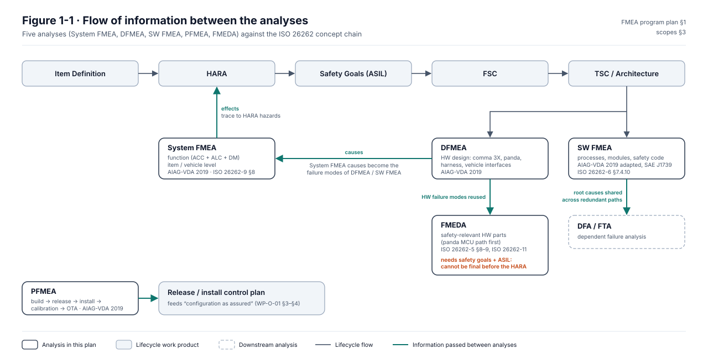
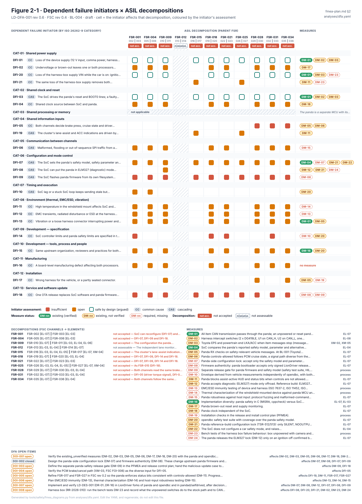
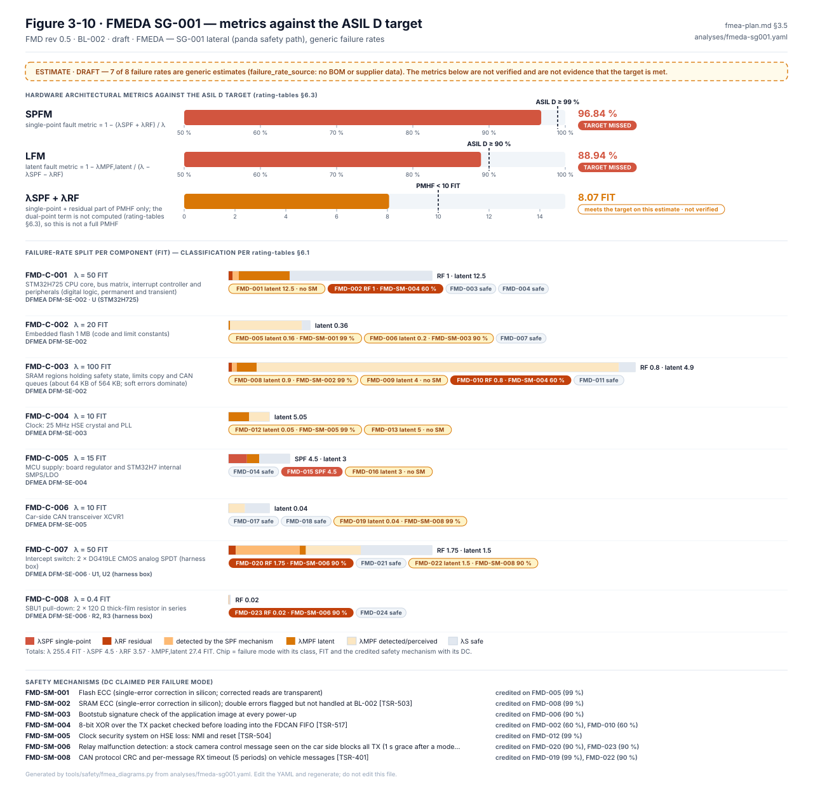
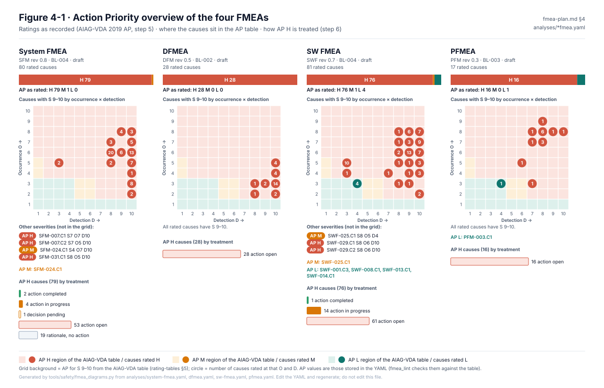
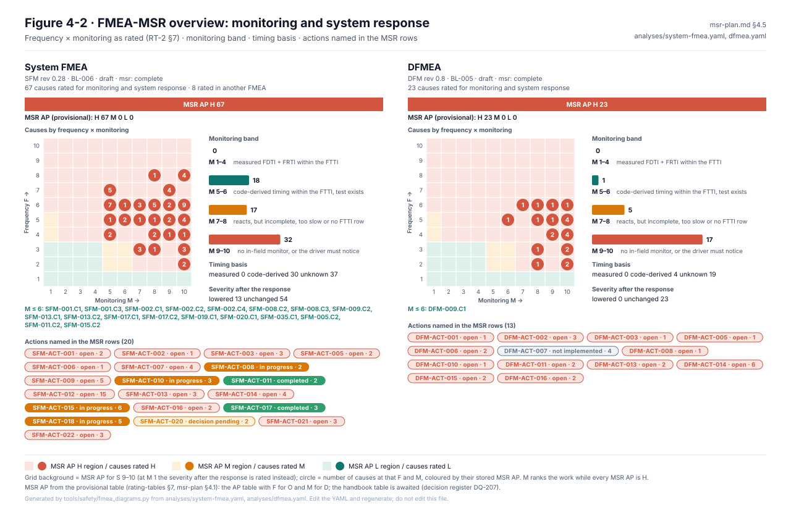

# LionDriver — FMEA Program Plan

**Status:** Draft v0.13 (System FMEA rev 0.16: SFM-016.C2 and SFM-029.C1 follow the SW FMEA BL-005 ratings; ODD up to 110 km/h; 2026-10-16). v0.12 (System FMEA rev 0.15: monitoring actions linked to their TSRs, warning paths compared with WP-S-04 §3.8; 2026-10-16). v0.11 (Figure 4-2, the FMEA-MSR overview, msr-plan M3; 2026-10-16). v0.10 (baseline BL-005 proposed: liondriver-dev `1033d98`, the reference build the default; System FMEA rev 0.9 re-rates its MSR rows at BL-005, the other analyses stay on their baselines; 2026-10-16). v0.9 (SG-04 FTA↔FMEA findings F-1…F-10 resolved: SW FMEA rev 0.7 adds SWF-003.C3 and SWF-050…053, DFMEA rev 0.3 adds DFM-019, System FMEA rev 0.6 and PFMEA rev 0.3 add HZ-006 effects, HARA rev 0.4 back-links SFM-026, FSC rev 0.3 re-based; [fta-fmea-mapping.md](../fta-fmea-mapping.md); 2026-10-13). v0.8 (DFA rev 0.5: the seven insufficient initiators re-checked against the reference build; 2026-10-13). v0.7 (generated FMEA, FMEDA and DFA figures, Figures 2-1, 3-1…3-11, 4-1; 2026-10-13). v0.6 (§1 flow diagram redrawn as Figure 1-1; text version kept; 2026-10-13) — Phase 0 complete; System FMEA rated (rev 0.5, BL-004); SW FMEA P1 elements rated (rev 0.6, BL-004); HARA draft rev 0.3
**Scope:** reference configuration CFG-001 (AC-001), Corolla E210 · ZRE212 · US: US sedan, model years 2020–2022, 1.8 L CVT ([vehicle register](../../../docs/liondriver/vehicles/README.md)); comma 3X (`system/hardware/tici`) with integrated panda, current LionDriver software baseline
**Covers:** System FMEA, DFMEA, PFMEA, SW FMEA, FMEDA

> **Location:** moved from `docs/safety/` on 2026-10-10. `assurance/` is the source of truth. This folder is supporting data for [WP-W-04](../../05-software/WP-W-04-software-safety-analysis.md), [WP-A-03](../WP-A-03-dependent-failure-analysis.md) and [WP-A-04](../WP-A-04-system-fta-fmea.md). Its HARA, FSC and item definition are parallel drafts that were not adopted; see the [reconciliation §7](../../00-assessment/docs-safety-reconciliation.md#7-second-set-aiag-vda-analyses-assurance08-analysesfmea).

> No safety claim is made by this plan. It defines *how* the failure analyses will be performed, what they consume, and what they produce.

---

## 1. Why five analyses, and how they relate

| Analysis | Question it answers | Level | Method basis | Primary output |
|---|---|---|---|---|
| **System FMEA** (the "FMEA") | How can the *function* (ACC + ALC + DM) fail, and what does the vehicle/driver experience? | Item / vehicle | AIAG-VDA 2019 (7-step), ISO 26262-9 §8 (qualitative) | Functional failure modes → effects → link to hazards (HARA) |
| **DFMEA** | How can the *hardware design* fail? | comma 3X, panda, harness, vehicle interfaces | AIAG-VDA 2019 DFMEA | HW failure modes, design controls, actions |
| **SW FMEA** | How can *software elements* fail (value, timing, omission, commission)? | Processes / modules / safety code | AIAG-VDA 2019 adapted + SAE J1739 SW guidewords, ISO 26262-6 §7.4.10 | SW failure modes, required safety mechanisms, test cases |
| **PFMEA** | How can the *process* that produces the deployed configuration fail? | Build → release → install → calibration → OTA | AIAG-VDA 2019 PFMEA | Process controls, install/release checklist (control plan) |
| **FMEDA** | Do the HW safety mechanisms achieve the ASIL target quantitatively? | Safety-relevant HW parts (panda MCU path first) | ISO 26262-5 §8–9, ISO 26262-11 | λ per part, SPFM, LFM, PMHF |

**Flow of information**



*Figure 1-1.* The concept chain runs along the top; the five analyses of this plan have dark outlines and the teal arrows carry information between them. Source: [`figures/fig-plan-1-1-analysis-flow.svg`](figures/fig-plan-1-1-analysis-flow.svg); change it together with the table above and §3.

<details><summary>Text version of Figure 1-1</summary>

```
Item Definition ─► HARA ─► Safety Goals (ASIL) ─► FSC ─► TSC / Architecture
                     ▲                                      │
                     │ effects                              ▼
               System FMEA ◄──────── causes ──────── DFMEA   SW FMEA
                                                      │         │
                                                      ▼         ▼
                                                    FMEDA     DFA / FTA
PFMEA ─► Release / install control plan  (feeds "configuration as assured")
```

</details>

- System FMEA **effects** must trace to HARA hazards; its **causes** become the failure modes of DFMEA / SW FMEA.
- FMEDA reuses DFMEA hardware failure modes but **requires safety goals and ASIL** — it cannot be finalized before HARA.
- SW FMEA findings that share a root cause across redundant paths feed the Dependent Failure Analysis.

---

## 2. Prerequisites (gating)

| Prereq | Needed by | Status |
|---|---|---|
| Item definition & boundary (README roadmap item 2) | All | Draft LD-ITEM-001 rev 0.2 (`item-definition.md`): platform (334 vehicles), variant family VF-001 Corolla E210, assured configuration AC-001 |
| HARA + safety goals | System FMEA severity, FMEDA | Draft rev 0.3 (`analyses/hara.yaml`): 13 hazards, 15 situations, 19 hazardous events, 10 safety goals (SG-001 ASIL D); guide-word matrix and situation coverage complete; pre-checks in `reviews/`; mapped onto WP-C-03, the HARA of record, in `hara-mapping.yaml` (checked by `fmea_lint.py`; [reconciliation §8](../../00-assessment/docs-safety-reconciliation.md#8-second-set-hara-mapped-onto-wp-c-03-oi-5)) |
| Functional / technical safety concept | DFMEA, SW FMEA, FMEDA | FSC draft rev 0.2 (`analyses/fsc.yaml`): 40 FSRs, 12 elements, 11 panda/SoC decompositions; DFA rev 0.5 accepts none of them yet (`analyses/dfa.yaml`; 4 initiators insufficient; the configuration lock, diagnostic-mode gate and HUD check implemented, awaiting HIL); TSC not started |
| HW/SW baseline frozen (commit SHA + submodule SHAs + AGNOS version) | All | BL-001 proposed in `baseline.yaml`; freeze at Phase 1 start |
| Panda schematic + BOM (open hardware) | DFMEA, FMEDA | To collect |
| comma 3X schematic / SoC failure data | DFMEA, FMEDA | Likely unavailable — see §7 |

**Recommendation:** System FMEA, DFMEA (structure + function steps) and SW FMEA can start in parallel with HARA, because steps 1–3 of AIAG-VDA (scope, structure, function) don't need severity. Ratings (step 5) and FMEDA wait for safety goals.

---



*Figure 2-1.* Dependent failure initiators against the FSC decompositions, coloured by assessment; measures by status (green only for `existing`). Drawn from `analyses/dfa.yaml` by `tools/safety/fmea_diagrams.py`; index of all generated figures: [figures/generated/README.md](figures/generated/README.md).

## 3. Analysis scopes

### 3.1 System FMEA
Functions under analysis (from `docs/SAFETY.md` and `selfdrived`/`controlsd`):

- F1 Lateral control (ALC) — steering torque request to Toyota EPS
- F2 Longitudinal control (ACC) — accel request to Toyota ADAS/PCM
- F3 Engagement / disengagement state machine (`selfdrive/selfdrived/state.py`)
- F4 Driver override: brake, gas, steering, cancel button
- F5 Driver monitoring & escalation (`selfdrive/monitoring/`)
- F6 Alerting (visual / audible) (`selfdrived/alertmanager.py`, soundd)
- F7 Actuation limiting / excessive-actuation detection (`selfdrived/helpers.py`, opendbc safety)
- F8 Stock function preservation — stock AEB/FCW/lane assist stay available with the harness installed (added in System FMEA rev 0.2)

Failure modes per function: loss, unintended, too much, too little, too early/late, stuck, wrong direction.


*Figure 3-1.* System FMEA structure and functions (steps 2–3). *Figure 3-2.* Failure chains, sheets [1](figures/generated/fig-3-2-sfm-failure-chains-1.svg) [2](figures/generated/fig-3-2-sfm-failure-chains-2.svg) [3](figures/generated/fig-3-2-sfm-failure-chains-3.svg) [4](figures/generated/fig-3-2-sfm-failure-chains-4.svg) [5](figures/generated/fig-3-2-sfm-failure-chains-5.svg) [6](figures/generated/fig-3-2-sfm-failure-chains-6.svg). Drawn from `analyses/system-fmea.yaml`.

### 3.2 DFMEA (hardware)
Structure tree:

1. **comma 3X** — SoC/compute, cameras (road, wide, driver), IMU, GNSS, power, thermal, display/speaker
2. **Integrated panda** — STM32H7 MCU, CAN/CAN-FD transceivers, SPI link to SoC, watchdog, power-on/relay control
3. **Harness / harness box** — Toyota TSS2 camera connector, relay that intercepts the stock camera's CAN, connectors
4. **Vehicle interfaces** (boundary, analysed as interfaces only) — EPS, ADAS ECU, gateway, power (12 V), mount/windshield


*Figure 3-3.* DFMEA structure and functions. *Figure 3-4.* Failure chains, sheets [1](figures/generated/fig-3-4-dfm-failure-chains-1.svg) [2](figures/generated/fig-3-4-dfm-failure-chains-2.svg). Drawn from `analyses/dfmea.yaml`.

### 3.3 SW FMEA
Prioritised by safety relevance (path from perception to actuator):

| Priority | Element | Path |
|---|---|---|
| P1 | Safety model / CAN TX filtering & limits (panda firmware, `opendbc/safety/`) | submodules |
| P1 | `pandad` (SoC↔panda comms, safety mode set, heartbeat) | `openpilot/selfdrive/pandad/` |
| P1 | `selfdrived` (state machine, events, alerts) | `openpilot/selfdrive/selfdrived/` |
| P1 | `controlsd` + lateral/longitudinal controllers | `openpilot/selfdrive/controls/` |
| P2 | `card` (car interface, CAN parse/pack, Toyota port) | `openpilot/selfdrive/car/`, opendbc |
| P2 | `dmonitoringd` / driver monitoring model | `openpilot/selfdrive/monitoring/` |
| P2 | `plannerd`, `radard` | `openpilot/selfdrive/controls/` |
| P3 | `modeld` (driving model — failure modes overlap SOTIF/ISO PAS 8800) | `openpilot/selfdrive/modeld/` |
| P3 | `locationd`, calibration, `camerad`, `sensord` | various |
| P3 | Messaging (`cereal`/msgq), `manager`, `updated` | `openpilot/cereal`, `openpilot/system/` |

**Status (rev 0.5, `analyses/sw-fmea.yaml`):** the panda safety model was re-rated at BL-003 (panda `c2e5d93`, opendbc `5b5a4ba`). It has 19 failure modes, 25 causes (21 AP H, 4 AP L) and 11 actions.

- **Firmware changes credited:**
  - RX timeout after 5 periods at 100 Hz (SWF-006: O4/D3);
  - grant-time RX check (SWF-007);
  - reference-build mode lock (SWF-001.C3, SWF-008.C1, SWF-013.C1: AP L);
  - hardware watchdog (new SWF-018, plus SWF-019 for spurious resets);
  - heartbeat loss revoked in 0.3 s (SWF-014.C1: AP L).
- **Still open:**
  - the lock is only in a `LIONDRIVER_REFERENCE=1` build, and nothing builds that yet (SWF-013.C2, AP H);
  - limits equal to the SoC limits;
  - no jerk check;
  - BRAKE_MODULE without end-to-end protection;
  - a control-loop stall behind a live heartbeat, caught only by the 3 s engaged mismatch (SWF-014.C2);
  - unrestricted ELM327 content.
- **Implementation defects** in the opendbc core are O5/D3 (CI gate with mutation tests).

**Host P1 elements (rev 0.6, BL-004):** pandad (SWF-020..029), selfdrived (SWF-030..039) and controlsd with the Toyota CarController hand-off (SWF-040..049): 30 failure modes, 51 causes, all AP H, 30 actions (SWF-ACT-020..049). The panda rows keep their BL-003 ratings, because every BL-004 firmware change except the IRQ priorities is compiled only into the reference build. Main findings:
  - pandad fills `pandaStates.faults` for bits 0..26 only; panda fault bit 27 leaves an entry at 0 = relayMalfunction, a false immediate disable (SWF-025);
  - the heartbeat's engaged flag reflects only selfdriveState, and controlsd uses selfdriveState, modelV2 and longitudinalPlan with no freshness check (SWF-020, SWF-040, SWF-043);
  - selfdrived reads none of the panda health flags (heartbeatLost, safetyTxBlocked, txRateExceeded, epsFault) and raises controlsMismatch only after 200 cycles (SWF-032, SWF-034);
  - a single non-finite input latches LatControlTorque and silently zeroes lateral output for the drive (SWF-045);
  - cruiseMismatch has no reaction, and lateral torque continues while the driver overrides (SWF-039, SWF-038/044).

**Re-baseline at BL-005 (SW FMEA rev 0.8, liondriver-dev `1033d98`, panda `a55bdfc`, opendbc `9a13f60`):** the reference build is the default since #36/#41, so its firmware features are credited. SWF-013.C2 (build without the lock) and SWF-014.C2 (control-loop stall behind a live heartbeat, now caught by TX arrival supervision, TSR-408) drop from AP H to L. Host supervision (#51: TSR-615, TSR-621, TSR-602, TSR-308, TSR-604 in part) lowers occurrence on SWF-032, -034, -039, -040, -043, -045; those rows stay AP H because the new code has targeted but unproven tests. New SWF-054 and SWF-055 record decisions DQ-079 and DQ-080, whose code (opendbc#15) is not pinned (SWF-ACT-054). 55 failure modes, 84 causes: 77 AP H, 1 M, 6 L.

**P2 elements (SW FMEA rev 0.9, BL-005):** card and the Toyota port (SWF-056..060), driver monitoring (SWF-061..064), plannerd (SWF-065..069) and radard (SWF-070, SWF-071): 16 failure modes, 29 causes, all AP H, actions SWF-ACT-056..064. Upstream code; the opendbc car and CAN tests are not run by LionDriver CI, and the driver-monitoring model, plannerd and card are not fuzzed. Main findings: no Toyota RX message has a counter and CAN timeouts are learned from a 10 s default; driver-monitoring timers count frames, a NaN pose reads as attentive, and the terminal alert does not disengage (DQ-220); plannerd uses invalid leads and controlsd does not read `longitudinalPlan.valid`; the final acceleration target has no rate limit; the driver can leave the assured configuration while driving (DQ-221). Perception and model performance stay with SOTIF (§7.3). Totals: 71 failure modes, 113 causes: 106 AP H, 1 M, 6 L.

**P3 elements (SW FMEA rev 1.0, BL-005):** modeld as a software element (SWF-072..074), localization and calibration (SWF-075..077), camerad (SWF-078), sensord (SWF-079), messaging (SWF-080, SWF-081), manager (SWF-082, SWF-083) and updated (SWF-084): 13 failure modes, 18 causes, all AP H, actions SWF-ACT-065..071. The SOTIF / ISO PAS 8800 boundary of §7.3 holds: modeld is rated only for output validity, frame accounting, calibration input, crash and the model file, not for whether its outputs are right. Main findings: `modelV2.valid` means only "calibration seen" and the small model has no finiteness check; a repeated camera frame counts as no drop; a road camera absent at start is ignored for the drive; IMU loss reaches selfdrived after 10 s; msgq skips lapped messages silently and has no payload checksum; manager never restarts a process and does not report a blocked one; updates are not signed. With this the SW FMEA covers every element of §3.3 (P1–P3). Totals: 84 failure modes, 131 causes: 124 AP H, 1 M, 6 L.

**System FMEA (rev 0.5, BL-004):** all 80 causes rated: 79 AP H, 1 AP M (SFM-024.C1). Causes on the panda, host, harness and hardware elements inherit the linked SW FMEA or DFMEA rows; actions SFM-ACT-001..011.

**System FMEA (rev 0.9, BL-005):** baseline moved to BL-005. S, O and AP unchanged; D of SFM-015.C2 10 → 8 (host unit test). The MSR rows credit the host supervision and the reference-build checks that BL-004 lacked (TSR-408, TSR-615, TSR-621, TSR-308, reference lock): monitoring M 5–6 on 15 causes, M 7–8 on 16, M 9–10 on 29 ([msr-plan.md §4.7](msr-plan.md#47-pilot-result-m1)). The SW FMEA (BL-004) and DFMEA (BL-002) rows it inherits are not re-rated here.

**DFMEA (rev 0.7, BL-005, `analyses/dfmea.yaml`):** 21 failure modes and 30 causes across 10 hardware elements of the comma 3X panda section, harness and relay box, based on WP-H-02/WP-H-03. Every row is S10, AP H, and most have no LionDriver hardware verification (D9–D10). The watchdog (DFM-004) is the only cause whose occurrence the BL-002 firmware lowers. At BL-005 the hardware is unchanged; the MSR rows credit the host controlsMismatch timing (DFM-009.C1, M 6) and list the panda siren on heartbeat loss and EPS fault (DFM-017) (msr-plan §4.7).

**FMEDA (rev 0.4, `analyses/fmeda-sg001.yaml`, `fmeda-sg009.yaml`):** block-level, **generic failure rates**, except the harness box switches U1/U2 at the SN 29500-2 reference value from a secondary source (WP-H-03 §6.3). Results:
- SG-001: 255 FIT, SPFM 96.8 %, LFM 88.9 %, λSPF + λRF 8.1 FIT.
- SG-009: 287 FIT, SPFM 78.1 %, LFM 97.7 %, λSPF + λRF 62.9 FIT.

Neither meets its target yet. The effect of the planned DFMEA measures and the soft-error sensitivity are in WP-H-03 §6.3. Workbooks: `tools/safety/export_fmeda_xlsx.py <name>`.

**PFMEA (rev 0.2, `analyses/pfmea.yaml`):** 17 failure modes over 11 process steps:
- release: freeze, build, verification, publication (WP-P-10);
- installation and provisioning: WP-O-01 INS-01..30;
- update and rollback.

16 causes are AP H and 1 is AP L. The procedures are drafts not yet in use, so prevention is rated as documented-but-unpractised (O7–O8) and detection mostly as unproven human checks (D7–D8). Special characteristics SPC-01..09 come from WP-O-01 §4, and the workbook links each row to its control-plan step.

**Workbooks** (git-ignored, regenerate from the YAML):

| Analysis | Command | Builder layout |
|---|---|---|
| System FMEA | `tools/safety/export_fmea_xlsx.py system --generator <dfmea-builder>/scripts/generate_dfmea.py` | dfmea-builder; unrated rows show "Not rated" |
| DFMEA | `tools/safety/export_fmea_xlsx.py dfmea --generator <dfmea-builder>/scripts/generate_dfmea.py` | dfmea-builder |
| SW FMEA | `tools/safety/export_fmea_xlsx.py sw --generator <sw-fmea-builder>/scripts/generate_sw_fmea.py` | sw-fmea-builder |
| PFMEA | `tools/safety/export_pfmea_xlsx.py --generator <pfmea-builder>/scripts/generate_pfmea.py` | pfmea-builder |
| FMEDA | `tools/safety/export_fmeda_xlsx.py fmeda-sg001` (and `fmeda-sg009`) | own formulas, fmeda-builder tab names |

AP always comes from the RT-1 table. The builders' own AP rules disagree with it, and the pfmea-builder's rule is inverted on detection.

This file supports the narrative analysis in [WP-W-04](../../05-software/WP-W-04-software-safety-analysis.md) with AIAG-VDA ratings (WP-W-04 §3.5).

SW failure-mode guidewords: omission, commission, early, late, incorrect value (high/low/stale/frozen), corrupted, out-of-sequence, wrong mode.
Model-level performance limitations go to the **SOTIF** analysis, not SW FMEA — SW FMEA covers the model as a software element (crash, stale output, wrong tensor shape, timeout).


*Figure 3-5.* SW FMEA structure and functions. *Figure 3-6.* Failure chains, sheets [1](figures/generated/fig-3-6-swf-failure-chains-1.svg) [2](figures/generated/fig-3-6-swf-failure-chains-2.svg) [3](figures/generated/fig-3-6-swf-failure-chains-3.svg) [4](figures/generated/fig-3-6-swf-failure-chains-4.svg) [5](figures/generated/fig-3-6-swf-failure-chains-5.svg) [6](figures/generated/fig-3-6-swf-failure-chains-6.svg) [7](figures/generated/fig-3-6-swf-failure-chains-7.svg) [8](figures/generated/fig-3-6-swf-failure-chains-8.svg) [9](figures/generated/fig-3-6-swf-failure-chains-9.svg) [10](figures/generated/fig-3-6-swf-failure-chains-10.svg) [11](figures/generated/fig-3-6-swf-failure-chains-11.svg). *Figure 3-7.* [AP as rated vs. predicted after planned actions (not achieved)](figures/generated/fig-3-7-swf-action-effect.svg). Drawn from `analyses/sw-fmea.yaml`.

### 3.4 PFMEA
LionDriver doesn't manufacture hardware, so "process" means the steps that produce the as-driven configuration:

1. Source build & release (`tools/release/`, `SConstruct`, CI, submodule pinning)
2. Device provisioning / OS (AGNOS) / software install
3. In-vehicle installation (harness, mount, camera placement, connectors)
4. Calibration (camera extrinsics, `locationd` calibration convergence)
5. OTA update (`system/updated`) and rollback
6. Car fingerprinting / correct car port selection

Output: a **release & install control plan** (checklist) — this is the practical deliverable.


*Figure 3-8.* PFMEA process structure and functions. *Figure 3-9.* Failure chains, sheets [1](figures/generated/fig-3-9-pfm-failure-chains-1.svg) [2](figures/generated/fig-3-9-pfm-failure-chains-2.svg). Drawn from `analyses/pfmea.yaml`.

### 3.5 FMEDA
- **Phase A (feasible now):** panda safety path — MCU, CAN transceivers, relay, watchdog, power supervision. Open schematic allows component-level analysis.
- **Phase B (data-limited):** comma 3X compute — treat as QM or use a top-down/budget approach; document the gap rather than invent failure rates.
- Failure rate sources: IEC 61709 / SN 29500 / IEC TR 62380, ISO 26262-11 for MCU; record source per row.
- Metrics: SPFM, LFM, PMHF per safety goal, with diagnostic coverage justified per safety mechanism (ISO 26262-5 Annex D).

---



*Figure 3-10.* FMEDA SG-001 and *Figure 3-11* [SG-009](figures/generated/fig-3-11-fmeda-sg009-metrics.svg): metrics against the ASIL target (rating-tables §6.3), split per component and failure mode, and safety-mechanism coverage. Failure rates are generic estimates; nothing here is verified. Drawn from `analyses/fmeda-sg001.yaml` and `analyses/fmeda-sg009.yaml`.

## 4. Method decisions

- **Rating scheme:** AIAG-VDA S/O/D 1–10 with **Action Priority (H/M/L)**, not RPN.
- **Severity** for System FMEA effects is derived from HARA severity (S0–S3) mapping, recorded in the rating tables.
- **Occurrence** for SW: based on prevention controls (MISRA, static analysis, code review, coverage), not field statistics.
- **Detection** credits only controls that exist in the repo/CI today (e.g. `opendbc/safety/tests`, `selfdrive/test/process_replay`, `controls/tests`) — each detection claim must reference a test path.
- **Severity 9–10 or AP=H** items require an action with owner and due date, or a documented rationale.
- **In-field monitoring and system response** (diagnostics plus safe-state reaction while driving) is rated by a supplementary FMEA-MSR on System FMEA and DFMEA causes, never as Detection: audit and plan in [msr-plan.md](msr-plan.md).

---



*Figure 4-1.* AP counts as rated, where the causes sit in the AIAG-VDA AP table, and how AP H is treated (action status or rationale). Drawn from the four FMEA YAML files.



*Figure 4-2.* FMEA-MSR ([msr-plan.md](msr-plan.md)): where the System FMEA and DFMEA causes sit by frequency F and monitoring M over the provisional MSR AP table, how many fall in each monitoring band, the timing basis, how many responses lower the severity, and the status of the actions the MSR rows name. While every MSR AP is H, M is what ranks the work.

## 5. Repository format & traceability

```
assurance/08-analyses/fmea/
  fmea-plan.md                 (this document)
  item-definition.md           (LD-ITEM-001: platform, variant families, assured configurations)
  item/                        (variants.yaml; vehicle-catalog.md generated by tools/safety/gen_vehicle_catalog.py)
  rating-tables.md             (S/O/D tables, AP table, FMEDA targets — version RT-n)
  msr-plan.md                  (FMEA-MSR audit and plan: monitoring and system response, RT-2)
  baseline.yaml                (analyzed configurations: vehicle, HW, repo + submodule SHAs, OS)
  schema/
    fmea.schema.json           (System FMEA, DFMEA, SW FMEA, PFMEA)
    fmeda.schema.json
    hara.schema.json           (ASIL checked against ISO 26262-3 Table 4)
    fsc.schema.json            (decompositions checked against ISO 26262-9 Table 1)
    dfa.schema.json            (decomposition status derived from its dependent failure initiators)
    baseline.schema.json
  analyses/
    hara.yaml
    fsc.yaml
    dfa.yaml
    system-fmea.yaml
    dfmea.yaml
    sw-fmea.yaml
    pfmea.yaml
    fmeda-<goal>.yaml          (one FMEDA per safety goal: fmeda-sg001.yaml lateral, fmeda-sg009.yaml stock AEB)
  exports/                     (generated .xlsx; git-ignored, regenerate)
  exports/review/              (review pages that read in GitHub: Markdown + SVG per FMEA, tools/safety/fmea_review_md.py;
                                and reviewer workbooks, tools/safety/fmea_review_xlsx.py; committed, checked in CI)
  diagrams/                    (block/boundary diagram or process flow, P-diagram per FMEA; drawn into the review pages)
  reviews/                     (review records, e.g. hara-r0.1-precheck.md)
  design/                      (safety design specifications, e.g. LD-DES-001 panda configuration lock)
tools/safety/
  fmea_lint.py                 (validator)
  test_fmea_lint.py
  export_hara_xlsx.py          (HARA -> xlsx in hara-builder layout, for hara-checklist-reviewer)
  export_fsc_xlsx.py           (FSC -> xlsx in fsc-builder layout, for fsc-checklist-reviewer)
  export_item_xlsx.py          (item definition -> xlsx in item-definition-builder layout, for item-def-checklist-reviewer)
  gen_vehicle_catalog.py       (vehicle catalog from docs/CARS.md and item/variants.yaml)
  fmea_diagrams.py             (figures/generated/*.svg + README.md from the YAML; --check)
  test_fmea_diagrams.py
```

Review workbooks come from the builder/reviewer skills in jherrodthomas/automotive-skills-suite. Exports render the YAML as-is; the skills' heuristic ratings are never written back into the analyses.

- Source of truth is YAML (diffable, reviewable in PRs); spreadsheets are generated.
- IDs: `SFM-`, `DFM-`, `SWF-`, `PFM-` prefixes for structure (`-SE-###`), functions (`-FN-###`), failure modes (`-###`), causes (`-###.C#`), actions (`-ACT-###`). FMEA ids are unique across all files; FMEDA ids (`FMD-…`) only within their file.
- Each row links upward (`hazard`, `requirements`) and downward (`paths`, `test`, `linked_failure_mode`).
- Every analysis names its `baseline` (from `baseline.yaml`) and the `rating_tables` version it was rated against.

**Validation** (needs `pip install pyyaml jsonschema`; not added to openpilot runtime deps):

```
tools/safety/fmea_lint.py --report            # validate all analyses
python3 -m unittest discover -s tools/safety  # linter tests
```

The linter checks: schema; unique and resolvable ids; failure-mode severity = max effect severity; hazard-linked effects rated 10; stored AP = AP table; AP=H has an action or rationale; detection ≤ 8 names a `test` path that exists (warning only inside an uninitialized submodule); released analyses fully rated; HARA ASIL = Table 4, safety-goal ASIL = highest hazardous event, every ASIL hazard covered by a goal, FMEA↔HARA links consistent both ways; FMEDA distributions sum to 1, mechanisms have DC, SPFM/LFM/λSPF+λRF against the ASIL target. Wiring it into CI is a follow-up.

---

## 6. Phasing

| Phase | Deliverable | Depends on |
|---|---|---|
| 0 | This plan + rating tables + YAML schema + baseline SHAs | — |
| 1 | System FMEA steps 1–4 (structure, functions, failure modes, effects, causes) — **draft rev 0.2 done** | Item definition draft |
| 2 | SW FMEA P1 elements + DFMEA structure/function — **SW FMEA rev 0.6: panda safety model, pandad, selfdrived and controlsd done (49 failure modes, all rated)** | Phase 1 |
| 3 | HARA → apply severities (**HARA draft + System FMEA severities done**); risk analysis & AP for System/SW/DFMEA (**done at BL-004: System FMEA rev 0.5, SW FMEA rev 0.6, DFMEA rev 0.2**) | HARA |
| 4 | PFMEA + release/install control plan — **PFMEA rev 0.2 done; control plan = WP-O-01 §3–§4** | Phase 0 |
| 5 | FMEDA Phase A (panda) | Safety goals, TSC, panda BOM |
| 6 | SW FMEA P2/P3, DFMEA comma 3X, FMEDA Phase B gap report | Phase 3 |
| 7 | Independent review (checklist), action closure, feed safety case | All |

---

## 7. Known risks to the plan

1. **Upstream code isn't ours.** Safety-critical logic lives in `panda` and `opendbc` submodules tracking comma.ai. Each upstream bump invalidates parts of SW FMEA → need an impact-analysis trigger on submodule changes.
2. **No supplier data for comma 3X.** FMEDA on the compute module will be incomplete; the architecture likely has to argue that the panda safety model bounds what a faulty SoC can command.
3. **ML model failures.** Most driving-model "failures" are performance limitations (SOTIF/PAS 8800), not random or systematic SW faults — keep the boundary explicit to avoid double counting or gaps.
4. **Vehicle ECUs are black boxes.** Toyota EPS/ADAS internal failures are outside the item; analyze only the interface and stock-system fallback behavior.

---

## 8. Decisions

| # | Decision | Resolution |
|---|---|---|
| 1 | Start FMEAs in parallel with HARA? | **Yes** — steps 1–4 now; ratings after HARA |
| 2 | Pin `panda` / `opendbc` into the analyzed baseline? | **Yes** — SHAs recorded in `baseline.yaml` (BL-001) |
| 3 | YAML source vs spreadsheets? | **YAML source**, xlsx generated |
| 4 | PFMEA scope per §3.4? | **Confirmed** |

| 5 | Reference device | **comma 3X** (recorded in BL-001) |
