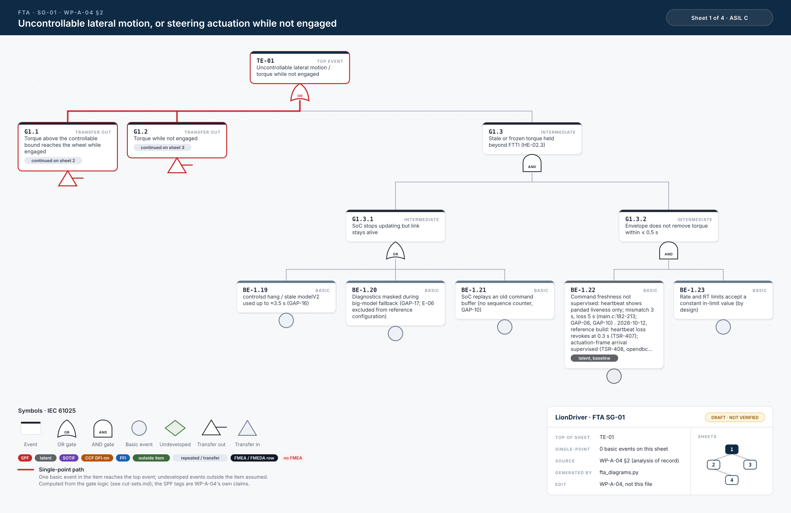

# Fault tree diagrams

Generated from the text trees in [WP-A-04](../WP-A-04-system-fta-fmea.md) by `fta_diagrams.py`. WP-A-04 is the analysis of record; edit it and run `python3 fta_diagrams.py` (CI runs `--check`).

*Sheet 1 of SG-01, as an example of the notation explained under the table; every sheet is listed below.*

| Goal | Top event | Sheets |
|---|---|---|
| SG-01 | TE-01 uncontrollable lateral motion, or steering actuation while not engaged | [1: TE-01](fta-SG-01-1.svg), [2: G1.1](fta-SG-01-2.svg), [3: G1.2](fta-SG-01-3.svg), [4: G1.1.1](fta-SG-01-4.svg), [5: G1.2.1](fta-SG-01-5.svg), [6: G1.1.1.a](fta-SG-01-6.svg) |
| SG-02 | TE-02 loss or degradation of lateral control without adequate take-over warning | [1: TE-02](fta-SG-02-1.svg), [2: G2.1](fta-SG-02-2.svg), [3: G2.3](fta-SG-02-3.svg), [4: G2.2](fta-SG-02-4.svg), [5: G2.4](fta-SG-02-5.svg), [6: G2.6](fta-SG-02-6.svg), [7: G2.8](fta-SG-02-7.svg), [8: G2.5](fta-SG-02-8.svg), [9: G2.1.1](fta-SG-02-9.svg) |
| SG-03 | TE-03 unintended acceleration | [1: TE-03](fta-SG-03-1.svg), [2: G3.1](fta-SG-03-2.svg), [3: G3.3](fta-SG-03-3.svg), [4: G3.6](fta-SG-03-4.svg), [5: G3.2](fta-SG-03-5.svg), [6: G3.5](fta-SG-03-6.svg) |
| SG-04 | TE-04 deceleration beyond what following traffic and the driver can control | [1: TE-04](fta-SG-04-1.svg), [2: G4.6](fta-SG-04-2.svg), [3: G4.1](fta-SG-04-3.svg), [4: G4.3](fta-SG-04-4.svg), [5: G4.4](fta-SG-04-5.svg), [6: G4.9](fta-SG-04-6.svg), [7: G4.2](fta-SG-04-7.svg), [8: G4.8](fta-SG-04-8.svg), [9: G4.5](fta-SG-04-9.svg) |
| SG-05 | TE-05 no release on driver brake, cancel or steering override | [1: TE-05](fta-SG-05-1.svg), [2: G5.1](fta-SG-05-2.svg), [3: G5.2](fta-SG-05-3.svg), [4: G5.1.2](fta-SG-05-4.svg) |
| SG-06 | TE-06 loss of longitudinal deceleration without take-over warning | [1: TE-06](fta-SG-06-1.svg), [2: G6.1](fta-SG-06-2.svg), [3: G6.2](fta-SG-06-3.svg), [4: G6.3](fta-SG-06-4.svg), [5: G6.4](fta-SG-06-5.svg), [6: G6.7](fta-SG-06-6.svg), [7: G6.9](fta-SG-06-7.svg), [8: G6.5](fta-SG-06-8.svg), [9: G6.6](fta-SG-06-9.svg) |
| SG-07 | TE-07 suppression, delay or alteration of the stock PCS/AEB | [1: TE-07](fta-SG-07-1.svg), [2: G7.1](fta-SG-07-2.svg), [3: G7.4](fta-SG-07-3.svg), [4: G7.3](fta-SG-07-4.svg) |
| SG-08 | TE-08 automated control continues with a driver who is not supervising or not responding | [1: TE-08](fta-SG-08-1.svg), [2: G8.1](fta-SG-08-2.svg) |

Each event is a card, styled like [fta-viewer.html](fta-viewer.html). Symbols follow IEC 61025, as the icon before the ID: square = gate (blue OR, violet AND), with the gate symbol beneath the card; circle = basic event; diamond = undeveloped event; triangle = transfer. A dashed card is a latent event. Each gate card shows the fewest item basic events in a cut set below it (undeveloped events assumed) and its number of minimal cut sets. Tags: SPF (single point in the baseline design), latent, SOTIF, CCF (→ WP-A-03 DFI), FFI (→ WP-A-02), repeated (event drawn again; defined where first shown). Red path: single-point path, one basic event in the item reaching the top event (undeveloped events outside the item assumed), computed from the gate logic. Outlined tags: the FMEA failure modes and FMEDA rows that realise a basic event ([fta-fmea-map.yaml](../fta-fmea-map.yaml), checked by `fmea_lint.py`); red "no FMEA": an event of a mapped tree that no FMEA row backs yet.

Minimal cut sets computed from the same trees, and the check of the WP-A-04 tables: [cut-sets.md](cut-sets.md) (`fta_cutsets.py`).

Interactive view of every tree on one page, without sheets: [fta-viewer.html](fta-viewer.html) (`fta_viewer.py`; download it and open it in a browser, it needs no network). Gates and transfers open in place, each gate shows its cut sets and the fewest item faults among them, and the red paths are the ones on these sheets; a switch also counts latent events as already failed. Light, dark and left-to-right layouts. The sheets stay the drawing of record.
