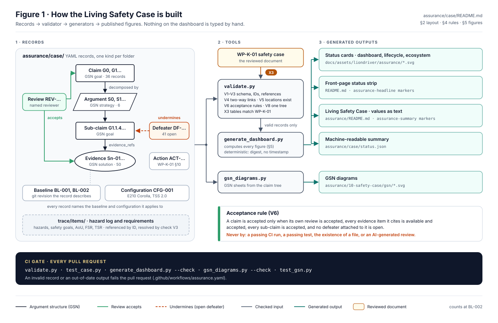

# LionDriver Assurance Repository

This tree holds the engineering assurance work products for LionDriver: functional
safety (ISO 26262:2018), SOTIF (ISO 21448:2022), cybersecurity (ISO/SAE 21434:2021),
AI safety (ISO/PAS 8800:2024) and process capability (Automotive SPICE 4.0). Safety-case
structure follows UL 4600 principles where they apply to a supervised Level 2 system.

> [!WARNING]
> Everything here is a **draft prepared for engineering review**. None of it has passed
> verification review, confirmation review or functional safety assessment. A document
> existing here does not mean the activity behind it is complete. Read the `Status` field
> of each work product and the register in [`01-management/WP-M-00-work-product-register.md`](01-management/WP-M-00-work-product-register.md).

## Living Safety Case

LionDriver publishes its safety argument as it is built: the claims it makes, the evidence for each one, the known counter-evidence against it, and what has and has not been reviewed. The figures below are generated from the structured records in [`case/`](case/README.md) and checked by CI on every pull request. Nothing on this card is typed by hand.

<p align="center">
  
</p>

> **Assurance status represents recorded engineering evidence and review state. It does not constitute certification or approval for unsupervised operation.**

<p align="center">
  
</p>

<details>
<summary><b>Recorded values as text</b></summary>

<!-- BEGIN GENERATED: assurance-summary (assurance/case/tools/generate_dashboard.py) -->

| Indicator | Recorded value |
|---|---|
| Assurance state | Development |
| Engineering baseline | `BL-002` at `bf6ce8c` (under development) |
| Registered safety claims | 36 |
| Claims with accepted supporting evidence | 0 |
| Registered evidence items | 50 (0 available, 35 drafted, 15 not yet performed) |
| Evidence requiring review | 35 |
| Open assurance actions | 5 |
| Open defeaters (known counter-evidence) | 41 |
| Evaluated configurations | 1 |
| Assurance-supported configurations | 0 |
| Records digest | `115222261c5f` |

| Lifecycle area | Status | Evidence (drafted / missing / accepted) |
|---|---|---|
| Safety Management | In Progress | 11 (10 / 1 / 0) |
| Hazard Analysis | In Progress | 6 (6 / 0 / 0) |
| Safety Concepts | In Progress | 7 (7 / 0 / 0) |
| Technical Implementation | In Progress | 5 (5 / 0 / 0) |
| Verification and Validation | In Progress | 16 (5 / 11 / 0) |
| Safety Case and Review | In Progress | 5 (2 / 3 / 0) |

<!-- END GENERATED: assurance-summary -->

</details>

**Read more:** [full safety case (WP-K-01)](10-safety-case/WP-K-01-safety-case.md) · [how the figures are computed](case/README.md#5-dashboard-figures) · [known gaps](00-assessment/gap-assessment.md)

**What the dashboard guarantees:**

- A claim counts as accepted only when a recorded review accepts it, every piece of evidence it cites is available and accepted, and no defeater against it is open. The [validator](case/tools/validate.py) refuses anything else.
- A passing CI run, a passing test or the existence of a document never accepts a claim on its own, and an AI-generated review is not a substitute for independent confirmation.
- A change to safety-relevant code needs an [impact analysis](01-management/WP-M-12-impact-analysis.md) that names the assurance records it affects.

How the records, the validator and the generators fit together:



Details: [Living Safety Case records](case/README.md).

## Start here

| Document | Why read it |
|---|---|
| [00-assessment/gap-assessment.md](00-assessment/gap-assessment.md) | Baseline review of the inherited openpilot code and process against the target standards |
| [01-management/WP-M-01-assurance-strategy.md](01-management/WP-M-01-assurance-strategy.md) | The assurance path: tailoring, safety architecture argument, phases and gates |
| [01-management/WP-M-00-work-product-register.md](01-management/WP-M-00-work-product-register.md) | Every required work product, its source clause, owner, gate and status |
| [02-concept/WP-C-01-item-definition.md](02-concept/WP-C-01-item-definition.md) | What the item is, where its boundary is, and what it assumes about the vehicle |
| [02-concept/WP-C-03-hara.md](02-concept/WP-C-03-hara.md) | Hazards, ASILs and safety goals |

## Layout

| Folder | Content | Primary standard clauses |
|---|---|---|
| `00-assessment/` | Baseline gap assessments; [reconciliation](00-assessment/docs-safety-reconciliation.md) of the earlier `docs/safety/` drafts | n/a |
| `01-management/` | Plans, safety management, supplier and upstream management | 26262-2, 21434 §5–8, 21448 §4, MAN.3/5, ACQ.4 |
| `02-concept/` | Item definition, HARA, FSC, SOTIF hazard and insufficiency analysis, TARA | 26262-3, 21448 §5–8, 21434 §9/§15, PAS 8800 |
| `03-system/` | Technical safety requirements and concept, system architecture, HSI, system integration and qualification | 26262-4, SYS.1–5 |
| `04-hardware/` | Hardware safety requirements, design, metrics, component qualification | 26262-5, 26262-8 §13, HWE.1–4 |
| `05-software/` | Software requirements, architecture, units, verification, ML engineering | 26262-6, SWE.1–6, MLE.1–4, SUP.11 |
| `06-validation/` | Safety validation, SOTIF known/unknown scenario evaluation, pen testing, vehicle test operations | 26262-4 §8, 21448 §9–11, 21434 §11, VAL.1 |
| `07-supporting/` | CM, change, problem resolution, documentation, tool and software-component qualification | 26262-8, SUP.1/8/9/10 |
| `08-analyses/` | ASIL decomposition, coexistence, DFA, system FTA/FMEA, STPA; [`fmea/`](08-analyses/fmea/fmea-plan.md) holds the AIAG-VDA FMEA data (YAML, checked by `tools/safety/fmea_lint.py`) that supports them | 26262-9, AIAG-VDA FMEA 2019 |
| `09-production-operation/` | Installation, operation, field monitoring, incident response | 26262-7, 21448 §13, 21434 §12–14 |
| `10-safety-case/` | Safety, SOTIF and cybersecurity cases; assessment and release records | 26262-2 §6, 21448 §12, 21434 §6, UL 4600 |
| `trace/` | Machine-readable requirement and trace data | 26262-8 §6, ASPICE traceability BPs |
| `case/` | Living Safety Case records (claims, evidence, defeaters, configurations, reviews), validator and dashboard generator | 26262-2 §6, UL 4600 |

## Conventions

### Identifiers

| Prefix | Meaning | Example |
|---|---|---|
| `WP-<area>-<nn>` | Work product | `WP-C-03` (HARA) |
| `H-<nn>` | Hazard (functional safety, HARA) | `H-01` |
| `HE-<nn>.<n>` | Hazardous event (hazard in a rated situation) | `HE-01.2` |
| `SG-<nn>` | Safety goal | `SG-01` |
| `FSR-<SG>.<nn>` | Functional safety requirement | `FSR-01.03` |
| `TSR-<nn>` | Technical safety requirement | `TSR-014` |
| `SWSR-<nn>` / `HWSR-<nn>` | Software / hardware safety requirement | `SWSR-031` |
| `SH-<nn>` | SOTIF hazard (hazardous behaviour from insufficiency) | `SH-04` |
| `FM-<nn>` | SOTIF functional modification | `FM-03` |
| `TC-<nn>` | SOTIF triggering condition | `TC-12` |
| `FI-<nn>` | Functional insufficiency | `FI-07` |
| `TS-<nn>` / `CSG-<nn>` / `CSR-<nn>` | Threat scenario / cybersecurity goal / cybersecurity requirement | `CSG-02` |
| `AOU-<nn>` | Assumption of use (on the vehicle, driver or environment) | `AOU-05` |
| `DVR-<nn>` / `DEV-<nn>` | Safety-related data verification requirement / coding-guideline deviation record | `DVR-04`, `DEV-02` |
| `VS-<area>-<nn>` | Verification specification (test case) | `VS-UV-03` |
| `GAP-<nn>` | Gap finding from an assessment | `GAP-17` |
| `OI-<nn>` | Open item to resolve before the next gate (per document) | `OI-3` |

Requirement IDs never get reused. A withdrawn requirement keeps its ID and is marked `Withdrawn`.

### Document control header

Every work product starts with this block:

```
| Field | Value |
|---|---|
| Work product | WP-x-nn <name> |
| Standard reference | <clause list> |
| Version | 0.1 |
| Status | Skeleton / Draft / In review / Approved / Baselined |
| ASIL / scope | <highest ASIL addressed, or QM / SOTIF / CS> |
| Author | <name> |
| Reviewer(s) | <name, independence level I0–I3> |
| Approver | <name> |
| Baseline | <git commit or tag the content refers to> |
```

### Status meanings

| Status | Meaning |
|---|---|
| Skeleton | Structure and clause mapping exist; content still to be written |
| Draft | Content written, derived from code review and engineering judgement; not yet verified |
| In review | Verification review open (pull request) |
| Approved | Verification review passed and approved by the approver named in the safety plan |
| Baselined | Approved and frozen in a tagged configuration baseline |

### Changing a work product

Work products change through pull requests in the same way code does (see
[WP-P-02 change management](07-supporting/WP-P-02-change-management.md)). If a pull request touches safety-relevant code
(see the safety-relevant file list in [WP-P-01 configuration management](07-supporting/WP-P-01-configuration-management-plan.md)),
it updates the affected work products or records an impact analysis that says why none are affected.

### Standards text

The standards are copyrighted and are not reproduced here. Clause references point to the
editions named above. Check each work-product clause number against your licensed copy
before an audit.
