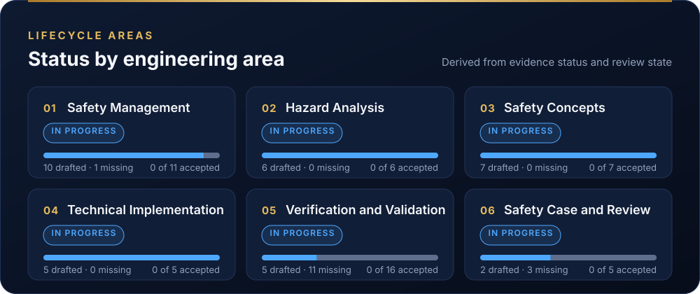

# Living Safety Case records

| Field | Value |
|---|---|
| Work product | Living Safety Case data (machine-readable copy of [WP-K-01](../10-safety-case/WP-K-01-safety-case.md)), validator and dashboard generator |
| Standard reference | ISO 26262-2:2018 §6.4.8 (safety case); ISO 26262-8:2018 §10 (documentation management); UL 4600 principles (living safety case, defeaters) |
| Version | 0.6 (§4: a review record may list interface items IFR-nn of the trace data, the only way an interface becomes agreed, DQ-129 A; 2026-10-25). 0.5 (§5.1 downloadable snapshot: build_snapshot.py, the README button and the safety-case-snapshot workflow; gate records and the release status rule; 2026-10-13). 0.4 (heartbeat-loss siren, panda `c33343b`; EPS-siren worst case 1.26 s; 2026-10-13). 0.3 (Figure 1 added; the full Living Safety Case moved to the assurance README, the front-page README keeps a generated status strip; 2026-10-13). 0.2 (baseline `BL-002` added for the firmware changes integrated 2026-10-12; evidence Sn-15 added; records restated for the 2026-10-12 state carry `source_revision: "bf6ce8c"` and stay on `baseline: BL-001` until they are re-baselined; 2026-10-12). 0.1: initial records |
| Status | Draft |
| Author | Assurance team |
| Reviewer(s) | TBD (I1) |
| Baseline | `BL-001` (`8b8c6ae`); `BL-002` (`bf6ce8c`; opendbc `7993399`, panda `b790fca`; now pinned at opendbc `273f44e` and panda `c33343b` (contains `6dee6fa`; 2026-10-13), which contain them), under development |

## 1. Purpose

This folder holds the structured records behind the [Living Safety Case](../README.md#living-safety-case) (the full view is in the assurance README; the front-page README shows the status strip): the claims, arguments, evidence, defeaters, open actions, vehicle configurations, baselines and reviews of the LionDriver safety case. A validator checks them, and a generator turns them into the dashboard, so every published figure comes from a record that can be read, reviewed and diffed.

[WP-K-01](../10-safety-case/WP-K-01-safety-case.md) stays the reviewed document. The records are a copy of it, and the validator fails if the two disagree on the evidence, defeater or open-item tables (check X3).


*Figure 1.* How the records, the validator and the generators produce every published figure, with the acceptance rule of §4 and the CI gate. Source: [`figures/fig-case-1-how-it-works.svg`](figures/fig-case-1-how-it-works.svg); change it together with §2, §4 and §5.

> **Assurance status represents recorded engineering evidence and review state. It does not constitute certification or approval for unsupervised operation.**

## 2. Layout

| Folder | Kind | IDs | Content at `BL-002` |
|---|---|---|---|
| [`claims/`](claims/) | `claim` | `G0`, `G1.1.4`, … (GSN goals) | 36 claims from WP-K-01 §3–§4, one file per top-level branch |
| [`arguments/`](arguments/) | `argument` | `S0`, `S1.1`, … (GSN strategies) | 6 strategies |
| [`evidence/`](evidence/) | `evidence` | `Sn-01`, … (GSN solutions) | 50 evidence items from WP-K-01 §6 |
| [`defeaters/`](defeaters/) | `defeater` | `DF-01`, … | 41 open defeaters from WP-K-01 §7 |
| [`actions/`](actions/) | `action` | `ACT-001`, … | Open items of WP-K-01 §10 |
| [`configurations/`](configurations/) | `configuration` | `CFG-001`, … | One record per evaluated vehicle configuration |
| [`baselines/`](baselines/) | `baseline` | `BL-001`, … | Engineering baselines the records refer to: `BL-001` (`8b8c6ae`), `BL-002` (`bf6ce8c`) |
| [`reviews/`](reviews/reviews.yaml) | `review` | `REV-001`, … | Review records; none at `BL-001` or `BL-002` |
| [`schema/case-schema.json`](schema/case-schema.json) | — | — | Fields, types, enumerations and reference rules per kind |
| [`tools/`](tools/) | — | — | Validator, dashboard and GSN diagram generators, and their self-tests |
| `status.json` | — | — | Generated summary (do not edit) |
| `badge.json` | — | — | Generated shields.io endpoint for the snapshot button in the front-page README (do not edit) |

Hazards, hazardous events, safety goals and assumptions of use are not duplicated here. Records reference them by ID, and the validator resolves those IDs against [`assurance/trace/items/`](../trace/items/), the machine-readable hazard log ([WP-T-01](../trace/README.md)). Requirements are referenced the same way: FSRs and TSRs are in `trace/items/fsr.yaml` and `tsr.yaml`, generated from WP-C-04, WP-S-02 and WP-S-06.

## 3. Record format

Files use the restricted YAML subset of [WP-T-01 §4.1](../trace/README.md#41-yaml-subset): a top-level list of flat mappings; values are quoted single-line strings, bare words, `null` or flow lists of bare identifiers. Dates and git revisions are always quoted. The validator always uses the built-in subset parser, never PyYAML, so the result does not depend on what is installed.

Fields shared by most kinds:

| Field | Meaning |
|---|---|
| `id`, `kind` | Stable identifier and object type. IDs are never reused |
| `title`, `description` | Short name and full statement |
| `lifecycle_status` | Where the object is in its own lifecycle (per kind, see the schema) |
| `baseline`, `configuration` | The engineering baseline and vehicle configuration the object applies to |
| `related_hazards`, `related_requirements`, `related_assumptions`, `related_claims` | Links to the hazard log, requirements, assumptions of use and claims |
| `evidence_refs`, `defeaters` | Evidence supporting a claim; counter-evidence currently undermining it |
| `review_state`, `reviewer`, `review_date`, `review_ref` | Review state and the review record that set it |
| `source`, `source_revision` | Work product the record copies, and the git revision it describes |

## 4. Rules

The validator ([`tools/validate.py`](tools/validate.py)) enforces these. CI runs it on every pull request that touches the records.

| Check | Rule |
|---|---|
| V1 | Every record sits in the folder of its kind, has every schema field and no others |
| V2 | IDs match their pattern and are unique; field types and enumerations are valid |
| V3 | Every reference resolves to a record, or trace item, of the right kind |
| V4 | Links agree in both directions: claim ↔ evidence, claim ↔ defeater, claim ↔ argument |
| V5 | Every evidence location exists in the repository |
| V6 | **Acceptance rules**, below |
| V8 | Claims form one tree under a single top-level claim |
| X3 | The evidence, defeater and open-item tables of WP-K-01 match the records |

Acceptance rules (V6):

- `review_state: accepted` needs `reviewer`, `review_date` and a `review_ref` pointing to an accepted review record that lists the object, at the same baseline.
- `evidence_status: available` means performed and approved (the WP-K-01 §6 rule), so it needs `review_state: accepted`. Missing evidence cannot be accepted.
- A claim can be `accepted` only if its own review is accepted, every evidence item it cites is available and accepted, every sub-claim is accepted, and no defeater attached to it is open.
- A configuration can be `assurance-supported` only if it is accepted and at least one accepted claim applies to it.
- A cross-domain interface is agreed only when an accepted review record lists its interface item (`IFR-nn` in [`trace/items/ifr.yaml`](../trace/items/ifr.yaml)) and the item's `review_ref` names that record (trace check I1, DQ-129 A). The record is written by the interface's two owners.

What never accepts anything: a passing CI run, a passing test, the existence of a file, or an AI-generated review. These can be inputs to a review; only a review record written by the named reviewer, at the independence level the [confirmation measures plan](../01-management/WP-M-06-confirmation-measures-plan.md) requires, changes a review state.

A change to safety-relevant code must come with an impact analysis ([WP-M-12](../01-management/WP-M-12-impact-analysis.md)) that names the affected records. Accepted records affected by a change go back to `not-reviewed` until they are reviewed again.

## 5. Dashboard figures

[`tools/generate_dashboard.py`](tools/generate_dashboard.py) computes every figure from the records and writes `status.json`, the three SVG cards under [`docs/assets/liondriver/assurance/`](../../docs/assets/liondriver/assurance/), the text table between the `assurance-summary` markers in the [assurance README](../README.md#living-safety-case) and the one-line status strip between the `assurance-headline` markers in the [front-page README](../../README.md#living-safety-case). `--check` fails if any of them is out of date. The output is deterministic: it carries a digest of the record files instead of a timestamp, so it changes only when the records change.




*Two of the three cards as `generate_dashboard.py` writes them today; the tables below define every number on them.*

| Figure | Definition |
|---|---|
| Assurance state | `Evidence Supported` if any configuration is assurance-supported; `Under Review` if any review record exists or any object is in review; otherwise `Development` |
| Registered safety claims | Number of claim records |
| Claims with accepted supporting evidence | Claims that cite evidence and whose evidence is all accepted |
| Registered evidence items | Number of evidence records, split by `evidence_status` |
| Evidence requiring review | Evidence with drafted or complete content (`partial` or `available`) that is not accepted |
| Open assurance actions | Action records with `lifecycle_status: open` |
| Open defeaters | Defeater records with `lifecycle_status: open` |
| Evaluated configurations | Configurations classified `liondriver-evaluated` or `assurance-supported` |
| Assurance-supported configurations | Configurations classified `assurance-supported` (see V6) |
| Upstream compatible | The model count stated in the main table of [`docs/CARS.md`](../../docs/CARS.md), and the number of vehicle makes in it |

Lifecycle-area status, from the evidence items assigned to the area (`lifecycle_area`):

| Status | Condition |
|---|---|
| Blocked | A claim citing evidence in the area has `lifecycle_status: blocked` |
| Not Started | Every evidence item in the area is `missing` |
| Accepted for Defined Baseline | Every evidence item in the area is `available` and accepted |
| Review Required | No evidence item is missing, and every item not yet accepted is in review |
| In Progress | Anything else |

## 5.1 Downloadable snapshot

The front-page README carries a button, a badge drawn from [`badge.json`](badge.json), that downloads the current safety case snapshot as a PDF. It is the document WP-K-01 as it stands at one commit, built from these records and the work products, and published as a GitHub release by [`safety-case-snapshot.yaml`](../../.github/workflows/safety-case-snapshot.yaml).

| Kind | When | Release | ID | Kept |
|---|---|---|---|---|
| Living snapshot | Every merge to `liondriver-dev` that touches `assurance/` | `snapshot-latest` (pre-release) | `SC-<commit date>-<commit>` | Replaced by the next one |
| Baseline release | A pushed tag `bl-NNN` | `bl-NNN` | `BL-NNN-<commit>` | Permanently |
| Controlled copy | Run of [`safety-case-controlled-copy.yaml`](../../.github/workflows/safety-case-controlled-copy.yaml) by someone with write access, naming a recipient and a purpose | Workflow artifact `CC-YYYY-NNN` (90 days; rebuildable from the record commit) | The living snapshot ID, stamped `CONTROLLED COPY CC-YYYY-NNN` | The record in [`distribution.yaml`](distribution.yaml), permanently |

Rules:

1. **Status is computed, never typed.** [`caselib.release_status`](tools/caselib.py) is the only source of the status on the badge, the cover, the watermark and the approval page. A snapshot shows "APPROVED" only when a gate record (`10-safety-case/gates/G<n>-<date>.md`) has the Pass outcome ticked and the current baseline is `frozen` with a tag. Otherwise it is "DRAFT", with the reason.
2. **No snapshot of a broken case.** The workflow runs the validator, the trace and link checks and `generate_dashboard.py --check` first, and publishes nothing if any of them fails.
3. **Reproducible.** The date is the commit date, so rebuilding a commit gives the same HTML byte for byte ([`test_snapshot.py`](tools/test_snapshot.py)).
4. **Verifiable.** Each release carries `SHA256SUMS` and a GitHub build attestation, so `gh attestation verify LionDriver-safety-case.pdf -R jherrodthomas/LionDriver` shows that a copy was built by the workflow from the stated commit.
5. **No signatures on paper.** Approvals are repository records. The approval page lists them and states that a signature added to a downloaded copy is not valid.
6. **Every page identifies itself.** The running header gives the document, its version (from the WP-K-01 control header), the snapshot ID and `DRAFT` or `APPROVED · PUBLIC · UNCONTROLLED` (or `CONTROLLED COPY CC-…`). The footer gives the configuration (CFG-001, reference build), the commit, the submodule pins, the baseline, the issue time (commit time, UTC), the copy line, the retention period from [WP-P-04 §10](../07-supporting/WP-P-04-documentation-management.md#10-retention), a QR code of the verification URL and the page number ([`build_snapshot.running_header`](tools/build_snapshot.py)).
7. **Downloads are anonymous; controlled copies are recorded.** GitHub reports only a download count for a release, so a public download is marked uncontrolled. A controlled copy exists only after [`distribution.py`](tools/distribution.py) has appended its entry (recipient, purpose, the GitHub login that issued it, the source commit and the run) to the public [`distribution.yaml`](distribution.yaml) and the workflow has pushed it; `build_snapshot.py --copy` refuses a copy number without a record ([WP-P-04 §9.1](../07-supporting/WP-P-04-documentation-management.md#91-distribution-of-the-safety-case)).

Content, in order (decision register DQ-004): front matter, that is cover (identity only), approval, document control (changes and status since the previous snapshot), contents, controlled documents (WP-M-00 register against each document's own header), distribution record, roles (WP-M-02 §3.1), RACI (WP-M-02 §3.2, landscape), contributors (git, with AI co-authorship counted) with review records and confirmation measures (WP-M-06 §9); then part 1, status and traceability: 1 status at a glance, 1.1 traceability on the V, 1.2 trace coverage (derivation, requirements named per ASPICE pair, and the kind × test-specification matrix), 1.3 lifecycle swimlanes (process model), 1.4 verification and validation per safety goal, 1.5 evidence freshness (commits to each evidence file since it was recorded); then 2 scope and element hierarchy, 3 GSN argument, 4 claims, 5 evidence, 6 open defeaters, 7 gates and decisions, 8 configuration and pins, and annexes A revision history, B abbreviations, C how to verify and D the requirements traceability matrix. The part 1 pages and annex D are built by [`snapshot_pages.py`](tools/snapshot_pages.py).

To build one locally (the PDF needs Node and Playwright with Chromium):

```sh
python3 assurance/case-records/tools/build_snapshot.py --out build/snapshot          # HTML and manifest.json
node assurance/case-records/tools/render_snapshot.cjs build/snapshot                   # PDF (QR code when the qrcode package is installed)
```

## 6. Updating the records

```sh
python3 assurance/case-records/tools/validate.py              # check the records
python3 assurance/case-records/tools/generate_dashboard.py    # regenerate status.json, the SVG cards, the README strip and the assurance README table
python3 assurance/case-records/tools/test_case.py             # self-tests of the validator rules
python3 assurance/case-records/tools/gsn_diagrams.py          # regenerate the GSN diagrams in assurance/10-safety-case/gsn/
python3 assurance/case-records/tools/test_gsn.py              # tests of the GSN generator
python3 assurance/case-records/tools/test_snapshot.py         # tests of the snapshot builder and the release status rule
```

When WP-K-01 changes, update the matching records in the same pull request; check X3 fails otherwise.

## 7. Open items

| ID | Item | Needed by |
|---|---|---|
| OI-1 | Partly closed: G1.1…G1.7 list their FSRs (FSR-0k.xx for SG-0k). Still open: the G1.1.x sub-claims and the TSR level (WP-K-01 OI-2) | G2 |
| OI-2 | Add a configuration-independent claim layer once a second configuration is evaluated, so platform evidence can be reused across configurations | G4 |
| OI-3 | Generate the WP-K-01 GSN diagrams from these records (WP-K-01 OI-4) | G2 |
