# Modelling plan

| Field | Value |
|---|---|
| What | Which open-source tools model which parts of LionDriver, and what their output may be used for |
| Status | Draft, AI-assisted (Claude), not reviewed |
| Decided | 2026-10-13, project maintainer, adopting Claude's recommendation ("yes" to the four questions in the modelling mockups) |
| Tool classification | [WP-P-07](../07-supporting/WP-P-07-tool-classification-qualification.md) (TL-25 Octave, TL-30 plant model; OI-10 closed by this plan; OI-11; OI-14 closed) |

Nothing listed under "Planned" exists yet. No model output is verification evidence until the tool that produced it is classified at the confidence level the evidence needs (WP-P-07 §5) and the result has been reviewed.

![Tool map in five rows. Python models the SM-SELFDRIVED record (item 2, exists; WP-P-07 TL-28, TCL2, envelope design description) and the back-to-back test (item 3, exists; TL-29, TCL1, envelope verification with no credit). Python, with OpenModelica only if needed, models the HIL plant (item 4, in progress; TL-30, TCL1 or TCL2, envelope verification on the bench). Octave does the envelope calculations and plots (exists; TL-25, TCL1, design support only). SysML v2 with in-house Python tools holds the architecture model (item 5, draft; TL-26 and TL-27, TCL1, design description and consistency support only). An amber dashed band marks the WP-P-07 classification gate, and a box below says no model output is verification evidence until its tool is classified and the result reviewed](figures/fig-md-1-tool-map.svg)

*Figure 1. Which tool models what, how WP-P-07 classifies it, and what the output may be used for; drawn from §2 and the WP-P-07 §3 inventory by [`figures/fig_models.py`](figures/fig_models.py) (CI fails if stale).*

## 1. Decisions

| ID | Question | Decision | Consequence |
|---|---|---|---|
| MD-01 | Which tool for which job? | **Python** for state machines, the back-to-back test and, first, the HIL plant model (simple reviewable ODEs). **OpenModelica**, run headless as an FMU from Python with the version pinned, only if bench tests need fidelity Python cannot give. **GNU Octave** for quick calculations and plots only (TL-25, no credit). Scilab/Xcos not adopted. *Revised 2026-10-13 (WP-P-07 OI-14, maintainer): aligned with [TE-01](../07-supporting/tool-evaluations/TE-01-modelling-tools.md)-D1; the first wording chose OpenModelica for the plant model* | OpenModelica must be classified before its first use (WP-P-07 OI-11); the plant tool is WP-P-07 TL-30 |
| MD-02 | Host state-machine transitions with no SWSR (SM-SELFDRIVED: engage, override, user disable) | Allowed, but each one carries a written `gap` reason. The checker reports it as finding S7 (a warning) and fails on a transition with neither an SWSR nor a `gap` (S4). WP-W-02 OI-12 derives the missing host SWSRs or records why none is needed. *Revised 2026-10-13 (WP-P-07 OI-14, maintainer): the first wording asked for a reviewed `qm_reason` counted as an open S4 finding until accepted* | Implemented in `check_state_machines.py` (S7) and `sm-selfdrived.yaml` |
| MD-03 | Should the back-to-back reference model follow the state-machine record or the C code? | The **record** (`sm-toy-auth.yaml`) | A divergence on a transition the C does not implement (T9, T10b, T10d, T10e, T12–T15) confirms an already-open SWSR; it is reported but is not a new defect. Any other divergence is a candidate finding |
| MD-04 | EPS torque lag for the plant model | Start with an **assumed value, marked as assumed** in the model and in every result that uses it; replace it with a value fitted from fork-owned Corolla logs when they exist (WP-W-06 OI-9) | Results from the assumed value can only be used to check the bench and the model, never as evidence about the vehicle |

## 2. Work items

*Figure 2. State of each work item, drawn from the table below by [`figures/fig_models.py`](figures/fig_models.py).*

| # | Item | Tool | State |
|---|---|---|---|
| 1 | Tool comparison | — | Done: this plan (MD-01) |
| 2 | SM-SELFDRIVED record (host state machine) | Python checker | Exists: [`sm-selfdrived.yaml`](../05-software/state-machines/sm-selfdrived.yaml), with `gap` reasons (finding S7, MD-02) |
| 3 | Back-to-back test: Python model of `sm-toy-auth.yaml` vs C `libsafety` | Python | Exists: [`reference-models/`](../05-software/reference-models/README.md); the model follows the record and the SWSR texts, in CI (`b2b` workflow). T10b is implemented in the reference build since opendbc `273f44e` and is compared. A second harness drafted in parallel (`models/b2b`, BB-01…BB-11) was retired in favour of this one; its finding BB-C-01 is B2B-06 there |
| 4 | HIL plant model: Corolla EPS and vehicle lateral, closed loop, bench stage B3 | Python (OpenModelica only as in MD-01) | In progress: fidelity level L1 runs in CI as the simulation track's fault-injection plant model ([`assurance/sim/`](../sim/README.md)), with libsafety in the loop and the EPS lag assumed and marked (MD-04). The same plant is packaged as an FMI 2.0 FMU (pythonfmu) and checked under FMPy; not yet run on the bench (stage B3) |
| — | Envelope calculations and plots | Octave | Exists: [`octave/`](octave/README.md) |
| 5 | Architecture model: elements, interfaces, cereal services, safety mechanisms and generated views | SysML v2 textual notation; OMG pilot implementation 0.62.0 for conformance; in-house Python for checks and figures | Draft: [`sysml/`](sysml/README.md). Decisions SY-01 to SY-06 there are proposals, not yet taken (WP-P-07 TL-26, TL-27) |
| 6 | Fault-propagation model of the SG-02 tree: failure modes injected alone and together, checked against the cut sets ([TE-02](../07-supporting/tool-evaluations/TE-02-fmdtools-fault-propagation.md)) | Python with NASA fmdtools (TL-49) | In progress: SG-02 model and tests in CI ([`fmdtools/`](fmdtools/README.md)); the sweeps (TE-02 P2 to P5) open |
| 7 | Panda TSRs restated as structured requirements with a temporal meaning; checked against WP-S-02 and the code ([TE-03](../07-supporting/tool-evaluations/TE-03-fret-requirements.md)) | NASA FRET, with an in-house Python checker | In progress: 18 FRETish requirements, formalised by FRET, checked for realizability with Kind 2, and three run as Copilot monitors over the panda code, in CI ([`fret/`](fret/README.md)); 8 findings, all fixed in WP-S-02 v0.53 and v0.54; decision on extending the pilot open (TE-03 P5) |
| 8 | AUTOSAR description of the existing architecture for OEM/Tier-1 integration: software components, ports and interfaces, CAN frames and signals, checksum and counter protection, generated as ARXML from the SysML model, WP-S-05, the trace data and opendbc | Python, in-house generator and structural check (TL-61); AUTOSAR Classic R22-11 | Draft: [`autosar/`](autosar/README.md); a description, not an AUTOSAR implementation; schema validation in CI waits on DQ-430 |

Item 4 also has an open question: whether a soft real-time loop on the bench PC at 100 Hz is acceptable for stage B3. It is not decided by this plan.
