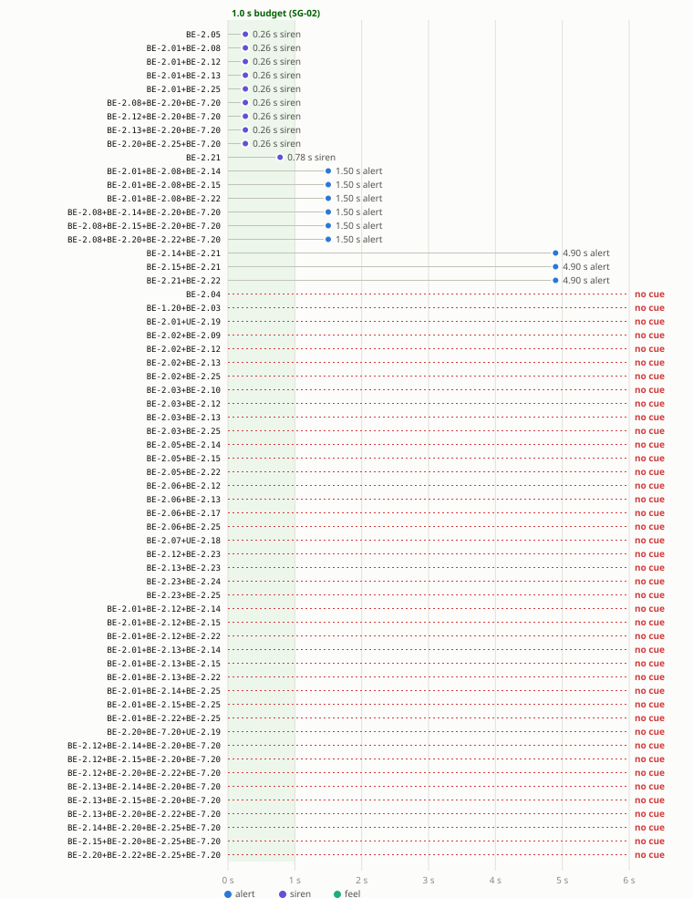

# SG-02 time to the first cue (TE-02 step P4)

> **Synthetic (DSR-12).** Generated by [`sweep.py`](sweep.py) `timing` from the fmdtools model; do not edit by hand. No evidence credit: the times are the model's inputs ([`events.yaml`](events.yaml)) combined, not measurements.

Every set of the [P3](p3-joint-faults.md) diff (58 sets: the tree's effective sets and the model's minimal sets), injected mid-curve and run for 6 s after the injection. The time is from the loss of lateral control to the first perceivable cue; the SG-02 budget is 1.0 s (WP-C-04 §3).

| Result | Sets |
|---|---|
| Cue within the budget | 9 |
| **Cue after the budget** | **7** |
| **No cue within 6 s** | **42** |

## Sets with a late cue or none

| Set | WP-A-04 row | Tree | Lost (after the fault) | First cue (after the fault) | Over the budget by |
|---|---|---|---|---|---|
| {BE-2.21} | MCS-02.9 | yes | 0.10 s | 5.00 s alert | 3.90 s |
| {BE-2.01, BE-2.08, BE-2.14} | MCS-02.1 | siren failure added | 0.00 s | 1.50 s alert | 0.50 s |
| {BE-2.01, BE-2.08, BE-2.15} | MCS-02.1 | siren failure added | 0.00 s | 1.50 s alert | 0.50 s |
| {BE-2.01, BE-2.08, BE-2.22} | MCS-02.1 | siren failure added | 0.00 s | 1.50 s alert | 0.50 s |
| {BE-2.08, BE-2.14, BE-2.20, BE-7.20} | MCS-02.11 | siren failure added | 0.00 s | 1.50 s alert | 0.50 s |
| {BE-2.08, BE-2.15, BE-2.20, BE-7.20} | MCS-02.11 | siren failure added | 0.00 s | 1.50 s alert | 0.50 s |
| {BE-2.08, BE-2.20, BE-2.22, BE-7.20} | MCS-02.11 | siren failure added | 0.00 s | 1.50 s alert | 0.50 s |
| {BE-2.04} | MCS-02.4 | yes | 0.00 s | none | > 5.0 s |
| {BE-1.20, BE-2.03} | MCS-02.3 | yes | 0.00 s | none | > 5.0 s |
| {BE-2.01, UE-2.19} | MCS-02.10 | yes | 0.00 s | none | > 5.0 s |
| {BE-2.02, BE-2.09} | MCS-02.2 | yes | 0.00 s | none | > 5.0 s |
| {BE-2.02, BE-2.12} | MCS-02.6 | yes | 0.00 s | none | > 5.0 s |
| {BE-2.02, BE-2.13} | MCS-02.6 | yes | 0.00 s | none | > 5.0 s |
| {BE-2.02, BE-2.25} | MCS-02.6 | yes | 0.00 s | none | > 5.0 s |
| {BE-2.03, BE-2.10} | MCS-02.3 | yes | 0.00 s | none | > 5.0 s |
| {BE-2.03, BE-2.12} | MCS-02.6 | yes | 0.00 s | none | > 5.0 s |
| {BE-2.03, BE-2.13} | MCS-02.6 | yes | 0.00 s | none | > 5.0 s |
| {BE-2.03, BE-2.25} | MCS-02.6 | yes | 0.00 s | none | > 5.0 s |
| {BE-2.05, BE-2.14} | MCS-02.5 | siren failure added | 0.00 s | none | > 5.0 s |
| {BE-2.05, BE-2.15} | MCS-02.5 | siren failure added | 0.00 s | none | > 5.0 s |
| {BE-2.05, BE-2.22} | MCS-02.5 | siren failure added | 0.00 s | none | > 5.0 s |
| {BE-2.06, BE-2.12} | MCS-02.6 | yes | 0.00 s | none | > 5.0 s |
| {BE-2.06, BE-2.13} | MCS-02.6 | yes | 0.00 s | none | > 5.0 s |
| {BE-2.06, BE-2.17} | MCS-02.8 | yes | 0.00 s | none | > 5.0 s |
| {BE-2.06, BE-2.25} | MCS-02.6 | yes | 0.00 s | none | > 5.0 s |
| {BE-2.07, UE-2.18} | MCS-02.7 | yes | 0.00 s | none | > 5.0 s |
| {BE-2.12, BE-2.23} | MCS-02.6 | yes | 0.00 s | none | > 5.0 s |
| {BE-2.13, BE-2.23} | MCS-02.6 | yes | 0.00 s | none | > 5.0 s |
| {BE-2.23, BE-2.24} | MCS-02.12 | yes | 0.00 s | none | > 5.0 s |
| {BE-2.23, BE-2.25} | MCS-02.6 | yes | 0.00 s | none | > 5.0 s |
| {BE-2.01, BE-2.12, BE-2.14} | MCS-02.6 | siren failure added | 0.00 s | none | > 5.0 s |
| {BE-2.01, BE-2.12, BE-2.15} | MCS-02.6 | siren failure added | 0.00 s | none | > 5.0 s |
| {BE-2.01, BE-2.12, BE-2.22} | MCS-02.6 | siren failure added | 0.00 s | none | > 5.0 s |
| {BE-2.01, BE-2.13, BE-2.14} | MCS-02.6 | siren failure added | 0.00 s | none | > 5.0 s |
| {BE-2.01, BE-2.13, BE-2.15} | MCS-02.6 | siren failure added | 0.00 s | none | > 5.0 s |
| {BE-2.01, BE-2.13, BE-2.22} | MCS-02.6 | siren failure added | 0.00 s | none | > 5.0 s |
| {BE-2.01, BE-2.14, BE-2.25} | MCS-02.6 | siren failure added | 0.00 s | none | > 5.0 s |
| {BE-2.01, BE-2.15, BE-2.25} | MCS-02.6 | siren failure added | 0.00 s | none | > 5.0 s |
| {BE-2.01, BE-2.22, BE-2.25} | MCS-02.6 | siren failure added | 0.00 s | none | > 5.0 s |
| {BE-2.20, BE-7.20, UE-2.19} | MCS-02.11 | yes | 0.00 s | none | > 5.0 s |
| {BE-2.12, BE-2.14, BE-2.20, BE-7.20} | MCS-02.11 | siren failure added | 0.00 s | none | > 5.0 s |
| {BE-2.12, BE-2.15, BE-2.20, BE-7.20} | MCS-02.11 | siren failure added | 0.00 s | none | > 5.0 s |
| {BE-2.12, BE-2.20, BE-2.22, BE-7.20} | MCS-02.11 | siren failure added | 0.00 s | none | > 5.0 s |
| {BE-2.13, BE-2.14, BE-2.20, BE-7.20} | MCS-02.11 | siren failure added | 0.00 s | none | > 5.0 s |
| {BE-2.13, BE-2.15, BE-2.20, BE-7.20} | MCS-02.11 | siren failure added | 0.00 s | none | > 5.0 s |
| {BE-2.13, BE-2.20, BE-2.22, BE-7.20} | MCS-02.11 | siren failure added | 0.00 s | none | > 5.0 s |
| {BE-2.14, BE-2.20, BE-2.25, BE-7.20} | MCS-02.11 | siren failure added | 0.00 s | none | > 5.0 s |
| {BE-2.15, BE-2.20, BE-2.25, BE-7.20} | MCS-02.11 | siren failure added | 0.00 s | none | > 5.0 s |
| {BE-2.20, BE-2.22, BE-2.25, BE-7.20} | MCS-02.11 | siren failure added | 0.00 s | none | > 5.0 s |

## Sets warned within the budget

These are tree sets that the model covers with a cue in time: the siren since panda `8a69ccf` (P3).

| Set | WP-A-04 row | Lost (after the fault) | First cue (after the fault) | Margin |
|---|---|---|---|---|
| {BE-2.05} | MCS-02.5 | 0.00 s | 0.26 s siren | 0.74 s |
| {BE-2.01, BE-2.08} | MCS-02.1 | 0.00 s | 0.26 s siren | 0.74 s |
| {BE-2.01, BE-2.12} | MCS-02.6 | 0.00 s | 0.26 s siren | 0.74 s |
| {BE-2.01, BE-2.13} | MCS-02.6 | 0.00 s | 0.26 s siren | 0.74 s |
| {BE-2.01, BE-2.25} | MCS-02.6 | 0.00 s | 0.26 s siren | 0.74 s |
| {BE-2.08, BE-2.20, BE-7.20} | MCS-02.11 | 0.00 s | 0.26 s siren | 0.74 s |
| {BE-2.12, BE-2.20, BE-7.20} | MCS-02.11 | 0.00 s | 0.26 s siren | 0.74 s |
| {BE-2.13, BE-2.20, BE-7.20} | MCS-02.11 | 0.00 s | 0.26 s siren | 0.74 s |
| {BE-2.20, BE-2.25, BE-7.20} | MCS-02.11 | 0.00 s | 0.26 s siren | 0.74 s |

## The times the model uses, against WP-S-04

Each late cue above comes from one of these inputs; the source names the WP-A-04 or WP-S-04 basis or the plant result. Two cue inputs exceed the budget: the 1.5 s escalation after an override (TSR-607 (b)) and the 5 s System Unresponsive alert after a selfdrived stop (MCS-02.9, a gap against TSR-516(b) / TSR-307(a)).

| Input | Seconds | ≤ 1 s | Source |
|---|---|---|---|
| `host_alert_eps_fault` | 0.1 | yes | WP-A-04 §4 BE-2.08: take-over alert on an EPS fault without a recent override |
| `host_alert_eps_fault_after_override` | 1.5 | **no** | WP-A-04 §4 BE-2.08: low-priority prompt for 1.5 s, then the take-over request (TSR-607 (b)) |
| `host_alert_envelope_block` | 0.5 | yes | WP-A-04 §4 BE-2.09: controlsMismatch after 2 samples, at most 0.5 s (TSR-621) |
| `host_alert_input_loss` | 0.1 | yes | Assumed: an immediate critical alert when the soft disable of BE-2.10 is not the reaction |
| `host_alert_frames_lost` | 0.5 | yes | Assumed: WP-A-04 OI-10 has the timing to confirm (BE-2.17) |
| `host_alert_saturation` | 0.5 | yes | Assumed: SFM-ACT-017 has the timing to analyse (BE-2.24) |
| `ui_unresponsive_after_selfdrived_stop` | 5 | **no** | WP-A-04 §4 BE-2.21: ui/soundd show System Unresponsive only after 5 s |
| `control_stop_after_selfdrived_stop` | 0.1 | yes | WP-A-04 §4 BE-2.21; plant engaged-mismatch.md: controlsd drops latActive once selfdriveState is 0.1 s stale (TSR-602); card keeps sending frames without a torque request |
| `siren_after_eps_fault` | 0.25 | yes | Plant F-07: EPS fault, revoked 0.053 s, siren 0.25 s (sim/results/plant-results.md) |
| `siren_after_heartbeat_loss` | 0.25 | yes | Plant F-04a/F-04b: heartbeat lost, revoked 0.193/0.043 s, siren 0.25 s (plant-results.md; silent-stall.md 0.25-0.29 s) |
