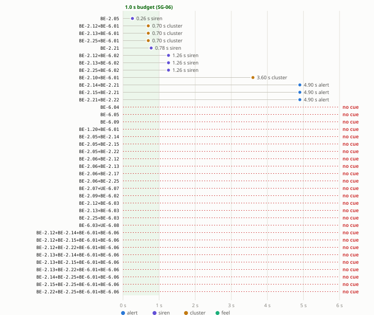

# SG-06 time to the first cue (step P4)

> **Synthetic (DSR-12).** Generated by [`sweep.py`](sweep.py) `timing` from the fmdtools model; do not edit by hand. No evidence credit: the times are the model's inputs ([`events.yaml`](events.yaml)) combined, not measurements.

Every set of the [P3](p3-joint-faults.md) diff (38 sets: the tree's effective sets and the model's minimal sets), injected in the approach phase and run for 6 s after the injection. The time is from the loss of deceleration to the first perceivable cue; the SG-06 budget is 1.0 s.

| Result | Sets |
|---|---|
| Cue within the budget | 5 |
| **Cue after the budget** | **7** |
| **No cue within 6 s** | **26** |

## Sets with a late cue or none

| Set | WP-A-04 row | Tree | Lost (after the fault) | First cue (after the fault) | Over the budget by |
|---|---|---|---|---|---|
| {BE-2.14, BE-2.21} | MCS-06.5 | latent-cue failure added | 0.10 s | 5.00 s alert | 3.90 s |
| {BE-2.15, BE-2.21} | MCS-06.5 | latent-cue failure added | 0.10 s | 5.00 s alert | 3.90 s |
| {BE-2.21, BE-2.22} | MCS-06.5 | latent-cue failure added | 0.10 s | 5.00 s alert | 3.90 s |
| {BE-2.10, BE-6.01} | MCS-06.1 | yes | 0.00 s | 3.60 s cluster | 2.60 s |
| {BE-2.12, BE-6.02} | MCS-06.8 | yes | 0.00 s | 1.26 s siren | 0.26 s |
| {BE-2.13, BE-6.02} | MCS-06.8 | yes | 0.00 s | 1.26 s siren | 0.26 s |
| {BE-2.25, BE-6.02} | MCS-06.8 | yes | 0.00 s | 1.26 s siren | 0.26 s |
| {BE-1.20, BE-6.01} | MCS-06.1 | yes | 0.00 s | none | > 5.0 s |
| {BE-2.05, BE-2.14} | MCS-06.5 | latent-cue failure added | 0.00 s | none | > 5.0 s |
| {BE-2.05, BE-2.15} | MCS-06.5 | latent-cue failure added | 0.00 s | none | > 5.0 s |
| {BE-2.05, BE-2.22} | MCS-06.5 | latent-cue failure added | 0.00 s | none | > 5.0 s |
| {BE-2.06, BE-2.12} | MCS-06.8 | yes | 0.00 s | none | > 5.0 s |
| {BE-2.06, BE-2.13} | MCS-06.8 | yes | 0.00 s | none | > 5.0 s |
| {BE-2.06, BE-2.17} | MCS-06.7 | yes | 0.00 s | none | > 5.0 s |
| {BE-2.06, BE-2.25} | MCS-06.8 | yes | 0.00 s | none | > 5.0 s |
| {BE-2.07, UE-6.07} | MCS-06.9 | yes | 0.00 s | none | > 5.0 s |
| {BE-2.09, BE-6.02} | MCS-06.2 | yes | 0.00 s | none | > 5.0 s |
| {BE-2.12, BE-2.14, BE-6.01, BE-6.06} | MCS-06.8 | latent-cue failure added | 0.00 s | none | > 5.0 s |
| {BE-2.12, BE-2.15, BE-6.01, BE-6.06} | MCS-06.8 | latent-cue failure added | 0.00 s | none | > 5.0 s |
| {BE-2.12, BE-2.22, BE-6.01, BE-6.06} | MCS-06.8 | latent-cue failure added | 0.00 s | none | > 5.0 s |
| {BE-2.12, BE-6.03} | MCS-06.3 | yes | 0.00 s | none | > 5.0 s |
| {BE-2.13, BE-2.14, BE-6.01, BE-6.06} | MCS-06.8 | latent-cue failure added | 0.00 s | none | > 5.0 s |
| {BE-2.13, BE-2.15, BE-6.01, BE-6.06} | MCS-06.8 | latent-cue failure added | 0.00 s | none | > 5.0 s |
| {BE-2.13, BE-2.22, BE-6.01, BE-6.06} | MCS-06.8 | latent-cue failure added | 0.00 s | none | > 5.0 s |
| {BE-2.13, BE-6.03} | MCS-06.3 | yes | 0.00 s | none | > 5.0 s |
| {BE-2.14, BE-2.25, BE-6.01, BE-6.06} | MCS-06.8 | latent-cue failure added | 0.00 s | none | > 5.0 s |
| {BE-2.15, BE-2.25, BE-6.01, BE-6.06} | MCS-06.8 | latent-cue failure added | 0.00 s | none | > 5.0 s |
| {BE-2.22, BE-2.25, BE-6.01, BE-6.06} | MCS-06.8 | latent-cue failure added | 0.00 s | none | > 5.0 s |
| {BE-2.25, BE-6.03} | MCS-06.3 | yes | 0.00 s | none | > 5.0 s |
| {BE-6.03, UE-6.08} | MCS-06.11 | yes | 0.00 s | none | > 5.0 s |
| {BE-6.04} | MCS-06.4 | yes | 0.00 s | none | > 5.0 s |
| {BE-6.05} | MCS-06.6 | yes | 0.00 s | none | > 5.0 s |
| {BE-6.09} | MCS-06.10 | yes | 0.00 s | none | > 5.0 s |

## Sets warned within the budget

These are tree sets that the model covers with a cue in time: the siren on a heartbeat loss or an engaged mismatch, or the cluster cruise change after the host's ACC cancel (P3).

| Set | WP-A-04 row | Lost (after the fault) | First cue (after the fault) | Margin |
|---|---|---|---|---|
| {BE-2.05} | MCS-06.5 | 0.00 s | 0.26 s siren | 0.74 s |
| {BE-2.12, BE-6.01} | MCS-06.8 | 0.00 s | 0.70 s cluster | 0.30 s |
| {BE-2.13, BE-6.01} | MCS-06.8 | 0.00 s | 0.70 s cluster | 0.30 s |
| {BE-2.25, BE-6.01} | MCS-06.8 | 0.00 s | 0.70 s cluster | 0.30 s |
| {BE-2.21} | MCS-06.5 | 0.10 s | 0.88 s siren | 0.22 s |

## The times the model uses

Each late cue above comes from one of these inputs; the source names the WP-A-04 or WP-S-02 basis or the plant result. Two cue inputs exceed the budget: the 3 s soft disable before the cancel (BE-2.10, SWF-048.C1) and the 5 s System Unresponsive alert after a selfdrived stop.

| Input | Seconds | ≤ 1 s | Source |
|---|---|---|---|
| `host_alert_input_loss` | 0.1 | yes | Assumed, as SG-02: an immediate critical alert when the soft disable of BE-2.10 is not the reaction |
| `soft_disable` | 3 | **no** | BE-2.10, MCS-06.1: soft disable keeps the stale command for 3 s (selfdrive/selfdrived/state.py SOFT_DISABLE_TIME), then disengages |
| `host_alert_envelope_block` | 0.5 | yes | WP-A-04 §4 BE-2.09: controlsMismatch after 2 samples, at most 0.5 s (TSR-621) |
| `host_alert_acc_fault` | 0.1 | yes | Assumed: accFaulted is an immediate disable (selfdrive/selfdrived/events.py accFaulted; WP-A-04 §7 BE-6.03); one host cycle plus the carState update |
| `host_alert_frames_lost` | 0.5 | yes | Assumed, as SG-02: WP-A-04 OI-10 has the timing to confirm (BE-2.17) |
| `ui_unresponsive_after_selfdrived_stop` | 5 | **no** | WP-A-04 §4 BE-2.21: ui/soundd show System Unresponsive only after 5 s |
| `control_stop_after_selfdrived_stop` | 0.1 | yes | WP-A-04 §4 BE-2.21; TSR-602: controlsd drops longActive once selfdriveState is 0.1 s stale |
| `siren_after_heartbeat_loss` | 0.25 | yes | Plant F-04a/F-04b: heartbeat lost, revoked 0.193/0.043 s, siren 0.25 s (plant-results.md; silent-stall.md 0.25-0.29 s) |
| `siren_after_selfdrived_stop` | 0.88 | yes | Plant engaged-mismatch.md: the siren sounds 0.63-0.88 s after the stop (TSR-307(a), TSR-516(c), panda f4803c5); the latest is used |
| `cluster_after_disengage` | 0.6 | yes | TSR-303 cancel within 0.1 s of the disengagement, plus at most 0.5 s PCM cancel lag before TSR-516(c) counts the cancel as failed (SWSR-516b; lag not measured, WP-W-02 OI-18) |
| `siren_after_failed_cancel` | 0.76 | yes | TSR-516(c): siren 0.5 s after the first "not engaged" heartbeat while PCM cruise is still active (SWSR-516b), plus at most 0.26 s to the speaker (8 Hz siren ticks, TSR-516 Impl) |
