# SysML v2 architecture model

| Field | Value |
|---|---|
| What | LD-SDA end to end as a SysML v2 model: stakeholders, stakeholder needs and use cases, elements, integrity, ports, interfaces, cereal services, safety mechanisms, functions and their chains, security zones and trust boundaries, integration steps, the operating modes and the three state-machine records as state machines, the start-up sequence, the timing budgets and the HSI signals, the requirements of WP-C-03, WP-C-04, WP-S-01, WP-S-02 and WP-S-07 with their derivation, satisfy and verify relationships, and the views drawn from them |
| Status | Draft, AI-assisted (Claude), not reviewed. Decisions SY-01 to SY-06 taken by the lead on 2026-10-24 (DQ-185 to DQ-187); SY-05 and SY-06 wait for the model review (OI-8) |
| Documents of record | [WP-C-01](../../02-concept/WP-C-01-item-definition.md) §3, [WP-S-03](../../03-system/WP-S-03-technical-safety-concept-architecture.md) §3, §6, §8, §9, [WP-W-03](../../05-software/WP-W-03-software-architecture.md) §3.1, §4.1; for behaviour the state-machine records ([`05-software/state-machines`](../../05-software/state-machines)) and WP-S-03 §4.1; WP-S-04 §3.7 and WP-S-05 §11 for timing and signals; for requirements the trace data ([`trace/items`](../../trace/items)), [WP-S-01](../../03-system/WP-S-01-system-requirements.md) §1.2–§10.1, [WP-S-07](../../03-system/WP-S-07-cybersecurity-requirements-architecture.md) §4 and the test specifications. The model is a checked copy of them (§4) |
| Tool classification | [WP-P-07](../../07-supporting/WP-P-07-tool-classification-qualification.md) TL-26 (OMG pilot implementation), TL-27 (in-house reader, checks, renderer); TCL1, no verification credit |
| Explorer | [`generated/explorer.html`](generated/explorer.html): open locally in a browser |

The model is description, not code generation: LionDriver does not use model-based development for production code ([WP-W-01](../../05-software/WP-W-01-software-development-environment-guidelines.md)). Nothing here is verification evidence. A figure or check result in this folder may support a review, but it does not replace one.

## 1. Why a model

The architecture is already written down, in tables in five work products and in hand-drawn figures. Three things are missing that a model provides:

1. **One set of element names.** The 351 `allocated_to` fields in [`trace/items`](../../trace/items) use 161 different strings in four vocabularies (`E-03`, `P-SW`, `U-SAF-TOY`, `host.selfdrived`). [WP-P-06](../../07-supporting/WP-P-06-requirements-management-traceability.md) OI-4 asks for an element catalogue. The model is that catalogue, and §5 measures how much of the allocation data it already resolves.
2. **Consistency by construction.** WP-S-03 says of Figure 3-2 "change it together with §3.1, §3.3, §5 and §6". Here a table and the model are compared on every pull request (§4), and every figure is regenerated from the model, so a figure cannot drift from the tables it shows.
3. **A semi-formal notation** for architectural design. ISO 26262-6:2018 Table 2 highly recommends semi-formal notations for the software architecture from ASIL B, and ASPICE SYS.3 and SWE.2 ask for static and dynamic aspects with their interfaces. Check the clause and table numbers against your licensed copy.

## 2. Decisions

Taken by the lead on 2026-10-24 ([DQ-185, DQ-186, DQ-187](../../01-management/decisions/register.yaml)): SysML MBSE for everything, drawn in the readable in-house style.

| ID | Question | Decision | Consequence |
|---|---|---|---|
| SY-01 | Which notation? | **SysML v2 textual notation** (OMG SysML 2.0, 2025). Plain text files reviewed in pull requests like code | No GUI tool is needed to read or change the model; diffs are reviewable |
| SY-02 | Which tool says the model is valid SysML v2? | The **OMG pilot implementation**, version 0.62.0, pinned by SHA-256 ([`tools/pilot/`](tools/pilot)), run in CI | Conformance is checked by the reference implementation, not by in-house code (WP-P-07 TL-26) |
| SY-03 | How are figures drawn? | **In-house renderer** ([`tools/render_views.py`](tools/render_views.py)) in the style of the existing work-product figures. The model says what is drawn; [`views/layout.toml`](views/layout.toml) says only where | The pilot's PlantUML rendering is not used. A layout entry that names an element the model does not have fails the build |
| SY-04 | Model or Markdown, which is the source? | **The model becomes the record** (revised by DQ-185). Until the model review (OI-8) the work products stay the record; [`record.toml`](record.toml) says which side is, and `gen_tables.py` holds the two to the same table cell by cell (T1, §4) | Two places to edit until the switch; no drift between them |
| SY-05 | Should the architecture tables be generated from the model? | **Yes** (DQ-186). Every column of WP-S-03 §3.1, §3.3 and §6 and WP-W-03 §3.1 is in the model (`@Catalogue`, `@InterfaceId`, the `SafetyMechanism` attributes) and [`tools/gen_tables.py`](tools/gen_tables.py) writes the four tables. The model is AI-drafted (I0): its human review (OI-8) comes before `record.toml` is set to `model` and the generated tables replace the hand-written ones (OI-5) | Removes the double edit; makes the model the record |
| SY-06 | Should generated views replace the hand-drawn figures? | **Yes** (DQ-187), in the V-01/V-03 style, figure by figure once the view shows what the figure shows (§2.1, OI-6) | One drawing per fact |

### 2.1 Figures to be replaced (SY-06)

A generated view replaces a hand-drawn figure when it carries the same facts; until then the figure stays, so that no work product loses content. What each view still lacks:

| Hand-drawn figure | Generated view | Not yet in the view | In the model? |
|---|---|---|---|
| WP-S-03 Figure 3-2, technical safety architecture | V-03 | TSR tags per block (§3.3, §5); cereal data flow between the processes (§9); the hooks inside E-03a and E-03b | TSRs: yes (`satisfy`); data flow: yes (M6); hooks: no |
| WP-S-03 Figure 3-1, system element hierarchy | V-02 | TSRs of §5 per element; mechanisms shared by two elements; the §8 processes that are not safety-related or must be absent | TSRs and mechanisms: yes; the other processes: no |
| WP-C-01 Figure 3-1, element hierarchy of LD-SDA | V-01, V-02, V-10 | in V-02: the functions F-01 to F-09 and the elements that realise them (drawn in V-10); the sensor, controller and actuation grouping; the F-09 processes | functions: yes (V-10); the rest: no |
| WP-S-03 Figure 4-1, start-up and engagement | V-17 | nothing: **replaced** on 2026-10-26 (WP-S-03 v0.19); the hand-drawn figure is gone and its text version became Table 4-1 | yes (B1, B2) |
| WP-C-01 Figure 4-1, operating modes and actuation authority | V-13 | the code references of each mode; the AOU-05 note on the PCM | modes, transitions and record IDs: yes (M12) |
| WP-W-03 Figure 3-1, software element hierarchy | V-02 | units UN-01 to UN-46, UN-N1 and the planned UN-N2 to UN-N6 of WP-W-05 §2 | no |
| WP-H-02 Figure 3-2, hardware element hierarchy | V-02 | hardware parts HE-01 to HE-17 with their HWSRs, unknowns and variant differences | no (OI-1) |

## 3. Contents

| Path | Content |
|---|---|
| [`model/LionDriverLibrary.sysml`](model/LionDriverLibrary.sysml) | Integrity enumeration (WP-S-02 §2.1 notation), element classes, port, interface and connection definitions, metadata (`Safety`, `Source`, `Unit`, `InterfaceId`, `FfiClaim`), view definitions |
| [`model/Functions.sysml`](model/Functions.sysml) | F-01 to F-09 of WP-C-01 §2.1 as `ItemFunction` actions, each decomposed into the `FunctionStep`s of its chain; elements `perform` the steps |
| [`model/Security.sysml`](model/Security.sysml) | Security zones Z1 to Z7 and trust boundaries TB-1 to TB-7 of WP-S-07 §3, every column of both tables; elements name their zone with `@Zone` |
| [`model/Integration.sysml`](model/Integration.sysml) | Integration steps I-1 to I-4 of WP-S-08 §3.1, every column, with the elements each integrates and the interfaces it exercises |
| [`model/Behaviour.sysml`](model/Behaviour.sysml) | The operating modes of WP-C-01 §4 as the state machine SM-SYS: states with their §4 row and record states, transitions with the record transitions they stand for and who enforces them |
| [`model/Mechanisms.sysml`](model/Mechanisms.sysml) | SM-01 to SM-43 as `action` usages of `SafetyMechanism` with coverage, DC target and TSRs (WP-S-03 §6) |
| [`model/Architecture.sysml`](model/Architecture.sysml) | E-01 to E-05 with their parts and software units, allocation of software to hardware, interfaces IF-01 to IF-10, the 23 cereal services of WP-S-03 §9 between modelled processes, `perform` statements, the vehicle context and the allocation short forms `P-SW`, `P-HW`, `SoC`, `HAR` as aliases |
| [`model/Requirements.sysml`](model/Requirements.sysml) | **Generated.** 282 requirements as `requirement` usages: safety goals SG, FSRs and TSRs from the trace data, system requirements SYS of WP-S-01, cybersecurity requirements CSR of WP-S-07 §4, each with its text, ASIL, allocation text and verification method; the parent links of the trace data as `#derivation` connections |
| [`model/Satisfaction.sysml`](model/Satisfaction.sysml) | **Generated.** `satisfy` relationships from each requirement's allocation: `allocated_to` of the trace data (resolved as in M8), WP-S-01 §10.1, the Alloc column of WP-S-07 §4 (FW → E-03, SoC → E-01); a safety goal is satisfied by the item. EXT, OPS, ENV and USR give no relationship |
| [`model/Verification.sysml`](model/Verification.sysml) | **Generated.** Every test case of a specification table (VS-…) as a `verification` usage whose objective verifies the modelled requirements it names, ranges expanded |
| [`model/Needs.sysml`](model/Needs.sysml) | **Generated.** The stakeholders and actors of WP-S-01 §1.2 as part definitions; the 12 stakeholder needs of §1.3 as `requirement` usages with their `stakeholder` parameters and a `#derivation` to each SYS requirement and safety goal that refines them; the 11 use cases of §1.4 as `use case` usages with LD-SDA as subject, their `actor`s, an objective that `require`s the needs they serve, and a `perform` of each function they use |
| [`model/StateRecords.sysml`](model/StateRecords.sysml) | **Generated.** The three state-machine records of WP-W-05 §5 (SM-SAFETY-MODE, SM-TOY-AUTH, SM-SELFDRIVED) as `state def`s: states, initial state and every record transition with its trigger, guard, effect, build, SWSRs, gap and code as `@RecordTransition`; a record transition from any state or to the requested mode becomes one SysML transition per source and target |
| [`model/Sequences.sysml`](model/Sequences.sysml) | **Generated.** The start-up and engagement sequence of WP-S-03 §4.1 (Table 4-1) as an `occurrence def`: one lifeline per element, one `message` per step with its phase, condition, state after, status, records and code, in order |
| [`model/Timing.sysml`](model/Timing.sysml) | **Generated.** The 17 FTTI budgets of WP-S-04 §3.7 as `constraint` usages of `TimingBudget`, named by the row label: FTTI, FDTI, FRTI, margin and FHTI as written and, where a cell is one time, in seconds; the safety goals and TSRs each names |
| [`model/Signals.sysml`](model/Signals.sysml) | **Generated.** The 29 safety-relevant signals of WP-S-05 §11 as `item` usages of `Signal`: interface, direction, owner elements, integrity, validity, rate, failure reaction, ASIL, TSRs and test cases |
| [`model/Views.sysml`](model/Views.sysml) | Views V-01 to V-19: what each exposes and how it is rendered |
| [`views/layout.toml`](views/layout.toml) | Placement only: boxes, grids, route adjustments, display names |
| [`tools/sysml_lite.py`](tools/sysml_lite.py) | Reader for the subset of the textual notation the model uses; builds the instance tree. Refuses any other construct with its line number |
| [`tools/gen_behaviour.py`](tools/gen_behaviour.py) | Generates `StateRecords.sysml` and `Sequences.sysml` from the records and WP-S-03 §4.1; `--check` fails if they differ |
| [`tools/gen_timing_hsi.py`](tools/gen_timing_hsi.py) | Generates `Timing.sysml` and `Signals.sysml` from WP-S-04 §3.7 and WP-S-05 §11; `--check` fails if they differ |
| [`tools/gen_requirements.py`](tools/gen_requirements.py) | Generates the four requirement and needs files above from the work products; `--check` fails if they differ |
| [`tools/check_model.py`](tools/check_model.py) | Checks M1 to M12, N1 to N3, B1 to B3, H1 to H3 and R1 to R4 (§4), the allocation-resolution report and the requirements-coverage report |
| [`tools/render_requirements.py`](tools/render_requirements.py) | Renderer of the requirement views V-05 to V-07 and of the needs views V-14 and V-15 |
| [`tools/gen_tables.py`](tools/gen_tables.py), [`record.toml`](record.toml) | Generates the architecture tables of WP-S-03 §3.1, §3.3, §6 and WP-W-03 §3.1 from the model (SY-05); `record.toml` says whether the work products or the model are the record |
| [`tools/render_arch.py`](tools/render_arch.py) | Renderer of V-10 functional architecture, V-11 security zones, V-12 integration build-up, V-13 system modes, V-16 state-machine records, V-17 start-up sequence, V-18 timing budgets and V-19 HSI signals |
| [`tools/render_se.py`](tools/render_se.py) | Renderer of the systems-engineering views: V-08 N2 chart, V-09 VCRM and the per-requirement [`generated/vcrm.md`](generated/vcrm.md) |
| [`tools/render_views.py`](tools/render_views.py), [`tools/svgkit.py`](tools/svgkit.py) | View renderer and drawing kit (palette, measured Inter metrics, orthogonal routing) |
| [`tools/explorer.py`](tools/explorer.py), [`tools/explorer_assets/`](tools/explorer_assets) | Builds the interactive explorer |
| [`tools/pilot/`](tools/pilot) | Pinned download and validation with the OMG pilot implementation |
| [`tools/test_sysml.py`](tools/test_sysml.py) | Tests of the reader, checks, renderer and explorer |
| [`generated/`](generated) | Figures, explorer and the allocation-resolution report. Never edited by hand |

## 4. Checks

| Check | What it compares |
|---|---|
| M1 | Elements and integrity of WP-S-03 §3.1 |
| M2 | Firmware elements of WP-W-03 §3.1: name, unit, build scope, integrity, in both directions |
| M3 | Host components of WP-W-03 §4.1: name and integrity, in both directions |
| M4 | Interfaces of WP-S-03 §3.3: every IF exists; each item-side element in the "Between" column is an endpoint of one of its connections |
| M5 | Mechanisms of WP-S-03 §6: same set, same performing elements, same TSRs |
| M6 | Cereal services of WP-S-03 §9 between modelled processes, in both directions |
| M7 | Every element inside the item has an integrity; any connection between a QM and an ASIL element inside the item declares the FFI claims of WP-S-03 §7 it crosses (`@FfiClaim`) |
| M8 | [`generated/allocation-resolution.md`](generated/allocation-resolution.md) is up to date |
| M9 | Functions of WP-C-01 §2.1: same IDs and titles; every step of a function is performed by an element |
| M10 | Security zones and trust boundaries of WP-S-07 §3.1 and §3.2, cell by cell; every element inside the item is in a zone |
| M11 | Integration steps of WP-S-08 §3.1, cell by cell; the elements a step integrates and the interfaces it exercises exist; every component is integrated by some step |
| M12 | Operating modes of WP-C-01 §4: every row is a state of SM-SYS (description and actuation cell by cell) or a listed configuration; the record states and transitions it names exist in the state-machine records |
| N1 | Stakeholders and actors of WP-S-01 §1.2: every stakeholder has a need and every actor takes part in a use case, and nothing else is used as one |
| N2 | Needs of WP-S-01 §1.3: every need is refined by a requirement and served by a use case; every SYS requirement and every safety goal refines a need |
| N3 | Use cases of WP-S-01 §1.4: each has an actor and performs a function; every function of the model is performed by some use case |
| B1 | `StateRecords.sysml` and `Sequences.sysml` equal what `gen_behaviour.py` builds from the state-machine records and WP-S-03 §4.1 |
| B2 | Every unit that runs a record state machine, and every lifeline of a sequence, is an element of the model; every record a step names is a transition of that record, and the state after the step a state of it; every requirement a step's condition names is in the model. M12 now reads the record states and transitions from the model |
| B3 | Every lifeline of a sequence takes part in a step |
| H1 | `Timing.sysml` and `Signals.sysml` equal what `gen_timing_hsi.py` builds from WP-S-04 §3.7 and WP-S-05 §11 |
| H2 | Every timing budget names safety goals and TSRs of the model, and adds up where its cells are times: FDTI + FRTI within the FTTI, FHTI = FDTI + FRTI, margin within FTTI − FHTI; every safety goal has a budget |
| H3 | Every HSI signal has an owner element, a TSR and test cases, and each of them is in the model |
| R1 | `Requirements.sysml`, `Satisfaction.sysml`, `Verification.sysml` and `Needs.sysml` equal what `gen_requirements.py` builds from the work products today: a requirement, allocation or test case changed in a document without regenerating fails |
| R2 | Every `satisfy` ends on an element inside the item; every SYS requirement is satisfied and every name in WP-S-01 §10.1 is an element of the model |
| R3 | Every verification case that names a requirement verifies it in the model, and the requirement lists the case |
| R4 | [`generated/requirements-coverage.md`](generated/requirements-coverage.md) is up to date: per kind, how many requirements are satisfied, allocated outside the item, verified by at least one case and derived from a parent, with the lists of those that are not (informational) |
| T1 | WP-S-03 §3.1, §3.3, §6 and WP-W-03 §3.1 are, cell by cell, the tables `gen_tables.py` generates from the model; with `record = "model"` they also carry the generated marker |

Integrity in a table cell is read as the highest level it names (`B (PCS restore), C (blocking)` is C; C > B‡ > B > QM (B-sup) > QM). Run from this folder:

```sh
python3 tools/gen_requirements.py      # regenerate the requirement files (--check to compare)
python3 tools/gen_behaviour.py         # regenerate the state-machine records and sequences (--check to compare)
python3 tools/gen_timing_hsi.py        # regenerate the timing budgets and HSI signals (--check to compare)
python3 tools/check_model.py           # M1-M12, N1-N3, B1-B3, H1-H3, R1-R4 (--write regenerates the two reports)
python3 tools/gen_tables.py            # T1: architecture tables (--write once record.toml says model)
python3 tools/render_views.py --check  # figures match the model
python3 tools/explorer.py --check      # explorer matches the model
python3 tools/test_sysml.py
tools/pilot/validate.sh                # SysML v2 conformance (JDK 21+, python3 with zstandard)
```

All of them run in CI (`.github/workflows/assurance.yaml`, job "sysml model"). Result at this baseline: M1 to M12, N1 to N3, B1 to B3, H1 to H3, R1 to R4 and T1 pass; the pilot reports 0 errors and 0 warnings for the sixteen files.

Writing the model found one difference worth recording. WP-S-03 §3.3 defines IF-05/06 as camera images reaching E-01/E-02 and IF-07 as starting in E-01, while WP-C-01 §3.4 defines the same IDs at the item boundary (road environment and driver to the cameras and display). The model now carries both hops under one identifier; the work products should say that the identifier covers the whole path (OI-7).

## 5. Allocation resolution

[`generated/allocation-resolution.md`](generated/allocation-resolution.md) matches every `allocated_to` value against the model. At this baseline:

| Requirement kind | Allocations | Resolved | Not resolved |
|---|---|---|---|
| FSR | 54 | 53 | 1 |
| TSR | 118 | 118 | 0 |
| SWSR | 134 | 124 | 10 |
| HWSR | 45 | 3 | 42 |

HWSRs are allocated to chip-level parts (RAMECC, PVD, relay driver, codec) that no catalogue defines yet. Modelling the parts of [WP-H-02](../../04-hardware/WP-H-02-hardware-design.md) is the next increment (OI-1). The report is informational and does not fail CI. Because CI asks for it to be regenerated whenever an allocation or the model changes, a new unresolved allocation is visible in review.

## 6. Views

Every figure below is generated. The explorer shows V-01 to V-04 with the model tree and an inspector (interfaces, services, mechanisms, allocated requirements per element).

**V-15 End-to-end thread (start here):** one stakeholder need followed through the whole model. SN-01, the driver's need for less effort keeping the lane, is served by use case UC-01, which performs F-01, F-05 and F-08 on the elements that perform their steps; it is refined by five system requirements, each satisfied by elements of the architecture and verified by specified cases.


**V-14 Stakeholder needs and use cases:** who uses LD-SDA (the actors), what each stakeholder needs, which use cases serve each need and which functions each use case performs, with the system requirements and safety goals that refine each need (WP-S-01 §1.2–§1.4). The needs and use cases are AI-drafted from WP-C-01 and WP-C-02 (I0).


**V-01 Item context:** the item boundary, components E-01 to E-05 and the elements outside the item.

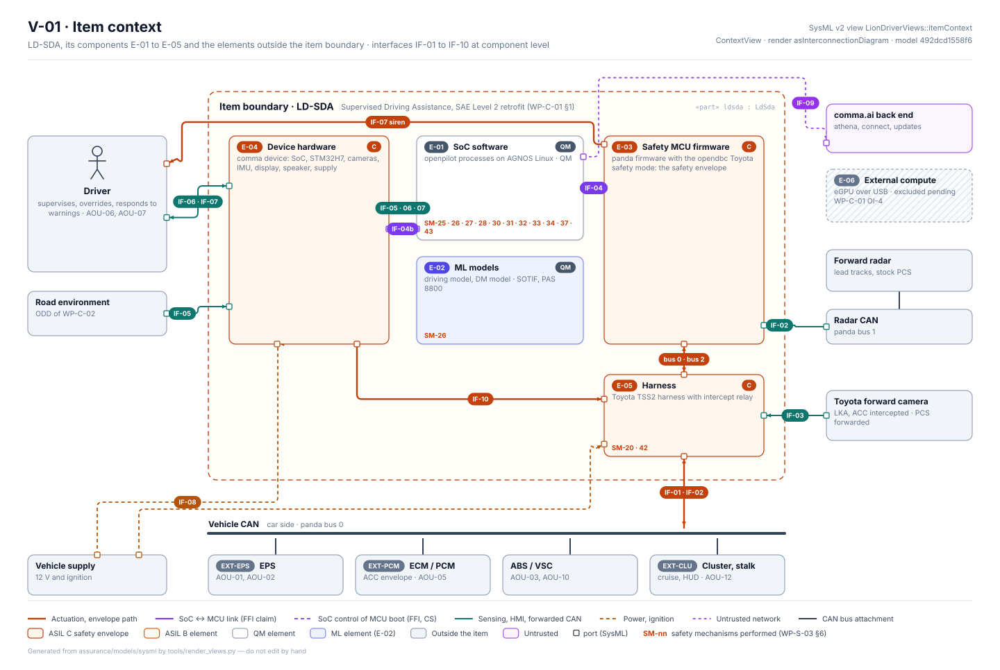

**V-03 Technical safety architecture:** the WP-S-03 Figure 3-2 content drawn from the model.

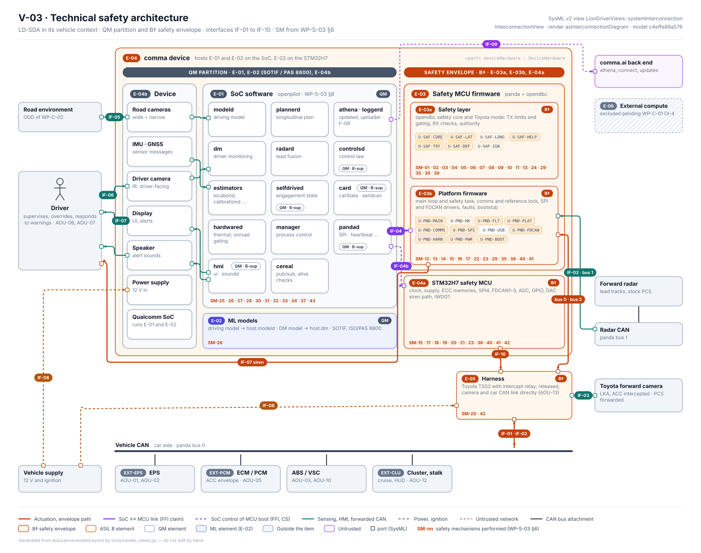

**V-02 Element hierarchy:** every part and software unit with integrity, unit and build scope.

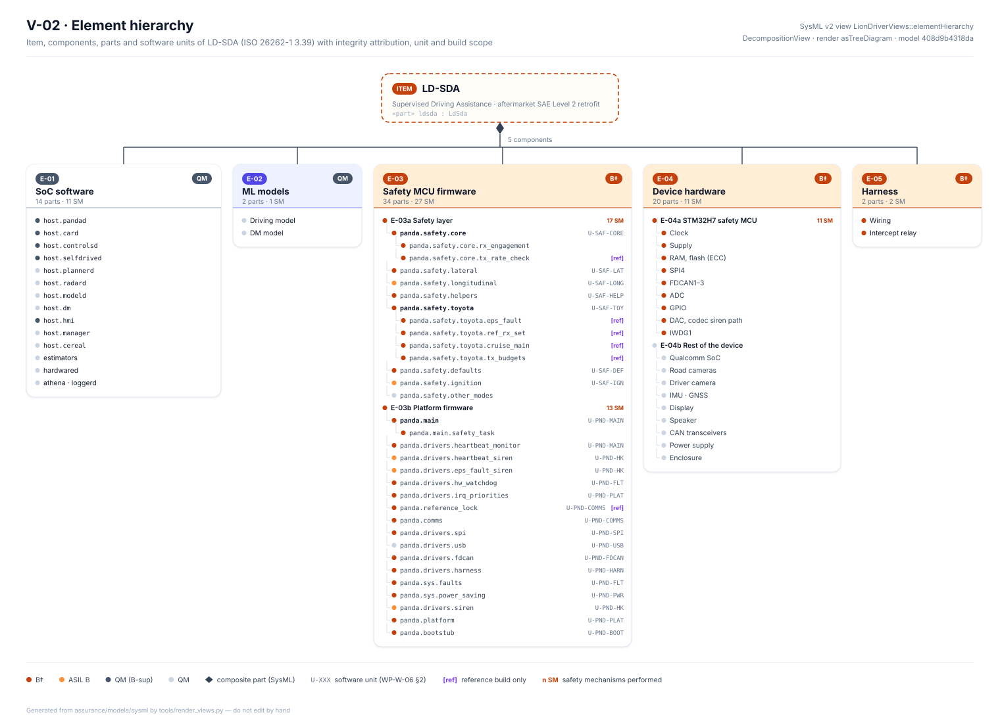

**V-04 Safety mechanism allocation:** SM-01 to SM-43 against the elements that perform them.

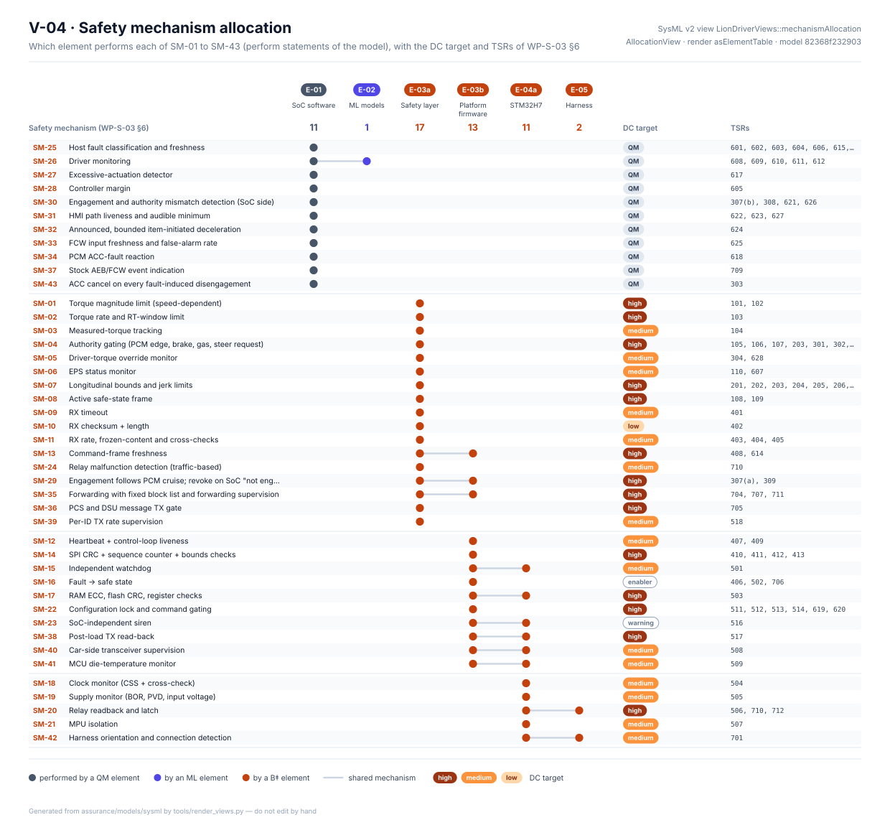

**V-05 Requirement thread:** one requirement (TSR-407, heartbeat loss) with what it derives from, up to the stakeholder need behind its safety goals, what satisfies it, the mechanisms that cite it and the cases that verify it.

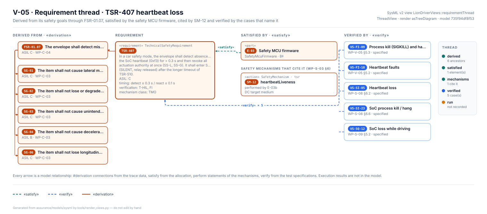

**V-06 Requirement diagram:** the system requirements of F-01 lateral control with their satisfying elements and verification cases; the two lane-change requirements have no case.


**V-07 Satisfy and verify matrix:** all 39 system requirements of WP-S-01.


**V-08 N2 chart:** every connection of the model rolled up to the components E-01 to E-05 and the elements outside the item; a row sends to a column. The INCOSE and NASA handbooks use the N2 chart for interface management (NASA process 12).

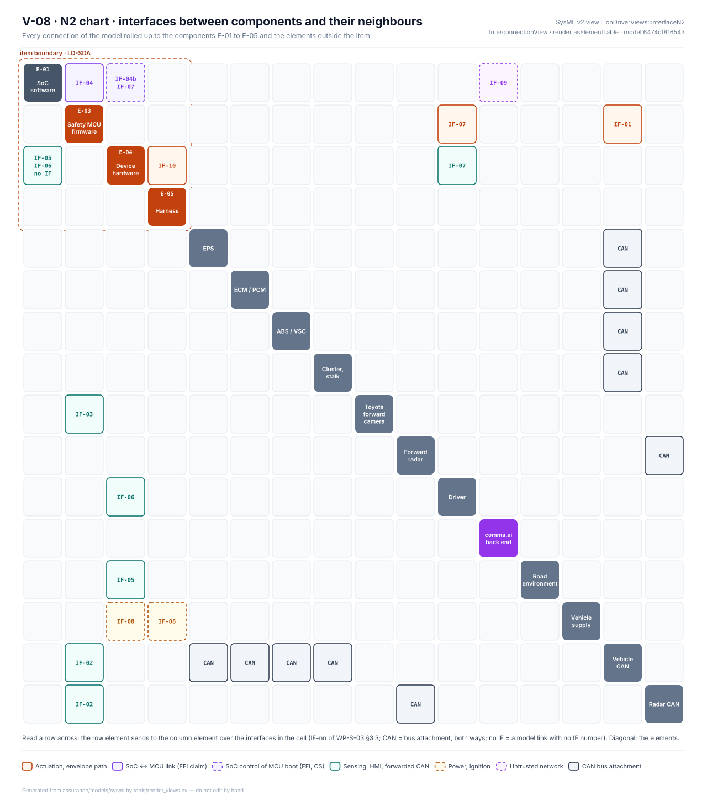

**V-09 Verification matrix (VCRM):** the SYS, TSR and CSR requirements by verification method, grouped as NASA analysis, inspection, demonstration and test, and by the level of their verification cases. One row per requirement: [`generated/vcrm.md`](generated/vcrm.md).


**V-10 Functional architecture:** the functions F-01 to F-09 along their chain (sense, perceive, plan, control, command path, safety envelope, act or inform), each step on the element that performs it. The decomposition is new in the model and AI-drafted (I0).

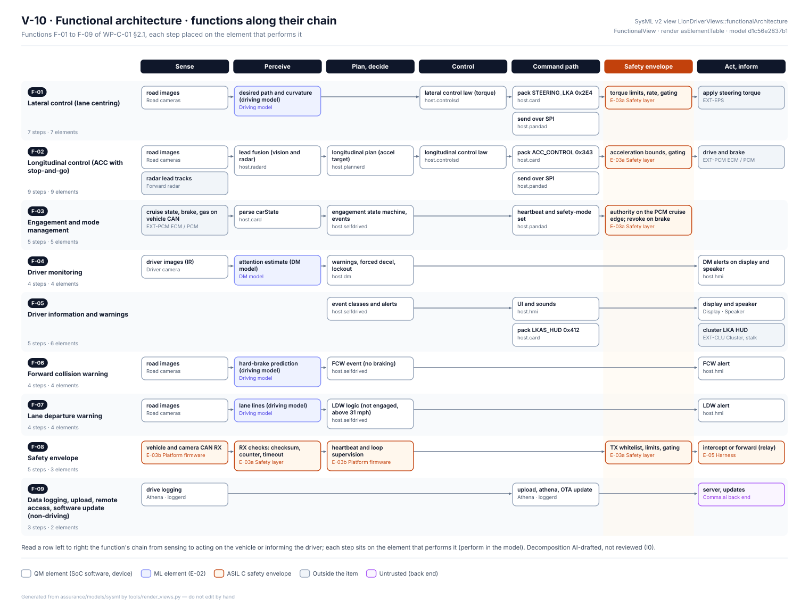

**V-11 Security zones and trust boundaries:** the zones of WP-S-07 §3.1 by trust level with the model elements in them, and the boundaries of §3.2 with what crosses them, their threats and the number of controlling CSRs.

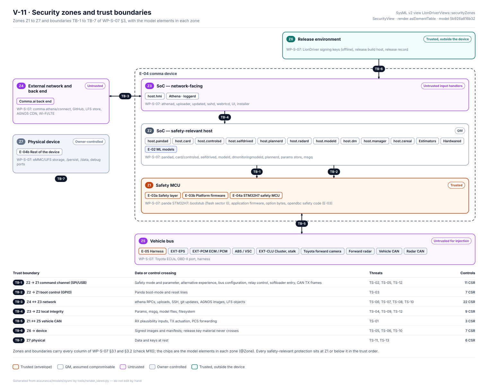

**V-12 System integration build-up:** the steps I-1 to I-4 of WP-S-08 §3.1 as a staircase, each with the elements it adds, the interfaces it exercises and the VS-SI cases that run at it.

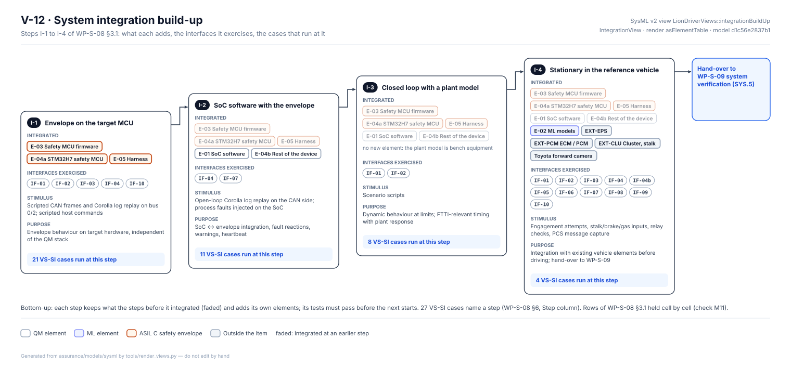

**V-13 System modes:** the operating modes of WP-C-01 §4 as a state machine; every transition names the record transitions it stands for and is coloured by who enforces it.

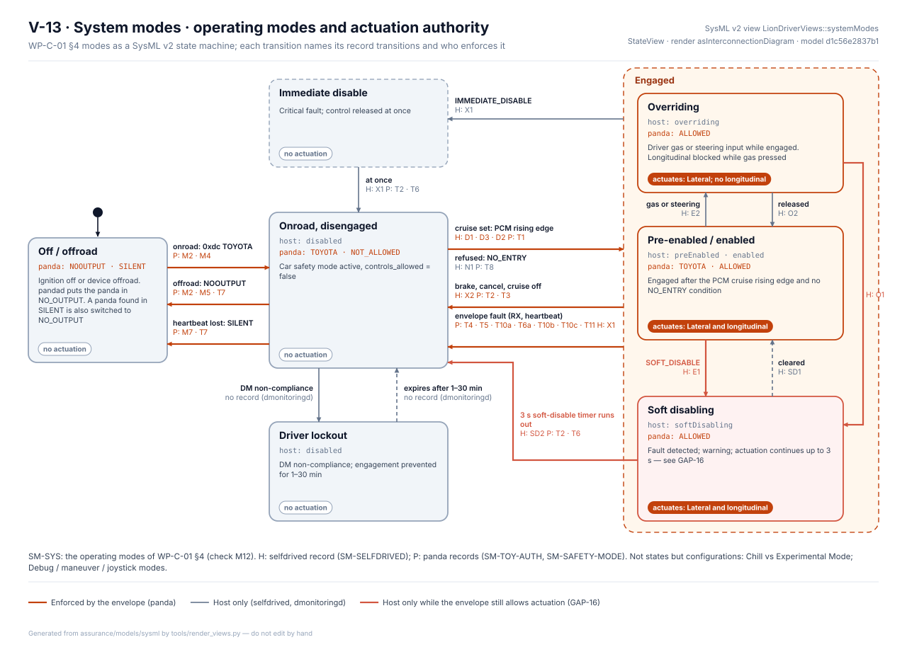

**V-16 State-machine records:** the three records of WP-W-05 §5 as modelled, one row per record transition with its trigger and guard, source and target states, status and SWSRs. Of 44 record transitions, 7 are not implemented (all in SM-TOY-AUTH: ways of taking authority away that the code does not have yet) and 5 are implemented with a gap the record names.

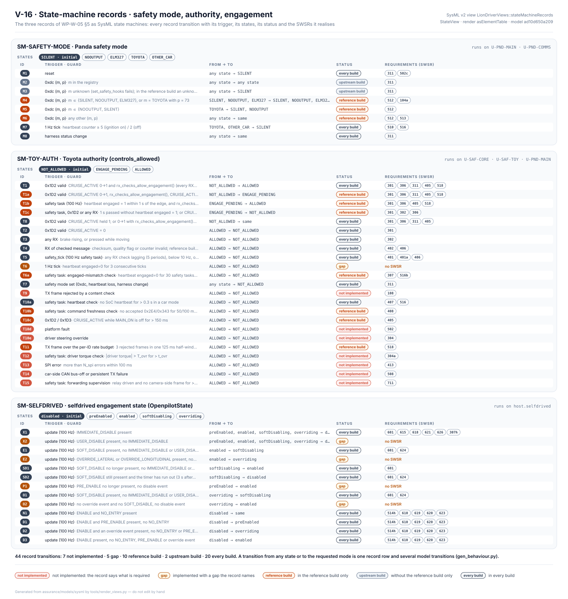

**V-17 Start-up and engagement sequence:** WP-S-03 §4.1 from ignition on to engaged actuation, now WP-S-03 Figure 4-1. Each lifeline is an element; each step carries its condition, the state it leads to, its status and the record transitions it stands for.


**V-18 Timing budgets:** the 17 budgets of WP-S-04 §3.7 on one time axis, each with its safety goals, its TSRs and the elements those TSRs are allocated to. Seven are plain times and add up (H2); ten have a cell that is not one time.


**V-19 HSI signals:** the 29 signals of WP-S-05 §11 by interface, with their owner elements, whether the signal carries a checksum and a liveness indication of its own, the ASIL, TSRs and test cases. Eleven carry no checksum, CRC or XOR; 22 no counter, alive check or supervision.

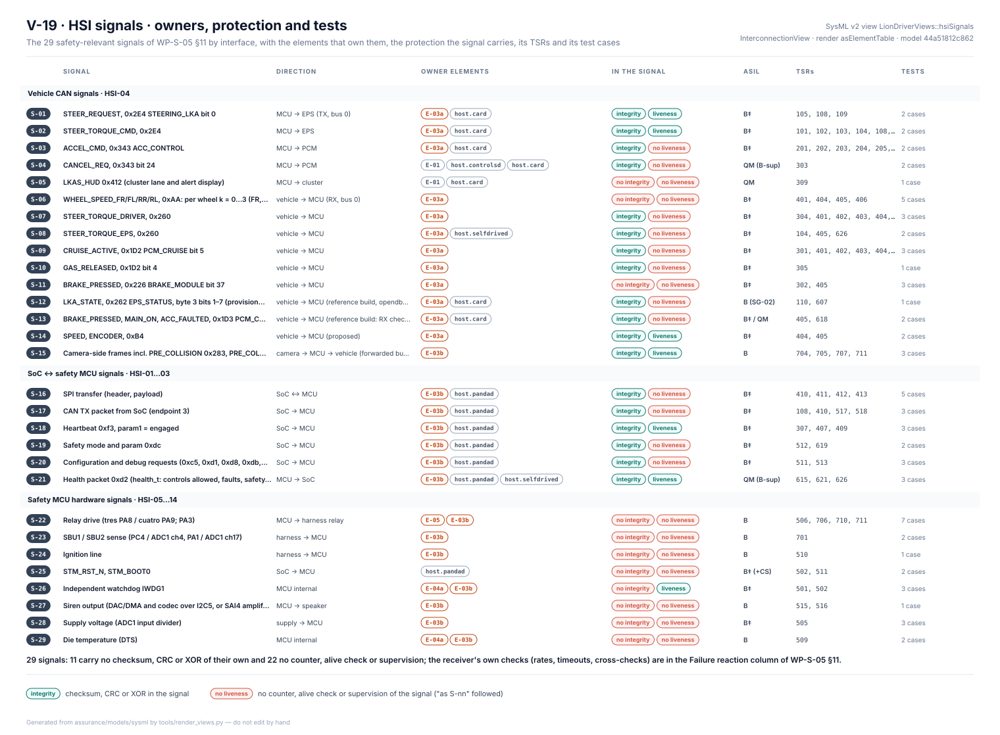

### 6.1 Requirements coverage

[`generated/requirements-coverage.md`](generated/requirements-coverage.md) is read from the model on every build. At this baseline: all 39 SYS requirements are satisfied and 25 are verified by a case; 96 of 118 TSRs are satisfied inside the item and the other 22 are allocated to EXT or OPS; 89 TSRs are verified by a case; no test specification names a CSR yet. "Verified" means a case is specified, not that it has passed: execution results are not in the model.

## 7. Changing the model

1. Change the work product and the `.sysml` file in the same pull request. For the four architecture tables, change the cell in both places (T1 says which cells differ); once `record.toml` says `model`, change the model and run `gen_tables.py --write`.
2. Run the commands of §4; regenerate with `check_model.py --write`, `render_views.py` and `explorer.py`.
3. For a new construct the reader refuses, extend `sysml_lite.py` and its tests; the pilot decides whether the construct is valid SysML v2.

Keep to SysML v2 words for names: `item`, `view`, `via`, `state`, `flow` and similar are keywords and fail the pilot parse.

## 8. Open items

| ID | Item |
|---|---|
| OI-1 | Model the hardware parts of WP-H-02 (RAMECC, PVD, CSS, relay driver, codec, transceivers) so that HWSR allocations resolve |
| OI-2 | Model the firmware interfaces SI-01 to SI-16 of WP-W-03 §3.3 and add a firmware interconnection view |
| OI-3 | **Closed 2026-10-26:** the operating modes (SM-SYS, V-13), the three state-machine records (V-16, B1) and the start-up sequence of WP-S-03 §4.1 (V-17) are in the model; SM-SYS now cites record transitions that are model elements (M12). The other sequences of WP-S-03 §4 (override, heartbeat chain) are not modelled yet |
| OI-4 | **Closed 2026-10-14:** SG, FSR, TSR, SYS and CSR are in the model with `satisfy` and `verify` relationships (R1–R4). SWSR and HWSR are not yet requirement elements; they follow with OI-1 (hardware parts) and the firmware interfaces of OI-2 |
| OI-9 | Add verification cases for the cybersecurity requirements (no test specification names a CSR) and for the 14 SYS requirements without a case (WP-S-09 OI-6); the coverage report lists them |
| OI-10 | MBSE extension: functions and functional chains (V-10), security zones (V-11), integration build-up (V-12), system modes (V-13), state-machine records and the start-up sequence (V-16, V-17), timing budgets and HSI signals (V-18, V-19), and stakeholder needs and use cases with the end-to-end thread (V-14, V-15) are in. Still to do: the override and heartbeat sequences of WP-S-03 §4; a link from each signal to the model interface (IF-nn) it travels on; a review of the function decomposition, the stakeholder needs and the use cases (all AI-drafted) |
| OI-5 | Finish SY-05: after the review of OI-8, set `record.toml` to `model` and run `gen_tables.py --write` |
| OI-6 | Carry out SY-06 figure by figure: close the gaps of §2.1, then swap the figure for its view |
| OI-7 | State in WP-C-01 §3.4 and WP-S-03 §3.3 that IF-05, IF-06 and IF-07 cover the path from the environment or driver to E-01/E-02 |
| OI-8 | Review the model (I1) and classify TL-26 and TL-27 in a confirmation review |
