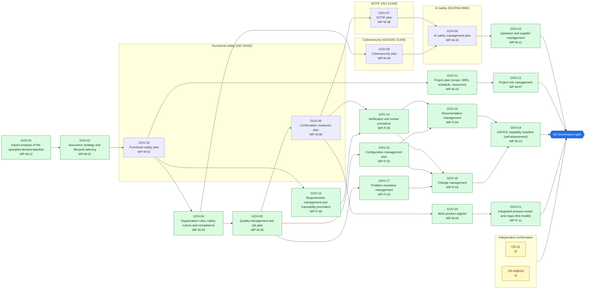
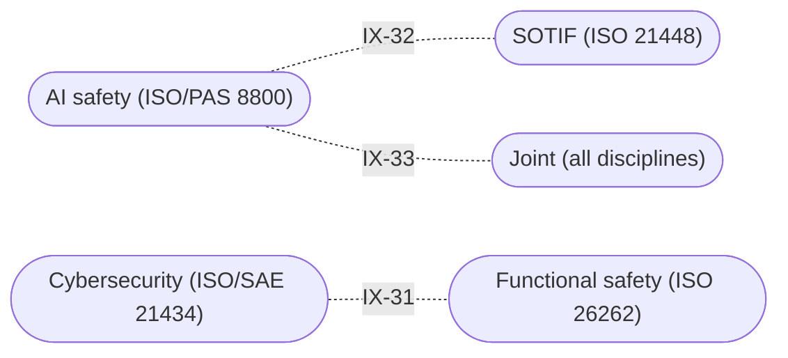

<!-- GENERATED by assurance/process/tools/process_model.py from assurance/process/model/. Do not edit; edit the model and re-run. -->

# G0 Governance: integrated process map (L1)

Back to the [lifecycle map](lifecycle.md). Model: [`model/`](../model/), method: [process README](../README.md).

## 1. Swimlane map

One box per discipline; green activities are joint work of all disciplines and sit outside the boxes. Arrows are work-product inputs: an activity cannot finish before its inputs exist. An arrow implied by a longer path is left out; §2 lists every input. Iteration between disciplines is shown in the interface map (§1.1), not here.

### 1.1 Interface map

Where one discipline's analysis depends on another's. Each edge lists the interfaces of §3 between two lanes; OPEN marks one that a recorded open item still has to settle.

## 2. Activities

Clause references and status are read from the [register (WP-M-00)](../../01-management/WP-M-00-work-product-register.md) row of each work product the activity produces or, for a living work product, updates (marked *update*).

| Activity | Lane | Produces | Inputs | ISO 26262 | ISO 21448 | ISO/SAE 21434 | Other | ASPICE | Handbook WP | Status |
|---|---|---|---|---|---|---|---|---|---|---|
| GOV-01 Impact analysis of the openpilot-derived baseline | Joint (all disciplines) | [WP-M-12](../../01-management/WP-M-12-impact-analysis.md) |  | 2 §6 (impact analysis), 8 §8 |  | §6 (reuse analysis) |  | SUP.10 |  | Draft |
| GOV-02 Assurance strategy and lifecycle tailoring | Joint (all disciplines) | [WP-M-01](../../01-management/WP-M-01-assurance-strategy.md) | WP-M-12 | 2 §6 (tailoring) | §4 | §6 | PAS 8800 (AI safety management), UL 4600 §5 | MAN.3 |  | Draft |
| GOV-03 Functional safety plan | Functional safety (ISO 26262) | [WP-M-02](../../01-management/WP-M-02-safety-plan.md) | WP-M-01 | 2 §6 |  |  |  | MAN.3 |  | Draft |
| GOV-04 Organization rules, safety culture and competence | Joint (all disciplines) | [WP-M-04](../../01-management/WP-M-04-organization-competence-safety-culture.md) | WP-M-02 | 2 §5 |  | §5 |  |  |  | Draft |
| GOV-05 Quality management and QA plan | Joint (all disciplines) | [WP-M-05](../../01-management/WP-M-05-quality-assurance-plan.md) | WP-M-02, WP-M-04 | 2 §5 (QMS) |  | §5 | IATF 16949 (informative) | SUP.1 |  | Draft |
| GOV-06 Confirmation measures plan | Functional safety (ISO 26262) | [WP-M-06](../../01-management/WP-M-06-confirmation-measures-plan.md) | WP-M-01, WP-M-02, WP-M-05 | 2 §6 Table 1 | §4 | §6 (assessment) |  |  |  | Draft |
| GOV-07 SOTIF plan | SOTIF (ISO 21448) | [WP-M-08](../../01-management/WP-M-08-sotif-plan.md) | WP-M-01, WP-M-02, WP-M-06 |  | §4, Clause 5–13 activities |  |  | MAN.3 |  | Draft |
| GOV-08 Cybersecurity plan | Cybersecurity (ISO/SAE 21434) | [WP-M-09](../../01-management/WP-M-09-cybersecurity-plan.md) | WP-M-01, WP-M-04, WP-M-12 |  |  | §6 |  | MAN.7 (CS) |  | Draft |
| GOV-09 AI safety management plan | AI safety (ISO/PAS 8800) | [WP-M-10](../../01-management/WP-M-10-ai-safety-plan.md) | WP-M-01, WP-M-08, WP-M-09, WP-M-12 |  |  |  | PAS 8800 (AI safety management, assurance argument) | MLE.1–4, SUP.11 |  | Draft |
| GOV-10 Upstream and supplier management | Joint (all disciplines) | [WP-M-11](../../01-management/WP-M-11-upstream-and-supplier-management.md) | WP-M-01, WP-M-09, WP-M-10, WP-M-12 | 8 §5 |  | §7 |  | ACQ.4 |  | Draft |
| GOV-11 Project plan (scope, WBS, schedule, resources) | Joint (all disciplines) | [WP-M-03](../../01-management/WP-M-03-project-plan.md) | WP-M-01, WP-M-02 |  |  |  |  | MAN.3 |  | Draft |
| GOV-12 Project risk management | Joint (all disciplines) | [WP-M-07](../../01-management/WP-M-07-risk-management.md) | WP-M-01, WP-M-03 |  |  |  |  | MAN.5 |  | Draft |
| GOV-13 Requirements management and traceability procedure | Joint (all disciplines) | [WP-P-06](../../07-supporting/WP-P-06-requirements-management-traceability.md) | WP-M-02 | 8 §6 |  |  |  | SYS.2, SWE.1 (traceability BPs) |  | Draft |
| GOV-14 Verification and review procedure | Joint (all disciplines) | [WP-P-05](../../07-supporting/WP-P-05-verification-review-procedure.md) | WP-M-06, WP-P-06 | 8 §9 |  |  |  | SUP.2 (informative) |  | Draft |
| GOV-15 Configuration management plan | Joint (all disciplines) | [WP-P-01](../../07-supporting/WP-P-01-configuration-management-plan.md) | WP-M-01, WP-M-05 | 8 §7 |  | §5 |  | SUP.8 |  | Draft |
| GOV-16 Documentation management | Joint (all disciplines) | [WP-P-04](../../07-supporting/WP-P-04-documentation-management.md) | WP-P-01, WP-P-05 | 8 §10 |  | §5 |  | SUP.7 (informative) |  | Draft |
| GOV-17 Problem resolution management | Joint (all disciplines) | [WP-P-03](../../07-supporting/WP-P-03-problem-resolution.md) | WP-M-02, WP-M-05 | 2 §5 (anomaly handling) | §13 | §8 |  | SUP.9 |  | Draft |
| GOV-18 Change management | Joint (all disciplines) | [WP-P-02](../../07-supporting/WP-P-02-change-management.md) | WP-P-01, WP-P-03, WP-P-05 | 8 §8 |  | §6 |  | SUP.10 |  | Draft |
| GOV-19 ASPICE capability baseline (self-assessment) | Joint (all disciplines) | [WP-M-13](../../01-management/WP-M-13-aspice-capability-baseline.md) | WP-M-01, WP-M-05, WP-P-01, WP-P-02, WP-P-03, WP-P-04, WP-P-05, WP-P-06 |  |  |  |  | All in scope |  | Draft |
| GOV-20 Work product register | Joint (all disciplines) | [WP-M-00](../../01-management/WP-M-00-work-product-register.md) | WP-M-01, WP-M-02, WP-M-06 | 2 §6 |  |  |  | MAN.3 |  | Draft |
| GOV-21 Integrated process model and maps (this model) | Joint (all disciplines) | [WP-P-11](../../process/README.md) | WP-M-00, WP-M-02, WP-M-06 | 2 §6 | §4 | §6 | PAS 8800 (AI safety lifecycle) | MAN.3 |  | Draft |

## 3. Cross-domain interfaces

Each interface is anchored to text in the work products; the checker fails if an anchor disappears. *Documented* means the documents reference each other but nobody has reviewed the agreement yet. An interface is *agreed* only when an accepted review record of both owners lists its IFR item in [`trace/items/ifr.yaml`](../../trace/items/ifr.yaml) (DQ-129 A). Agreed in the whole model: 0 of 33.

| ID | IFR | Pattern | Between | Topic | Status | Open item | Due |
|---|---|---|---|---|---|---|---|
| IX-31 | IFR-31 | Safety-Security | [WP-M-02](../../01-management/WP-M-02-safety-plan.md), [WP-M-09](../../01-management/WP-M-09-cybersecurity-plan.md) (Functional safety / Cybersecurity) | The cybersecurity manager carries the interface to safety on safety-relevant threats; the G1 cybersecurity review is combined with the FuSa confirmation review where one assessor has both competences | Documented | — | G0 |
| IX-32 | IFR-32 | SOTIF-AI | [WP-M-08](../../01-management/WP-M-08-sotif-plan.md), [WP-M-10](../../01-management/WP-M-10-ai-safety-plan.md) (SOTIF / AI safety) | The AI safety lead supplies model-related insufficiencies to the SOTIF lead, who records them in the SOTIF analysis | Documented | — | G0 |
| IX-33 | IFR-33 | Supplier-AI | [WP-M-10](../../01-management/WP-M-10-ai-safety-plan.md), [WP-M-11](../../01-management/WP-M-11-upstream-and-supplier-management.md) (AI safety / Joint) | The ML models are supplier artefacts of comma.ai; what comma.ai publishes about their training data and evaluation is recorded in upstream management (no model card, dataset description or evaluation report exists) and bounds the AI plan's claims | Documented | — | G0 |

## 4. Clause coverage by standard

Which activity answers each clause reference listed in the register. One activity can answer several standards; that is the point of the integrated lifecycle.

- **ISO 26262:** 2 §6 (impact analysis), 8 §8 → GOV-01; 2 §6 (tailoring) → GOV-02; 2 §6 → GOV-03, GOV-20, GOV-21; 2 §5 → GOV-04; 2 §5 (QMS) → GOV-05; 2 §6 Table 1 → GOV-06; 8 §5 → GOV-10; 8 §6 → GOV-13; 8 §9 → GOV-14; 8 §7 → GOV-15; 8 §10 → GOV-16; 2 §5 (anomaly handling) → GOV-17; 8 §8 → GOV-18
- **ISO 21448:** §4 → GOV-02, GOV-06, GOV-21; §4, Clause 5–13 activities → GOV-07; §13 → GOV-17
- **ISO/SAE 21434:** §6 (reuse analysis) → GOV-01; §6 → GOV-02, GOV-08, GOV-18, GOV-21; §5 → GOV-04, GOV-05, GOV-15, GOV-16; §6 (assessment) → GOV-06; §7 → GOV-10; §8 → GOV-17
- **Other:** PAS 8800 (AI safety management), UL 4600 §5 → GOV-02; IATF 16949 (informative) → GOV-05; PAS 8800 (AI safety management, assurance argument) → GOV-09; PAS 8800 (AI safety lifecycle) → GOV-21
- **ASPICE:** SUP.10 → GOV-01, GOV-18; MAN.3 → GOV-02, GOV-03, GOV-07, GOV-11, GOV-20, GOV-21; SUP.1 → GOV-05; MAN.7 (CS) → GOV-08; MLE.1–4, SUP.11 → GOV-09; ACQ.4 → GOV-10; MAN.5 → GOV-12; SYS.2, SWE.1 (traceability BPs) → GOV-13; SUP.2 (informative) → GOV-14; SUP.8 → GOV-15; SUP.7 (informative) → GOV-16; SUP.9 → GOV-17; All in scope → GOV-19

## 5. G0 readiness

**Exit criterion (WP-M-00 §2):** Plans approved; roles assigned; CM and change control running

**Work products:** 21 Draft of 21. Approval needs the verification review of [WP-P-05](../../07-supporting/WP-P-05-verification-review-procedure.md).

**Roles the lanes need (WP-M-02 §3.1):**

| Lane | Role | Assigned to | Needed by |
|---|---|---|---|
| Joint (all disciplines) | Safety manager | Jherrod Thomas (acting) | G0 |
| Functional safety (ISO 26262) | Safety manager | Jherrod Thomas (acting) | G0 |
| SOTIF (ISO 21448) | SOTIF lead | Jherrod Thomas (acting); permanent holder TBD | G1 |
| AI safety (ISO/PAS 8800) | AI/ML safety lead | Jherrod Thomas (acting); permanent holder TBD | G1 |
| Cybersecurity (ISO/SAE 21434) | Cybersecurity manager | Jherrod Thomas (acting); permanent holder TBD | G1 |
| Independent confirmation | External functional safety assessor | TBD (D-06) | G1 |

**Other roles WP-M-02 §3.1 needs by G0:** Project maintainer (Jherrod Thomas); Configuration and change manager (Jherrod Thomas (acting)); Verification reviewer(s) (TBD (at least one person other than the author)); Quality assurance (TBD (independent of the author)).

**Role records that disagree** (the readiness tables read WP-M-02 §3.1; a discipline plan records the same role differently): none.

**Confirmation measures (WP-M-06 §9):**

| Measure | Covers | Independence | Record |
|---|---|---|---|
| CR-01 Confirmation review of the impact analysis | WP-M-12 | I3 | Not performed |
| CR-03@G0 Confirmation review of the safety plan and tailoring | WP-M-02, WP-M-01, WP-M-06 | I3 | Not performed |

**Work products with no confirmation measure at this gate** (verification review only): WP-M-04, WP-M-05, WP-M-08, WP-M-09, WP-M-10, WP-M-11, WP-M-03, WP-M-07, WP-P-06, WP-P-05, WP-P-01, WP-P-04, WP-P-03, WP-P-02, WP-M-13, WP-M-00, WP-P-11.

**Open interfaces due by this gate** (from this or an earlier phase): none.

**Interfaces due by this gate that are not agreed** (no accepted review of their IFR item, DQ-129 A): 3 of 3: IFR-31, IFR-32, IFR-33.
