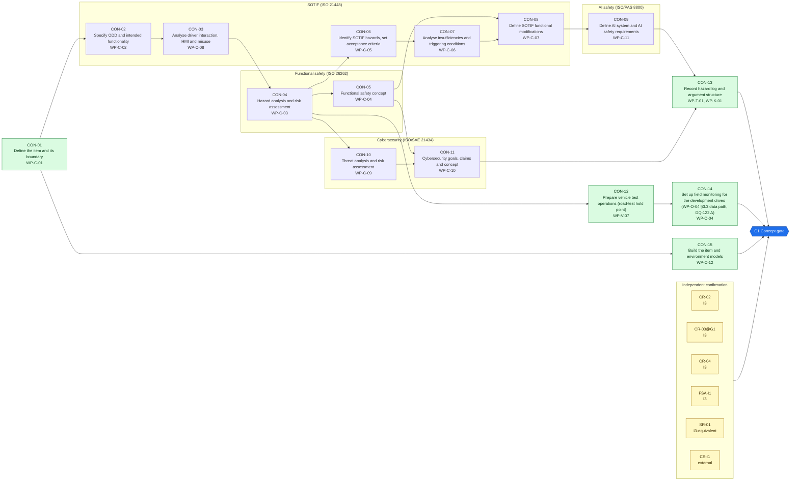
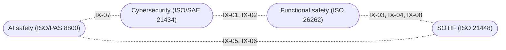

<!-- GENERATED by assurance/process/tools/process_model.py from assurance/process/model/. Do not edit; edit the model and re-run. -->

# G1 Concept: integrated process map (L1)

Back to the [lifecycle map](lifecycle.md). Model: [`model/`](../model/), method: [process README](../README.md).

## 1. Swimlane map

One box per discipline; green activities are joint work of all disciplines and sit outside the boxes. Arrows are work-product inputs: an activity cannot finish before its inputs exist. An arrow implied by a longer path is left out; §2 lists every input. Iteration between disciplines is shown in the interface map (§1.1), not here.

### 1.1 Interface map

Where one discipline's analysis depends on another's. Each edge lists the interfaces of §3 between two lanes; OPEN marks one that a recorded open item still has to settle.

## 2. Activities

Clause references and status are read from the [register (WP-M-00)](../../01-management/WP-M-00-work-product-register.md) row of each work product the activity produces or, for a living work product, updates (marked *update*).

| Activity | Lane | Produces | Inputs | ISO 26262 | ISO 21448 | ISO/SAE 21434 | Other | ASPICE | Handbook WP | Status |
|---|---|---|---|---|---|---|---|---|---|---|
| CON-01 Define the item and its boundary | Joint (all disciplines) | [WP-C-01](../../02-concept/WP-C-01-item-definition.md) | WP-M-01, WP-M-12 | 3 §5 | §5 (functionality, system) | §9.3 |  | SYS.1 | WP-1 | Draft |
| CON-02 Specify ODD and intended functionality | SOTIF (ISO 21448) | [WP-C-02](../../02-concept/WP-C-02-odd-and-intended-functionality.md) | WP-C-01 | 3 §5 | §5 |  | PAS 8800 (input space definition) | SYS.1 | WP-1 | Draft |
| CON-03 Analyse driver interaction, HMI and misuse | SOTIF (ISO 21448) | [WP-C-08](../../02-concept/WP-C-08-driver-hmi-misuse-analysis.md) | WP-C-01, WP-C-02 | 3 §6 (controllability) | §6, Annex B |  |  |  | WP-2 | Draft |
| CON-04 Hazard analysis and risk assessment | Functional safety (ISO 26262) | [WP-C-03](../../02-concept/WP-C-03-hara.md) | WP-C-01, WP-C-02, WP-C-08 | 3 §6 |  |  |  |  | WP-2 | Draft |
| CON-05 Functional safety concept | Functional safety (ISO 26262) | [WP-C-04](../../02-concept/WP-C-04-functional-safety-concept.md) | WP-C-01, WP-C-03, WP-C-08 | 3 §7 |  |  |  | SYS.2 | WP-3 | Draft |
| CON-06 Identify SOTIF hazards, set acceptance criteria | SOTIF (ISO 21448) | [WP-C-05](../../02-concept/WP-C-05-sotif-hazard-identification.md) | WP-C-02, WP-C-03, WP-C-08 |  | §6 |  |  |  | WP-2 | Draft |
| CON-07 Analyse insufficiencies and triggering conditions | SOTIF (ISO 21448) | [WP-C-06](../../02-concept/WP-C-06-sotif-insufficiencies-triggering-conditions.md) | WP-C-02, WP-C-05 |  | §7 |  | PAS 8800 (AI error causes) |  | WP-2 | Draft |
| CON-08 Define SOTIF functional modifications | SOTIF (ISO 21448) | [WP-C-07](../../02-concept/WP-C-07-sotif-functional-modifications.md) | WP-C-04, WP-C-06 |  | §8 |  |  | SYS.2 | WP-3 | Draft |
| CON-09 Define AI system and AI safety requirements | AI safety (ISO/PAS 8800) | [WP-C-11](../../02-concept/WP-C-11-ai-system-definition-and-safety-requirements.md) | WP-C-02, WP-C-04, WP-C-06, WP-C-07, WP-C-08 |  | §7 |  | PAS 8800 (AI safety requirements) | MLE.1 | WP-1, WP-4 | Draft |
| CON-10 Threat analysis and risk assessment | Cybersecurity (ISO/SAE 21434) | [WP-C-09](../../02-concept/WP-C-09-tara.md) | WP-C-01, WP-C-03 |  |  | §15, §9.4 | UN R155 Annex 5 (informative) | SEC.1 | WP-2 | Draft |
| CON-11 Cybersecurity goals, claims and concept | Cybersecurity (ISO/SAE 21434) | [WP-C-10](../../02-concept/WP-C-10-cybersecurity-goals-and-concept.md) | WP-C-01, WP-C-04, WP-C-09 |  |  | §9.4, §9.5 |  | SEC.1 | WP-3 | Draft |
| CON-12 Prepare vehicle test operations (road-test hold point) | Joint (all disciplines) | [WP-V-07](../../06-validation/WP-V-07-vehicle-test-operations.md) | WP-C-02, WP-C-03, WP-C-08 | 4 §8 | §10–11 |  | SAE J3018 (informative) | VAL.1 | WP-6 | Draft |
| CON-13 Record hazard log and argument structure | Joint (all disciplines) | [WP-T-01](../../trace/README.md), [WP-K-01](../../10-safety-case/WP-K-01-safety-case.md) | WP-C-03, WP-C-04, WP-C-05, WP-C-10, WP-C-11 | 8 §6; 2 §6 | §12 | §10 | UL 4600, PAS 8800 (assurance argument) | 13-51 consistency evidence (SYS.2–5, SWE.1–6) | WP-7 | Draft |
| CON-14 Set up field monitoring for the development drives (WP-O-04 §3.3 data path, DQ-122 A) | Joint (all disciplines) | [WP-O-04](../../09-production-operation/WP-O-04-field-monitoring.md) | WP-V-07, WP-C-02 | 2 §7 | §13 | §8 | PAS 8800 (operation phase), NHTSA SGO (US) |  | WP-8 | Draft |
| CON-15 Build the item and environment models | Joint (all disciplines) | [WP-C-12](../../02-concept/WP-C-12-item-and-environment-models.md) | WP-C-01 | 3 §5 | §5 (system, environment) |  |  | SYS.1 | WP-1 | Draft |

## 3. Cross-domain interfaces

Each interface is anchored to text in the work products; the checker fails if an anchor disappears. *Documented* means the documents reference each other but nobody has reviewed the agreement yet. An interface is *agreed* only when an accepted review record of both owners lists its IFR item in [`trace/items/ifr.yaml`](../../trace/items/ifr.yaml) (DQ-129 A). Agreed in the whole model: 0 of 33.

| ID | IFR | Pattern | Between | Topic | Status | Open item | Due |
|---|---|---|---|---|---|---|---|
| IX-01 | IFR-01 | Safety-Security | [WP-C-03](../../02-concept/WP-C-03-hara.md), [WP-C-09](../../02-concept/WP-C-09-tara.md) (Functional safety / Cybersecurity) | Cyber-induced effects map onto the HARA hazards; TARA safety impact is rated against those hazards and their ASILs | Documented | — | G1 |
| IX-02 | IFR-02 | Safety-Security | [WP-C-04](../../02-concept/WP-C-04-functional-safety-concept.md), [WP-C-10](../../02-concept/WP-C-10-cybersecurity-goals-and-concept.md) (Functional safety / Cybersecurity) | Cybersecurity goals protect the safety goals; the SG to CSG mapping was checked against the FSC allocation and corrected (WP-C-10 OI-6 closed), and the FSC now points back to it | Documented | — | G1 |
| IX-03 | IFR-03 | Safety-SOTIF | [WP-C-03](../../02-concept/WP-C-03-hara.md), [WP-C-05](../../02-concept/WP-C-05-sotif-hazard-identification.md) (Functional safety / SOTIF) | One hazard log: each HARA hazard cross-references the SOTIF hazards that can cause the same vehicle-level effect | Documented | — | G1 |
| IX-04 | IFR-04 | Safety-SOTIF | [WP-C-04](../../02-concept/WP-C-04-functional-safety-concept.md), [WP-C-08](../../02-concept/WP-C-08-driver-hmi-misuse-analysis.md) (Functional safety / SOTIF) | Driver monitoring carries no ASIL and is managed as a SOTIF misuse measure, while the C2 controllability ratings assume a supervising driver (AOU-06R) | Documented | — | G1 |
| IX-05 | IFR-05 | SOTIF-AI | [WP-C-08](../../02-concept/WP-C-08-driver-hmi-misuse-analysis.md), [WP-C-11](../../02-concept/WP-C-11-ai-system-definition-and-safety-requirements.md) (SOTIF / AI safety) | Driver-monitoring performance targets (DMP-01/02) are AI safety requirements AIR-07/08; their values are confirmed, with the end-to-end alert time set at 6 s, and validated under VT-08 | Documented | — | G2 |
| IX-06 | IFR-06 | SOTIF-AI | [WP-C-02](../../02-concept/WP-C-02-odd-and-intended-functionality.md), [WP-C-11](../../02-concept/WP-C-11-ai-system-definition-and-safety-requirements.md) (SOTIF / AI safety) | The driving model's training-data ODD is unpublished, so by the maintainer's decision it is not compared with the reference ODD. WP-C-02 §3.3: a stratum is claimed only where LionDriver evaluation data covers it and meets AIR-09 (DSR-03/04/05); AIR-14 is the runtime backstop; the residual stays as defeater DF-20 | Documented | — | G2 |
| IX-07 | IFR-07 | Security-AI | [WP-C-11](../../02-concept/WP-C-11-ai-system-definition-and-safety-requirements.md), [WP-C-09](../../02-concept/WP-C-09-tara.md) (AI safety / Cybersecurity) | Model artefacts load through pickle without a hash or signature: AI integrity requirements AIR-19/AIR-20 and threat scenario TS-09 address the same weakness (GAP-22) | Documented | — | G1 |
| IX-08 | IFR-08 | Safety-SOTIF | [WP-C-04](../../02-concept/WP-C-04-functional-safety-concept.md), [WP-C-07](../../02-concept/WP-C-07-sotif-functional-modifications.md) (Functional safety / SOTIF) | The FSC transition rule (untrusted command to immediate safe state, otherwise soft disable) is implemented by functional modification FM-03 | Documented | — | G1 |

## 4. Clause coverage by standard

Which activity answers each clause reference listed in the register. One activity can answer several standards; that is the point of the integrated lifecycle.

- **ISO 26262:** 3 §5 → CON-01, CON-02, CON-15; 3 §6 (controllability) → CON-03; 3 §6 → CON-04; 3 §7 → CON-05; 4 §8 → CON-12; 8 §6 → CON-13; 2 §6 → CON-13; 2 §7 → CON-14
- **ISO 21448:** §5 (functionality, system) → CON-01; §5 → CON-02; §6, Annex B → CON-03; §6 → CON-06; §7 → CON-07, CON-09; §8 → CON-08; §10–11 → CON-12; §12 → CON-13; §13 → CON-14; §5 (system, environment) → CON-15
- **ISO/SAE 21434:** §9.3 → CON-01; §15, §9.4 → CON-10; §9.4, §9.5 → CON-11; §10 → CON-13; §8 → CON-14
- **Other:** PAS 8800 (input space definition) → CON-02; PAS 8800 (AI error causes) → CON-07; PAS 8800 (AI safety requirements) → CON-09; UN R155 Annex 5 (informative) → CON-10; SAE J3018 (informative) → CON-12; UL 4600, PAS 8800 (assurance argument) → CON-13; PAS 8800 (operation phase), NHTSA SGO (US) → CON-14
- **ASPICE:** SYS.1 → CON-01, CON-02, CON-15; SYS.2 → CON-05, CON-08; MLE.1 → CON-09; SEC.1 → CON-10, CON-11; VAL.1 → CON-12; 13-51 consistency evidence (SYS.2–5, SWE.1–6) → CON-13

## 5. G1 readiness

**Exit criterion (WP-M-00 §2):** Item definition, HARA, FSC, SOTIF hazard and insufficiency analysis, TARA and CS concept approved; confirmation review of HARA (I3) passed

**Work products:** 16 Draft of 16. Approval needs the verification review of [WP-P-05](../../07-supporting/WP-P-05-verification-review-procedure.md).

**Roles the lanes need (WP-M-02 §3.1):**

| Lane | Role | Assigned to | Needed by |
|---|---|---|---|
| Joint (all disciplines) | Safety manager | Jherrod Thomas (acting) | G0 |
| Functional safety (ISO 26262) | Safety manager | Jherrod Thomas (acting) | G0 |
| SOTIF (ISO 21448) | SOTIF lead | Jherrod Thomas (acting); permanent holder TBD | G1 |
| AI safety (ISO/PAS 8800) | AI/ML safety lead | Jherrod Thomas (acting); permanent holder TBD | G1 |
| Cybersecurity (ISO/SAE 21434) | Cybersecurity manager | Jherrod Thomas (acting); permanent holder TBD | G1 |
| Independent confirmation | External functional safety assessor | TBD (D-06) | G1 |

**Other roles WP-M-02 §3.1 needs by G1:** Verification reviewer(s) (TBD (at least one person other than the author); needed by G0, still unassigned); Quality assurance (TBD (independent of the author); needed by G0, still unassigned); Test / safety driver(s) (TBD (trained per WP-M-04)).

**Confirmation measures (WP-M-06 §9):**

| Measure | Covers | Independence | Record |
|---|---|---|---|
| CR-02 Confirmation review of the HARA | WP-C-03, WP-C-01, WP-C-08 | I3 | Not performed |
| CR-03@G1 Confirmation review of the safety plan (re-confirm after HARA) | WP-M-02, WP-M-01, WP-M-06 | I3 | Not performed |
| CR-04 Confirmation review of the functional safety concept | WP-C-04 | I3 | Not performed |
| FSA-I1 Interim functional safety assessment | WP-C-01, WP-C-03, WP-C-04 | I3 | Not performed |
| SR-01 Review of SOTIF hazard identification and acceptance criteria | WP-C-05, WP-C-06, WP-C-08 | I3-equivalent | Not performed |
| CS-I1 Interim cybersecurity review (TARA, goals, links to safety goals) | WP-C-09, WP-C-10 | external | Not performed |

**Work products with no confirmation measure at this gate** (verification review only): WP-C-02, WP-C-07, WP-C-11, WP-V-07, WP-T-01, WP-K-01, WP-O-04, WP-C-12.

**Open interfaces due by this gate** (from this or an earlier phase): none.

**Interfaces due by this gate that are not agreed** (no accepted review of their IFR item, DQ-129 A): 9 of 9: IFR-01, IFR-02, IFR-03, IFR-04, IFR-07, IFR-08, IFR-31, IFR-32, IFR-33.
