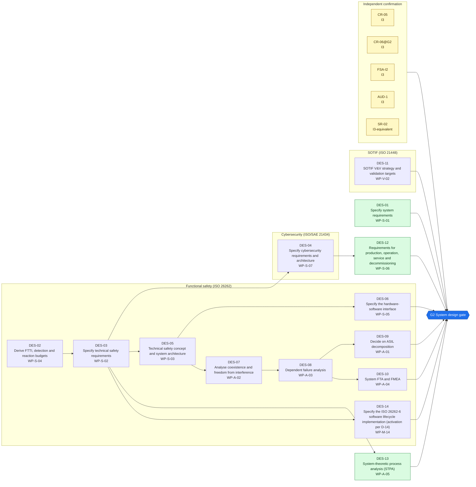
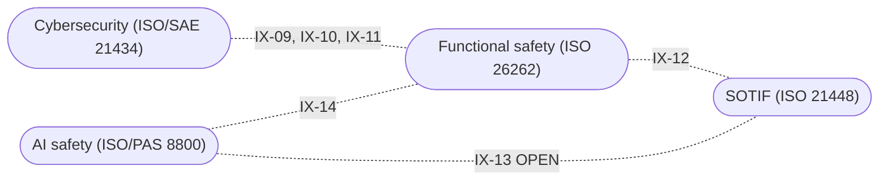

<!-- GENERATED by assurance/process/tools/process_model.py from assurance/process/model/. Do not edit; edit the model and re-run. -->

# G2 System design: integrated process map (L1)

Back to the [lifecycle map](lifecycle.md). Model: [`model/`](../model/), method: [process README](../README.md).

## 1. Swimlane map

One box per discipline; green activities are joint work of all disciplines and sit outside the boxes. Arrows are work-product inputs: an activity cannot finish before its inputs exist. An arrow implied by a longer path is left out; §2 lists every input. Iteration between disciplines is shown in the interface map (§1.1), not here.

### 1.1 Interface map

Where one discipline's analysis depends on another's. Each edge lists the interfaces of §3 between two lanes; OPEN marks one that a recorded open item still has to settle.

## 2. Activities

Clause references and status are read from the [register (WP-M-00)](../../01-management/WP-M-00-work-product-register.md) row of each work product the activity produces or, for a living work product, updates (marked *update*).

| Activity | Lane | Produces | Inputs | ISO 26262 | ISO 21448 | ISO/SAE 21434 | Other | ASPICE | Handbook WP | Status |
|---|---|---|---|---|---|---|---|---|---|---|
| DES-01 Specify system requirements | Joint (all disciplines) | [WP-S-01](../../03-system/WP-S-01-system-requirements.md) | WP-C-01, WP-C-02, WP-C-08 |  | §5 |  |  | SYS.2 | WP-4 | Draft |
| DES-02 Derive FTTI, detection and reaction budgets | Functional safety (ISO 26262) | [WP-S-04](../../03-system/WP-S-04-timing-ftti-budget.md) | WP-C-02, WP-C-03, WP-C-04, WP-C-08 | 4 §6 |  |  |  | SYS.3 | WP-5 | Draft |
| DES-03 Specify technical safety requirements | Functional safety (ISO 26262) | [WP-S-02](../../03-system/WP-S-02-technical-safety-requirements.md) | WP-C-04, WP-C-08, WP-S-04 | 4 §6 |  |  |  | SYS.2 | WP-4 | Draft |
| DES-04 Specify cybersecurity requirements and architecture | Cybersecurity (ISO/SAE 21434) | [WP-S-07](../../03-system/WP-S-07-cybersecurity-requirements-architecture.md) | WP-C-04, WP-C-09, WP-C-10, WP-S-02 |  |  | §10 |  | SEC.1, SYS.3 | WP-4, WP-5 | Draft |
| DES-05 Technical safety concept and system architecture | Functional safety (ISO 26262) | [WP-S-03](../../03-system/WP-S-03-technical-safety-concept-architecture.md) | WP-C-04, WP-S-02 | 4 §6 | §8 |  |  | SYS.3 | WP-5 | Draft |
| DES-06 Specify the hardware-software interface | Functional safety (ISO 26262) | [WP-S-05](../../03-system/WP-S-05-hsi-specification.md) | WP-C-01, WP-S-02, WP-S-03, WP-S-04 | 4 §6 |  |  |  | SYS.3 | WP-5 | Draft |
| DES-07 Analyse coexistence and freedom from interference | Functional safety (ISO 26262) | [WP-A-02](../../08-analyses/WP-A-02-coexistence-freedom-from-interference.md) | WP-C-04, WP-S-02, WP-S-03 | 9 §6 |  |  |  |  | WP-5 | Draft |
| DES-08 Dependent failure analysis | Functional safety (ISO 26262) | [WP-A-03](../../08-analyses/WP-A-03-dependent-failure-analysis.md) | WP-C-04, WP-S-02, WP-S-03, WP-A-02 | 9 §7 |  |  |  |  | WP-5 | Draft |
| DES-09 Decide on ASIL decomposition | Functional safety (ISO 26262) | [WP-A-01](../../08-analyses/WP-A-01-asil-decomposition.md) | WP-C-03, WP-C-04, WP-S-02, WP-A-02, WP-A-03 | 9 §5 |  |  |  |  | WP-3 | Draft |
| DES-10 System FTA and FMEA | Functional safety (ISO 26262) | [WP-A-04](../../08-analyses/WP-A-04-system-fta-fmea.md) | WP-C-01, WP-C-04, WP-C-06, WP-S-02, WP-A-02, WP-A-03 | 9 §8, 4 §6 | §7 |  |  |  | WP-2 | Draft |
| DES-11 SOTIF V&V strategy and validation targets | SOTIF (ISO 21448) | [WP-V-02](../../06-validation/WP-V-02-sotif-vv-strategy.md) | WP-C-02, WP-C-05, WP-C-06, WP-C-07, WP-C-11 |  | §9 |  | PAS 8800 (AI V&V) | VAL.1 | WP-6 | Draft |
| DES-12 Requirements for production, operation, service and decommissioning | Joint (all disciplines) | [WP-S-06](../../03-system/WP-S-06-requirements-production-operation.md) | WP-C-01, WP-S-02, WP-S-07 | 4 §6 | §13 | §10 |  | SYS.2 | WP-4 | Draft |
| DES-13 System-theoretic process analysis (STPA) | Joint (all disciplines) | [WP-A-05](../../08-analyses/WP-A-05-stpa.md) | WP-C-01, WP-C-03, WP-C-06, WP-C-08, WP-S-02 | 9 §8 (supplementary) | §6–§7 |  | STPA Handbook 2018; PAS 8800 |  | WP-2 | Draft |
| DES-14 Specify the ISO 26262-6 software lifecycle implementation (activation per D-14) | Functional safety (ISO 26262) | [WP-M-14](../../01-management/WP-M-14-iso26262-6-implementation-specification.md) | WP-M-01, WP-M-02, WP-S-02 | 6 §5–11, Annex C; 8 §6–12 |  |  |  | MAN.3, SWE.1–6 |  | Draft |

## 3. Cross-domain interfaces

Each interface is anchored to text in the work products; the checker fails if an anchor disappears. *Documented* means the documents reference each other but nobody has reviewed the agreement yet. An interface is *agreed* only when an accepted review record of both owners lists its IFR item in [`trace/items/ifr.yaml`](../../trace/items/ifr.yaml) (DQ-129 A). Agreed in the whole model: 0 of 33.

| ID | IFR | Pattern | Between | Topic | Status | Open item | Due |
|---|---|---|---|---|---|---|---|
| IX-09 | IFR-09 | Safety-Security | [WP-S-02](../../03-system/WP-S-02-technical-safety-requirements.md), [WP-S-07](../../03-system/WP-S-07-cybersecurity-requirements-architecture.md) (Functional safety / Cybersecurity) | Boot integrity, safety-mode lock and command gating are both safety and security requirements: TSR-511…514 overlap the CSRs that refine them | Documented | — | G2 |
| IX-10 | IFR-10 | Safety-Security | [WP-S-03](../../03-system/WP-S-03-technical-safety-concept-architecture.md), [WP-S-07](../../03-system/WP-S-07-cybersecurity-requirements-architecture.md) (Functional safety / Cybersecurity) | The FFI claim that the QM SoC cannot replace the safety MCU firmware (FFI-3, not met) depends on the trust boundary TB-2 over the BOOT0/NRST lines | Documented | — | G2 |
| IX-11 | IFR-11 | Safety-Security | [WP-S-03](../../03-system/WP-S-03-technical-safety-concept-architecture.md), [WP-S-07](../../03-system/WP-S-07-cybersecurity-requirements-architecture.md) (Functional safety / Cybersecurity) | Unauthenticated SoC messaging (GAP-20) is both an interference path into safety-relevant processes and an attack surface; CSR-062/063 restrict writers and publishers | Documented | — | G2 |
| IX-12 | IFR-12 | Safety-SOTIF | [WP-A-04](../../08-analyses/WP-A-04-system-fta-fmea.md), [WP-C-06](../../02-concept/WP-C-06-sotif-insufficiencies-triggering-conditions.md) (Functional safety / SOTIF) | The system fault trees include ML functional insufficiencies as [SOTIF] basic events so they are complete; their evaluation stays in the SOTIF analysis | Documented | — | G2 |
| IX-13 | IFR-13 | SOTIF-AI | [WP-V-02](../../06-validation/WP-V-02-sotif-vv-strategy.md), [WP-C-11](../../02-concept/WP-C-11-ai-system-definition-and-safety-requirements.md) (SOTIF / AI safety) | The AI safety requirements carry (TBC) performance values that the SOTIF validation targets VT-01…VT-15 must confirm. WP-V-02 §4.1 traces each value: 8 confirmed or replaced (AIR-11 and AIR-14 through VT-14 and VT-15; AIR-01, AIR-03 and AIR-04 derived in §4.3); 6 come from other documents. The targets are not yet frozen: the project lead freezes them once the B1 crash data replaces the illustrative rates, with a later assessor review (DQ-096 B) | Open | WP-V-02 OI-3 | G2 |
| IX-14 | IFR-14 | Safety-AI | [WP-A-02](../../08-analyses/WP-A-02-coexistence-freedom-from-interference.md), [WP-C-11](../../02-concept/WP-C-11-ai-system-definition-and-safety-requirements.md) (Functional safety / AI safety) | The QM ML models may reach the actuators only through the envelope and may not alter its limits (AIR-28); the FFI analysis is where that containment is shown | Documented | — | G2 |

## 4. Clause coverage by standard

Which activity answers each clause reference listed in the register. One activity can answer several standards; that is the point of the integrated lifecycle.

- **ISO 26262:** 4 §6 → DES-02, DES-03, DES-05, DES-06, DES-12; 9 §6 → DES-07; 9 §7 → DES-08; 9 §5 → DES-09; 9 §8, 4 §6 → DES-10; 9 §8 (supplementary) → DES-13; 6 §5–11, Annex C; 8 §6–12 → DES-14
- **ISO 21448:** §5 → DES-01; §8 → DES-05; §7 → DES-10; §9 → DES-11; §13 → DES-12; §6–§7 → DES-13
- **ISO/SAE 21434:** §10 → DES-04, DES-12
- **Other:** PAS 8800 (AI V&V) → DES-11; STPA Handbook 2018; PAS 8800 → DES-13
- **ASPICE:** SYS.2 → DES-01, DES-03, DES-12; SYS.3 → DES-02, DES-05, DES-06; SEC.1, SYS.3 → DES-04; VAL.1 → DES-11; MAN.3, SWE.1–6 → DES-14

## 5. G2 readiness

**Exit criterion (WP-M-00 §2):** TSC, system architecture, HSI and system-level safety analyses approved

**Work products:** 14 Draft of 14. Approval needs the verification review of [WP-P-05](../../07-supporting/WP-P-05-verification-review-procedure.md).

**Roles the lanes need (WP-M-02 §3.1):**

| Lane | Role | Assigned to | Needed by |
|---|---|---|---|
| Joint (all disciplines) | Safety manager | Jherrod Thomas (acting) | G0 |
| Functional safety (ISO 26262) | Safety manager | Jherrod Thomas (acting) | G0 |
| SOTIF (ISO 21448) | SOTIF lead | Jherrod Thomas (acting); permanent holder TBD | G1 |
| Cybersecurity (ISO/SAE 21434) | Cybersecurity manager | Jherrod Thomas (acting); permanent holder TBD | G1 |
| Independent confirmation | External functional safety assessor | TBD (D-06) | G1 |

**Other roles WP-M-02 §3.1 needs by G2:** Envelope software engineer(s) (Jherrod Thomas; additional contributors TBD); Hardware safety engineer (TBD (likely external)); Verification reviewer(s) (TBD (at least one person other than the author); needed by G0, still unassigned); Quality assurance (TBD (independent of the author); needed by G0, still unassigned); Test / safety driver(s) (TBD (trained per WP-M-04); needed by G1, still unassigned).

**Confirmation measures (WP-M-06 §9):**

| Measure | Covers | Independence | Record |
|---|---|---|---|
| CR-05 Confirmation review of the technical safety concept | WP-S-02, WP-S-03, WP-S-04, WP-S-05 | I3 | Not performed |
| CR-06@G2 Confirmation review of the system-level safety analyses | WP-A-01, WP-A-02, WP-A-03, WP-A-04 | I3 | Not performed |
| FSA-I2 Interim functional safety assessment (TSC, FFI/DFA, hardware route) | WP-S-02, WP-S-03, WP-A-02, WP-A-03 | I3 | Not performed |
| AUD-1 Functional safety audit (process in use for concept and system design) | WP-M-02, WP-M-05 | I3 | Not performed |
| SR-02 Review of V&V strategy and validation targets | WP-V-02 | I3-equivalent | Not performed |

**Work products with no confirmation measure at this gate** (verification review only): WP-S-01, WP-S-07, WP-S-06, WP-A-05, WP-M-14.

**Open interfaces due by this gate** (from this or an earlier phase): IX-13 (WP-V-02 OI-3).

**Interfaces due by this gate that are not agreed** (no accepted review of their IFR item, DQ-129 A): 17 of 17: IFR-01, IFR-02, IFR-03, IFR-04, IFR-05, IFR-06, IFR-07, IFR-08, IFR-09, IFR-10, IFR-11, IFR-12, IFR-13, IFR-14, IFR-31, IFR-32, IFR-33.
