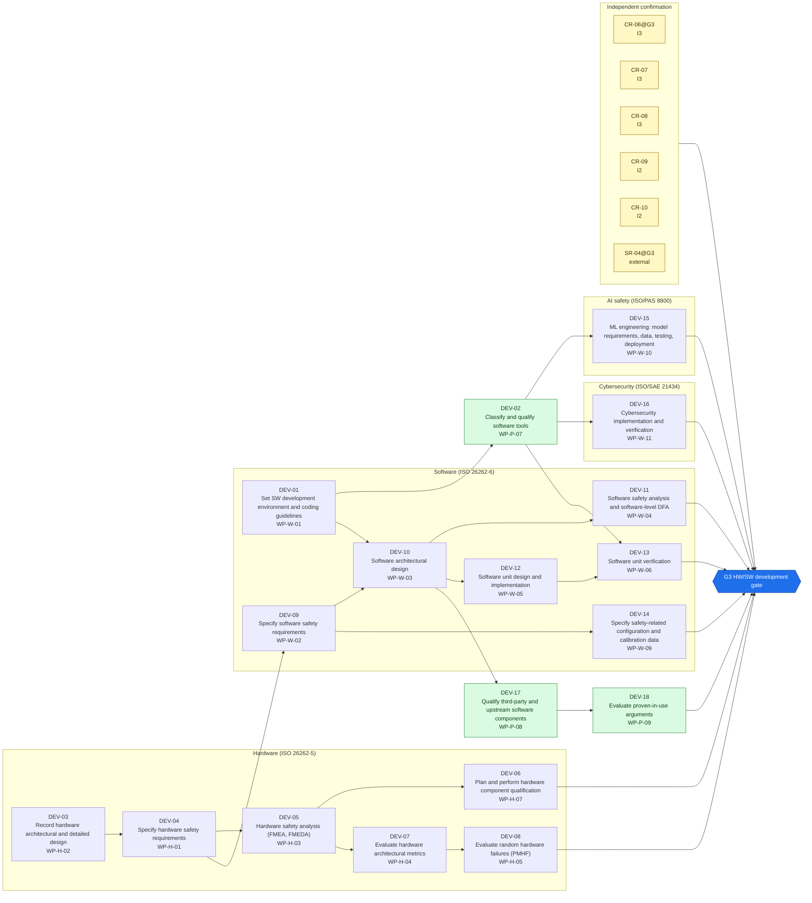
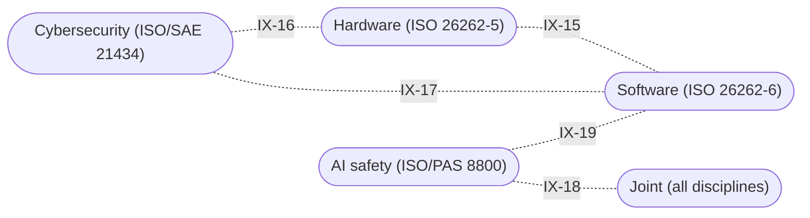

<!-- GENERATED by assurance/process/tools/process_model.py from assurance/process/model/. Do not edit; edit the model and re-run. -->

# G3 HW/SW development: integrated process map (L1)

Back to the [lifecycle map](lifecycle.md). Model: [`model/`](../model/), method: [process README](../README.md).

## 1. Swimlane map

One box per discipline; green activities are joint work of all disciplines and sit outside the boxes. Arrows are work-product inputs: an activity cannot finish before its inputs exist. An arrow implied by a longer path is left out; §2 lists every input. Iteration between disciplines is shown in the interface map (§1.1), not here.

### 1.1 Interface map

Where one discipline's analysis depends on another's. Each edge lists the interfaces of §3 between two lanes; OPEN marks one that a recorded open item still has to settle.

## 2. Activities

Clause references and status are read from the [register (WP-M-00)](../../01-management/WP-M-00-work-product-register.md) row of each work product the activity produces or, for a living work product, updates (marked *update*).

| Activity | Lane | Produces | Inputs | ISO 26262 | ISO 21448 | ISO/SAE 21434 | Other | ASPICE | Handbook WP | Status |
|---|---|---|---|---|---|---|---|---|---|---|
| DEV-01 Set SW development environment and coding guidelines | Software (ISO 26262-6) | [WP-W-01](../../05-software/WP-W-01-software-development-environment-guidelines.md) | WP-P-01, WP-P-05 | 6 §5 |  | §10 | MISRA C:2012 | SWE.3 | WP-5 | Draft |
| DEV-02 Classify and qualify software tools | Joint (all disciplines) | [WP-P-07](../../07-supporting/WP-P-07-tool-classification-qualification.md) | WP-P-01, WP-W-01 | 8 §11 |  | §5 (tool management) |  |  | WP-6 | Draft |
| DEV-03 Record hardware architectural and detailed design | Hardware (ISO 26262-5) | [WP-H-02](../../04-hardware/WP-H-02-hardware-design.md) | WP-C-01, WP-S-05 | 5 §7 |  |  |  | HWE.2 | WP-5 | Draft |
| DEV-04 Specify hardware safety requirements | Hardware (ISO 26262-5) | [WP-H-01](../../04-hardware/WP-H-01-hardware-safety-requirements.md) | WP-C-04, WP-S-02, WP-S-04, WP-S-05, WP-H-02 | 5 §6 |  |  |  | HWE.1 | WP-4 | Draft |
| DEV-05 Hardware safety analysis (FMEA, FMEDA) | Hardware (ISO 26262-5) | [WP-H-03](../../04-hardware/WP-H-03-hardware-safety-analysis-fmeda.md) | WP-A-04, WP-H-01, WP-H-02 | 5 §7, §8 |  |  |  | HWE.2 | WP-2 | Draft |
| DEV-06 Plan and perform hardware component qualification | Hardware (ISO 26262-5) | [WP-H-07](../../04-hardware/WP-H-07-hardware-component-qualification.md) | WP-M-11, WP-H-02, WP-H-03 | 8 §13 |  |  | 26262-11 (semiconductors, informative) |  | WP-6 | Draft |
| DEV-07 Evaluate hardware architectural metrics | Hardware (ISO 26262-5) | [WP-H-04](../../04-hardware/WP-H-04-hardware-metrics.md) | WP-H-01, WP-H-03 | 5 §8 |  |  |  |  | WP-6 | Draft |
| DEV-08 Evaluate random hardware failures (PMHF) | Hardware (ISO 26262-5) | [WP-H-05](../../04-hardware/WP-H-05-random-hardware-failures-pmhf.md) | WP-H-03, WP-H-04 | 5 §9 |  |  |  |  | WP-6 | Draft |
| DEV-09 Specify software safety requirements | Software (ISO 26262-6) | [WP-W-02](../../05-software/WP-W-02-software-safety-requirements.md) | WP-S-02, WP-S-05, WP-H-01 | 6 §6 |  |  |  | SWE.1 | WP-4 | Draft |
| DEV-10 Software architectural design | Software (ISO 26262-6) | [WP-W-03](../../05-software/WP-W-03-software-architecture.md) | WP-S-03, WP-A-02, WP-W-01, WP-W-02 | 6 §7 |  |  |  | SWE.2 | WP-5 | Draft |
| DEV-11 Software safety analysis and software-level DFA | Software (ISO 26262-6) | [WP-W-04](../../05-software/WP-W-04-software-safety-analysis.md) | WP-S-03, WP-A-02, WP-A-04, WP-W-02, WP-W-03 | 6 §7, 9 §7–8 |  |  |  | SWE.2 | WP-2 | Draft |
| DEV-12 Software unit design and implementation | Software (ISO 26262-6) | [WP-W-05](../../05-software/WP-W-05-software-unit-design.md) | WP-W-01, WP-W-02, WP-W-03 | 6 §8 |  | §10 |  | SWE.3 | WP-5 | Draft |
| DEV-13 Software unit verification | Software (ISO 26262-6) | [WP-W-06](../../05-software/WP-W-06-software-unit-verification.md) | WP-C-04, WP-S-02, WP-P-07, WP-W-01, WP-W-02, WP-W-05 | 6 §9 |  | §10 |  | SWE.4 | WP-6 | Draft |
| DEV-14 Specify safety-related configuration and calibration data | Software (ISO 26262-6) | [WP-W-09](../../05-software/WP-W-09-configuration-calibration-data.md) | WP-C-08, WP-S-02, WP-W-02 | 6 Annex C |  |  |  | SWE.3 | WP-4 | Draft |
| DEV-15 ML engineering: model requirements, data, testing, deployment | AI safety (ISO/PAS 8800) | [WP-W-10](../../05-software/WP-W-10-ml-engineering.md) | WP-C-11, WP-V-02, WP-P-07 |  | §7, §10 |  | PAS 8800 (data, V&V, AI architecture) | MLE.1–4, SUP.11 | WP-4, WP-6 | Draft |
| DEV-16 Cybersecurity implementation and verification | Cybersecurity (ISO/SAE 21434) | [WP-W-11](../../05-software/WP-W-11-cybersecurity-implementation-verification.md) | WP-C-09, WP-S-07, WP-P-07, WP-W-01 |  |  | §10 |  | SEC.2, SEC.3 | WP-6 | Draft |
| DEV-17 Qualify third-party and upstream software components | Joint (all disciplines) | [WP-P-08](../../07-supporting/WP-P-08-software-component-qualification.md) | WP-A-02, WP-W-02, WP-W-03 | 8 §12 |  | §10 (reuse, OSS) |  |  | WP-6 | Draft |
| DEV-18 Evaluate proven-in-use arguments | Joint (all disciplines) | [WP-P-09](../../07-supporting/WP-P-09-proven-in-use.md) | WP-M-11, WP-P-08 | 8 §14 |  |  |  |  | WP-7 | Draft |

## 3. Cross-domain interfaces

Each interface is anchored to text in the work products; the checker fails if an anchor disappears. *Documented* means the documents reference each other but nobody has reviewed the agreement yet. An interface is *agreed* only when an accepted review record of both owners lists its IFR item in [`trace/items/ifr.yaml`](../../trace/items/ifr.yaml) (DQ-129 A). Agreed in the whole model: 0 of 33.

| ID | IFR | Pattern | Between | Topic | Status | Open item | Due |
|---|---|---|---|---|---|---|---|
| IX-15 | IFR-15 | Hardware-Software | [WP-W-02](../../05-software/WP-W-02-software-safety-requirements.md), [WP-H-01](../../04-hardware/WP-H-01-hardware-safety-requirements.md) (Software / Hardware) | Software safety requirements that depend on a hardware resource refine the HSI and pair with the hardware safety requirements | Documented | — | G3 |
| IX-16 | IFR-16 | Safety-Security | [WP-H-01](../../04-hardware/WP-H-01-hardware-safety-requirements.md), [WP-S-07](../../03-system/WP-S-07-cybersecurity-requirements-architecture.md) (Hardware / Cybersecurity) | The SoC's control of the MCU boot and reset lines is a hardware safety requirement (HWSR-502c) and an input to the security architecture | Documented | — | G3 |
| IX-17 | IFR-17 | Safety-Security | [WP-W-11](../../05-software/WP-W-11-cybersecurity-implementation-verification.md), [WP-W-01](../../05-software/WP-W-01-software-development-environment-guidelines.md) (Cybersecurity / Software) | One coding guideline for safety and security: the CERT C subset for security static analysis is recorded next to MISRA C:2012, with each rule mapped to the cppcheck or MISRA checker that covers it or to review (the pinned cppcheck has no CERT addon) | Documented | — | G3 |
| IX-18 | IFR-18 | AI-Tools | [WP-W-10](../../05-software/WP-W-10-ml-engineering.md), [WP-P-07](../../07-supporting/WP-P-07-tool-classification-qualification.md) (AI safety / Joint) | The ML compiler (tinygrad) is a QM tool whose confidence comes from back-to-back comparison against an independent reference: ONNX Runtime 1.24.1 on CPU (TL-23), with a seeded difference that the comparison must catch | Documented | — | G3 |
| IX-19 | IFR-19 | Safety-AI | [WP-W-09](../../05-software/WP-W-09-configuration-calibration-data.md), [WP-W-10](../../05-software/WP-W-10-ml-engineering.md) (Software / AI safety) | Model weights are safety-related configuration data: which model runs depends on file presence and device detection | Documented | — | G3 |

## 4. Clause coverage by standard

Which activity answers each clause reference listed in the register. One activity can answer several standards; that is the point of the integrated lifecycle.

- **ISO 26262:** 6 §5 → DEV-01; 8 §11 → DEV-02; 5 §7 → DEV-03; 5 §6 → DEV-04; 5 §7, §8 → DEV-05; 8 §13 → DEV-06; 5 §8 → DEV-07; 5 §9 → DEV-08; 6 §6 → DEV-09; 6 §7 → DEV-10; 6 §7, 9 §7–8 → DEV-11; 6 §8 → DEV-12; 6 §9 → DEV-13; 6 Annex C → DEV-14; 8 §12 → DEV-17; 8 §14 → DEV-18
- **ISO 21448:** §7, §10 → DEV-15
- **ISO/SAE 21434:** §10 → DEV-01, DEV-12, DEV-13, DEV-16; §5 (tool management) → DEV-02; §10 (reuse, OSS) → DEV-17
- **Other:** MISRA C:2012 → DEV-01; 26262-11 (semiconductors, informative) → DEV-06; PAS 8800 (data, V&V, AI architecture) → DEV-15
- **ASPICE:** SWE.3 → DEV-01, DEV-12, DEV-14; HWE.2 → DEV-03, DEV-05; HWE.1 → DEV-04; SWE.1 → DEV-09; SWE.2 → DEV-10, DEV-11; SWE.4 → DEV-13; MLE.1–4, SUP.11 → DEV-15; SEC.2, SEC.3 → DEV-16

## 5. G3 readiness

**Exit criterion (WP-M-00 §2):** HW and SW safety requirements, architecture, units and unit verification approved for every safety-relevant element

**Work products:** 18 Draft of 18. Approval needs the verification review of [WP-P-05](../../07-supporting/WP-P-05-verification-review-procedure.md).

**Roles the lanes need (WP-M-02 §3.1):**

| Lane | Role | Assigned to | Needed by |
|---|---|---|---|
| Joint (all disciplines) | Safety manager | Jherrod Thomas (acting) | G0 |
| Hardware (ISO 26262-5) | Hardware safety engineer | TBD (likely external) | G2 |
| Software (ISO 26262-6) | Envelope software engineer(s) | Jherrod Thomas; additional contributors TBD | G2 |
| AI safety (ISO/PAS 8800) | AI/ML safety lead | Jherrod Thomas (acting); permanent holder TBD | G1 |
| Cybersecurity (ISO/SAE 21434) | Cybersecurity manager | Jherrod Thomas (acting); permanent holder TBD | G1 |
| Independent confirmation | External functional safety assessor | TBD (D-06) | G1 |

**Other roles WP-M-02 §3.1 needs by G3:** Verification reviewer(s) (TBD (at least one person other than the author); needed by G0, still unassigned); Quality assurance (TBD (independent of the author); needed by G0, still unassigned); HIL bench owner (TBD); Test / safety driver(s) (TBD (trained per WP-M-04); needed by G1, still unassigned).

**Confirmation measures (WP-M-06 §9):**

| Measure | Covers | Independence | Record |
|---|---|---|---|
| CR-06@G3 Confirmation review of the hardware and software safety analyses | WP-H-03, WP-W-04 | I3 | Not performed |
| CR-07 Evaluation of hardware metrics and random hardware failure targets | WP-H-04, WP-H-05 | I3 | Not performed |
| CR-08 Confirmation review of hardware component qualification | WP-H-07 | I3 | Not performed |
| CR-09 Confirmation review of software tool qualification | WP-P-07 | I2 | Not performed |
| CR-10 Confirmation review of software component qualification | WP-P-08 | I2 | Not performed |
| SR-04@G3 Review of the AI assurance argument (PAS 8800) | WP-C-11, WP-W-10, WP-K-01 | external | Not performed |

**Work products with no confirmation measure at this gate** (verification review only): WP-W-01, WP-H-02, WP-H-01, WP-W-02, WP-W-03, WP-W-05, WP-W-06, WP-W-09, WP-W-11, WP-P-09.

**Open interfaces due by this gate** (from this or an earlier phase): IX-13 (WP-V-02 OI-3).

**Interfaces due by this gate that are not agreed** (no accepted review of their IFR item, DQ-129 A): 22 of 22: IFR-01, IFR-02, IFR-03, IFR-04, IFR-05, IFR-06, IFR-07, IFR-08, IFR-09, IFR-10, IFR-11, IFR-12, IFR-13, IFR-14, IFR-15, IFR-16, IFR-17, IFR-18, IFR-19, IFR-31, IFR-32, IFR-33.
