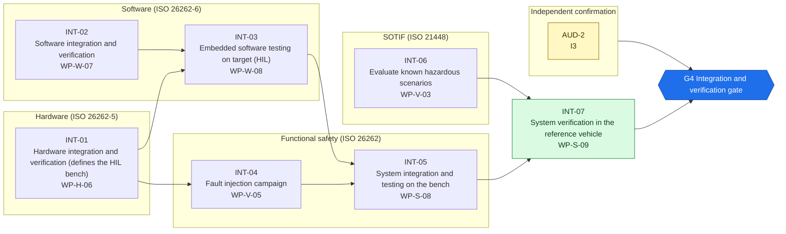
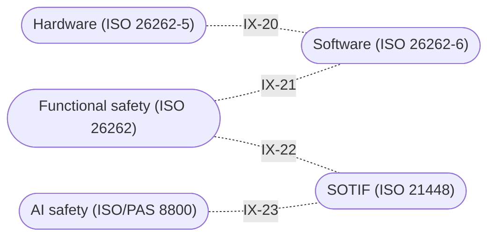

<!-- GENERATED by assurance/process/tools/process_model.py from assurance/process/model/. Do not edit; edit the model and re-run. -->

# G4 Integration and verification: integrated process map (L1)

Back to the [lifecycle map](lifecycle.md). Model: [`model/`](../model/), method: [process README](../README.md).

## 1. Swimlane map

One box per discipline; green activities are joint work of all disciplines and sit outside the boxes. Arrows are work-product inputs: an activity cannot finish before its inputs exist. An arrow implied by a longer path is left out; §2 lists every input. Iteration between disciplines is shown in the interface map (§1.1), not here.

### 1.1 Interface map

Where one discipline's analysis depends on another's. Each edge lists the interfaces of §3 between two lanes; OPEN marks one that a recorded open item still has to settle.

## 2. Activities

Clause references and status are read from the [register (WP-M-00)](../../01-management/WP-M-00-work-product-register.md) row of each work product the activity produces or, for a living work product, updates (marked *update*).

| Activity | Lane | Produces | Inputs | ISO 26262 | ISO 21448 | ISO/SAE 21434 | Other | ASPICE | Handbook WP | Status |
|---|---|---|---|---|---|---|---|---|---|---|
| INT-01 Hardware integration and verification (defines the HIL bench) | Hardware (ISO 26262-5) | [WP-H-06](../../04-hardware/WP-H-06-hardware-integration-verification.md) | WP-H-01, WP-H-02, WP-H-03, WP-H-07 | 5 §10 |  |  |  | HWE.3, HWE.4 | WP-6 | Draft |
| INT-02 Software integration and verification | Software (ISO 26262-6) | [WP-W-07](../../05-software/WP-W-07-software-integration-verification.md) | WP-W-02, WP-W-03, WP-W-05, WP-W-06 | 6 §10 |  |  |  | SWE.5 | WP-6 | Draft |
| INT-03 Embedded software testing on target (HIL) | Software (ISO 26262-6) | [WP-W-08](../../05-software/WP-W-08-embedded-software-testing.md) | WP-W-02, WP-H-06, WP-W-07 | 6 §11 |  |  |  | SWE.6 | WP-6 | Draft |
| INT-04 Fault injection campaign | Functional safety (ISO 26262) | [WP-V-05](../../06-validation/WP-V-05-fault-injection.md) | WP-C-04, WP-S-02, WP-S-04, WP-A-02, WP-A-03, WP-A-04, WP-H-06 | 4 §7, 5 §10, 6 §10–11 |  |  |  | SYS.4, SWE.6 | WP-6 | Draft |
| INT-05 System integration and testing on the bench | Functional safety (ISO 26262) | [WP-S-08](../../03-system/WP-S-08-system-integration-test.md) | WP-S-02, WP-S-03, WP-S-05, WP-H-06, WP-W-08, WP-V-05 | 4 §7 |  |  |  | SYS.4 | WP-6 | Draft |
| INT-06 Evaluate known hazardous scenarios | SOTIF (ISO 21448) | [WP-V-03](../../06-validation/WP-V-03-sotif-known-scenarios.md) | WP-C-02, WP-C-06, WP-V-02, WP-V-07, WP-W-10 |  | §10 |  |  | SYS.5, VAL.1 | WP-6 | Draft |
| INT-07 System verification in the reference vehicle | Joint (all disciplines) | [WP-S-09](../../03-system/WP-S-09-system-verification.md) | WP-C-08, WP-S-01, WP-S-02, WP-V-07, WP-S-08, WP-V-05, WP-V-03 | 4 §7 | §10 |  |  | SYS.5 | WP-6 | Draft |

## 3. Cross-domain interfaces

Each interface is anchored to text in the work products; the checker fails if an anchor disappears. *Documented* means the documents reference each other but nobody has reviewed the agreement yet. An interface is *agreed* only when an accepted review record of both owners lists its IFR item in [`trace/items/ifr.yaml`](../../trace/items/ifr.yaml) (DQ-129 A). Agreed in the whole model: 0 of 33.

| ID | IFR | Pattern | Between | Topic | Status | Open item | Due |
|---|---|---|---|---|---|---|---|
| IX-20 | IFR-20 | Hardware-Software | [WP-H-06](../../04-hardware/WP-H-06-hardware-integration-verification.md), [WP-W-08](../../05-software/WP-W-08-embedded-software-testing.md) (Hardware / Software) | Hardware, embedded-software and system integration share one HIL bench (D-04): WP-W-08 §3 uses the WP-H-06 §2 bench and adds its software needs; both plan it ready by G3 as WP-M-03 phase P4 requires. Building it stays open as WP-H-06 OI-1 / WP-W-08 OI-1 / WP-M-03 task 5.1 | Documented | — | G4 |
| IX-21 | IFR-21 | Software-System | [WP-W-08](../../05-software/WP-W-08-embedded-software-testing.md), [WP-V-05](../../06-validation/WP-V-05-fault-injection.md) (Software / Functional safety) | Embedded-software qualification, system integration and the fault-injection campaign test the same faults on one bench. WP-W-08 §6.1 splits them: WP-V-05 owns every injection procedure; a case at WP-S-08 step I-1 runs once under WP-W-08 and is cited by WP-S-08 and WP-V-05; WP-S-08 adds steps I-2 to I-4 | Documented | — | G4 |
| IX-22 | IFR-22 | Safety-SOTIF | [WP-V-05](../../06-validation/WP-V-05-fault-injection.md), [WP-V-03](../../06-validation/WP-V-03-sotif-known-scenarios.md) (Functional safety / SOTIF) | Faults (malfunctions) are injected under WP-V-05 and triggering conditions are tested under WP-V-03; scenarios that need an induced fault reuse the WP-V-05 rules | Documented | — | G4 |
| IX-23 | IFR-23 | SOTIF-AI | [WP-V-03](../../06-validation/WP-V-03-sotif-known-scenarios.md), [WP-W-10](../../05-software/WP-W-10-ml-engineering.md) (SOTIF / AI safety) | Known-scenario evaluation reuses the ML test cases (e.g. VS-ML-06 for driver monitoring) and is re-run after every model change listed in WP-W-10 | Documented | — | G4 |

## 4. Clause coverage by standard

Which activity answers each clause reference listed in the register. One activity can answer several standards; that is the point of the integrated lifecycle.

- **ISO 26262:** 5 §10 → INT-01; 6 §10 → INT-02; 6 §11 → INT-03; 4 §7, 5 §10, 6 §10–11 → INT-04; 4 §7 → INT-05, INT-07
- **ISO 21448:** §10 → INT-06, INT-07
- **ISO/SAE 21434:** none
- **Other:** none
- **ASPICE:** HWE.3, HWE.4 → INT-01; SWE.5 → INT-02; SWE.6 → INT-03; SYS.4, SWE.6 → INT-04; SYS.4 → INT-05; SYS.5, VAL.1 → INT-06; SYS.5 → INT-07

## 5. G4 readiness

**Exit criterion (WP-M-00 §2):** SW, HW and system integration and qualification evidence complete; fault injection campaign closed

**Work products:** 7 Draft of 7. Approval needs the verification review of [WP-P-05](../../07-supporting/WP-P-05-verification-review-procedure.md).

**Roles the lanes need (WP-M-02 §3.1):**

| Lane | Role | Assigned to | Needed by |
|---|---|---|---|
| Joint (all disciplines) | Safety manager | Jherrod Thomas (acting) | G0 |
| Functional safety (ISO 26262) | Safety manager | Jherrod Thomas (acting) | G0 |
| Hardware (ISO 26262-5) | Hardware safety engineer | TBD (likely external) | G2 |
| Software (ISO 26262-6) | Envelope software engineer(s) | Jherrod Thomas; additional contributors TBD | G2 |
| SOTIF (ISO 21448) | SOTIF lead | Jherrod Thomas (acting); permanent holder TBD | G1 |
| Independent confirmation | External functional safety assessor | TBD (D-06) | G1 |

**Other roles WP-M-02 §3.1 needs by G4:** Verification reviewer(s) (TBD (at least one person other than the author); needed by G0, still unassigned); Quality assurance (TBD (independent of the author); needed by G0, still unassigned); HIL bench owner (TBD; needed by G3, still unassigned); Test / safety driver(s) (TBD (trained per WP-M-04); needed by G1, still unassigned).

**Confirmation measures (WP-M-06 §9):**

| Measure | Covers | Independence | Record |
|---|---|---|---|
| AUD-2 Functional safety audit (development, verification, tool use) | WP-M-02, WP-M-05, WP-P-07 | I3 | Not performed |

**Work products with no confirmation measure at this gate** (verification review only): WP-H-06, WP-W-07, WP-W-08, WP-V-05, WP-S-08, WP-V-03, WP-S-09.

**Open interfaces due by this gate** (from this or an earlier phase): IX-13 (WP-V-02 OI-3).

**Interfaces due by this gate that are not agreed** (no accepted review of their IFR item, DQ-129 A): 26 of 26: IFR-01, IFR-02, IFR-03, IFR-04, IFR-05, IFR-06, IFR-07, IFR-08, IFR-09, IFR-10, IFR-11, IFR-12, IFR-13, IFR-14, IFR-15, IFR-16, IFR-17, IFR-18, IFR-19, IFR-20, IFR-21, IFR-22, IFR-23, IFR-31, IFR-32, IFR-33.
