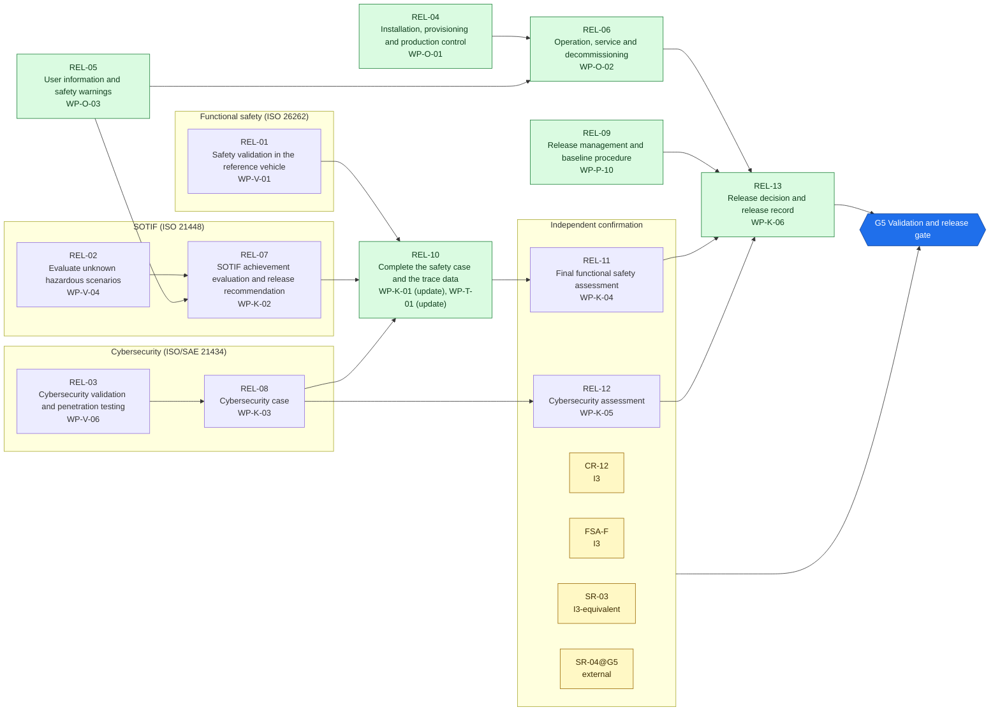
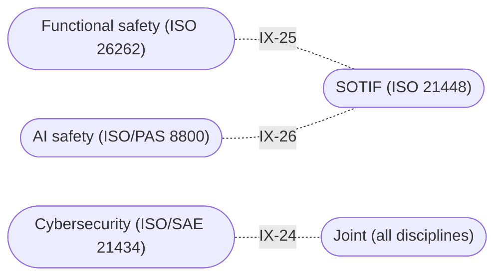

<!-- GENERATED by assurance/process/tools/process_model.py from assurance/process/model/. Do not edit; edit the model and re-run. -->

# G5 Validation and release: integrated process map (L1)

Back to the [lifecycle map](lifecycle.md). Model: [`model/`](../model/), method: [process README](../README.md).

## 1. Swimlane map

One box per discipline; green activities are joint work of all disciplines and sit outside the boxes. Arrows are work-product inputs: an activity cannot finish before its inputs exist. An arrow implied by a longer path is left out; §2 lists every input. Iteration between disciplines is shown in the interface map (§1.1), not here.

### 1.1 Interface map

Where one discipline's analysis depends on another's. Each edge lists the interfaces of §3 between two lanes; OPEN marks one that a recorded open item still has to settle.

## 2. Activities

Clause references and status are read from the [register (WP-M-00)](../../01-management/WP-M-00-work-product-register.md) row of each work product the activity produces or, for a living work product, updates (marked *update*).

| Activity | Lane | Produces | Inputs | ISO 26262 | ISO 21448 | ISO/SAE 21434 | Other | ASPICE | Handbook WP | Status |
|---|---|---|---|---|---|---|---|---|---|---|
| REL-01 Safety validation in the reference vehicle | Functional safety (ISO 26262) | [WP-V-01](../../06-validation/WP-V-01-safety-validation.md) | WP-C-03, WP-C-04, WP-C-08, WP-V-07, WP-V-05, WP-S-09 | 4 §8 |  |  |  | VAL.1 | WP-6 | Draft |
| REL-02 Evaluate unknown hazardous scenarios | SOTIF (ISO 21448) | [WP-V-04](../../06-validation/WP-V-04-sotif-unknown-scenarios.md) | WP-V-02, WP-V-03, WP-V-07, WP-W-10 |  | §11 |  |  | VAL.1 | WP-6 | Draft |
| REL-03 Cybersecurity validation and penetration testing | Cybersecurity (ISO/SAE 21434) | [WP-V-06](../../06-validation/WP-V-06-cybersecurity-validation.md) | WP-C-09, WP-C-10, WP-S-07, WP-W-11, WP-V-07 |  |  | §11 |  | SEC.4 | WP-6 | Draft |
| REL-04 Installation, provisioning and production control | Joint (all disciplines) | [WP-O-01](../../09-production-operation/WP-O-01-installation-and-provisioning-control.md) | WP-C-01, WP-M-11, WP-S-06, WP-V-07 | 7 §5 |  | §12 |  |  | WP-8 | Draft |
| REL-05 User information and safety warnings | Joint (all disciplines) | [WP-O-03](../../09-production-operation/WP-O-03-user-information-safety-warnings.md) | WP-C-02, WP-C-03, WP-C-08, WP-S-06 | 7 §6 | §6 (misuse), §13 |  |  |  | WP-8 | Draft |
| REL-06 Operation, service and decommissioning | Joint (all disciplines) | [WP-O-02](../../09-production-operation/WP-O-02-operation-service-decommissioning.md) | WP-S-06, WP-O-01, WP-O-03 | 7 §6 |  | §14 |  |  | WP-8 | Draft |
| REL-07 SOTIF achievement evaluation and release recommendation | SOTIF (ISO 21448) | [WP-K-02](../../10-safety-case/WP-K-02-sotif-release-argument.md) | WP-C-05, WP-C-07, WP-V-02, WP-V-03, WP-W-10, WP-V-04, WP-O-03 |  | §12 |  |  |  | WP-7 | Skeleton |
| REL-08 Cybersecurity case | Cybersecurity (ISO/SAE 21434) | [WP-K-03](../../10-safety-case/WP-K-03-cybersecurity-case.md) | WP-C-09, WP-C-10, WP-S-07, WP-W-11, WP-V-06 |  |  | §6 |  |  | WP-7 | Draft |
| REL-09 Release management and baseline procedure | Joint (all disciplines) | [WP-P-10](../../07-supporting/WP-P-10-release-management.md) | WP-P-01, WP-S-07 | 2 §6 (release), 8 §7 |  | §6 (release for post-development) |  | SUP.8 | WP-7 | Draft |
| REL-10 Complete the safety case and the trace data | Joint (all disciplines) | [WP-K-01](../../10-safety-case/WP-K-01-safety-case.md) *update*, [WP-T-01](../../trace/README.md) *update* | WP-V-01, WP-K-02, WP-K-03 | 2 §6; 8 §6 | §12 | §10 | UL 4600, PAS 8800 (assurance argument) | 13-51 consistency evidence (SYS.2–5, SWE.1–6) | WP-7 | Draft |
| REL-11 Final functional safety assessment | Independent confirmation | [WP-K-04](../../10-safety-case/WP-K-04-functional-safety-assessment.md) | WP-K-01, WP-V-01, WP-V-05 | 2 §6 |  |  |  |  | WP-7 | Skeleton |
| REL-12 Cybersecurity assessment | Independent confirmation | [WP-K-05](../../10-safety-case/WP-K-05-cybersecurity-assessment.md) | WP-K-03, WP-V-06 |  |  | §6 |  |  | WP-7 | Skeleton |
| REL-13 Release decision and release record | Joint (all disciplines) | [WP-K-06](../../10-safety-case/WP-K-06-release-record.md) | WP-K-01, WP-K-02, WP-K-03, WP-K-04, WP-K-05, WP-P-10, WP-O-01, WP-O-02, WP-O-03 | 2 §6, 4 §9 | §12 | §6 |  | SUP.8 | WP-7 | Skeleton |

## 3. Cross-domain interfaces

Each interface is anchored to text in the work products; the checker fails if an anchor disappears. *Documented* means the documents reference each other but nobody has reviewed the agreement yet. An interface is *agreed* only when an accepted review record of both owners lists its IFR item in [`trace/items/ifr.yaml`](../../trace/items/ifr.yaml) (DQ-129 A). Agreed in the whole model: 0 of 33.

| ID | IFR | Pattern | Between | Topic | Status | Open item | Due |
|---|---|---|---|---|---|---|---|
| IX-24 | IFR-24 | Safety-Security | [WP-K-01](../../10-safety-case/WP-K-01-safety-case.md), [WP-K-03](../../10-safety-case/WP-K-03-cybersecurity-case.md) (Joint / Cybersecurity) | The safety case delegates its cybersecurity branch (G4) to the cybersecurity case, which argues against the same reference configuration | Documented | — | G5 |
| IX-25 | IFR-25 | Safety-SOTIF | [WP-V-01](../../06-validation/WP-V-01-safety-validation.md), [WP-V-02](../../06-validation/WP-V-02-sotif-vv-strategy.md) (Functional safety / SOTIF) | The SOTIF validation targets take P(not controlled) from the subject controllability tests of the safety validation: WP-V-02 §3.3 maps each SH to a WP-V-01 test and uses the one-sided 95 % upper bound at the least favourable tested condition; untested SHs and speeds above the highest tested use 1. P(E-situation) has its own route in WP-V-02 §3.4 | Documented | — | G5 |
| IX-26 | IFR-26 | SOTIF-AI | [WP-K-02](../../10-safety-case/WP-K-02-sotif-release-argument.md), [WP-W-10](../../05-software/WP-W-10-ml-engineering.md) (SOTIF / AI safety) | The SOTIF release argument needs the model evaluation report and hash-identified models from ML engineering; the report is missing | Documented | — | G5 |

## 4. Clause coverage by standard

Which activity answers each clause reference listed in the register. One activity can answer several standards; that is the point of the integrated lifecycle.

- **ISO 26262:** 4 §8 → REL-01; 7 §5 → REL-04; 7 §6 → REL-05, REL-06; 2 §6 (release), 8 §7 → REL-09; 2 §6 → REL-10, REL-11; 8 §6 → REL-10; 2 §6, 4 §9 → REL-13
- **ISO 21448:** §11 → REL-02; §6 (misuse), §13 → REL-05; §12 → REL-07, REL-10, REL-13
- **ISO/SAE 21434:** §11 → REL-03; §12 → REL-04; §14 → REL-06; §6 → REL-08, REL-12, REL-13; §6 (release for post-development) → REL-09; §10 → REL-10
- **Other:** UL 4600, PAS 8800 (assurance argument) → REL-10
- **ASPICE:** VAL.1 → REL-01, REL-02; SEC.4 → REL-03; SUP.8 → REL-09, REL-13; 13-51 consistency evidence (SYS.2–5, SWE.1–6) → REL-10

## 5. G5 readiness

**Exit criterion (WP-M-00 §2):** Safety validation, SOTIF residual risk acceptance, CS validation, safety case, FSA and CS assessment complete; release record signed

**Work products:** 10 Draft, 4 Skeleton of 14. Approval needs the verification review of [WP-P-05](../../07-supporting/WP-P-05-verification-review-procedure.md).

**Roles the lanes need (WP-M-02 §3.1):**

| Lane | Role | Assigned to | Needed by |
|---|---|---|---|
| Joint (all disciplines) | Safety manager | Jherrod Thomas (acting) | G0 |
| Functional safety (ISO 26262) | Safety manager | Jherrod Thomas (acting) | G0 |
| SOTIF (ISO 21448) | SOTIF lead | Jherrod Thomas (acting); permanent holder TBD | G1 |
| Cybersecurity (ISO/SAE 21434) | Cybersecurity manager | Jherrod Thomas (acting); permanent holder TBD | G1 |
| Independent confirmation | External functional safety assessor | TBD (D-06) | G1 |

**Other roles WP-M-02 §3.1 needs by G5:** Hardware safety engineer (TBD (likely external); needed by G2, still unassigned); Verification reviewer(s) (TBD (at least one person other than the author); needed by G0, still unassigned); Quality assurance (TBD (independent of the author); needed by G0, still unassigned); HIL bench owner (TBD; needed by G3, still unassigned); Test / safety driver(s) (TBD (trained per WP-M-04); needed by G1, still unassigned); External cybersecurity assessor (TBD).

**Confirmation measures (WP-M-06 §9):**

| Measure | Covers | Independence | Record |
|---|---|---|---|
| CR-12 Confirmation review of the safety case (completeness) | WP-K-01 | I3 | Not performed |
| FSA-F Final functional safety assessment (report WP-K-04) | WP-K-01, WP-V-01, WP-V-05 | I3 | Not performed |
| SR-03 Review of the SOTIF release argument and residual risk | WP-K-02, WP-V-03, WP-V-04 | I3-equivalent | Not performed |
| SR-04@G5 Review of the AI assurance argument (PAS 8800) | WP-C-11, WP-W-10, WP-K-01 | external | Not performed |

**Work products with no confirmation measure at this gate** (verification review only): WP-O-01, WP-O-03, WP-O-02, WP-P-10, WP-T-01, WP-K-06.

**Open interfaces due by this gate** (from this or an earlier phase): IX-13 (WP-V-02 OI-3).

**Interfaces due by this gate that are not agreed** (no accepted review of their IFR item, DQ-129 A): 29 of 29: IFR-01, IFR-02, IFR-03, IFR-04, IFR-05, IFR-06, IFR-07, IFR-08, IFR-09, IFR-10, IFR-11, IFR-12, IFR-13, IFR-14, IFR-15, IFR-16, IFR-17, IFR-18, IFR-19, IFR-20, IFR-21, IFR-22, IFR-23, IFR-24, IFR-25, IFR-26, IFR-31, IFR-32, IFR-33.
