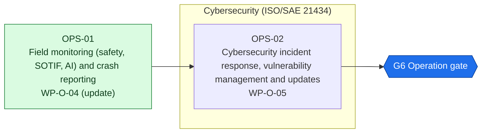
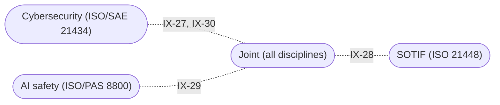

<!-- GENERATED by assurance/process/tools/process_model.py from assurance/process/model/. Do not edit; edit the model and re-run. -->

# G6 Operation: integrated process map (L1)

Back to the [lifecycle map](lifecycle.md). Model: [`model/`](../model/), method: [process README](../README.md).

## 1. Swimlane map

One box per discipline; green activities are joint work of all disciplines and sit outside the boxes. Arrows are work-product inputs: an activity cannot finish before its inputs exist. An arrow implied by a longer path is left out; §2 lists every input. Iteration between disciplines is shown in the interface map (§1.1), not here.

### 1.1 Interface map

Where one discipline's analysis depends on another's. Each edge lists the interfaces of §3 between two lanes; OPEN marks one that a recorded open item still has to settle.

## 2. Activities

Clause references and status are read from the [register (WP-M-00)](../../01-management/WP-M-00-work-product-register.md) row of each work product the activity produces or, for a living work product, updates (marked *update*).

| Activity | Lane | Produces | Inputs | ISO 26262 | ISO 21448 | ISO/SAE 21434 | Other | ASPICE | Handbook WP | Status |
|---|---|---|---|---|---|---|---|---|---|---|
| OPS-01 Field monitoring (safety, SOTIF, AI) and crash reporting | Joint (all disciplines) | [WP-O-04](../../09-production-operation/WP-O-04-field-monitoring.md) *update* | WP-P-03, WP-V-04, WP-O-01, WP-O-02, WP-O-03, WP-K-06 | 2 §7 | §13 | §8 | PAS 8800 (operation phase), NHTSA SGO (US) |  | WP-8 | Draft |
| OPS-02 Cybersecurity incident response, vulnerability management and updates | Cybersecurity (ISO/SAE 21434) | [WP-O-05](../../09-production-operation/WP-O-05-cybersecurity-incident-response-updates.md) | WP-P-02, WP-P-03, WP-C-09, WP-S-07, WP-W-11, WP-V-06, WP-P-10, WP-O-04 |  |  | §8, §13 | UN R156 (informative) | SEC.* | WP-8 | Draft |

## 3. Cross-domain interfaces

Each interface is anchored to text in the work products; the checker fails if an anchor disappears. *Documented* means the documents reference each other but nobody has reviewed the agreement yet. An interface is *agreed* only when an accepted review record of both owners lists its IFR item in [`trace/items/ifr.yaml`](../../trace/items/ifr.yaml) (DQ-129 A). Agreed in the whole model: 0 of 33.

| ID | IFR | Pattern | Between | Topic | Status | Open item | Due |
|---|---|---|---|---|---|---|---|
| IX-27 | IFR-27 | Safety-Security | [WP-O-04](../../09-production-operation/WP-O-04-field-monitoring.md), [WP-O-05](../../09-production-operation/WP-O-05-cybersecurity-incident-response-updates.md) (Joint / Cybersecurity) | A field event may have a safety or a cyber cause: field monitoring passes possible cyber causes to incident response, which watches field data for tampering indicators | Documented | — | G6 |
| IX-28 | IFR-28 | Operation-SOTIF | [WP-O-04](../../09-production-operation/WP-O-04-field-monitoring.md), [WP-V-04](../../06-validation/WP-V-04-sotif-unknown-scenarios.md) (Joint / SOTIF) | Pre-release exploration and field monitoring use one signature set: WP-V-04 §2.1 defines AS-01…AS-11 with thresholds and maps each to a WP-O-04 MON event (MON-17 added for the three without one); one extractor and signature-set version, thresholds frozen per version, and the same ODD denominator and discovery-rate definition. Numeric thresholds are still to be tuned (WP-O-04 OI-5) | Documented | — | G6 |
| IX-29 | IFR-29 | Operation-AI | [WP-O-04](../../09-production-operation/WP-O-04-field-monitoring.md), [WP-W-10](../../05-software/WP-W-10-ml-engineering.md) (Joint / AI safety) | Field monitoring checks that the ML models behave as validated and stay inside their input space; anomalies go back to the model test set | Documented | — | G6 |
| IX-30 | IFR-30 | Security-Release | [WP-O-05](../../09-production-operation/WP-O-05-cybersecurity-incident-response-updates.md), [WP-P-10](../../07-supporting/WP-P-10-release-management.md) (Cybersecurity / Joint) | Security fixes reach the field as releases, but updates are not signed (GAP-26), so the update path is itself an open security weakness | Documented | — | G6 |

### 3.1 Feedback into earlier phases

Findings of this phase that re-open work products of earlier phases. Each row is anchored to the routing table of the source work product.

| ID | Finding | From | Back into |
|---|---|---|---|
| FB-01 | Potential safety goal violation or E/E fault | [WP-O-04](../../09-production-operation/WP-O-04-field-monitoring.md) | [WP-C-03](../../02-concept/WP-C-03-hara.md) (G1), [WP-A-04](../../08-analyses/WP-A-04-system-fta-fmea.md) (G2) |
| FB-02 | New hazardous scenario or triggering condition | [WP-O-04](../../09-production-operation/WP-O-04-field-monitoring.md) | [WP-V-04](../../06-validation/WP-V-04-sotif-unknown-scenarios.md) (G5), [WP-C-06](../../02-concept/WP-C-06-sotif-insufficiencies-triggering-conditions.md) (G1), [WP-V-03](../../06-validation/WP-V-03-sotif-known-scenarios.md) (G4), [WP-C-07](../../02-concept/WP-C-07-sotif-functional-modifications.md) (G1) |
| FB-03 | New misuse pattern | [WP-O-04](../../09-production-operation/WP-O-04-field-monitoring.md) | [WP-C-08](../../02-concept/WP-C-08-driver-hmi-misuse-analysis.md) (G1), [WP-O-03](../../09-production-operation/WP-O-03-user-information-safety-warnings.md) (G5) |
| FB-04 | Model anomaly | [WP-O-04](../../09-production-operation/WP-O-04-field-monitoring.md) | [WP-W-10](../../05-software/WP-W-10-ml-engineering.md) (G3), [WP-C-11](../../02-concept/WP-C-11-ai-system-definition-and-safety-requirements.md) (G1) |
| FB-05 | Assumption of use found not to hold | [WP-O-04](../../09-production-operation/WP-O-04-field-monitoring.md) | [WP-C-01](../../02-concept/WP-C-01-item-definition.md) (G1), [WP-C-03](../../02-concept/WP-C-03-hara.md) (G1) |
| FB-06 | Counter-evidence to the safety case | [WP-O-04](../../09-production-operation/WP-O-04-field-monitoring.md) | [WP-K-01](../../10-safety-case/WP-K-01-safety-case.md) (G1) |

## 4. Clause coverage by standard

Which activity answers each clause reference listed in the register. One activity can answer several standards; that is the point of the integrated lifecycle.

- **ISO 26262:** 2 §7 → OPS-01
- **ISO 21448:** §13 → OPS-01
- **ISO/SAE 21434:** §8 → OPS-01; §8, §13 → OPS-02
- **Other:** PAS 8800 (operation phase), NHTSA SGO (US) → OPS-01; UN R156 (informative) → OPS-02
- **ASPICE:** SEC.* → OPS-02

## 5. G6 readiness

**Exit criterion (WP-M-00 §2):** Field monitoring, incident response and update processes running

**Work products:** 2 Draft of 2. Approval needs the verification review of [WP-P-05](../../07-supporting/WP-P-05-verification-review-procedure.md).

**Roles the lanes need (WP-M-02 §3.1):**

| Lane | Role | Assigned to | Needed by |
|---|---|---|---|
| Joint (all disciplines) | Safety manager | Jherrod Thomas (acting) | G0 |
| Cybersecurity (ISO/SAE 21434) | Cybersecurity manager | Jherrod Thomas (acting); permanent holder TBD | G1 |

**Other roles WP-M-02 §3.1 needs by G6:** Hardware safety engineer (TBD (likely external); needed by G2, still unassigned); Verification reviewer(s) (TBD (at least one person other than the author); needed by G0, still unassigned); Quality assurance (TBD (independent of the author); needed by G0, still unassigned); HIL bench owner (TBD; needed by G3, still unassigned); Test / safety driver(s) (TBD (trained per WP-M-04); needed by G1, still unassigned); External functional safety assessor (TBD (D-06); needed by G1, still unassigned); External cybersecurity assessor (TBD; needed by G5, still unassigned).

**Confirmation measures (WP-M-06 §9):** none planned at this gate.

**Work products with no confirmation measure at this gate** (verification review only): WP-O-04, WP-O-05.

**Open interfaces due by this gate** (from this or an earlier phase): IX-13 (WP-V-02 OI-3).

**Interfaces due by this gate that are not agreed** (no accepted review of their IFR item, DQ-129 A): 33 of 33: IFR-01, IFR-02, IFR-03, IFR-04, IFR-05, IFR-06, IFR-07, IFR-08, IFR-09, IFR-10, IFR-11, IFR-12, IFR-13, IFR-14, IFR-15, IFR-16, IFR-17, IFR-18, IFR-19, IFR-20, IFR-21, IFR-22, IFR-23, IFR-24, IFR-25, IFR-26, IFR-27, IFR-28, IFR-29, IFR-30, IFR-31, IFR-32, IFR-33.
