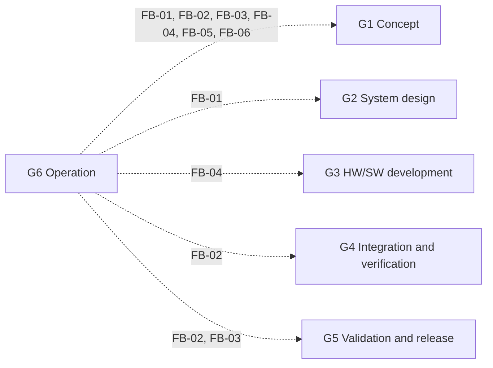

<!-- GENERATED by assurance/process/tools/process_model.py from assurance/process/model/. Do not edit; edit the model and re-run. -->

# Integrated lifecycle (L0)

One lifecycle with one gate per phase. All disciplines work inside each phase and decide at the same gate.
Gate names and exit criteria come from [WP-M-00 §2](../../01-management/WP-M-00-work-product-register.md#2-gates). The handbook column maps each phase to the lifecycle chapters of the Integrated Automotive Standards Handbook (informative).

```mermaid
flowchart LR
  G0["G0 Governance<br/>not modelled yet"]
  G1["G1 Concept<br/>13 activities modelled"]
  G2["G2 System design<br/>12 activities modelled"]
  G3["G3 HW/SW development<br/>18 activities modelled"]
  G4["G4 Integration and verification<br/>7 activities modelled"]
  G5["G5 Validation and release<br/>13 activities modelled"]
  G6["G6 Operation<br/>2 activities modelled"]
  G0 --> G1 --> G2 --> G3 --> G4 --> G5 --> G6
  classDef modelled fill:#1f6feb,stroke:#0b3d91,color:#ffffff
  classDef pending fill:#f6f8fa,stroke:#8c959f,color:#57606a,stroke-dasharray: 4 3
  class G1,G2,G3,G4,G5,G6 modelled
  class G0 pending
```

## Feedback into earlier phases

Findings that a later phase routes back into work products of earlier phases (FB-nn, listed in the map of the phase that raises them). A finding that needs a change re-enters through problem resolution, change management and impact analysis.

## Phases

| Gate | Phase | Exit criterion (WP-M-00 §2) | Handbook chapters | Process map |
|---|---|---|---|---|
| G0 | Governance | Plans approved; roles assigned; CM and change control running | 4 | Not modelled yet |
| G1 | Concept | Item definition, HARA, FSC, SOTIF hazard and insufficiency analysis, TARA and CS concept approved; confirmation review of HARA (I3) passed | 5 | [G1 map](g1-concept.md) |
| G2 | System design | TSC, system architecture, HSI and system-level safety analyses approved | 6 | [G2 map](g2-system-design.md) |
| G3 | HW/SW development | HW and SW safety requirements, architecture, units and unit verification approved for every safety-relevant element | 7, 8 | [G3 map](g3-hw-sw-development.md) |
| G4 | Integration and verification | SW, HW and system integration and qualification evidence complete; fault injection campaign closed | 9 | [G4 map](g4-integration-and-verification.md) |
| G5 | Validation and release | Safety validation, SOTIF residual risk acceptance, CS validation, safety case, FSA and CS assessment complete; release record signed | 9 | [G5 map](g5-validation-and-release.md) |
| G6 | Operation | Field monitoring, incident response and update processes running | 10 | [G6 map](g6-operation.md) |
