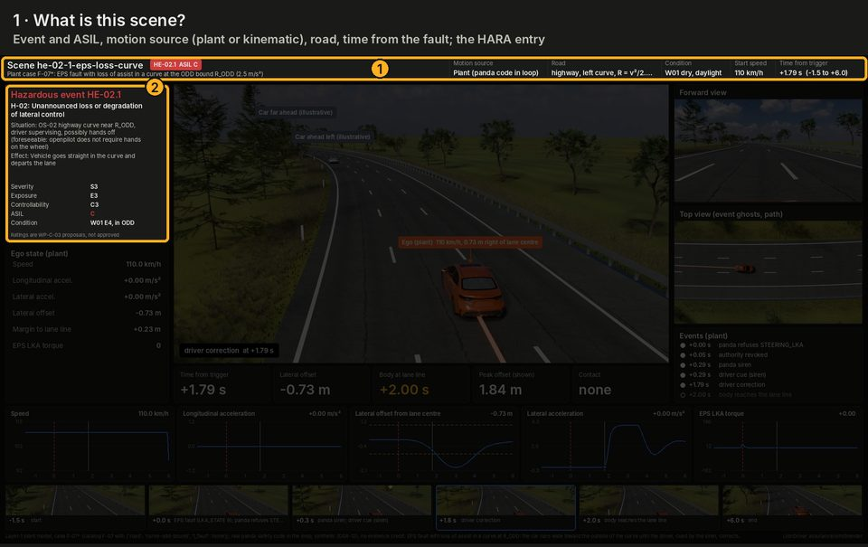
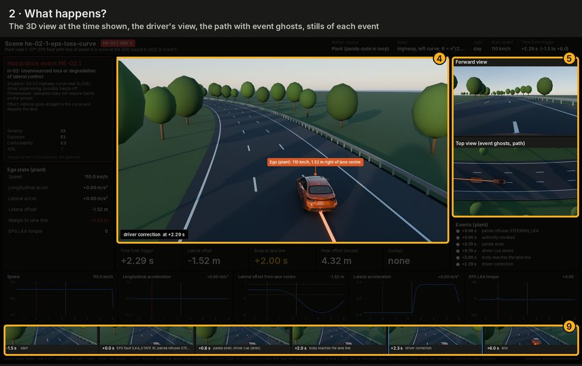
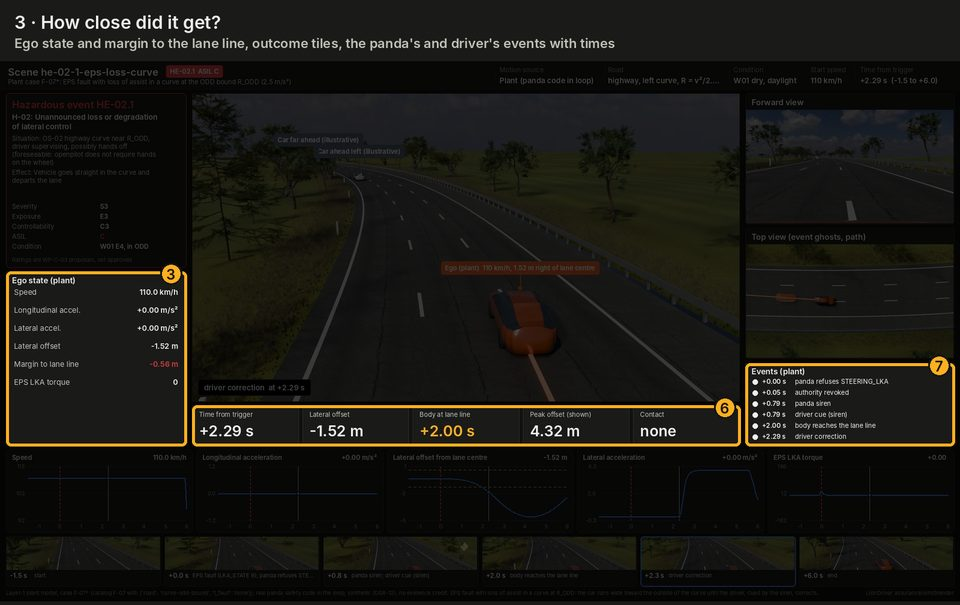
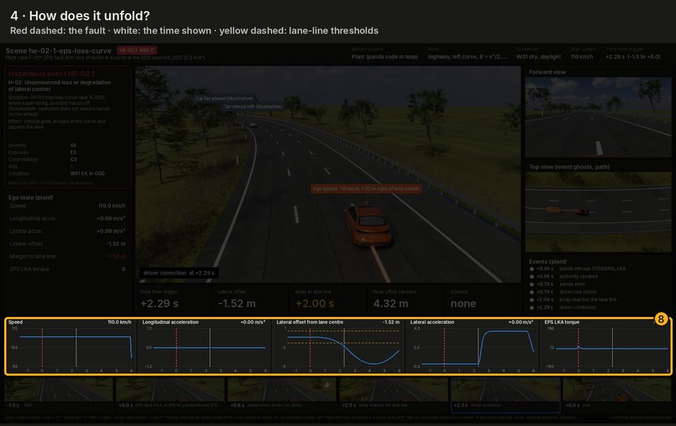
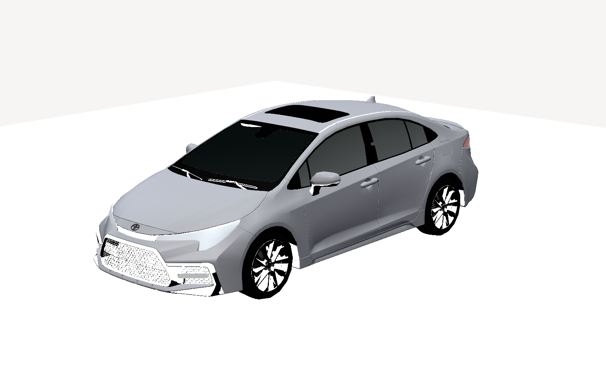
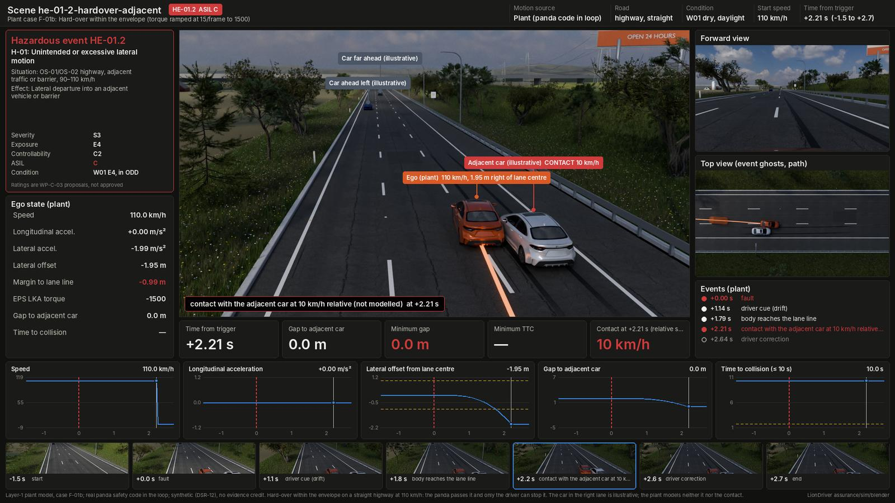

# Simulation track: method

| Field | Value |
|---|---|
| Scope | Simulation for LionDriver; modelling-plan work item 4, the HIL plant ([models README](../models/README.md), MD-01, MD-04): fault-injection plant model (layer 1), known scenarios as OpenSCENARIO (layer 2), MetaDrive closed loop (layer 3), unknown-scenario search (layer 4) |
| Version | 0.32 (§3.11, §3.12: physics plan round 3 phase A, dust in the fan, wet curves, hill crests and a stopped car ahead; the truck study stopped for want of a source; 2026-10-25). 0.31 (plan for ten more physics studies, round 3, `physics-plan-round3.md`; 2026-10-25). 0.30 (§3.11–§3.13: physics plan phase C, sun on the device through the car, the mount's vibration modes, the 12 V cranking dip with ngspice, tool TL-58; 2026-10-25). 0.29 (§3.12: physics plan phase B, gusts, tunnels and oncoming headlights; 2026-10-25). 0.28 (§1: the item and environment models indexed as WP-C-12; 2026-10-24). 0.27 (interactive 3D pages of committed results, `interactive/`, tool TL-57; 2026-10-23). 0.26 (§3.7: HE-01.6 is ASIL C (WP-C-03 v0.9, DQ-418 A) and gets its loop diagram and animation, Figures 15 and 16; later figures renumbered; 2026-10-22). 0.25 (§3.11, §3.12: physics plan phase A, fog on the windshield, the safety MCU, road crown and wet braking; 2026-10-21). 0.24 (plan for ten more physics studies, `physics-plan.md`; 2026-10-21). 0.23 (§3.12: crosswind on the measured Corolla outline; 2026-10-21). 0.22 (§3.12: the cabin heat soak, and the device model on its temperatures; 2026-10-21). 0.21 (§3.12: weather physics, sun in the road camera and hydroplaning, tool TL-54; 2026-10-21). 0.20 (§3.11: the device heat model of TE-04, FEniCSx with a FiPy cross-check, tool TL-53; 2026-10-21). 0.19 (§3.10: vehicle specs, the reference Corolla from public data and physics with sources and ranges, built into a Chrono::Vehicle model and swept; 2026-10-21). 0.18 (§3.9: Project Chrono pilot, the silent assist loss rerun on Chrono::Vehicle's generic sedan, Chrono 9.0.1 built from source with open-source parts only, tool TL-52; 2026-10-21). 0.17 (§3.4: six longitudinal and hand-over families in the failure search, robustness the bumper gap to the lead or follower; plant: an ACC that follows the lead, a braking or stopped lead, the follower's gap, the soft disable and DM stop, search-only and off by default, `report.py --check` unchanged; 2026-10-21). 0.16.2 (engaged mismatch, WP-A-04 MCS-02.9: the plant runs the panda's 1 Hz engaged-mismatch check; selfdrived stops, the heartbeat goes on, 2026-10-20). 0.16.1 (silent assist loss on a straight with a crown or crosswind push, for fmdtools SG-02 TE-02 P2, 2026-10-20). 0.16 (§3.4: the failure search has families as data, eight lateral families with a page each, and an edge-case catalogue mapped to the HARA; driver-model options, fault clearing, a second fault, assisted lane changes, curves with an exit and a crosswind in the plant, all off by default; nine edge-case scenes and four library environments, 2026-10-19). 0.15.5 (§3.7 HE-02.1, HE-02.2, HE-07.1 and the failure search follow the siren on the TX-arrival revocation, panda `8a69ccf` (DQ-404 A); the silent-stall study now compares as built with a muted panda; 2026-10-20). 0.15.4 (§3.4 and §3.6: the failure search and the reachability bound as loops, Figures 8a and 10a, 2026-10-19). 0.15.3 (layer 2: a looping top view per scenario file in the scenarios README §1.1, 2026-10-19). 0.15.2 (layer 2: KS-25 crosses the 110 km/h ODD-H bound, DQ-260 A, 2026-10-19). 0.15.1 (layer 2: KS-27 also at 400 m and 600 m, 2026-10-19). 0.15 (§3.7: HE-02.2 added, ASIL C since WP-C-03 v0.6, with its loop diagram and animation, Figures 16a and 16b; the 3D compilation labels HE-01.1 ASIL B; 2026-10-19). 0.14 (silent SoC stall study with a what-if siren on revocation, for decision register DQ-404, 2026-10-19). 0.13 (layer 2: KS-27 written, 10 of the 27 WP-V-03 scenarios, 2026-10-19). 0.12 (§3.8: layer 3 on a self-hosted runner, DQ-400 A, 2026-10-18). 0.11 (§1.1: how to read a scene dashboard, with an annotated overview and four spotlights, 2026-10-18). 0.10 (scenes outside the highway-only ODD tagged as misuse in the compilation and stills, 2026-10-18). 0.9 (3D compilation of the three Blender clips at the top, 2026-10-18). 0.8 (§3.7: loop diagram and animation for each ASIL C hazardous event the plant runs, 2026-10-18). 0.7 (pictures: hero strip, a figure per section from `figures/fig_sim_readme.py`, the existing renders and dashboards embedded, 2026-10-18). 0.6 (reference-car outline in the layer-1 figures, 2026-10-17). 0.5 (vehicle 3D-model note, 2026-10-17). 0.4 (§3.6: Julia retired, the bound computed exactly with numpy; 2026-10-17). 0.3 (reachability pilot, §3.6, 2026-10-16). 0.2 (layer 2, 2026-10-16). 0.1 (layer 1, 2026-10-16) |
| Status | Draft. AI-drafted (Claude, AI assistant; I0 under WP-M-02 §3.3); not reviewed. **No result here is evidence until the model is validated against Corolla logs; until then results rank risks and guide tests only** (§4) |
| Feeds | [WP-S-04](../03-system/WP-S-04-timing-ftti-budget.md) timing (owned by the safety-concept session); [WP-V-02](../06-validation/WP-V-02-sotif-vv-strategy.md) M4, [WP-V-03](../06-validation/WP-V-03-sotif-known-scenarios.md), [WP-V-04](../06-validation/WP-V-04-sotif-unknown-scenarios.md) (owned by the SOTIF session); previews [WP-V-05](../06-validation/WP-V-05-fault-injection.md) cases |

![Looping 3D compilation of three Blender scenes, about 9 s, each labelled: HE-02.1 (ASIL C, inside the ODD), the Corolla running wide in a highway curve after losing EPS assist until the driver corrects; HE-01.1 (ASIL B, tagged outside the ODD as foreseeable misuse), a hard-over on a rural road taking the car across the centre line toward an oncoming car; SH-11 (SOTIF hazard, tagged outside the ODD as foreseeable misuse), a pedestrian stepping out from behind a parked truck in a city street; a red band on every frame reads synthetic, no evidence credit](figures/sim-reel-3d.webp)

*3D compilation, cut at real speed from the three committed clips by [`figures/fig_sim_reel.py`](figures/fig_sim_reel.py); the stills below are for viewers that do not animate. The ODD is limited-access highways only ([WP-C-02](../02-concept/WP-C-02-odd-and-intended-functionality.md) §3, DQ-023): the rural and city scenes show engagement off the highway, which the HARA rates as foreseeable misuse, and why the system must refuse or warn there (FM-08).*


*Hard-over into the adjacent lane ([HE-01.2](blender/dashboards/he-01-2-hardover-adjacent.jpg), plant F-01b), EPS assist lost in a curve ([HE-02.1](blender/dashboards/he-02-1-eps-loss-curve.jpg), plant F-07), occluded pedestrian ([SH-11](blender/dashboards/sh-11-pedestrian-occluded.jpg), kinematic; a city street, outside the ODD); every scene in the [gallery](blender/dashboards/README.md), and as a web page with filters and the clips: [hazard scenes](https://claude.ai/artifact/9jBQoqn2dNVRcpYwsJF8W3) (private to the project lead).*

Clips (mp4, open to play): [HE-01.1 rural hard-over toward oncoming traffic](blender/dashboards/clips/he-01-1-rural-hardover-oncoming.mp4) ·
[HE-02.1 EPS loss in a curve](blender/dashboards/clips/he-02-1-eps-loss-curve.mp4) ·
[SH-11 occluded pedestrian](blender/dashboards/clips/sh-11-pedestrian-occluded.mp4).

> **Pictures only.** Every image on this page is synthetic data (DSR-12) and earns no evidence credit (§4). The
> diagrams restate this page's text; the renders and plots come from plant runs or kinematic motions under stated assumptions.

## 1. Where things are

Everything the simulation track adds lives in `assurance/sim/`: code next to the method and results it produces, as
the figure tools of the other work products do. The MetaDrive bridge stays where openpilot keeps it,
`openpilot/tools/sim/` (layer 3).

The Blender scenes ([`blender/`](blender/README.md)) sit beside the layers, not in them: one scene per HARA hazardous
event and SOTIF hazard takes the motion of a layer-1 plant run, or a kinematic motion where the plant cannot represent
the situation, writes it to `scene.json`, has it rendered in Blender and composed into a review dashboard and, for
some, a clip. They are for review and earn no credit.


*Figure 1. The four layers and the Blender scenes; generated by [`figures/fig_sim_readme.py`](figures/fig_sim_readme.py) from this page (CI fails if stale).*

| Path | Content |
|---|---|
| [`faults.yaml`](faults.yaml) | Fault catalog: each fault with its FMEA causes, TSRs, injection point, trigger, duration and expected mechanism |
| [`INTERFACE.md`](INTERFACE.md) | Plant interface: signals, units and rates shared by every harness |
| [`plant/`](plant/) | Layer 1: the fault-injection plant model and its tests; the plant itself is [`plant/plant.py`](plant/plant.py) |
| [`plant/fmu/`](plant/fmu/) | The same plant as an FMI 2.0 co-simulation FMU (built, not committed), and its test under FMPy |
| [`plant/modelica/`](plant/modelica/SteeringColumn.mo) | Fidelity L2: the steering column in Modelica, its OpenModelica FMU build (pinned lock) and tests |
| [`plant/override.py`](plant/override.py), [`results/override-l2.md`](results/override-l2.md) | Driver override against LKA torque on the L2 column (SG-05), and its table (generated) |
| [`scenarios/`](scenarios/README.md) | Layer 2: WP-V-03 known scenarios as OpenSCENARIO/OpenDRIVE files, their generator and the esmini replay |
| [`results/scenario-replay.md`](results/scenario-replay.md) | Layer 2 replay checks (generated) |
| [`results/plant-results.md`](results/plant-results.md) | Layer 1 results table, event log and model inputs (generated) |
| [`plant/silent_stall.py`](plant/silent_stall.py), [`results/silent-stall.md`](results/silent-stall.md) | SoC stall (F-04b) as built, with the siren on revocation since panda `8a69ccf` (DQ-404 A), and with the panda siren muted as before that change (generated) |
| [`plant/straight_drift.py`](plant/straight_drift.py), [`results/straight-drift.md`](results/straight-drift.md) | Silent assist loss (F-04b, F-07, siren muted) on a straight with a steady lateral push for a crown, bank or crosswind (TC-15): time from the drift to the lane line (generated) |
| [`plant/engaged_mismatch.py`](plant/engaged_mismatch.py), [`results/engaged-mismatch.md`](results/engaged-mismatch.md) | Engaged mismatch (MCS-02.9): selfdrived stops while controlsd and pandad run on; time to the panda's revocation on its 1 Hz engaged-mismatch check, siren and openpilot alert (generated) |
| [`chrono/`](chrono/chrono_pilot.py), [`results/chrono-pilot.md`](results/chrono-pilot.md) | Project Chrono pilot (§3.9): the silent assist loss on a straight with a cross slope and at curve entry, on Chrono::Vehicle's generic sedan, against the L1 plant (generated) |
| [`vehicle/`](vehicle/vehicle_spec.py), [`results/chrono-corolla.md`](results/chrono-corolla.md) | Vehicle specs (§3.10): a car's parameters with sources and ranges, the physics that derives the rest, the Chrono::Vehicle model built from them; the reference Corolla run through the Chrono pilot with its sweep (generated) |
| [`thermal/`](thermal/README.md), [`results/thermal-pilot.md`](results/thermal-pilot.md) | Device heat model (§3.11, TE-04): the comma device behind a sun-loaded windshield in FEniCSx, cross-checked with FiPy; a candidate for the ODD ambient bound, the safety MCU next to the SoC ([`results/mcu-heat.md`](results/mcu-heat.md)) and the mount's vibration modes ([`results/mount-modes.md`](results/mount-modes.md)) (generated) |
| [`supply/`](supply/README.md), [`results/crank-dip.md`](results/crank-dip.md) | 12 V supply (§3.13): the panda MCU's supply through ISO 16750-2 cranking dips, a generic power path in ngspice (TL-58) (generated) |
| [`harness_box/`](harness_box/README.md), [`results/harness-box.md`](results/harness-box.md) | Harness box switch path: the four box faults of the DFMEA (DFM-010.C3, DFM-011.C2, DFM-014.C2, DFM-021.C1) as DC operating points in ngspice (TL-58) and as a Falstad link to flip them in the browser (TL-60), checked against each other in CI (generated) |
| [`physics-plan.md`](physics-plan.md) | The plan for ten more physics studies after the four in `weather/`: fog on the windshield, gusts, wet braking, MCU heat, road crown, tunnel and headlight exposure, sun on the device, mount vibration, cranking dips (all built, phases A–C) |
| [`physics-plan-round3.md`](physics-plan-round3.md) | Round 3, ten more studies: a stopped car ahead, hill crests, passing a truck, wet curves, dust in the fan, lane markings at night in rain, fog and truck spray, radar under bridges, the driver camera through sunglasses, losing GPS in a tunnel (phase A built; the truck study stopped for want of a source) |
| [`interactive/`](interactive/README.md) | Interactive 3D pages of committed results (Machine Skill, TL-57): the comma 3X behind the windshield, on the device heat model. Presentation only (generated) |
| [`weather/`](weather/README.md), [`results/sun-glare.md`](results/sun-glare.md), [`results/hydroplaning.md`](results/hydroplaning.md) | Weather physics (§3.12): when the sun is in the road camera's frame on the test corridor (TC-01), hydroplaning speed in rain and on standing water (TC-03), the cabin heat soak with the device on it ([`results/cabin-soak.md`](results/cabin-soak.md), [`results/cabin-device.md`](results/cabin-device.md)), the crosswind push ([`results/crosswind.md`](results/crosswind.md)), fog on the windshield ([`results/windshield-fog.md`](results/windshield-fog.md)), road crown after roll compensation ([`results/road-crown.md`](results/road-crown.md)), wet braking ([`results/wet-braking.md`](results/wet-braking.md)), gusts, tunnels and headlights, and the sun on the device through the car ([`results/device-sun.md`](results/device-sun.md)) (generated) |
| [`search/`](search/search.py) | Layer 4: failure search (Monte Carlo and cross-entropy) over the plant model |
| [`search/families.yaml`](search/families.yaml) | Layer 4: the search families as data (fault, road, box, robustness, HARA mapping) |
| [`results/search-curve-assist-loss.md`](results/search-curve-assist-loss.md) | Layer 4 search results of the first family (generated); one page per family beside it |
| [`results/edge-cases.md`](results/edge-cases.md) | Layer 4 edge-case catalogue: the worst case of each family, what decides it, the HARA entry it falls under (generated) |
| [`figures/`](figures/) | This page's diagrams and hero strip ([`fig_sim_readme.py`](figures/fig_sim_readme.py)), the ASIL C loops and animations of §3.7 ([`fig_sim_he.py`](figures/fig_sim_he.py)), the 3D compilation at the top ([`fig_sim_reel.py`](figures/fig_sim_reel.py)), the dashboard guide of §1.1 ([`fig_sim_guide.py`](figures/fig_sim_guide.py)); layer 1 figures, one per selected case (generated); the ego is drawn from [`figures/corolla-e210-silhouette.json`](figures/corolla-e210-silhouette.json), the reference car's outline ([vehicle-3d-model.md](vehicle-3d-model.md) §6) |
| [`reach/`](reach/reach_compare.py) | Reachability bound (exact, numpy): the drift under any LKA command the panda passes, and its check against sampled runs (§3.6) |
| [`requirements.txt`](requirements.txt) | Pinned Python packages of the track |
| [`blender/`](blender/README.md) | Hazardous-event scenes: plant runs drawn as animated Blender scenes and review dashboards (pictures only, no evidence credit) |
| [`vehicle-3d-model.md`](vehicle-3d-model.md) | Layer 3 asset note: which Corolla E210 mesh to buy for the MetaDrive ego car and the figures, what it does and does not change, and the handover for the next session (DQ-368) |

The models of the reference car and its environment (the car's data, its 3D model and the scene library) are indexed as a concept work product, [WP-C-12](../02-concept/WP-C-12-item-and-environment-models.md); the files stay here.

```sh
git submodule update --init opendbc_repo panda
python3 -m pip install -r assurance/sim/requirements.txt
python3 assurance/sim/plant/report.py           # run all cases (about 7 s), write the table and figures
python3 assurance/sim/plant/report.py --check   # CI: fail if the committed outputs differ from a fresh run
python3 assurance/sim/plant/test_plant.py       # unit tests (CI)
```

### 1.1 Reading a scene dashboard

Every Blender scene ends in one review dashboard ([gallery](blender/dashboards/README.md)). They all share one layout.
The guide below uses [HE-02.1](blender/dashboards/he-02-1-eps-loss-curve.jpg), the EPS assist lost in a highway curve
(ASIL C, a plant run with the real panda code). Like the dashboards, it is synthetic (DSR-12) and earns no evidence
credit.


*Figure 1.1. The ten panels of a scene dashboard; the key below says what each one shows.*

1. **Header strip**: the scene, its event and ASIL, and the **motion source**, which says how far to trust the
   motion. *Plant* means a layer-1 run with the real panda safety code in the loop. *Kinematic* means stated
   accelerations with no item code at all. Also the road, the light, the start speed, and the time shown, counted
   from the fault.
2. **Hazardous-event card**: the HARA or SOTIF entry: hazard, situation, effect, and S, E, C and ASIL. Its footnote
   is part of the reading: the ratings are WP-C-03 proposals, not approved.
3. **Ego state**: the car's speed, accelerations and lateral offset at the time shown, its **margin to the lane line**
   (red once negative), and the EPS LKA torque.
4. **3D view**: the scene at the time shown. Each road user's label names its source: plant, kinematic, or
   *illustrative* (drawn, not simulated: a qualitative analysis). The banner at the bottom names the current event.
5. **Forward and top views**: roughly what the driver sees, and the path from above with "ghosts" of the car at
   each event.
6. **Outcome tiles**: time from the fault, offset, when the body reaches the lane line, the peak offset, and contact.
   A contact is reported where two outlines first overlap; what happens after it is not modelled.
7. **Event list**: the run's events with their times. In a plant scene these are the panda's own decisions (refuse,
   revoke, siren) and the driver model's cue and correction.
8. **Plots**: each signal over the whole run. The red dashed line is the fault, the white line the time shown, and the
   yellow dashed lines the thresholds: the lane line for the offset, a time to collision where a gap is shown.
9. **Filmstrip**: a still at each key event; the outlined one is the time shown.
10. **Footer**: where the motion came from (plant case and its overrides, or the kinematic assumptions) and the
    synthetic label.



*Spotlight 1. What is this scene? Panels 1 and 2: the event, its rating and the motion source.*



*Spotlight 2. What happens? Panels 4, 5 and 9: the car running wide in the curve, seen three ways.*



*Spotlight 3. How close did it get? Panels 3, 6 and 7: here the body is on the lane line at 2.00 s and the driver
corrects at 2.29 s.*



*Spotlight 4. How does it unfold? Panel 8: the offset crosses the yellow lane-line threshold after the red fault line.*

**What a dashboard cannot tell you.**

- *Perception.* Nothing in the scenes models a camera. Low sun, night, faded markings or an occluding truck are drawn
  in the scene, not simulated.
- *Contact.* An overlap is reported, with the relative speed there; the collision itself is not modelled.
- *The item, in a kinematic scene.* No panda code runs. The scene shows the hazardous behaviour the entry describes
  and what the stated driver does about it.
- *A rating.* The S, E, C and ASIL shown are the HARA's proposals, and the scene is not evidence for them.

The images are drawn from the committed HE-02.1 dashboard by [`figures/fig_sim_guide.py`](figures/fig_sim_guide.py).
CI fails if that dashboard changes, so the boxes are redrawn whenever its layout moves.

## 2. Layers: what each can and cannot show


*Figure 2. The table below in short form; the table is the full wording.*

| Layer | Status | Can show | Cannot show |
|---|---|---|---|
| 1. Fault-injection plant model (`plant/`) | Built | What the **real panda safety code** of the reference build does with each injected fault, frame by frame and in time: refusal, revocation, siren, IWDG reset, relay-malfunction detection. How far the car moves meanwhile under stated EPS, PCM and driver assumptions, against the WP-S-04 §3 kinematic estimates. Which assumptions decide the outcome (sensitivity runs) | Anything the assumptions decide: the EPS reaction to lost frames, the torque-to-lateral-acceleration gain, the driver. The SoC: openpilot is replaced by a perfect-perception controller, so no SoC alert, no model or planner fault. Interrupt latency and bus load on the real MCU. Tyre limits beyond the linear single-track model. Results are not measurements and not code-derived times |
| 2. Known scenarios as data (OpenSCENARIO + OpenDRIVE, esmini) | Built for 10 of the 27 WP-V-03 scenarios; the reasons for the others are listed ([scenarios](scenarios/README.md)) | That each WP-V-03 scenario that simulation can represent is written down unambiguously, parses and replays headless; the same road and traffic used by layers 1 and 3 | Any behaviour of the item: esmini plays the scenario with its own simple controllers |
| 3. MetaDrive closed loop (`openpilot/tools/sim`) | Planned (backlog item 3) | The full openpilot stack driving on rendered images, with the Corolla CarParams and the panda safety code in the loop, in WP-V-03 scenarios with traffic: lateral and longitudinal behaviour, alert timing, outcome class | Camera realism, sensor faults, the real EPS and PCM; credit only per scenario family after the WP-V-02 §5.3 fidelity case (DQ-139) |
| 4. Unknown-scenario search | Prototype over the plant model: seeded Monte Carlo and cross-entropy falsification in plain numpy (§3.4). Scenic with VerifAI was the plan; it is not used, because Scenic requires a package published without a licence (§5) | Parameter regions of layer 2/3 scenarios where the item fails, to direct closed-course tests (WP-V-04 U-4) | That no other failure exists; a rate of failure in the real ODD |


*Figure 3. Mock-up of what a layer-3 clip frame will show (illustrative numbers, not a result; [vehicle-3d-model.md](vehicle-3d-model.md) §7 has the other mock-ups).*

## 3. Layer 1: fault-injection plant model

### 3.1 Loop


*Figure 4. Blue is real code, grey a model, dashed amber an assumption; the tags are the §3.3 fault injection points.*

<details><summary>Text version of Figure 4</summary>

```
SoC stand-in ── STEERING_LKA 100 Hz, ACC_CONTROL 33 Hz, heartbeat 10 Hz ──▶ panda safety code (real)
     ▲                                                                       │ frames the TX hook allows
     │ perfect perception                                                    ▼
CommonRoad single-track Corolla ◀── EPS model, PCM model ◀──────────── car bus ◀── stock camera frames
     │                                   ▲                                      (only through a pass-through switch)
     └─ driver model ────────────────────┘
car bus RX at the nominal rates (0xAA, 0x260, 0x262, 0x1D2, 0x1D3, 0x226) ──▶ panda RX hook and 100 Hz safety task
```

</details>

| Part | Real code or model | Detail |
|---|---|---|
| Panda safety decisions | **Real code** | opendbc `libsafety` compiled with `LIONDRIVER_REFERENCE`, Toyota mode with safety parameter 73 (`panda/board/reference_lock.h`); every RX and TX frame goes through its hooks |
| Panda 100 Hz safety task | **Real code**, glue restated | `panda/board/drivers/heartbeat_monitor.h`, `heartbeat_siren.h`, `eps_fault_siren.h`, `hw_watchdog.h` compiled unchanged into [`plant/sim_panda.c`](plant/sim_panda.c); the few lines of `main.c` that call them are restated there, and `test_plant.py` fails when the firmware's lines change |
| IWDG | Model of the peripheral | Counts down at f_LSI / (4 · 2^PR) from the reload value the firmware writes; a feed outside the window resets. Nominal LSI 32 kHz; its tolerance (watchdog impact record OI-2) is not modelled |
| Harness switch | Model | Two DG419LE switches with pull-down to pass-through and no feedback (RR-2026-010): pass-through whenever the MCU does not drive them, unless a stuck fault is injected. Transition time taken as zero (to be confirmed from the datasheet, WP-H-02) |
| Host frames | **Real code** | opendbc `toyotacan.create_steer_command` and `create_accel_command`; torque through `apply_meas_steer_torque_limits` with the Toyota `CarControllerParams` |
| SoC | Model | Perfect-perception lane keeping and speed holding, torque from the openpilot torque model (a_y / LAT_ACCEL_FACTOR). Not openpilot: no SoC alerts, no SoC-side fault reactions |
| Vehicle | Model | CommonRoad single-track model (`commonroad-vehicle-models` 3.0.2, `vehicle_dynamics_st`), RK4 at 5 ms. Parameters in §3.2 |
| EPS | Model, **assumption** | LKA torque with a first-order lag of `steerActuatorDelay`; lateral acceleration = LAT_ACCEL_FACTOR · torque / 1500, mapped to a front-wheel angle in steady state. Two cases for lost frames: release after 30 ms, or hold 2 s (T-23). M-02 decides |
| PCM | Model, **assumption** | Acceleration request with a first-order lag of `longitudinalActuatorDelay`; request taken as 0 after 100 ms without a frame. M-03 decides |
| Driver | Model, **assumption** | Reacts 1.5 s (WP-S-04 §3.2 upper value) after the first cue: the panda siren, a 0.2 m drift or a 1 m/s² change of acceleration; corrects with up to 4 m/s². WP-C-08 §8 to replace |
| Roads | Model | Highway only (ODD-H; DQ-023 answered B): straight, and a clothoid over 100 m into a left arc at 1.5 m/s² (inside the ODD) or at the ODD bound R_ODD = v²/2.5 m/s²; 3.7 m lane, thresholds also for the 3.0 m ODD minimum |

The full list of inputs, with source and status of each, is printed under the results table.

**One plant, many harnesses.** The vehicle, EPS and PCM are one class, `CorollaPlant` in
[`plant/plant.py`](plant/plant.py), behind the signals of [`INTERFACE.md`](INTERFACE.md). The fault-injection loop calls
it directly. [`plant/fmu/build_fmu.py`](plant/fmu/build_fmu.py) packages the same class as an FMI 2.0 co-simulation
FMU with pythonfmu, freezing the parameters into the FMU's resources, so that any FMI master can drive it: FMPy in the
test, later MetaDrive and the HIL bench. The test runs the FMU through FMPy and requires the same trajectory as the
in-process plant (to 1e-9). A plant of higher fidelity (L2, OpenModelica EPS physics) is meant to replace it behind
the same interface. The FMU runs Python from the host: it needs the packages of `requirements.txt`, and is a build
product, not a committed file.

### 3.2 Corolla parameters

CommonRoad has no Corolla set. The model starts from **CommonRoad vehicle 2 (BMW 320i)**: of the four CommonRoad
sets it is the only front-engined compact sedan (vehicle 1 is an older, lighter Ford Escort, vehicle 3 a VW Vanagon
van, vehicle 4 a semi-trailer truck). Over it go the Corolla values openpilot itself uses: mass with standard cargo,
wheelbase and centre of gravity from the opendbc `TOYOTA_COROLLA_TSS2` CarParams, yaw inertia scaled by m·L² (the rule
of opendbc's `scale_rot_inertia`), and the body width checked in WP-V-02 §3.5. Tyre stiffness, friction and steering
rate stay at vehicle 2. With one normalised cornering stiffness front and rear the single-track model is neutral-steer;
the test suite checks it. Nothing is measured on the reference car (WP-S-04 M-01).



*Figure 5. The reference car's mesh ([vehicle-3d-model.md](vehicle-3d-model.md)): it gives the figures their outline; the plant takes only the parameters above.*

### 3.3 Faults and measurements

The faults are those of the backlog, each traced to its FMEA rows and to the WP-V-05 case it previews:
over-limit torque and rate (F-01a, F-01b), torque while not engaged (F-02), frozen command (F-03), SoC heartbeat loss
and SoC stall (F-04a, F-04b), MCU hang until the IWDG reset (F-05), harness switch stuck in pass-through or intercept
(F-06a, F-06b), EPS fault (F-07), RX loss (F-08), the longitudinal equivalents for SG-03/SG-04 (L-01…L-04), and
the stock PCS path for SG-07 (P-01…P-03, from the safety-concept session's handover). The catalog
[`faults.yaml`](faults.yaml) holds each fault with its FMEA causes and TSRs; the tests check that every one exists.
Faults whose reaction is a loss of frames at the EPS are run again with the EPS-hold assumption (suffix `-H`).

Measured per case: the panda's reaction times, EPS torque below 5 %, siren, driver cue and correction, lateral
deviation at the 0.5 s SG-01 FTTI, time until the body edge reaches the lane line (3.0 m and 3.7 m lanes), the WP-S-04
§3.1 kinematic estimate for the same acceleration, and for longitudinal cases the gaps to a lead and a follower against
WP-S-04 §3.3/§3.4. The §3.1 formulas are restated in [`plant/kinematics.py`](plant/kinematics.py) and tested against
the §3.1 table.

Figures follow the layout the lead approved: a top-down lane view with the ego path, the lateral deviation against
time with the 0.5 s FTTI band and the lane-line thresholds, and an event timeline. They use colour tokens with a dark
variant, so they read in either theme.


*Figure 6. Case F-01b, torque ramped at the panda's limit to full scale; the others: [F-03](figures/fig-sim-f-03.svg), [F-04a](figures/fig-sim-f-04a.svg), [F-05](figures/fig-sim-f-05.svg), [F-07](figures/fig-sim-f-07.svg).*



*Figure 7. The same kind of run as a review scene (HE-01.2), with an adjacent car the plant does not simulate; contact is not modelled.*

### 3.4 Failure search (layer 4)

[`search/search.py`](search/search.py) searches one family, loss of lateral assistance in a highway curve (the EPS
fault of case F-07), over speed, curve lateral acceleration, lane width, driver reaction time and drift cue. It maps
where departures happen with seeded uniform Monte Carlo samples, then runs a cross-entropy falsification search for
the worst cases. Robustness is the margin from the body edge to the lane line. The share of departing samples
describes the sampled box, not a probability on the road. The results rank where bench and closed-course tests should
look first (WP-V-04 U-4); the search over MetaDrive and the scenario files comes after layer 3 runs end to end.

A family is data ([`search/families.yaml`](search/families.yaml)): a plant fault (or a choice of faults), a road
(straight, `curve@a_y`, `rcurve@a_y`, a curve with an exit `arc@a_y:L`, a KS road), the case and assumptions as
expressions over the sampled parameters, the box, and the robustness measure (the lane, or the two lanes of an
assisted lane change; for a longitudinal family the smallest bumper gap to the lead or the follower, rho < 0 being
contact). Eight lateral families run: the first one above (its page and figure unchanged), fault timing
in a curve with an exit, a fault that clears and returns, a fault during an assisted lane change, a fault that clears
just after the driver's correction starts, driver edge cases (a wrong-direction first correction, over-correction,
braking instead of steering: plant options off by default), a fault in a curve at R_ODD near the ODD speed bound, and
a hard-over in a narrow lane with crosswind (TC-32, TC-15). The [edge-case catalogue](results/edge-cases.md) re-runs
the worst case of each family without its fault and under assumption probes, says which assumption decides it, and
maps it to the HARA. Two rows match no hazardous event (EC-N1, an assisted lane change that does not stop at the
target lane): it is queued for the project lead as DQ-406. Nine rows are scenes in the
[gallery](blender/dashboards/README.md#edge-cases-from-the-search). The plant has no tyre friction limit and no
perception, so a row says nothing about sliding and nothing about seeing the lane.

Six longitudinal and hand-over families run on the same plant with search-only additions (off in every catalog case,
so `report.py --check` is unchanged): an ACC that follows the lead within the envelope bounds (a model, not
openpilot's MPC), a lead that brakes or stands still, the follower's gap and its driver's reaction and braking, and the
fault soft disable and driver-monitoring stop as openpilot runs them (alert, then the cruise target zero at
A_CRUISE_MIN = −1.2 m/s², SOFT_DISABLE_TIME and the 5 s countdown read from the code). They search loss of
deceleration with a braking or stopped lead (HE-06.x), acceleration toward a slower lead (HE-03.x), a deceleration step
with a close follower (HE-04.1), and the order of alert and slow-down (as built, and options B and C of register
DQ-407, TSR-624's proposed 1 s) against a close follower (HE-04.3, HE-04.1) and a slower lead (HE-07.3). Three rows end
in contact, each under a hazardous event; the driver's braking, which the plant does not limit by friction, decides two
of them, and no order of alert and slow-down ends in contact. Four rows are scenes in
[`blender/scenes.yaml`](blender/scenes.yaml) (`ec-28` to `ec-36`), not yet rendered.


*Figure 8. Where the departures are in the sampled box (not a probability on the road); the family's case as a scene: [HE-02.1 dashboard](blender/dashboards/he-02-1-eps-loss-curve.jpg), [clip](blender/dashboards/clips/he-02-1-eps-loss-curve.mp4).*


*Figure 8a. The same search, looping: the map fills in run by run, then each cross-entropy round's worst case is ringed; generated by [`figures/fig_sim_plots.py`](figures/fig_sim_plots.py) from the committed figure and table (CI fails if stale).*

### 3.5 L2 steering column and the driver-override study (SG-05)

The L1 EPS is a torque command with a first-order lag: it has no steering wheel, no torsion bar and no driver torque,
so it cannot show what happens when the driver steers against LKA (Figure 9). [`plant/modelica/SteeringColumn.mo`](plant/modelica/SteeringColumn.mo)
adds that, in plain Modelica without libraries: the steering wheel inertia (driver torque in), the torsion bar (its
torque is what the EPS reports as STEER_TORQUE_DRIVER), and the lower column, motor and rack as one inertia held by a
rack stiffness. The motor follows the LKA command through the same lag as L1, up to a torque limit.
OpenModelica 1.27.1 (tool TL-44, TCL1 while no credit is taken) exports it as an FMI 2.0 FMU with CVODE inside
([`build_column_fmu.py`](plant/modelica/build_column_fmu.py)); the environment is an explicit conda lock, every
package pinned by URL and md5 ([`omc-linux-64.lock`](plant/modelica/omc-linux-64.lock)). The FMU is a build product.

**Checks (TL-44 detection).** [`test_column.py`](plant/modelica/test_column.py): the steady states (hands off, driver
only, motor limit) against the analytic values; the motor step response against 1 − e^(−t/τ) (within 1e-3); and
back-to-back with the L1 EPS on the same command sequence (within 3 % of full scale, the forward-Euler step of L1).
The rack stiffness is set so that full LKA torque gives the L1 steady state (LAT_ACCEL_FACTOR at 110 km/h).

**Override study.** [`plant/override.py`](plant/override.py) holds full LKA torque to one side and lets the driver ramp
torque to the other. Around the FMU run the real panda code (reference build) and the Toyota car controller's own
rule: LKA is dropped when |STEER_TORQUE_DRIVER| reaches `MAX_USER_TORQUE` (500 units). The panda does not act on
driver torque on the LKA path (TSR-304 not implemented, GAP-02), so that host rule is the only override path. Two
scales decide the result and are not known: what 1500 LKA units and 500 driver-torque units are in N·m. Both are
swept, with the driver's peak torque and rise time. Under these assumptions ([table](results/override-l2.md)):

- the host drops LKA within 0.2 s of the driver's input only where the driver's torque passes the host threshold
  quickly; with a slow or light driver, or a high threshold, it does not;
- where the driver's peak stays below the threshold, LKA is never dropped and keeps steering against the driver;
- after the drop, the motor torque falls below 5 % after a further ≈ 0.36 s (three motor time constants of the
  assumed lag), so 0.41–0.77 s after the driver's input in the sweep.

Every column parameter is an assumption until M-02 (SIM-OI-7), and both scales are measurement items (SIM-OI-8).


*Figure 9. The column and the one override path (the host's `MAX_USER_TORQUE` rule), with the sweep's findings.*

**When M-08 has measured the scales**, one run puts them in:

```sh
python3 assurance/sim/plant/modelica/build_column_fmu.py      # prints the FMU path (build/sim-column/...)
python3 assurance/sim/plant/override.py --fmu build/sim-column/SteeringColumn.fmu \
    --scales driver=<N·m per STEER_TORQUE_DRIVER unit>,lka=<N·m at the column per LKA command unit> \
    --source "<M-08 record>"
```

It runs the driver sweep at those two scales and writes [`results/override-l2-m08.md`](results/) beside the
swept table, which stays. `--source` is required, so every measured table names its record. The column parameters
remain assumed, so the result stays synthetic. When that table is committed, add the same command with `--check` to
the 'simulation L2 column' CI job.

### 3.6 Reachability bound: the drift under any LKA command the panda passes

The fault-injection runs sample command sequences; a reachable set covers all of them.

- **Case.** Straight road at 110 km/h (ODD-H bound), engaged, no driver input. From t = 0 a faulty host sends any LKA
  command the panda passes. Horizon 3 s, past the driver's correction in the hard-over run (drift cue 0.2 m plus
  reaction time 1.5 s, the plant's driver model: 2.64 s).
- **Model.** The L1 plant (CommonRoad single-track Corolla, EPS lag, steering tracking) linearised numerically at that
  speed, with the LKA command u as input ([`reach_inputs.py`](reach/reach_inputs.py) → `model.json`).
- **Input set.** The panda (Toyota, torque-motor limited) lets |u| grow by at most 15 units per 10 ms frame from the 0
  sent before the fault, and lets it fall toward 0 within one frame. A symmetric rate limit on u would therefore not
  be sound; the sound description is the envelope |u| ≤ min(1500, 15 (k + 1)) in frame k.
- **Bound** ([`reach_compare.py`](reach/reach_compare.py)). With one bounded input and a linear model, the reachable
  set's support function in the direction of y or ψ is |impulse response| × envelope, summed or integrated, so the
  bound is exact and needs no reachability tool:
  - *held per step* (the bound): commands held over each 5 ms plant step, the plant's own input structure; a sum
    over plant steps;
  - *any input in the envelope*: commands may also change between plant steps; an integral by quadrature;
  - *no panda ramp*: |u| ≤ 1500 from t = 0, for comparison.
- **Checks** (`reach_compare.py --check`, [`test_reach.py`](reach/test_reach.py), in the 'simulation plant model' CI
  job): every sampled run of the same linear model lies inside the bound (62 runs with the real panda code in the
  loop: the two hard-overs and 60 seeded random command sequences within what the panda passes), and the nonlinear
  plant runs lie inside it widened by the linearisation error measured on the same runs (0.045 m in y; measured, not
  proven).

Results (generated): [`reach/results/reach.md`](reach/results/reach.md) and
[`reach/results/reach-y.svg`](reach/results/reach-y.svg).


*Figure 10. The bound and the sampled runs; the hard-over run reaches the bound.*

![Animation of the reachability bound at 110 km/h, at half speed: in a top view of three lanes an amber band, where the car's body can be under any LKA command the panda passes, grows from the ego lane and reaches the lane markings at 1.77 s, while the car follows the hard-over run inside it into the next lane; a dashed outline shows the larger bound without the panda's ramp; below, the lateral offset plot draws the bound, the no-ramp bound and the hard-over run with a moving cursor, and the events light up: drift cue 1.13 s, body on the lane line 1.76 s, correction 2.64 s at 3.27 m](figures/fig-sim-reach-anim.svg)

*Figure 10a. The same bound, looping, with the lane it covers; generated by [`figures/fig_sim_plots.py`](figures/fig_sim_plots.py) from `model.json` and `samples.json` (CI fails if stale).*

```sh
python3 assurance/sim/reach/reach_inputs.py     # model.json and samples.json (about 7 s)
python3 assurance/sim/reach/reach_compare.py    # the bound, the table and the figure (about 1 s)
python3 assurance/sim/reach/test_reach.py
```

**What it shows.** Every sampled run lies inside the bound, and the hard-over run reaches it: under any command the
panda passes, the linear model drifts at most 3.27 m by the driver's correction (2.64 s), and the hard-over is that
worst case (the nonlinear plant's hard-over: 3.31 m). So a hard-over run is the right case to study for lateral drift
under an LKA torque fault. Without the panda's ramp the bound would be 5.17 m at 2.64 s and 18 times larger at 0.2 s
(3.7 mm against 0.2 mm): the ramp is what keeps the first 0.2 s small. The bound covers the linear model on a straight
road at one speed only, and earns no credit (DQ-139).

**Julia pilot, retired 2026-10-17.** The bound was first computed with Julia and JuliaReach (tool TL-46, #155, at the
coordinator's request). Its exact zonotope recursion (LazySets) gave the same values as the numpy sum to rounding.
The general-purpose continuous-time method (ReachabilityAnalysis.jl 0.33.0, GLGM06) depended on its discretisation
setting: `Forward()` gave 1.07 times the exact bound at the correction; the package default gave 2.19 m at 0.2 s
(about 10⁴ times the exact bound) and 2847 m at the correction; `CorrectionHull` failed inside GLGM06. The result
equals a short numpy sum, the general method was only trustworthy once checked against that sum, and it brought 134
packages into CI. The coordinator retired the job and TL-46 and kept the numpy computation as the cross-check. The
pilot's code, pins and CI output stay in the history of #155. Reconsider a reachability tool only for a question
with no closed form: the nonlinear tyre model, a curved road, or the panda's mode switching as a hybrid system.

### 3.7 The ASIL C hazardous events in the loop

Nine hazardous events are rated ASIL C in [WP-C-03](../02-concept/WP-C-03-hara.md) §5, and none is ASIL D. HE-02.2 joined them in WP-C-03 v0.6 (off-highway engagement at E3, DQ-213 A), and HE-01.6 in v0.9 (the lane change that does not stop in the target lane, DQ-418 A). HE-01.2,
HE-01.4 and HE-03.3 would become ASIL D if the assumptions they credit fail (WP-C-03 §5.12). Six of the nine have a
plant run behind their scene. For each of those, a loop diagram shows the §3.1 loop with that run's path: where the
fault enters, what each part does with it and when, and who stops it. An animation of the same run follows. Both are
drawn by [`figures/fig_sim_he.py`](figures/fig_sim_he.py), which runs the plant itself. The 'simulation plant model' CI
job fails if WP-C-03's list of ASIL C events changes, or if a run no longer shows the reaction a diagram describes.
The road in the animations is drawn straight; in the three curve runs the offset is measured from the curve's lane centre.

The hazards these runs test start from the HARA guide words. The HARA's [guide-word scenes](../02-concept/hara/figures/fig-c03-4-1-f01-guide-words.svg) show every safety-relevant guide word as looping animations, one sheet per function (all 14 for F-01 lateral control; the others are listed in the [HARA README](../02-concept/hara/README.md#guide-word-scenes)): the function over time, required against performed, over a top-down view of what it does to the car. They are schematic, drawn by [`hara/guideword_scenes.py`](../02-concept/hara/guideword_scenes.py) from `hara_model.FM`; the runs above are the measured cases. The SOTIF counterpart, one looping card per SOTIF hazard, is the [SOTIF scene sheet](../02-concept/figures/fig-c06-5-2-sotif-scenes.svg).

**HE-01.2, hard-over into the adjacent lane** (plant run F-01b). The panda passes the hard-over: the ramp stays inside the envelope, and there is no siren. Only the driver ends it, after the 0.2 m drift cue and the 1.5 s reaction.


*Figure 11. HE-01.2 in the loop: what each part does with the fault, when, and who stops it.*


*Figure 12. The same run, looping (it plays in a browser; a viewer that shows the SVG as a still shows 1 s before the fault). Scene: [dashboard](blender/dashboards/he-01-2-hardover-adjacent.jpg).*

**HE-01.4, torque while driving manually** (plant run F-02). The panda refuses the frame at once because the item is not engaged, so nothing reaches the car. The diagram shows the reference build's check doing its job; the rating still rests on AOU-01/02.



*Figure 13. HE-01.4 in the loop: what each part does with the fault, when, and who stops it.*


*Figure 14. The same run, looping (it plays in a browser; a viewer that shows the SVG as a still shows 1 s before the fault). Scene: [dashboard](blender/dashboards/he-01-4-not-engaged-torque.jpg).*

**HE-01.6, a lane change that does not stop in the target lane** (plant run F-03 with the overrides of edge case EC-11). The command freezes 27 % into a lane change to the left at 80 km/h. Every repeated frame is inside the envelope, so the panda passes it and there is no siren; the car keeps moving sideways past the target lane. The driver, cued by the drift, corrects only after the car has left the target lane. HE-01.6 is ASIL C since WP-C-03 v0.9 (DQ-418 A).


*Figure 15. HE-01.6 in the loop: what each part does with the fault, when, and who stops it.*


*Figure 16. The same run, looping (it plays in a browser; a viewer that shows the SVG as a still shows 1 s before the fault). Scene: `he-01-6-lane-change-overshoot` in [`blender/scenes.yaml`](blender/scenes.yaml), not rendered yet.*

**HE-02.1, EPS assist lost in a curve at R_ODD** (plant run F-07). The panda sees the EPS fault on the bus: it refuses and revokes within 0.05 s and sounds the siren at 0.29 s, but it cannot restore steering. The siren comes from the revocation (DQ-404 A, panda `8a69ccf`), because the modelled host keeps commanding through the fault; before that change it came after the 0.7 s EPS-fault persistence, at 0.79 s. The driver ends it, cued by the siren.


*Figure 17. HE-02.1 in the loop: what each part does with the fault, when, and who stops it.*


*Figure 18. The same run, looping (it plays in a browser; a viewer that shows the SVG as a still shows 1 s before the fault). Scene: [dashboard](blender/dashboards/he-02-1-eps-loss-curve.jpg), [clip](blender/dashboards/clips/he-02-1-eps-loss-curve.mp4).*

**HE-02.2, EPS assist lost in a rural curve, outside the ODD** (plant run F-07 at 80 km/h in a right curve at 2.0 m/s²). ASIL C since WP-C-03 v0.6, which rates off-highway engagement at 1–10 % of engaged time (RR-2026-011, DQ-213 A). The item reacts as in HE-02.1: refusal and revocation within 0.07 s, siren at 0.30 s (0.80 s before panda `8a69ccf`). The car goes straight on, towards the oncoming lane; cued by the siren, the driver corrects from 1.80 s and the car stays in its lane (largest offset 0.73 m).


*Figure 16a. HE-02.2 in the loop: what each part does with the fault, when, and who stops it.*


*Figure 16b. The same run, looping (it plays in a browser; a viewer that shows the SVG as a still shows 1 s before the fault). Scene: [dashboard](blender/dashboards/he-02-2-rural-curve-oncoming.jpg).*

**HE-07.1, the item stops steering in a curve** (plant run F-04b). The SoC stalls, so heartbeat and commands stop; the panda revokes authority when the command frames stop and, since panda `8a69ccf` (DQ-404 A), sounds its siren on that revocation. The driver takes the siren as the cue and corrects from 1.79 s; at the curve bound the body still reaches the lane line at 1.97 s. Before that change the panda was silent here and the driver, cued only by the drift, corrected from 2.68 s. The [silent-stall study](results/silent-stall.md) compares the two: at the curve bound the peak offset falls from 7.3 m to 1.8 m, inside the ODD from 3.6 m to 0.8 m.


*Figure 19. HE-07.1 in the loop: what each part does with the fault, when, and who stops it.*


*Figure 20. The same run, looping (it plays in a browser; a viewer that shows the SVG as a still shows 1 s before the fault). Scene: [dashboard](blender/dashboards/he-07-1-mode-confusion-curve.jpg).*

**The other three have no loop.** [HE-03.3](blender/dashboards/he-03-3-accel-toward-slower-lead.jpg) (acceleration
toward the lead), [HE-06.1](blender/dashboards/he-06-1-stationary-decel-lost.jpg) (deceleration lost before a
stationary car) and [HE-07.3](blender/dashboards/he-07-3-believes-acc-active.jpg) (the driver believes ACC is active)
have kinematic scenes only. No panda code ran in them, so a loop diagram would claim something the scene does not show.
A loop for them needs longitudinal plant cases for their situations first.

### 3.8 Layer 3 in CI: the self-hosted runner (DQ-400, option A)

The closed-loop MetaDrive run (the 'simulator driving' job in `.github/workflows/tests.yaml`, PR #124) cannot keep real
time on GitHub's free 4-core runners: the rendered terrain takes about 160 ms per camera frame, about 6 frames/s
against the 20 openpilot needs, and the driving model then drops a third of its frames. The lead chose a self-hosted
runner (DQ-400, option A, 2026-10-18). The job now runs on a runner labelled `liondriver-sim`:

- **Only trusted code.** It runs for pushes and for pull requests from this repository's own branches; a fork's pull
  request never reaches the runner.
- **Off until switched on.** It runs only when the repository variable `LIONDRIVER_SIM_RUNNER` is `true`. Until then it
  is skipped, as it was before, rather than waiting for a runner that does not exist.

**Setting it up (the lead, once):**

1. A Linux x64 machine that can stay on during CI: Ubuntu 24.04, or Ubuntu 24.04 under WSL2 on Windows. A graphics
   card is what makes the scene render in real time; whether it is used through EGL on that machine is shown by the
   first run.
2. GitHub → the repository → Settings → Actions → Runners → **New self-hosted runner** → Linux, x64. Run the commands
   it shows on the machine, and add the label `liondriver-sim` when `config.sh` asks for labels. Install it as a
   service (`sudo ./svc.sh install && sudo ./svc.sh start`) so it survives restarts.
3. The job installs packages with `sudo apt-get`, so the runner's user needs passwordless sudo for `apt-get`.
4. Settings → Actions → General → **Fork pull request workflows from outside collaborators**: require approval for all
   outside collaborators.
5. Settings → Secrets and variables → Actions → Variables → **New repository variable**: `LIONDRIVER_SIM_RUNNER` =
   `true`. The next push runs the job.

What the first run shows (frame rate, whether openpilot engages, the bridge test result) goes into SIM-OI-4 as CI shows
it.

### 3.9 Project Chrono pilot: the vehicle side of the L1 caveat

The L1 plant moves the car with a single-track model and adds a lateral push as an acceleration. The pilot asks
whether a multibody vehicle with tyre models changes the answers of two studies. [Project Chrono](https://projectchrono.org/)
9.0.1 (BSD-3-Clause, tool TL-52, TCL1 while no credit is taken) runs Chrono::Vehicle's generic `Sedan` (double
wishbone front, multilink rear, TMeasy tyres) through the same two scenarios, with the same item law, EPS lag and
driver: a silent assist loss on a straight with a real cross slope ([straight-drift.md](results/straight-drift.md))
and at curve entry with the siren muted ([silent-stall.md](results/silent-stall.md), "before DQ-404").
[`chrono/chrono_pilot.py`](chrono/chrono_pilot.py) writes [`chrono-pilot.json`](results/chrono-pilot.json);
[`chrono/compare_l1.py`](chrono/compare_l1.py) runs the matching L1 cases and writes the side-by-side
[chrono-pilot.md](results/chrono-pilot.md).

**Result.** At curve entry the two agree to within 0.04 s (driver cue and lane line): the drift there is the geometry
of a car that stops turning. On a straight with a cross slope the Chrono vehicle drifts more slowly, because its tyres
build side force against the slope; the L1 push is the conservative model. What the pilot cannot show is the steering
side: Chrono's steering is a kinematic input, so the tyres' aligning torque and the driver's hands do not move the
wheel. That stays with the L2 column (§3.5). Before Chrono says more than a generic sedan does, it needs the reference
Corolla's tyre and suspension parameters (WP-S-04 M-02).

**Built from source.** The conda `pychrono` package of the projectchrono channel links Intel MKL and the NVIDIA CUDA
libraries, which are free to use but not open source. [`chrono/build_chrono.sh`](chrono/build_chrono.sh) builds
Chrono's core, vehicle module, vehicle models and Python module instead, with no Irrlicht, CUDA, MKL or OpenCASCADE,
from the git tag at a checked commit; the build tools (Python 3.13.12, numpy, SWIG 4.2.1, Eigen 3.4.0, CMake, Ninja)
come from the explicit conda-forge lock [`chrono-build-linux-64.lock`](chrono/chrono-build-linux-64.lock), every
package pinned by URL and md5. One line is added to Chrono's SWIG interface: without the Irrlicht module SWIG wraps a
constructor of the abstract `ChVehicleVisualSystem`, which the compiler refuses. The CI job 'simulation Chrono pilot'
caches the build on the lock and the script, and checks a fresh run against the committed JSON within 0.05 s or m;
the conda build and the source build gave the same results to three decimals.

```bash
assurance/sim/chrono/build_chrono.sh <micromamba> <prefix>    # about 80 min of CPU on 4 cores; prints the run line
LD_LIBRARY_PATH=<prefix>/chrono/lib PYTHONPATH=<prefix>/chrono/share/chrono/python \
  <prefix>/env/bin/python assurance/sim/chrono/chrono_pilot.py --check
python3 assurance/sim/chrono/compare_l1.py --check            # plant Python, no Chrono needed
```

### 3.10 Vehicle specs: the reference Corolla from public data and physics

§3.9 ran a generic sedan. [`vehicle/vehicle_spec.py`](vehicle/vehicle_spec.py) builds the vehicle from a spec file
instead, [`vehicle/specs/toyota_corolla_e210_sedan.toml`](vehicle/specs/toyota_corolla_e210_sedan.toml): every
parameter with a value, a range, a status and its source. *Published* values were read from public pages (toyota.com,
dimensions.com, Wikipedia; date of reading given); *fleet* values come from opendbc, which openpilot drives the car
with; *derived* ones follow from the physics in the builder; *assumed* ones are typical values with a wide range. The
builder refuses an entry without a source or with a value outside its range.

What public data gives and does not give: size, mass, track, tyre size, turning circle and suspension type are
published; axle loads, CoG height, inertias, tyre force data, spring and damper rates and the suspension geometry are
not. The builder derives the yaw inertia from mass and axle distances (k m a b, Garrott et al., SAE 881767), the tyre's
stiffness from its size and load index (Chrono's TMeasy estimate), and scales the Chrono sedan's springs and dampers
with the corner load; the suspension kinematics stay the sedan's, scaled to the track (no MacPherson geometry is
public). The runner calibrates the chassis so the assembled vehicle has the spec's mass and CoG, and checks it.

[results/chrono-corolla.md](results/chrono-corolla.md) runs the §3.9 cases on this vehicle, compares its understeer
gradient with the one openpilot's fleet-fitted tyre stiffness gives, and moves each uncertain parameter to both ends
of its range. Another car needs only another spec file. All of it is synthetic (DSR-12), with no evidence credit: the
measurements of WP-S-04 M-01 and M-02 replace the spec's values, and the spec's ranges say how much they can move.

### 3.11 Device heat model: the comma device behind the windshield

A field model beside the layers, not in them: FEniCSx (tool TL-53) solves the heat in the comma device behind a
sun-loaded windshield over a drive, and FiPy solves a 2D section of it as an independent check. It proposes a candidate
for the ODD's ambient bound (WP-C-02 OI-3) and an MCU temperature for DFI-04. The lead's decisions of 2026-10-21: go
(DQ-410 A), a logger for validation (DQ-412 A), design aid with no credit (DQ-413 A). Every input is an estimate until
the device is measured and its own logs are read (step T1), so the first result (96 °C at about 43–50 °C cabin air) is
the model's, not the device's. The same model, run against the STM32H725's datasheet limits, puts a number on DFI-04
(the SoC's heat lifts the MCU by about 12 K) and proposes a TSR-509 trip at a DTS reading of 117 °C or below
([`results/mcu-heat.md`](results/mcu-heat.md)). In the same environment, linear elasticity with SLEPc finds the
mount's vibration modes (physics plan study 7): the device nods on its foam pad at about 91 Hz (56–117 Hz over the
pad's band), near the engine's second order at cruise, while the road's own jitter of the camera stays far below a
pixel ([`results/mount-modes.md`](results/mount-modes.md)). A fan clogging with dust costs 18 K of cabin air from
clean to stalled, most of it in the last fifth of its cooling, and the host still stops before the MCU leaves its
range ([`results/fan-dust.md`](results/fan-dust.md)). Method, checks and figures:
[`thermal/README.md`](thermal/README.md); scope and tool choice:
[TE-04](../07-supporting/tool-evaluations/TE-04-physics-field-model.md).

### 3.12 Weather physics: sun, rain, heat, wind, fog, road crown, wet braking, gusts, tunnels, headlights, sun on the device, wet curves, crests and a stopped car

Small studies for SOTIF triggering conditions, beside the layers. Phases A to C of the [physics plan](physics-plan.md)
added seven, and phase A of [round 3](physics-plan-round3.md) the last three.
- **Sun** (pvlib's NREL SPA, tool TL-54): finds when the sun sits in the road camera's 40° × 25.7° frame on I-85:
  April–August mornings northbound and October–March evenings southbound, 158 and 203 h a year as an upper bound.
  Its calendar schedules the KS-12 drives.
- **Hydroplaning** (FHWA/NCHRP film model and NASA TN D-2056): rain alone brings the hydroplaning speed down to
  110 km/h only in heavy rain, which the ODD excludes. Standing water deeper than the tread gives about 98 km/h,
  below the bound (DQ-414 A).
- **Cabin heat soak** (lumped, glass measured on the Corolla's 3D model, checked against measured parked cars): on a
  hot July day the air at the device mount reaches 62 °C after two hours parked. With the AC on it falls below the
  device model's bound within minutes; with it off it takes 44 min. On those temperatures the device model's SoC
  peaks at 79–84 °C, below its 96 °C limit, on estimated inputs.

- **Crosswind** (textbook models on the side elevation measured on the 3D model, through the plant's Corolla): a
  30 km/h crosswind at 110 km/h needs a steering-equivalent push of 0.9–1.8 m/s², beyond the 0.5 m/s² margin the
  ODD's curve bound keeps for wind (DQ-415).
- **Fog on the windshield** (NOAA 1991–2020 hourly normals): dew about 680 h a year and frost about 71 h on a car
  parked outside. The camera's view at the top of the glass clears last under the defroster, about 8 min after a
  humid January night. Recirculation without air conditioning fogs the inside in the cold months.
- **Road crown** (openpilot's roll path read from the code): with a valid roll estimate the crown is compensated.
  What is left is mostly the device's mount roll, 0.17 m/s² per degree until torqued learns it. With the roll
  estimate invalid, a 6 % bank's whole 0.59 m/s² comes back, more than the margin.
- **Wet braking** (Bosch handbook friction table): new tyres give 5.6 m/s² on a wet road at 110 km/h, above the
  item's −3.5. Tyres worn to the legal minimum give about 2.0 m/s². That is put to the lead in the register.
- **Gusts** (the crosswind loads in time, through opendbc's torque limiter): gusts of 0.5–8 s move the car at most
  26 cm with ideal steering. A step into a 30 km/h wind at the upper load band takes 89 % of the Corolla's steering
  and carries the car out of the lane.
- **Tunnels** (openpilot's auto exposure ported from camerad): about 0.25 s of dark frames at the entry and 1–1.25 s
  of bright ones at the exit.
- **Oncoming headlights** (UN R112 bounds, assumed veiling glare): low beams leave at least 88 % of the road's
  contrast. An undipped high beam across an 8 m median leaves 20 % with a dirty windshield.
- **Sun on the device** (a ray cast through the 3D model, committed as a table): the car never shades the device's
  windshield side; its angle limits the sun. Into the whole box at most 2.32 W, in winter, the heat model's 2.30 W;
  in June–August at most 1.89 W.
- **Wet curves** (the friction circle on the wet-braking table, 3 mm of tread from two measured tests): cornering
  at the ODD's bound and braking on a straight both hold in light rain; both at once fall just short at the
  pessimistic end, a note for the curve bound's rationale.
- **Hill crests** (AASHTO's geometry): over a crest built for 110 km/h the camera sees a stopped car at 228 m, the
  radar, mounted lowest, at 172 m; both cover the item's 149 m and a driver's wet stop.
- **A stopped car ahead** (the model's input intrinsics and radard's rules read from the code): for the item to stop
  on its own the driving model must take the car as a lead at 149 m, where it is 11 px wide in its input.

Method, checks and figures: [`weather/README.md`](weather/README.md).

### 3.13 12 V supply: the cranking dip

Physics plan study 8, for TSR-505: ngspice (tool TL-58) runs a generic device power path (harness, diode, hold-up, a
buck with its lockout, the MCU's 3.3 V regulator) through the ISO 16750-2 starting profiles. Level I rides through.
Level II (4.5 V) locks the nominal converter out, and the device resets and restarts. On the way down the MCU's rail
spends a fraction of a millisecond out of its range before its reset, the window a brown-out reset would close. The
device's input dips to 4.3–7.5 V, which an input threshold for HWSR-505b has to allow for. The 3X's own power path is
not published, so this is a band, not the device. Method, checks and figures: [`supply/README.md`](supply/README.md).

## 4. Credit and hand-back


*Figure 21. The evidence gate (today every result takes the left branch) and where results go.*

**Evidence rule.** No result of this track is evidence until the model is validated against Corolla logs (roadmap
phase S7: system identification of EPS lag, steer ratio and tyre stiffness, and the WP-V-02 §5.3 fidelity case).
Until then the results only rank risks and guide which tests to run on the bench and the car.

- **No evidence credit.** Simulation earns credit only once the WP-V-02 §5.3 fidelity case is approved for the scenario
  family: the lead decided so on 2026-10-16 (DQ-139, option A; DQ-107 is its duplicate), and no family has an approved
  fidelity case yet. CARLA and GPU rendering are not pursued before G3 (DQ-261, option A). Every output is labelled
  synthetic data under DSR-12 and is kept apart from real-world data.
- **Not self-credited.** Timing results go to the safety-concept session, which decides what enters WP-S-04. Scenario
  results go to the SOTIF session for WP-V-03/04. The simulation track does not edit those documents.
- **Rating tables.** The FMEA-MSR rating tables (RT-2 §7) allow `measured | code_derived | unknown` timing only. A
  simulated time enters them only if the System FMEA session accepts a proposal to add a category.

## 5. Dependencies and licences

| Package | Version | Licence | Use |
|---|---|---|---|
| commonroad-vehicle-models | 3.0.2 | BSD-3-Clause (TUM) | single-track vehicle model and vehicle-2 parameters |
| omegaconf, PyYAML | 2.4.0, 6.0.3 | BSD-3-Clause, MIT | parameter loading of commonroad-vehicle-models |
| cffi, pycparser | 2.1.1, 3.11 | MIT-0, BSD-3-Clause | loading the compiled panda code |
| pycapnp | 2.1.0 | BSD-2-Clause | imported by opendbc (same pin as the root `pyproject.toml`) |
| numpy | 2.5.4 | BSD-3-Clause with permissive bundled licences | opendbc host limit functions |
| scenariogeneration | 0.16.7 | MPL-2.0; its dependencies scipy (BSD-3), pyclothoids (MIT), xmlschema and elementpath (MIT), lxml (BSD-3) | writing the scenario files |
| esmini (binary release, not a Python package) | v3.9.0, SHA-256 pinned in `scenarios/fetch_esmini.py` | MPL-2.0 | replaying the scenario files headless |
| pythonfmu | 0.7.0 | MIT | packaging the plant as an FMU |
| fmpy | 0.3.32 | BSD-2-Clause; its dependencies MIT, BSD-3-Clause, Apache-2.0 | running the FMU in the test |
| OpenModelica (`omc`, conda-forge) | 1.27.1, build `hf6fb681_0`; explicit lock `plant/modelica/omc-linux-64.lock` | OSMC-PL 1.8, used under its AGPL-3 option; the simulation runtime compiled into the FMU is BSD-new (or AGPL-3/OSMC-PL), its solver SUNDIALS CVODE BSD-3 | exporting the L2 column FMU (TL-44) |
| Project Chrono (core, Chrono::Vehicle, PyChrono) | 9.0.1, git tag at commit `2617649`, built from source by `chrono/build_chrono.sh` | BSD-3-Clause | the multibody vehicle of the Chrono pilot (§3.9) |
| Chrono build tools (conda-forge) | explicit lock `chrono/chrono-build-linux-64.lock`: Python 3.13.12, numpy 2.4.6, SWIG 4.2.1, Eigen 3.4.0, CMake 3.31.8, Ninja 1.13 | Python-2.0, BSD-3-Clause, GPL-3.0-or-later (SWIG, a build tool; its generated wrappers are not covered), MPL-2.0, BSD-3-Clause, Apache-2.0; the rest of the lock is open source: permissive, LGPL, GPL-3 with the GCC runtime exception (libgcc, libstdc++), or GPL-3 build-time tools (readline, the linker); checked from the package metadata on 2026-10-21 | building Chrono in CI; not redistributed |
| FEniCSx (DOLFINx, Basix, UFL, FFCx), PETSc, SLEPc, FiPy, PyVista with VTK, Mesa (conda-forge) | explicit lock `thermal/thermal-linux-64.lock`: DOLFINx 0.10.0, FiPy 4.0.3, PyVista 0.49.1, VTK 9.7.0, PETSc 3.25.6, SLEPc 3.25.2, MUMPS 5.8.2, Mesa 26.2.5 | LGPL-3.0-or-later (DOLFINx, UFL, FFCx), MIT (Basix, PyVista, Mesa), NIST public domain (FiPy), BSD-3 (VTK), BSD-2 (PETSc, SLEPc), CeCILL-C (MUMPS), Apache-2.0 (METIS); the PETSc build links ParMETIS (non-commercial without permission; not used by the serial runs, TE-04 OI-4) | the device heat model and the mount's modes (§3.11) |
| ngspice (conda-forge) | 41; explicit lock `supply/supply-linux-64.lock` with Python 3.12.15, numpy 2.5.4, PyYAML 6.0.3, matplotlib 3.11.2, Pillow 13.0.0 | BSD-3-Clause (ngspice) | the cranking dip (§3.13) |
| pvlib (with pandas, scipy, h5py, requests) | 0.16.1; the whole tree pinned in `weather/requirements.txt` | BSD-3-Clause (pvlib, pandas, scipy, h5py), Apache-2.0 (requests) | the sun position of the weather study (§3.12) |
| Machine Skill (Claude Code skill) with three.js; Playwright for the page check | skill vendored at upstream `e0bd066` with SHA-256 sums in `.claude/skills/machine/SHA256SUMS`; three.js 0.170.0 pinned in the pages; Playwright 1.56.1 in CI | MIT (Machine Skill, three.js), Apache-2.0 (Playwright) | the interactive pages ([`interactive/`](interactive/README.md)) |
| NOAA NCEI 1991–2020 hourly and monthly normals, station USW00003870 (data) | reduced to month × hour in `weather/climate-gsp.csv` by `weather/climate.py` | US government work, public domain | the climate of the fog study (§3.12) |
| micromamba | 2.3.2-0, SHA-256 pinned in `assurance.yaml` | BSD-3-Clause | creating the OpenModelica, Chrono build and heat-model environments from their locks in CI |


*Figure 22. The table above by use; red marks the two licence points: OpenModelica's AGPL option and rv-ltl without a licence.*

**Not used: Scenic and VerifAI.** Scenic 3.0.0–3.1.1 (BSD-3) requires `rv-ltl ~= 0.1`, imported by its core
(`scenic/core/requirements.py`), and VerifAI 2.2 (BSD-3) requires and imports Scenic. rv-ltl 0.1.1 is published on PyPI
without a licence: no licence field, no licence file in the wheel, no project URL, and no public source repository was
found (checked 2026-10-16). Without a licence it is not open source, so it is not added. Their other dependencies were
also checked: all MIT, BSD or Apache except lenses (GPL-3.0+), easydict (LGPL-3.0) and pygame-ce (LGPL-2.1). The
search uses numpy instead (§3.4). Scenic can be reconsidered if rv-ltl is given a licence.

Licences read from the package metadata on 2026-10-16. All were reachable through the network proxy. MPL-2.0 is a file-level copyleft: it covers changes to the
scenariogeneration and esmini files themselves, which this track does not make, and not the scenario files they
produce. The panda and
opendbc code is the project's own (MIT).

## 6. Open items


*Figure 23. Three items wait on measurements on the car; the table below has the full wording.*

| ID | Item |
|---|---|
| SIM-OI-1 | The EPS reaction to lost STEERING_LKA frames decides most layer-1 results (release vs hold). Replace both cases with M-02 once measured |
| SIM-OI-2 | Replace the driver assumptions with WP-C-08 §8 values; add the SoC take-over alert once openpilot runs in the loop (layer 3) |
| SIM-OI-3 | Model the LSI tolerance and the other hang types of WP-V-05 VS-FI-17 (main loop only, tick, safety task) |
| SIM-OI-4 | Layer 3 end to end (PR #124) on the self-hosted runner (§3.8): waits for the lead to register it and set `LIONDRIVER_SIM_RUNNER`; then the search over MetaDrive and the scenario files |
| SIM-OI-6 | Scenic and VerifAI if rv-ltl is published with a licence (§5) |
| SIM-OI-5 | KS-04 (lane split and merge) as an OpenDRIVE junction or lane-width polynomial |
| SIM-OI-7 | L2 column parameters (§3.5) are assumed. Published column-EPS parameter tables were found but could not be read: their hosts are not reachable from the build environment. Check the values against those sources, then replace them with M-02 measurements |
| SIM-OI-9 | **Closed 2026-10-17:** reachability pilot (§3.6) done; Julia retired by the coordinator, the bound kept in numpy |
| SIM-OI-8 | Measure the N·m scale of STEER_TORQUE_DRIVER and of the LKA torque command on the reference Corolla (now in WP-S-04 M-08); they decide whether the host's `MAX_USER_TORQUE` rule meets SG-05. `override.py --scales` is ready to take them (§3.5) |
