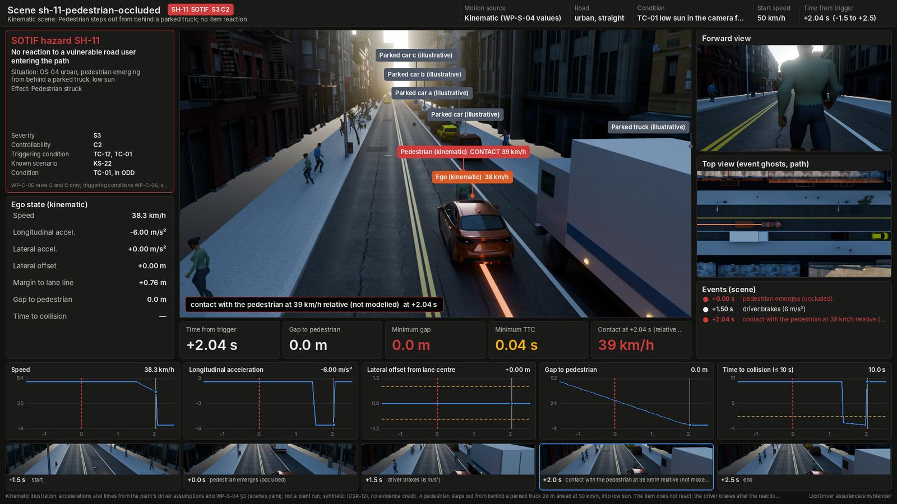

# Hazardous-event scenes in Blender

| Field | Value |
|---|---|
| Scope | A 3D scene and a review dashboard for every HARA hazardous event (38 HE-, WP-C-03) and every SOTIF hazard (12 SH-, WP-C-05, with its triggering conditions from WP-C-06 and known scenarios from WP-V-03) |
| Version | 0.6 (2026-10-19): nine edge-case scenes from the failure search, each reproducing a row of the [edge-case catalogue](../results/edge-cases.md) (`edge_case:`), rendered with the silhouette stand-in car; four library environments for SOTIF triggering conditions (TC-15 crosswind, TC-18 tunnel, TC-31 exit split, TC-32 narrow lane beside a truck) with tunnel, gore and windsock props; the gallery keeps a committed dashboard whose render is not in `out/`. 0.5 (2026-10-19): gallery re-rendered with the CC0 assets (all 90 dashboards, the 40 condition variants included; silhouette stand-in car, the Corolla mesh was not available), committed at JPEG quality 75; a dashboard without contact shows the driver's response rather than an earlier item or lead braking. 0.4 (2026-10-18): scanned CC0 plants (Poly Haven trees, shrubs and verge grass, with snow under W05) in place of the procedural trees when fetched; dry patches and mowing rows in the fields; urban streets with fewer, kerbside street trees, 8 m lamp columns, bus shelters and scanned bins, benches, hydrants and street cabinets, kept clear of every pedestrian, cyclist and junction. 0.3 (2026-10-18): scene library (environments, HARA weather codes and low sun, traffic presets, CC0 assets with a procedural fallback); 40 condition variants; richer procedural road, grass, trees and road furniture. 0.2 (2026-10-18): all HEs and SOTIF hazards, kinematic scenes, the purchased Corolla mesh on every car, rural and urban roads, props, night and wet road. 0.1 (2026-10-18): three plant scenes |
| Status | Draft. AI-drafted (Claude, AI assistant; I0 under WP-M-02 §3.3); not reviewed. Synthetic (DSR-12): **pictures only, no evidence credit** |
| Feeds | Review of the HARA, the SOTIF analysis and the WP-V-03 scenarios; figures. Nothing in the safety case |

**Gallery: [dashboards/README.md](dashboards/README.md)**, one dashboard per scene with its outcome. **Library:
[library/README.md](library/README.md)**: every scene is an environment, a condition (W01 to W06, TC-01) and traffic,
so the same event can be drawn under each condition it is rated for.



## 1. What a scene shows, and what it does not

Each scene names its motion source on the dashboard.

| Source | Used for | What it is | What it is not |
|---|---|---|---|
| **Plant** | 26 scenes (and their condition variants): every HE whose situation the highway plant can represent, including variants of a catalog case (speed, road, engagement, a mirrored fault) and of its assumptions (a driver who does not react) | The ego's motion and the panda and driver events from a [layer-1 plant](../plant/) run: the real panda safety code in the loop, under the assumptions in [plant-results.md](../results/plant-results.md); in longitudinal cases the plant's own lead and follower | A measurement; a model of the EPS, the PCM or the driver beyond the stated assumptions; tyre limits (the tyre model is linear: HE-04.2 on a wet road shows the dry-road motion) |
| **Kinematic** | 23 scenes (and their condition variants): urban, rural and pedestrian situations, perception insufficiencies, override and mode-confusion events the plant does not model | Piecewise-constant accelerations and a lateral law. Every time and acceleration in [`scenes.yaml`](scenes.yaml) is a number or a named assumption from [`export_scene.py`](export_scene.py): the plant's driver assumptions (reaction 1.5 s, lateral cue 0.2 m, longitudinal cue 1 m/s²) and WP-S-04 §3 values (envelope +2.0 / -3.5 m/s², driver braking to 6 m/s², PCS 6 m/s², envelope torque about 1.99 m/s²) | A run of the item: no panda code, no controller. It shows the hazardous behaviour the entry describes and what the stated driver does about it |

Road users the scene adds without simulating them are marked **illustrative**. Neither source models contact: at
the first overlap of two body outlines (or the body and the barrier, or a cone) the scene freezes, records the relative
speed and ends half a second later; the dashboard says "not modelled". Layer 1 has no perception, so the dashboard has
no perception, camera-detection or sensor-fusion panel; a triggering condition (low sun, night, faded markings, an
occluding truck, an overpass, cones) is drawn in the scene, not simulated.

## 2. Pipeline

| Step | Script | Runs in | Writes (under `out/<scene>/`, git-ignored) |
|---|---|---|---|
| 0 (optional) | [`fetch_assets.py`](fetch_assets.py) | Python; network access to Poly Haven and ambientCG | CC0 HDRIs, textures, scanned plants and street furniture under `assets/library/` (git-ignored); [`library/assets.lock.json`](library/README.md#4-cc0-assets) (committed). Without them the scenes use the procedural look |
| 1 | [`export_scene.py`](export_scene.py) | the track's Python (the plant needs `opendbc_repo`, `panda`, [`../requirements.txt`](../requirements.txt)) | `scene.json`: the scene resolved through the [library](library/README.md) (road cross-section, props, condition, traffic), poses at 24 fps, signals, gap and TTC, events, the HARA or SOTIF entry |
| 2 | [`hazard_scene.py`](hazard_scene.py) with [`scene_assets.py`](scene_assets.py) and [`street_layout.py`](street_layout.py) | Blender 4.2+ (`blender -b -P`) or Python 3.13 with `pip install bpy` | `scene.blend` (animated, three cameras), `screen.json`, `stills/`, `frames/` with `--video` |
| 3 | [`compose.py`](compose.py) | Python with Pillow; ffmpeg for `--video` | `dashboard/`, `dashboard.png`, `<scene>.mp4` |
| 4 | [`gallery.py`](gallery.py) | Python with Pillow | [`dashboards/`](dashboards/README.md) (committed) |

```sh
python3 assurance/sim/blender/export_scene.py                                   # all scenes (about 8 s)
blender -b -P assurance/sim/blender/hazard_scene.py -- assurance/sim/blender/out/sh-11-pedestrian-occluded/scene.json --stills
python3 assurance/sim/blender/compose.py assurance/sim/blender/out/sh-11-pedestrian-occluded
python3 assurance/sim/blender/gallery.py
python3 assurance/sim/blender/test_scenes.py                                    # CI: every HE has a scene; all export; library, variant and street-furniture checks
python3 assurance/sim/blender/test_fetch_assets.py                              # CI: fetch_assets.py against fake API answers
```

Rendering is Cycles on the CPU, so it runs headless without a GPU: with the CC0 assets, 2.5 to 12 minutes per
scene for its key-event stills (mean about 6; three cameras, 16 samples, 4 cores; weather variants take longest),
so the whole gallery takes about 9 hours; a clip (`--video`) takes about ten times as long.

## 3. The cars

Every car is the purchased Corolla E210 mesh when `assets/1450755-gltf-extended.glb` is present (or `--vehicle PATH`,
or `LIONDRIVER_VEHICLE_GLB`): imported once, centred on the ground, turned to face forward (front found from the lower
bonnet end; override with `--front`), and instanced per road user with its own body paint. The ego is orange-red; the
plant's lead and follower are blue. Without the GLB, cars are a stand-in lofted from the committed outline
[`../figures/corolla-e210-silhouette.json`](../figures/corolla-e210-silhouette.json). Pedestrians are the two
CC0 Quaternius figures of [library/people/](library/people/README.md), walking with a scanned walk cycle played by the
distance walked (the procedural figure when the files are missing); trucks and cyclists are procedural. The GLB is a Git LFS file in the private `jherrodthomas/LionDriver-assets`
(sha256 `1dc000e5…8216`): GitHub's "Download ZIP" holds only the LFS pointer, so fetch the file itself. Renders made
with it may be published; a `scene.blend` made with it holds the licensed mesh and stays private
([assets/README.md](../assets/README.md)).

## 4. The plant extensions the scenes use

Two additions to [`../plant/`](../plant/), used only by these scenes (no catalog case uses them, and
`report.py --check` is unchanged): the fault kind `hardover_left` (the mirror of `hardover`, for a departure toward
oncoming traffic, HE-01.1) and the road `rcurve@<a_y>` (a right curve, for going straight on toward the oncoming lane,
HE-02.2). The failure search ([`../search/`](../search/families.yaml)) added more, all off by default and used by the
edge-case scenes through `case_overrides` and `assumptions`: the road `arc@<a_y>:<L>` (a curve with an exit); the case
fields `fault_clear`, `clear_after_correction`, `fault2` and `fault2_gap` (a fault that clears, and a second one),
`lane_change` and `lane_change_s` (an assisted lane change to the left) and `ay_disturbance` (a steady crosswind or
bank, TC-15); and the driver-model options of `simulate.DRIVER_OPTIONS` (a wrong-direction first correction,
over-correction, a lag in feeling the item's torque, braking instead of steering). An edge-case scene names its
catalogue row with `edge_case:`, and `search/test_search.py` checks that it reproduces the row's rho.

## 5. Adding a scene

Add an entry to [`scenes.yaml`](scenes.yaml) (its header lists every field) with an `environment`, and a `conditions`
and `traffic` if not the defaults. Add `variants` for the other conditions the hazardous event is rated under where
the HARA model changes its rating for them (snow or ice raises C; wet or heavy rain changes braking in a curve; heavy
rain and fog raise C for lost deceleration), or where the condition is a triggering condition of the SOTIF hazard.
Run the four steps for it, and check `test_scenes.py`. Prefer a plant case whose fault and road match the entry; use a kinematic scene only where the plant
cannot represent the situation, and write every time and acceleration as a named assumption where one exists.
